# Place data in the Dashboard consumer

Static source interpretation. Declared interactions do not establish runtime routing.

Source freshness: STALE. Meaning review: UNASSESSED.

Content revisions: {"dashboard":"7e602ace02c04006fb7b2a2f5ecd88ba3c4005c6","forecasts":"c289b28be4819eddf29d59a7c12f178559ec5229","places":"c289b28be4819eddf29d59a7c12f178559ec5229"}

Target revisions: {"dashboard":"7e602ace02c04006fb7b2a2f5ecd88ba3c4005c6","forecasts":"c289b28be4819eddf29d59a7c12f178559ec5229","places":"c289b28be4819eddf29d59a7c12f178559ec5229"}

## Place data in the Dashboard consumer

Dashboard source parses message.value and validates the event before calling applyEvent. Parse or validation errors are caught, recorded in rejected_messages with reason INVALID_EVENT, followed by an offset-plus-one commit and return. applyEvent records event.id in inbox; duplicates commit and return without a card write. Otherwise it upserts weather_cards: forecast updates store place fields and forecast JSON, updating an existing card only when stored updated_at is null or the incoming value is later; the other branch writes place fields only. The transaction commits on success and rolls back and rethrows on error. The supplied source does not identify a configured or resolved database destination. The linked process component is stale, and runtime lineage and authoritative Place ownership remain unverified.

```mermaid
flowchart LR
    %% Static entity data flow; not a runtime trace or universal taint analysis.
    %% node place-domain: dependencies entity:weather-place
    n0["domain: Place"]
    %% node message-value: dependencies dashboard:symbol:a4627e5e868830287e83e0dc,entity:weather-place
    n1["message: consumeMessage reads message.value from its payload before parsing it."]
    %% node parsed-event: dependencies dashboard:flow:1198b0d44dde70fcd80329fc,dashboard:symbol:a4627e5e868830287e83e0dc,entity:weather-place
    n2["message: The parsed JSON value is passed to validateEvent."]
    %% node event-place: dependencies dashboard:symbol:021fcd0ff7baa53bd3c51930,entity:weather-place
    n3["field: The validator reads event.place.id, name, latitude, and longitude."]
    %% node validate-event: dependencies dashboard:symbol:021fcd0ff7baa53bd3c51930,dashboard:symbol:7d0d09a16ac25de86e5beb53,entity:weather-place
    n4["function: validateEvent checks the event id and version, place fields, and topic-specific fields; unsupported topics throw."]
    %% node validated-event: dependencies dashboard:symbol:021fcd0ff7baa53bd3c51930,entity:weather-place
    n5["dto: validateEvent returns the event after its checks pass."]
    %% node apply-event: dependencies dashboard:symbol:ac3aadb76be6fea3e790cb85,entity:weather-place
    n6["function: applyEvent opens a transaction, skips the card write for duplicate event ids, and otherwise performs a card upsert."]
    %% node weather-cards: dependencies dashboard:symbol:ac3aadb76be6fea3e790cb85,entity:weather-place
    n7["table: The upserts map place id, name, latitude, and longitude to weather_cards; forecast updates also store updated_at and forecast JSON."]
    %% edge domain-event-place: dependencies entity:weather-place
    n0 -.->|"candidate / UNKNOWN: The declared entity record proposes event.place as a stored-copy representation of Place."| n3
    %% edge domain-weather-cards: dependencies entity:weather-place
    n0 -.->|"candidate / UNKNOWN: The declared entity record proposes weather_cards as a stored-copy representation of Place."| n7
    %% edge parse-message: dependencies dashboard:flow:1198b0d44dde70fcd80329fc,dashboard:symbol:a4627e5e868830287e83e0dc,entity:weather-place
    n1 -->|"transform / SOURCE_INTERPRETATION: consumeMessage converts message.value to a string, defaults a missing value to an empty string, and parses it as JSON."| n2
    %% edge read-event-place: dependencies dashboard:symbol:021fcd0ff7baa53bd3c51930,entity:weather-place
    n2 -->|"read / SOURCE_INTERPRETATION: validateEvent reads event.place and its id, name, latitude, and longitude fields."| n3
    %% edge validate-place: dependencies dashboard:symbol:021fcd0ff7baa53bd3c51930,entity:weather-place
    n3 -->|"read / SOURCE_INTERPRETATION: validateEvent requires a present place, a string id in oslo, helsinki, or lisbon, a string name, and finite latitude and longitude."| n4
    %% edge return-validated-event: dependencies dashboard:symbol:021fcd0ff7baa53bd3c51930,dashboard:symbol:7d0d09a16ac25de86e5beb53,entity:weather-place
    n4 -->|"transform / SOURCE_INTERPRETATION: validateEvent returns the event after its base and topic-specific checks pass. Forecast updates also require valid timestamps, an allowed mode, one to six periods, and valid period fields."| n5
    %% edge pass-to-apply: dependencies dashboard:flow:37dec2bf70bc69d603cb8d4b,dashboard:symbol:a4627e5e868830287e83e0dc,entity:weather-place
    n5 -->|"read / SOURCE_INTERPRETATION: After validation returns, consumeMessage calls applyEvent with the event."| n6
    %% edge write-weather-cards: dependencies dashboard:symbol:ac3aadb76be6fea3e790cb85,entity:weather-place
    n6 -->|"write / SOURCE_INTERPRETATION: For a nonduplicate event, applyEvent upserts place id, name, latitude, and longitude into weather_cards. Forecast updates also store updated_at and forecast JSON; an existing card is updated only when its stored updated_at is null or the incoming value is later. The other branch writes place fields only."| n7
```

<details>
<summary>Implementation details</summary>



</details>

## dashboard-place-lineage

Documentation gap: Outside the requested work entrypoint.


## Saved entity data-flow view

Static source interpretation, not a runtime trace or universal taint analysis. Name-only matches remain unknown candidates.

Requested scope: Dashboard.consumeMessage, validateEvent and applyEvent; event.place and weather_cards only.

| Node | Domain identity | Representation kind | Representation |
| --- | --- | --- | --- |
| place-domain | entity:weather-place | domain | entity:weather-place |
| message-value | entity:weather-place | message | message.value |
| parsed-event | entity:weather-place | message | Parsed event JSON |
| event-place | entity:weather-place | field | event.place |
| validate-event | entity:weather-place | function | validateEvent |
| validated-event | entity:weather-place | dto | Event returned by validateEvent |
| apply-event | entity:weather-place | function | applyEvent |
| weather-cards | entity:weather-place | table | weather_cards |

| Edge | Kind / authority | Explanation and uncertainty |
| --- | --- | --- |
| place-domain → event-place | candidate / UNKNOWN | The declared entity record proposes event.place as a stored-copy representation of Place. This proposed mapping does not prove authoritative ownership or runtime lineage. |
| place-domain → weather-cards | candidate / UNKNOWN | The declared entity record proposes weather_cards as a stored-copy representation of Place. This proposed mapping does not prove authoritative ownership or runtime lineage. |
| message-value → parsed-event | transform / SOURCE_INTERPRETATION | consumeMessage converts message.value to a string, defaults a missing value to an empty string, and parses it as JSON. This source path does not prove runtime delivery or activation. |
| parsed-event → event-place | read / SOURCE_INTERPRETATION | validateEvent reads event.place and its id, name, latitude, and longitude fields.  |
| event-place → validate-event | read / SOURCE_INTERPRETATION | validateEvent requires a present place, a string id in oslo, helsinki, or lisbon, a string name, and finite latitude and longitude.  |
| validate-event → validated-event | transform / SOURCE_INTERPRETATION | validateEvent returns the event after its base and topic-specific checks pass. Forecast updates also require valid timestamps, an allowed mode, one to six periods, and valid period fields.  |
| validated-event → apply-event | read / SOURCE_INTERPRETATION | After validation returns, consumeMessage calls applyEvent with the event. This call is shown in source; runtime invocation is unverified. |
| apply-event → weather-cards | write / SOURCE_INTERPRETATION | For a nonduplicate event, applyEvent upserts place id, name, latitude, and longitude into weather_cards. Forecast updates also store updated_at and forecast JSON; an existing card is updated only when its stored updated_at is null or the incoming value is later. The other branch writes place fields only. This is source interpretation; runtime execution is unverified. |

### Protected human annotations and layout

```json
{
  "annotations": {},
  "layout": {},
  "metadata": {},
  "tags": []
}
```
