# Dashboard

Static source interpretation. Declared interactions do not establish runtime routing.

## Overview

Describe the service purpose, scope and supported outcomes.

Documentation gap: source-bound section content has not been accepted.

## Responsibilities

Describe responsibilities and exclusions from evidence; business intent may need a human note.

Documentation gap: source-bound section content has not been accepted.

## Domain entities

Identify domain concepts separately from DTOs and storage classes; ownership needs an explicit declaration.

Documentation gap: source-bound section content has not been accepted.

## Ingress contracts

Document discovered public boundaries and declared contracts; retain gaps for unsupported discovery.

Documentation gap: source-bound section content has not been accepted.

## Egress contracts

Document external calls and messages; unresolved destinations and runtime activation remain gaps.

Documentation gap: source-bound section content has not been accepted.

## consumeMessage static execution flow

Kind: execution-flow. Source interpretation, not runtime proof.

Show the captured handler order through rejection or application, keeping database work and offset commits separate.

Scope: Static behavior of consumeMessage and the delivered validateEvent and applyEvent bodies.

- EachMessagePayload supplied to consumeMessage.
- Function consumeMessage.
- Parse the value and validate the event against its topic.
- Catch a parse or validation throw.
- Insert a rejected_messages record with reason INVALID_EVENT.
- Commit the next topic and partition offset after the rejection insert resolves.
- Return before applyEvent.
- Await applyEvent with the validated event.
- Acquire a database client before the helper try block.
- Connection acquisition rejects before the helper rollback catch and release finally.
- Begin the database transaction and insert event_id into inbox.
- Commit and return DUPLICATE when the inbox insert returns no row.
- Run the forecast or place weather_cards upsert.
- Commit the applyEvent database transaction.
- Commit the supplied topic and partition at offset plus one.
- For an in-try error, await ROLLBACK and then rethrow if that await resolves; finally release the acquired client.
- A rejected applyEvent call does not reach the handler&#39;s later offset commit.
- Supply EachMessagePayload to consumeMessage.
- Read the optional message value, parse it, and call validateEvent with the topic.
- A parse or validation throw enters the catch branch.
- A validated event is passed to applyEvent.
- Await the rejected_messages insert with generic reason INVALID_EVENT.
- After the insert resolves, await the next-offset commit.
- Return before applyEvent.
- applyEvent awaits pool.connect before its try block.
- After connection acquisition, begin the transaction and insert event_id into inbox.
- If pool.connect rejects, the helper&#39;s try, rollback catch, and release finally are not entered.
- The rejected applyEvent call prevents consumeMessage from reaching its later offset commit.
- If the insert returns rowCount zero, commit and return DUPLICATE.
- A newly inserted inbox row proceeds to the forecast or place upsert.
- The resolved helper call is followed by the handler&#39;s next-offset commit.
- After its upsert, applyEvent commits the database transaction and returns a rowCount-based status.
- After applyEvent resolves, consumeMessage awaits the next-offset commit.
- An error caught inside the helper try leads to an awaited ROLLBACK attempt, rethrow, and client release in finally.
- An error caught inside the helper try leads to an awaited ROLLBACK attempt, rethrow, and client release in finally.
- The rejected applyEvent call prevents consumeMessage from reaching its later offset commit.

Limit: This diagram interprets captured source control flow; it is not an observed runtime trace.

Limit: Framework activation, consumer configuration, resolved pool or consumer targets, and deployed delivery are not established.

Limit: The rejected_messages insert, applyEvent transaction, and consumer offset commit are distinct operations.

Limit: Failures of the rejection query and commitOffsets have no local catch in the delivered handler. The applyEvent connection-acquisition and in-try error paths are shown separately.
## consumeMessage local dependencies

Kind: dependency-map. Source interpretation, not runtime proof.

Map the local handler, helper, input, SQL table, and offset-commit relationships visible in source.

Scope: Relationships in the captured consumeMessage, validateEvent, and applyEvent source.

- EachMessagePayload input.
- Function consumeMessage.
- Function validateEvent.
- Table named rejected_messages in the insert statement.
- Function applyEvent.
- Table named inbox in the event_id insert.
- Table weather_cards in the forecast and place upserts.
- Call site consumer.commitOffsets.
- Handler receives topic, partition, and message fields.
- Reads and parses message.value, then validates with the topic.
- The parse and validation catch writes a rejection record.
- Passes a validated event to applyEvent.
- Inserts event_id into inbox with ON CONFLICT DO NOTHING.
- Writes weather_cards through its forecast or place SQL branch.
- Calls commitOffsets after the rejection insert or after applyEvent resolves.

Limit: These edges show local source relationships, not execution order; use the execution-flow view for ordering.

Limit: The pool and consumer runtime configuration and resolved targets are not shown.

Limit: No cross-service transfer is asserted.

Limit: The consumer target and configuration are not delivered.

Limit: The captured bodies do not show consumer configuration or its resolved runtime target.
## applyEvent database outcome selection

Kind: decision-table. Source interpretation, not runtime proof.

Select applyEvent&#39;s database outcome after consumeMessage has validated and passed an event to it.

Scope: Covers the inbox duplicate check and weather_cards branches reached after validation.

- The inbox insert returns rowCount zero because event_id already exists.
- Commit the helper transaction, return DUPLICATE, and skip weather_cards writes. If the helper resolves, consumeMessage still attempts its next-offset commit.
- A new inbox row is inserted for a validated forecast.updated event, and no weather_cards row exists for the place_id.
- The INSERT creates a card using the place fields; forecast.updatedAt supplies updated_at and JSON.stringify(event.forecast) supplies forecast. Commit, then map nonzero result.rowCount to APPLIED.
- A new forecast event conflicts on place_id and the stored weather_cards.updated_at is null, or incoming event.forecast.updatedAt is strictly greater than the stored updated_at.
- The SQL conflict update is allowed and sets name, latitude, longitude, updated_at, and forecast from the incoming event. Commit, then map nonzero result.rowCount to APPLIED.
- A new forecast event conflicts on place_id, stored updated_at is nonnull, and incoming event.forecast.updatedAt is equal to or earlier than the stored value.
- The strict greater-than WHERE predicate prevents the card update, leaving its fields unchanged. The inbox row is still committed; result.rowCount zero maps to OLDER_OR_EQUAL.
- A new inbox row is inserted for a validated place.requested event, taking the helper&#39;s else branch.
- Upsert place id, name, and coordinates. The conflict update list does not assign forecast. Commit; the helper maps result.rowCount zero to OLDER_OR_EQUAL and nonzero to APPLIED.
- FIRST follows applyEvent&#39;s source order: the inbox duplicate early exit precedes the forecast if and its place else branch. The forecast SQL predicate then selects update or no-op within that branch. This is a source interpretation, not verified DMN execution.
- The rejection insert is awaited before its offset commit; if it rejects, that later commit is not reached. pool.connect occurs before applyEvent&#39;s try, so its rejection bypasses the helper rollback catch and release finally. Errors caught inside the helper try cause an awaited ROLLBACK attempt and rethrow if rollback resolves; the acquired client is released in finally. Because consumeMessage awaits applyEvent outside its parse and validation catch, a rejected helper prevents the later offset commit. The captured handler shows no local catch for commitOffsets failures.

Limit: FIRST interprets the helper&#39;s ordered duplicate check and forecast if/place else selection; it is not verified executable DMN.

Limit: This table starts after successful validation. Invalid input handling and offset commits are outside the selection.
Source freshness: UNVERIFIED. Meaning review: UNASSESSED.

Content revisions: {"dashboard":"7e602ace02c04006fb7b2a2f5ecd88ba3c4005c6","forecasts":"c289b28be4819eddf29d59a7c12f178559ec5229","places":"c289b28be4819eddf29d59a7c12f178559ec5229"}

Target revisions: {"dashboard":"7e602ace02c04006fb7b2a2f5ecd88ba3c4005c6","forecasts":"c289b28be4819eddf29d59a7c12f178559ec5229","places":"c289b28be4819eddf29d59a7c12f178559ec5229"}

## consumeMessage event handling and commits

A validated place.requested event upserts place details; a validated forecast.updated event updates its card only when the card is missing, its stored updated_at is null, or the incoming forecast.updatedAt is strictly newer. A duplicate inbox event skips card writes. Parse or validation failures instead write a generic rejection record. The rejection insert, applyEvent database transaction, and Kafka offset commits are separate operations; each offset commit follows its awaited database action. The captured source does not establish activation or deployed delivery.

Call the recorded consumeMessage entrypoint with an EachMessagePayload. The captured source does not establish its framework trigger or deployed delivery.

User documentation by gpt-6-luna (max); preserved accepted proposal text. Meaning review: UNASSESSED. Originally linked code is retained unverified context (source snapshot sha256:cd128dab5185ee06165da23afe31d75586b018ecdbe77d51b8c6bb3c178547b3/162173).

Inside the try, parse the message value, using an empty string when it is absent, then validate the parsed value with the topic. A parse or validation throw takes the rejection branch; otherwise the validated event is applied.

If parsing and validation complete without throwing, consumeMessage awaits applyEvent(event). The helper&#39;s database outcomes are shown in the linked decision table; its returned status is ignored.

After applyEvent resolves, await commitOffsets for the supplied topic and partition at the decimal offset plus one.

The source describes an alternative branch.

On a parse or validation throw, await the rejected_messages insert with the supplied topic, partition, and offset and generic reason INVALID_EVENT. The insert uses ON CONFLICT DO NOTHING.

After that insert resolves, await commitOffsets at the supplied topic and partition and offset plus one.

Return early after the rejection insert and offset commit; applyEvent is skipped.

Rejected input is handled separately from event deduplication: the handler writes rejected_messages in its parse and validation catch, while applyEvent uses an inbox transaction. The rejection insert is an awaited pool.query and is not shown inside that helper transaction.

applyEvent can resolve with DUPLICATE, OLDER_OR_EQUAL, or APPLIED, but consumeMessage discards that value. A duplicate skips card writes; a forecast freshness no-op still follows the inbox insert with a database COMMIT, after which the handler attempts its separate offset commit.

pool.connect is awaited before applyEvent enters its try block. If connection acquisition rejects, its ROLLBACK catch and release finally are bypassed. For errors caught inside the try, the helper awaits a ROLLBACK attempt and then rethrows if that await resolves; once a client was acquired, finally calls client.release. consumeMessage awaits applyEvent outside its parse and validation catch, so a rejected helper prevents the later offset commit. Rejection-query and commitOffsets failures also have no local catch in the captured handler.

### consumeMessage inputs and outcomes

Source-derived payload interface description.

| Element | Value / behavior |
|---|---|
| Handler input and decoding | consumeMessage receives an EachMessagePayload and reads topic, partition, and message. It converts message.value with toString(); a missing value becomes an empty string before JSON.parse. |
| Common event fields | validateEvent requires an object, string id, version 1, a place with a string id from oslo, helsinki, or lisbon, a string place name, and finite latitude and longitude. These captured checks do not impose coordinate ranges. |
| Forecast event | On weather.forecast-updated, type must be forecast.updated. The forecast timestamps must pass isTimestamp, mode must be fixture or live, and periods must contain 1 to 6 entries. Each period needs a passing time check, finite temperatureC, precipitationMm that is null or finite and nonnegative, and a string symbol. |
| Place event and unsupported topics | On weather.place-requested, type must be place.requested and forecast must be undefined. Other topics throw UNKNOWN_TOPIC. Parse and validation errors are caught by consumeMessage and recorded with the generic reason INVALID_EVENT. |
| Rejected input outcome | For a parse or validation error, consumeMessage awaits an insert into rejected_messages with topic, partition, offset, and reason INVALID_EVENT, using ON CONFLICT DO NOTHING. If that query resolves, it commits the supplied topic and partition at BigInt(message.offset) + 1, converted to a string, then returns. The handler returns no applyEvent status. |
| Applied input outcome | After validation, consumeMessage awaits applyEvent and ignores its returned status. If applyEvent resolves, the handler commits the next offset. A rejected applyEvent call prevents that later offset commit from being reached. |

The isTimestamp implementation is not delivered, so accepted timestamp syntax is unknown.

```mermaid
sequenceDiagram
    autonumber
    %% Agent-interpreted static source; declared edges are not compiler calls.
    participant caller as Caller
    participant service-dashboard as dashboard
    %% claim-ff3791dcc1ad16ce5481: dependencies dashboard:symbol:a4627e5e868830287e83e0dc, entity:weather-place
    caller->>service-dashboard: Call the recorded consumeMessage entrypoint with an EachMessagePayload. The captured source does not establish its framework trigger or deployed delivery.
    %% claim-a31383d61462fd30cbdd: dependencies dashboard:flow:1198b0d44dde70fcd80329fc, dashboard:flow:886390b176392fdbad06fc3a, dashboard:flow:a190efb9bca6603f1d2abc58, dashboard:symbol:021fcd0ff7baa53bd3c51930, dashboard:symbol:a4627e5e868830287e83e0dc, entity:weather-place
    alt Inside the try, parse the message value, using an empty string when it is absent, then validate the parsed value with the topic. A parse or validation throw takes the rejection branch&#59; otherwise the validated event is applied.
    %% claim-b677530698176aeef8a5: dependencies dashboard:flow:1198b0d44dde70fcd80329fc, dashboard:flow:37dec2bf70bc69d603cb8d4b, dashboard:flow:886390b176392fdbad06fc3a, dashboard:symbol:021fcd0ff7baa53bd3c51930, dashboard:symbol:a4627e5e868830287e83e0dc, dashboard:symbol:ac3aadb76be6fea3e790cb85, entity:weather-place
    Note over caller: If parsing and validation complete without throwing, consumeMessage awaits applyEvent(event). The helper's database outcomes are shown in the linked decision table&#59; its returned status is ignored.
    %% claim-251bb6edb4bdd3ee96c9: dependencies dashboard:flow:5f3ddc5ec529c16f3f1143f8, dashboard:flow:667235490ded3f35c51f99f1, dashboard:flow:8a4f6855cb7f1a476a0484e4, dashboard:symbol:a4627e5e868830287e83e0dc, entity:weather-place
    Note over caller: After applyEvent resolves, await commitOffsets for the supplied topic and partition at the decimal offset plus one.
    %% claim-5b5724ea963a95a69429: dependencies dashboard:flow:1198b0d44dde70fcd80329fc, dashboard:flow:886390b176392fdbad06fc3a, dashboard:flow:a190efb9bca6603f1d2abc58, dashboard:symbol:021fcd0ff7baa53bd3c51930, dashboard:symbol:a4627e5e868830287e83e0dc, entity:weather-place
    else Otherwise
    %% claim-4986ed8cb5304e1e2a6a: dependencies dashboard:flow:59f03a0653cc7a3798b8ceaf, dashboard:flow:a190efb9bca6603f1d2abc58
    Note over caller: On a parse or validation throw, await the rejected_messages insert with the supplied topic, partition, and offset and generic reason INVALID_EVENT. The insert uses ON CONFLICT DO NOTHING.
    %% claim-f97db6d914e0e2424fd3: dependencies dashboard:flow:654eeebd7e0618b0c6dd58f9, dashboard:flow:667235490ded3f35c51f99f1, dashboard:flow:a190efb9bca6603f1d2abc58
    Note over caller: After that insert resolves, await commitOffsets at the supplied topic and partition and offset plus one.
    %% claim-ab17c9c1c95d4e307f35: dependencies dashboard:flow:a190efb9bca6603f1d2abc58, dashboard:flow:f4a336f51f8e91a3da04831a, dashboard:symbol:a4627e5e868830287e83e0dc, entity:weather-place
    service-dashboard-->>caller: Return early after the rejection insert and offset commit&#59; applyEvent is skipped.
    %% claim-a5714df916ad8a958eb8: dependencies dashboard:flow:1198b0d44dde70fcd80329fc, dashboard:flow:886390b176392fdbad06fc3a, dashboard:flow:a190efb9bca6603f1d2abc58, dashboard:symbol:021fcd0ff7baa53bd3c51930, dashboard:symbol:a4627e5e868830287e83e0dc, entity:weather-place
    end
```

Implementation details

## assessment-runtime-kafka-replay

Documentation gap: Outside the requested work entrypoint.

## assessment-runtime-validator-node24

Documentation gap: Outside the requested work entrypoint.

## dashboard-1d4aa83e0d1825825971

Documentation gap: Outside the requested work entrypoint.

## dashboard-310371b6c91f276ad642

Documentation gap: Outside the requested work entrypoint.

## dashboard-32f3a8fe3000ac506a5a

Documentation gap: Outside the requested work entrypoint.

## dashboard-4301d0222c019e9d5339

Documentation gap: Outside the requested work entrypoint.

## dashboard-721012b8ddf1b26a39b9

Documentation gap: Outside the requested work entrypoint.

## dashboard-8f0c2429af695539e6cd

Documentation gap: Outside the requested work entrypoint.

## dashboard-9e8af3ed64d9d5e72548

Documentation gap: Outside the requested work entrypoint.

## dashboard-aa92fac55661297c8e9a

Documentation gap: Outside the requested work entrypoint.

## dashboard-ad968c2137fedea90215

Documentation gap: Outside the requested work entrypoint.

## dashboard-d36957b096678dbe4785

Documentation gap: Outside the requested work entrypoint.

## dashboard-f965de51f1f237949bc6

Documentation gap: Outside the requested work entrypoint.

User documentation paragraph service:dashboard/dashboard-d527a6e620a1974b0e5a/claim-a1492cfcfa17ec67d1e2: source context freshness CURRENT. Meaning review: UNASSESSED. Pinned source snapshot sha256:cd128dab5185ee06165da23afe31d75586b018ecdbe77d51b8c6bb3c178547b3/162173.

## Human note: kafka-replay.json

Classification: mixed. Period: 2026-10-13T01:19:20.188431+00:00.

Original captured text (human/imported, unverified):

<pre>{
  &quot;schema&quot;: &quot;clew-weather-runtime-observation/1.0&quot;,
  &quot;id&quot;: &quot;kafka-replay&quot;,
  &quot;origin&quot;: &quot;LOCAL_TEST_OBSERVATION&quot;,
  &quot;compilerEvidence&quot;: false,
  &quot;originalRecordSha256&quot;: &quot;caddd2d52464acb6a2fa5107473b77e1a47d94bd5101e27011382549efd87552&quot;,
  &quot;status&quot;: &quot;PASS&quot;,
  &quot;sourceCommit&quot;: &quot;8d69f2b1d4a6d9770f87c720cd665dab30081815&quot;,
  &quot;sourceHashes&quot;: {
    &quot;services/dashboard/src/main.ts&quot;: &quot;24e65777311802d2204bc41eedf3b814e869f777c2e65cb74d5c8be8c4d47e6a&quot;,
    &quot;services/dashboard/src/events.ts&quot;: &quot;a17702c69c12855a10f629ed89938eba6b4492e1b84efa9faf0e02f251ce2a2b&quot;,
    &quot;services/forecasts/src/main/kotlin/weather/Forecasts.kt&quot;: &quot;6ed6406eab325f8de2860e4fc8a0a0afca9499394732dcf9c7115bd8df711fe6&quot;,
    &quot;compose.yaml&quot;: &quot;76d5d8226d233a558b901a06887bcce216e4738778edff8462367d827169c167&quot;,
    &quot;database/init.sql&quot;: &quot;c888c357d74a2e37512309e826d90fc689be0c348fb3e1cbfe635ce5a46f879f&quot;
  },
  &quot;runnerSha256&quot;: &quot;8bfaa5d4fa467df91f7b46609bf5bd1cd561f30abcf6d635da5bfabf20930f10&quot;,
  &quot;startedAt&quot;: &quot;2026-10-13T01:19:20.188431+00:00&quot;,
  &quot;finishedAt&quot;: &quot;2026-10-13T01:19:39.261171+00:00&quot;,
  &quot;sourceUnchangedAtFinish&quot;: true,
  &quot;cases&quot;: [
    {
      &quot;case&quot;: &quot;forecast-before-place&quot;,
      &quot;pass&quot;: true,
      &quot;observed&quot;: {
        &quot;id&quot;: &quot;lisbon&quot;,
        &quot;name&quot;: &quot;Lisbon&quot;,
        &quot;latitude&quot;: 38.72,
        &quot;longitude&quot;: -9.14,
        &quot;forecast&quot;: {
          &quot;mode&quot;: &quot;fixture&quot;,
          &quot;periods&quot;: [
            {
              &quot;time&quot;: &quot;2026-10-12T21:34:59Z&quot;,
              &quot;symbol&quot;: &quot;synthetic_acceptance&quot;,
              &quot;temperatureC&quot;: 18,
              &quot;precipitationMm&quot;: 0
            }
          ],
          &quot;fetchedAt&quot;: &quot;2026-10-12T20:36:59Z&quot;,
          &quot;updatedAt&quot;: &quot;2026-10-12T20:35:59Z&quot;
        }
      },
      &quot;topicEnd&quot;: 1,
      &quot;groupSnapshot&quot;: &quot;\nGROUP                TOPIC                    PARTITION  CURRENT-OFFSET  LOG-END-OFFSET  LAG             CONSUMER-ID                                            HOST            CLIENT-ID\nweather-dashboard-v1 weather.forecast-updated 0          1               1               0               weather-dashboard-6d4f072e-edfd-4d08-9f35-6cf7f1ad7234 /172.19.0.6     weather-dashboard\nweather-dashboard-v1 weather.place-requested  0          -               0               -               weather-dashboard-6d4f072e-edfd-4d08-9f35-6cf7f1ad7234 /172.19.0.6     weather-dashboard\n&quot;
    },
    {
      &quot;case&quot;: &quot;duplicate&quot;,
      &quot;pass&quot;: true,
      &quot;inboxTimestampBefore&quot;: &quot;2026-10-13 01:19:20.860972+00&quot;,
      &quot;inboxTimestampAfter&quot;: &quot;2026-10-13 01:19:20.860972+00&quot;,
      &quot;topicEnd&quot;: 2,
      &quot;groupSnapshot&quot;: &quot;\nGROUP                TOPIC                    PARTITION  CURRENT-OFFSET  LOG-END-OFFSET  LAG             CONSUMER-ID                                            HOST            CLIENT-ID\nweather-dashboard-v1 weather.forecast-updated 0          2               2               0               weather-dashboard-6d4f072e-edfd-4d08-9f35-6cf7f1ad7234 /172.19.0.6     weather-dashboard\nweather-dashboard-v1 weather.place-requested  0          -               0               -               weather-dashboard-6d4f072e-edfd-4d08-9f35-6cf7f1ad7234 /172.19.0.6     weather-dashboard\n&quot;
    },
    {
      &quot;case&quot;: &quot;older&quot;,
      &quot;pass&quot;: true,
      &quot;inboxRows&quot;: &quot;1&quot;,
      &quot;observed&quot;: {
        &quot;id&quot;: &quot;lisbon&quot;,
        &quot;name&quot;: &quot;Lisbon&quot;,
        &quot;latitude&quot;: 38.72,
        &quot;longitude&quot;: -9.14,
        &quot;forecast&quot;: {
          &quot;mode&quot;: &quot;fixture&quot;,
          &quot;periods&quot;: [
            {
              &quot;time&quot;: &quot;2026-10-12T21:34:59Z&quot;,
              &quot;symbol&quot;: &quot;synthetic_acceptance&quot;,
              &quot;temperatureC&quot;: 18,
              &quot;precipitationMm&quot;: 0
            }
          ],
          &quot;fetchedAt&quot;: &quot;2026-10-12T20:36:59Z&quot;,
          &quot;updatedAt&quot;: &quot;2026-10-12T20:35:59Z&quot;
        }
      },
      &quot;topicEnd&quot;: 3,
      &quot;groupSnapshot&quot;: &quot;\nGROUP                TOPIC                    PARTITION  CURRENT-OFFSET  LOG-END-OFFSET  LAG             CONSUMER-ID                                            HOST            CLIENT-ID\nweather-dashboard-v1 weather.forecast-updated 0          3               3               0               weather-dashboard-6d4f072e-edfd-4d08-9f35-6cf7f1ad7234 /172.19.0.6     weather-dashboard\nweather-dashboard-v1 weather.place-requested  0          -               0               -               weather-dashboard-6d4f072e-edfd-4d08-9f35-6cf7f1ad7234 /172.19.0.6     weather-dashboard\n&quot;
    },
    {
      &quot;case&quot;: &quot;equal&quot;,
      &quot;pass&quot;: true,
      &quot;inboxRows&quot;: &quot;1&quot;,
      &quot;observed&quot;: {
        &quot;id&quot;: &quot;lisbon&quot;,
        &quot;name&quot;: &quot;Lisbon&quot;,
        &quot;latitude&quot;: 38.72,
        &quot;longitude&quot;: -9.14,
        &quot;forecast&quot;: {
          &quot;mode&quot;: &quot;fixture&quot;,
          &quot;periods&quot;: [
            {
              &quot;time&quot;: &quot;2026-10-12T21:34:59Z&quot;,
              &quot;symbol&quot;: &quot;synthetic_acceptance&quot;,
              &quot;temperatureC&quot;: 18,
              &quot;precipitationMm&quot;: 0
            }
          ],
          &quot;fetchedAt&quot;: &quot;2026-10-12T20:36:59Z&quot;,
          &quot;updatedAt&quot;: &quot;2026-10-12T20:35:59Z&quot;
        }
      },
      &quot;topicEnd&quot;: 4,
      &quot;groupSnapshot&quot;: &quot;\nGROUP                TOPIC                    PARTITION  CURRENT-OFFSET  LOG-END-OFFSET  LAG             CONSUMER-ID                                            HOST            CLIENT-ID\nweather-dashboard-v1 weather.forecast-updated 0          4               4               0               weather-dashboard-6d4f072e-edfd-4d08-9f35-6cf7f1ad7234 /172.19.0.6     weather-dashboard\nweather-dashboard-v1 weather.place-requested  0          -               0               -               weather-dashboard-6d4f072e-edfd-4d08-9f35-6cf7f1ad7234 /172.19.0.6     weather-dashboard\n&quot;
    },
    {
      &quot;case&quot;: &quot;newer-zero-temperature-unknown-rain&quot;,
      &quot;pass&quot;: true,
      &quot;observed&quot;: {
        &quot;id&quot;: &quot;lisbon&quot;,
        &quot;name&quot;: &quot;Lisbon&quot;,
        &quot;latitude&quot;: 38.72,
        &quot;longitude&quot;: -9.14,
        &quot;forecast&quot;: {
          &quot;mode&quot;: &quot;fixture&quot;,
          &quot;periods&quot;: [
            {
              &quot;time&quot;: &quot;2026-10-12T21:34:59Z&quot;,
              &quot;symbol&quot;: &quot;synthetic_acceptance&quot;,
              &quot;temperatureC&quot;: 0,
              &quot;precipitationMm&quot;: null
            }
          ],
          &quot;fetchedAt&quot;: &quot;2026-10-12T20:36:59Z&quot;,
          &quot;updatedAt&quot;: &quot;2026-10-12T20:37:59Z&quot;
        }
      },
      &quot;topicEnd&quot;: 5,
      &quot;groupSnapshot&quot;: &quot;\nGROUP                TOPIC                    PARTITION  CURRENT-OFFSET  LOG-END-OFFSET  LAG             CONSUMER-ID                                            HOST            CLIENT-ID\nweather-dashboard-v1 weather.forecast-updated 0          5               5               0               weather-dashboard-6d4f072e-edfd-4d08-9f35-6cf7f1ad7234 /172.19.0.6     weather-dashboard\nweather-dashboard-v1 weather.place-requested  0          -               0               -               weather-dashboard-6d4f072e-edfd-4d08-9f35-6cf7f1ad7234 /172.19.0.6     weather-dashboard\n&quot;
    },
    {
      &quot;case&quot;: &quot;place-arrives-later-and-generated-older-forecast&quot;,
      &quot;pass&quot;: true,
      &quot;observed&quot;: {
        &quot;id&quot;: &quot;lisbon&quot;,
        &quot;name&quot;: &quot;Lisbon&quot;,
        &quot;latitude&quot;: 38.72,
        &quot;longitude&quot;: -9.14,
        &quot;forecast&quot;: {
          &quot;mode&quot;: &quot;fixture&quot;,
          &quot;periods&quot;: [
            {
              &quot;time&quot;: &quot;2026-10-12T21:34:59Z&quot;,
              &quot;symbol&quot;: &quot;synthetic_acceptance&quot;,
              &quot;temperatureC&quot;: 0,
              &quot;precipitationMm&quot;: null
            }
          ],
          &quot;fetchedAt&quot;: &quot;2026-10-12T20:36:59Z&quot;,
          &quot;updatedAt&quot;: &quot;2026-10-12T20:37:59Z&quot;
        }
      },
      &quot;generatedForecastConsumed&quot;: &quot;1&quot;,
      &quot;topicEnd&quot;: 1,
      &quot;groupSnapshot&quot;: &quot;\nGROUP                TOPIC                    PARTITION  CURRENT-OFFSET  LOG-END-OFFSET  LAG             CONSUMER-ID                                            HOST            CLIENT-ID\nweather-dashboard-v1 weather.forecast-updated 0          6               6               0               weather-dashboard-6d4f072e-edfd-4d08-9f35-6cf7f1ad7234 /172.19.0.6     weather-dashboard\nweather-dashboard-v1 weather.place-requested  0          1               1               0               weather-dashboard-6d4f072e-edfd-4d08-9f35-6cf7f1ad7234 /172.19.0.6     weather-dashboard\n&quot;
    }
  ],
  &quot;inputs&quot;: [
    {
      &quot;topic&quot;: &quot;weather.forecast-updated&quot;,
      &quot;event&quot;: {
        &quot;id&quot;: &quot;acceptance-lisbon-7f836229-f312-4e59-881a-d709e7fbd1ee-initial&quot;,
        &quot;type&quot;: &quot;forecast.updated&quot;,
        &quot;version&quot;: 1,
        &quot;place&quot;: {
          &quot;id&quot;: &quot;lisbon&quot;,
          &quot;name&quot;: &quot;Lisbon&quot;,
          &quot;latitude&quot;: 38.72,
          &quot;longitude&quot;: -9.14
        },
        &quot;forecast&quot;: {
          &quot;updatedAt&quot;: &quot;2026-10-12T20:35:59Z&quot;,
          &quot;fetchedAt&quot;: &quot;2026-10-12T20:36:59Z&quot;,
          &quot;mode&quot;: &quot;fixture&quot;,
          &quot;periods&quot;: [
            {
              &quot;time&quot;: &quot;2026-10-12T21:34:59Z&quot;,
              &quot;temperatureC&quot;: 18,
              &quot;precipitationMm&quot;: 0,
              &quot;symbol&quot;: &quot;synthetic_acceptance&quot;
            }
          ]
        }
      }
    },
    {
      &quot;topic&quot;: &quot;weather.forecast-updated&quot;,
      &quot;event&quot;: {
        &quot;id&quot;: &quot;acceptance-lisbon-7f836229-f312-4e59-881a-d709e7fbd1ee-initial&quot;,
        &quot;type&quot;: &quot;forecast.updated&quot;,
        &quot;version&quot;: 1,
        &quot;place&quot;: {
          &quot;id&quot;: &quot;lisbon&quot;,
          &quot;name&quot;: &quot;Lisbon&quot;,
          &quot;latitude&quot;: 38.72,
          &quot;longitude&quot;: -9.14
        },
        &quot;forecast&quot;: {
          &quot;updatedAt&quot;: &quot;2026-10-12T20:35:59Z&quot;,
          &quot;fetchedAt&quot;: &quot;2026-10-12T20:36:59Z&quot;,
          &quot;mode&quot;: &quot;fixture&quot;,
          &quot;periods&quot;: [
            {
              &quot;time&quot;: &quot;2026-10-12T21:34:59Z&quot;,
              &quot;temperatureC&quot;: 18,
              &quot;precipitationMm&quot;: 0,
              &quot;symbol&quot;: &quot;synthetic_acceptance&quot;
            }
          ]
        }
      }
    },
    {
      &quot;topic&quot;: &quot;weather.forecast-updated&quot;,
      &quot;event&quot;: {
        &quot;id&quot;: &quot;acceptance-lisbon-7f836229-f312-4e59-881a-d709e7fbd1ee-older&quot;,
        &quot;type&quot;: &quot;forecast.updated&quot;,
        &quot;version&quot;: 1,
        &quot;place&quot;: {
          &quot;id&quot;: &quot;lisbon&quot;,
          &quot;name&quot;: &quot;Lisbon&quot;,
          &quot;latitude&quot;: 38.72,
          &quot;longitude&quot;: -9.14
        },
        &quot;forecast&quot;: {
          &quot;updatedAt&quot;: &quot;2026-10-12T20:34:59Z&quot;,
          &quot;fetchedAt&quot;: &quot;2026-10-12T20:36:59Z&quot;,
          &quot;mode&quot;: &quot;fixture&quot;,
          &quot;periods&quot;: [
            {
              &quot;time&quot;: &quot;2026-10-12T21:34:59Z&quot;,
              &quot;temperatureC&quot;: 99,
              &quot;precipitationMm&quot;: 0,
              &quot;symbol&quot;: &quot;synthetic_acceptance&quot;
            }
          ]
        }
      }
    },
    {
      &quot;topic&quot;: &quot;weather.forecast-updated&quot;,
      &quot;event&quot;: {
        &quot;id&quot;: &quot;acceptance-lisbon-7f836229-f312-4e59-881a-d709e7fbd1ee-equal&quot;,
        &quot;type&quot;: &quot;forecast.updated&quot;,
        &quot;version&quot;: 1,
        &quot;place&quot;: {
          &quot;id&quot;: &quot;lisbon&quot;,
          &quot;name&quot;: &quot;Lisbon&quot;,
          &quot;latitude&quot;: 38.72,
          &quot;longitude&quot;: -9.14
        },
        &quot;forecast&quot;: {
          &quot;updatedAt&quot;: &quot;2026-10-12T20:35:59Z&quot;,
          &quot;fetchedAt&quot;: &quot;2026-10-12T20:36:59Z&quot;,
          &quot;mode&quot;: &quot;fixture&quot;,
          &quot;periods&quot;: [
            {
              &quot;time&quot;: &quot;2026-10-12T21:34:59Z&quot;,
              &quot;temperatureC&quot;: 98,
              &quot;precipitationMm&quot;: 0,
              &quot;symbol&quot;: &quot;synthetic_acceptance&quot;
            }
          ]
        }
      }
    },
    {
      &quot;topic&quot;: &quot;weather.forecast-updated&quot;,
      &quot;event&quot;: {
        &quot;id&quot;: &quot;acceptance-lisbon-7f836229-f312-4e59-881a-d709e7fbd1ee-newer&quot;,
        &quot;type&quot;: &quot;forecast.updated&quot;,
        &quot;version&quot;: 1,
        &quot;place&quot;: {
          &quot;id&quot;: &quot;lisbon&quot;,
          &quot;name&quot;: &quot;Lisbon&quot;,
          &quot;latitude&quot;: 38.72,
          &quot;longitude&quot;: -9.14
        },
        &quot;forecast&quot;: {
          &quot;updatedAt&quot;: &quot;2026-10-12T20:37:59Z&quot;,
          &quot;fetchedAt&quot;: &quot;2026-10-12T20:36:59Z&quot;,
          &quot;mode&quot;: &quot;fixture&quot;,
          &quot;periods&quot;: [
            {
              &quot;time&quot;: &quot;2026-10-12T21:34:59Z&quot;,
              &quot;temperatureC&quot;: 0,
              &quot;precipitationMm&quot;: null,
              &quot;symbol&quot;: &quot;synthetic_acceptance&quot;
            }
          ]
        }
      }
    },
    {
      &quot;topic&quot;: &quot;weather.place-requested&quot;,
      &quot;event&quot;: {
        &quot;id&quot;: &quot;acceptance-lisbon-7f836229-f312-4e59-881a-d709e7fbd1ee-place-last&quot;,
        &quot;type&quot;: &quot;place.requested&quot;,
        &quot;version&quot;: 1,
        &quot;place&quot;: {
          &quot;id&quot;: &quot;lisbon&quot;,
          &quot;name&quot;: &quot;Lisbon&quot;,
          &quot;latitude&quot;: 38.72,
          &quot;longitude&quot;: -9.14
        }
      }
    }
  ],
  &quot;topicPartitions&quot;: 1
}
</pre>

Original metadata and associations
<pre>{
  &quot;classification&quot;: &quot;mixed&quot;,
  &quot;id&quot;: &quot;runtime-kafka-replay&quot;,
  &quot;metadata&quot;: {
    &quot;compilerEvidence&quot;: false,
    &quot;sourceSha256&quot;: &quot;d27da19937723e3bb0f18876946fe40afed441d3c57aca7431f6b3e83e5fa8e5&quot;
  },
  &quot;path&quot;: &quot;notes/runtime-kafka-replay.md&quot;,
  &quot;period&quot;: &quot;2026-10-13T01:19:20.188431+00:00&quot;,
  &quot;schema&quot;: &quot;codeclew-documentation-note-association/1.0&quot;,
  &quot;service&quot;: &quot;dashboard&quot;,
  &quot;tags&quot;: [
    &quot;imported-context&quot;
  ],
  &quot;targets&quot;: [
    &quot;service:dashboard/section-overview&quot;
  ],
  &quot;title&quot;: &quot;kafka-replay.json&quot;
}</pre>

Separate agent assessment: UNASSESSED.

## Human note: validator-node24.json

Classification: mixed. Period: v24.21.0.

Original captured text (human/imported, unverified):

<pre>{
  &quot;schema&quot;: &quot;clew-weather-runtime-observation/1.0&quot;,
  &quot;id&quot;: &quot;validator-node24&quot;,
  &quot;origin&quot;: &quot;LOCAL_TEST_OBSERVATION&quot;,
  &quot;compilerEvidence&quot;: false,
  &quot;originalRecordSha256&quot;: &quot;dd0db06bc40207580d6c1097e68fff4d0fe696172e7d861fe528e98468bc218a&quot;,
  &quot;status&quot;: &quot;PASSED&quot;,
  &quot;nodeVersion&quot;: &quot;v24.21.0&quot;,
  &quot;assetSha256&quot;: &quot;bed7eea5325e1108f32ce5228ddd6a5f0f08a499ee42aa7442aea583702f6057&quot;,
  &quot;officialChecksumMatched&quot;: true,
  &quot;exerciseResult&quot;: {
    &quot;status&quot;: &quot;PASSED&quot;,
    &quot;assertions&quot;: 6,
    &quot;runtime&quot;: &quot;v24.21.0&quot;
  },
  &quot;repositoryRevision&quot;: &quot;8d69f2b1d4a6d9770f87c720cd665dab30081815&quot;
}
</pre>

Original metadata and associations
<pre>{
  &quot;classification&quot;: &quot;mixed&quot;,
  &quot;id&quot;: &quot;runtime-validator-node24&quot;,
  &quot;metadata&quot;: {
    &quot;compilerEvidence&quot;: false,
    &quot;sourceSha256&quot;: &quot;0b92cf23a6811f7044e0c7a86d99c694638f63bab2f59b3376565bf1616ab2de&quot;
  },
  &quot;path&quot;: &quot;notes/runtime-validator-node24.md&quot;,
  &quot;period&quot;: &quot;v24.21.0&quot;,
  &quot;schema&quot;: &quot;codeclew-documentation-note-association/1.0&quot;,
  &quot;service&quot;: &quot;dashboard&quot;,
  &quot;tags&quot;: [
    &quot;imported-context&quot;
  ],
  &quot;targets&quot;: [
    &quot;service:dashboard/section-overview&quot;
  ],
  &quot;title&quot;: &quot;validator-node24.json&quot;
}</pre>

Separate agent assessment: UNASSESSED.

