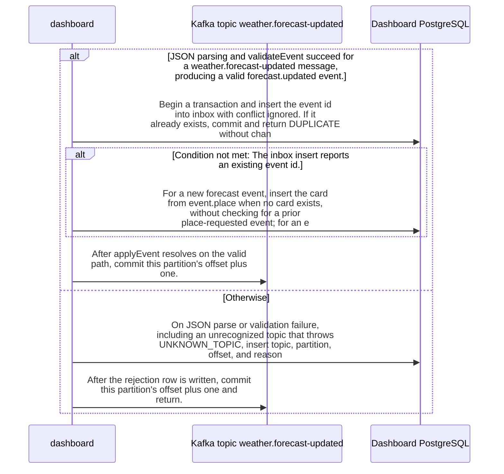

import {ClewMarkdown, ClewFieldDetails, ClewProcess, ClewDataModel, ClewDownload, ClewModelLink, ClewRelatedModelLink, ClewFieldTrace, ClewContextLink, ClewPageContext, ClewProcessReturn, ClewStatus, ClewRetainedPage, ClewCatalog, ClewAnchor} from '@site/src/components/ClewReaders';

# Dashboard consumes forecast-updated events

<ClewPageContext />

Retained account · STALE · UNASSESSED. Runtime behavior is not established by this export.

The saved process declaration proposes a weather.forecast-updated mapping to Dashboard.consumeMessage; subscription settings and runtime delivery remain unverified. For that topic, validateEvent requires a string id, version 1, an allowed place id (oslo, helsinki, lisbon), string name, finite coordinates, type forecast.updated, valid updatedAt/fetchedAt timestamps, fixture or live mode, and 1–6 periods. Each period needs a valid time, finite temperature, null or finite nonnegative precipitation, and a string symbol. Parse or validation failures, including UNKNOWN\_TOPIC, are caught, recorded as INVALID\_EVENT, and followed by offset plus one; reject-write or offset-commit errors propagate. On valid input, applyEvent inserts the id into inbox in a transaction. A duplicate commits and returns DUPLICATE without changing the card. A new forecast can insert its card directly from event.place, without a prior place-requested event; an existing card updates only when its stored timestamp is null or older, while equal or older timestamps leave it unchanged and return OLDER\_OR\_EQUAL. Connected-client transaction errors attempt rollback and release in finally; connection errors occur before the try, and either failure prevents the offset commit. The DB transaction commits before the offset, so a later offset failure can replay the message; inbox suppresses a second card update, not duplicate delivery. Runtime remains unverified.

Summary source bindings

- [services/dashboard/src/events.ts:10–29 · revision e635069293d58cb0d4f28c8211e748b8d58e6b37](../sources/afddedfc8054e8c5495b73e95e3924f7b15f90f9b73caf09d7c1b7cdda664830.mdx)
- [services/dashboard/src/main.ts:59–59 · revision e635069293d58cb0d4f28c8211e748b8d58e6b37](../sources/fb056517f94476af3c7964b81f570f4579e6b57b469923f270bb1b5b7f3ec245.mdx)
- [services/dashboard/src/main.ts:58–58 · revision e635069293d58cb0d4f28c8211e748b8d58e6b37](../sources/03b9efe6bc6d50d833e9a96c49365da011a0e4f6ed708994589122816819a21f.mdx)
- [services/dashboard/src/main.ts:53–54 · revision e635069293d58cb0d4f28c8211e748b8d58e6b37](../sources/51eb13746a4ec715b7f498f982fc29c26b082e21cf20eed410ae88e3807a0f13.mdx)
- [services/dashboard/src/main.ts:55–55 · revision e635069293d58cb0d4f28c8211e748b8d58e6b37](../sources/04307c94ed8910824028310d5a54e4062e623b9b852e4e1ed79879721fe73f84.mdx)
- [services/dashboard/src/events.ts:6–8 · revision e635069293d58cb0d4f28c8211e748b8d58e6b37](../sources/f595401e33ffe1c87198d3297a901422e3d449fe00dd98adddc17aaca283d70e.mdx)
- [services/dashboard/src/main.ts:59–59 · revision e635069293d58cb0d4f28c8211e748b8d58e6b37](../sources/596449b04f878bf0394c5492523a6a54d943d9f3a2a63e24cba4e4ca8dce043a.mdx)
- [services/dashboard/src/main.ts:50–57 · revision e635069293d58cb0d4f28c8211e748b8d58e6b37](../sources/cb1d1d3100a0984649d98da9a16956ac42fc63a19ea6841dad22f15a13784ba7.mdx)
- [services/dashboard/src/main.ts:47–60 · revision e635069293d58cb0d4f28c8211e748b8d58e6b37](../sources/c8b3521f73ba74f836cc640aa7a8cad2b6e1012251c1b736f186c06a9b475233.mdx)
- [services/dashboard/src/main.ts:15–45 · revision e635069293d58cb0d4f28c8211e748b8d58e6b37](../sources/bf524d202ba882540036918136ea088912da8bc6f340ab23d8a90bfb0aacab71.mdx)

## weather.forecast-updated message checks

| Topic | Retained contract detail |
| --- | --- |
| Topic association | The saved process proposes weather.forecast-updated as a mapping to Dashboard.consumeMessage; subscription configuration and runtime delivery remain unverified. |
| Shared event fields | validateEvent requires an object with string id, version 1, place.id in oslo, helsinki, or lisbon, string place.name, and finite place.latitude and place.longitude. |
| Forecast fields | For the weather.forecast-updated topic, type must be forecast.updated; forecast must include valid updatedAt and fetchedAt strings, mode fixture or live, and a periods array containing 1 to 6 entries. |
| Period fields | Each period must have a valid UTC time, finite temperatureC (including 0), precipitationMm that is null or finite and nonnegative, and a string symbol. |
| Timestamp check | isTimestamp accepts a UTC Z timestamp with seconds and optional fractional seconds when Date.parse returns a finite value. |
| Validation scope | These are code-level checks in validateEvent, not proof of runtime JSON Schema enforcement, subscription, or delivery. Runtime status remains UNKNOWN. |

Contract source bindings

**Topic association**

- [services/dashboard/src/main.ts:47–60 · revision e635069293d58cb0d4f28c8211e748b8d58e6b37](../sources/c8b3521f73ba74f836cc640aa7a8cad2b6e1012251c1b736f186c06a9b475233.mdx)

**Shared event fields**

- [services/dashboard/src/events.ts:10–29 · revision e635069293d58cb0d4f28c8211e748b8d58e6b37](../sources/afddedfc8054e8c5495b73e95e3924f7b15f90f9b73caf09d7c1b7cdda664830.mdx)

**Forecast fields**

- [services/dashboard/src/events.ts:10–29 · revision e635069293d58cb0d4f28c8211e748b8d58e6b37](../sources/afddedfc8054e8c5495b73e95e3924f7b15f90f9b73caf09d7c1b7cdda664830.mdx)
- [services/dashboard/src/events.ts:6–8 · revision e635069293d58cb0d4f28c8211e748b8d58e6b37](../sources/f595401e33ffe1c87198d3297a901422e3d449fe00dd98adddc17aaca283d70e.mdx)

**Period fields**

- [services/dashboard/src/events.ts:10–29 · revision e635069293d58cb0d4f28c8211e748b8d58e6b37](../sources/afddedfc8054e8c5495b73e95e3924f7b15f90f9b73caf09d7c1b7cdda664830.mdx)
- [services/dashboard/src/events.ts:6–8 · revision e635069293d58cb0d4f28c8211e748b8d58e6b37](../sources/f595401e33ffe1c87198d3297a901422e3d449fe00dd98adddc17aaca283d70e.mdx)

**Timestamp check**

- [services/dashboard/src/events.ts:6–8 · revision e635069293d58cb0d4f28c8211e748b8d58e6b37](../sources/f595401e33ffe1c87198d3297a901422e3d449fe00dd98adddc17aaca283d70e.mdx)

**Validation scope**

- [services/dashboard/src/events.ts:10–29 · revision e635069293d58cb0d4f28c8211e748b8d58e6b37](../sources/afddedfc8054e8c5495b73e95e3924f7b15f90f9b73caf09d7c1b7cdda664830.mdx)
- [services/dashboard/src/events.ts:6–8 · revision e635069293d58cb0d4f28c8211e748b8d58e6b37](../sources/f595401e33ffe1c87198d3297a901422e3d449fe00dd98adddc17aaca283d70e.mdx)

## Interaction diagram

Actors and nested branches from the retained account; not a runtime trace. Labels are shortened for readability. Full messages and notes follow.

Full original sequence, branches and notes

#### 1. note

<ClewMarkdown text={"The saved process associates weather.forecast-updated with Dashboard.consumeMessage as an agent-proposed topic mapping. It leaves topic subscription configuration and runtime delivery unverified."} />

Source bindings

- [services/dashboard/src/main.ts:47–60 · revision e635069293d58cb0d4f28c8211e748b8d58e6b37](../sources/c8b3521f73ba74f836cc640aa7a8cad2b6e1012251c1b736f186c06a9b475233.mdx)

#### 2. alt

<ClewMarkdown text={"JSON parsing and validateEvent succeed for a weather.forecast-updated message, producing a valid forecast.updated event."} />

Source bindings

- [services/dashboard/src/events.ts:10–29 · revision e635069293d58cb0d4f28c8211e748b8d58e6b37](../sources/afddedfc8054e8c5495b73e95e3924f7b15f90f9b73caf09d7c1b7cdda664830.mdx)
- [services/dashboard/src/main.ts:50–57 · revision e635069293d58cb0d4f28c8211e748b8d58e6b37](../sources/cb1d1d3100a0984649d98da9a16956ac42fc63a19ea6841dad22f15a13784ba7.mdx)
- [services/dashboard/src/main.ts:47–60 · revision e635069293d58cb0d4f28c8211e748b8d58e6b37](../sources/c8b3521f73ba74f836cc640aa7a8cad2b6e1012251c1b736f186c06a9b475233.mdx)

#### 3. note

<ClewMarkdown text={"The common envelope requires an object, string id, version 1, a place with id oslo, helsinki, or lisbon, string name, and finite latitude and longitude. The forecast branch requires updatedAt and fetchedAt accepted by isTimestamp, mode fixture or live, and a periods array of length 1 through 6. Each period requires a valid time, finite temperatureC, precipitationMm null or finite and nonnegative, and a string symbol. isTimestamp accepts a UTC ISO-like value with seconds and optional fractional seconds, and also requires Date.parse to be finite."} />

Source bindings

- [services/dashboard/src/events.ts:10–29 · revision e635069293d58cb0d4f28c8211e748b8d58e6b37](../sources/afddedfc8054e8c5495b73e95e3924f7b15f90f9b73caf09d7c1b7cdda664830.mdx)
- [services/dashboard/src/events.ts:6–8 · revision e635069293d58cb0d4f28c8211e748b8d58e6b37](../sources/f595401e33ffe1c87198d3297a901422e3d449fe00dd98adddc17aaca283d70e.mdx)

#### 4. message

<ClewMarkdown text={"Begin a transaction and insert the event id into inbox with conflict ignored. If it already exists, commit and return DUPLICATE without changing the weather card."} />

Source bindings

- [services/dashboard/src/main.ts:15–45 · revision e635069293d58cb0d4f28c8211e748b8d58e6b37](../sources/bf524d202ba882540036918136ea088912da8bc6f340ab23d8a90bfb0aacab71.mdx)

#### 5. alt

<ClewMarkdown text={"The inbox insert reports an existing event id."} />

Source bindings

- [services/dashboard/src/main.ts:15–45 · revision e635069293d58cb0d4f28c8211e748b8d58e6b37](../sources/bf524d202ba882540036918136ea088912da8bc6f340ab23d8a90bfb0aacab71.mdx)

#### 6. note

<ClewMarkdown text={"The duplicate path commits and returns DUPLICATE; consumeMessage then commits this partition's offset plus one."} />

Source bindings

- [services/dashboard/src/main.ts:59–59 · revision e635069293d58cb0d4f28c8211e748b8d58e6b37](../sources/fb056517f94476af3c7964b81f570f4579e6b57b469923f270bb1b5b7f3ec245.mdx)
- [services/dashboard/src/main.ts:59–59 · revision e635069293d58cb0d4f28c8211e748b8d58e6b37](../sources/596449b04f878bf0394c5492523a6a54d943d9f3a2a63e24cba4e4ca8dce043a.mdx)
- [services/dashboard/src/main.ts:47–60 · revision e635069293d58cb0d4f28c8211e748b8d58e6b37](../sources/c8b3521f73ba74f836cc640aa7a8cad2b6e1012251c1b736f186c06a9b475233.mdx)
- [services/dashboard/src/main.ts:15–45 · revision e635069293d58cb0d4f28c8211e748b8d58e6b37](../sources/bf524d202ba882540036918136ea088912da8bc6f340ab23d8a90bfb0aacab71.mdx)

#### 7. else

<ClewMarkdown text={"Otherwise"} />

Source bindings

- [services/dashboard/src/main.ts:15–45 · revision e635069293d58cb0d4f28c8211e748b8d58e6b37](../sources/bf524d202ba882540036918136ea088912da8bc6f340ab23d8a90bfb0aacab71.mdx)

#### 8. message

<ClewMarkdown text={"For a new forecast event, insert the card from event.place when no card exists, without checking for a prior place-requested event; for an existing card, update its place fields and forecast only when stored updated_at is null or the incoming timestamp is strictly newer."} />

Source bindings

- [services/dashboard/src/main.ts:15–45 · revision e635069293d58cb0d4f28c8211e748b8d58e6b37](../sources/bf524d202ba882540036918136ea088912da8bc6f340ab23d8a90bfb0aacab71.mdx)

#### 9. alt

<ClewMarkdown text={"The card insert or timestamp-gated update affects a row."} />

Source bindings

- [services/dashboard/src/main.ts:15–45 · revision e635069293d58cb0d4f28c8211e748b8d58e6b37](../sources/bf524d202ba882540036918136ea088912da8bc6f340ab23d8a90bfb0aacab71.mdx)

#### 10. note

<ClewMarkdown text={"Commit the transaction and return APPLIED; after applyEvent resolves, consumeMessage commits offset plus one."} />

Source bindings

- [services/dashboard/src/main.ts:59–59 · revision e635069293d58cb0d4f28c8211e748b8d58e6b37](../sources/fb056517f94476af3c7964b81f570f4579e6b57b469923f270bb1b5b7f3ec245.mdx)
- [services/dashboard/src/main.ts:59–59 · revision e635069293d58cb0d4f28c8211e748b8d58e6b37](../sources/596449b04f878bf0394c5492523a6a54d943d9f3a2a63e24cba4e4ca8dce043a.mdx)
- [services/dashboard/src/main.ts:47–60 · revision e635069293d58cb0d4f28c8211e748b8d58e6b37](../sources/c8b3521f73ba74f836cc640aa7a8cad2b6e1012251c1b736f186c06a9b475233.mdx)
- [services/dashboard/src/main.ts:15–45 · revision e635069293d58cb0d4f28c8211e748b8d58e6b37](../sources/bf524d202ba882540036918136ea088912da8bc6f340ab23d8a90bfb0aacab71.mdx)

#### 11. else

<ClewMarkdown text={"Otherwise"} />

Source bindings

- [services/dashboard/src/main.ts:15–45 · revision e635069293d58cb0d4f28c8211e748b8d58e6b37](../sources/bf524d202ba882540036918136ea088912da8bc6f340ab23d8a90bfb0aacab71.mdx)

#### 12. note

<ClewMarkdown text={"For an existing card with an equal or newer stored timestamp, the SQL update condition affects no row. The transaction still commits the inbox insert and returns OLDER_OR_EQUAL without changing the card; consumeMessage then commits offset plus one."} />

Source bindings

- [services/dashboard/src/main.ts:59–59 · revision e635069293d58cb0d4f28c8211e748b8d58e6b37](../sources/fb056517f94476af3c7964b81f570f4579e6b57b469923f270bb1b5b7f3ec245.mdx)
- [services/dashboard/src/main.ts:59–59 · revision e635069293d58cb0d4f28c8211e748b8d58e6b37](../sources/596449b04f878bf0394c5492523a6a54d943d9f3a2a63e24cba4e4ca8dce043a.mdx)
- [services/dashboard/src/main.ts:47–60 · revision e635069293d58cb0d4f28c8211e748b8d58e6b37](../sources/c8b3521f73ba74f836cc640aa7a8cad2b6e1012251c1b736f186c06a9b475233.mdx)
- [services/dashboard/src/main.ts:15–45 · revision e635069293d58cb0d4f28c8211e748b8d58e6b37](../sources/bf524d202ba882540036918136ea088912da8bc6f340ab23d8a90bfb0aacab71.mdx)

#### 13. end

<ClewMarkdown text={""} />

Source bindings

- [services/dashboard/src/main.ts:15–45 · revision e635069293d58cb0d4f28c8211e748b8d58e6b37](../sources/bf524d202ba882540036918136ea088912da8bc6f340ab23d8a90bfb0aacab71.mdx)

#### 14. end

<ClewMarkdown text={""} />

Source bindings

- [services/dashboard/src/main.ts:15–45 · revision e635069293d58cb0d4f28c8211e748b8d58e6b37](../sources/bf524d202ba882540036918136ea088912da8bc6f340ab23d8a90bfb0aacab71.mdx)

#### 15. message

<ClewMarkdown text={"After applyEvent resolves on the valid path, commit this partition's offset plus one."} />

Source bindings

- [services/dashboard/src/main.ts:59–59 · revision e635069293d58cb0d4f28c8211e748b8d58e6b37](../sources/fb056517f94476af3c7964b81f570f4579e6b57b469923f270bb1b5b7f3ec245.mdx)
- [services/dashboard/src/main.ts:58–58 · revision e635069293d58cb0d4f28c8211e748b8d58e6b37](../sources/03b9efe6bc6d50d833e9a96c49365da011a0e4f6ed708994589122816819a21f.mdx)
- [services/dashboard/src/main.ts:59–59 · revision e635069293d58cb0d4f28c8211e748b8d58e6b37](../sources/596449b04f878bf0394c5492523a6a54d943d9f3a2a63e24cba4e4ca8dce043a.mdx)
- [services/dashboard/src/main.ts:47–60 · revision e635069293d58cb0d4f28c8211e748b8d58e6b37](../sources/c8b3521f73ba74f836cc640aa7a8cad2b6e1012251c1b736f186c06a9b475233.mdx)

#### 16. else

<ClewMarkdown text={"Otherwise"} />

Source bindings

- [services/dashboard/src/events.ts:10–29 · revision e635069293d58cb0d4f28c8211e748b8d58e6b37](../sources/afddedfc8054e8c5495b73e95e3924f7b15f90f9b73caf09d7c1b7cdda664830.mdx)
- [services/dashboard/src/main.ts:50–57 · revision e635069293d58cb0d4f28c8211e748b8d58e6b37](../sources/cb1d1d3100a0984649d98da9a16956ac42fc63a19ea6841dad22f15a13784ba7.mdx)
- [services/dashboard/src/main.ts:47–60 · revision e635069293d58cb0d4f28c8211e748b8d58e6b37](../sources/c8b3521f73ba74f836cc640aa7a8cad2b6e1012251c1b736f186c06a9b475233.mdx)

#### 17. message

<ClewMarkdown text={"On JSON parse or validation failure, including an unrecognized topic that throws UNKNOWN_TOPIC, insert topic, partition, offset, and reason INVALID_EVENT into rejected_messages; ignore a duplicate rejection row."} />

Source bindings

- [services/dashboard/src/events.ts:10–29 · revision e635069293d58cb0d4f28c8211e748b8d58e6b37](../sources/afddedfc8054e8c5495b73e95e3924f7b15f90f9b73caf09d7c1b7cdda664830.mdx)
- [services/dashboard/src/main.ts:53–54 · revision e635069293d58cb0d4f28c8211e748b8d58e6b37](../sources/51eb13746a4ec715b7f498f982fc29c26b082e21cf20eed410ae88e3807a0f13.mdx)
- [services/dashboard/src/main.ts:50–57 · revision e635069293d58cb0d4f28c8211e748b8d58e6b37](../sources/cb1d1d3100a0984649d98da9a16956ac42fc63a19ea6841dad22f15a13784ba7.mdx)

#### 18. message

<ClewMarkdown text={"After the rejection row is written, commit this partition's offset plus one and return."} />

Source bindings

- [services/dashboard/src/main.ts:59–59 · revision e635069293d58cb0d4f28c8211e748b8d58e6b37](../sources/fb056517f94476af3c7964b81f570f4579e6b57b469923f270bb1b5b7f3ec245.mdx)
- [services/dashboard/src/main.ts:55–55 · revision e635069293d58cb0d4f28c8211e748b8d58e6b37](../sources/04307c94ed8910824028310d5a54e4062e623b9b852e4e1ed79879721fe73f84.mdx)
- [services/dashboard/src/main.ts:50–57 · revision e635069293d58cb0d4f28c8211e748b8d58e6b37](../sources/cb1d1d3100a0984649d98da9a16956ac42fc63a19ea6841dad22f15a13784ba7.mdx)

#### 19. note

<ClewMarkdown text={"A rejection-write or rejection-path offset-commit failure propagates. When both writes succeed, consumeMessage returns after advancing the offset."} />

Source bindings

- [services/dashboard/src/main.ts:53–54 · revision e635069293d58cb0d4f28c8211e748b8d58e6b37](../sources/51eb13746a4ec715b7f498f982fc29c26b082e21cf20eed410ae88e3807a0f13.mdx)
- [services/dashboard/src/main.ts:55–55 · revision e635069293d58cb0d4f28c8211e748b8d58e6b37](../sources/04307c94ed8910824028310d5a54e4062e623b9b852e4e1ed79879721fe73f84.mdx)
- [services/dashboard/src/main.ts:50–57 · revision e635069293d58cb0d4f28c8211e748b8d58e6b37](../sources/cb1d1d3100a0984649d98da9a16956ac42fc63a19ea6841dad22f15a13784ba7.mdx)
- [services/dashboard/src/main.ts:56–56 · revision e635069293d58cb0d4f28c8211e748b8d58e6b37](../sources/7fdaf9f2a9021a175f7a56f3d1da7a449de99be9aa83f25efd9106bc89d18e90.mdx)

#### 20. end

<ClewMarkdown text={""} />

Source bindings

- [services/dashboard/src/events.ts:10–29 · revision e635069293d58cb0d4f28c8211e748b8d58e6b37](../sources/afddedfc8054e8c5495b73e95e3924f7b15f90f9b73caf09d7c1b7cdda664830.mdx)
- [services/dashboard/src/main.ts:50–57 · revision e635069293d58cb0d4f28c8211e748b8d58e6b37](../sources/cb1d1d3100a0984649d98da9a16956ac42fc63a19ea6841dad22f15a13784ba7.mdx)
- [services/dashboard/src/main.ts:47–60 · revision e635069293d58cb0d4f28c8211e748b8d58e6b37](../sources/c8b3521f73ba74f836cc640aa7a8cad2b6e1012251c1b736f186c06a9b475233.mdx)

#### 21. note

<ClewMarkdown text={"pool.connect runs before applyEvent's try. If it fails, there is no transaction rollback or client release. Once connected, errors inside the try attempt ROLLBACK, rethrow, and release the client in finally; either error prevents consumeMessage from reaching its valid-path offset commit. The DB transaction commits before the offset commit, so an offset failure can replay the message; the inbox duplicate check prevents a second card update, but does not establish exactly-once delivery."} />

Source bindings

- [services/dashboard/src/main.ts:58–58 · revision e635069293d58cb0d4f28c8211e748b8d58e6b37](../sources/03b9efe6bc6d50d833e9a96c49365da011a0e4f6ed708994589122816819a21f.mdx)
- [services/dashboard/src/main.ts:59–59 · revision e635069293d58cb0d4f28c8211e748b8d58e6b37](../sources/596449b04f878bf0394c5492523a6a54d943d9f3a2a63e24cba4e4ca8dce043a.mdx)
- [services/dashboard/src/main.ts:50–57 · revision e635069293d58cb0d4f28c8211e748b8d58e6b37](../sources/cb1d1d3100a0984649d98da9a16956ac42fc63a19ea6841dad22f15a13784ba7.mdx)
- [services/dashboard/src/main.ts:47–60 · revision e635069293d58cb0d4f28c8211e748b8d58e6b37](../sources/c8b3521f73ba74f836cc640aa7a8cad2b6e1012251c1b736f186c06a9b475233.mdx)
- [services/dashboard/src/main.ts:15–45 · revision e635069293d58cb0d4f28c8211e748b8d58e6b37](../sources/bf524d202ba882540036918136ea088912da8bc6f340ab23d8a90bfb0aacab71.mdx)

## Implementation explanation

<ClewMarkdown text={"The saved process associates weather.forecast-updated with Dashboard.consumeMessage as an agent-proposed topic mapping. It leaves topic subscription configuration and runtime delivery unverified."} />

Source bindings

- [services/dashboard/src/main.ts:47–60 · revision e635069293d58cb0d4f28c8211e748b8d58e6b37](../sources/c8b3521f73ba74f836cc640aa7a8cad2b6e1012251c1b736f186c06a9b475233.mdx)

<ClewMarkdown text={"JSON parsing and validateEvent succeed for a weather.forecast-updated message, producing a valid forecast.updated event."} />

Source bindings

- [services/dashboard/src/events.ts:10–29 · revision e635069293d58cb0d4f28c8211e748b8d58e6b37](../sources/afddedfc8054e8c5495b73e95e3924f7b15f90f9b73caf09d7c1b7cdda664830.mdx)
- [services/dashboard/src/main.ts:50–57 · revision e635069293d58cb0d4f28c8211e748b8d58e6b37](../sources/cb1d1d3100a0984649d98da9a16956ac42fc63a19ea6841dad22f15a13784ba7.mdx)
- [services/dashboard/src/main.ts:47–60 · revision e635069293d58cb0d4f28c8211e748b8d58e6b37](../sources/c8b3521f73ba74f836cc640aa7a8cad2b6e1012251c1b736f186c06a9b475233.mdx)

<ClewMarkdown text={"The common envelope requires an object, string id, version 1, a place with id oslo, helsinki, or lisbon, string name, and finite latitude and longitude. The forecast branch requires updatedAt and fetchedAt accepted by isTimestamp, mode fixture or live, and a periods array of length 1 through 6. Each period requires a valid time, finite temperatureC, precipitationMm null or finite and nonnegative, and a string symbol. isTimestamp accepts a UTC ISO-like value with seconds and optional fractional seconds, and also requires Date.parse to be finite."} />

Source bindings

- [services/dashboard/src/events.ts:10–29 · revision e635069293d58cb0d4f28c8211e748b8d58e6b37](../sources/afddedfc8054e8c5495b73e95e3924f7b15f90f9b73caf09d7c1b7cdda664830.mdx)
- [services/dashboard/src/events.ts:6–8 · revision e635069293d58cb0d4f28c8211e748b8d58e6b37](../sources/f595401e33ffe1c87198d3297a901422e3d449fe00dd98adddc17aaca283d70e.mdx)

<ClewMarkdown text={"Begin a transaction and insert the event id into inbox with conflict ignored. If it already exists, commit and return DUPLICATE without changing the weather card."} />

Source bindings

- [services/dashboard/src/main.ts:15–45 · revision e635069293d58cb0d4f28c8211e748b8d58e6b37](../sources/bf524d202ba882540036918136ea088912da8bc6f340ab23d8a90bfb0aacab71.mdx)

<ClewMarkdown text={"The inbox insert reports an existing event id."} />

Source bindings

- [services/dashboard/src/main.ts:15–45 · revision e635069293d58cb0d4f28c8211e748b8d58e6b37](../sources/bf524d202ba882540036918136ea088912da8bc6f340ab23d8a90bfb0aacab71.mdx)

<ClewMarkdown text={"The duplicate path commits and returns DUPLICATE; consumeMessage then commits this partition's offset plus one."} />

Source bindings

- [services/dashboard/src/main.ts:59–59 · revision e635069293d58cb0d4f28c8211e748b8d58e6b37](../sources/fb056517f94476af3c7964b81f570f4579e6b57b469923f270bb1b5b7f3ec245.mdx)
- [services/dashboard/src/main.ts:59–59 · revision e635069293d58cb0d4f28c8211e748b8d58e6b37](../sources/596449b04f878bf0394c5492523a6a54d943d9f3a2a63e24cba4e4ca8dce043a.mdx)
- [services/dashboard/src/main.ts:47–60 · revision e635069293d58cb0d4f28c8211e748b8d58e6b37](../sources/c8b3521f73ba74f836cc640aa7a8cad2b6e1012251c1b736f186c06a9b475233.mdx)
- [services/dashboard/src/main.ts:15–45 · revision e635069293d58cb0d4f28c8211e748b8d58e6b37](../sources/bf524d202ba882540036918136ea088912da8bc6f340ab23d8a90bfb0aacab71.mdx)

<ClewMarkdown text={"The source describes an alternative branch."} />

Source bindings

- [services/dashboard/src/main.ts:15–45 · revision e635069293d58cb0d4f28c8211e748b8d58e6b37](../sources/bf524d202ba882540036918136ea088912da8bc6f340ab23d8a90bfb0aacab71.mdx)

<ClewMarkdown text={"For a new forecast event, insert the card from event.place when no card exists, without checking for a prior place-requested event; for an existing card, update its place fields and forecast only when stored updated_at is null or the incoming timestamp is strictly newer."} />

Source bindings

- [services/dashboard/src/main.ts:15–45 · revision e635069293d58cb0d4f28c8211e748b8d58e6b37](../sources/bf524d202ba882540036918136ea088912da8bc6f340ab23d8a90bfb0aacab71.mdx)

<ClewMarkdown text={"The card insert or timestamp-gated update affects a row."} />

Source bindings

- [services/dashboard/src/main.ts:15–45 · revision e635069293d58cb0d4f28c8211e748b8d58e6b37](../sources/bf524d202ba882540036918136ea088912da8bc6f340ab23d8a90bfb0aacab71.mdx)

<ClewMarkdown text={"Commit the transaction and return APPLIED; after applyEvent resolves, consumeMessage commits offset plus one."} />

Source bindings

- [services/dashboard/src/main.ts:59–59 · revision e635069293d58cb0d4f28c8211e748b8d58e6b37](../sources/fb056517f94476af3c7964b81f570f4579e6b57b469923f270bb1b5b7f3ec245.mdx)
- [services/dashboard/src/main.ts:59–59 · revision e635069293d58cb0d4f28c8211e748b8d58e6b37](../sources/596449b04f878bf0394c5492523a6a54d943d9f3a2a63e24cba4e4ca8dce043a.mdx)
- [services/dashboard/src/main.ts:47–60 · revision e635069293d58cb0d4f28c8211e748b8d58e6b37](../sources/c8b3521f73ba74f836cc640aa7a8cad2b6e1012251c1b736f186c06a9b475233.mdx)
- [services/dashboard/src/main.ts:15–45 · revision e635069293d58cb0d4f28c8211e748b8d58e6b37](../sources/bf524d202ba882540036918136ea088912da8bc6f340ab23d8a90bfb0aacab71.mdx)

<ClewMarkdown text={"The source describes an alternative branch."} />

Source bindings

- [services/dashboard/src/main.ts:15–45 · revision e635069293d58cb0d4f28c8211e748b8d58e6b37](../sources/bf524d202ba882540036918136ea088912da8bc6f340ab23d8a90bfb0aacab71.mdx)

<ClewMarkdown text={"For an existing card with an equal or newer stored timestamp, the SQL update condition affects no row. The transaction still commits the inbox insert and returns OLDER_OR_EQUAL without changing the card; consumeMessage then commits offset plus one."} />

Source bindings

- [services/dashboard/src/main.ts:59–59 · revision e635069293d58cb0d4f28c8211e748b8d58e6b37](../sources/fb056517f94476af3c7964b81f570f4579e6b57b469923f270bb1b5b7f3ec245.mdx)
- [services/dashboard/src/main.ts:59–59 · revision e635069293d58cb0d4f28c8211e748b8d58e6b37](../sources/596449b04f878bf0394c5492523a6a54d943d9f3a2a63e24cba4e4ca8dce043a.mdx)
- [services/dashboard/src/main.ts:47–60 · revision e635069293d58cb0d4f28c8211e748b8d58e6b37](../sources/c8b3521f73ba74f836cc640aa7a8cad2b6e1012251c1b736f186c06a9b475233.mdx)
- [services/dashboard/src/main.ts:15–45 · revision e635069293d58cb0d4f28c8211e748b8d58e6b37](../sources/bf524d202ba882540036918136ea088912da8bc6f340ab23d8a90bfb0aacab71.mdx)

<ClewMarkdown text={"After applyEvent resolves on the valid path, commit this partition's offset plus one."} />

Source bindings

- [services/dashboard/src/main.ts:59–59 · revision e635069293d58cb0d4f28c8211e748b8d58e6b37](../sources/fb056517f94476af3c7964b81f570f4579e6b57b469923f270bb1b5b7f3ec245.mdx)
- [services/dashboard/src/main.ts:58–58 · revision e635069293d58cb0d4f28c8211e748b8d58e6b37](../sources/03b9efe6bc6d50d833e9a96c49365da011a0e4f6ed708994589122816819a21f.mdx)
- [services/dashboard/src/main.ts:59–59 · revision e635069293d58cb0d4f28c8211e748b8d58e6b37](../sources/596449b04f878bf0394c5492523a6a54d943d9f3a2a63e24cba4e4ca8dce043a.mdx)
- [services/dashboard/src/main.ts:47–60 · revision e635069293d58cb0d4f28c8211e748b8d58e6b37](../sources/c8b3521f73ba74f836cc640aa7a8cad2b6e1012251c1b736f186c06a9b475233.mdx)

<ClewMarkdown text={"The source describes an alternative branch."} />

Source bindings

- [services/dashboard/src/events.ts:10–29 · revision e635069293d58cb0d4f28c8211e748b8d58e6b37](../sources/afddedfc8054e8c5495b73e95e3924f7b15f90f9b73caf09d7c1b7cdda664830.mdx)
- [services/dashboard/src/main.ts:50–57 · revision e635069293d58cb0d4f28c8211e748b8d58e6b37](../sources/cb1d1d3100a0984649d98da9a16956ac42fc63a19ea6841dad22f15a13784ba7.mdx)
- [services/dashboard/src/main.ts:47–60 · revision e635069293d58cb0d4f28c8211e748b8d58e6b37](../sources/c8b3521f73ba74f836cc640aa7a8cad2b6e1012251c1b736f186c06a9b475233.mdx)

<ClewMarkdown text={"On JSON parse or validation failure, including an unrecognized topic that throws UNKNOWN_TOPIC, insert topic, partition, offset, and reason INVALID_EVENT into rejected_messages; ignore a duplicate rejection row."} />

Source bindings

- [services/dashboard/src/events.ts:10–29 · revision e635069293d58cb0d4f28c8211e748b8d58e6b37](../sources/afddedfc8054e8c5495b73e95e3924f7b15f90f9b73caf09d7c1b7cdda664830.mdx)
- [services/dashboard/src/main.ts:53–54 · revision e635069293d58cb0d4f28c8211e748b8d58e6b37](../sources/51eb13746a4ec715b7f498f982fc29c26b082e21cf20eed410ae88e3807a0f13.mdx)
- [services/dashboard/src/main.ts:50–57 · revision e635069293d58cb0d4f28c8211e748b8d58e6b37](../sources/cb1d1d3100a0984649d98da9a16956ac42fc63a19ea6841dad22f15a13784ba7.mdx)

<ClewMarkdown text={"After the rejection row is written, commit this partition's offset plus one and return."} />

Source bindings

- [services/dashboard/src/main.ts:59–59 · revision e635069293d58cb0d4f28c8211e748b8d58e6b37](../sources/fb056517f94476af3c7964b81f570f4579e6b57b469923f270bb1b5b7f3ec245.mdx)
- [services/dashboard/src/main.ts:55–55 · revision e635069293d58cb0d4f28c8211e748b8d58e6b37](../sources/04307c94ed8910824028310d5a54e4062e623b9b852e4e1ed79879721fe73f84.mdx)
- [services/dashboard/src/main.ts:50–57 · revision e635069293d58cb0d4f28c8211e748b8d58e6b37](../sources/cb1d1d3100a0984649d98da9a16956ac42fc63a19ea6841dad22f15a13784ba7.mdx)

<ClewMarkdown text={"A rejection-write or rejection-path offset-commit failure propagates. When both writes succeed, consumeMessage returns after advancing the offset."} />

Source bindings

- [services/dashboard/src/main.ts:53–54 · revision e635069293d58cb0d4f28c8211e748b8d58e6b37](../sources/51eb13746a4ec715b7f498f982fc29c26b082e21cf20eed410ae88e3807a0f13.mdx)
- [services/dashboard/src/main.ts:55–55 · revision e635069293d58cb0d4f28c8211e748b8d58e6b37](../sources/04307c94ed8910824028310d5a54e4062e623b9b852e4e1ed79879721fe73f84.mdx)
- [services/dashboard/src/main.ts:50–57 · revision e635069293d58cb0d4f28c8211e748b8d58e6b37](../sources/cb1d1d3100a0984649d98da9a16956ac42fc63a19ea6841dad22f15a13784ba7.mdx)
- [services/dashboard/src/main.ts:56–56 · revision e635069293d58cb0d4f28c8211e748b8d58e6b37](../sources/7fdaf9f2a9021a175f7a56f3d1da7a449de99be9aa83f25efd9106bc89d18e90.mdx)

<ClewMarkdown text={"pool.connect runs before applyEvent's try. If it fails, there is no transaction rollback or client release. Once connected, errors inside the try attempt ROLLBACK, rethrow, and release the client in finally; either error prevents consumeMessage from reaching its valid-path offset commit. The DB transaction commits before the offset commit, so an offset failure can replay the message; the inbox duplicate check prevents a second card update, but does not establish exactly-once delivery."} />

Source bindings

- [services/dashboard/src/main.ts:58–58 · revision e635069293d58cb0d4f28c8211e748b8d58e6b37](../sources/03b9efe6bc6d50d833e9a96c49365da011a0e4f6ed708994589122816819a21f.mdx)
- [services/dashboard/src/main.ts:59–59 · revision e635069293d58cb0d4f28c8211e748b8d58e6b37](../sources/596449b04f878bf0394c5492523a6a54d943d9f3a2a63e24cba4e4ca8dce043a.mdx)
- [services/dashboard/src/main.ts:50–57 · revision e635069293d58cb0d4f28c8211e748b8d58e6b37](../sources/cb1d1d3100a0984649d98da9a16956ac42fc63a19ea6841dad22f15a13784ba7.mdx)
- [services/dashboard/src/main.ts:47–60 · revision e635069293d58cb0d4f28c8211e748b8d58e6b37](../sources/c8b3521f73ba74f836cc640aa7a8cad2b6e1012251c1b736f186c06a9b475233.mdx)
- [services/dashboard/src/main.ts:15–45 · revision e635069293d58cb0d4f28c8211e748b8d58e6b37](../sources/bf524d202ba882540036918136ea088912da8bc6f340ab23d8a90bfb0aacab71.mdx)

Retained boundaries

- CALL\_TARGETS\_UNRESOLVED
- DIALECT\_DECLARED\_NOT\_COMPILER\_VALIDATED
- FILE\_ONLY:compose.yaml
- FILE\_ONLY:contracts/dashboard.openapi.json
- FILE\_ONLY:contracts/events.schema.json
- FILE\_ONLY:database/init.sql
- FILE\_ONLY:exercises/dashboard-focus-regression.mjs
- FILE\_ONLY:exercises/replay.py
- FILE\_ONLY:exercises/validator-regression.mjs
- FILE\_ONLY:fixtures/helsinki.json
- FILE\_ONLY:fixtures/lisbon.json
- FILE\_ONLY:fixtures/met-oslo-recorded.json
- FILE\_ONLY:fixtures/oslo.json
- FILE\_ONLY:fixtures/provenance.json
- FILE\_ONLY:services/dashboard/Dockerfile
- FILE\_ONLY:services/dashboard/package-lock.json
- FILE\_ONLY:services/dashboard/package.json
- FILE\_ONLY:services/dashboard/public/index.html
- FILE\_ONLY:services/dashboard/tsconfig.json
- OPENAPI\_JSON\_SCHEMA\_KEYWORDS\_NOT\_INTERPRETED
- OPENAPI\_SCHEMA\_NULL\_TYPE\_NOT\_INTERPRETED
- OPENAPI\_SCHEMA\_TYPE\_UNIONS\_NOT\_INTERPRETED
- ORDER\_LEXICAL\_ONLY
- SCOPE\_WATCH\_CONSERVATIVE
- Syntax evidence does not establish runtime dispatch or configuration. Expand known owners and helpers; retain explicit gaps for unresolved targets.
- ANNOTATION\_DECLARATION\_UNAVAILABLE
- CALL\_TARGETS\_UNRESOLVED
- DIALECT\_DECLARED\_NOT\_COMPILER\_VALIDATED
- FILE\_ONLY:compose.yaml
- FILE\_ONLY:contracts/events.schema.json
- FILE\_ONLY:contracts/forecasts.openapi.json
- FILE\_ONLY:database/init.sql
- FILE\_ONLY:fixtures/helsinki.json
- FILE\_ONLY:fixtures/lisbon.json
- FILE\_ONLY:fixtures/met-oslo-recorded.json
- FILE\_ONLY:fixtures/oslo.json
- FILE\_ONLY:fixtures/provenance.json
- FILE\_ONLY:services/forecasts/Dockerfile
- FILE\_ONLY:services/forecasts/pom.xml
- FILE\_ONLY:services/forecasts/src/main/resources/application.properties
- NO\_BEAN\_OWNER
- OPENAPI\_JSON\_SCHEMA\_KEYWORDS\_NOT\_INTERPRETED
- OPENAPI\_SCHEMA\_NULL\_TYPE\_NOT\_INTERPRETED
- OPENAPI\_SCHEMA\_TYPE\_UNIONS\_NOT\_INTERPRETED
- ORDER\_LEXICAL\_ONLY
- RUNTIME\_REGISTRATION\_UNPROVEN
- SCOPE\_WATCH\_CONSERVATIVE
- SOURCE\_NAMES\_NOT\_COMPILER\_RESOLVED
- UNRESOLVED\_ANNOTATION\_VALUE
- Syntax evidence does not establish runtime dispatch or configuration. Expand known owners and helpers; retain explicit gaps for unresolved targets.
- CLR\_SIGNATURE\_PROJECTED\_TO\_JVM\_DESCRIPTOR\_GRAMMAR
- CSHARP\_SOURCE\_GENERATED\_DOCUMENTS\_NOT\_INDEXED
- EXCEPTION\_FLOW\_REQUIRES\_SOURCE\_REVIEW
- GENERATED\_SOURCE\_BODIES\_NOT\_INDEXED
- LAMBDA\_EXECUTION\_NOT\_EXPANDED
- OPENAPI\_JSON\_SCHEMA\_KEYWORDS\_NOT\_INTERPRETED
- SHORT\_CIRCUIT\_FLOW\_REQUIRES\_SOURCE\_REVIEW
- SWITCH\_FLOW\_REQUIRES\_SOURCE\_REVIEW

