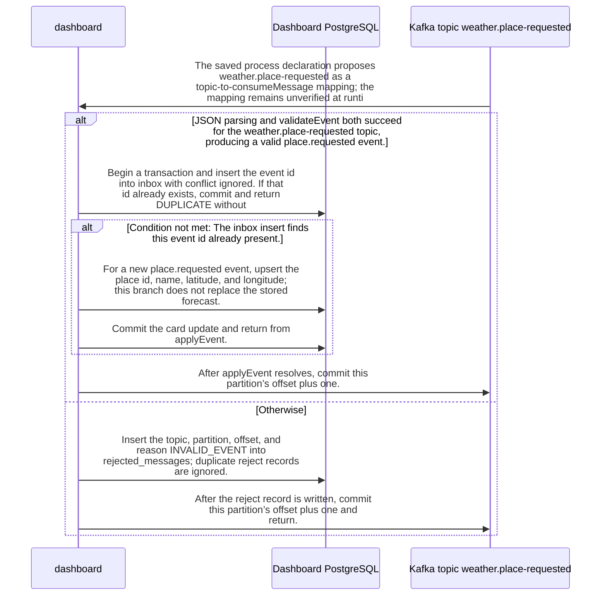

import {ClewMarkdown, ClewFieldDetails, ClewProcess, ClewDataModel, ClewDownload, ClewModelLink, ClewRelatedModelLink, ClewFieldTrace, ClewContextLink, ClewPageContext, ClewProcessReturn, ClewStatus, ClewRetainedPage, ClewCatalog, ClewAnchor} from '@site/src/components/ClewReaders';

# Dashboard consumes place-requested events

<ClewPageContext />

Retained account · STALE · UNASSESSED. Runtime behavior is not established by this export.

At source level, start subscribes to weather.place-requested and weather.forecast-updated from the beginning and runs consumeMessage with autoCommit false; this does not prove runtime activation or delivery. The saved mapping of weather.place-requested to consumeMessage is agent-proposed. For this topic, validateEvent requires a string event id, version 1, an allowed place id, string name, finite coordinates, type place.requested, and no forecast. The known forecast-updated topic has its own validator branch; only an unrecognized topic name throws UNKNOWN\_TOPIC, and consumeMessage catches that too as INVALID\_EVENT. On parse or validation failure it writes a rejected\_messages row and commits offset plus one; a write or commit failure propagates. On valid input it inserts the event id into inbox within a transaction; an existing id commits and returns DUPLICATE without changing the card, while a new place event upserts name and coordinates without replacing forecast data. If the DB transaction commits but offset commit then fails, a replay can occur; inbox suppresses duplicate application, not delivery, so this is not exactly-once processing. If pool.connect succeeds, errors inside applyEvent’s try attempt rollback, rethrow, and release in finally. A connection failure occurs before the try, so no transaction rollback or client release runs; either failure prevents offset commit. Runtime behavior remains unverified.

Summary source bindings

- [services/dashboard/src/events.ts:10–29 · revision e635069293d58cb0d4f28c8211e748b8d58e6b37](../sources/afddedfc8054e8c5495b73e95e3924f7b15f90f9b73caf09d7c1b7cdda664830.mdx)
- [services/dashboard/src/main.ts:58–58 · revision e635069293d58cb0d4f28c8211e748b8d58e6b37](../sources/03b9efe6bc6d50d833e9a96c49365da011a0e4f6ed708994589122816819a21f.mdx)
- [services/dashboard/src/main.ts:53–54 · revision e635069293d58cb0d4f28c8211e748b8d58e6b37](../sources/51eb13746a4ec715b7f498f982fc29c26b082e21cf20eed410ae88e3807a0f13.mdx)
- [services/dashboard/src/main.ts:55–55 · revision e635069293d58cb0d4f28c8211e748b8d58e6b37](../sources/04307c94ed8910824028310d5a54e4062e623b9b852e4e1ed79879721fe73f84.mdx)
- [services/dashboard/src/main.ts:59–59 · revision e635069293d58cb0d4f28c8211e748b8d58e6b37](../sources/596449b04f878bf0394c5492523a6a54d943d9f3a2a63e24cba4e4ca8dce043a.mdx)
- [services/dashboard/src/main.ts:50–57 · revision e635069293d58cb0d4f28c8211e748b8d58e6b37](../sources/cb1d1d3100a0984649d98da9a16956ac42fc63a19ea6841dad22f15a13784ba7.mdx)
- [services/dashboard/src/main.ts:47–60 · revision e635069293d58cb0d4f28c8211e748b8d58e6b37](../sources/c8b3521f73ba74f836cc640aa7a8cad2b6e1012251c1b736f186c06a9b475233.mdx)
- [services/dashboard/src/main.ts:15–45 · revision e635069293d58cb0d4f28c8211e748b8d58e6b37](../sources/bf524d202ba882540036918136ea088912da8bc6f340ab23d8a90bfb0aacab71.mdx)
- [services/dashboard/src/main.ts:99–111 · revision e635069293d58cb0d4f28c8211e748b8d58e6b37](../sources/b8c6b94020ae709e61177a744a5a5315fccb0813ac9f4e37ca6a0be5140d129c.mdx)
- [services/dashboard/src/main.ts:56–56 · revision e635069293d58cb0d4f28c8211e748b8d58e6b37](../sources/7fdaf9f2a9021a175f7a56f3d1da7a449de99be9aa83f25efd9106bc89d18e90.mdx)

## weather.place-requested message checks

| Topic | Retained contract detail |
| --- | --- |
| Topic association | The saved process proposes weather.place-requested as a mapping to consumeMessage; source start subscribes to this topic and weather.forecast-updated from the beginning, but runtime delivery is unverified. |
| Shared event fields | validateEvent requires a string event id, version 1, place.id in oslo, helsinki, or lisbon, string place.name, and finite place.latitude and place.longitude. |
| Place-topic fields | For weather.place-requested, type must be place.requested and the forecast field must be absent. These are code-level validator checks; they do not establish runtime JSON Schema enforcement. |

Contract source bindings

**Topic association**

- [services/dashboard/src/main.ts:99–111 · revision e635069293d58cb0d4f28c8211e748b8d58e6b37](../sources/b8c6b94020ae709e61177a744a5a5315fccb0813ac9f4e37ca6a0be5140d129c.mdx)

**Shared event fields**

- [services/dashboard/src/events.ts:10–29 · revision e635069293d58cb0d4f28c8211e748b8d58e6b37](../sources/afddedfc8054e8c5495b73e95e3924f7b15f90f9b73caf09d7c1b7cdda664830.mdx)

**Place-topic fields**

- [services/dashboard/src/events.ts:10–29 · revision e635069293d58cb0d4f28c8211e748b8d58e6b37](../sources/afddedfc8054e8c5495b73e95e3924f7b15f90f9b73caf09d7c1b7cdda664830.mdx)

## Interaction diagram

Actors and nested branches from the retained account; not a runtime trace. Labels are shortened for readability. Full messages and notes follow.

Full original sequence, branches and notes

#### 1. note

<ClewMarkdown text={"The source subscribes to both weather topics from the beginning and starts consumeMessage with automatic commits disabled. This source sequence does not prove runtime activation or delivery."} />

Source bindings

- [services/dashboard/src/main.ts:47–60 · revision e635069293d58cb0d4f28c8211e748b8d58e6b37](../sources/c8b3521f73ba74f836cc640aa7a8cad2b6e1012251c1b736f186c06a9b475233.mdx)
- [services/dashboard/src/main.ts:99–111 · revision e635069293d58cb0d4f28c8211e748b8d58e6b37](../sources/b8c6b94020ae709e61177a744a5a5315fccb0813ac9f4e37ca6a0be5140d129c.mdx)

#### 2. message

<ClewMarkdown text={"The saved process declaration proposes weather.place-requested as a topic-to-consumeMessage mapping; the mapping remains unverified at runtime."} />

Source bindings

- [services/dashboard/src/main.ts:47–60 · revision e635069293d58cb0d4f28c8211e748b8d58e6b37](../sources/c8b3521f73ba74f836cc640aa7a8cad2b6e1012251c1b736f186c06a9b475233.mdx)

#### 3. alt

<ClewMarkdown text={"JSON parsing and validateEvent both succeed for the weather.place-requested topic, producing a valid place.requested event."} />

Source bindings

- [services/dashboard/src/events.ts:10–29 · revision e635069293d58cb0d4f28c8211e748b8d58e6b37](../sources/afddedfc8054e8c5495b73e95e3924f7b15f90f9b73caf09d7c1b7cdda664830.mdx)
- [services/dashboard/src/main.ts:51–51 · revision e635069293d58cb0d4f28c8211e748b8d58e6b37](../sources/4798bc09cdd58e52e7e56aae4740dbb99954e40e39ad7c17923a447e491e2712.mdx)
- [services/dashboard/src/main.ts:50–57 · revision e635069293d58cb0d4f28c8211e748b8d58e6b37](../sources/cb1d1d3100a0984649d98da9a16956ac42fc63a19ea6841dad22f15a13784ba7.mdx)
- [services/dashboard/src/main.ts:47–60 · revision e635069293d58cb0d4f28c8211e748b8d58e6b37](../sources/c8b3521f73ba74f836cc640aa7a8cad2b6e1012251c1b736f186c06a9b475233.mdx)

#### 4. note

<ClewMarkdown text={"A place event has a string id, version 1, allowed place.id (oslo, helsinki, or lisbon), string place.name, finite latitude and longitude, type place.requested, and no forecast field. The known weather.forecast-updated topic has a separate validation branch; only unrecognized topic names throw UNKNOWN_TOPIC."} />

Source bindings

- [services/dashboard/src/events.ts:10–29 · revision e635069293d58cb0d4f28c8211e748b8d58e6b37](../sources/afddedfc8054e8c5495b73e95e3924f7b15f90f9b73caf09d7c1b7cdda664830.mdx)

#### 5. message

<ClewMarkdown text={"Begin a transaction and insert the event id into inbox with conflict ignored. If that id already exists, commit and return DUPLICATE without updating the card."} />

Source bindings

- [services/dashboard/src/main.ts:15–45 · revision e635069293d58cb0d4f28c8211e748b8d58e6b37](../sources/bf524d202ba882540036918136ea088912da8bc6f340ab23d8a90bfb0aacab71.mdx)

#### 6. alt

<ClewMarkdown text={"The inbox insert finds this event id already present."} />

Source bindings

- [services/dashboard/src/main.ts:15–45 · revision e635069293d58cb0d4f28c8211e748b8d58e6b37](../sources/bf524d202ba882540036918136ea088912da8bc6f340ab23d8a90bfb0aacab71.mdx)

#### 7. note

<ClewMarkdown text={"A duplicate commits its transaction and returns DUPLICATE; consumeMessage then advances the message offset."} />

Source bindings

- [services/dashboard/src/main.ts:59–59 · revision e635069293d58cb0d4f28c8211e748b8d58e6b37](../sources/596449b04f878bf0394c5492523a6a54d943d9f3a2a63e24cba4e4ca8dce043a.mdx)
- [services/dashboard/src/main.ts:47–60 · revision e635069293d58cb0d4f28c8211e748b8d58e6b37](../sources/c8b3521f73ba74f836cc640aa7a8cad2b6e1012251c1b736f186c06a9b475233.mdx)
- [services/dashboard/src/main.ts:15–45 · revision e635069293d58cb0d4f28c8211e748b8d58e6b37](../sources/bf524d202ba882540036918136ea088912da8bc6f340ab23d8a90bfb0aacab71.mdx)

#### 8. else

<ClewMarkdown text={"Otherwise"} />

Source bindings

- [services/dashboard/src/main.ts:15–45 · revision e635069293d58cb0d4f28c8211e748b8d58e6b37](../sources/bf524d202ba882540036918136ea088912da8bc6f340ab23d8a90bfb0aacab71.mdx)

#### 9. message

<ClewMarkdown text={"For a new place.requested event, upsert the place id, name, latitude, and longitude; this branch does not replace the stored forecast."} />

Source bindings

- [services/dashboard/src/main.ts:15–45 · revision e635069293d58cb0d4f28c8211e748b8d58e6b37](../sources/bf524d202ba882540036918136ea088912da8bc6f340ab23d8a90bfb0aacab71.mdx)

#### 10. message

<ClewMarkdown text={"Commit the card update and return from applyEvent."} />

Source bindings

- [services/dashboard/src/main.ts:15–45 · revision e635069293d58cb0d4f28c8211e748b8d58e6b37](../sources/bf524d202ba882540036918136ea088912da8bc6f340ab23d8a90bfb0aacab71.mdx)

#### 11. end

<ClewMarkdown text={""} />

Source bindings

- [services/dashboard/src/main.ts:15–45 · revision e635069293d58cb0d4f28c8211e748b8d58e6b37](../sources/bf524d202ba882540036918136ea088912da8bc6f340ab23d8a90bfb0aacab71.mdx)

#### 12. message

<ClewMarkdown text={"After applyEvent resolves, commit this partition’s offset plus one."} />

Source bindings

- [services/dashboard/src/main.ts:59–59 · revision e635069293d58cb0d4f28c8211e748b8d58e6b37](../sources/fb056517f94476af3c7964b81f570f4579e6b57b469923f270bb1b5b7f3ec245.mdx)
- [services/dashboard/src/main.ts:59–59 · revision e635069293d58cb0d4f28c8211e748b8d58e6b37](../sources/596449b04f878bf0394c5492523a6a54d943d9f3a2a63e24cba4e4ca8dce043a.mdx)
- [services/dashboard/src/main.ts:47–60 · revision e635069293d58cb0d4f28c8211e748b8d58e6b37](../sources/c8b3521f73ba74f836cc640aa7a8cad2b6e1012251c1b736f186c06a9b475233.mdx)

#### 13. else

<ClewMarkdown text={"Otherwise"} />

Source bindings

- [services/dashboard/src/events.ts:10–29 · revision e635069293d58cb0d4f28c8211e748b8d58e6b37](../sources/afddedfc8054e8c5495b73e95e3924f7b15f90f9b73caf09d7c1b7cdda664830.mdx)
- [services/dashboard/src/main.ts:51–51 · revision e635069293d58cb0d4f28c8211e748b8d58e6b37](../sources/4798bc09cdd58e52e7e56aae4740dbb99954e40e39ad7c17923a447e491e2712.mdx)
- [services/dashboard/src/main.ts:50–57 · revision e635069293d58cb0d4f28c8211e748b8d58e6b37](../sources/cb1d1d3100a0984649d98da9a16956ac42fc63a19ea6841dad22f15a13784ba7.mdx)
- [services/dashboard/src/main.ts:47–60 · revision e635069293d58cb0d4f28c8211e748b8d58e6b37](../sources/c8b3521f73ba74f836cc640aa7a8cad2b6e1012251c1b736f186c06a9b475233.mdx)

#### 14. message

<ClewMarkdown text={"Insert the topic, partition, offset, and reason INVALID_EVENT into rejected_messages; duplicate reject records are ignored."} />

Source bindings

- [services/dashboard/src/main.ts:53–54 · revision e635069293d58cb0d4f28c8211e748b8d58e6b37](../sources/51eb13746a4ec715b7f498f982fc29c26b082e21cf20eed410ae88e3807a0f13.mdx)
- [services/dashboard/src/main.ts:50–57 · revision e635069293d58cb0d4f28c8211e748b8d58e6b37](../sources/cb1d1d3100a0984649d98da9a16956ac42fc63a19ea6841dad22f15a13784ba7.mdx)

#### 15. message

<ClewMarkdown text={"After the reject record is written, commit this partition’s offset plus one and return."} />

Source bindings

- [services/dashboard/src/main.ts:59–59 · revision e635069293d58cb0d4f28c8211e748b8d58e6b37](../sources/fb056517f94476af3c7964b81f570f4579e6b57b469923f270bb1b5b7f3ec245.mdx)
- [services/dashboard/src/main.ts:55–55 · revision e635069293d58cb0d4f28c8211e748b8d58e6b37](../sources/04307c94ed8910824028310d5a54e4062e623b9b852e4e1ed79879721fe73f84.mdx)
- [services/dashboard/src/main.ts:55–55 · revision e635069293d58cb0d4f28c8211e748b8d58e6b37](../sources/7aade9ed3c0bb735283355f77a431ea3c8729271662e54ebab578098032c7df9.mdx)
- [services/dashboard/src/main.ts:50–57 · revision e635069293d58cb0d4f28c8211e748b8d58e6b37](../sources/cb1d1d3100a0984649d98da9a16956ac42fc63a19ea6841dad22f15a13784ba7.mdx)
- [services/dashboard/src/main.ts:56–56 · revision e635069293d58cb0d4f28c8211e748b8d58e6b37](../sources/7fdaf9f2a9021a175f7a56f3d1da7a449de99be9aa83f25efd9106bc89d18e90.mdx)

#### 16. note

<ClewMarkdown text={"After writing the INVALID_EVENT rejection and committing offset plus one, consumeMessage returns."} />

Source bindings

- [services/dashboard/src/main.ts:50–57 · revision e635069293d58cb0d4f28c8211e748b8d58e6b37](../sources/cb1d1d3100a0984649d98da9a16956ac42fc63a19ea6841dad22f15a13784ba7.mdx)
- [services/dashboard/src/main.ts:56–56 · revision e635069293d58cb0d4f28c8211e748b8d58e6b37](../sources/7fdaf9f2a9021a175f7a56f3d1da7a449de99be9aa83f25efd9106bc89d18e90.mdx)

#### 17. end

<ClewMarkdown text={""} />

Source bindings

- [services/dashboard/src/events.ts:10–29 · revision e635069293d58cb0d4f28c8211e748b8d58e6b37](../sources/afddedfc8054e8c5495b73e95e3924f7b15f90f9b73caf09d7c1b7cdda664830.mdx)
- [services/dashboard/src/main.ts:51–51 · revision e635069293d58cb0d4f28c8211e748b8d58e6b37](../sources/4798bc09cdd58e52e7e56aae4740dbb99954e40e39ad7c17923a447e491e2712.mdx)
- [services/dashboard/src/main.ts:50–57 · revision e635069293d58cb0d4f28c8211e748b8d58e6b37](../sources/cb1d1d3100a0984649d98da9a16956ac42fc63a19ea6841dad22f15a13784ba7.mdx)
- [services/dashboard/src/main.ts:47–60 · revision e635069293d58cb0d4f28c8211e748b8d58e6b37](../sources/c8b3521f73ba74f836cc640aa7a8cad2b6e1012251c1b736f186c06a9b475233.mdx)

#### 18. note

<ClewMarkdown text={"A failure writing the rejection row or committing the rejection-path offset propagates. On the valid path, if pool.connect succeeds, an error inside applyEvent’s try attempts ROLLBACK, rethrows, and releases the client in finally. If pool.connect fails, that happens before the try, so no transaction rollback or client release runs. Either applyEvent error prevents consumeMessage from reaching the offset commit."} />

Source bindings

- [services/dashboard/src/main.ts:58–58 · revision e635069293d58cb0d4f28c8211e748b8d58e6b37](../sources/03b9efe6bc6d50d833e9a96c49365da011a0e4f6ed708994589122816819a21f.mdx)
- [services/dashboard/src/main.ts:59–59 · revision e635069293d58cb0d4f28c8211e748b8d58e6b37](../sources/596449b04f878bf0394c5492523a6a54d943d9f3a2a63e24cba4e4ca8dce043a.mdx)
- [services/dashboard/src/main.ts:50–57 · revision e635069293d58cb0d4f28c8211e748b8d58e6b37](../sources/cb1d1d3100a0984649d98da9a16956ac42fc63a19ea6841dad22f15a13784ba7.mdx)
- [services/dashboard/src/main.ts:47–60 · revision e635069293d58cb0d4f28c8211e748b8d58e6b37](../sources/c8b3521f73ba74f836cc640aa7a8cad2b6e1012251c1b736f186c06a9b475233.mdx)
- [services/dashboard/src/main.ts:15–45 · revision e635069293d58cb0d4f28c8211e748b8d58e6b37](../sources/bf524d202ba882540036918136ea088912da8bc6f340ab23d8a90bfb0aacab71.mdx)
- [services/dashboard/src/main.ts:56–56 · revision e635069293d58cb0d4f28c8211e748b8d58e6b37](../sources/7fdaf9f2a9021a175f7a56f3d1da7a449de99be9aa83f25efd9106bc89d18e90.mdx)

#### 19. note

<ClewMarkdown text={"On a valid event, applyEvent commits its database transaction before consumeMessage commits offset plus one. If that later offset commit fails, the event can be replayed; the inbox duplicate check suppresses a second card update, but does not establish exactly-once delivery."} />

Source bindings

- [services/dashboard/src/main.ts:59–59 · revision e635069293d58cb0d4f28c8211e748b8d58e6b37](../sources/596449b04f878bf0394c5492523a6a54d943d9f3a2a63e24cba4e4ca8dce043a.mdx)
- [services/dashboard/src/main.ts:47–60 · revision e635069293d58cb0d4f28c8211e748b8d58e6b37](../sources/c8b3521f73ba74f836cc640aa7a8cad2b6e1012251c1b736f186c06a9b475233.mdx)
- [services/dashboard/src/main.ts:15–45 · revision e635069293d58cb0d4f28c8211e748b8d58e6b37](../sources/bf524d202ba882540036918136ea088912da8bc6f340ab23d8a90bfb0aacab71.mdx)

## Implementation explanation

<ClewMarkdown text={"The source subscribes to both weather topics from the beginning and starts consumeMessage with automatic commits disabled. This source sequence does not prove runtime activation or delivery."} />

Source bindings

- [services/dashboard/src/main.ts:47–60 · revision e635069293d58cb0d4f28c8211e748b8d58e6b37](../sources/c8b3521f73ba74f836cc640aa7a8cad2b6e1012251c1b736f186c06a9b475233.mdx)
- [services/dashboard/src/main.ts:99–111 · revision e635069293d58cb0d4f28c8211e748b8d58e6b37](../sources/b8c6b94020ae709e61177a744a5a5315fccb0813ac9f4e37ca6a0be5140d129c.mdx)

<ClewMarkdown text={"The saved process declaration proposes weather.place-requested as a topic-to-consumeMessage mapping; the mapping remains unverified at runtime."} />

Source bindings

- [services/dashboard/src/main.ts:47–60 · revision e635069293d58cb0d4f28c8211e748b8d58e6b37](../sources/c8b3521f73ba74f836cc640aa7a8cad2b6e1012251c1b736f186c06a9b475233.mdx)

<ClewMarkdown text={"JSON parsing and validateEvent both succeed for the weather.place-requested topic, producing a valid place.requested event."} />

Source bindings

- [services/dashboard/src/events.ts:10–29 · revision e635069293d58cb0d4f28c8211e748b8d58e6b37](../sources/afddedfc8054e8c5495b73e95e3924f7b15f90f9b73caf09d7c1b7cdda664830.mdx)
- [services/dashboard/src/main.ts:51–51 · revision e635069293d58cb0d4f28c8211e748b8d58e6b37](../sources/4798bc09cdd58e52e7e56aae4740dbb99954e40e39ad7c17923a447e491e2712.mdx)
- [services/dashboard/src/main.ts:50–57 · revision e635069293d58cb0d4f28c8211e748b8d58e6b37](../sources/cb1d1d3100a0984649d98da9a16956ac42fc63a19ea6841dad22f15a13784ba7.mdx)
- [services/dashboard/src/main.ts:47–60 · revision e635069293d58cb0d4f28c8211e748b8d58e6b37](../sources/c8b3521f73ba74f836cc640aa7a8cad2b6e1012251c1b736f186c06a9b475233.mdx)

<ClewMarkdown text={"A place event has a string id, version 1, allowed place.id (oslo, helsinki, or lisbon), string place.name, finite latitude and longitude, type place.requested, and no forecast field. The known weather.forecast-updated topic has a separate validation branch; only unrecognized topic names throw UNKNOWN_TOPIC."} />

Source bindings

- [services/dashboard/src/events.ts:10–29 · revision e635069293d58cb0d4f28c8211e748b8d58e6b37](../sources/afddedfc8054e8c5495b73e95e3924f7b15f90f9b73caf09d7c1b7cdda664830.mdx)

<ClewMarkdown text={"Begin a transaction and insert the event id into inbox with conflict ignored. If that id already exists, commit and return DUPLICATE without updating the card."} />

Source bindings

- [services/dashboard/src/main.ts:15–45 · revision e635069293d58cb0d4f28c8211e748b8d58e6b37](../sources/bf524d202ba882540036918136ea088912da8bc6f340ab23d8a90bfb0aacab71.mdx)

<ClewMarkdown text={"The inbox insert finds this event id already present."} />

Source bindings

- [services/dashboard/src/main.ts:15–45 · revision e635069293d58cb0d4f28c8211e748b8d58e6b37](../sources/bf524d202ba882540036918136ea088912da8bc6f340ab23d8a90bfb0aacab71.mdx)

<ClewMarkdown text={"A duplicate commits its transaction and returns DUPLICATE; consumeMessage then advances the message offset."} />

Source bindings

- [services/dashboard/src/main.ts:59–59 · revision e635069293d58cb0d4f28c8211e748b8d58e6b37](../sources/596449b04f878bf0394c5492523a6a54d943d9f3a2a63e24cba4e4ca8dce043a.mdx)
- [services/dashboard/src/main.ts:47–60 · revision e635069293d58cb0d4f28c8211e748b8d58e6b37](../sources/c8b3521f73ba74f836cc640aa7a8cad2b6e1012251c1b736f186c06a9b475233.mdx)
- [services/dashboard/src/main.ts:15–45 · revision e635069293d58cb0d4f28c8211e748b8d58e6b37](../sources/bf524d202ba882540036918136ea088912da8bc6f340ab23d8a90bfb0aacab71.mdx)

<ClewMarkdown text={"The source describes an alternative branch."} />

Source bindings

- [services/dashboard/src/main.ts:15–45 · revision e635069293d58cb0d4f28c8211e748b8d58e6b37](../sources/bf524d202ba882540036918136ea088912da8bc6f340ab23d8a90bfb0aacab71.mdx)

<ClewMarkdown text={"For a new place.requested event, upsert the place id, name, latitude, and longitude; this branch does not replace the stored forecast."} />

Source bindings

- [services/dashboard/src/main.ts:15–45 · revision e635069293d58cb0d4f28c8211e748b8d58e6b37](../sources/bf524d202ba882540036918136ea088912da8bc6f340ab23d8a90bfb0aacab71.mdx)

<ClewMarkdown text={"Commit the card update and return from applyEvent."} />

Source bindings

- [services/dashboard/src/main.ts:15–45 · revision e635069293d58cb0d4f28c8211e748b8d58e6b37](../sources/bf524d202ba882540036918136ea088912da8bc6f340ab23d8a90bfb0aacab71.mdx)

<ClewMarkdown text={"After applyEvent resolves, commit this partition’s offset plus one."} />

Source bindings

- [services/dashboard/src/main.ts:59–59 · revision e635069293d58cb0d4f28c8211e748b8d58e6b37](../sources/fb056517f94476af3c7964b81f570f4579e6b57b469923f270bb1b5b7f3ec245.mdx)
- [services/dashboard/src/main.ts:59–59 · revision e635069293d58cb0d4f28c8211e748b8d58e6b37](../sources/596449b04f878bf0394c5492523a6a54d943d9f3a2a63e24cba4e4ca8dce043a.mdx)
- [services/dashboard/src/main.ts:47–60 · revision e635069293d58cb0d4f28c8211e748b8d58e6b37](../sources/c8b3521f73ba74f836cc640aa7a8cad2b6e1012251c1b736f186c06a9b475233.mdx)

<ClewMarkdown text={"The source describes an alternative branch."} />

Source bindings

- [services/dashboard/src/events.ts:10–29 · revision e635069293d58cb0d4f28c8211e748b8d58e6b37](../sources/afddedfc8054e8c5495b73e95e3924f7b15f90f9b73caf09d7c1b7cdda664830.mdx)
- [services/dashboard/src/main.ts:51–51 · revision e635069293d58cb0d4f28c8211e748b8d58e6b37](../sources/4798bc09cdd58e52e7e56aae4740dbb99954e40e39ad7c17923a447e491e2712.mdx)
- [services/dashboard/src/main.ts:50–57 · revision e635069293d58cb0d4f28c8211e748b8d58e6b37](../sources/cb1d1d3100a0984649d98da9a16956ac42fc63a19ea6841dad22f15a13784ba7.mdx)
- [services/dashboard/src/main.ts:47–60 · revision e635069293d58cb0d4f28c8211e748b8d58e6b37](../sources/c8b3521f73ba74f836cc640aa7a8cad2b6e1012251c1b736f186c06a9b475233.mdx)

<ClewMarkdown text={"Insert the topic, partition, offset, and reason INVALID_EVENT into rejected_messages; duplicate reject records are ignored."} />

Source bindings

- [services/dashboard/src/main.ts:53–54 · revision e635069293d58cb0d4f28c8211e748b8d58e6b37](../sources/51eb13746a4ec715b7f498f982fc29c26b082e21cf20eed410ae88e3807a0f13.mdx)
- [services/dashboard/src/main.ts:50–57 · revision e635069293d58cb0d4f28c8211e748b8d58e6b37](../sources/cb1d1d3100a0984649d98da9a16956ac42fc63a19ea6841dad22f15a13784ba7.mdx)

<ClewMarkdown text={"After the reject record is written, commit this partition’s offset plus one and return."} />

Source bindings

- [services/dashboard/src/main.ts:59–59 · revision e635069293d58cb0d4f28c8211e748b8d58e6b37](../sources/fb056517f94476af3c7964b81f570f4579e6b57b469923f270bb1b5b7f3ec245.mdx)
- [services/dashboard/src/main.ts:55–55 · revision e635069293d58cb0d4f28c8211e748b8d58e6b37](../sources/04307c94ed8910824028310d5a54e4062e623b9b852e4e1ed79879721fe73f84.mdx)
- [services/dashboard/src/main.ts:55–55 · revision e635069293d58cb0d4f28c8211e748b8d58e6b37](../sources/7aade9ed3c0bb735283355f77a431ea3c8729271662e54ebab578098032c7df9.mdx)
- [services/dashboard/src/main.ts:50–57 · revision e635069293d58cb0d4f28c8211e748b8d58e6b37](../sources/cb1d1d3100a0984649d98da9a16956ac42fc63a19ea6841dad22f15a13784ba7.mdx)
- [services/dashboard/src/main.ts:56–56 · revision e635069293d58cb0d4f28c8211e748b8d58e6b37](../sources/7fdaf9f2a9021a175f7a56f3d1da7a449de99be9aa83f25efd9106bc89d18e90.mdx)

<ClewMarkdown text={"After writing the INVALID_EVENT rejection and committing offset plus one, consumeMessage returns."} />

Source bindings

- [services/dashboard/src/main.ts:50–57 · revision e635069293d58cb0d4f28c8211e748b8d58e6b37](../sources/cb1d1d3100a0984649d98da9a16956ac42fc63a19ea6841dad22f15a13784ba7.mdx)
- [services/dashboard/src/main.ts:56–56 · revision e635069293d58cb0d4f28c8211e748b8d58e6b37](../sources/7fdaf9f2a9021a175f7a56f3d1da7a449de99be9aa83f25efd9106bc89d18e90.mdx)

<ClewMarkdown text={"A failure writing the rejection row or committing the rejection-path offset propagates. On the valid path, if pool.connect succeeds, an error inside applyEvent’s try attempts ROLLBACK, rethrows, and releases the client in finally. If pool.connect fails, that happens before the try, so no transaction rollback or client release runs. Either applyEvent error prevents consumeMessage from reaching the offset commit."} />

Source bindings

- [services/dashboard/src/main.ts:58–58 · revision e635069293d58cb0d4f28c8211e748b8d58e6b37](../sources/03b9efe6bc6d50d833e9a96c49365da011a0e4f6ed708994589122816819a21f.mdx)
- [services/dashboard/src/main.ts:59–59 · revision e635069293d58cb0d4f28c8211e748b8d58e6b37](../sources/596449b04f878bf0394c5492523a6a54d943d9f3a2a63e24cba4e4ca8dce043a.mdx)
- [services/dashboard/src/main.ts:50–57 · revision e635069293d58cb0d4f28c8211e748b8d58e6b37](../sources/cb1d1d3100a0984649d98da9a16956ac42fc63a19ea6841dad22f15a13784ba7.mdx)
- [services/dashboard/src/main.ts:47–60 · revision e635069293d58cb0d4f28c8211e748b8d58e6b37](../sources/c8b3521f73ba74f836cc640aa7a8cad2b6e1012251c1b736f186c06a9b475233.mdx)
- [services/dashboard/src/main.ts:15–45 · revision e635069293d58cb0d4f28c8211e748b8d58e6b37](../sources/bf524d202ba882540036918136ea088912da8bc6f340ab23d8a90bfb0aacab71.mdx)
- [services/dashboard/src/main.ts:56–56 · revision e635069293d58cb0d4f28c8211e748b8d58e6b37](../sources/7fdaf9f2a9021a175f7a56f3d1da7a449de99be9aa83f25efd9106bc89d18e90.mdx)

<ClewMarkdown text={"On a valid event, applyEvent commits its database transaction before consumeMessage commits offset plus one. If that later offset commit fails, the event can be replayed; the inbox duplicate check suppresses a second card update, but does not establish exactly-once delivery."} />

Source bindings

- [services/dashboard/src/main.ts:59–59 · revision e635069293d58cb0d4f28c8211e748b8d58e6b37](../sources/596449b04f878bf0394c5492523a6a54d943d9f3a2a63e24cba4e4ca8dce043a.mdx)
- [services/dashboard/src/main.ts:47–60 · revision e635069293d58cb0d4f28c8211e748b8d58e6b37](../sources/c8b3521f73ba74f836cc640aa7a8cad2b6e1012251c1b736f186c06a9b475233.mdx)
- [services/dashboard/src/main.ts:15–45 · revision e635069293d58cb0d4f28c8211e748b8d58e6b37](../sources/bf524d202ba882540036918136ea088912da8bc6f340ab23d8a90bfb0aacab71.mdx)

Retained boundaries

- CALL\_TARGETS\_UNRESOLVED
- DIALECT\_DECLARED\_NOT\_COMPILER\_VALIDATED
- FILE\_ONLY:compose.yaml
- FILE\_ONLY:contracts/dashboard.openapi.json
- FILE\_ONLY:contracts/events.schema.json
- FILE\_ONLY:database/init.sql
- FILE\_ONLY:exercises/dashboard-focus-regression.mjs
- FILE\_ONLY:exercises/replay.py
- FILE\_ONLY:exercises/validator-regression.mjs
- FILE\_ONLY:fixtures/helsinki.json
- FILE\_ONLY:fixtures/lisbon.json
- FILE\_ONLY:fixtures/met-oslo-recorded.json
- FILE\_ONLY:fixtures/oslo.json
- FILE\_ONLY:fixtures/provenance.json
- FILE\_ONLY:services/dashboard/Dockerfile
- FILE\_ONLY:services/dashboard/package-lock.json
- FILE\_ONLY:services/dashboard/package.json
- FILE\_ONLY:services/dashboard/public/index.html
- FILE\_ONLY:services/dashboard/tsconfig.json
- OPENAPI\_JSON\_SCHEMA\_KEYWORDS\_NOT\_INTERPRETED
- OPENAPI\_SCHEMA\_NULL\_TYPE\_NOT\_INTERPRETED
- OPENAPI\_SCHEMA\_TYPE\_UNIONS\_NOT\_INTERPRETED
- ORDER\_LEXICAL\_ONLY
- SCOPE\_WATCH\_CONSERVATIVE
- Syntax evidence does not establish runtime dispatch or configuration. Expand known owners and helpers; retain explicit gaps for unresolved targets.
- ANNOTATION\_DECLARATION\_UNAVAILABLE
- CALL\_TARGETS\_UNRESOLVED
- DIALECT\_DECLARED\_NOT\_COMPILER\_VALIDATED
- FILE\_ONLY:compose.yaml
- FILE\_ONLY:contracts/events.schema.json
- FILE\_ONLY:contracts/forecasts.openapi.json
- FILE\_ONLY:database/init.sql
- FILE\_ONLY:fixtures/helsinki.json
- FILE\_ONLY:fixtures/lisbon.json
- FILE\_ONLY:fixtures/met-oslo-recorded.json
- FILE\_ONLY:fixtures/oslo.json
- FILE\_ONLY:fixtures/provenance.json
- FILE\_ONLY:services/forecasts/Dockerfile
- FILE\_ONLY:services/forecasts/pom.xml
- FILE\_ONLY:services/forecasts/src/main/resources/application.properties
- NO\_BEAN\_OWNER
- OPENAPI\_JSON\_SCHEMA\_KEYWORDS\_NOT\_INTERPRETED
- OPENAPI\_SCHEMA\_NULL\_TYPE\_NOT\_INTERPRETED
- OPENAPI\_SCHEMA\_TYPE\_UNIONS\_NOT\_INTERPRETED
- ORDER\_LEXICAL\_ONLY
- RUNTIME\_REGISTRATION\_UNPROVEN
- SCOPE\_WATCH\_CONSERVATIVE
- SOURCE\_NAMES\_NOT\_COMPILER\_RESOLVED
- UNRESOLVED\_ANNOTATION\_VALUE
- Syntax evidence does not establish runtime dispatch or configuration. Expand known owners and helpers; retain explicit gaps for unresolved targets.
- CLR\_SIGNATURE\_PROJECTED\_TO\_JVM\_DESCRIPTOR\_GRAMMAR
- CSHARP\_SOURCE\_GENERATED\_DOCUMENTS\_NOT\_INDEXED
- EXCEPTION\_FLOW\_REQUIRES\_SOURCE\_REVIEW
- GENERATED\_SOURCE\_BODIES\_NOT\_INDEXED
- LAMBDA\_EXECUTION\_NOT\_EXPANDED
- OPENAPI\_JSON\_SCHEMA\_KEYWORDS\_NOT\_INTERPRETED
- SHORT\_CIRCUIT\_FLOW\_REQUIRES\_SOURCE\_REVIEW
- SWITCH\_FLOW\_REQUIRES\_SOURCE\_REVIEW

