import {ClewMarkdown, ClewFieldDetails, ClewProcess, ClewDataModel, ClewDownload, ClewModelLink, ClewRelatedModelLink, ClewFieldTrace, ClewContextLink, ClewPageContext, ClewProcessReturn, ClewStatus, ClewRetainedPage, ClewCatalog, ClewAnchor} from '@site/src/components/ClewReaders';

# Save a city through Dashboard and record the outbox boundary

<ClewPageContext />

Retained account · UNVERIFIED · UNASSESSED. Runtime behavior is not established by this export.

A caller submits a cityId to Dashboard.savePlace. The handler serializes the body and sends POST /places with a 10-second abort signal; the declared OpenAPI request is an object containing only cityId, with oslo, helsinki, and lisbon as allowed values. The saved Dashboard-to-Places mapping is agent-proposed, so runtime target binding is not established. Places returns 400 UNSUPPORTED\_CITY when its city mapping fails; otherwise it awaits repository.Save and returns 200. Save inserts the place in a database transaction, inserts a place.requested version 1 outbox record only when the place insert returns a new id, and commits. A conflict skips the outbox insert but still commits. Dashboard forwards a parsed upstream status/body, while a fetch or JSON parse exception returns 503 PLACES\_UNAVAILABLE; the wrapper has no retry and that response does not say whether the Places transaction committed. The no-outbox path is tied to the place INSERT returning null on conflict; that can reflect an existing city or another request, so it is not a retry guarantee for the timed-out caller. The saved process links publisher and consumer views separately; an outbox row is not proof of Kafka publication or consumption.

Summary source bindings

- [services/dashboard/src/main.ts:67–74 · revision e635069293d58cb0d4f28c8211e748b8d58e6b37](../sources/ab8df8a5fe7536b2fc32d2257bed77e48c54ce422b10c3afba79f26ac88b67a8.mdx)
- [services/places/PlacesController.cs:10–17 · revision c289b28be4819eddf29d59a7c12f178559ec5229](../sources/31d65799d2ab0d5586875469994de48826eff9efa7554c342d97a36030a8d9a0.mdx)
- [services/places/PlacesRepository.cs:52–59 · revision c289b28be4819eddf29d59a7c12f178559ec5229](../sources/89387464df117dd1f2cfdbd8113d90c803728d4fe220f507529703bd597dbf8e.mdx)
- [services/places/PlacesController.cs:4–4 · revision c289b28be4819eddf29d59a7c12f178559ec5229](../sources/5d0e0230101848f293cac0902245f465a92e8106f700b8853514a42687637309.mdx)
- [contracts/places.openapi.json:1–263 · revision c289b28be4819eddf29d59a7c12f178559ec5229](../sources/d04d07ecb57a86dc75dd79d70d54dfd22aeaecc9ece8f888218b6a6fde39f959.mdx)
- [services/places/PlacesRepository.cs:36–44 · revision c289b28be4819eddf29d59a7c12f178559ec5229](../sources/379c0b710ffb354ec36825644e1d5c73ec611814e26c938687bac753bdb832c6.mdx)

## Declared Places POST /places contract

| Topic | Retained contract detail |
| --- | --- |
| Request | The declared required JSON body is an object with no additional properties and one required cityId string, restricted to oslo, helsinki, or lisbon. |
| Declared responses | The OpenAPI operation declares a 200 Place JSON object and a 400 JSON error object, plus 415 and 500 status codes. The captured controller explicitly returns 400 for an unsupported mapping and 200 after repository.Save; the declaration does not prove runtime enforcement or exception-to-status mapping. |
| Routing boundary | The saved process records Dashboard.savePlace to Places.Save as an agent-proposed POST /places interaction. Runtime receiver binding and routing remain unverified. |

Contract source bindings

**Request**

- [contracts/places.openapi.json:1–263 · revision c289b28be4819eddf29d59a7c12f178559ec5229](../sources/d04d07ecb57a86dc75dd79d70d54dfd22aeaecc9ece8f888218b6a6fde39f959.mdx)

**Declared responses**

- [services/places/PlacesController.cs:10–17 · revision c289b28be4819eddf29d59a7c12f178559ec5229](../sources/31d65799d2ab0d5586875469994de48826eff9efa7554c342d97a36030a8d9a0.mdx)
- [contracts/places.openapi.json:1–263 · revision c289b28be4819eddf29d59a7c12f178559ec5229](../sources/d04d07ecb57a86dc75dd79d70d54dfd22aeaecc9ece8f888218b6a6fde39f959.mdx)

**Routing boundary**

- [services/dashboard/src/main.ts:67–74 · revision e635069293d58cb0d4f28c8211e748b8d58e6b37](../sources/ab8df8a5fe7536b2fc32d2257bed77e48c54ce422b10c3afba79f26ac88b67a8.mdx)
- [services/places/PlacesController.cs:10–17 · revision c289b28be4819eddf29d59a7c12f178559ec5229](../sources/31d65799d2ab0d5586875469994de48826eff9efa7554c342d97a36030a8d9a0.mdx)

## Interaction diagram

Actors and nested branches from the retained account; not a runtime trace. Labels are shortened for readability. Full messages and notes follow.

```mermaid
sequenceDiagram
participant p0 as Caller
participant p1 as dashboard
participant p2 as Places
participant p3 as Places PostgreSQL
p0->>p1: A caller enters savePlace with a JSON body.<br/>The declared Places request body requires<br/>only cityId, a string in the oslo,<br/>helsinki, or lisbon
p1->>p2: Dashboard POSTs<br/>JSON.stringify(request.body) to /places<br/>with content-type application/json and<br/>AbortSignal.timeout(10000). The saved<br/>interac
alt Dashboard fetch and response.json complete
alt PlacesRepository.City returns null for<br/>CityId
p2-->>p1: Places returns HTTP 400 with error<br/>UNSUPPORTED_CITY.
else Otherwise
p2->>p3: For a supported city, repository.Save opens<br/>a connection, begins a transaction, and<br/>inserts the place with ON CONFLICT DO<br/>NOTHING RETURNING
alt The place INSERT returns a new id
p2->>p3: Within the same transaction, InsertRequest<br/>creates a UUID and inserts a JSONB outbox<br/>payload with type place.requested, version<br/>1, and the p
end
p2->>p3: repository.Save commits the transaction<br/>after the optional outbox insert#59; the new<br/>place and its outbox row share that<br/>transaction.
p2-->>p1: After repository.Save returns, the<br/>controller returns HTTP 200 with the mapped<br/>city.
end
p1-->>p0: Dashboard forwards the upstream status and<br/>parsed JSON body. The shown Places branches<br/>return 400 for an unsupported city or 200<br/>after a sup
else Otherwise
p1-->>p0: A fetch or response.json exception,<br/>including an abort from the 10-second<br/>signal, is caught and mapped to HTTP 503<br/>PLACES_UNAVAILABLE.
end

```

Full original sequence, branches and notes

#### 1. message

<ClewMarkdown text={"A caller enters savePlace with a JSON body. The declared Places request body requires only cityId, a string in the oslo, helsinki, or lisbon enum; SavePlace exposes that value as CityId."} />

Source bindings

- [services/dashboard/src/main.ts:67–74 · revision e635069293d58cb0d4f28c8211e748b8d58e6b37](../sources/ab8df8a5fe7536b2fc32d2257bed77e48c54ce422b10c3afba79f26ac88b67a8.mdx)
- [services/places/PlacesController.cs:4–4 · revision c289b28be4819eddf29d59a7c12f178559ec5229](../sources/5d0e0230101848f293cac0902245f465a92e8106f700b8853514a42687637309.mdx)
- [contracts/places.openapi.json:1–263 · revision c289b28be4819eddf29d59a7c12f178559ec5229](../sources/d04d07ecb57a86dc75dd79d70d54dfd22aeaecc9ece8f888218b6a6fde39f959.mdx)

#### 2. message

<ClewMarkdown text={"Dashboard POSTs JSON.stringify(request.body) to /places with content-type application/json and AbortSignal.timeout(10000). The saved interaction is an agent-proposed target mapping, not proof of runtime routing."} />

Source bindings

- [services/dashboard/src/main.ts:67–74 · revision e635069293d58cb0d4f28c8211e748b8d58e6b37](../sources/ab8df8a5fe7536b2fc32d2257bed77e48c54ce422b10c3afba79f26ac88b67a8.mdx)

#### 3. alt

<ClewMarkdown text={"Dashboard fetch and response.json complete"} />

Source bindings

- [services/dashboard/src/main.ts:67–74 · revision e635069293d58cb0d4f28c8211e748b8d58e6b37](../sources/ab8df8a5fe7536b2fc32d2257bed77e48c54ce422b10c3afba79f26ac88b67a8.mdx)
- [services/dashboard/src/main.ts:68–73 · revision e635069293d58cb0d4f28c8211e748b8d58e6b37](../sources/baa3248d99ea30a6c17da11fe53dc9898eb6ec9f54f08b597247f295b7f98989.mdx)

#### 4. alt

<ClewMarkdown text={"PlacesRepository.City returns null for CityId"} />

Source bindings

- [services/places/PlacesController.cs:10–17 · revision c289b28be4819eddf29d59a7c12f178559ec5229](../sources/31d65799d2ab0d5586875469994de48826eff9efa7554c342d97a36030a8d9a0.mdx)

#### 5. return

<ClewMarkdown text={"Places returns HTTP 400 with error UNSUPPORTED_CITY."} />

Source bindings

- [services/places/PlacesController.cs:10–17 · revision c289b28be4819eddf29d59a7c12f178559ec5229](../sources/31d65799d2ab0d5586875469994de48826eff9efa7554c342d97a36030a8d9a0.mdx)
- [contracts/places.openapi.json:1–263 · revision c289b28be4819eddf29d59a7c12f178559ec5229](../sources/d04d07ecb57a86dc75dd79d70d54dfd22aeaecc9ece8f888218b6a6fde39f959.mdx)

#### 6. else

<ClewMarkdown text={"Otherwise"} />

Source bindings

- [services/places/PlacesController.cs:10–17 · revision c289b28be4819eddf29d59a7c12f178559ec5229](../sources/31d65799d2ab0d5586875469994de48826eff9efa7554c342d97a36030a8d9a0.mdx)

#### 7. message

<ClewMarkdown text={"For a supported city, repository.Save opens a connection, begins a transaction, and inserts the place with ON CONFLICT DO NOTHING RETURNING id."} />

Source bindings

- [services/places/PlacesController.cs:10–17 · revision c289b28be4819eddf29d59a7c12f178559ec5229](../sources/31d65799d2ab0d5586875469994de48826eff9efa7554c342d97a36030a8d9a0.mdx)
- [services/places/PlacesRepository.cs:36–44 · revision c289b28be4819eddf29d59a7c12f178559ec5229](../sources/379c0b710ffb354ec36825644e1d5c73ec611814e26c938687bac753bdb832c6.mdx)

#### 8. alt

<ClewMarkdown text={"The place INSERT returns a new id"} />

Source bindings

- [services/places/PlacesRepository.cs:36–44 · revision c289b28be4819eddf29d59a7c12f178559ec5229](../sources/379c0b710ffb354ec36825644e1d5c73ec611814e26c938687bac753bdb832c6.mdx)

#### 9. message

<ClewMarkdown text={"Within the same transaction, InsertRequest creates a UUID and inserts a JSONB outbox payload with type place.requested, version 1, and the place."} />

Source bindings

- [services/places/PlacesRepository.cs:52–59 · revision c289b28be4819eddf29d59a7c12f178559ec5229](../sources/89387464df117dd1f2cfdbd8113d90c803728d4fe220f507529703bd597dbf8e.mdx)
- [services/places/PlacesRepository.cs:36–44 · revision c289b28be4819eddf29d59a7c12f178559ec5229](../sources/379c0b710ffb354ec36825644e1d5c73ec611814e26c938687bac753bdb832c6.mdx)

#### 10. else

<ClewMarkdown text={"Otherwise"} />

Source bindings

- [services/places/PlacesRepository.cs:36–44 · revision c289b28be4819eddf29d59a7c12f178559ec5229](../sources/379c0b710ffb354ec36825644e1d5c73ec611814e26c938687bac753bdb832c6.mdx)

#### 11. note

<ClewMarkdown text={"If the INSERT returns null after a conflict, InsertRequest is skipped, so this call adds no outbox row."} />

Source bindings

- [services/places/PlacesRepository.cs:36–44 · revision c289b28be4819eddf29d59a7c12f178559ec5229](../sources/379c0b710ffb354ec36825644e1d5c73ec611814e26c938687bac753bdb832c6.mdx)

#### 12. end

<ClewMarkdown text={""} />

Source bindings

- [services/places/PlacesRepository.cs:36–44 · revision c289b28be4819eddf29d59a7c12f178559ec5229](../sources/379c0b710ffb354ec36825644e1d5c73ec611814e26c938687bac753bdb832c6.mdx)

#### 13. message

<ClewMarkdown text={"repository.Save commits the transaction after the optional outbox insert; the new place and its outbox row share that transaction."} />

Source bindings

- [services/places/PlacesRepository.cs:52–59 · revision c289b28be4819eddf29d59a7c12f178559ec5229](../sources/89387464df117dd1f2cfdbd8113d90c803728d4fe220f507529703bd597dbf8e.mdx)
- [services/places/PlacesRepository.cs:36–44 · revision c289b28be4819eddf29d59a7c12f178559ec5229](../sources/379c0b710ffb354ec36825644e1d5c73ec611814e26c938687bac753bdb832c6.mdx)

#### 14. return

<ClewMarkdown text={"After repository.Save returns, the controller returns HTTP 200 with the mapped city."} />

Source bindings

- [services/places/PlacesController.cs:10–17 · revision c289b28be4819eddf29d59a7c12f178559ec5229](../sources/31d65799d2ab0d5586875469994de48826eff9efa7554c342d97a36030a8d9a0.mdx)
- [contracts/places.openapi.json:1–263 · revision c289b28be4819eddf29d59a7c12f178559ec5229](../sources/d04d07ecb57a86dc75dd79d70d54dfd22aeaecc9ece8f888218b6a6fde39f959.mdx)

#### 15. end

<ClewMarkdown text={""} />

Source bindings

- [services/places/PlacesController.cs:10–17 · revision c289b28be4819eddf29d59a7c12f178559ec5229](../sources/31d65799d2ab0d5586875469994de48826eff9efa7554c342d97a36030a8d9a0.mdx)

#### 16. return

<ClewMarkdown text={"Dashboard forwards the upstream status and parsed JSON body. The shown Places branches return 400 for an unsupported city or 200 after a supported save."} />

Source bindings

- [services/dashboard/src/main.ts:67–74 · revision e635069293d58cb0d4f28c8211e748b8d58e6b37](../sources/ab8df8a5fe7536b2fc32d2257bed77e48c54ce422b10c3afba79f26ac88b67a8.mdx)
- [services/places/PlacesController.cs:10–17 · revision c289b28be4819eddf29d59a7c12f178559ec5229](../sources/31d65799d2ab0d5586875469994de48826eff9efa7554c342d97a36030a8d9a0.mdx)
- [contracts/places.openapi.json:1–263 · revision c289b28be4819eddf29d59a7c12f178559ec5229](../sources/d04d07ecb57a86dc75dd79d70d54dfd22aeaecc9ece8f888218b6a6fde39f959.mdx)

#### 17. else

<ClewMarkdown text={"Otherwise"} />

Source bindings

- [services/dashboard/src/main.ts:67–74 · revision e635069293d58cb0d4f28c8211e748b8d58e6b37](../sources/ab8df8a5fe7536b2fc32d2257bed77e48c54ce422b10c3afba79f26ac88b67a8.mdx)
- [services/dashboard/src/main.ts:68–73 · revision e635069293d58cb0d4f28c8211e748b8d58e6b37](../sources/baa3248d99ea30a6c17da11fe53dc9898eb6ec9f54f08b597247f295b7f98989.mdx)

#### 18. return

<ClewMarkdown text={"A fetch or response.json exception, including an abort from the 10-second signal, is caught and mapped to HTTP 503 PLACES_UNAVAILABLE."} />

Source bindings

- [services/dashboard/src/main.ts:67–74 · revision e635069293d58cb0d4f28c8211e748b8d58e6b37](../sources/ab8df8a5fe7536b2fc32d2257bed77e48c54ce422b10c3afba79f26ac88b67a8.mdx)

#### 19. note

<ClewMarkdown text={"The exception may occur before or after Places commits, so this 503 is not a database outcome. The handler has no retry branch. A later call can follow the no-outbox conflict path whenever the place INSERT returns null, including for a preexisting city or another request; the source does not identify which request caused that state."} />

Source bindings

- [services/dashboard/src/main.ts:67–74 · revision e635069293d58cb0d4f28c8211e748b8d58e6b37](../sources/ab8df8a5fe7536b2fc32d2257bed77e48c54ce422b10c3afba79f26ac88b67a8.mdx)
- [services/places/PlacesRepository.cs:52–59 · revision c289b28be4819eddf29d59a7c12f178559ec5229](../sources/89387464df117dd1f2cfdbd8113d90c803728d4fe220f507529703bd597dbf8e.mdx)
- [services/places/PlacesRepository.cs:36–44 · revision c289b28be4819eddf29d59a7c12f178559ec5229](../sources/379c0b710ffb354ec36825644e1d5c73ec611814e26c938687bac753bdb832c6.mdx)

#### 20. end

<ClewMarkdown text={""} />

Source bindings

- [services/dashboard/src/main.ts:67–74 · revision e635069293d58cb0d4f28c8211e748b8d58e6b37](../sources/ab8df8a5fe7536b2fc32d2257bed77e48c54ce422b10c3afba79f26ac88b67a8.mdx)
- [services/dashboard/src/main.ts:68–73 · revision e635069293d58cb0d4f28c8211e748b8d58e6b37](../sources/baa3248d99ea30a6c17da11fe53dc9898eb6ec9f54f08b597247f295b7f98989.mdx)

#### 21. note

<ClewMarkdown text={"The saved process links the Places publisher, Forecasts consumer/publisher, and Dashboard consumer views as separate subviews. This HTTP narrative does not establish their activation, routing, retry behavior, or message delivery, and the outbox insert is not a synchronous broker acknowledgement."} />

Source bindings

- [services/places/PlacesRepository.cs:52–59 · revision c289b28be4819eddf29d59a7c12f178559ec5229](../sources/89387464df117dd1f2cfdbd8113d90c803728d4fe220f507529703bd597dbf8e.mdx)

## Implementation explanation

<ClewMarkdown text={"A caller enters savePlace with a JSON body. The declared Places request body requires only cityId, a string in the oslo, helsinki, or lisbon enum; SavePlace exposes that value as CityId."} />

Source bindings

- [services/dashboard/src/main.ts:67–74 · revision e635069293d58cb0d4f28c8211e748b8d58e6b37](../sources/ab8df8a5fe7536b2fc32d2257bed77e48c54ce422b10c3afba79f26ac88b67a8.mdx)
- [services/places/PlacesController.cs:4–4 · revision c289b28be4819eddf29d59a7c12f178559ec5229](../sources/5d0e0230101848f293cac0902245f465a92e8106f700b8853514a42687637309.mdx)
- [contracts/places.openapi.json:1–263 · revision c289b28be4819eddf29d59a7c12f178559ec5229](../sources/d04d07ecb57a86dc75dd79d70d54dfd22aeaecc9ece8f888218b6a6fde39f959.mdx)

<ClewMarkdown text={"Dashboard POSTs JSON.stringify(request.body) to /places with content-type application/json and AbortSignal.timeout(10000). The saved interaction is an agent-proposed target mapping, not proof of runtime routing."} />

Source bindings

- [services/dashboard/src/main.ts:67–74 · revision e635069293d58cb0d4f28c8211e748b8d58e6b37](../sources/ab8df8a5fe7536b2fc32d2257bed77e48c54ce422b10c3afba79f26ac88b67a8.mdx)

<ClewMarkdown text={"Dashboard fetch and response.json complete"} />

Source bindings

- [services/dashboard/src/main.ts:67–74 · revision e635069293d58cb0d4f28c8211e748b8d58e6b37](../sources/ab8df8a5fe7536b2fc32d2257bed77e48c54ce422b10c3afba79f26ac88b67a8.mdx)
- [services/dashboard/src/main.ts:68–73 · revision e635069293d58cb0d4f28c8211e748b8d58e6b37](../sources/baa3248d99ea30a6c17da11fe53dc9898eb6ec9f54f08b597247f295b7f98989.mdx)

<ClewMarkdown text={"PlacesRepository.City returns null for CityId"} />

Source bindings

- [services/places/PlacesController.cs:10–17 · revision c289b28be4819eddf29d59a7c12f178559ec5229](../sources/31d65799d2ab0d5586875469994de48826eff9efa7554c342d97a36030a8d9a0.mdx)

<ClewMarkdown text={"Places returns HTTP 400 with error UNSUPPORTED_CITY."} />

Source bindings

- [services/places/PlacesController.cs:10–17 · revision c289b28be4819eddf29d59a7c12f178559ec5229](../sources/31d65799d2ab0d5586875469994de48826eff9efa7554c342d97a36030a8d9a0.mdx)
- [contracts/places.openapi.json:1–263 · revision c289b28be4819eddf29d59a7c12f178559ec5229](../sources/d04d07ecb57a86dc75dd79d70d54dfd22aeaecc9ece8f888218b6a6fde39f959.mdx)

<ClewMarkdown text={"The source describes an alternative branch."} />

Source bindings

- [services/places/PlacesController.cs:10–17 · revision c289b28be4819eddf29d59a7c12f178559ec5229](../sources/31d65799d2ab0d5586875469994de48826eff9efa7554c342d97a36030a8d9a0.mdx)

<ClewMarkdown text={"For a supported city, repository.Save opens a connection, begins a transaction, and inserts the place with ON CONFLICT DO NOTHING RETURNING id."} />

Source bindings

- [services/places/PlacesController.cs:10–17 · revision c289b28be4819eddf29d59a7c12f178559ec5229](../sources/31d65799d2ab0d5586875469994de48826eff9efa7554c342d97a36030a8d9a0.mdx)
- [services/places/PlacesRepository.cs:36–44 · revision c289b28be4819eddf29d59a7c12f178559ec5229](../sources/379c0b710ffb354ec36825644e1d5c73ec611814e26c938687bac753bdb832c6.mdx)

<ClewMarkdown text={"The place INSERT returns a new id"} />

Source bindings

- [services/places/PlacesRepository.cs:36–44 · revision c289b28be4819eddf29d59a7c12f178559ec5229](../sources/379c0b710ffb354ec36825644e1d5c73ec611814e26c938687bac753bdb832c6.mdx)

<ClewMarkdown text={"Within the same transaction, InsertRequest creates a UUID and inserts a JSONB outbox payload with type place.requested, version 1, and the place."} />

Source bindings

- [services/places/PlacesRepository.cs:52–59 · revision c289b28be4819eddf29d59a7c12f178559ec5229](../sources/89387464df117dd1f2cfdbd8113d90c803728d4fe220f507529703bd597dbf8e.mdx)
- [services/places/PlacesRepository.cs:36–44 · revision c289b28be4819eddf29d59a7c12f178559ec5229](../sources/379c0b710ffb354ec36825644e1d5c73ec611814e26c938687bac753bdb832c6.mdx)

<ClewMarkdown text={"The source describes an alternative branch."} />

Source bindings

- [services/places/PlacesRepository.cs:36–44 · revision c289b28be4819eddf29d59a7c12f178559ec5229](../sources/379c0b710ffb354ec36825644e1d5c73ec611814e26c938687bac753bdb832c6.mdx)

<ClewMarkdown text={"If the INSERT returns null after a conflict, InsertRequest is skipped, so this call adds no outbox row."} />

Source bindings

- [services/places/PlacesRepository.cs:36–44 · revision c289b28be4819eddf29d59a7c12f178559ec5229](../sources/379c0b710ffb354ec36825644e1d5c73ec611814e26c938687bac753bdb832c6.mdx)

<ClewMarkdown text={"repository.Save commits the transaction after the optional outbox insert; the new place and its outbox row share that transaction."} />

Source bindings

- [services/places/PlacesRepository.cs:52–59 · revision c289b28be4819eddf29d59a7c12f178559ec5229](../sources/89387464df117dd1f2cfdbd8113d90c803728d4fe220f507529703bd597dbf8e.mdx)
- [services/places/PlacesRepository.cs:36–44 · revision c289b28be4819eddf29d59a7c12f178559ec5229](../sources/379c0b710ffb354ec36825644e1d5c73ec611814e26c938687bac753bdb832c6.mdx)

<ClewMarkdown text={"After repository.Save returns, the controller returns HTTP 200 with the mapped city."} />

Source bindings

- [services/places/PlacesController.cs:10–17 · revision c289b28be4819eddf29d59a7c12f178559ec5229](../sources/31d65799d2ab0d5586875469994de48826eff9efa7554c342d97a36030a8d9a0.mdx)
- [contracts/places.openapi.json:1–263 · revision c289b28be4819eddf29d59a7c12f178559ec5229](../sources/d04d07ecb57a86dc75dd79d70d54dfd22aeaecc9ece8f888218b6a6fde39f959.mdx)

<ClewMarkdown text={"Dashboard forwards the upstream status and parsed JSON body. The shown Places branches return 400 for an unsupported city or 200 after a supported save."} />

Source bindings

- [services/dashboard/src/main.ts:67–74 · revision e635069293d58cb0d4f28c8211e748b8d58e6b37](../sources/ab8df8a5fe7536b2fc32d2257bed77e48c54ce422b10c3afba79f26ac88b67a8.mdx)
- [services/places/PlacesController.cs:10–17 · revision c289b28be4819eddf29d59a7c12f178559ec5229](../sources/31d65799d2ab0d5586875469994de48826eff9efa7554c342d97a36030a8d9a0.mdx)
- [contracts/places.openapi.json:1–263 · revision c289b28be4819eddf29d59a7c12f178559ec5229](../sources/d04d07ecb57a86dc75dd79d70d54dfd22aeaecc9ece8f888218b6a6fde39f959.mdx)

<ClewMarkdown text={"The source describes an alternative branch."} />

Source bindings

- [services/dashboard/src/main.ts:67–74 · revision e635069293d58cb0d4f28c8211e748b8d58e6b37](../sources/ab8df8a5fe7536b2fc32d2257bed77e48c54ce422b10c3afba79f26ac88b67a8.mdx)
- [services/dashboard/src/main.ts:68–73 · revision e635069293d58cb0d4f28c8211e748b8d58e6b37](../sources/baa3248d99ea30a6c17da11fe53dc9898eb6ec9f54f08b597247f295b7f98989.mdx)

<ClewMarkdown text={"A fetch or response.json exception, including an abort from the 10-second signal, is caught and mapped to HTTP 503 PLACES_UNAVAILABLE."} />

Source bindings

- [services/dashboard/src/main.ts:67–74 · revision e635069293d58cb0d4f28c8211e748b8d58e6b37](../sources/ab8df8a5fe7536b2fc32d2257bed77e48c54ce422b10c3afba79f26ac88b67a8.mdx)

<ClewMarkdown text={"The exception may occur before or after Places commits, so this 503 is not a database outcome. The handler has no retry branch. A later call can follow the no-outbox conflict path whenever the place INSERT returns null, including for a preexisting city or another request; the source does not identify which request caused that state."} />

Source bindings

- [services/dashboard/src/main.ts:67–74 · revision e635069293d58cb0d4f28c8211e748b8d58e6b37](../sources/ab8df8a5fe7536b2fc32d2257bed77e48c54ce422b10c3afba79f26ac88b67a8.mdx)
- [services/places/PlacesRepository.cs:52–59 · revision c289b28be4819eddf29d59a7c12f178559ec5229](../sources/89387464df117dd1f2cfdbd8113d90c803728d4fe220f507529703bd597dbf8e.mdx)
- [services/places/PlacesRepository.cs:36–44 · revision c289b28be4819eddf29d59a7c12f178559ec5229](../sources/379c0b710ffb354ec36825644e1d5c73ec611814e26c938687bac753bdb832c6.mdx)

<ClewMarkdown text={"The saved process links the Places publisher, Forecasts consumer/publisher, and Dashboard consumer views as separate subviews. This HTTP narrative does not establish their activation, routing, retry behavior, or message delivery, and the outbox insert is not a synchronous broker acknowledgement."} />

Source bindings

- [services/places/PlacesRepository.cs:52–59 · revision c289b28be4819eddf29d59a7c12f178559ec5229](../sources/89387464df117dd1f2cfdbd8113d90c803728d4fe220f507529703bd597dbf8e.mdx)

Retained boundaries

- This scenario combines exact captured source text with an explicitly saved process declaration. The Dashboard-to-Places interaction is agent-proposed; runtime target binding, request completion, transaction durability after timeout, publisher activation, Kafka routing and downstream delivery are not verified. The diagram expresses a source-based narrative, not guaranteed runtime ordering.
- CALL\_TARGETS\_UNRESOLVED
- DIALECT\_DECLARED\_NOT\_COMPILER\_VALIDATED
- FILE\_ONLY:compose.yaml
- FILE\_ONLY:contracts/dashboard.openapi.json
- FILE\_ONLY:contracts/events.schema.json
- FILE\_ONLY:database/init.sql
- FILE\_ONLY:exercises/dashboard-focus-regression.mjs
- FILE\_ONLY:exercises/replay.py
- FILE\_ONLY:exercises/validator-regression.mjs
- FILE\_ONLY:fixtures/helsinki.json
- FILE\_ONLY:fixtures/lisbon.json
- FILE\_ONLY:fixtures/met-oslo-recorded.json
- FILE\_ONLY:fixtures/oslo.json
- FILE\_ONLY:fixtures/provenance.json
- FILE\_ONLY:services/dashboard/Dockerfile
- FILE\_ONLY:services/dashboard/package-lock.json
- FILE\_ONLY:services/dashboard/package.json
- FILE\_ONLY:services/dashboard/public/index.html
- FILE\_ONLY:services/dashboard/tsconfig.json
- OPENAPI\_JSON\_SCHEMA\_KEYWORDS\_NOT\_INTERPRETED
- OPENAPI\_SCHEMA\_NULL\_TYPE\_NOT\_INTERPRETED
- OPENAPI\_SCHEMA\_TYPE\_UNIONS\_NOT\_INTERPRETED
- ORDER\_LEXICAL\_ONLY
- SCOPE\_WATCH\_CONSERVATIVE
- Syntax evidence does not establish runtime dispatch or configuration. Expand known owners and helpers; retain explicit gaps for unresolved targets.
- ANNOTATION\_DECLARATION\_UNAVAILABLE
- CALL\_TARGETS\_UNRESOLVED
- DIALECT\_DECLARED\_NOT\_COMPILER\_VALIDATED
- FILE\_ONLY:compose.yaml
- FILE\_ONLY:contracts/events.schema.json
- FILE\_ONLY:contracts/forecasts.openapi.json
- FILE\_ONLY:database/init.sql
- FILE\_ONLY:fixtures/helsinki.json
- FILE\_ONLY:fixtures/lisbon.json
- FILE\_ONLY:fixtures/met-oslo-recorded.json
- FILE\_ONLY:fixtures/oslo.json
- FILE\_ONLY:fixtures/provenance.json
- FILE\_ONLY:services/forecasts/Dockerfile
- FILE\_ONLY:services/forecasts/pom.xml
- FILE\_ONLY:services/forecasts/src/main/resources/application.properties
- NO\_BEAN\_OWNER
- OPENAPI\_JSON\_SCHEMA\_KEYWORDS\_NOT\_INTERPRETED
- OPENAPI\_SCHEMA\_NULL\_TYPE\_NOT\_INTERPRETED
- OPENAPI\_SCHEMA\_TYPE\_UNIONS\_NOT\_INTERPRETED
- ORDER\_LEXICAL\_ONLY
- RUNTIME\_REGISTRATION\_UNPROVEN
- SCOPE\_WATCH\_CONSERVATIVE
- SOURCE\_NAMES\_NOT\_COMPILER\_RESOLVED
- UNRESOLVED\_ANNOTATION\_VALUE
- Syntax evidence does not establish runtime dispatch or configuration. Expand known owners and helpers; retain explicit gaps for unresolved targets.
- CLR\_SIGNATURE\_PROJECTED\_TO\_JVM\_DESCRIPTOR\_GRAMMAR
- CSHARP\_SOURCE\_GENERATED\_DOCUMENTS\_NOT\_INDEXED
- EXCEPTION\_FLOW\_REQUIRES\_SOURCE\_REVIEW
- GENERATED\_SOURCE\_BODIES\_NOT\_INDEXED
- LAMBDA\_EXECUTION\_NOT\_EXPANDED
- OPENAPI\_JSON\_SCHEMA\_KEYWORDS\_NOT\_INTERPRETED
- SHORT\_CIRCUIT\_FLOW\_REQUIRES\_SOURCE\_REVIEW
- SWITCH\_FLOW\_REQUIRES\_SOURCE\_REVIEW

