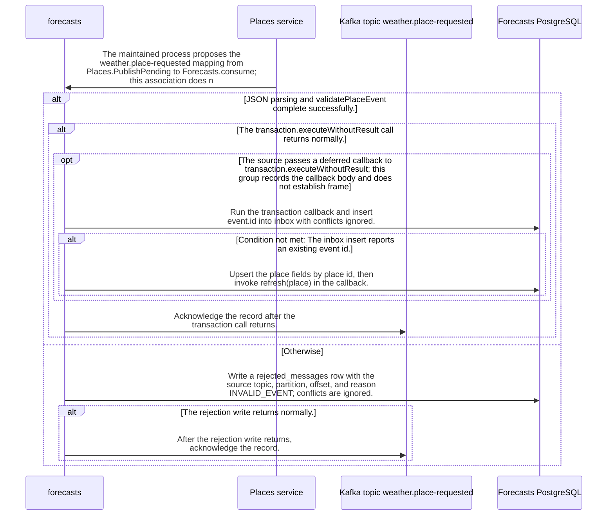

import {ClewMarkdown, ClewFieldDetails, ClewProcess, ClewDataModel, ClewDownload, ClewModelLink, ClewRelatedModelLink, ClewFieldTrace, ClewContextLink, ClewPageContext, ClewProcessReturn, ClewStatus, ClewRetainedPage, ClewCatalog, ClewAnchor} from '@site/src/components/ClewReaders';

# Forecasts consumes proposed place-requested events

<ClewPageContext />

Retained account · STALE · UNASSESSED. Runtime behavior is not established by this export.

The saved process declares an agent-proposed mapping from Places.PublishPending to Forecasts.consume on weather.place-requested; it does not establish broker routing or runtime delivery. At source, the listener parses and validates the record before entering a transaction. A parse or validation exception enters the rejection branch: an INVALID\_EVENT row is written and the record is acknowledged; if the rejection write fails, the acknowledgement is not reached. A valid event inserts its id into inbox. An existing id returns before the place upsert and refresh call; a new id upserts the place and calls refresh(place) inside the callback. The listener acknowledges after the transaction call returns, so an exception exiting that call prevents this source-level acknowledgement. The accepted Consume weather.place-requested service operation retains the detailed handler body; this page locates it in the declared Places-to-Forecasts path. Saved refresh and publisher views are links, not proof of order or atomicity. Runtime routing, delivery, and transaction outcomes remain unverified.

Summary source bindings

- [services/forecasts/src/main/kotlin/weather/Forecasts.kt:38–53 · revision c289b28be4819eddf29d59a7c12f178559ec5229](../sources/fabcf790d6359bad92930830b294197d73c440e51b6a010808853eccb900f2e6.mdx)
- [services/forecasts/src/main/kotlin/weather/Forecasts.kt:55–60 · revision c289b28be4819eddf29d59a7c12f178559ec5229](../sources/9233bcae5aa5673c061ebdb857c39ce75ee4724473f2f75c21b7387f0fc94e1b.mdx)

## weather.place-requested consumer path

| Topic | Retained contract detail |
| --- | --- |
| Topic association | The saved process proposes weather.place-requested as a mapping from Places.PublishPending to Forecasts.consume. The annotation names this listener topic; broker configuration and runtime delivery remain unverified. |
| Source validation | validatePlaceEvent requires version 1, type place.requested, a nonblank event id, a place id in oslo, helsinki, or lisbon, a nonblank name, and numeric latitude and longitude. These are source-level checks, not proof of runtime schema enforcement. |
| Process boundaries | The saved process links forecasts-refresh-scheduled and forecasts-publish-pending views. The links do not establish cross-process order, transaction atomicity, acknowledgment timing, or message delivery. |

Contract source bindings

**Topic association**

- [services/forecasts/src/main/kotlin/weather/Forecasts.kt:38–53 · revision c289b28be4819eddf29d59a7c12f178559ec5229](../sources/fabcf790d6359bad92930830b294197d73c440e51b6a010808853eccb900f2e6.mdx)

**Source validation**

- [services/forecasts/src/main/kotlin/weather/Forecasts.kt:55–60 · revision c289b28be4819eddf29d59a7c12f178559ec5229](../sources/9233bcae5aa5673c061ebdb857c39ce75ee4724473f2f75c21b7387f0fc94e1b.mdx)

**Process boundaries**

- [services/forecasts/src/main/kotlin/weather/Forecasts.kt:38–53 · revision c289b28be4819eddf29d59a7c12f178559ec5229](../sources/fabcf790d6359bad92930830b294197d73c440e51b6a010808853eccb900f2e6.mdx)

## Interaction diagram

Actors and nested branches from the retained account; not a runtime trace. Labels are shortened for readability. Full messages and notes follow.

Full original sequence, branches and notes

#### 1. message

<ClewMarkdown text={"The maintained process proposes the weather.place-requested mapping from Places.PublishPending to Forecasts.consume; this association does not verify topic configuration or runtime delivery."} />

Source bindings

- [services/forecasts/src/main/kotlin/weather/Forecasts.kt:38–53 · revision c289b28be4819eddf29d59a7c12f178559ec5229](../sources/fabcf790d6359bad92930830b294197d73c440e51b6a010808853eccb900f2e6.mdx)

#### 2. alt

<ClewMarkdown text={"JSON parsing and validatePlaceEvent complete successfully."} />

Source bindings

- [services/forecasts/src/main/kotlin/weather/Forecasts.kt:40–44 · revision c289b28be4819eddf29d59a7c12f178559ec5229](../sources/97e0dd89fa86dcb90cc283f4c25f9200d6f06d20fb3ddd9728645de580dd22fc.mdx)
- [services/forecasts/src/main/kotlin/weather/Forecasts.kt:38–53 · revision c289b28be4819eddf29d59a7c12f178559ec5229](../sources/fabcf790d6359bad92930830b294197d73c440e51b6a010808853eccb900f2e6.mdx)
- [services/forecasts/src/main/kotlin/weather/Forecasts.kt:55–60 · revision c289b28be4819eddf29d59a7c12f178559ec5229](../sources/9233bcae5aa5673c061ebdb857c39ce75ee4724473f2f75c21b7387f0fc94e1b.mdx)

#### 3. note

<ClewMarkdown text={"The source validator checks version 1, type place.requested, a nonblank id, an allowed place id, a nonblank name, and numeric latitude and longitude."} />

Source bindings

- [services/forecasts/src/main/kotlin/weather/Forecasts.kt:55–60 · revision c289b28be4819eddf29d59a7c12f178559ec5229](../sources/9233bcae5aa5673c061ebdb857c39ce75ee4724473f2f75c21b7387f0fc94e1b.mdx)

#### 4. opt

<ClewMarkdown text={"The source expression contains a deferred also lambda that calls validatePlaceEvent. The exact invocation semantics are not established by this syntax record."} />

Source bindings

- [services/forecasts/src/main/kotlin/weather/Forecasts.kt:40–40 · revision c289b28be4819eddf29d59a7c12f178559ec5229](../sources/47e4ea3df3f628f54c8dde414c838593d9efdf9d54a4f79f3c08f48519ca7d51.mdx)
- [services/forecasts/src/main/kotlin/weather/Forecasts.kt:38–53 · revision c289b28be4819eddf29d59a7c12f178559ec5229](../sources/fabcf790d6359bad92930830b294197d73c440e51b6a010808853eccb900f2e6.mdx)
- [services/forecasts/src/main/kotlin/weather/Forecasts.kt:55–60 · revision c289b28be4819eddf29d59a7c12f178559ec5229](../sources/9233bcae5aa5673c061ebdb857c39ce75ee4724473f2f75c21b7387f0fc94e1b.mdx)

#### 5. note

<ClewMarkdown text={"The source shows the parsed node passed through an also lambda to validatePlaceEvent(it)."} />

Source bindings

- [services/forecasts/src/main/kotlin/weather/Forecasts.kt:38–53 · revision c289b28be4819eddf29d59a7c12f178559ec5229](../sources/fabcf790d6359bad92930830b294197d73c440e51b6a010808853eccb900f2e6.mdx)
- [services/forecasts/src/main/kotlin/weather/Forecasts.kt:55–60 · revision c289b28be4819eddf29d59a7c12f178559ec5229](../sources/9233bcae5aa5673c061ebdb857c39ce75ee4724473f2f75c21b7387f0fc94e1b.mdx)

#### 6. end

<ClewMarkdown text={""} />

Source bindings

- [services/forecasts/src/main/kotlin/weather/Forecasts.kt:40–40 · revision c289b28be4819eddf29d59a7c12f178559ec5229](../sources/47e4ea3df3f628f54c8dde414c838593d9efdf9d54a4f79f3c08f48519ca7d51.mdx)
- [services/forecasts/src/main/kotlin/weather/Forecasts.kt:38–53 · revision c289b28be4819eddf29d59a7c12f178559ec5229](../sources/fabcf790d6359bad92930830b294197d73c440e51b6a010808853eccb900f2e6.mdx)
- [services/forecasts/src/main/kotlin/weather/Forecasts.kt:55–60 · revision c289b28be4819eddf29d59a7c12f178559ec5229](../sources/9233bcae5aa5673c061ebdb857c39ce75ee4724473f2f75c21b7387f0fc94e1b.mdx)

#### 7. alt

<ClewMarkdown text={"The transaction.executeWithoutResult call returns normally."} />

Source bindings

- [services/forecasts/src/main/kotlin/weather/Forecasts.kt:38–53 · revision c289b28be4819eddf29d59a7c12f178559ec5229](../sources/fabcf790d6359bad92930830b294197d73c440e51b6a010808853eccb900f2e6.mdx)

#### 8. opt

<ClewMarkdown text={"The source passes a deferred callback to transaction.executeWithoutResult; this group records the callback body and does not establish framework invocation or transaction outcome."} />

Source bindings

- [services/forecasts/src/main/kotlin/weather/Forecasts.kt:38–53 · revision c289b28be4819eddf29d59a7c12f178559ec5229](../sources/fabcf790d6359bad92930830b294197d73c440e51b6a010808853eccb900f2e6.mdx)
- [services/forecasts/src/main/kotlin/weather/Forecasts.kt:45–51 · revision c289b28be4819eddf29d59a7c12f178559ec5229](../sources/4e9f622c29b7004ef06a46c8f890c5d19566d4f728694d74e89ca982402eeb60.mdx)

#### 9. message

<ClewMarkdown text={"Run the transaction callback and insert event.id into inbox with conflicts ignored."} />

Source bindings

- [services/forecasts/src/main/kotlin/weather/Forecasts.kt:38–53 · revision c289b28be4819eddf29d59a7c12f178559ec5229](../sources/fabcf790d6359bad92930830b294197d73c440e51b6a010808853eccb900f2e6.mdx)

#### 10. alt

<ClewMarkdown text={"The inbox insert reports an existing event id."} />

Source bindings

- [services/forecasts/src/main/kotlin/weather/Forecasts.kt:47–47 · revision c289b28be4819eddf29d59a7c12f178559ec5229](../sources/409e3c65e41d42561e1d69c57c599677ac5cd54fccc2d766e8adf954f68ee7d8.mdx)
- [services/forecasts/src/main/kotlin/weather/Forecasts.kt:38–53 · revision c289b28be4819eddf29d59a7c12f178559ec5229](../sources/fabcf790d6359bad92930830b294197d73c440e51b6a010808853eccb900f2e6.mdx)

#### 11. note

<ClewMarkdown text={"When the inbox insert reports an existing event id, return from the transaction callback before the place upsert and refresh call."} />

Source bindings

- [services/forecasts/src/main/kotlin/weather/Forecasts.kt:38–53 · revision c289b28be4819eddf29d59a7c12f178559ec5229](../sources/fabcf790d6359bad92930830b294197d73c440e51b6a010808853eccb900f2e6.mdx)
- [services/forecasts/src/main/kotlin/weather/Forecasts.kt:47–47 · revision c289b28be4819eddf29d59a7c12f178559ec5229](../sources/7e91c34807cc22ec484f72d2e4506c85976f38cfff61cce5f7dece6d263b8506.mdx)

#### 12. else

<ClewMarkdown text={"Otherwise"} />

Source bindings

- [services/forecasts/src/main/kotlin/weather/Forecasts.kt:47–47 · revision c289b28be4819eddf29d59a7c12f178559ec5229](../sources/409e3c65e41d42561e1d69c57c599677ac5cd54fccc2d766e8adf954f68ee7d8.mdx)
- [services/forecasts/src/main/kotlin/weather/Forecasts.kt:38–53 · revision c289b28be4819eddf29d59a7c12f178559ec5229](../sources/fabcf790d6359bad92930830b294197d73c440e51b6a010808853eccb900f2e6.mdx)

#### 13. message

<ClewMarkdown text={"Upsert the place fields by place id, then invoke refresh(place) in the callback."} />

Source bindings

- [services/forecasts/src/main/kotlin/weather/Forecasts.kt:38–53 · revision c289b28be4819eddf29d59a7c12f178559ec5229](../sources/fabcf790d6359bad92930830b294197d73c440e51b6a010808853eccb900f2e6.mdx)

#### 14. end

<ClewMarkdown text={""} />

Source bindings

- [services/forecasts/src/main/kotlin/weather/Forecasts.kt:47–47 · revision c289b28be4819eddf29d59a7c12f178559ec5229](../sources/409e3c65e41d42561e1d69c57c599677ac5cd54fccc2d766e8adf954f68ee7d8.mdx)
- [services/forecasts/src/main/kotlin/weather/Forecasts.kt:38–53 · revision c289b28be4819eddf29d59a7c12f178559ec5229](../sources/fabcf790d6359bad92930830b294197d73c440e51b6a010808853eccb900f2e6.mdx)

#### 15. end

<ClewMarkdown text={""} />

Source bindings

- [services/forecasts/src/main/kotlin/weather/Forecasts.kt:38–53 · revision c289b28be4819eddf29d59a7c12f178559ec5229](../sources/fabcf790d6359bad92930830b294197d73c440e51b6a010808853eccb900f2e6.mdx)
- [services/forecasts/src/main/kotlin/weather/Forecasts.kt:45–51 · revision c289b28be4819eddf29d59a7c12f178559ec5229](../sources/4e9f622c29b7004ef06a46c8f890c5d19566d4f728694d74e89ca982402eeb60.mdx)

#### 16. message

<ClewMarkdown text={"Acknowledge the record after the transaction call returns."} />

Source bindings

- [services/forecasts/src/main/kotlin/weather/Forecasts.kt:38–53 · revision c289b28be4819eddf29d59a7c12f178559ec5229](../sources/fabcf790d6359bad92930830b294197d73c440e51b6a010808853eccb900f2e6.mdx)

#### 17. else

<ClewMarkdown text={"Otherwise"} />

Source bindings

- [services/forecasts/src/main/kotlin/weather/Forecasts.kt:38–53 · revision c289b28be4819eddf29d59a7c12f178559ec5229](../sources/fabcf790d6359bad92930830b294197d73c440e51b6a010808853eccb900f2e6.mdx)

#### 18. note

<ClewMarkdown text={"If an exception exits the transaction call, execution does not reach the following acknowledge statement. This source view does not determine rollback or delivery outcomes."} />

Source bindings

- [services/forecasts/src/main/kotlin/weather/Forecasts.kt:38–53 · revision c289b28be4819eddf29d59a7c12f178559ec5229](../sources/fabcf790d6359bad92930830b294197d73c440e51b6a010808853eccb900f2e6.mdx)

#### 19. end

<ClewMarkdown text={""} />

Source bindings

- [services/forecasts/src/main/kotlin/weather/Forecasts.kt:38–53 · revision c289b28be4819eddf29d59a7c12f178559ec5229](../sources/fabcf790d6359bad92930830b294197d73c440e51b6a010808853eccb900f2e6.mdx)

#### 20. else

<ClewMarkdown text={"Otherwise"} />

Source bindings

- [services/forecasts/src/main/kotlin/weather/Forecasts.kt:40–44 · revision c289b28be4819eddf29d59a7c12f178559ec5229](../sources/97e0dd89fa86dcb90cc283f4c25f9200d6f06d20fb3ddd9728645de580dd22fc.mdx)
- [services/forecasts/src/main/kotlin/weather/Forecasts.kt:38–53 · revision c289b28be4819eddf29d59a7c12f178559ec5229](../sources/fabcf790d6359bad92930830b294197d73c440e51b6a010808853eccb900f2e6.mdx)
- [services/forecasts/src/main/kotlin/weather/Forecasts.kt:55–60 · revision c289b28be4819eddf29d59a7c12f178559ec5229](../sources/9233bcae5aa5673c061ebdb857c39ce75ee4724473f2f75c21b7387f0fc94e1b.mdx)

#### 21. message

<ClewMarkdown text={"Write a rejected_messages row with the source topic, partition, offset, and reason INVALID_EVENT; conflicts are ignored."} />

Source bindings

- [services/forecasts/src/main/kotlin/weather/Forecasts.kt:38–53 · revision c289b28be4819eddf29d59a7c12f178559ec5229](../sources/fabcf790d6359bad92930830b294197d73c440e51b6a010808853eccb900f2e6.mdx)

#### 22. alt

<ClewMarkdown text={"The rejection write returns normally."} />

Source bindings

- [services/forecasts/src/main/kotlin/weather/Forecasts.kt:38–53 · revision c289b28be4819eddf29d59a7c12f178559ec5229](../sources/fabcf790d6359bad92930830b294197d73c440e51b6a010808853eccb900f2e6.mdx)

#### 23. message

<ClewMarkdown text={"After the rejection write returns, acknowledge the record."} />

Source bindings

- [services/forecasts/src/main/kotlin/weather/Forecasts.kt:38–53 · revision c289b28be4819eddf29d59a7c12f178559ec5229](../sources/fabcf790d6359bad92930830b294197d73c440e51b6a010808853eccb900f2e6.mdx)

#### 24. note

<ClewMarkdown text={"After the record is acknowledged, the catch branch returns from the listener."} />

Source bindings

- [services/forecasts/src/main/kotlin/weather/Forecasts.kt:43–43 · revision c289b28be4819eddf29d59a7c12f178559ec5229](../sources/384453793a46df4473ae10f9da35b024cd20ccdcc119f971bdd3c51a8dc6b413.mdx)
- [services/forecasts/src/main/kotlin/weather/Forecasts.kt:38–53 · revision c289b28be4819eddf29d59a7c12f178559ec5229](../sources/fabcf790d6359bad92930830b294197d73c440e51b6a010808853eccb900f2e6.mdx)

#### 25. else

<ClewMarkdown text={"Otherwise"} />

Source bindings

- [services/forecasts/src/main/kotlin/weather/Forecasts.kt:38–53 · revision c289b28be4819eddf29d59a7c12f178559ec5229](../sources/fabcf790d6359bad92930830b294197d73c440e51b6a010808853eccb900f2e6.mdx)

#### 26. note

<ClewMarkdown text={"If the rejection write throws, the acknowledge call is not reached and the exception propagates from this source path."} />

Source bindings

- [services/forecasts/src/main/kotlin/weather/Forecasts.kt:38–53 · revision c289b28be4819eddf29d59a7c12f178559ec5229](../sources/fabcf790d6359bad92930830b294197d73c440e51b6a010808853eccb900f2e6.mdx)

#### 27. end

<ClewMarkdown text={""} />

Source bindings

- [services/forecasts/src/main/kotlin/weather/Forecasts.kt:38–53 · revision c289b28be4819eddf29d59a7c12f178559ec5229](../sources/fabcf790d6359bad92930830b294197d73c440e51b6a010808853eccb900f2e6.mdx)

#### 28. end

<ClewMarkdown text={""} />

Source bindings

- [services/forecasts/src/main/kotlin/weather/Forecasts.kt:40–44 · revision c289b28be4819eddf29d59a7c12f178559ec5229](../sources/97e0dd89fa86dcb90cc283f4c25f9200d6f06d20fb3ddd9728645de580dd22fc.mdx)
- [services/forecasts/src/main/kotlin/weather/Forecasts.kt:38–53 · revision c289b28be4819eddf29d59a7c12f178559ec5229](../sources/fabcf790d6359bad92930830b294197d73c440e51b6a010808853eccb900f2e6.mdx)
- [services/forecasts/src/main/kotlin/weather/Forecasts.kt:55–60 · revision c289b28be4819eddf29d59a7c12f178559ec5229](../sources/9233bcae5aa5673c061ebdb857c39ce75ee4724473f2f75c21b7387f0fc94e1b.mdx)

#### 29. note

<ClewMarkdown text={"The accepted Consume weather.place-requested service operation retains the detailed handler body. The saved process links forecasts-refresh-scheduled and forecasts-publish-pending as related views; those links do not prove cross-process sequencing or exactly-once behavior."} />

Source bindings

- [services/forecasts/src/main/kotlin/weather/Forecasts.kt:38–53 · revision c289b28be4819eddf29d59a7c12f178559ec5229](../sources/fabcf790d6359bad92930830b294197d73c440e51b6a010808853eccb900f2e6.mdx)

## Implementation explanation

<ClewMarkdown text={"The maintained process proposes the weather.place-requested mapping from Places.PublishPending to Forecasts.consume; this association does not verify topic configuration or runtime delivery."} />

Source bindings

- [services/forecasts/src/main/kotlin/weather/Forecasts.kt:38–53 · revision c289b28be4819eddf29d59a7c12f178559ec5229](../sources/fabcf790d6359bad92930830b294197d73c440e51b6a010808853eccb900f2e6.mdx)

<ClewMarkdown text={"JSON parsing and validatePlaceEvent complete successfully."} />

Source bindings

- [services/forecasts/src/main/kotlin/weather/Forecasts.kt:40–44 · revision c289b28be4819eddf29d59a7c12f178559ec5229](../sources/97e0dd89fa86dcb90cc283f4c25f9200d6f06d20fb3ddd9728645de580dd22fc.mdx)
- [services/forecasts/src/main/kotlin/weather/Forecasts.kt:38–53 · revision c289b28be4819eddf29d59a7c12f178559ec5229](../sources/fabcf790d6359bad92930830b294197d73c440e51b6a010808853eccb900f2e6.mdx)
- [services/forecasts/src/main/kotlin/weather/Forecasts.kt:55–60 · revision c289b28be4819eddf29d59a7c12f178559ec5229](../sources/9233bcae5aa5673c061ebdb857c39ce75ee4724473f2f75c21b7387f0fc94e1b.mdx)

<ClewMarkdown text={"The source validator checks version 1, type place.requested, a nonblank id, an allowed place id, a nonblank name, and numeric latitude and longitude."} />

Source bindings

- [services/forecasts/src/main/kotlin/weather/Forecasts.kt:55–60 · revision c289b28be4819eddf29d59a7c12f178559ec5229](../sources/9233bcae5aa5673c061ebdb857c39ce75ee4724473f2f75c21b7387f0fc94e1b.mdx)

<ClewMarkdown text={"The source expression contains a deferred also lambda that calls validatePlaceEvent. The exact invocation semantics are not established by this syntax record."} />

Source bindings

- [services/forecasts/src/main/kotlin/weather/Forecasts.kt:40–40 · revision c289b28be4819eddf29d59a7c12f178559ec5229](../sources/47e4ea3df3f628f54c8dde414c838593d9efdf9d54a4f79f3c08f48519ca7d51.mdx)
- [services/forecasts/src/main/kotlin/weather/Forecasts.kt:38–53 · revision c289b28be4819eddf29d59a7c12f178559ec5229](../sources/fabcf790d6359bad92930830b294197d73c440e51b6a010808853eccb900f2e6.mdx)
- [services/forecasts/src/main/kotlin/weather/Forecasts.kt:55–60 · revision c289b28be4819eddf29d59a7c12f178559ec5229](../sources/9233bcae5aa5673c061ebdb857c39ce75ee4724473f2f75c21b7387f0fc94e1b.mdx)

<ClewMarkdown text={"The source shows the parsed node passed through an also lambda to validatePlaceEvent(it)."} />

Source bindings

- [services/forecasts/src/main/kotlin/weather/Forecasts.kt:38–53 · revision c289b28be4819eddf29d59a7c12f178559ec5229](../sources/fabcf790d6359bad92930830b294197d73c440e51b6a010808853eccb900f2e6.mdx)
- [services/forecasts/src/main/kotlin/weather/Forecasts.kt:55–60 · revision c289b28be4819eddf29d59a7c12f178559ec5229](../sources/9233bcae5aa5673c061ebdb857c39ce75ee4724473f2f75c21b7387f0fc94e1b.mdx)

<ClewMarkdown text={"The transaction.executeWithoutResult call returns normally."} />

Source bindings

- [services/forecasts/src/main/kotlin/weather/Forecasts.kt:38–53 · revision c289b28be4819eddf29d59a7c12f178559ec5229](../sources/fabcf790d6359bad92930830b294197d73c440e51b6a010808853eccb900f2e6.mdx)

<ClewMarkdown text={"The source passes a deferred callback to transaction.executeWithoutResult; this group records the callback body and does not establish framework invocation or transaction outcome."} />

Source bindings

- [services/forecasts/src/main/kotlin/weather/Forecasts.kt:38–53 · revision c289b28be4819eddf29d59a7c12f178559ec5229](../sources/fabcf790d6359bad92930830b294197d73c440e51b6a010808853eccb900f2e6.mdx)
- [services/forecasts/src/main/kotlin/weather/Forecasts.kt:45–51 · revision c289b28be4819eddf29d59a7c12f178559ec5229](../sources/4e9f622c29b7004ef06a46c8f890c5d19566d4f728694d74e89ca982402eeb60.mdx)

<ClewMarkdown text={"Run the transaction callback and insert event.id into inbox with conflicts ignored."} />

Source bindings

- [services/forecasts/src/main/kotlin/weather/Forecasts.kt:38–53 · revision c289b28be4819eddf29d59a7c12f178559ec5229](../sources/fabcf790d6359bad92930830b294197d73c440e51b6a010808853eccb900f2e6.mdx)

<ClewMarkdown text={"The inbox insert reports an existing event id."} />

Source bindings

- [services/forecasts/src/main/kotlin/weather/Forecasts.kt:47–47 · revision c289b28be4819eddf29d59a7c12f178559ec5229](../sources/409e3c65e41d42561e1d69c57c599677ac5cd54fccc2d766e8adf954f68ee7d8.mdx)
- [services/forecasts/src/main/kotlin/weather/Forecasts.kt:38–53 · revision c289b28be4819eddf29d59a7c12f178559ec5229](../sources/fabcf790d6359bad92930830b294197d73c440e51b6a010808853eccb900f2e6.mdx)

<ClewMarkdown text={"When the inbox insert reports an existing event id, return from the transaction callback before the place upsert and refresh call."} />

Source bindings

- [services/forecasts/src/main/kotlin/weather/Forecasts.kt:38–53 · revision c289b28be4819eddf29d59a7c12f178559ec5229](../sources/fabcf790d6359bad92930830b294197d73c440e51b6a010808853eccb900f2e6.mdx)
- [services/forecasts/src/main/kotlin/weather/Forecasts.kt:47–47 · revision c289b28be4819eddf29d59a7c12f178559ec5229](../sources/7e91c34807cc22ec484f72d2e4506c85976f38cfff61cce5f7dece6d263b8506.mdx)

<ClewMarkdown text={"The source describes an alternative branch."} />

Source bindings

- [services/forecasts/src/main/kotlin/weather/Forecasts.kt:47–47 · revision c289b28be4819eddf29d59a7c12f178559ec5229](../sources/409e3c65e41d42561e1d69c57c599677ac5cd54fccc2d766e8adf954f68ee7d8.mdx)
- [services/forecasts/src/main/kotlin/weather/Forecasts.kt:38–53 · revision c289b28be4819eddf29d59a7c12f178559ec5229](../sources/fabcf790d6359bad92930830b294197d73c440e51b6a010808853eccb900f2e6.mdx)

<ClewMarkdown text={"Upsert the place fields by place id, then invoke refresh(place) in the callback."} />

Source bindings

- [services/forecasts/src/main/kotlin/weather/Forecasts.kt:38–53 · revision c289b28be4819eddf29d59a7c12f178559ec5229](../sources/fabcf790d6359bad92930830b294197d73c440e51b6a010808853eccb900f2e6.mdx)

<ClewMarkdown text={"Acknowledge the record after the transaction call returns."} />

Source bindings

- [services/forecasts/src/main/kotlin/weather/Forecasts.kt:38–53 · revision c289b28be4819eddf29d59a7c12f178559ec5229](../sources/fabcf790d6359bad92930830b294197d73c440e51b6a010808853eccb900f2e6.mdx)

<ClewMarkdown text={"The source describes an alternative branch."} />

Source bindings

- [services/forecasts/src/main/kotlin/weather/Forecasts.kt:38–53 · revision c289b28be4819eddf29d59a7c12f178559ec5229](../sources/fabcf790d6359bad92930830b294197d73c440e51b6a010808853eccb900f2e6.mdx)

<ClewMarkdown text={"If an exception exits the transaction call, execution does not reach the following acknowledge statement. This source view does not determine rollback or delivery outcomes."} />

Source bindings

- [services/forecasts/src/main/kotlin/weather/Forecasts.kt:38–53 · revision c289b28be4819eddf29d59a7c12f178559ec5229](../sources/fabcf790d6359bad92930830b294197d73c440e51b6a010808853eccb900f2e6.mdx)

<ClewMarkdown text={"The source describes an alternative branch."} />

Source bindings

- [services/forecasts/src/main/kotlin/weather/Forecasts.kt:40–44 · revision c289b28be4819eddf29d59a7c12f178559ec5229](../sources/97e0dd89fa86dcb90cc283f4c25f9200d6f06d20fb3ddd9728645de580dd22fc.mdx)
- [services/forecasts/src/main/kotlin/weather/Forecasts.kt:38–53 · revision c289b28be4819eddf29d59a7c12f178559ec5229](../sources/fabcf790d6359bad92930830b294197d73c440e51b6a010808853eccb900f2e6.mdx)
- [services/forecasts/src/main/kotlin/weather/Forecasts.kt:55–60 · revision c289b28be4819eddf29d59a7c12f178559ec5229](../sources/9233bcae5aa5673c061ebdb857c39ce75ee4724473f2f75c21b7387f0fc94e1b.mdx)

<ClewMarkdown text={"Write a rejected_messages row with the source topic, partition, offset, and reason INVALID_EVENT; conflicts are ignored."} />

Source bindings

- [services/forecasts/src/main/kotlin/weather/Forecasts.kt:38–53 · revision c289b28be4819eddf29d59a7c12f178559ec5229](../sources/fabcf790d6359bad92930830b294197d73c440e51b6a010808853eccb900f2e6.mdx)

<ClewMarkdown text={"The rejection write returns normally."} />

Source bindings

- [services/forecasts/src/main/kotlin/weather/Forecasts.kt:38–53 · revision c289b28be4819eddf29d59a7c12f178559ec5229](../sources/fabcf790d6359bad92930830b294197d73c440e51b6a010808853eccb900f2e6.mdx)

<ClewMarkdown text={"After the rejection write returns, acknowledge the record."} />

Source bindings

- [services/forecasts/src/main/kotlin/weather/Forecasts.kt:38–53 · revision c289b28be4819eddf29d59a7c12f178559ec5229](../sources/fabcf790d6359bad92930830b294197d73c440e51b6a010808853eccb900f2e6.mdx)

<ClewMarkdown text={"After the record is acknowledged, the catch branch returns from the listener."} />

Source bindings

- [services/forecasts/src/main/kotlin/weather/Forecasts.kt:43–43 · revision c289b28be4819eddf29d59a7c12f178559ec5229](../sources/384453793a46df4473ae10f9da35b024cd20ccdcc119f971bdd3c51a8dc6b413.mdx)
- [services/forecasts/src/main/kotlin/weather/Forecasts.kt:38–53 · revision c289b28be4819eddf29d59a7c12f178559ec5229](../sources/fabcf790d6359bad92930830b294197d73c440e51b6a010808853eccb900f2e6.mdx)

<ClewMarkdown text={"The source describes an alternative branch."} />

Source bindings

- [services/forecasts/src/main/kotlin/weather/Forecasts.kt:38–53 · revision c289b28be4819eddf29d59a7c12f178559ec5229](../sources/fabcf790d6359bad92930830b294197d73c440e51b6a010808853eccb900f2e6.mdx)

<ClewMarkdown text={"If the rejection write throws, the acknowledge call is not reached and the exception propagates from this source path."} />

Source bindings

- [services/forecasts/src/main/kotlin/weather/Forecasts.kt:38–53 · revision c289b28be4819eddf29d59a7c12f178559ec5229](../sources/fabcf790d6359bad92930830b294197d73c440e51b6a010808853eccb900f2e6.mdx)

<ClewMarkdown text={"The accepted Consume weather.place-requested service operation retains the detailed handler body. The saved process links forecasts-refresh-scheduled and forecasts-publish-pending as related views; those links do not prove cross-process sequencing or exactly-once behavior."} />

Source bindings

- [services/forecasts/src/main/kotlin/weather/Forecasts.kt:38–53 · revision c289b28be4819eddf29d59a7c12f178559ec5229](../sources/fabcf790d6359bad92930830b294197d73c440e51b6a010808853eccb900f2e6.mdx)

Retained boundaries

- Callback execution, commit, rollback, and broker delivery are not established by this syntax evidence.
- CALL\_TARGETS\_UNRESOLVED
- DIALECT\_DECLARED\_NOT\_COMPILER\_VALIDATED
- FILE\_ONLY:compose.yaml
- FILE\_ONLY:contracts/dashboard.openapi.json
- FILE\_ONLY:contracts/events.schema.json
- FILE\_ONLY:database/init.sql
- FILE\_ONLY:exercises/dashboard-focus-regression.mjs
- FILE\_ONLY:exercises/replay.py
- FILE\_ONLY:exercises/validator-regression.mjs
- FILE\_ONLY:fixtures/helsinki.json
- FILE\_ONLY:fixtures/lisbon.json
- FILE\_ONLY:fixtures/met-oslo-recorded.json
- FILE\_ONLY:fixtures/oslo.json
- FILE\_ONLY:fixtures/provenance.json
- FILE\_ONLY:services/dashboard/Dockerfile
- FILE\_ONLY:services/dashboard/package-lock.json
- FILE\_ONLY:services/dashboard/package.json
- FILE\_ONLY:services/dashboard/public/index.html
- FILE\_ONLY:services/dashboard/tsconfig.json
- OPENAPI\_JSON\_SCHEMA\_KEYWORDS\_NOT\_INTERPRETED
- OPENAPI\_SCHEMA\_NULL\_TYPE\_NOT\_INTERPRETED
- OPENAPI\_SCHEMA\_TYPE\_UNIONS\_NOT\_INTERPRETED
- ORDER\_LEXICAL\_ONLY
- SCOPE\_WATCH\_CONSERVATIVE
- Syntax evidence does not establish runtime dispatch or configuration. Expand known owners and helpers; retain explicit gaps for unresolved targets.
- ANNOTATION\_DECLARATION\_UNAVAILABLE
- CALL\_TARGETS\_UNRESOLVED
- DIALECT\_DECLARED\_NOT\_COMPILER\_VALIDATED
- FILE\_ONLY:compose.yaml
- FILE\_ONLY:contracts/events.schema.json
- FILE\_ONLY:contracts/forecasts.openapi.json
- FILE\_ONLY:database/init.sql
- FILE\_ONLY:fixtures/helsinki.json
- FILE\_ONLY:fixtures/lisbon.json
- FILE\_ONLY:fixtures/met-oslo-recorded.json
- FILE\_ONLY:fixtures/oslo.json
- FILE\_ONLY:fixtures/provenance.json
- FILE\_ONLY:services/forecasts/Dockerfile
- FILE\_ONLY:services/forecasts/pom.xml
- FILE\_ONLY:services/forecasts/src/main/resources/application.properties
- NO\_BEAN\_OWNER
- OPENAPI\_JSON\_SCHEMA\_KEYWORDS\_NOT\_INTERPRETED
- OPENAPI\_SCHEMA\_NULL\_TYPE\_NOT\_INTERPRETED
- OPENAPI\_SCHEMA\_TYPE\_UNIONS\_NOT\_INTERPRETED
- ORDER\_LEXICAL\_ONLY
- RUNTIME\_REGISTRATION\_UNPROVEN
- SCOPE\_WATCH\_CONSERVATIVE
- SOURCE\_NAMES\_NOT\_COMPILER\_RESOLVED
- UNRESOLVED\_ANNOTATION\_VALUE
- Syntax evidence does not establish runtime dispatch or configuration. Expand known owners and helpers; retain explicit gaps for unresolved targets.
- CLR\_SIGNATURE\_PROJECTED\_TO\_JVM\_DESCRIPTOR\_GRAMMAR
- CSHARP\_SOURCE\_GENERATED\_DOCUMENTS\_NOT\_INDEXED
- EXCEPTION\_FLOW\_REQUIRES\_SOURCE\_REVIEW
- GENERATED\_SOURCE\_BODIES\_NOT\_INDEXED
- LAMBDA\_EXECUTION\_NOT\_EXPANDED
- OPENAPI\_JSON\_SCHEMA\_KEYWORDS\_NOT\_INTERPRETED
- SHORT\_CIRCUIT\_FLOW\_REQUIRES\_SOURCE\_REVIEW
- SWITCH\_FLOW\_REQUIRES\_SOURCE\_REVIEW

