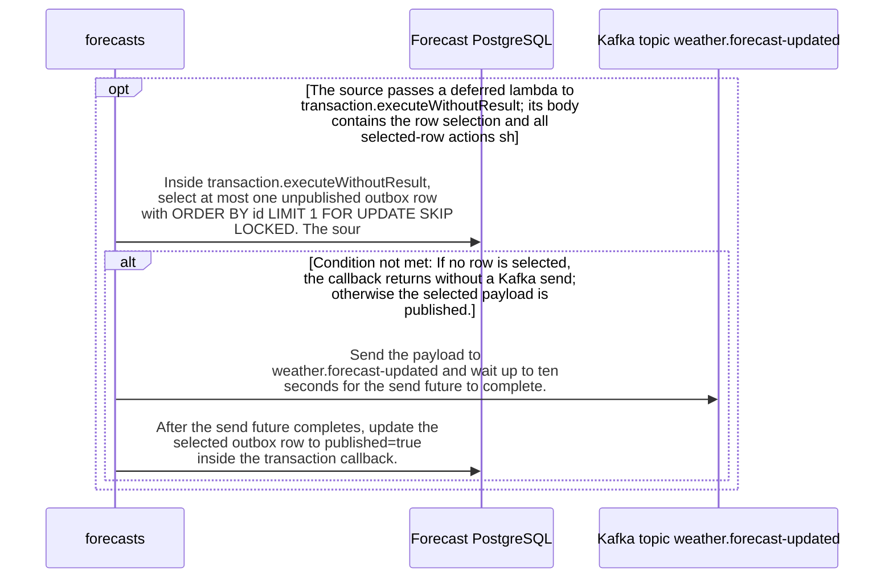

import {ClewMarkdown, ClewFieldDetails, ClewProcess, ClewDataModel, ClewDownload, ClewModelLink, ClewRelatedModelLink, ClewFieldTrace, ClewContextLink, ClewPageContext, ClewProcessReturn, ClewStatus, ClewRetainedPage, ClewCatalog, ClewAnchor} from '@site/src/components/ClewReaders';

# Publish pending forecast updates

<ClewPageContext />

Retained account · STALE · UNASSESSED. Runtime behavior is not established by this export.

At source level, publishPending declares a fixed delay from PUBLISH\_INTERVAL\_MS with a 1000 ms default; runtime registration and activation are unverified. Each invocation opens a database transaction and selects at most one unpublished outbox row ordered by id with FOR UPDATE SKIP LOCKED. The query uses identifier order, not event-time order. An empty selection returns without sending. For a selected row, the method waits up to ten seconds for the Kafka send future on weather.forecast-updated, then updates published=true in the transaction callback. Exceptions are logged as PUBLISH\_RETRY with the exception class, and the method has no in-body retry loop. Kafka send and database commit are separate effects, so a completed send followed by a transaction failure or crash can leave the row eligible for replay. The source does not establish exactly-once delivery or runtime success.

Summary source bindings

- [services/forecasts/src/main/kotlin/weather/Forecasts.kt:127–139 · revision c289b28be4819eddf29d59a7c12f178559ec5229](../sources/1bd07596f6d98195ae25427eb2eb0175e2e0db2969f1b348800d52ddabc630ab.mdx)
- [services/forecasts/src/main/kotlin/weather/Forecasts.kt:129–138 · revision c289b28be4819eddf29d59a7c12f178559ec5229](../sources/77419b38cab1c2be268d248020c0f3d1aed119786e7f30a01355c56299cf7b1f.mdx)

## Interaction diagram

Actors and nested branches from the retained account; not a runtime trace. Labels are shortened for readability. Full messages and notes follow.

Full original sequence, branches and notes

#### 1. note

<ClewMarkdown text={"The source annotation sets a fixed delay from PUBLISH_INTERVAL_MS, default 1000 ms. Runtime scheduler registration and activation are unverified."} />

Source bindings

- [services/forecasts/src/main/kotlin/weather/Forecasts.kt:127–139 · revision c289b28be4819eddf29d59a7c12f178559ec5229](../sources/1bd07596f6d98195ae25427eb2eb0175e2e0db2969f1b348800d52ddabc630ab.mdx)

#### 2. opt

<ClewMarkdown text={"The source passes a deferred lambda to transaction.executeWithoutResult; its body contains the row selection and all selected-row actions shown below. This does not establish runtime scheduler activation."} />

Source bindings

- [services/forecasts/src/main/kotlin/weather/Forecasts.kt:130–137 · revision c289b28be4819eddf29d59a7c12f178559ec5229](../sources/d16edda6870f49ad776f5d271642e7ceb0421909d445f9f593fa3fd1ecf610c2.mdx)

#### 3. message

<ClewMarkdown text={"Inside transaction.executeWithoutResult, select at most one unpublished outbox row with ORDER BY id LIMIT 1 FOR UPDATE SKIP LOCKED. The source orders by identifier; it does not establish a globally oldest event."} />

Source bindings

- [services/forecasts/src/main/kotlin/weather/Forecasts.kt:127–139 · revision c289b28be4819eddf29d59a7c12f178559ec5229](../sources/1bd07596f6d98195ae25427eb2eb0175e2e0db2969f1b348800d52ddabc630ab.mdx)
- [services/forecasts/src/main/kotlin/weather/Forecasts.kt:129–138 · revision c289b28be4819eddf29d59a7c12f178559ec5229](../sources/77419b38cab1c2be268d248020c0f3d1aed119786e7f30a01355c56299cf7b1f.mdx)

#### 4. alt

<ClewMarkdown text={"If no row is selected, the callback returns without a Kafka send; otherwise the selected payload is published."} />

Source bindings

- [services/forecasts/src/main/kotlin/weather/Forecasts.kt:127–139 · revision c289b28be4819eddf29d59a7c12f178559ec5229](../sources/1bd07596f6d98195ae25427eb2eb0175e2e0db2969f1b348800d52ddabc630ab.mdx)
- [services/forecasts/src/main/kotlin/weather/Forecasts.kt:129–138 · revision c289b28be4819eddf29d59a7c12f178559ec5229](../sources/77419b38cab1c2be268d248020c0f3d1aed119786e7f30a01355c56299cf7b1f.mdx)
- [services/forecasts/src/main/kotlin/weather/Forecasts.kt:132–132 · revision c289b28be4819eddf29d59a7c12f178559ec5229](../sources/a9ab89dedd2b2f820a65a3b31b06a7e29e1e432f2a2e9f9b8c1d1a030d0a2614.mdx)

#### 5. note

<ClewMarkdown text={"An empty result returns from the transaction callback without sending."} />

Source bindings

- [services/forecasts/src/main/kotlin/weather/Forecasts.kt:127–139 · revision c289b28be4819eddf29d59a7c12f178559ec5229](../sources/1bd07596f6d98195ae25427eb2eb0175e2e0db2969f1b348800d52ddabc630ab.mdx)
- [services/forecasts/src/main/kotlin/weather/Forecasts.kt:129–138 · revision c289b28be4819eddf29d59a7c12f178559ec5229](../sources/77419b38cab1c2be268d248020c0f3d1aed119786e7f30a01355c56299cf7b1f.mdx)
- [services/forecasts/src/main/kotlin/weather/Forecasts.kt:132–132 · revision c289b28be4819eddf29d59a7c12f178559ec5229](../sources/7c66cfc253529cc22121742daf694971e07c9472d3498bc6ef300d767cbf4713.mdx)

#### 6. else

<ClewMarkdown text={"Otherwise"} />

Source bindings

- [services/forecasts/src/main/kotlin/weather/Forecasts.kt:127–139 · revision c289b28be4819eddf29d59a7c12f178559ec5229](../sources/1bd07596f6d98195ae25427eb2eb0175e2e0db2969f1b348800d52ddabc630ab.mdx)
- [services/forecasts/src/main/kotlin/weather/Forecasts.kt:129–138 · revision c289b28be4819eddf29d59a7c12f178559ec5229](../sources/77419b38cab1c2be268d248020c0f3d1aed119786e7f30a01355c56299cf7b1f.mdx)
- [services/forecasts/src/main/kotlin/weather/Forecasts.kt:132–132 · revision c289b28be4819eddf29d59a7c12f178559ec5229](../sources/a9ab89dedd2b2f820a65a3b31b06a7e29e1e432f2a2e9f9b8c1d1a030d0a2614.mdx)

#### 7. note

<ClewMarkdown text={"Read the stored JSON payload and use place.id as the Kafka message key."} />

Source bindings

- [services/forecasts/src/main/kotlin/weather/Forecasts.kt:127–139 · revision c289b28be4819eddf29d59a7c12f178559ec5229](../sources/1bd07596f6d98195ae25427eb2eb0175e2e0db2969f1b348800d52ddabc630ab.mdx)

#### 8. message

<ClewMarkdown text={"Send the payload to weather.forecast-updated and wait up to ten seconds for the send future to complete."} />

Source bindings

- [services/forecasts/src/main/kotlin/weather/Forecasts.kt:127–139 · revision c289b28be4819eddf29d59a7c12f178559ec5229](../sources/1bd07596f6d98195ae25427eb2eb0175e2e0db2969f1b348800d52ddabc630ab.mdx)
- [services/forecasts/src/main/kotlin/weather/Forecasts.kt:129–138 · revision c289b28be4819eddf29d59a7c12f178559ec5229](../sources/77419b38cab1c2be268d248020c0f3d1aed119786e7f30a01355c56299cf7b1f.mdx)

#### 9. message

<ClewMarkdown text={"After the send future completes, update the selected outbox row to published=true inside the transaction callback."} />

Source bindings

- [services/forecasts/src/main/kotlin/weather/Forecasts.kt:127–139 · revision c289b28be4819eddf29d59a7c12f178559ec5229](../sources/1bd07596f6d98195ae25427eb2eb0175e2e0db2969f1b348800d52ddabc630ab.mdx)
- [services/forecasts/src/main/kotlin/weather/Forecasts.kt:129–138 · revision c289b28be4819eddf29d59a7c12f178559ec5229](../sources/77419b38cab1c2be268d248020c0f3d1aed119786e7f30a01355c56299cf7b1f.mdx)

#### 10. note

<ClewMarkdown text={"The database transaction does not make the Kafka effect atomic with its commit. If the send completes but the transaction later fails or the process stops before commit, the row can remain pending and be sent again."} />

Source bindings

- [services/forecasts/src/main/kotlin/weather/Forecasts.kt:127–139 · revision c289b28be4819eddf29d59a7c12f178559ec5229](../sources/1bd07596f6d98195ae25427eb2eb0175e2e0db2969f1b348800d52ddabc630ab.mdx)
- [services/forecasts/src/main/kotlin/weather/Forecasts.kt:129–138 · revision c289b28be4819eddf29d59a7c12f178559ec5229](../sources/77419b38cab1c2be268d248020c0f3d1aed119786e7f30a01355c56299cf7b1f.mdx)

#### 11. end

<ClewMarkdown text={""} />

Source bindings

- [services/forecasts/src/main/kotlin/weather/Forecasts.kt:127–139 · revision c289b28be4819eddf29d59a7c12f178559ec5229](../sources/1bd07596f6d98195ae25427eb2eb0175e2e0db2969f1b348800d52ddabc630ab.mdx)
- [services/forecasts/src/main/kotlin/weather/Forecasts.kt:129–138 · revision c289b28be4819eddf29d59a7c12f178559ec5229](../sources/77419b38cab1c2be268d248020c0f3d1aed119786e7f30a01355c56299cf7b1f.mdx)
- [services/forecasts/src/main/kotlin/weather/Forecasts.kt:132–132 · revision c289b28be4819eddf29d59a7c12f178559ec5229](../sources/a9ab89dedd2b2f820a65a3b31b06a7e29e1e432f2a2e9f9b8c1d1a030d0a2614.mdx)

#### 12. end

<ClewMarkdown text={""} />

Source bindings

- [services/forecasts/src/main/kotlin/weather/Forecasts.kt:130–137 · revision c289b28be4819eddf29d59a7c12f178559ec5229](../sources/d16edda6870f49ad776f5d271642e7ceb0421909d445f9f593fa3fd1ecf610c2.mdx)

#### 13. note

<ClewMarkdown text={"An exception from the transaction path, send wait, or database update is caught and logged as PUBLISH_RETRY followed by the exception class name. A later attempt depends on another invocation; this method contains no immediate retry loop."} />

Source bindings

- [services/forecasts/src/main/kotlin/weather/Forecasts.kt:127–139 · revision c289b28be4819eddf29d59a7c12f178559ec5229](../sources/1bd07596f6d98195ae25427eb2eb0175e2e0db2969f1b348800d52ddabc630ab.mdx)
- [services/forecasts/src/main/kotlin/weather/Forecasts.kt:129–138 · revision c289b28be4819eddf29d59a7c12f178559ec5229](../sources/77419b38cab1c2be268d248020c0f3d1aed119786e7f30a01355c56299cf7b1f.mdx)

## Implementation explanation

<ClewMarkdown text={"The source annotation sets a fixed delay from PUBLISH_INTERVAL_MS, default 1000 ms. Runtime scheduler registration and activation are unverified."} />

Source bindings

- [services/forecasts/src/main/kotlin/weather/Forecasts.kt:127–139 · revision c289b28be4819eddf29d59a7c12f178559ec5229](../sources/1bd07596f6d98195ae25427eb2eb0175e2e0db2969f1b348800d52ddabc630ab.mdx)

<ClewMarkdown text={"The source passes a deferred lambda to transaction.executeWithoutResult; its body contains the row selection and all selected-row actions shown below. This does not establish runtime scheduler activation."} />

Source bindings

- [services/forecasts/src/main/kotlin/weather/Forecasts.kt:130–137 · revision c289b28be4819eddf29d59a7c12f178559ec5229](../sources/d16edda6870f49ad776f5d271642e7ceb0421909d445f9f593fa3fd1ecf610c2.mdx)

<ClewMarkdown text={"Inside transaction.executeWithoutResult, select at most one unpublished outbox row with ORDER BY id LIMIT 1 FOR UPDATE SKIP LOCKED. The source orders by identifier; it does not establish a globally oldest event."} />

Source bindings

- [services/forecasts/src/main/kotlin/weather/Forecasts.kt:127–139 · revision c289b28be4819eddf29d59a7c12f178559ec5229](../sources/1bd07596f6d98195ae25427eb2eb0175e2e0db2969f1b348800d52ddabc630ab.mdx)
- [services/forecasts/src/main/kotlin/weather/Forecasts.kt:129–138 · revision c289b28be4819eddf29d59a7c12f178559ec5229](../sources/77419b38cab1c2be268d248020c0f3d1aed119786e7f30a01355c56299cf7b1f.mdx)

<ClewMarkdown text={"If no row is selected, the callback returns without a Kafka send; otherwise the selected payload is published."} />

Source bindings

- [services/forecasts/src/main/kotlin/weather/Forecasts.kt:127–139 · revision c289b28be4819eddf29d59a7c12f178559ec5229](../sources/1bd07596f6d98195ae25427eb2eb0175e2e0db2969f1b348800d52ddabc630ab.mdx)
- [services/forecasts/src/main/kotlin/weather/Forecasts.kt:129–138 · revision c289b28be4819eddf29d59a7c12f178559ec5229](../sources/77419b38cab1c2be268d248020c0f3d1aed119786e7f30a01355c56299cf7b1f.mdx)
- [services/forecasts/src/main/kotlin/weather/Forecasts.kt:132–132 · revision c289b28be4819eddf29d59a7c12f178559ec5229](../sources/a9ab89dedd2b2f820a65a3b31b06a7e29e1e432f2a2e9f9b8c1d1a030d0a2614.mdx)

<ClewMarkdown text={"An empty result returns from the transaction callback without sending."} />

Source bindings

- [services/forecasts/src/main/kotlin/weather/Forecasts.kt:127–139 · revision c289b28be4819eddf29d59a7c12f178559ec5229](../sources/1bd07596f6d98195ae25427eb2eb0175e2e0db2969f1b348800d52ddabc630ab.mdx)
- [services/forecasts/src/main/kotlin/weather/Forecasts.kt:129–138 · revision c289b28be4819eddf29d59a7c12f178559ec5229](../sources/77419b38cab1c2be268d248020c0f3d1aed119786e7f30a01355c56299cf7b1f.mdx)
- [services/forecasts/src/main/kotlin/weather/Forecasts.kt:132–132 · revision c289b28be4819eddf29d59a7c12f178559ec5229](../sources/7c66cfc253529cc22121742daf694971e07c9472d3498bc6ef300d767cbf4713.mdx)

<ClewMarkdown text={"The source describes an alternative branch."} />

Source bindings

- [services/forecasts/src/main/kotlin/weather/Forecasts.kt:127–139 · revision c289b28be4819eddf29d59a7c12f178559ec5229](../sources/1bd07596f6d98195ae25427eb2eb0175e2e0db2969f1b348800d52ddabc630ab.mdx)
- [services/forecasts/src/main/kotlin/weather/Forecasts.kt:129–138 · revision c289b28be4819eddf29d59a7c12f178559ec5229](../sources/77419b38cab1c2be268d248020c0f3d1aed119786e7f30a01355c56299cf7b1f.mdx)
- [services/forecasts/src/main/kotlin/weather/Forecasts.kt:132–132 · revision c289b28be4819eddf29d59a7c12f178559ec5229](../sources/a9ab89dedd2b2f820a65a3b31b06a7e29e1e432f2a2e9f9b8c1d1a030d0a2614.mdx)

<ClewMarkdown text={"Read the stored JSON payload and use place.id as the Kafka message key."} />

Source bindings

- [services/forecasts/src/main/kotlin/weather/Forecasts.kt:127–139 · revision c289b28be4819eddf29d59a7c12f178559ec5229](../sources/1bd07596f6d98195ae25427eb2eb0175e2e0db2969f1b348800d52ddabc630ab.mdx)

<ClewMarkdown text={"Send the payload to weather.forecast-updated and wait up to ten seconds for the send future to complete."} />

Source bindings

- [services/forecasts/src/main/kotlin/weather/Forecasts.kt:127–139 · revision c289b28be4819eddf29d59a7c12f178559ec5229](../sources/1bd07596f6d98195ae25427eb2eb0175e2e0db2969f1b348800d52ddabc630ab.mdx)
- [services/forecasts/src/main/kotlin/weather/Forecasts.kt:129–138 · revision c289b28be4819eddf29d59a7c12f178559ec5229](../sources/77419b38cab1c2be268d248020c0f3d1aed119786e7f30a01355c56299cf7b1f.mdx)

<ClewMarkdown text={"After the send future completes, update the selected outbox row to published=true inside the transaction callback."} />

Source bindings

- [services/forecasts/src/main/kotlin/weather/Forecasts.kt:127–139 · revision c289b28be4819eddf29d59a7c12f178559ec5229](../sources/1bd07596f6d98195ae25427eb2eb0175e2e0db2969f1b348800d52ddabc630ab.mdx)
- [services/forecasts/src/main/kotlin/weather/Forecasts.kt:129–138 · revision c289b28be4819eddf29d59a7c12f178559ec5229](../sources/77419b38cab1c2be268d248020c0f3d1aed119786e7f30a01355c56299cf7b1f.mdx)

<ClewMarkdown text={"The database transaction does not make the Kafka effect atomic with its commit. If the send completes but the transaction later fails or the process stops before commit, the row can remain pending and be sent again."} />

Source bindings

- [services/forecasts/src/main/kotlin/weather/Forecasts.kt:127–139 · revision c289b28be4819eddf29d59a7c12f178559ec5229](../sources/1bd07596f6d98195ae25427eb2eb0175e2e0db2969f1b348800d52ddabc630ab.mdx)
- [services/forecasts/src/main/kotlin/weather/Forecasts.kt:129–138 · revision c289b28be4819eddf29d59a7c12f178559ec5229](../sources/77419b38cab1c2be268d248020c0f3d1aed119786e7f30a01355c56299cf7b1f.mdx)

<ClewMarkdown text={"An exception from the transaction path, send wait, or database update is caught and logged as PUBLISH_RETRY followed by the exception class name. A later attempt depends on another invocation; this method contains no immediate retry loop."} />

Source bindings

- [services/forecasts/src/main/kotlin/weather/Forecasts.kt:127–139 · revision c289b28be4819eddf29d59a7c12f178559ec5229](../sources/1bd07596f6d98195ae25427eb2eb0175e2e0db2969f1b348800d52ddabc630ab.mdx)
- [services/forecasts/src/main/kotlin/weather/Forecasts.kt:129–138 · revision c289b28be4819eddf29d59a7c12f178559ec5229](../sources/77419b38cab1c2be268d248020c0f3d1aed119786e7f30a01355c56299cf7b1f.mdx)

Retained boundaries

- ANNOTATION\_DECLARATION\_UNAVAILABLE
- CALL\_TARGETS\_UNRESOLVED
- DIALECT\_DECLARED\_NOT\_COMPILER\_VALIDATED
- FILE\_ONLY:compose.yaml
- FILE\_ONLY:contracts/events.schema.json
- FILE\_ONLY:contracts/forecasts.openapi.json
- FILE\_ONLY:database/init.sql
- FILE\_ONLY:fixtures/helsinki.json
- FILE\_ONLY:fixtures/lisbon.json
- FILE\_ONLY:fixtures/met-oslo-recorded.json
- FILE\_ONLY:fixtures/oslo.json
- FILE\_ONLY:fixtures/provenance.json
- FILE\_ONLY:services/forecasts/Dockerfile
- FILE\_ONLY:services/forecasts/pom.xml
- FILE\_ONLY:services/forecasts/src/main/resources/application.properties
- NO\_BEAN\_OWNER
- OPENAPI\_JSON\_SCHEMA\_KEYWORDS\_NOT\_INTERPRETED
- OPENAPI\_SCHEMA\_NULL\_TYPE\_NOT\_INTERPRETED
- OPENAPI\_SCHEMA\_TYPE\_UNIONS\_NOT\_INTERPRETED
- ORDER\_LEXICAL\_ONLY
- RUNTIME\_REGISTRATION\_UNPROVEN
- SCOPE\_WATCH\_CONSERVATIVE
- SOURCE\_NAMES\_NOT\_COMPILER\_RESOLVED
- UNRESOLVED\_ANNOTATION\_VALUE
- Syntax evidence does not establish runtime dispatch or configuration. Expand known owners and helpers; retain explicit gaps for unresolved targets.
- CLR\_SIGNATURE\_PROJECTED\_TO\_JVM\_DESCRIPTOR\_GRAMMAR
- CSHARP\_SOURCE\_GENERATED\_DOCUMENTS\_NOT\_INDEXED
- EXCEPTION\_FLOW\_REQUIRES\_SOURCE\_REVIEW
- GENERATED\_SOURCE\_BODIES\_NOT\_INDEXED
- LAMBDA\_EXECUTION\_NOT\_EXPANDED
- OPENAPI\_JSON\_SCHEMA\_KEYWORDS\_NOT\_INTERPRETED
- SHORT\_CIRCUIT\_FLOW\_REQUIRES\_SOURCE\_REVIEW
- SWITCH\_FLOW\_REQUIRES\_SOURCE\_REVIEW

