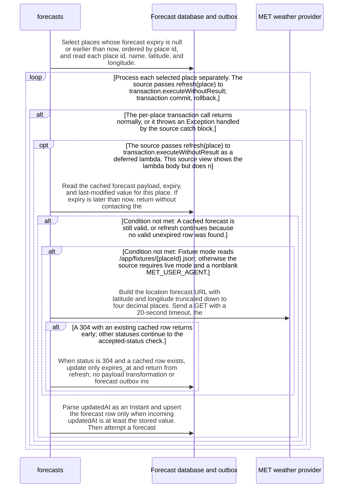

import {ClewMarkdown, ClewFieldDetails, ClewProcess, ClewDataModel, ClewDownload, ClewModelLink, ClewRelatedModelLink, ClewFieldTrace, ClewContextLink, ClewPageContext, ClewProcessReturn, ClewStatus, ClewRetainedPage, ClewCatalog, ClewAnchor} from '@site/src/components/ClewReaders';

# Refresh cached and provider forecasts

<ClewPageContext />

Retained account · STALE · UNASSESSED. Runtime behavior is not established by this export.

The source declares refreshExpired with a 60-second default fixed delay; scheduler registration and activation are unverified. It selects places with a null or expired forecast, ordered by place id, and passes each refresh call to a transaction callback inside a per-place try/catch. The shared refresh path returns on an unexpired cache entry. Fixture mode reads a place file; live mode requires a nonblank MET\_USER\_AGENT and uses a private in-memory ConcurrentHashMap field keyed by place id for nextAttempt, setting a 60-second deadline before the request. Each response sets expiry from Expires or a one-hour fallback, then sets nextAttempt from numeric Retry-After for 429 with a 60-second minimum, or from expiry for other statuses. A cached 304 updates expiry and returns. Fixture data and accepted 200/203 bodies share the transformation and persistence path: up to six periods require numeric temperature and a nonempty result; missing or nonnumeric rain becomes null and a missing symbol becomes unknown. The forecast upsert accepts an incoming updatedAt at least as new as the stored value, then attempts a forecast.updated outbox insert keyed by place id and updatedAt with conflict suppression. Pending-row delivery belongs to a separate linked publisher view. These source records do not prove scheduler activation, callback transaction behavior, or runtime delivery.

Summary source bindings

- [services/forecasts/src/main/kotlin/weather/Forecasts.kt:70–125 · revision c289b28be4819eddf29d59a7c12f178559ec5229](../sources/ca9432fec2a98615bce1212fc0e5541dcddd9f87f2124c7af78487e0179ddffa.mdx)
- [services/forecasts/src/main/kotlin/weather/Forecasts.kt:62–68 · revision c289b28be4819eddf29d59a7c12f178559ec5229](../sources/ee1c73490c4cd4a1f4efaf310e65a12cc2a3c6bbb15ab76a4eb246cf1533dc35.mdx)
- [services/forecasts/src/main/kotlin/weather/Forecasts.kt:32–32 · revision c289b28be4819eddf29d59a7c12f178559ec5229](../sources/b325b07220fc25f8eb6c7811f29686ee179f573e860c82a95641074c7f3d0907.mdx)

## Interaction diagram

Actors and nested branches from the retained account; not a runtime trace. Labels are shortened for readability. Full messages and notes follow.

Full original sequence, branches and notes

#### 1. note

<ClewMarkdown text={"The source annotates refreshExpired with fixedDelayString REFRESH_INTERVAL_MS defaulting to 60000 ms. This declaration does not establish that the runtime scheduler registers or activates it."} />

Source bindings

- [services/forecasts/src/main/kotlin/weather/Forecasts.kt:62–68 · revision c289b28be4819eddf29d59a7c12f178559ec5229](../sources/ee1c73490c4cd4a1f4efaf310e65a12cc2a3c6bbb15ab76a4eb246cf1533dc35.mdx)

#### 2. message

<ClewMarkdown text={"Select places whose forecast expiry is null or earlier than now, ordered by place id, and read each place id, name, latitude, and longitude."} />

Source bindings

- [services/forecasts/src/main/kotlin/weather/Forecasts.kt:62–68 · revision c289b28be4819eddf29d59a7c12f178559ec5229](../sources/ee1c73490c4cd4a1f4efaf310e65a12cc2a3c6bbb15ab76a4eb246cf1533dc35.mdx)

#### 3. opt

<ClewMarkdown text={"The source passes a deferred row-mapping lambda to jdbc.query. If invoked for a returned row, the lambda builds a JSON object with id, name, latitude, and longitude; callback execution is not attested."} />

Source bindings

- [services/forecasts/src/main/kotlin/weather/Forecasts.kt:64–64 · revision c289b28be4819eddf29d59a7c12f178559ec5229](../sources/d88100a3e64655a7f2f776447263dde9b9a986a7fdba57965ea9c7565783ffbf.mdx)

#### 4. note

<ClewMarkdown text={"Map the returned row columns into the place object consumed by the following per-place loop."} />

Source bindings

- [services/forecasts/src/main/kotlin/weather/Forecasts.kt:64–64 · revision c289b28be4819eddf29d59a7c12f178559ec5229](../sources/d88100a3e64655a7f2f776447263dde9b9a986a7fdba57965ea9c7565783ffbf.mdx)

#### 5. end

<ClewMarkdown text={""} />

Source bindings

- [services/forecasts/src/main/kotlin/weather/Forecasts.kt:64–64 · revision c289b28be4819eddf29d59a7c12f178559ec5229](../sources/d88100a3e64655a7f2f776447263dde9b9a986a7fdba57965ea9c7565783ffbf.mdx)

#### 6. loop

<ClewMarkdown text={"Process each selected place separately. The source passes refresh(place) to transaction.executeWithoutResult; transaction commit, rollback, and callback timing are not established by this syntax capture."} />

Source bindings

- [services/forecasts/src/main/kotlin/weather/Forecasts.kt:62–68 · revision c289b28be4819eddf29d59a7c12f178559ec5229](../sources/ee1c73490c4cd4a1f4efaf310e65a12cc2a3c6bbb15ab76a4eb246cf1533dc35.mdx)
- [services/forecasts/src/main/kotlin/weather/Forecasts.kt:65–67 · revision c289b28be4819eddf29d59a7c12f178559ec5229](../sources/afc9d1096fb08a657cb9b7dfe6672bff110cfa74625c7d51092f4873e0a6863d.mdx)

#### 7. alt

<ClewMarkdown text={"The per-place transaction call returns normally, or it throws an Exception handled by the source catch block."} />

Source bindings

- [services/forecasts/src/main/kotlin/weather/Forecasts.kt:66–66 · revision c289b28be4819eddf29d59a7c12f178559ec5229](../sources/a5d4bf22b0f8c31ff9bfeb782f4242c6a3fbae92380ecfadc31c144d27b7f55f.mdx)

#### 8. opt

<ClewMarkdown text={"The source passes refresh(place) to transaction.executeWithoutResult as a deferred lambda. This source view shows the lambda body but does not establish callback invocation or transaction outcomes."} />

Source bindings

- [services/forecasts/src/main/kotlin/weather/Forecasts.kt:62–68 · revision c289b28be4819eddf29d59a7c12f178559ec5229](../sources/ee1c73490c4cd4a1f4efaf310e65a12cc2a3c6bbb15ab76a4eb246cf1533dc35.mdx)
- [services/forecasts/src/main/kotlin/weather/Forecasts.kt:66–66 · revision c289b28be4819eddf29d59a7c12f178559ec5229](../sources/181fa6c9d9cc1e3e7ddeb4efe5cd89a564e8b1eb6511eb73f297139264c4609d.mdx)

#### 9. message

<ClewMarkdown text={"Read the cached forecast payload, expiry, and last-modified value for this place. If expiry is later than now, return without contacting the provider or writing a new forecast outbox event."} />

Source bindings

- [services/forecasts/src/main/kotlin/weather/Forecasts.kt:70–125 · revision c289b28be4819eddf29d59a7c12f178559ec5229](../sources/ca9432fec2a98615bce1212fc0e5541dcddd9f87f2124c7af78487e0179ddffa.mdx)

#### 10. alt

<ClewMarkdown text={"A cached forecast is still valid, or refresh continues because no valid unexpired row was found."} />

Source bindings

- [services/forecasts/src/main/kotlin/weather/Forecasts.kt:70–125 · revision c289b28be4819eddf29d59a7c12f178559ec5229](../sources/ca9432fec2a98615bce1212fc0e5541dcddd9f87f2124c7af78487e0179ddffa.mdx)

#### 11. note

<ClewMarkdown text={"For an unexpired cached row, refresh returns immediately."} />

Source bindings

- [services/forecasts/src/main/kotlin/weather/Forecasts.kt:70–125 · revision c289b28be4819eddf29d59a7c12f178559ec5229](../sources/ca9432fec2a98615bce1212fc0e5541dcddd9f87f2124c7af78487e0179ddffa.mdx)

#### 12. else

<ClewMarkdown text={"Otherwise"} />

Source bindings

- [services/forecasts/src/main/kotlin/weather/Forecasts.kt:70–125 · revision c289b28be4819eddf29d59a7c12f178559ec5229](../sources/ca9432fec2a98615bce1212fc0e5541dcddd9f87f2124c7af78487e0179ddffa.mdx)

#### 13. alt

<ClewMarkdown text={"Fixture mode reads /app/fixtures/{placeId}.json; otherwise the source requires live mode and a nonblank MET_USER_AGENT."} />

Source bindings

- [services/forecasts/src/main/kotlin/weather/Forecasts.kt:70–125 · revision c289b28be4819eddf29d59a7c12f178559ec5229](../sources/ca9432fec2a98615bce1212fc0e5541dcddd9f87f2124c7af78487e0179ddffa.mdx)

#### 14. note

<ClewMarkdown text={"In fixture mode, read the place-specific fixture and continue through the common transformation and persistence path."} />

Source bindings

- [services/forecasts/src/main/kotlin/weather/Forecasts.kt:70–125 · revision c289b28be4819eddf29d59a7c12f178559ec5229](../sources/ca9432fec2a98615bce1212fc0e5541dcddd9f87f2124c7af78487e0179ddffa.mdx)

#### 15. else

<ClewMarkdown text={"Otherwise"} />

Source bindings

- [services/forecasts/src/main/kotlin/weather/Forecasts.kt:70–125 · revision c289b28be4819eddf29d59a7c12f178559ec5229](../sources/ca9432fec2a98615bce1212fc0e5541dcddd9f87f2124c7af78487e0179ddffa.mdx)

#### 16. note

<ClewMarkdown text={"The Forecasts source declares nextAttempt as a private in-memory ConcurrentHashMap field keyed by place id and storing Instant values. In live mode, reject the request when this place entry is later than now, then set it to now plus 60 seconds before sending. The capture does not establish how long a runtime instance is retained."} />

Source bindings

- [services/forecasts/src/main/kotlin/weather/Forecasts.kt:70–125 · revision c289b28be4819eddf29d59a7c12f178559ec5229](../sources/ca9432fec2a98615bce1212fc0e5541dcddd9f87f2124c7af78487e0179ddffa.mdx)
- [services/forecasts/src/main/kotlin/weather/Forecasts.kt:32–32 · revision c289b28be4819eddf29d59a7c12f178559ec5229](../sources/b325b07220fc25f8eb6c7811f29686ee179f573e860c82a95641074c7f3d0907.mdx)

#### 17. message

<ClewMarkdown text={"Build the location forecast URL with latitude and longitude truncated down to four decimal places. Send a GET with a 20-second timeout, the configured User-Agent, Accept-Encoding gzip, and If-Modified-Since when the cached row has a last-modified value."} />

Source bindings

- [services/forecasts/src/main/kotlin/weather/Forecasts.kt:70–125 · revision c289b28be4819eddf29d59a7c12f178559ec5229](../sources/ca9432fec2a98615bce1212fc0e5541dcddd9f87f2124c7af78487e0179ddffa.mdx)

#### 18. note

<ClewMarkdown text={"For every live response, set expiry from the Expires header or now plus one hour. Set nextAttempt from numeric Retry-After for status 429, defaulting to 60 seconds and enforcing a 60-second minimum; for other statuses set nextAttempt to expiry. These updates occur before the 304 and accepted-status branches."} />

Source bindings

- [services/forecasts/src/main/kotlin/weather/Forecasts.kt:70–125 · revision c289b28be4819eddf29d59a7c12f178559ec5229](../sources/ca9432fec2a98615bce1212fc0e5541dcddd9f87f2124c7af78487e0179ddffa.mdx)
- [services/forecasts/src/main/kotlin/weather/Forecasts.kt:32–32 · revision c289b28be4819eddf29d59a7c12f178559ec5229](../sources/b325b07220fc25f8eb6c7811f29686ee179f573e860c82a95641074c7f3d0907.mdx)

#### 19. alt

<ClewMarkdown text={"A 304 with an existing cached row returns early; other statuses continue to the accepted-status check."} />

Source bindings

- [services/forecasts/src/main/kotlin/weather/Forecasts.kt:70–125 · revision c289b28be4819eddf29d59a7c12f178559ec5229](../sources/ca9432fec2a98615bce1212fc0e5541dcddd9f87f2124c7af78487e0179ddffa.mdx)

#### 20. message

<ClewMarkdown text={"When status is 304 and a cached row exists, update only expires_at and return from refresh; no payload transformation or forecast outbox insert follows this branch."} />

Source bindings

- [services/forecasts/src/main/kotlin/weather/Forecasts.kt:70–125 · revision c289b28be4819eddf29d59a7c12f178559ec5229](../sources/ca9432fec2a98615bce1212fc0e5541dcddd9f87f2124c7af78487e0179ddffa.mdx)

#### 21. note

<ClewMarkdown text={"Return from refresh after updating cached expiry; skip the shared transformation and persistence steps that follow this branch."} />

Source bindings

- [services/forecasts/src/main/kotlin/weather/Forecasts.kt:70–125 · revision c289b28be4819eddf29d59a7c12f178559ec5229](../sources/ca9432fec2a98615bce1212fc0e5541dcddd9f87f2124c7af78487e0179ddffa.mdx)

#### 22. else

<ClewMarkdown text={"Otherwise"} />

Source bindings

- [services/forecasts/src/main/kotlin/weather/Forecasts.kt:70–125 · revision c289b28be4819eddf29d59a7c12f178559ec5229](../sources/ca9432fec2a98615bce1212fc0e5541dcddd9f87f2124c7af78487e0179ddffa.mdx)

#### 23. alt

<ClewMarkdown text={"The status is 200 or 203, or the source status requirement throws."} />

Source bindings

- [services/forecasts/src/main/kotlin/weather/Forecasts.kt:70–125 · revision c289b28be4819eddf29d59a7c12f178559ec5229](../sources/ca9432fec2a98615bce1212fc0e5541dcddd9f87f2124c7af78487e0179ddffa.mdx)

#### 24. note

<ClewMarkdown text={"Require status 200 or 203, then read Last-Modified and decode the body as gzip when indicated or UTF-8 otherwise. Other statuses throw an error containing the provider status."} />

Source bindings

- [services/forecasts/src/main/kotlin/weather/Forecasts.kt:70–125 · revision c289b28be4819eddf29d59a7c12f178559ec5229](../sources/ca9432fec2a98615bce1212fc0e5541dcddd9f87f2124c7af78487e0179ddffa.mdx)

#### 25. else

<ClewMarkdown text={"Otherwise"} />

Source bindings

- [services/forecasts/src/main/kotlin/weather/Forecasts.kt:70–125 · revision c289b28be4819eddf29d59a7c12f178559ec5229](../sources/ca9432fec2a98615bce1212fc0e5541dcddd9f87f2124c7af78487e0179ddffa.mdx)

#### 26. note

<ClewMarkdown text={"For a status other than 200 or 203, the source requirement throws an error containing the provider status. The enclosing per-place catch logs the exception class, and this failed path does not reach the shared transformation or persistence steps."} />

Source bindings

- [services/forecasts/src/main/kotlin/weather/Forecasts.kt:70–125 · revision c289b28be4819eddf29d59a7c12f178559ec5229](../sources/ca9432fec2a98615bce1212fc0e5541dcddd9f87f2124c7af78487e0179ddffa.mdx)
- [services/forecasts/src/main/kotlin/weather/Forecasts.kt:66–66 · revision c289b28be4819eddf29d59a7c12f178559ec5229](../sources/a5d4bf22b0f8c31ff9bfeb782f4242c6a3fbae92380ecfadc31c144d27b7f55f.mdx)

#### 27. end

<ClewMarkdown text={""} />

Source bindings

- [services/forecasts/src/main/kotlin/weather/Forecasts.kt:70–125 · revision c289b28be4819eddf29d59a7c12f178559ec5229](../sources/ca9432fec2a98615bce1212fc0e5541dcddd9f87f2124c7af78487e0179ddffa.mdx)

#### 28. end

<ClewMarkdown text={""} />

Source bindings

- [services/forecasts/src/main/kotlin/weather/Forecasts.kt:70–125 · revision c289b28be4819eddf29d59a7c12f178559ec5229](../sources/ca9432fec2a98615bce1212fc0e5541dcddd9f87f2124c7af78487e0179ddffa.mdx)

#### 29. end

<ClewMarkdown text={""} />

Source bindings

- [services/forecasts/src/main/kotlin/weather/Forecasts.kt:70–125 · revision c289b28be4819eddf29d59a7c12f178559ec5229](../sources/ca9432fec2a98615bce1212fc0e5541dcddd9f87f2124c7af78487e0179ddffa.mdx)

#### 30. note

<ClewMarkdown text={"For fixture input or an accepted provider body, parse the document and transform up to six time-series points. Require numeric air temperature and at least one period; missing or nonnumeric precipitation becomes null and a missing symbol becomes unknown."} />

Source bindings

- [services/forecasts/src/main/kotlin/weather/Forecasts.kt:70–125 · revision c289b28be4819eddf29d59a7c12f178559ec5229](../sources/ca9432fec2a98615bce1212fc0e5541dcddd9f87f2124c7af78487e0179ddffa.mdx)

#### 31. message

<ClewMarkdown text={"Parse updatedAt as an Instant and upsert the forecast row only when incoming updatedAt is at least the stored value. Then attempt a forecast.updated event insert with id placeId:updatedAt, version 1, place and forecast data, using ON CONFLICT DO NOTHING. The outbox attempt follows the upsert call even when the SQL predicate rejects an older value."} />

Source bindings

- [services/forecasts/src/main/kotlin/weather/Forecasts.kt:70–125 · revision c289b28be4819eddf29d59a7c12f178559ec5229](../sources/ca9432fec2a98615bce1212fc0e5541dcddd9f87f2124c7af78487e0179ddffa.mdx)

#### 32. end

<ClewMarkdown text={""} />

Source bindings

- [services/forecasts/src/main/kotlin/weather/Forecasts.kt:70–125 · revision c289b28be4819eddf29d59a7c12f178559ec5229](../sources/ca9432fec2a98615bce1212fc0e5541dcddd9f87f2124c7af78487e0179ddffa.mdx)

#### 33. end

<ClewMarkdown text={""} />

Source bindings

- [services/forecasts/src/main/kotlin/weather/Forecasts.kt:62–68 · revision c289b28be4819eddf29d59a7c12f178559ec5229](../sources/ee1c73490c4cd4a1f4efaf310e65a12cc2a3c6bbb15ab76a4eb246cf1533dc35.mdx)
- [services/forecasts/src/main/kotlin/weather/Forecasts.kt:66–66 · revision c289b28be4819eddf29d59a7c12f178559ec5229](../sources/181fa6c9d9cc1e3e7ddeb4efe5cd89a564e8b1eb6511eb73f297139264c4609d.mdx)

#### 34. else

<ClewMarkdown text={"Otherwise"} />

Source bindings

- [services/forecasts/src/main/kotlin/weather/Forecasts.kt:66–66 · revision c289b28be4819eddf29d59a7c12f178559ec5229](../sources/a5d4bf22b0f8c31ff9bfeb782f4242c6a3fbae92380ecfadc31c144d27b7f55f.mdx)

#### 35. note

<ClewMarkdown text={"When the per-place transaction call throws an Exception, the source catches it, logs FORECAST_RETRY followed by the exception class, and continues to the next place. This method contains no explicit retry loop; another invocation is needed for another attempt, and runtime scheduling remains unverified."} />

Source bindings

- [services/forecasts/src/main/kotlin/weather/Forecasts.kt:62–68 · revision c289b28be4819eddf29d59a7c12f178559ec5229](../sources/ee1c73490c4cd4a1f4efaf310e65a12cc2a3c6bbb15ab76a4eb246cf1533dc35.mdx)
- [services/forecasts/src/main/kotlin/weather/Forecasts.kt:66–66 · revision c289b28be4819eddf29d59a7c12f178559ec5229](../sources/a5d4bf22b0f8c31ff9bfeb782f4242c6a3fbae92380ecfadc31c144d27b7f55f.mdx)

#### 36. end

<ClewMarkdown text={""} />

Source bindings

- [services/forecasts/src/main/kotlin/weather/Forecasts.kt:66–66 · revision c289b28be4819eddf29d59a7c12f178559ec5229](../sources/a5d4bf22b0f8c31ff9bfeb782f4242c6a3fbae92380ecfadc31c144d27b7f55f.mdx)

#### 37. end

<ClewMarkdown text={""} />

Source bindings

- [services/forecasts/src/main/kotlin/weather/Forecasts.kt:62–68 · revision c289b28be4819eddf29d59a7c12f178559ec5229](../sources/ee1c73490c4cd4a1f4efaf310e65a12cc2a3c6bbb15ab76a4eb246cf1533dc35.mdx)
- [services/forecasts/src/main/kotlin/weather/Forecasts.kt:65–67 · revision c289b28be4819eddf29d59a7c12f178559ec5229](../sources/afc9d1096fb08a657cb9b7dfe6672bff110cfa74625c7d51092f4873e0a6863d.mdx)

#### 38. note

<ClewMarkdown text={"The source writes a pending forecast outbox row; the saved process definition links pending-row delivery to a separate forecasts-publish-pending view. This refresh scenario documents the outbox write and does not claim successful delivery."} />

Source bindings

- [services/forecasts/src/main/kotlin/weather/Forecasts.kt:70–125 · revision c289b28be4819eddf29d59a7c12f178559ec5229](../sources/ca9432fec2a98615bce1212fc0e5541dcddd9f87f2124c7af78487e0179ddffa.mdx)

## Implementation explanation

<ClewMarkdown text={"The source annotates refreshExpired with fixedDelayString REFRESH_INTERVAL_MS defaulting to 60000 ms. This declaration does not establish that the runtime scheduler registers or activates it."} />

Source bindings

- [services/forecasts/src/main/kotlin/weather/Forecasts.kt:62–68 · revision c289b28be4819eddf29d59a7c12f178559ec5229](../sources/ee1c73490c4cd4a1f4efaf310e65a12cc2a3c6bbb15ab76a4eb246cf1533dc35.mdx)

<ClewMarkdown text={"Select places whose forecast expiry is null or earlier than now, ordered by place id, and read each place id, name, latitude, and longitude."} />

Source bindings

- [services/forecasts/src/main/kotlin/weather/Forecasts.kt:62–68 · revision c289b28be4819eddf29d59a7c12f178559ec5229](../sources/ee1c73490c4cd4a1f4efaf310e65a12cc2a3c6bbb15ab76a4eb246cf1533dc35.mdx)

<ClewMarkdown text={"The source passes a deferred row-mapping lambda to jdbc.query. If invoked for a returned row, the lambda builds a JSON object with id, name, latitude, and longitude; callback execution is not attested."} />

Source bindings

- [services/forecasts/src/main/kotlin/weather/Forecasts.kt:64–64 · revision c289b28be4819eddf29d59a7c12f178559ec5229](../sources/d88100a3e64655a7f2f776447263dde9b9a986a7fdba57965ea9c7565783ffbf.mdx)

<ClewMarkdown text={"Map the returned row columns into the place object consumed by the following per-place loop."} />

Source bindings

- [services/forecasts/src/main/kotlin/weather/Forecasts.kt:64–64 · revision c289b28be4819eddf29d59a7c12f178559ec5229](../sources/d88100a3e64655a7f2f776447263dde9b9a986a7fdba57965ea9c7565783ffbf.mdx)

<ClewMarkdown text={"Process each selected place separately. The source passes refresh(place) to transaction.executeWithoutResult; transaction commit, rollback, and callback timing are not established by this syntax capture."} />

Source bindings

- [services/forecasts/src/main/kotlin/weather/Forecasts.kt:62–68 · revision c289b28be4819eddf29d59a7c12f178559ec5229](../sources/ee1c73490c4cd4a1f4efaf310e65a12cc2a3c6bbb15ab76a4eb246cf1533dc35.mdx)
- [services/forecasts/src/main/kotlin/weather/Forecasts.kt:65–67 · revision c289b28be4819eddf29d59a7c12f178559ec5229](../sources/afc9d1096fb08a657cb9b7dfe6672bff110cfa74625c7d51092f4873e0a6863d.mdx)

<ClewMarkdown text={"The per-place transaction call returns normally, or it throws an Exception handled by the source catch block."} />

Source bindings

- [services/forecasts/src/main/kotlin/weather/Forecasts.kt:66–66 · revision c289b28be4819eddf29d59a7c12f178559ec5229](../sources/a5d4bf22b0f8c31ff9bfeb782f4242c6a3fbae92380ecfadc31c144d27b7f55f.mdx)

<ClewMarkdown text={"The source passes refresh(place) to transaction.executeWithoutResult as a deferred lambda. This source view shows the lambda body but does not establish callback invocation or transaction outcomes."} />

Source bindings

- [services/forecasts/src/main/kotlin/weather/Forecasts.kt:62–68 · revision c289b28be4819eddf29d59a7c12f178559ec5229](../sources/ee1c73490c4cd4a1f4efaf310e65a12cc2a3c6bbb15ab76a4eb246cf1533dc35.mdx)
- [services/forecasts/src/main/kotlin/weather/Forecasts.kt:66–66 · revision c289b28be4819eddf29d59a7c12f178559ec5229](../sources/181fa6c9d9cc1e3e7ddeb4efe5cd89a564e8b1eb6511eb73f297139264c4609d.mdx)

<ClewMarkdown text={"Read the cached forecast payload, expiry, and last-modified value for this place. If expiry is later than now, return without contacting the provider or writing a new forecast outbox event."} />

Source bindings

- [services/forecasts/src/main/kotlin/weather/Forecasts.kt:70–125 · revision c289b28be4819eddf29d59a7c12f178559ec5229](../sources/ca9432fec2a98615bce1212fc0e5541dcddd9f87f2124c7af78487e0179ddffa.mdx)

<ClewMarkdown text={"A cached forecast is still valid, or refresh continues because no valid unexpired row was found."} />

Source bindings

- [services/forecasts/src/main/kotlin/weather/Forecasts.kt:70–125 · revision c289b28be4819eddf29d59a7c12f178559ec5229](../sources/ca9432fec2a98615bce1212fc0e5541dcddd9f87f2124c7af78487e0179ddffa.mdx)

<ClewMarkdown text={"For an unexpired cached row, refresh returns immediately."} />

Source bindings

- [services/forecasts/src/main/kotlin/weather/Forecasts.kt:70–125 · revision c289b28be4819eddf29d59a7c12f178559ec5229](../sources/ca9432fec2a98615bce1212fc0e5541dcddd9f87f2124c7af78487e0179ddffa.mdx)

<ClewMarkdown text={"The source describes an alternative branch."} />

Source bindings

- [services/forecasts/src/main/kotlin/weather/Forecasts.kt:70–125 · revision c289b28be4819eddf29d59a7c12f178559ec5229](../sources/ca9432fec2a98615bce1212fc0e5541dcddd9f87f2124c7af78487e0179ddffa.mdx)

<ClewMarkdown text={"Fixture mode reads /app/fixtures/{placeId}.json; otherwise the source requires live mode and a nonblank MET_USER_AGENT."} />

Source bindings

- [services/forecasts/src/main/kotlin/weather/Forecasts.kt:70–125 · revision c289b28be4819eddf29d59a7c12f178559ec5229](../sources/ca9432fec2a98615bce1212fc0e5541dcddd9f87f2124c7af78487e0179ddffa.mdx)

<ClewMarkdown text={"In fixture mode, read the place-specific fixture and continue through the common transformation and persistence path."} />

Source bindings

- [services/forecasts/src/main/kotlin/weather/Forecasts.kt:70–125 · revision c289b28be4819eddf29d59a7c12f178559ec5229](../sources/ca9432fec2a98615bce1212fc0e5541dcddd9f87f2124c7af78487e0179ddffa.mdx)

<ClewMarkdown text={"The source describes an alternative branch."} />

Source bindings

- [services/forecasts/src/main/kotlin/weather/Forecasts.kt:70–125 · revision c289b28be4819eddf29d59a7c12f178559ec5229](../sources/ca9432fec2a98615bce1212fc0e5541dcddd9f87f2124c7af78487e0179ddffa.mdx)

<ClewMarkdown text={"The Forecasts source declares nextAttempt as a private in-memory ConcurrentHashMap field keyed by place id and storing Instant values. In live mode, reject the request when this place entry is later than now, then set it to now plus 60 seconds before sending. The capture does not establish how long a runtime instance is retained."} />

Source bindings

- [services/forecasts/src/main/kotlin/weather/Forecasts.kt:70–125 · revision c289b28be4819eddf29d59a7c12f178559ec5229](../sources/ca9432fec2a98615bce1212fc0e5541dcddd9f87f2124c7af78487e0179ddffa.mdx)
- [services/forecasts/src/main/kotlin/weather/Forecasts.kt:32–32 · revision c289b28be4819eddf29d59a7c12f178559ec5229](../sources/b325b07220fc25f8eb6c7811f29686ee179f573e860c82a95641074c7f3d0907.mdx)

<ClewMarkdown text={"Build the location forecast URL with latitude and longitude truncated down to four decimal places. Send a GET with a 20-second timeout, the configured User-Agent, Accept-Encoding gzip, and If-Modified-Since when the cached row has a last-modified value."} />

Source bindings

- [services/forecasts/src/main/kotlin/weather/Forecasts.kt:70–125 · revision c289b28be4819eddf29d59a7c12f178559ec5229](../sources/ca9432fec2a98615bce1212fc0e5541dcddd9f87f2124c7af78487e0179ddffa.mdx)

<ClewMarkdown text={"For every live response, set expiry from the Expires header or now plus one hour. Set nextAttempt from numeric Retry-After for status 429, defaulting to 60 seconds and enforcing a 60-second minimum; for other statuses set nextAttempt to expiry. These updates occur before the 304 and accepted-status branches."} />

Source bindings

- [services/forecasts/src/main/kotlin/weather/Forecasts.kt:70–125 · revision c289b28be4819eddf29d59a7c12f178559ec5229](../sources/ca9432fec2a98615bce1212fc0e5541dcddd9f87f2124c7af78487e0179ddffa.mdx)
- [services/forecasts/src/main/kotlin/weather/Forecasts.kt:32–32 · revision c289b28be4819eddf29d59a7c12f178559ec5229](../sources/b325b07220fc25f8eb6c7811f29686ee179f573e860c82a95641074c7f3d0907.mdx)

<ClewMarkdown text={"A 304 with an existing cached row returns early; other statuses continue to the accepted-status check."} />

Source bindings

- [services/forecasts/src/main/kotlin/weather/Forecasts.kt:70–125 · revision c289b28be4819eddf29d59a7c12f178559ec5229](../sources/ca9432fec2a98615bce1212fc0e5541dcddd9f87f2124c7af78487e0179ddffa.mdx)

<ClewMarkdown text={"When status is 304 and a cached row exists, update only expires_at and return from refresh; no payload transformation or forecast outbox insert follows this branch."} />

Source bindings

- [services/forecasts/src/main/kotlin/weather/Forecasts.kt:70–125 · revision c289b28be4819eddf29d59a7c12f178559ec5229](../sources/ca9432fec2a98615bce1212fc0e5541dcddd9f87f2124c7af78487e0179ddffa.mdx)

<ClewMarkdown text={"Return from refresh after updating cached expiry; skip the shared transformation and persistence steps that follow this branch."} />

Source bindings

- [services/forecasts/src/main/kotlin/weather/Forecasts.kt:70–125 · revision c289b28be4819eddf29d59a7c12f178559ec5229](../sources/ca9432fec2a98615bce1212fc0e5541dcddd9f87f2124c7af78487e0179ddffa.mdx)

<ClewMarkdown text={"The source describes an alternative branch."} />

Source bindings

- [services/forecasts/src/main/kotlin/weather/Forecasts.kt:70–125 · revision c289b28be4819eddf29d59a7c12f178559ec5229](../sources/ca9432fec2a98615bce1212fc0e5541dcddd9f87f2124c7af78487e0179ddffa.mdx)

<ClewMarkdown text={"The status is 200 or 203, or the source status requirement throws."} />

Source bindings

- [services/forecasts/src/main/kotlin/weather/Forecasts.kt:70–125 · revision c289b28be4819eddf29d59a7c12f178559ec5229](../sources/ca9432fec2a98615bce1212fc0e5541dcddd9f87f2124c7af78487e0179ddffa.mdx)

<ClewMarkdown text={"Require status 200 or 203, then read Last-Modified and decode the body as gzip when indicated or UTF-8 otherwise. Other statuses throw an error containing the provider status."} />

Source bindings

- [services/forecasts/src/main/kotlin/weather/Forecasts.kt:70–125 · revision c289b28be4819eddf29d59a7c12f178559ec5229](../sources/ca9432fec2a98615bce1212fc0e5541dcddd9f87f2124c7af78487e0179ddffa.mdx)

<ClewMarkdown text={"The source describes an alternative branch."} />

Source bindings

- [services/forecasts/src/main/kotlin/weather/Forecasts.kt:70–125 · revision c289b28be4819eddf29d59a7c12f178559ec5229](../sources/ca9432fec2a98615bce1212fc0e5541dcddd9f87f2124c7af78487e0179ddffa.mdx)

<ClewMarkdown text={"For a status other than 200 or 203, the source requirement throws an error containing the provider status. The enclosing per-place catch logs the exception class, and this failed path does not reach the shared transformation or persistence steps."} />

Source bindings

- [services/forecasts/src/main/kotlin/weather/Forecasts.kt:70–125 · revision c289b28be4819eddf29d59a7c12f178559ec5229](../sources/ca9432fec2a98615bce1212fc0e5541dcddd9f87f2124c7af78487e0179ddffa.mdx)
- [services/forecasts/src/main/kotlin/weather/Forecasts.kt:66–66 · revision c289b28be4819eddf29d59a7c12f178559ec5229](../sources/a5d4bf22b0f8c31ff9bfeb782f4242c6a3fbae92380ecfadc31c144d27b7f55f.mdx)

<ClewMarkdown text={"For fixture input or an accepted provider body, parse the document and transform up to six time-series points. Require numeric air temperature and at least one period; missing or nonnumeric precipitation becomes null and a missing symbol becomes unknown."} />

Source bindings

- [services/forecasts/src/main/kotlin/weather/Forecasts.kt:70–125 · revision c289b28be4819eddf29d59a7c12f178559ec5229](../sources/ca9432fec2a98615bce1212fc0e5541dcddd9f87f2124c7af78487e0179ddffa.mdx)

<ClewMarkdown text={"Parse updatedAt as an Instant and upsert the forecast row only when incoming updatedAt is at least the stored value. Then attempt a forecast.updated event insert with id placeId:updatedAt, version 1, place and forecast data, using ON CONFLICT DO NOTHING. The outbox attempt follows the upsert call even when the SQL predicate rejects an older value."} />

Source bindings

- [services/forecasts/src/main/kotlin/weather/Forecasts.kt:70–125 · revision c289b28be4819eddf29d59a7c12f178559ec5229](../sources/ca9432fec2a98615bce1212fc0e5541dcddd9f87f2124c7af78487e0179ddffa.mdx)

<ClewMarkdown text={"The source describes an alternative branch."} />

Source bindings

- [services/forecasts/src/main/kotlin/weather/Forecasts.kt:66–66 · revision c289b28be4819eddf29d59a7c12f178559ec5229](../sources/a5d4bf22b0f8c31ff9bfeb782f4242c6a3fbae92380ecfadc31c144d27b7f55f.mdx)

<ClewMarkdown text={"When the per-place transaction call throws an Exception, the source catches it, logs FORECAST_RETRY followed by the exception class, and continues to the next place. This method contains no explicit retry loop; another invocation is needed for another attempt, and runtime scheduling remains unverified."} />

Source bindings

- [services/forecasts/src/main/kotlin/weather/Forecasts.kt:62–68 · revision c289b28be4819eddf29d59a7c12f178559ec5229](../sources/ee1c73490c4cd4a1f4efaf310e65a12cc2a3c6bbb15ab76a4eb246cf1533dc35.mdx)
- [services/forecasts/src/main/kotlin/weather/Forecasts.kt:66–66 · revision c289b28be4819eddf29d59a7c12f178559ec5229](../sources/a5d4bf22b0f8c31ff9bfeb782f4242c6a3fbae92380ecfadc31c144d27b7f55f.mdx)

<ClewMarkdown text={"The source writes a pending forecast outbox row; the saved process definition links pending-row delivery to a separate forecasts-publish-pending view. This refresh scenario documents the outbox write and does not claim successful delivery."} />

Source bindings

- [services/forecasts/src/main/kotlin/weather/Forecasts.kt:70–125 · revision c289b28be4819eddf29d59a7c12f178559ec5229](../sources/ca9432fec2a98615bce1212fc0e5541dcddd9f87f2124c7af78487e0179ddffa.mdx)

Retained boundaries

- ANNOTATION\_DECLARATION\_UNAVAILABLE
- CALL\_TARGETS\_UNRESOLVED
- DIALECT\_DECLARED\_NOT\_COMPILER\_VALIDATED
- FILE\_ONLY:compose.yaml
- FILE\_ONLY:contracts/events.schema.json
- FILE\_ONLY:contracts/forecasts.openapi.json
- FILE\_ONLY:database/init.sql
- FILE\_ONLY:fixtures/helsinki.json
- FILE\_ONLY:fixtures/lisbon.json
- FILE\_ONLY:fixtures/met-oslo-recorded.json
- FILE\_ONLY:fixtures/oslo.json
- FILE\_ONLY:fixtures/provenance.json
- FILE\_ONLY:services/forecasts/Dockerfile
- FILE\_ONLY:services/forecasts/pom.xml
- FILE\_ONLY:services/forecasts/src/main/resources/application.properties
- NO\_BEAN\_OWNER
- OPENAPI\_JSON\_SCHEMA\_KEYWORDS\_NOT\_INTERPRETED
- OPENAPI\_SCHEMA\_NULL\_TYPE\_NOT\_INTERPRETED
- OPENAPI\_SCHEMA\_TYPE\_UNIONS\_NOT\_INTERPRETED
- ORDER\_LEXICAL\_ONLY
- RUNTIME\_REGISTRATION\_UNPROVEN
- SCOPE\_WATCH\_CONSERVATIVE
- SOURCE\_NAMES\_NOT\_COMPILER\_RESOLVED
- UNRESOLVED\_ANNOTATION\_VALUE
- Syntax evidence does not establish runtime dispatch or configuration. Expand known owners and helpers; retain explicit gaps for unresolved targets.
- CLR\_SIGNATURE\_PROJECTED\_TO\_JVM\_DESCRIPTOR\_GRAMMAR
- CSHARP\_SOURCE\_GENERATED\_DOCUMENTS\_NOT\_INDEXED
- EXCEPTION\_FLOW\_REQUIRES\_SOURCE\_REVIEW
- GENERATED\_SOURCE\_BODIES\_NOT\_INDEXED
- LAMBDA\_EXECUTION\_NOT\_EXPANDED
- OPENAPI\_JSON\_SCHEMA\_KEYWORDS\_NOT\_INTERPRETED
- SHORT\_CIRCUIT\_FLOW\_REQUIRES\_SOURCE\_REVIEW
- SWITCH\_FLOW\_REQUIRES\_SOURCE\_REVIEW

