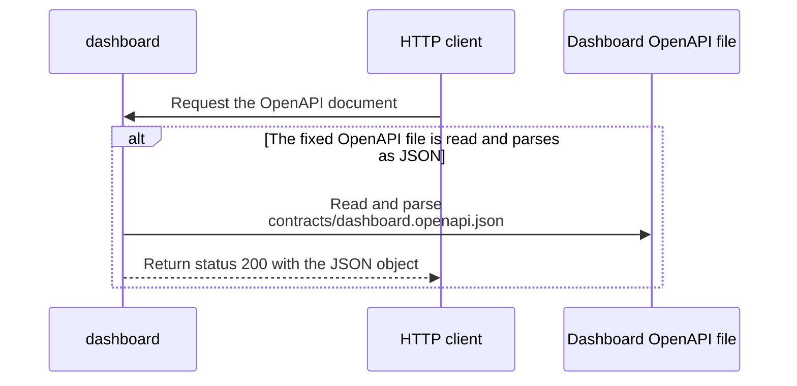

import {ClewMarkdown, ClewFieldDetails, ClewProcess, ClewDataModel, ClewDownload, ClewModelLink, ClewRelatedModelLink, ClewFieldTrace, ClewContextLink, ClewPageContext, ClewProcessReturn, ClewStatus, ClewRetainedPage, ClewCatalog, ClewAnchor} from '@site/src/components/ClewReaders';

# GET /openapi.json — serve contract

<ClewPageContext />

Retained account · UNVERIFIED · UNASSESSED. Runtime behavior is not established by this export.

The handler reads and parses the fixed Dashboard OpenAPI JSON file. A successful parse returns the object as application/json. A file-read or parse exception propagates without local error mapping; the OpenAPI separately declares a 500 JSON response.

Summary source bindings

- [services/dashboard/src/main.ts:92–92 · revision e635069293d58cb0d4f28c8211e748b8d58e6b37](../sources/1d70a12a03f3b80dbb63907c4d59e282b54f9dc82a35750e81f806a6b74f2917.mdx)
- [contracts/dashboard.openapi.json:1–462 · revision e635069293d58cb0d4f28c8211e748b8d58e6b37](../sources/2cf069499a8284aa81909007590ed57f8b987703681fef870962f36c0681f13b.mdx)
- [services/dashboard/src/main.ts:91–93 · revision e635069293d58cb0d4f28c8211e748b8d58e6b37](../sources/9dfc47272109627664d48b7bdfc7a9f5e84c42965146d7a0196095441dd45229.mdx)
- [services/dashboard/src/main.ts:92–92 · revision e635069293d58cb0d4f28c8211e748b8d58e6b37](../sources/43bda6a648cf14d5b141fb29efc4ba79b0ec7618f4f9d27987092a42276773fe.mdx)
- [services/dashboard/src/main.ts:92–92 · revision e635069293d58cb0d4f28c8211e748b8d58e6b37](../sources/731fb90962ad840677fb54411c9b7f0d0b8b03c56b165a386ce35b7cf54d88ba.mdx)

## Declared GET /openapi.json contract

| Topic | Retained contract detail |
| --- | --- |
| Request | GET /openapi.json has no declared parameters or request body. |
| 200 response | The success body is application/json with an object that may have additional properties. |
| 500 response | The error response is application/json with an object containing a string error field. |
| Declaration boundary | OpenAPI 3.1 declarations are parsed by a bounded reader; runtime enforcement and full JSON Schema validation are unverified. |

Contract source bindings

**Request**

- [contracts/dashboard.openapi.json:1–462 · revision e635069293d58cb0d4f28c8211e748b8d58e6b37](../sources/2cf069499a8284aa81909007590ed57f8b987703681fef870962f36c0681f13b.mdx)

**200 response**

- [contracts/dashboard.openapi.json:1–462 · revision e635069293d58cb0d4f28c8211e748b8d58e6b37](../sources/2cf069499a8284aa81909007590ed57f8b987703681fef870962f36c0681f13b.mdx)

**500 response**

- [contracts/dashboard.openapi.json:1–462 · revision e635069293d58cb0d4f28c8211e748b8d58e6b37](../sources/2cf069499a8284aa81909007590ed57f8b987703681fef870962f36c0681f13b.mdx)

**Declaration boundary**

- [contracts/dashboard.openapi.json:1–462 · revision e635069293d58cb0d4f28c8211e748b8d58e6b37](../sources/2cf069499a8284aa81909007590ed57f8b987703681fef870962f36c0681f13b.mdx)

## Declared interface schemas

<ClewContextLink path="/http/475242e2ef07721c45d26c563b5cd15b52b47fb16494eab9b22738cd80b35c25">GET /openapi.json</ClewContextLink>

<ClewContextLink path="/http/5e9ce2f78105d5d9215b07ddf87c8025176e932f11403c3b248ee8f2f77a9989">POST /api/places</ClewContextLink>

<ClewContextLink path="/http/ed3ea26055386f7e8904ff37c1c9931e4943602283a96c6067a31ac32aa24dac">POST /api/places/&#123;id&#125;/refresh</ClewContextLink>

<ClewContextLink path="/http/d3d56f55618a4d6b12c611f5055d16e80668439f39a23e30eb42437d1be85294">GET /</ClewContextLink>

<ClewContextLink path="/http/589bef5f2c1640933430afb73226fc910c4cdb435b53197fdaef848d460a716b">GET /health</ClewContextLink>

<ClewContextLink path="/http/5fda6cc4b385e34a2f5c5b6539f9420f1a95661ef0c3656b18ef951b4f2fe516">GET /api/weather</ClewContextLink>

## Interaction diagram

Actors and nested branches from the retained account; not a runtime trace. Labels are shortened for readability. Full messages and notes follow.

Full original sequence, branches and notes

#### 1. message

<ClewMarkdown text={"Request the OpenAPI document"} />

Source bindings

- [contracts/dashboard.openapi.json:1–462 · revision e635069293d58cb0d4f28c8211e748b8d58e6b37](../sources/2cf069499a8284aa81909007590ed57f8b987703681fef870962f36c0681f13b.mdx)
- [services/dashboard/src/main.ts:91–93 · revision e635069293d58cb0d4f28c8211e748b8d58e6b37](../sources/9dfc47272109627664d48b7bdfc7a9f5e84c42965146d7a0196095441dd45229.mdx)

#### 2. alt

<ClewMarkdown text={"The fixed OpenAPI file is read and parses as JSON"} />

Source bindings

- [services/dashboard/src/main.ts:92–92 · revision e635069293d58cb0d4f28c8211e748b8d58e6b37](../sources/1d70a12a03f3b80dbb63907c4d59e282b54f9dc82a35750e81f806a6b74f2917.mdx)
- [services/dashboard/src/main.ts:91–93 · revision e635069293d58cb0d4f28c8211e748b8d58e6b37](../sources/9dfc47272109627664d48b7bdfc7a9f5e84c42965146d7a0196095441dd45229.mdx)
- [services/dashboard/src/main.ts:92–92 · revision e635069293d58cb0d4f28c8211e748b8d58e6b37](../sources/43bda6a648cf14d5b141fb29efc4ba79b0ec7618f4f9d27987092a42276773fe.mdx)
- [services/dashboard/src/main.ts:92–92 · revision e635069293d58cb0d4f28c8211e748b8d58e6b37](../sources/731fb90962ad840677fb54411c9b7f0d0b8b03c56b165a386ce35b7cf54d88ba.mdx)

#### 3. message

<ClewMarkdown text={"Read and parse contracts/dashboard.openapi.json"} />

Source bindings

- [services/dashboard/src/main.ts:91–93 · revision e635069293d58cb0d4f28c8211e748b8d58e6b37](../sources/9dfc47272109627664d48b7bdfc7a9f5e84c42965146d7a0196095441dd45229.mdx)
- [services/dashboard/src/main.ts:92–92 · revision e635069293d58cb0d4f28c8211e748b8d58e6b37](../sources/43bda6a648cf14d5b141fb29efc4ba79b0ec7618f4f9d27987092a42276773fe.mdx)
- [services/dashboard/src/main.ts:92–92 · revision e635069293d58cb0d4f28c8211e748b8d58e6b37](../sources/731fb90962ad840677fb54411c9b7f0d0b8b03c56b165a386ce35b7cf54d88ba.mdx)

#### 4. return

<ClewMarkdown text={"Return status 200 with the JSON object"} />

Source bindings

- [services/dashboard/src/main.ts:92–92 · revision e635069293d58cb0d4f28c8211e748b8d58e6b37](../sources/1d70a12a03f3b80dbb63907c4d59e282b54f9dc82a35750e81f806a6b74f2917.mdx)
- [contracts/dashboard.openapi.json:1–462 · revision e635069293d58cb0d4f28c8211e748b8d58e6b37](../sources/2cf069499a8284aa81909007590ed57f8b987703681fef870962f36c0681f13b.mdx)
- [services/dashboard/src/main.ts:91–93 · revision e635069293d58cb0d4f28c8211e748b8d58e6b37](../sources/9dfc47272109627664d48b7bdfc7a9f5e84c42965146d7a0196095441dd45229.mdx)

#### 5. else

<ClewMarkdown text={"Otherwise"} />

Source bindings

- [services/dashboard/src/main.ts:92–92 · revision e635069293d58cb0d4f28c8211e748b8d58e6b37](../sources/1d70a12a03f3b80dbb63907c4d59e282b54f9dc82a35750e81f806a6b74f2917.mdx)
- [services/dashboard/src/main.ts:91–93 · revision e635069293d58cb0d4f28c8211e748b8d58e6b37](../sources/9dfc47272109627664d48b7bdfc7a9f5e84c42965146d7a0196095441dd45229.mdx)
- [services/dashboard/src/main.ts:92–92 · revision e635069293d58cb0d4f28c8211e748b8d58e6b37](../sources/43bda6a648cf14d5b141fb29efc4ba79b0ec7618f4f9d27987092a42276773fe.mdx)
- [services/dashboard/src/main.ts:92–92 · revision e635069293d58cb0d4f28c8211e748b8d58e6b37](../sources/731fb90962ad840677fb54411c9b7f0d0b8b03c56b165a386ce35b7cf54d88ba.mdx)

#### 6. note

<ClewMarkdown text={"If file reading or JSON parsing fails, the exception propagates; this handler has no local catch or response mapping. The OpenAPI separately declares a 500 JSON response."} />

Source bindings

- [contracts/dashboard.openapi.json:1–462 · revision e635069293d58cb0d4f28c8211e748b8d58e6b37](../sources/2cf069499a8284aa81909007590ed57f8b987703681fef870962f36c0681f13b.mdx)
- [services/dashboard/src/main.ts:91–93 · revision e635069293d58cb0d4f28c8211e748b8d58e6b37](../sources/9dfc47272109627664d48b7bdfc7a9f5e84c42965146d7a0196095441dd45229.mdx)
- [services/dashboard/src/main.ts:92–92 · revision e635069293d58cb0d4f28c8211e748b8d58e6b37](../sources/43bda6a648cf14d5b141fb29efc4ba79b0ec7618f4f9d27987092a42276773fe.mdx)
- [services/dashboard/src/main.ts:92–92 · revision e635069293d58cb0d4f28c8211e748b8d58e6b37](../sources/731fb90962ad840677fb54411c9b7f0d0b8b03c56b165a386ce35b7cf54d88ba.mdx)

#### 7. end

<ClewMarkdown text={""} />

Source bindings

- [services/dashboard/src/main.ts:92–92 · revision e635069293d58cb0d4f28c8211e748b8d58e6b37](../sources/1d70a12a03f3b80dbb63907c4d59e282b54f9dc82a35750e81f806a6b74f2917.mdx)
- [services/dashboard/src/main.ts:91–93 · revision e635069293d58cb0d4f28c8211e748b8d58e6b37](../sources/9dfc47272109627664d48b7bdfc7a9f5e84c42965146d7a0196095441dd45229.mdx)
- [services/dashboard/src/main.ts:92–92 · revision e635069293d58cb0d4f28c8211e748b8d58e6b37](../sources/43bda6a648cf14d5b141fb29efc4ba79b0ec7618f4f9d27987092a42276773fe.mdx)
- [services/dashboard/src/main.ts:92–92 · revision e635069293d58cb0d4f28c8211e748b8d58e6b37](../sources/731fb90962ad840677fb54411c9b7f0d0b8b03c56b165a386ce35b7cf54d88ba.mdx)

## Implementation explanation

<ClewMarkdown text={"Request the OpenAPI document"} />

Source bindings

- [contracts/dashboard.openapi.json:1–462 · revision e635069293d58cb0d4f28c8211e748b8d58e6b37](../sources/2cf069499a8284aa81909007590ed57f8b987703681fef870962f36c0681f13b.mdx)
- [services/dashboard/src/main.ts:91–93 · revision e635069293d58cb0d4f28c8211e748b8d58e6b37](../sources/9dfc47272109627664d48b7bdfc7a9f5e84c42965146d7a0196095441dd45229.mdx)

<ClewMarkdown text={"The fixed OpenAPI file is read and parses as JSON"} />

Source bindings

- [services/dashboard/src/main.ts:92–92 · revision e635069293d58cb0d4f28c8211e748b8d58e6b37](../sources/1d70a12a03f3b80dbb63907c4d59e282b54f9dc82a35750e81f806a6b74f2917.mdx)
- [services/dashboard/src/main.ts:91–93 · revision e635069293d58cb0d4f28c8211e748b8d58e6b37](../sources/9dfc47272109627664d48b7bdfc7a9f5e84c42965146d7a0196095441dd45229.mdx)
- [services/dashboard/src/main.ts:92–92 · revision e635069293d58cb0d4f28c8211e748b8d58e6b37](../sources/43bda6a648cf14d5b141fb29efc4ba79b0ec7618f4f9d27987092a42276773fe.mdx)
- [services/dashboard/src/main.ts:92–92 · revision e635069293d58cb0d4f28c8211e748b8d58e6b37](../sources/731fb90962ad840677fb54411c9b7f0d0b8b03c56b165a386ce35b7cf54d88ba.mdx)

<ClewMarkdown text={"Read and parse contracts/dashboard.openapi.json"} />

Source bindings

- [services/dashboard/src/main.ts:91–93 · revision e635069293d58cb0d4f28c8211e748b8d58e6b37](../sources/9dfc47272109627664d48b7bdfc7a9f5e84c42965146d7a0196095441dd45229.mdx)
- [services/dashboard/src/main.ts:92–92 · revision e635069293d58cb0d4f28c8211e748b8d58e6b37](../sources/43bda6a648cf14d5b141fb29efc4ba79b0ec7618f4f9d27987092a42276773fe.mdx)
- [services/dashboard/src/main.ts:92–92 · revision e635069293d58cb0d4f28c8211e748b8d58e6b37](../sources/731fb90962ad840677fb54411c9b7f0d0b8b03c56b165a386ce35b7cf54d88ba.mdx)

<ClewMarkdown text={"Return status 200 with the JSON object"} />

Source bindings

- [services/dashboard/src/main.ts:92–92 · revision e635069293d58cb0d4f28c8211e748b8d58e6b37](../sources/1d70a12a03f3b80dbb63907c4d59e282b54f9dc82a35750e81f806a6b74f2917.mdx)
- [contracts/dashboard.openapi.json:1–462 · revision e635069293d58cb0d4f28c8211e748b8d58e6b37](../sources/2cf069499a8284aa81909007590ed57f8b987703681fef870962f36c0681f13b.mdx)
- [services/dashboard/src/main.ts:91–93 · revision e635069293d58cb0d4f28c8211e748b8d58e6b37](../sources/9dfc47272109627664d48b7bdfc7a9f5e84c42965146d7a0196095441dd45229.mdx)

<ClewMarkdown text={"The source describes an alternative branch."} />

Source bindings

- [services/dashboard/src/main.ts:92–92 · revision e635069293d58cb0d4f28c8211e748b8d58e6b37](../sources/1d70a12a03f3b80dbb63907c4d59e282b54f9dc82a35750e81f806a6b74f2917.mdx)
- [services/dashboard/src/main.ts:91–93 · revision e635069293d58cb0d4f28c8211e748b8d58e6b37](../sources/9dfc47272109627664d48b7bdfc7a9f5e84c42965146d7a0196095441dd45229.mdx)
- [services/dashboard/src/main.ts:92–92 · revision e635069293d58cb0d4f28c8211e748b8d58e6b37](../sources/43bda6a648cf14d5b141fb29efc4ba79b0ec7618f4f9d27987092a42276773fe.mdx)
- [services/dashboard/src/main.ts:92–92 · revision e635069293d58cb0d4f28c8211e748b8d58e6b37](../sources/731fb90962ad840677fb54411c9b7f0d0b8b03c56b165a386ce35b7cf54d88ba.mdx)

<ClewMarkdown text={"If file reading or JSON parsing fails, the exception propagates; this handler has no local catch or response mapping. The OpenAPI separately declares a 500 JSON response."} />

Source bindings

- [contracts/dashboard.openapi.json:1–462 · revision e635069293d58cb0d4f28c8211e748b8d58e6b37](../sources/2cf069499a8284aa81909007590ed57f8b987703681fef870962f36c0681f13b.mdx)
- [services/dashboard/src/main.ts:91–93 · revision e635069293d58cb0d4f28c8211e748b8d58e6b37](../sources/9dfc47272109627664d48b7bdfc7a9f5e84c42965146d7a0196095441dd45229.mdx)
- [services/dashboard/src/main.ts:92–92 · revision e635069293d58cb0d4f28c8211e748b8d58e6b37](../sources/43bda6a648cf14d5b141fb29efc4ba79b0ec7618f4f9d27987092a42276773fe.mdx)
- [services/dashboard/src/main.ts:92–92 · revision e635069293d58cb0d4f28c8211e748b8d58e6b37](../sources/731fb90962ad840677fb54411c9b7f0d0b8b03c56b165a386ce35b7cf54d88ba.mdx)

Retained boundaries

- CALL\_TARGETS\_UNRESOLVED
- DIALECT\_DECLARED\_NOT\_COMPILER\_VALIDATED
- FILE\_ONLY:compose.yaml
- FILE\_ONLY:contracts/dashboard.openapi.json
- FILE\_ONLY:contracts/events.schema.json
- FILE\_ONLY:database/init.sql
- FILE\_ONLY:exercises/dashboard-focus-regression.mjs
- FILE\_ONLY:exercises/replay.py
- FILE\_ONLY:exercises/validator-regression.mjs
- FILE\_ONLY:fixtures/helsinki.json
- FILE\_ONLY:fixtures/lisbon.json
- FILE\_ONLY:fixtures/met-oslo-recorded.json
- FILE\_ONLY:fixtures/oslo.json
- FILE\_ONLY:fixtures/provenance.json
- FILE\_ONLY:services/dashboard/Dockerfile
- FILE\_ONLY:services/dashboard/package-lock.json
- FILE\_ONLY:services/dashboard/package.json
- FILE\_ONLY:services/dashboard/public/index.html
- FILE\_ONLY:services/dashboard/tsconfig.json
- OPENAPI\_JSON\_SCHEMA\_KEYWORDS\_NOT\_INTERPRETED
- OPENAPI\_SCHEMA\_NULL\_TYPE\_NOT\_INTERPRETED
- OPENAPI\_SCHEMA\_TYPE\_UNIONS\_NOT\_INTERPRETED
- ORDER\_LEXICAL\_ONLY
- SCOPE\_WATCH\_CONSERVATIVE
- Syntax evidence does not establish runtime dispatch or configuration. Expand known owners and helpers; retain explicit gaps for unresolved targets.
- ANNOTATION\_DECLARATION\_UNAVAILABLE
- CALL\_TARGETS\_UNRESOLVED
- DIALECT\_DECLARED\_NOT\_COMPILER\_VALIDATED
- FILE\_ONLY:compose.yaml
- FILE\_ONLY:contracts/events.schema.json
- FILE\_ONLY:contracts/forecasts.openapi.json
- FILE\_ONLY:database/init.sql
- FILE\_ONLY:fixtures/helsinki.json
- FILE\_ONLY:fixtures/lisbon.json
- FILE\_ONLY:fixtures/met-oslo-recorded.json
- FILE\_ONLY:fixtures/oslo.json
- FILE\_ONLY:fixtures/provenance.json
- FILE\_ONLY:services/forecasts/Dockerfile
- FILE\_ONLY:services/forecasts/pom.xml
- FILE\_ONLY:services/forecasts/src/main/resources/application.properties
- NO\_BEAN\_OWNER
- OPENAPI\_JSON\_SCHEMA\_KEYWORDS\_NOT\_INTERPRETED
- OPENAPI\_SCHEMA\_NULL\_TYPE\_NOT\_INTERPRETED
- OPENAPI\_SCHEMA\_TYPE\_UNIONS\_NOT\_INTERPRETED
- ORDER\_LEXICAL\_ONLY
- RUNTIME\_REGISTRATION\_UNPROVEN
- SCOPE\_WATCH\_CONSERVATIVE
- SOURCE\_NAMES\_NOT\_COMPILER\_RESOLVED
- UNRESOLVED\_ANNOTATION\_VALUE
- Syntax evidence does not establish runtime dispatch or configuration. Expand known owners and helpers; retain explicit gaps for unresolved targets.
- CLR\_SIGNATURE\_PROJECTED\_TO\_JVM\_DESCRIPTOR\_GRAMMAR
- CSHARP\_SOURCE\_GENERATED\_DOCUMENTS\_NOT\_INDEXED
- EXCEPTION\_FLOW\_REQUIRES\_SOURCE\_REVIEW
- GENERATED\_SOURCE\_BODIES\_NOT\_INDEXED
- LAMBDA\_EXECUTION\_NOT\_EXPANDED
- OPENAPI\_JSON\_SCHEMA\_KEYWORDS\_NOT\_INTERPRETED
- SHORT\_CIRCUIT\_FLOW\_REQUIRES\_SOURCE\_REVIEW
- SWITCH\_FLOW\_REQUIRES\_SOURCE\_REVIEW

