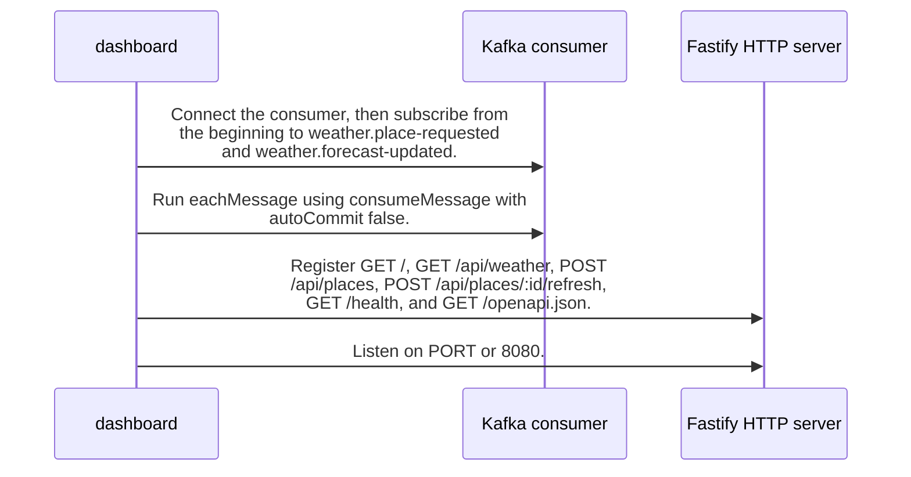

import {ClewMarkdown, ClewFieldDetails, ClewProcess, ClewDataModel, ClewDownload, ClewModelLink, ClewRelatedModelLink, ClewFieldTrace, ClewContextLink, ClewPageContext, ClewProcessReturn, ClewStatus, ClewRetainedPage, ClewCatalog, ClewAnchor} from '@site/src/components/ClewReaders';

# Dashboard startup registrations (source-level)

<ClewPageContext />

Retained account · UNVERIFIED · UNASSESSED. Runtime behavior is not established by this export.

The captured start function connects and subscribes the consumer, runs shared consumeMessage with autoCommit false, registers six HTTP routes on Fastify, then listens. These syntax-level calls do not prove runtime activation.

Summary source bindings

- [services/dashboard/src/main.ts:100–100 · revision e635069293d58cb0d4f28c8211e748b8d58e6b37](../sources/f95cfa4f2ac7f2f0e9b3fb3d086ef9ccd3d59541fcc8224cf1d10e0ebca87337.mdx)
- [services/dashboard/src/main.ts:102–102 · revision e635069293d58cb0d4f28c8211e748b8d58e6b37](../sources/bd8873253fa9602355ca1a19243b1d458a1e77a4f3c120dc6b6c91822fa35bb6.mdx)
- [services/dashboard/src/main.ts:110–110 · revision e635069293d58cb0d4f28c8211e748b8d58e6b37](../sources/40b3ffde8c2b30e87bdca3ec00bd53f738009a41859d53dcd88cf02ae5554483.mdx)
- [services/dashboard/src/main.ts:105–105 · revision e635069293d58cb0d4f28c8211e748b8d58e6b37](../sources/ef3aa88e54813acc75c157bd6cb3ecb7022f552d7b6b761867be127f93969b88.mdx)
- [services/dashboard/src/main.ts:110–110 · revision e635069293d58cb0d4f28c8211e748b8d58e6b37](../sources/5269dfe643b96784a08f65a2af6d7fc81f8d1ca5ccd8225937e41c08b01fe897.mdx)
- [services/dashboard/src/main.ts:109–109 · revision e635069293d58cb0d4f28c8211e748b8d58e6b37](../sources/1c22633fc97cd2cfbe94cfdbd6182a6bae785d780e411350ca4d4114f8ef458d.mdx)
- [services/dashboard/src/main.ts:104–104 · revision e635069293d58cb0d4f28c8211e748b8d58e6b37](../sources/3de8491a9dac90fc982899631f7e165433410b8eecdd1948746f0c4855d314a9.mdx)
- [services/dashboard/src/main.ts:108–108 · revision e635069293d58cb0d4f28c8211e748b8d58e6b37](../sources/02df8a8a878b0d1bcccbe95254b51299f27778a573059d554ef15d4b5bc4d3f0.mdx)
- [services/dashboard/src/main.ts:106–106 · revision e635069293d58cb0d4f28c8211e748b8d58e6b37](../sources/a76abe78abe240a901395f28b66c80ab6414061c8b8302d2fa75a90cd7d385da.mdx)
- [services/dashboard/src/main.ts:99–111 · revision e635069293d58cb0d4f28c8211e748b8d58e6b37](../sources/b8c6b94020ae709e61177a744a5a5315fccb0813ac9f4e37ca6a0be5140d129c.mdx)
- [services/dashboard/src/main.ts:107–107 · revision e635069293d58cb0d4f28c8211e748b8d58e6b37](../sources/5fbb40a6690a2e0ec9028ef5c692d8e5c69289dd336644863c75e093b71181a4.mdx)
- [services/dashboard/src/main.ts:101–101 · revision e635069293d58cb0d4f28c8211e748b8d58e6b37](../sources/da1659a8327b8aecd7e61977894445c5f3ee2983c3a8452cc29f6c75241a70a1.mdx)

## Declared interface schemas

<ClewContextLink path="/http/475242e2ef07721c45d26c563b5cd15b52b47fb16494eab9b22738cd80b35c25">GET /openapi.json</ClewContextLink>

<ClewContextLink path="/http/5e9ce2f78105d5d9215b07ddf87c8025176e932f11403c3b248ee8f2f77a9989">POST /api/places</ClewContextLink>

<ClewContextLink path="/http/ed3ea26055386f7e8904ff37c1c9931e4943602283a96c6067a31ac32aa24dac">POST /api/places/&#123;id&#125;/refresh</ClewContextLink>

<ClewContextLink path="/http/d3d56f55618a4d6b12c611f5055d16e80668439f39a23e30eb42437d1be85294">GET /</ClewContextLink>

<ClewContextLink path="/http/589bef5f2c1640933430afb73226fc910c4cdb435b53197fdaef848d460a716b">GET /health</ClewContextLink>

<ClewContextLink path="/http/5fda6cc4b385e34a2f5c5b6539f9420f1a95661ef0c3656b18ef951b4f2fe516">GET /api/weather</ClewContextLink>

## Interaction diagram

Actors and nested branches from the retained account; not a runtime trace. Labels are shortened for readability. Full messages and notes follow.

Full original sequence, branches and notes

#### 1. message

<ClewMarkdown text={"Connect the consumer, then subscribe from the beginning to weather.place-requested and weather.forecast-updated."} />

Source bindings

- [services/dashboard/src/main.ts:100–100 · revision e635069293d58cb0d4f28c8211e748b8d58e6b37](../sources/f95cfa4f2ac7f2f0e9b3fb3d086ef9ccd3d59541fcc8224cf1d10e0ebca87337.mdx)
- [services/dashboard/src/main.ts:99–111 · revision e635069293d58cb0d4f28c8211e748b8d58e6b37](../sources/b8c6b94020ae709e61177a744a5a5315fccb0813ac9f4e37ca6a0be5140d129c.mdx)
- [services/dashboard/src/main.ts:101–101 · revision e635069293d58cb0d4f28c8211e748b8d58e6b37](../sources/da1659a8327b8aecd7e61977894445c5f3ee2983c3a8452cc29f6c75241a70a1.mdx)

#### 2. message

<ClewMarkdown text={"Run eachMessage using consumeMessage with autoCommit false."} />

Source bindings

- [services/dashboard/src/main.ts:102–102 · revision e635069293d58cb0d4f28c8211e748b8d58e6b37](../sources/bd8873253fa9602355ca1a19243b1d458a1e77a4f3c120dc6b6c91822fa35bb6.mdx)
- [services/dashboard/src/main.ts:99–111 · revision e635069293d58cb0d4f28c8211e748b8d58e6b37](../sources/b8c6b94020ae709e61177a744a5a5315fccb0813ac9f4e37ca6a0be5140d129c.mdx)

#### 3. message

<ClewMarkdown text={"Register GET /, GET /api/weather, POST /api/places, POST /api/places/:id/refresh, GET /health, and GET /openapi.json."} />

Source bindings

- [services/dashboard/src/main.ts:105–105 · revision e635069293d58cb0d4f28c8211e748b8d58e6b37](../sources/ef3aa88e54813acc75c157bd6cb3ecb7022f552d7b6b761867be127f93969b88.mdx)
- [services/dashboard/src/main.ts:109–109 · revision e635069293d58cb0d4f28c8211e748b8d58e6b37](../sources/1c22633fc97cd2cfbe94cfdbd6182a6bae785d780e411350ca4d4114f8ef458d.mdx)
- [services/dashboard/src/main.ts:104–104 · revision e635069293d58cb0d4f28c8211e748b8d58e6b37](../sources/3de8491a9dac90fc982899631f7e165433410b8eecdd1948746f0c4855d314a9.mdx)
- [services/dashboard/src/main.ts:108–108 · revision e635069293d58cb0d4f28c8211e748b8d58e6b37](../sources/02df8a8a878b0d1bcccbe95254b51299f27778a573059d554ef15d4b5bc4d3f0.mdx)
- [services/dashboard/src/main.ts:106–106 · revision e635069293d58cb0d4f28c8211e748b8d58e6b37](../sources/a76abe78abe240a901395f28b66c80ab6414061c8b8302d2fa75a90cd7d385da.mdx)
- [services/dashboard/src/main.ts:99–111 · revision e635069293d58cb0d4f28c8211e748b8d58e6b37](../sources/b8c6b94020ae709e61177a744a5a5315fccb0813ac9f4e37ca6a0be5140d129c.mdx)
- [services/dashboard/src/main.ts:107–107 · revision e635069293d58cb0d4f28c8211e748b8d58e6b37](../sources/5fbb40a6690a2e0ec9028ef5c692d8e5c69289dd336644863c75e093b71181a4.mdx)

#### 4. message

<ClewMarkdown text={"Listen on PORT or 8080."} />

Source bindings

- [services/dashboard/src/main.ts:110–110 · revision e635069293d58cb0d4f28c8211e748b8d58e6b37](../sources/40b3ffde8c2b30e87bdca3ec00bd53f738009a41859d53dcd88cf02ae5554483.mdx)
- [services/dashboard/src/main.ts:110–110 · revision e635069293d58cb0d4f28c8211e748b8d58e6b37](../sources/5269dfe643b96784a08f65a2af6d7fc81f8d1ca5ccd8225937e41c08b01fe897.mdx)
- [services/dashboard/src/main.ts:99–111 · revision e635069293d58cb0d4f28c8211e748b8d58e6b37](../sources/b8c6b94020ae709e61177a744a5a5315fccb0813ac9f4e37ca6a0be5140d129c.mdx)

## Implementation explanation

<ClewMarkdown text={"Connect the consumer, then subscribe from the beginning to weather.place-requested and weather.forecast-updated."} />

Source bindings

- [services/dashboard/src/main.ts:100–100 · revision e635069293d58cb0d4f28c8211e748b8d58e6b37](../sources/f95cfa4f2ac7f2f0e9b3fb3d086ef9ccd3d59541fcc8224cf1d10e0ebca87337.mdx)
- [services/dashboard/src/main.ts:99–111 · revision e635069293d58cb0d4f28c8211e748b8d58e6b37](../sources/b8c6b94020ae709e61177a744a5a5315fccb0813ac9f4e37ca6a0be5140d129c.mdx)
- [services/dashboard/src/main.ts:101–101 · revision e635069293d58cb0d4f28c8211e748b8d58e6b37](../sources/da1659a8327b8aecd7e61977894445c5f3ee2983c3a8452cc29f6c75241a70a1.mdx)

<ClewMarkdown text={"Run eachMessage using consumeMessage with autoCommit false."} />

Source bindings

- [services/dashboard/src/main.ts:102–102 · revision e635069293d58cb0d4f28c8211e748b8d58e6b37](../sources/bd8873253fa9602355ca1a19243b1d458a1e77a4f3c120dc6b6c91822fa35bb6.mdx)
- [services/dashboard/src/main.ts:99–111 · revision e635069293d58cb0d4f28c8211e748b8d58e6b37](../sources/b8c6b94020ae709e61177a744a5a5315fccb0813ac9f4e37ca6a0be5140d129c.mdx)

<ClewMarkdown text={"Register GET /, GET /api/weather, POST /api/places, POST /api/places/:id/refresh, GET /health, and GET /openapi.json."} />

Source bindings

- [services/dashboard/src/main.ts:105–105 · revision e635069293d58cb0d4f28c8211e748b8d58e6b37](../sources/ef3aa88e54813acc75c157bd6cb3ecb7022f552d7b6b761867be127f93969b88.mdx)
- [services/dashboard/src/main.ts:109–109 · revision e635069293d58cb0d4f28c8211e748b8d58e6b37](../sources/1c22633fc97cd2cfbe94cfdbd6182a6bae785d780e411350ca4d4114f8ef458d.mdx)
- [services/dashboard/src/main.ts:104–104 · revision e635069293d58cb0d4f28c8211e748b8d58e6b37](../sources/3de8491a9dac90fc982899631f7e165433410b8eecdd1948746f0c4855d314a9.mdx)
- [services/dashboard/src/main.ts:108–108 · revision e635069293d58cb0d4f28c8211e748b8d58e6b37](../sources/02df8a8a878b0d1bcccbe95254b51299f27778a573059d554ef15d4b5bc4d3f0.mdx)
- [services/dashboard/src/main.ts:106–106 · revision e635069293d58cb0d4f28c8211e748b8d58e6b37](../sources/a76abe78abe240a901395f28b66c80ab6414061c8b8302d2fa75a90cd7d385da.mdx)
- [services/dashboard/src/main.ts:99–111 · revision e635069293d58cb0d4f28c8211e748b8d58e6b37](../sources/b8c6b94020ae709e61177a744a5a5315fccb0813ac9f4e37ca6a0be5140d129c.mdx)
- [services/dashboard/src/main.ts:107–107 · revision e635069293d58cb0d4f28c8211e748b8d58e6b37](../sources/5fbb40a6690a2e0ec9028ef5c692d8e5c69289dd336644863c75e093b71181a4.mdx)

<ClewMarkdown text={"Listen on PORT or 8080."} />

Source bindings

- [services/dashboard/src/main.ts:110–110 · revision e635069293d58cb0d4f28c8211e748b8d58e6b37](../sources/40b3ffde8c2b30e87bdca3ec00bd53f738009a41859d53dcd88cf02ae5554483.mdx)
- [services/dashboard/src/main.ts:110–110 · revision e635069293d58cb0d4f28c8211e748b8d58e6b37](../sources/5269dfe643b96784a08f65a2af6d7fc81f8d1ca5ccd8225937e41c08b01fe897.mdx)
- [services/dashboard/src/main.ts:99–111 · revision e635069293d58cb0d4f28c8211e748b8d58e6b37](../sources/b8c6b94020ae709e61177a744a5a5315fccb0813ac9f4e37ca6a0be5140d129c.mdx)

Retained boundaries

- CALL\_TARGETS\_UNRESOLVED
- DIALECT\_DECLARED\_NOT\_COMPILER\_VALIDATED
- FILE\_ONLY:compose.yaml
- FILE\_ONLY:contracts/dashboard.openapi.json
- FILE\_ONLY:contracts/events.schema.json
- FILE\_ONLY:database/init.sql
- FILE\_ONLY:exercises/dashboard-focus-regression.mjs
- FILE\_ONLY:exercises/replay.py
- FILE\_ONLY:exercises/validator-regression.mjs
- FILE\_ONLY:fixtures/helsinki.json
- FILE\_ONLY:fixtures/lisbon.json
- FILE\_ONLY:fixtures/met-oslo-recorded.json
- FILE\_ONLY:fixtures/oslo.json
- FILE\_ONLY:fixtures/provenance.json
- FILE\_ONLY:services/dashboard/Dockerfile
- FILE\_ONLY:services/dashboard/package-lock.json
- FILE\_ONLY:services/dashboard/package.json
- FILE\_ONLY:services/dashboard/public/index.html
- FILE\_ONLY:services/dashboard/tsconfig.json
- OPENAPI\_JSON\_SCHEMA\_KEYWORDS\_NOT\_INTERPRETED
- OPENAPI\_SCHEMA\_NULL\_TYPE\_NOT\_INTERPRETED
- OPENAPI\_SCHEMA\_TYPE\_UNIONS\_NOT\_INTERPRETED
- ORDER\_LEXICAL\_ONLY
- SCOPE\_WATCH\_CONSERVATIVE
- Syntax evidence does not establish runtime dispatch or configuration. Expand known owners and helpers; retain explicit gaps for unresolved targets.
- ANNOTATION\_DECLARATION\_UNAVAILABLE
- CALL\_TARGETS\_UNRESOLVED
- DIALECT\_DECLARED\_NOT\_COMPILER\_VALIDATED
- FILE\_ONLY:compose.yaml
- FILE\_ONLY:contracts/events.schema.json
- FILE\_ONLY:contracts/forecasts.openapi.json
- FILE\_ONLY:database/init.sql
- FILE\_ONLY:fixtures/helsinki.json
- FILE\_ONLY:fixtures/lisbon.json
- FILE\_ONLY:fixtures/met-oslo-recorded.json
- FILE\_ONLY:fixtures/oslo.json
- FILE\_ONLY:fixtures/provenance.json
- FILE\_ONLY:services/forecasts/Dockerfile
- FILE\_ONLY:services/forecasts/pom.xml
- FILE\_ONLY:services/forecasts/src/main/resources/application.properties
- NO\_BEAN\_OWNER
- OPENAPI\_JSON\_SCHEMA\_KEYWORDS\_NOT\_INTERPRETED
- OPENAPI\_SCHEMA\_NULL\_TYPE\_NOT\_INTERPRETED
- OPENAPI\_SCHEMA\_TYPE\_UNIONS\_NOT\_INTERPRETED
- ORDER\_LEXICAL\_ONLY
- RUNTIME\_REGISTRATION\_UNPROVEN
- SCOPE\_WATCH\_CONSERVATIVE
- SOURCE\_NAMES\_NOT\_COMPILER\_RESOLVED
- UNRESOLVED\_ANNOTATION\_VALUE
- Syntax evidence does not establish runtime dispatch or configuration. Expand known owners and helpers; retain explicit gaps for unresolved targets.
- CLR\_SIGNATURE\_PROJECTED\_TO\_JVM\_DESCRIPTOR\_GRAMMAR
- CSHARP\_SOURCE\_GENERATED\_DOCUMENTS\_NOT\_INDEXED
- EXCEPTION\_FLOW\_REQUIRES\_SOURCE\_REVIEW
- GENERATED\_SOURCE\_BODIES\_NOT\_INDEXED
- LAMBDA\_EXECUTION\_NOT\_EXPANDED
- OPENAPI\_JSON\_SCHEMA\_KEYWORDS\_NOT\_INTERPRETED
- SHORT\_CIRCUIT\_FLOW\_REQUIRES\_SOURCE\_REVIEW
- SWITCH\_FLOW\_REQUIRES\_SOURCE\_REVIEW

