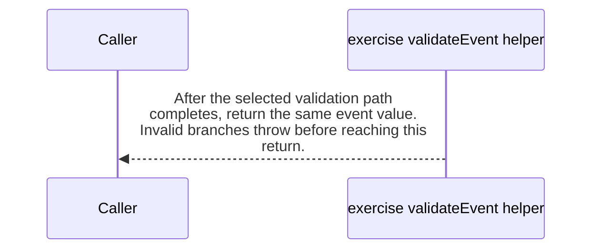

import {ClewMarkdown, ClewFieldDetails, ClewProcess, ClewDataModel, ClewDownload, ClewModelLink, ClewRelatedModelLink, ClewFieldTrace, ClewContextLink, ClewPageContext, ClewProcessReturn, ClewStatus, ClewRetainedPage, ClewCatalog, ClewAnchor} from '@site/src/components/ClewReaders';

# Dashboard exercise place and forecast validator

<ClewPageContext />

Retained account · UNVERIFIED · UNASSESSED. Runtime behavior is not established by this export.

The exercise-only validateEvent(value, topic) first rejects falsy or non-object input with INVALID\_EVENT, then checks the event id/version and required allowlisted place fields; that explicit guard also throws INVALID\_EVENT. Only topic weather.forecast-updated selects forecast validation. The forecast event type, timestamp parses, mode and periods array (one to six items) are checked by an explicit guard that throws INVALID\_FORECAST when a check fails. The period loop reads period.time before its explicit period guard, so periods:\[null\] passes the length check and then throws a property-access TypeError before INVALID\_PERIOD. No local catch handles that TypeError or other property-access/conversion exceptions. When property reads and conversions complete, the explicit period guard throws INVALID\_PERIOD for a non-finite parsed time or temperature, precipitation other than null or a finite nonnegative number, or a non-string symbol. Other topics accept only event.type place.requested; a mismatch throws INVALID\_PLACE\_EVENT. Valid input returns the same event. The body shows no I/O or mutation. Evidence is source-syntax only; call targets, compiler validation, framework trigger, and runtime activation are unverified.

Summary source bindings

- [exercises/unchecked-place-forecast.ts:6–23 · revision e635069293d58cb0d4f28c8211e748b8d58e6b37](../sources/b3d49b4c42d1ee4f45240ac8a2f2b1bab2f1041ee5c0b7e4cecc13e3887168b0.mdx)
- [exercises/unchecked-place-forecast.ts:17–19 · revision e635069293d58cb0d4f28c8211e748b8d58e6b37](../sources/3a81327dd5a0a202bcf0478842b7f1548cb29bc661119b27088099ca1bcd3487.mdx)
- [exercises/unchecked-place-forecast.ts:7–7 · revision e635069293d58cb0d4f28c8211e748b8d58e6b37](../sources/690f120dd2b2fd34d9ee5356c866f50358a51ed54fdcb57af0a47cdcf8164a05.mdx)
- [exercises/unchecked-place-forecast.ts:12–21 · revision e635069293d58cb0d4f28c8211e748b8d58e6b37](../sources/6d8aa7559bd69c992406b0ad1b9e6c2c78c89f131c5f420133af516f75fa3adb.mdx)
- [exercises/unchecked-place-forecast.ts:9–11 · revision e635069293d58cb0d4f28c8211e748b8d58e6b37](../sources/06a614c8c1ba5997f691087ab64fb8757e2b2b0ff5e7ff5a9d2b450158d4f9a6.mdx)
- [exercises/unchecked-place-forecast.ts:11–11 · revision e635069293d58cb0d4f28c8211e748b8d58e6b37](../sources/6d683bdc24c04e85356c7a024326d35d01b37fb180c4b4648e5c1f3d146e99b2.mdx)
- [exercises/unchecked-place-forecast.ts:22–22 · revision e635069293d58cb0d4f28c8211e748b8d58e6b37](../sources/84f1e98c69560b314ced968c97e0f640ce52cdfe843e9bd7edf795f8ac550621.mdx)
- [exercises/unchecked-place-forecast.ts:13–15 · revision e635069293d58cb0d4f28c8211e748b8d58e6b37](../sources/443921237f5507689b10de3d589f0eacfe57312bec802c6e14eea6c88ecf7cbe.mdx)
- [exercises/unchecked-place-forecast.ts:15–15 · revision e635069293d58cb0d4f28c8211e748b8d58e6b37](../sources/069e11a3b57fe94d612d8b40ff93b59e7d2061a45c9ce711d9c418d5835ae381.mdx)
- [exercises/unchecked-place-forecast.ts:21–21 · revision e635069293d58cb0d4f28c8211e748b8d58e6b37](../sources/4a58c3966d1b840c1265fbd8d786d1afd46de4588b9235592f182f53f3efea15.mdx)
- [exercises/unchecked-place-forecast.ts:21–21 · revision e635069293d58cb0d4f28c8211e748b8d58e6b37](../sources/d70390c59f999c361905a722ee4b2b2f718eda32266ab1f1de584785c8d45f2e.mdx)
- [exercises/unchecked-place-forecast.ts:19–19 · revision e635069293d58cb0d4f28c8211e748b8d58e6b37](../sources/9d162f310c10b95f496d0846906e2eab3a2f47866cd294d0ef3427f07b16fd85.mdx)
- [exercises/unchecked-place-forecast.ts:7–7 · revision e635069293d58cb0d4f28c8211e748b8d58e6b37](../sources/d5dc1340c585b487fed8c0d3cd3c32a66cf4541056c08b036e47ca4a09b56974.mdx)

## Declared interface schemas

<ClewContextLink path="/http/475242e2ef07721c45d26c563b5cd15b52b47fb16494eab9b22738cd80b35c25">GET /openapi.json</ClewContextLink>

<ClewContextLink path="/http/5e9ce2f78105d5d9215b07ddf87c8025176e932f11403c3b248ee8f2f77a9989">POST /api/places</ClewContextLink>

<ClewContextLink path="/http/ed3ea26055386f7e8904ff37c1c9931e4943602283a96c6067a31ac32aa24dac">POST /api/places/&#123;id&#125;/refresh</ClewContextLink>

<ClewContextLink path="/http/d3d56f55618a4d6b12c611f5055d16e80668439f39a23e30eb42437d1be85294">GET /</ClewContextLink>

<ClewContextLink path="/http/589bef5f2c1640933430afb73226fc910c4cdb435b53197fdaef848d460a716b">GET /health</ClewContextLink>

<ClewContextLink path="/http/5fda6cc4b385e34a2f5c5b6539f9420f1a95661ef0c3656b18ef951b4f2fe516">GET /api/weather</ClewContextLink>

## Interaction diagram

Actors and nested branches from the retained account; not a runtime trace. Labels are shortened for readability. Full messages and notes follow.

Full original sequence, branches and notes

#### 1. alt

<ClewMarkdown text={"The first guard requires a truthy object."} />

Source bindings

- [exercises/unchecked-place-forecast.ts:6–23 · revision e635069293d58cb0d4f28c8211e748b8d58e6b37](../sources/b3d49b4c42d1ee4f45240ac8a2f2b1bab2f1041ee5c0b7e4cecc13e3887168b0.mdx)
- [exercises/unchecked-place-forecast.ts:7–7 · revision e635069293d58cb0d4f28c8211e748b8d58e6b37](../sources/690f120dd2b2fd34d9ee5356c866f50358a51ed54fdcb57af0a47cdcf8164a05.mdx)

#### 2. note

<ClewMarkdown text={"Falsy input or a value whose type is not object throws INVALID_EVENT and exits before the cast."} />

Source bindings

- [exercises/unchecked-place-forecast.ts:6–23 · revision e635069293d58cb0d4f28c8211e748b8d58e6b37](../sources/b3d49b4c42d1ee4f45240ac8a2f2b1bab2f1041ee5c0b7e4cecc13e3887168b0.mdx)
- [exercises/unchecked-place-forecast.ts:7–7 · revision e635069293d58cb0d4f28c8211e748b8d58e6b37](../sources/690f120dd2b2fd34d9ee5356c866f50358a51ed54fdcb57af0a47cdcf8164a05.mdx)
- [exercises/unchecked-place-forecast.ts:7–7 · revision e635069293d58cb0d4f28c8211e748b8d58e6b37](../sources/d5dc1340c585b487fed8c0d3cd3c32a66cf4541056c08b036e47ca4a09b56974.mdx)

#### 3. else

<ClewMarkdown text={"Otherwise"} />

Source bindings

- [exercises/unchecked-place-forecast.ts:6–23 · revision e635069293d58cb0d4f28c8211e748b8d58e6b37](../sources/b3d49b4c42d1ee4f45240ac8a2f2b1bab2f1041ee5c0b7e4cecc13e3887168b0.mdx)
- [exercises/unchecked-place-forecast.ts:7–7 · revision e635069293d58cb0d4f28c8211e748b8d58e6b37](../sources/690f120dd2b2fd34d9ee5356c866f50358a51ed54fdcb57af0a47cdcf8164a05.mdx)

#### 4. note

<ClewMarkdown text={"A truthy object is cast to Event and proceeds to field validation."} />

Source bindings

- [exercises/unchecked-place-forecast.ts:6–23 · revision e635069293d58cb0d4f28c8211e748b8d58e6b37](../sources/b3d49b4c42d1ee4f45240ac8a2f2b1bab2f1041ee5c0b7e4cecc13e3887168b0.mdx)
- [exercises/unchecked-place-forecast.ts:7–7 · revision e635069293d58cb0d4f28c8211e748b8d58e6b37](../sources/690f120dd2b2fd34d9ee5356c866f50358a51ed54fdcb57af0a47cdcf8164a05.mdx)

#### 5. end

<ClewMarkdown text={""} />

Source bindings

- [exercises/unchecked-place-forecast.ts:6–23 · revision e635069293d58cb0d4f28c8211e748b8d58e6b37](../sources/b3d49b4c42d1ee4f45240ac8a2f2b1bab2f1041ee5c0b7e4cecc13e3887168b0.mdx)
- [exercises/unchecked-place-forecast.ts:7–7 · revision e635069293d58cb0d4f28c8211e748b8d58e6b37](../sources/690f120dd2b2fd34d9ee5356c866f50358a51ed54fdcb57af0a47cdcf8164a05.mdx)

#### 6. alt

<ClewMarkdown text={"The cast value must have the required identity and place fields."} />

Source bindings

- [exercises/unchecked-place-forecast.ts:6–23 · revision e635069293d58cb0d4f28c8211e748b8d58e6b37](../sources/b3d49b4c42d1ee4f45240ac8a2f2b1bab2f1041ee5c0b7e4cecc13e3887168b0.mdx)
- [exercises/unchecked-place-forecast.ts:9–11 · revision e635069293d58cb0d4f28c8211e748b8d58e6b37](../sources/06a614c8c1ba5997f691087ab64fb8757e2b2b0ff5e7ff5a9d2b450158d4f9a6.mdx)

#### 7. note

<ClewMarkdown text={"A non-string id, version other than 1, absent place, non-string or non-allowlisted place id, non-string place name, or non-finite latitude or longitude throws INVALID_EVENT."} />

Source bindings

- [exercises/unchecked-place-forecast.ts:6–23 · revision e635069293d58cb0d4f28c8211e748b8d58e6b37](../sources/b3d49b4c42d1ee4f45240ac8a2f2b1bab2f1041ee5c0b7e4cecc13e3887168b0.mdx)
- [exercises/unchecked-place-forecast.ts:9–11 · revision e635069293d58cb0d4f28c8211e748b8d58e6b37](../sources/06a614c8c1ba5997f691087ab64fb8757e2b2b0ff5e7ff5a9d2b450158d4f9a6.mdx)
- [exercises/unchecked-place-forecast.ts:11–11 · revision e635069293d58cb0d4f28c8211e748b8d58e6b37](../sources/6d683bdc24c04e85356c7a024326d35d01b37fb180c4b4648e5c1f3d146e99b2.mdx)

#### 8. else

<ClewMarkdown text={"Otherwise"} />

Source bindings

- [exercises/unchecked-place-forecast.ts:6–23 · revision e635069293d58cb0d4f28c8211e748b8d58e6b37](../sources/b3d49b4c42d1ee4f45240ac8a2f2b1bab2f1041ee5c0b7e4cecc13e3887168b0.mdx)
- [exercises/unchecked-place-forecast.ts:9–11 · revision e635069293d58cb0d4f28c8211e748b8d58e6b37](../sources/06a614c8c1ba5997f691087ab64fb8757e2b2b0ff5e7ff5a9d2b450158d4f9a6.mdx)

#### 9. note

<ClewMarkdown text={"If those fields pass, topic-specific validation continues."} />

Source bindings

- [exercises/unchecked-place-forecast.ts:6–23 · revision e635069293d58cb0d4f28c8211e748b8d58e6b37](../sources/b3d49b4c42d1ee4f45240ac8a2f2b1bab2f1041ee5c0b7e4cecc13e3887168b0.mdx)
- [exercises/unchecked-place-forecast.ts:9–11 · revision e635069293d58cb0d4f28c8211e748b8d58e6b37](../sources/06a614c8c1ba5997f691087ab64fb8757e2b2b0ff5e7ff5a9d2b450158d4f9a6.mdx)

#### 10. end

<ClewMarkdown text={""} />

Source bindings

- [exercises/unchecked-place-forecast.ts:6–23 · revision e635069293d58cb0d4f28c8211e748b8d58e6b37](../sources/b3d49b4c42d1ee4f45240ac8a2f2b1bab2f1041ee5c0b7e4cecc13e3887168b0.mdx)
- [exercises/unchecked-place-forecast.ts:9–11 · revision e635069293d58cb0d4f28c8211e748b8d58e6b37](../sources/06a614c8c1ba5997f691087ab64fb8757e2b2b0ff5e7ff5a9d2b450158d4f9a6.mdx)

#### 11. alt

<ClewMarkdown text={"Only weather.forecast-updated selects the forecast branch; the else branch checks the place-request event type."} />

Source bindings

- [exercises/unchecked-place-forecast.ts:6–23 · revision e635069293d58cb0d4f28c8211e748b8d58e6b37](../sources/b3d49b4c42d1ee4f45240ac8a2f2b1bab2f1041ee5c0b7e4cecc13e3887168b0.mdx)
- [exercises/unchecked-place-forecast.ts:12–21 · revision e635069293d58cb0d4f28c8211e748b8d58e6b37](../sources/6d8aa7559bd69c992406b0ad1b9e6c2c78c89f131c5f420133af516f75fa3adb.mdx)

#### 12. alt

<ClewMarkdown text={"The forecast event metadata and period list must satisfy the forecast guard."} />

Source bindings

- [exercises/unchecked-place-forecast.ts:6–23 · revision e635069293d58cb0d4f28c8211e748b8d58e6b37](../sources/b3d49b4c42d1ee4f45240ac8a2f2b1bab2f1041ee5c0b7e4cecc13e3887168b0.mdx)
- [exercises/unchecked-place-forecast.ts:12–21 · revision e635069293d58cb0d4f28c8211e748b8d58e6b37](../sources/6d8aa7559bd69c992406b0ad1b9e6c2c78c89f131c5f420133af516f75fa3adb.mdx)
- [exercises/unchecked-place-forecast.ts:13–15 · revision e635069293d58cb0d4f28c8211e748b8d58e6b37](../sources/443921237f5507689b10de3d589f0eacfe57312bec802c6e14eea6c88ecf7cbe.mdx)

#### 13. note

<ClewMarkdown text={"A wrong event type, missing forecast, non-finite parsed updatedAt or fetchedAt, mode outside fixture/live, non-array periods, or period count outside one through six throws INVALID_FORECAST."} />

Source bindings

- [exercises/unchecked-place-forecast.ts:6–23 · revision e635069293d58cb0d4f28c8211e748b8d58e6b37](../sources/b3d49b4c42d1ee4f45240ac8a2f2b1bab2f1041ee5c0b7e4cecc13e3887168b0.mdx)
- [exercises/unchecked-place-forecast.ts:12–21 · revision e635069293d58cb0d4f28c8211e748b8d58e6b37](../sources/6d8aa7559bd69c992406b0ad1b9e6c2c78c89f131c5f420133af516f75fa3adb.mdx)
- [exercises/unchecked-place-forecast.ts:13–15 · revision e635069293d58cb0d4f28c8211e748b8d58e6b37](../sources/443921237f5507689b10de3d589f0eacfe57312bec802c6e14eea6c88ecf7cbe.mdx)
- [exercises/unchecked-place-forecast.ts:15–15 · revision e635069293d58cb0d4f28c8211e748b8d58e6b37](../sources/069e11a3b57fe94d612d8b40ff93b59e7d2061a45c9ce711d9c418d5835ae381.mdx)

#### 14. else

<ClewMarkdown text={"Otherwise"} />

Source bindings

- [exercises/unchecked-place-forecast.ts:6–23 · revision e635069293d58cb0d4f28c8211e748b8d58e6b37](../sources/b3d49b4c42d1ee4f45240ac8a2f2b1bab2f1041ee5c0b7e4cecc13e3887168b0.mdx)
- [exercises/unchecked-place-forecast.ts:12–21 · revision e635069293d58cb0d4f28c8211e748b8d58e6b37](../sources/6d8aa7559bd69c992406b0ad1b9e6c2c78c89f131c5f420133af516f75fa3adb.mdx)
- [exercises/unchecked-place-forecast.ts:13–15 · revision e635069293d58cb0d4f28c8211e748b8d58e6b37](../sources/443921237f5507689b10de3d589f0eacfe57312bec802c6e14eea6c88ecf7cbe.mdx)

#### 15. note

<ClewMarkdown text={"After forecast metadata passes, the function checks each period."} />

Source bindings

- [exercises/unchecked-place-forecast.ts:6–23 · revision e635069293d58cb0d4f28c8211e748b8d58e6b37](../sources/b3d49b4c42d1ee4f45240ac8a2f2b1bab2f1041ee5c0b7e4cecc13e3887168b0.mdx)
- [exercises/unchecked-place-forecast.ts:12–21 · revision e635069293d58cb0d4f28c8211e748b8d58e6b37](../sources/6d8aa7559bd69c992406b0ad1b9e6c2c78c89f131c5f420133af516f75fa3adb.mdx)
- [exercises/unchecked-place-forecast.ts:13–15 · revision e635069293d58cb0d4f28c8211e748b8d58e6b37](../sources/443921237f5507689b10de3d589f0eacfe57312bec802c6e14eea6c88ecf7cbe.mdx)

#### 16. end

<ClewMarkdown text={""} />

Source bindings

- [exercises/unchecked-place-forecast.ts:6–23 · revision e635069293d58cb0d4f28c8211e748b8d58e6b37](../sources/b3d49b4c42d1ee4f45240ac8a2f2b1bab2f1041ee5c0b7e4cecc13e3887168b0.mdx)
- [exercises/unchecked-place-forecast.ts:12–21 · revision e635069293d58cb0d4f28c8211e748b8d58e6b37](../sources/6d8aa7559bd69c992406b0ad1b9e6c2c78c89f131c5f420133af516f75fa3adb.mdx)
- [exercises/unchecked-place-forecast.ts:13–15 · revision e635069293d58cb0d4f28c8211e748b8d58e6b37](../sources/443921237f5507689b10de3d589f0eacfe57312bec802c6e14eea6c88ecf7cbe.mdx)

#### 17. note

<ClewMarkdown text={"The forecast branch iterates through the periods array before the final return."} />

Source bindings

- [exercises/unchecked-place-forecast.ts:6–23 · revision e635069293d58cb0d4f28c8211e748b8d58e6b37](../sources/b3d49b4c42d1ee4f45240ac8a2f2b1bab2f1041ee5c0b7e4cecc13e3887168b0.mdx)
- [exercises/unchecked-place-forecast.ts:12–21 · revision e635069293d58cb0d4f28c8211e748b8d58e6b37](../sources/6d8aa7559bd69c992406b0ad1b9e6c2c78c89f131c5f420133af516f75fa3adb.mdx)

#### 18. alt

<ClewMarkdown text={"Every forecast period must pass the period guard."} />

Source bindings

- [exercises/unchecked-place-forecast.ts:6–23 · revision e635069293d58cb0d4f28c8211e748b8d58e6b37](../sources/b3d49b4c42d1ee4f45240ac8a2f2b1bab2f1041ee5c0b7e4cecc13e3887168b0.mdx)
- [exercises/unchecked-place-forecast.ts:17–19 · revision e635069293d58cb0d4f28c8211e748b8d58e6b37](../sources/3a81327dd5a0a202bcf0478842b7f1548cb29bc661119b27088099ca1bcd3487.mdx)

#### 19. note

<ClewMarkdown text={"For periods that reach this explicit guard after their property reads and conversions complete, a non-finite parsed time or temperature, precipitation other than null or a finite nonnegative number, or non-string symbol throws INVALID_PERIOD. A null period reaches period.time before this guard and throws a property-access TypeError; this function has no local catch for that or other property-access/conversion exceptions."} />

Source bindings

- [exercises/unchecked-place-forecast.ts:6–23 · revision e635069293d58cb0d4f28c8211e748b8d58e6b37](../sources/b3d49b4c42d1ee4f45240ac8a2f2b1bab2f1041ee5c0b7e4cecc13e3887168b0.mdx)
- [exercises/unchecked-place-forecast.ts:17–19 · revision e635069293d58cb0d4f28c8211e748b8d58e6b37](../sources/3a81327dd5a0a202bcf0478842b7f1548cb29bc661119b27088099ca1bcd3487.mdx)
- [exercises/unchecked-place-forecast.ts:19–19 · revision e635069293d58cb0d4f28c8211e748b8d58e6b37](../sources/9d162f310c10b95f496d0846906e2eab3a2f47866cd294d0ef3427f07b16fd85.mdx)

#### 20. else

<ClewMarkdown text={"Otherwise"} />

Source bindings

- [exercises/unchecked-place-forecast.ts:6–23 · revision e635069293d58cb0d4f28c8211e748b8d58e6b37](../sources/b3d49b4c42d1ee4f45240ac8a2f2b1bab2f1041ee5c0b7e4cecc13e3887168b0.mdx)
- [exercises/unchecked-place-forecast.ts:17–19 · revision e635069293d58cb0d4f28c8211e748b8d58e6b37](../sources/3a81327dd5a0a202bcf0478842b7f1548cb29bc661119b27088099ca1bcd3487.mdx)

#### 21. note

<ClewMarkdown text={"Each period that passes this guard continues through the loop."} />

Source bindings

- [exercises/unchecked-place-forecast.ts:6–23 · revision e635069293d58cb0d4f28c8211e748b8d58e6b37](../sources/b3d49b4c42d1ee4f45240ac8a2f2b1bab2f1041ee5c0b7e4cecc13e3887168b0.mdx)
- [exercises/unchecked-place-forecast.ts:17–19 · revision e635069293d58cb0d4f28c8211e748b8d58e6b37](../sources/3a81327dd5a0a202bcf0478842b7f1548cb29bc661119b27088099ca1bcd3487.mdx)

#### 22. end

<ClewMarkdown text={""} />

Source bindings

- [exercises/unchecked-place-forecast.ts:6–23 · revision e635069293d58cb0d4f28c8211e748b8d58e6b37](../sources/b3d49b4c42d1ee4f45240ac8a2f2b1bab2f1041ee5c0b7e4cecc13e3887168b0.mdx)
- [exercises/unchecked-place-forecast.ts:17–19 · revision e635069293d58cb0d4f28c8211e748b8d58e6b37](../sources/3a81327dd5a0a202bcf0478842b7f1548cb29bc661119b27088099ca1bcd3487.mdx)

#### 23. else

<ClewMarkdown text={"Otherwise"} />

Source bindings

- [exercises/unchecked-place-forecast.ts:6–23 · revision e635069293d58cb0d4f28c8211e748b8d58e6b37](../sources/b3d49b4c42d1ee4f45240ac8a2f2b1bab2f1041ee5c0b7e4cecc13e3887168b0.mdx)
- [exercises/unchecked-place-forecast.ts:12–21 · revision e635069293d58cb0d4f28c8211e748b8d58e6b37](../sources/6d8aa7559bd69c992406b0ad1b9e6c2c78c89f131c5f420133af516f75fa3adb.mdx)

#### 24. alt

<ClewMarkdown text={"For every topic other than weather.forecast-updated, the else-if guard accepts only event.type place.requested."} />

Source bindings

- [exercises/unchecked-place-forecast.ts:6–23 · revision e635069293d58cb0d4f28c8211e748b8d58e6b37](../sources/b3d49b4c42d1ee4f45240ac8a2f2b1bab2f1041ee5c0b7e4cecc13e3887168b0.mdx)
- [exercises/unchecked-place-forecast.ts:12–21 · revision e635069293d58cb0d4f28c8211e748b8d58e6b37](../sources/6d8aa7559bd69c992406b0ad1b9e6c2c78c89f131c5f420133af516f75fa3adb.mdx)
- [exercises/unchecked-place-forecast.ts:21–21 · revision e635069293d58cb0d4f28c8211e748b8d58e6b37](../sources/d70390c59f999c361905a722ee4b2b2f718eda32266ab1f1de584785c8d45f2e.mdx)

#### 25. note

<ClewMarkdown text={"Any other event type throws INVALID_PLACE_EVENT."} />

Source bindings

- [exercises/unchecked-place-forecast.ts:6–23 · revision e635069293d58cb0d4f28c8211e748b8d58e6b37](../sources/b3d49b4c42d1ee4f45240ac8a2f2b1bab2f1041ee5c0b7e4cecc13e3887168b0.mdx)
- [exercises/unchecked-place-forecast.ts:21–21 · revision e635069293d58cb0d4f28c8211e748b8d58e6b37](../sources/4a58c3966d1b840c1265fbd8d786d1afd46de4588b9235592f182f53f3efea15.mdx)
- [exercises/unchecked-place-forecast.ts:21–21 · revision e635069293d58cb0d4f28c8211e748b8d58e6b37](../sources/d70390c59f999c361905a722ee4b2b2f718eda32266ab1f1de584785c8d45f2e.mdx)

#### 26. else

<ClewMarkdown text={"Otherwise"} />

Source bindings

- [exercises/unchecked-place-forecast.ts:6–23 · revision e635069293d58cb0d4f28c8211e748b8d58e6b37](../sources/b3d49b4c42d1ee4f45240ac8a2f2b1bab2f1041ee5c0b7e4cecc13e3887168b0.mdx)
- [exercises/unchecked-place-forecast.ts:12–21 · revision e635069293d58cb0d4f28c8211e748b8d58e6b37](../sources/6d8aa7559bd69c992406b0ad1b9e6c2c78c89f131c5f420133af516f75fa3adb.mdx)
- [exercises/unchecked-place-forecast.ts:21–21 · revision e635069293d58cb0d4f28c8211e748b8d58e6b37](../sources/d70390c59f999c361905a722ee4b2b2f718eda32266ab1f1de584785c8d45f2e.mdx)

#### 27. note

<ClewMarkdown text={"The place-request event type passes this branch."} />

Source bindings

- [exercises/unchecked-place-forecast.ts:6–23 · revision e635069293d58cb0d4f28c8211e748b8d58e6b37](../sources/b3d49b4c42d1ee4f45240ac8a2f2b1bab2f1041ee5c0b7e4cecc13e3887168b0.mdx)
- [exercises/unchecked-place-forecast.ts:21–21 · revision e635069293d58cb0d4f28c8211e748b8d58e6b37](../sources/d70390c59f999c361905a722ee4b2b2f718eda32266ab1f1de584785c8d45f2e.mdx)

#### 28. end

<ClewMarkdown text={""} />

Source bindings

- [exercises/unchecked-place-forecast.ts:6–23 · revision e635069293d58cb0d4f28c8211e748b8d58e6b37](../sources/b3d49b4c42d1ee4f45240ac8a2f2b1bab2f1041ee5c0b7e4cecc13e3887168b0.mdx)
- [exercises/unchecked-place-forecast.ts:12–21 · revision e635069293d58cb0d4f28c8211e748b8d58e6b37](../sources/6d8aa7559bd69c992406b0ad1b9e6c2c78c89f131c5f420133af516f75fa3adb.mdx)
- [exercises/unchecked-place-forecast.ts:21–21 · revision e635069293d58cb0d4f28c8211e748b8d58e6b37](../sources/d70390c59f999c361905a722ee4b2b2f718eda32266ab1f1de584785c8d45f2e.mdx)

#### 29. end

<ClewMarkdown text={""} />

Source bindings

- [exercises/unchecked-place-forecast.ts:6–23 · revision e635069293d58cb0d4f28c8211e748b8d58e6b37](../sources/b3d49b4c42d1ee4f45240ac8a2f2b1bab2f1041ee5c0b7e4cecc13e3887168b0.mdx)
- [exercises/unchecked-place-forecast.ts:12–21 · revision e635069293d58cb0d4f28c8211e748b8d58e6b37](../sources/6d8aa7559bd69c992406b0ad1b9e6c2c78c89f131c5f420133af516f75fa3adb.mdx)

#### 30. return

<ClewMarkdown text={"After the selected validation path completes, return the same event value. Invalid branches throw before reaching this return."} />

Source bindings

- [exercises/unchecked-place-forecast.ts:6–23 · revision e635069293d58cb0d4f28c8211e748b8d58e6b37](../sources/b3d49b4c42d1ee4f45240ac8a2f2b1bab2f1041ee5c0b7e4cecc13e3887168b0.mdx)
- [exercises/unchecked-place-forecast.ts:22–22 · revision e635069293d58cb0d4f28c8211e748b8d58e6b37](../sources/84f1e98c69560b314ced968c97e0f640ce52cdfe843e9bd7edf795f8ac550621.mdx)

## Implementation explanation

<ClewMarkdown text={"The first guard requires a truthy object."} />

Source bindings

- [exercises/unchecked-place-forecast.ts:6–23 · revision e635069293d58cb0d4f28c8211e748b8d58e6b37](../sources/b3d49b4c42d1ee4f45240ac8a2f2b1bab2f1041ee5c0b7e4cecc13e3887168b0.mdx)
- [exercises/unchecked-place-forecast.ts:7–7 · revision e635069293d58cb0d4f28c8211e748b8d58e6b37](../sources/690f120dd2b2fd34d9ee5356c866f50358a51ed54fdcb57af0a47cdcf8164a05.mdx)

<ClewMarkdown text={"Falsy input or a value whose type is not object throws INVALID_EVENT and exits before the cast."} />

Source bindings

- [exercises/unchecked-place-forecast.ts:6–23 · revision e635069293d58cb0d4f28c8211e748b8d58e6b37](../sources/b3d49b4c42d1ee4f45240ac8a2f2b1bab2f1041ee5c0b7e4cecc13e3887168b0.mdx)
- [exercises/unchecked-place-forecast.ts:7–7 · revision e635069293d58cb0d4f28c8211e748b8d58e6b37](../sources/690f120dd2b2fd34d9ee5356c866f50358a51ed54fdcb57af0a47cdcf8164a05.mdx)
- [exercises/unchecked-place-forecast.ts:7–7 · revision e635069293d58cb0d4f28c8211e748b8d58e6b37](../sources/d5dc1340c585b487fed8c0d3cd3c32a66cf4541056c08b036e47ca4a09b56974.mdx)

<ClewMarkdown text={"The source describes an alternative branch."} />

Source bindings

- [exercises/unchecked-place-forecast.ts:6–23 · revision e635069293d58cb0d4f28c8211e748b8d58e6b37](../sources/b3d49b4c42d1ee4f45240ac8a2f2b1bab2f1041ee5c0b7e4cecc13e3887168b0.mdx)
- [exercises/unchecked-place-forecast.ts:7–7 · revision e635069293d58cb0d4f28c8211e748b8d58e6b37](../sources/690f120dd2b2fd34d9ee5356c866f50358a51ed54fdcb57af0a47cdcf8164a05.mdx)

<ClewMarkdown text={"A truthy object is cast to Event and proceeds to field validation."} />

Source bindings

- [exercises/unchecked-place-forecast.ts:6–23 · revision e635069293d58cb0d4f28c8211e748b8d58e6b37](../sources/b3d49b4c42d1ee4f45240ac8a2f2b1bab2f1041ee5c0b7e4cecc13e3887168b0.mdx)
- [exercises/unchecked-place-forecast.ts:7–7 · revision e635069293d58cb0d4f28c8211e748b8d58e6b37](../sources/690f120dd2b2fd34d9ee5356c866f50358a51ed54fdcb57af0a47cdcf8164a05.mdx)

<ClewMarkdown text={"The cast value must have the required identity and place fields."} />

Source bindings

- [exercises/unchecked-place-forecast.ts:6–23 · revision e635069293d58cb0d4f28c8211e748b8d58e6b37](../sources/b3d49b4c42d1ee4f45240ac8a2f2b1bab2f1041ee5c0b7e4cecc13e3887168b0.mdx)
- [exercises/unchecked-place-forecast.ts:9–11 · revision e635069293d58cb0d4f28c8211e748b8d58e6b37](../sources/06a614c8c1ba5997f691087ab64fb8757e2b2b0ff5e7ff5a9d2b450158d4f9a6.mdx)

<ClewMarkdown text={"A non-string id, version other than 1, absent place, non-string or non-allowlisted place id, non-string place name, or non-finite latitude or longitude throws INVALID_EVENT."} />

Source bindings

- [exercises/unchecked-place-forecast.ts:6–23 · revision e635069293d58cb0d4f28c8211e748b8d58e6b37](../sources/b3d49b4c42d1ee4f45240ac8a2f2b1bab2f1041ee5c0b7e4cecc13e3887168b0.mdx)
- [exercises/unchecked-place-forecast.ts:9–11 · revision e635069293d58cb0d4f28c8211e748b8d58e6b37](../sources/06a614c8c1ba5997f691087ab64fb8757e2b2b0ff5e7ff5a9d2b450158d4f9a6.mdx)
- [exercises/unchecked-place-forecast.ts:11–11 · revision e635069293d58cb0d4f28c8211e748b8d58e6b37](../sources/6d683bdc24c04e85356c7a024326d35d01b37fb180c4b4648e5c1f3d146e99b2.mdx)

<ClewMarkdown text={"The source describes an alternative branch."} />

Source bindings

- [exercises/unchecked-place-forecast.ts:6–23 · revision e635069293d58cb0d4f28c8211e748b8d58e6b37](../sources/b3d49b4c42d1ee4f45240ac8a2f2b1bab2f1041ee5c0b7e4cecc13e3887168b0.mdx)
- [exercises/unchecked-place-forecast.ts:9–11 · revision e635069293d58cb0d4f28c8211e748b8d58e6b37](../sources/06a614c8c1ba5997f691087ab64fb8757e2b2b0ff5e7ff5a9d2b450158d4f9a6.mdx)

<ClewMarkdown text={"If those fields pass, topic-specific validation continues."} />

Source bindings

- [exercises/unchecked-place-forecast.ts:6–23 · revision e635069293d58cb0d4f28c8211e748b8d58e6b37](../sources/b3d49b4c42d1ee4f45240ac8a2f2b1bab2f1041ee5c0b7e4cecc13e3887168b0.mdx)
- [exercises/unchecked-place-forecast.ts:9–11 · revision e635069293d58cb0d4f28c8211e748b8d58e6b37](../sources/06a614c8c1ba5997f691087ab64fb8757e2b2b0ff5e7ff5a9d2b450158d4f9a6.mdx)

<ClewMarkdown text={"Only weather.forecast-updated selects the forecast branch; the else branch checks the place-request event type."} />

Source bindings

- [exercises/unchecked-place-forecast.ts:6–23 · revision e635069293d58cb0d4f28c8211e748b8d58e6b37](../sources/b3d49b4c42d1ee4f45240ac8a2f2b1bab2f1041ee5c0b7e4cecc13e3887168b0.mdx)
- [exercises/unchecked-place-forecast.ts:12–21 · revision e635069293d58cb0d4f28c8211e748b8d58e6b37](../sources/6d8aa7559bd69c992406b0ad1b9e6c2c78c89f131c5f420133af516f75fa3adb.mdx)

<ClewMarkdown text={"The forecast event metadata and period list must satisfy the forecast guard."} />

Source bindings

- [exercises/unchecked-place-forecast.ts:6–23 · revision e635069293d58cb0d4f28c8211e748b8d58e6b37](../sources/b3d49b4c42d1ee4f45240ac8a2f2b1bab2f1041ee5c0b7e4cecc13e3887168b0.mdx)
- [exercises/unchecked-place-forecast.ts:12–21 · revision e635069293d58cb0d4f28c8211e748b8d58e6b37](../sources/6d8aa7559bd69c992406b0ad1b9e6c2c78c89f131c5f420133af516f75fa3adb.mdx)
- [exercises/unchecked-place-forecast.ts:13–15 · revision e635069293d58cb0d4f28c8211e748b8d58e6b37](../sources/443921237f5507689b10de3d589f0eacfe57312bec802c6e14eea6c88ecf7cbe.mdx)

<ClewMarkdown text={"A wrong event type, missing forecast, non-finite parsed updatedAt or fetchedAt, mode outside fixture/live, non-array periods, or period count outside one through six throws INVALID_FORECAST."} />

Source bindings

- [exercises/unchecked-place-forecast.ts:6–23 · revision e635069293d58cb0d4f28c8211e748b8d58e6b37](../sources/b3d49b4c42d1ee4f45240ac8a2f2b1bab2f1041ee5c0b7e4cecc13e3887168b0.mdx)
- [exercises/unchecked-place-forecast.ts:12–21 · revision e635069293d58cb0d4f28c8211e748b8d58e6b37](../sources/6d8aa7559bd69c992406b0ad1b9e6c2c78c89f131c5f420133af516f75fa3adb.mdx)
- [exercises/unchecked-place-forecast.ts:13–15 · revision e635069293d58cb0d4f28c8211e748b8d58e6b37](../sources/443921237f5507689b10de3d589f0eacfe57312bec802c6e14eea6c88ecf7cbe.mdx)
- [exercises/unchecked-place-forecast.ts:15–15 · revision e635069293d58cb0d4f28c8211e748b8d58e6b37](../sources/069e11a3b57fe94d612d8b40ff93b59e7d2061a45c9ce711d9c418d5835ae381.mdx)

<ClewMarkdown text={"The source describes an alternative branch."} />

Source bindings

- [exercises/unchecked-place-forecast.ts:6–23 · revision e635069293d58cb0d4f28c8211e748b8d58e6b37](../sources/b3d49b4c42d1ee4f45240ac8a2f2b1bab2f1041ee5c0b7e4cecc13e3887168b0.mdx)
- [exercises/unchecked-place-forecast.ts:12–21 · revision e635069293d58cb0d4f28c8211e748b8d58e6b37](../sources/6d8aa7559bd69c992406b0ad1b9e6c2c78c89f131c5f420133af516f75fa3adb.mdx)
- [exercises/unchecked-place-forecast.ts:13–15 · revision e635069293d58cb0d4f28c8211e748b8d58e6b37](../sources/443921237f5507689b10de3d589f0eacfe57312bec802c6e14eea6c88ecf7cbe.mdx)

<ClewMarkdown text={"After forecast metadata passes, the function checks each period."} />

Source bindings

- [exercises/unchecked-place-forecast.ts:6–23 · revision e635069293d58cb0d4f28c8211e748b8d58e6b37](../sources/b3d49b4c42d1ee4f45240ac8a2f2b1bab2f1041ee5c0b7e4cecc13e3887168b0.mdx)
- [exercises/unchecked-place-forecast.ts:12–21 · revision e635069293d58cb0d4f28c8211e748b8d58e6b37](../sources/6d8aa7559bd69c992406b0ad1b9e6c2c78c89f131c5f420133af516f75fa3adb.mdx)
- [exercises/unchecked-place-forecast.ts:13–15 · revision e635069293d58cb0d4f28c8211e748b8d58e6b37](../sources/443921237f5507689b10de3d589f0eacfe57312bec802c6e14eea6c88ecf7cbe.mdx)

<ClewMarkdown text={"The forecast branch iterates through the periods array before the final return."} />

Source bindings

- [exercises/unchecked-place-forecast.ts:6–23 · revision e635069293d58cb0d4f28c8211e748b8d58e6b37](../sources/b3d49b4c42d1ee4f45240ac8a2f2b1bab2f1041ee5c0b7e4cecc13e3887168b0.mdx)
- [exercises/unchecked-place-forecast.ts:12–21 · revision e635069293d58cb0d4f28c8211e748b8d58e6b37](../sources/6d8aa7559bd69c992406b0ad1b9e6c2c78c89f131c5f420133af516f75fa3adb.mdx)

<ClewMarkdown text={"Every forecast period must pass the period guard."} />

Source bindings

- [exercises/unchecked-place-forecast.ts:6–23 · revision e635069293d58cb0d4f28c8211e748b8d58e6b37](../sources/b3d49b4c42d1ee4f45240ac8a2f2b1bab2f1041ee5c0b7e4cecc13e3887168b0.mdx)
- [exercises/unchecked-place-forecast.ts:17–19 · revision e635069293d58cb0d4f28c8211e748b8d58e6b37](../sources/3a81327dd5a0a202bcf0478842b7f1548cb29bc661119b27088099ca1bcd3487.mdx)

<ClewMarkdown text={"For periods that reach this explicit guard after their property reads and conversions complete, a non-finite parsed time or temperature, precipitation other than null or a finite nonnegative number, or non-string symbol throws INVALID_PERIOD. A null period reaches period.time before this guard and throws a property-access TypeError; this function has no local catch for that or other property-access/conversion exceptions."} />

Source bindings

- [exercises/unchecked-place-forecast.ts:6–23 · revision e635069293d58cb0d4f28c8211e748b8d58e6b37](../sources/b3d49b4c42d1ee4f45240ac8a2f2b1bab2f1041ee5c0b7e4cecc13e3887168b0.mdx)
- [exercises/unchecked-place-forecast.ts:17–19 · revision e635069293d58cb0d4f28c8211e748b8d58e6b37](../sources/3a81327dd5a0a202bcf0478842b7f1548cb29bc661119b27088099ca1bcd3487.mdx)
- [exercises/unchecked-place-forecast.ts:19–19 · revision e635069293d58cb0d4f28c8211e748b8d58e6b37](../sources/9d162f310c10b95f496d0846906e2eab3a2f47866cd294d0ef3427f07b16fd85.mdx)

<ClewMarkdown text={"The source describes an alternative branch."} />

Source bindings

- [exercises/unchecked-place-forecast.ts:6–23 · revision e635069293d58cb0d4f28c8211e748b8d58e6b37](../sources/b3d49b4c42d1ee4f45240ac8a2f2b1bab2f1041ee5c0b7e4cecc13e3887168b0.mdx)
- [exercises/unchecked-place-forecast.ts:17–19 · revision e635069293d58cb0d4f28c8211e748b8d58e6b37](../sources/3a81327dd5a0a202bcf0478842b7f1548cb29bc661119b27088099ca1bcd3487.mdx)

<ClewMarkdown text={"Each period that passes this guard continues through the loop."} />

Source bindings

- [exercises/unchecked-place-forecast.ts:6–23 · revision e635069293d58cb0d4f28c8211e748b8d58e6b37](../sources/b3d49b4c42d1ee4f45240ac8a2f2b1bab2f1041ee5c0b7e4cecc13e3887168b0.mdx)
- [exercises/unchecked-place-forecast.ts:17–19 · revision e635069293d58cb0d4f28c8211e748b8d58e6b37](../sources/3a81327dd5a0a202bcf0478842b7f1548cb29bc661119b27088099ca1bcd3487.mdx)

<ClewMarkdown text={"The source describes an alternative branch."} />

Source bindings

- [exercises/unchecked-place-forecast.ts:6–23 · revision e635069293d58cb0d4f28c8211e748b8d58e6b37](../sources/b3d49b4c42d1ee4f45240ac8a2f2b1bab2f1041ee5c0b7e4cecc13e3887168b0.mdx)
- [exercises/unchecked-place-forecast.ts:12–21 · revision e635069293d58cb0d4f28c8211e748b8d58e6b37](../sources/6d8aa7559bd69c992406b0ad1b9e6c2c78c89f131c5f420133af516f75fa3adb.mdx)

<ClewMarkdown text={"For every topic other than weather.forecast-updated, the else-if guard accepts only event.type place.requested."} />

Source bindings

- [exercises/unchecked-place-forecast.ts:6–23 · revision e635069293d58cb0d4f28c8211e748b8d58e6b37](../sources/b3d49b4c42d1ee4f45240ac8a2f2b1bab2f1041ee5c0b7e4cecc13e3887168b0.mdx)
- [exercises/unchecked-place-forecast.ts:12–21 · revision e635069293d58cb0d4f28c8211e748b8d58e6b37](../sources/6d8aa7559bd69c992406b0ad1b9e6c2c78c89f131c5f420133af516f75fa3adb.mdx)
- [exercises/unchecked-place-forecast.ts:21–21 · revision e635069293d58cb0d4f28c8211e748b8d58e6b37](../sources/d70390c59f999c361905a722ee4b2b2f718eda32266ab1f1de584785c8d45f2e.mdx)

<ClewMarkdown text={"Any other event type throws INVALID_PLACE_EVENT."} />

Source bindings

- [exercises/unchecked-place-forecast.ts:6–23 · revision e635069293d58cb0d4f28c8211e748b8d58e6b37](../sources/b3d49b4c42d1ee4f45240ac8a2f2b1bab2f1041ee5c0b7e4cecc13e3887168b0.mdx)
- [exercises/unchecked-place-forecast.ts:21–21 · revision e635069293d58cb0d4f28c8211e748b8d58e6b37](../sources/4a58c3966d1b840c1265fbd8d786d1afd46de4588b9235592f182f53f3efea15.mdx)
- [exercises/unchecked-place-forecast.ts:21–21 · revision e635069293d58cb0d4f28c8211e748b8d58e6b37](../sources/d70390c59f999c361905a722ee4b2b2f718eda32266ab1f1de584785c8d45f2e.mdx)

<ClewMarkdown text={"The source describes an alternative branch."} />

Source bindings

- [exercises/unchecked-place-forecast.ts:6–23 · revision e635069293d58cb0d4f28c8211e748b8d58e6b37](../sources/b3d49b4c42d1ee4f45240ac8a2f2b1bab2f1041ee5c0b7e4cecc13e3887168b0.mdx)
- [exercises/unchecked-place-forecast.ts:12–21 · revision e635069293d58cb0d4f28c8211e748b8d58e6b37](../sources/6d8aa7559bd69c992406b0ad1b9e6c2c78c89f131c5f420133af516f75fa3adb.mdx)
- [exercises/unchecked-place-forecast.ts:21–21 · revision e635069293d58cb0d4f28c8211e748b8d58e6b37](../sources/d70390c59f999c361905a722ee4b2b2f718eda32266ab1f1de584785c8d45f2e.mdx)

<ClewMarkdown text={"The place-request event type passes this branch."} />

Source bindings

- [exercises/unchecked-place-forecast.ts:6–23 · revision e635069293d58cb0d4f28c8211e748b8d58e6b37](../sources/b3d49b4c42d1ee4f45240ac8a2f2b1bab2f1041ee5c0b7e4cecc13e3887168b0.mdx)
- [exercises/unchecked-place-forecast.ts:21–21 · revision e635069293d58cb0d4f28c8211e748b8d58e6b37](../sources/d70390c59f999c361905a722ee4b2b2f718eda32266ab1f1de584785c8d45f2e.mdx)

<ClewMarkdown text={"After the selected validation path completes, return the same event value. Invalid branches throw before reaching this return."} />

Source bindings

- [exercises/unchecked-place-forecast.ts:6–23 · revision e635069293d58cb0d4f28c8211e748b8d58e6b37](../sources/b3d49b4c42d1ee4f45240ac8a2f2b1bab2f1041ee5c0b7e4cecc13e3887168b0.mdx)
- [exercises/unchecked-place-forecast.ts:22–22 · revision e635069293d58cb0d4f28c8211e748b8d58e6b37](../sources/84f1e98c69560b314ced968c97e0f640ce52cdfe843e9bd7edf795f8ac550621.mdx)

Retained boundaries

- This explanation is limited to the captured TypeScript source-syntax record. Call targets remain unresolved; compiler validation, framework trigger resolution, and runtime activation are not established.
- CALL\_TARGETS\_UNRESOLVED
- DIALECT\_DECLARED\_NOT\_COMPILER\_VALIDATED
- FILE\_ONLY:compose.yaml
- FILE\_ONLY:contracts/dashboard.openapi.json
- FILE\_ONLY:contracts/events.schema.json
- FILE\_ONLY:database/init.sql
- FILE\_ONLY:exercises/dashboard-focus-regression.mjs
- FILE\_ONLY:exercises/replay.py
- FILE\_ONLY:exercises/validator-regression.mjs
- FILE\_ONLY:fixtures/helsinki.json
- FILE\_ONLY:fixtures/lisbon.json
- FILE\_ONLY:fixtures/met-oslo-recorded.json
- FILE\_ONLY:fixtures/oslo.json
- FILE\_ONLY:fixtures/provenance.json
- FILE\_ONLY:services/dashboard/Dockerfile
- FILE\_ONLY:services/dashboard/package-lock.json
- FILE\_ONLY:services/dashboard/package.json
- FILE\_ONLY:services/dashboard/public/index.html
- FILE\_ONLY:services/dashboard/tsconfig.json
- OPENAPI\_JSON\_SCHEMA\_KEYWORDS\_NOT\_INTERPRETED
- OPENAPI\_SCHEMA\_NULL\_TYPE\_NOT\_INTERPRETED
- OPENAPI\_SCHEMA\_TYPE\_UNIONS\_NOT\_INTERPRETED
- ORDER\_LEXICAL\_ONLY
- SCOPE\_WATCH\_CONSERVATIVE
- Syntax evidence does not establish runtime dispatch or configuration. Expand known owners and helpers; retain explicit gaps for unresolved targets.
- ANNOTATION\_DECLARATION\_UNAVAILABLE
- CALL\_TARGETS\_UNRESOLVED
- DIALECT\_DECLARED\_NOT\_COMPILER\_VALIDATED
- FILE\_ONLY:compose.yaml
- FILE\_ONLY:contracts/events.schema.json
- FILE\_ONLY:contracts/forecasts.openapi.json
- FILE\_ONLY:database/init.sql
- FILE\_ONLY:fixtures/helsinki.json
- FILE\_ONLY:fixtures/lisbon.json
- FILE\_ONLY:fixtures/met-oslo-recorded.json
- FILE\_ONLY:fixtures/oslo.json
- FILE\_ONLY:fixtures/provenance.json
- FILE\_ONLY:services/forecasts/Dockerfile
- FILE\_ONLY:services/forecasts/pom.xml
- FILE\_ONLY:services/forecasts/src/main/resources/application.properties
- NO\_BEAN\_OWNER
- OPENAPI\_JSON\_SCHEMA\_KEYWORDS\_NOT\_INTERPRETED
- OPENAPI\_SCHEMA\_NULL\_TYPE\_NOT\_INTERPRETED
- OPENAPI\_SCHEMA\_TYPE\_UNIONS\_NOT\_INTERPRETED
- ORDER\_LEXICAL\_ONLY
- RUNTIME\_REGISTRATION\_UNPROVEN
- SCOPE\_WATCH\_CONSERVATIVE
- SOURCE\_NAMES\_NOT\_COMPILER\_RESOLVED
- UNRESOLVED\_ANNOTATION\_VALUE
- Syntax evidence does not establish runtime dispatch or configuration. Expand known owners and helpers; retain explicit gaps for unresolved targets.
- CLR\_SIGNATURE\_PROJECTED\_TO\_JVM\_DESCRIPTOR\_GRAMMAR
- CSHARP\_SOURCE\_GENERATED\_DOCUMENTS\_NOT\_INDEXED
- EXCEPTION\_FLOW\_REQUIRES\_SOURCE\_REVIEW
- GENERATED\_SOURCE\_BODIES\_NOT\_INDEXED
- LAMBDA\_EXECUTION\_NOT\_EXPANDED
- OPENAPI\_JSON\_SCHEMA\_KEYWORDS\_NOT\_INTERPRETED
- SHORT\_CIRCUIT\_FLOW\_REQUIRES\_SOURCE\_REVIEW
- SWITCH\_FLOW\_REQUIRES\_SOURCE\_REVIEW

