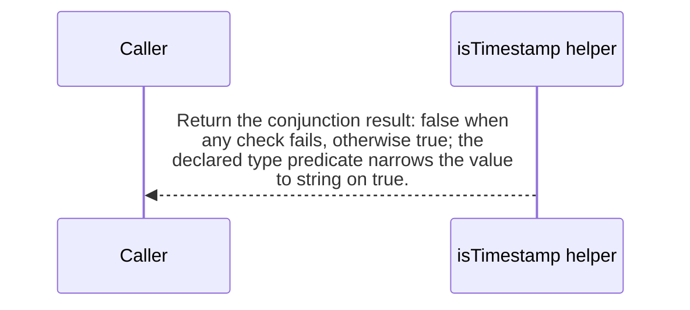

import {ClewMarkdown, ClewFieldDetails, ClewProcess, ClewDataModel, ClewDownload, ClewModelLink, ClewRelatedModelLink, ClewFieldTrace, ClewContextLink, ClewPageContext, ClewProcessReturn, ClewStatus, ClewRetainedPage, ClewCatalog, ClewAnchor} from '@site/src/components/ClewReaders';

# Dashboard timestamp predicate

<ClewPageContext />

Retained account · UNVERIFIED · UNASSESSED. Runtime behavior is not established by this export.

isTimestamp is a TypeScript type predicate from unknown to string. Its single returned conjunction first requires a string, then a UTC-shaped YYYY-MM-DDTHH:mm:ss value with optional fractional seconds and a trailing Z, and finally a finite Date.parse result. Because the checks use &amp;&amp;, a failed earlier check returns false and short-circuits later checks; true requires all three. No I/O or mutation is written in the captured body; the extractor leaves its calls unresolved.

Summary source bindings

- [services/dashboard/src/events.ts:6–8 · revision e635069293d58cb0d4f28c8211e748b8d58e6b37](../sources/f595401e33ffe1c87198d3297a901422e3d449fe00dd98adddc17aaca283d70e.mdx)
- [services/dashboard/src/events.ts:7–7 · revision e635069293d58cb0d4f28c8211e748b8d58e6b37](../sources/b76c9c4fe68ef99c93cd4231295d055f5730288cd582449dcd78c9622ce7ab87.mdx)
- [services/dashboard/src/events.ts:7–7 · revision e635069293d58cb0d4f28c8211e748b8d58e6b37](../sources/d7ec7cb1dca1be352924e7f976052b96787bf94c5aefb5e8978688b15194bc2d.mdx)
- [services/dashboard/src/events.ts:7–7 · revision e635069293d58cb0d4f28c8211e748b8d58e6b37](../sources/5ded879bffca4444775113931feb50cab6762eb26cbd5878e529e342f553ee1b.mdx)
- [services/dashboard/src/events.ts:7–7 · revision e635069293d58cb0d4f28c8211e748b8d58e6b37](../sources/fb358ae597d219d0f72bad801288e6eb88b5b7b9cd7db3e79f8398d94348f0dc.mdx)

## Declared interface schemas

<ClewContextLink path="/http/475242e2ef07721c45d26c563b5cd15b52b47fb16494eab9b22738cd80b35c25">GET /openapi.json</ClewContextLink>

<ClewContextLink path="/http/5e9ce2f78105d5d9215b07ddf87c8025176e932f11403c3b248ee8f2f77a9989">POST /api/places</ClewContextLink>

<ClewContextLink path="/http/ed3ea26055386f7e8904ff37c1c9931e4943602283a96c6067a31ac32aa24dac">POST /api/places/&#123;id&#125;/refresh</ClewContextLink>

<ClewContextLink path="/http/d3d56f55618a4d6b12c611f5055d16e80668439f39a23e30eb42437d1be85294">GET /</ClewContextLink>

<ClewContextLink path="/http/589bef5f2c1640933430afb73226fc910c4cdb435b53197fdaef848d460a716b">GET /health</ClewContextLink>

<ClewContextLink path="/http/5fda6cc4b385e34a2f5c5b6539f9420f1a95661ef0c3656b18ef951b4f2fe516">GET /api/weather</ClewContextLink>

## Interaction diagram

Actors and nested branches from the retained account; not a runtime trace. Labels are shortened for readability. Full messages and notes follow.

Full original sequence, branches and notes

#### 1. note

<ClewMarkdown text={"The first conjunct accepts only a string. A non-string makes the conjunction false and short-circuits the later checks."} />

Source bindings

- [services/dashboard/src/events.ts:7–7 · revision e635069293d58cb0d4f28c8211e748b8d58e6b37](../sources/b76c9c4fe68ef99c93cd4231295d055f5730288cd582449dcd78c9622ce7ab87.mdx)

#### 2. note

<ClewMarkdown text={"For a string, test the UTC-shaped YYYY-MM-DDTHH:mm:ss form with optional fractional seconds and a trailing Z. A mismatch makes the conjunction false before parsing."} />

Source bindings

- [services/dashboard/src/events.ts:7–7 · revision e635069293d58cb0d4f28c8211e748b8d58e6b37](../sources/b76c9c4fe68ef99c93cd4231295d055f5730288cd582449dcd78c9622ce7ab87.mdx)
- [services/dashboard/src/events.ts:7–7 · revision e635069293d58cb0d4f28c8211e748b8d58e6b37](../sources/5ded879bffca4444775113931feb50cab6762eb26cbd5878e529e342f553ee1b.mdx)

#### 3. note

<ClewMarkdown text={"Only a string that passes the shape check reaches Date.parse(value); the final conjunct requires Number.isFinite of that result. This describes the captured predicates and does not claim a separate calendar-validity guarantee."} />

Source bindings

- [services/dashboard/src/events.ts:7–7 · revision e635069293d58cb0d4f28c8211e748b8d58e6b37](../sources/b76c9c4fe68ef99c93cd4231295d055f5730288cd582449dcd78c9622ce7ab87.mdx)
- [services/dashboard/src/events.ts:7–7 · revision e635069293d58cb0d4f28c8211e748b8d58e6b37](../sources/d7ec7cb1dca1be352924e7f976052b96787bf94c5aefb5e8978688b15194bc2d.mdx)
- [services/dashboard/src/events.ts:7–7 · revision e635069293d58cb0d4f28c8211e748b8d58e6b37](../sources/fb358ae597d219d0f72bad801288e6eb88b5b7b9cd7db3e79f8398d94348f0dc.mdx)

#### 4. return

<ClewMarkdown text={"Return the conjunction result: false when any check fails, otherwise true; the declared type predicate narrows the value to string on true."} />

Source bindings

- [services/dashboard/src/events.ts:6–8 · revision e635069293d58cb0d4f28c8211e748b8d58e6b37](../sources/f595401e33ffe1c87198d3297a901422e3d449fe00dd98adddc17aaca283d70e.mdx)
- [services/dashboard/src/events.ts:7–7 · revision e635069293d58cb0d4f28c8211e748b8d58e6b37](../sources/b76c9c4fe68ef99c93cd4231295d055f5730288cd582449dcd78c9622ce7ab87.mdx)

## Implementation explanation

<ClewMarkdown text={"The first conjunct accepts only a string. A non-string makes the conjunction false and short-circuits the later checks."} />

Source bindings

- [services/dashboard/src/events.ts:7–7 · revision e635069293d58cb0d4f28c8211e748b8d58e6b37](../sources/b76c9c4fe68ef99c93cd4231295d055f5730288cd582449dcd78c9622ce7ab87.mdx)

<ClewMarkdown text={"For a string, test the UTC-shaped YYYY-MM-DDTHH:mm:ss form with optional fractional seconds and a trailing Z. A mismatch makes the conjunction false before parsing."} />

Source bindings

- [services/dashboard/src/events.ts:7–7 · revision e635069293d58cb0d4f28c8211e748b8d58e6b37](../sources/b76c9c4fe68ef99c93cd4231295d055f5730288cd582449dcd78c9622ce7ab87.mdx)
- [services/dashboard/src/events.ts:7–7 · revision e635069293d58cb0d4f28c8211e748b8d58e6b37](../sources/5ded879bffca4444775113931feb50cab6762eb26cbd5878e529e342f553ee1b.mdx)

<ClewMarkdown text={"Only a string that passes the shape check reaches Date.parse(value); the final conjunct requires Number.isFinite of that result. This describes the captured predicates and does not claim a separate calendar-validity guarantee."} />

Source bindings

- [services/dashboard/src/events.ts:7–7 · revision e635069293d58cb0d4f28c8211e748b8d58e6b37](../sources/b76c9c4fe68ef99c93cd4231295d055f5730288cd582449dcd78c9622ce7ab87.mdx)
- [services/dashboard/src/events.ts:7–7 · revision e635069293d58cb0d4f28c8211e748b8d58e6b37](../sources/d7ec7cb1dca1be352924e7f976052b96787bf94c5aefb5e8978688b15194bc2d.mdx)
- [services/dashboard/src/events.ts:7–7 · revision e635069293d58cb0d4f28c8211e748b8d58e6b37](../sources/fb358ae597d219d0f72bad801288e6eb88b5b7b9cd7db3e79f8398d94348f0dc.mdx)

<ClewMarkdown text={"Return the conjunction result: false when any check fails, otherwise true; the declared type predicate narrows the value to string on true."} />

Source bindings

- [services/dashboard/src/events.ts:6–8 · revision e635069293d58cb0d4f28c8211e748b8d58e6b37](../sources/f595401e33ffe1c87198d3297a901422e3d449fe00dd98adddc17aaca283d70e.mdx)
- [services/dashboard/src/events.ts:7–7 · revision e635069293d58cb0d4f28c8211e748b8d58e6b37](../sources/b76c9c4fe68ef99c93cd4231295d055f5730288cd582449dcd78c9622ce7ab87.mdx)

Retained boundaries

- This is a source-syntax explanation of the exact TypeScript declaration. The extractor leaves its call targets unresolved and does not resolve a framework trigger; compiler validation and runtime activation are not established.
- CALL\_TARGETS\_UNRESOLVED
- DIALECT\_DECLARED\_NOT\_COMPILER\_VALIDATED
- FILE\_ONLY:compose.yaml
- FILE\_ONLY:contracts/dashboard.openapi.json
- FILE\_ONLY:contracts/events.schema.json
- FILE\_ONLY:database/init.sql
- FILE\_ONLY:exercises/dashboard-focus-regression.mjs
- FILE\_ONLY:exercises/replay.py
- FILE\_ONLY:exercises/validator-regression.mjs
- FILE\_ONLY:fixtures/helsinki.json
- FILE\_ONLY:fixtures/lisbon.json
- FILE\_ONLY:fixtures/met-oslo-recorded.json
- FILE\_ONLY:fixtures/oslo.json
- FILE\_ONLY:fixtures/provenance.json
- FILE\_ONLY:services/dashboard/Dockerfile
- FILE\_ONLY:services/dashboard/package-lock.json
- FILE\_ONLY:services/dashboard/package.json
- FILE\_ONLY:services/dashboard/public/index.html
- FILE\_ONLY:services/dashboard/tsconfig.json
- OPENAPI\_JSON\_SCHEMA\_KEYWORDS\_NOT\_INTERPRETED
- OPENAPI\_SCHEMA\_NULL\_TYPE\_NOT\_INTERPRETED
- OPENAPI\_SCHEMA\_TYPE\_UNIONS\_NOT\_INTERPRETED
- ORDER\_LEXICAL\_ONLY
- SCOPE\_WATCH\_CONSERVATIVE
- Syntax evidence does not establish runtime dispatch or configuration. Expand known owners and helpers; retain explicit gaps for unresolved targets.
- ANNOTATION\_DECLARATION\_UNAVAILABLE
- CALL\_TARGETS\_UNRESOLVED
- DIALECT\_DECLARED\_NOT\_COMPILER\_VALIDATED
- FILE\_ONLY:compose.yaml
- FILE\_ONLY:contracts/events.schema.json
- FILE\_ONLY:contracts/forecasts.openapi.json
- FILE\_ONLY:database/init.sql
- FILE\_ONLY:fixtures/helsinki.json
- FILE\_ONLY:fixtures/lisbon.json
- FILE\_ONLY:fixtures/met-oslo-recorded.json
- FILE\_ONLY:fixtures/oslo.json
- FILE\_ONLY:fixtures/provenance.json
- FILE\_ONLY:services/forecasts/Dockerfile
- FILE\_ONLY:services/forecasts/pom.xml
- FILE\_ONLY:services/forecasts/src/main/resources/application.properties
- NO\_BEAN\_OWNER
- OPENAPI\_JSON\_SCHEMA\_KEYWORDS\_NOT\_INTERPRETED
- OPENAPI\_SCHEMA\_NULL\_TYPE\_NOT\_INTERPRETED
- OPENAPI\_SCHEMA\_TYPE\_UNIONS\_NOT\_INTERPRETED
- ORDER\_LEXICAL\_ONLY
- RUNTIME\_REGISTRATION\_UNPROVEN
- SCOPE\_WATCH\_CONSERVATIVE
- SOURCE\_NAMES\_NOT\_COMPILER\_RESOLVED
- UNRESOLVED\_ANNOTATION\_VALUE
- Syntax evidence does not establish runtime dispatch or configuration. Expand known owners and helpers; retain explicit gaps for unresolved targets.
- CLR\_SIGNATURE\_PROJECTED\_TO\_JVM\_DESCRIPTOR\_GRAMMAR
- CSHARP\_SOURCE\_GENERATED\_DOCUMENTS\_NOT\_INDEXED
- EXCEPTION\_FLOW\_REQUIRES\_SOURCE\_REVIEW
- GENERATED\_SOURCE\_BODIES\_NOT\_INDEXED
- LAMBDA\_EXECUTION\_NOT\_EXPANDED
- OPENAPI\_JSON\_SCHEMA\_KEYWORDS\_NOT\_INTERPRETED
- SHORT\_CIRCUIT\_FLOW\_REQUIRES\_SOURCE\_REVIEW
- SWITCH\_FLOW\_REQUIRES\_SOURCE\_REVIEW

