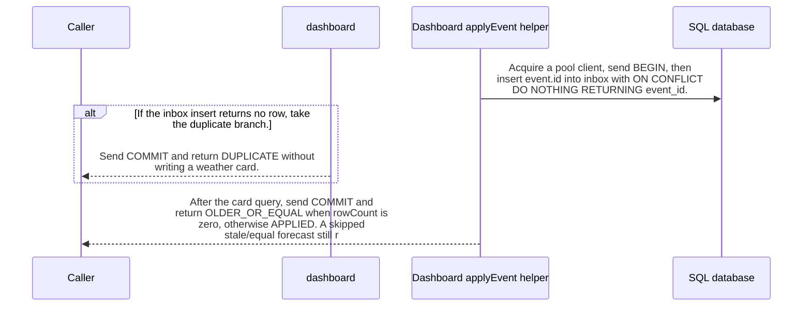

import {ClewMarkdown, ClewFieldDetails, ClewProcess, ClewDataModel, ClewDownload, ClewModelLink, ClewRelatedModelLink, ClewFieldTrace, ClewContextLink, ClewPageContext, ClewProcessReturn, ClewStatus, ClewRetainedPage, ClewCatalog, ClewAnchor} from '@site/src/components/ClewReaders';

# Apply dashboard event effects

<ClewPageContext />

Retained account · UNVERIFIED · UNASSESSED. Runtime behavior is not established by this export.

applyEvent calls pool.connect before try, then sends BEGIN and inserts event.id into inbox with ON CONFLICT DO NOTHING. If the insert returns no row, it sends COMMIT and returns DUPLICATE before any card write. Otherwise, the forecast upsert runs only when event.type is forecast.updated and event.forecast is truthy; on conflict it accepts a NULL stored timestamp or a strictly newer incoming updatedAt. Every other event type or a falsy forecast takes the place-only upsert, which does not itself validate place.requested. The function then sends COMMIT and returns OLDER\_OR\_EQUAL for rowCount 0 or APPLIED otherwise; a stale/equal forecast still commits the newly inserted inbox row. An error in try awaits ROLLBACK then rethrows; rollback failure replaces the original error. finally releases the client, and a release error may replace the pending result. A connect rejection is outside try. These are source-level calls and branches; DB semantics, runtime delivery, and exactly-once effects are unverified.

Summary source bindings

- [services/dashboard/src/main.ts:19–19 · revision e635069293d58cb0d4f28c8211e748b8d58e6b37](../sources/cdacc9bb5d8f5f0fe255ef49394104b05be7457cf15fa9cd4e62325d914ca189.mdx)
- [services/dashboard/src/main.ts:38–38 · revision e635069293d58cb0d4f28c8211e748b8d58e6b37](../sources/1a4bd6fae968bd7ce2055accd586504e7fbeb9bec769d3c9b980109638e931c6.mdx)
- [services/dashboard/src/main.ts:22–22 · revision e635069293d58cb0d4f28c8211e748b8d58e6b37](../sources/0d7f9694bf15c2f0fad3b5dd9e8a2efe63803bb7240515ecfb8f9ae2489d6303.mdx)
- [services/dashboard/src/main.ts:21–21 · revision e635069293d58cb0d4f28c8211e748b8d58e6b37](../sources/e309060e6d4922aabac57c6703ab9d1a1a8c828e9e859ceede9a32986b1801dc.mdx)
- [services/dashboard/src/main.ts:26–31 · revision e635069293d58cb0d4f28c8211e748b8d58e6b37](../sources/2c66817e9154ddb20fb23277ff15e3b4e442414533b29db0eef994ea2a03df94.mdx)
- [services/dashboard/src/main.ts:37–37 · revision e635069293d58cb0d4f28c8211e748b8d58e6b37](../sources/8a119af28ac8db50b7f790471b59dd042a6ab6f87aa26fb880123f8857558266.mdx)
- [services/dashboard/src/main.ts:18–18 · revision e635069293d58cb0d4f28c8211e748b8d58e6b37](../sources/de7db9630ac9f0f8031d4071a88cf062aea6e0a90514aed3f30ccab4eaa757bb.mdx)
- [services/dashboard/src/main.ts:16–16 · revision e635069293d58cb0d4f28c8211e748b8d58e6b37](../sources/60c523b876459c2468c28ef3998fae18a4a76e016db8f86932d5ff5273c81272.mdx)
- [services/dashboard/src/main.ts:17–44 · revision e635069293d58cb0d4f28c8211e748b8d58e6b37](../sources/a10f268c5bd504c57256d1e23e40f2967bf5f0cc856aed4a51fd32fea3013612.mdx)
- [services/dashboard/src/main.ts:25–36 · revision e635069293d58cb0d4f28c8211e748b8d58e6b37](../sources/748a3145ae4e083b0f8cbb6e8d98c8eb342cdde71ac8e1ecb8cb42142be6192c.mdx)
- [services/dashboard/src/main.ts:40–40 · revision e635069293d58cb0d4f28c8211e748b8d58e6b37](../sources/8398733280eed9d0a19284aadcfbcc1ba6015a16c36fef06edc96a92eaf64fe0.mdx)
- [services/dashboard/src/main.ts:20–23 · revision e635069293d58cb0d4f28c8211e748b8d58e6b37](../sources/edf1b642af6214c18a6d57b93d0e225af6d7c19d052d2a15319724076438e338.mdx)
- [services/dashboard/src/main.ts:15–45 · revision e635069293d58cb0d4f28c8211e748b8d58e6b37](../sources/bf524d202ba882540036918136ea088912da8bc6f340ab23d8a90bfb0aacab71.mdx)
- [services/dashboard/src/main.ts:33–35 · revision e635069293d58cb0d4f28c8211e748b8d58e6b37](../sources/8a600c6422069268bfb7681828b39afd5f77fd44d52854088341e44dd3349397.mdx)
- [services/dashboard/src/main.ts:43–43 · revision e635069293d58cb0d4f28c8211e748b8d58e6b37](../sources/192ac15b0239693f16a30524f39144164d6c2ad3f0062e3edea0c58d91456ea7.mdx)
- [services/dashboard/src/main.ts:41–41 · revision e635069293d58cb0d4f28c8211e748b8d58e6b37](../sources/05862343ff22500cb88b3fb25fa1de93bc01827b6c45ef5b5e6e5d9e93cf25f6.mdx)
- [services/dashboard/src/main.ts:42–44 · revision e635069293d58cb0d4f28c8211e748b8d58e6b37](../sources/d9cc6bd5d1c5891aacac7f245646839b97a9ce345a4d4f8e2b65d60b6fb1e27c.mdx)
- [services/dashboard/src/main.ts:31–31 · revision e635069293d58cb0d4f28c8211e748b8d58e6b37](../sources/78fe92a9bc12b007d73deefe324b94d5b84ce2ff830ae221bcf3132997ff9f65.mdx)

## Declared interface schemas

<ClewContextLink path="/http/475242e2ef07721c45d26c563b5cd15b52b47fb16494eab9b22738cd80b35c25">GET /openapi.json</ClewContextLink>

<ClewContextLink path="/http/5e9ce2f78105d5d9215b07ddf87c8025176e932f11403c3b248ee8f2f77a9989">POST /api/places</ClewContextLink>

<ClewContextLink path="/http/ed3ea26055386f7e8904ff37c1c9931e4943602283a96c6067a31ac32aa24dac">POST /api/places/&#123;id&#125;/refresh</ClewContextLink>

<ClewContextLink path="/http/d3d56f55618a4d6b12c611f5055d16e80668439f39a23e30eb42437d1be85294">GET /</ClewContextLink>

<ClewContextLink path="/http/589bef5f2c1640933430afb73226fc910c4cdb435b53197fdaef848d460a716b">GET /health</ClewContextLink>

<ClewContextLink path="/http/5fda6cc4b385e34a2f5c5b6539f9420f1a95661ef0c3656b18ef951b4f2fe516">GET /api/weather</ClewContextLink>

## Interaction diagram

Actors and nested branches from the retained account; not a runtime trace. Labels are shortened for readability. Full messages and notes follow.

Full original sequence, branches and notes

#### 1. message

<ClewMarkdown text={"Acquire a pool client, send BEGIN, then insert event.id into inbox with ON CONFLICT DO NOTHING RETURNING event_id."} />

Source bindings

- [services/dashboard/src/main.ts:19–19 · revision e635069293d58cb0d4f28c8211e748b8d58e6b37](../sources/cdacc9bb5d8f5f0fe255ef49394104b05be7457cf15fa9cd4e62325d914ca189.mdx)
- [services/dashboard/src/main.ts:18–18 · revision e635069293d58cb0d4f28c8211e748b8d58e6b37](../sources/de7db9630ac9f0f8031d4071a88cf062aea6e0a90514aed3f30ccab4eaa757bb.mdx)
- [services/dashboard/src/main.ts:16–16 · revision e635069293d58cb0d4f28c8211e748b8d58e6b37](../sources/60c523b876459c2468c28ef3998fae18a4a76e016db8f86932d5ff5273c81272.mdx)
- [services/dashboard/src/main.ts:15–45 · revision e635069293d58cb0d4f28c8211e748b8d58e6b37](../sources/bf524d202ba882540036918136ea088912da8bc6f340ab23d8a90bfb0aacab71.mdx)

#### 2. alt

<ClewMarkdown text={"If the inbox insert returns no row, take the duplicate branch."} />

Source bindings

- [services/dashboard/src/main.ts:20–23 · revision e635069293d58cb0d4f28c8211e748b8d58e6b37](../sources/edf1b642af6214c18a6d57b93d0e225af6d7c19d052d2a15319724076438e338.mdx)
- [services/dashboard/src/main.ts:15–45 · revision e635069293d58cb0d4f28c8211e748b8d58e6b37](../sources/bf524d202ba882540036918136ea088912da8bc6f340ab23d8a90bfb0aacab71.mdx)

#### 3. return

<ClewMarkdown text={"Send COMMIT and return DUPLICATE without writing a weather card."} />

Source bindings

- [services/dashboard/src/main.ts:22–22 · revision e635069293d58cb0d4f28c8211e748b8d58e6b37](../sources/0d7f9694bf15c2f0fad3b5dd9e8a2efe63803bb7240515ecfb8f9ae2489d6303.mdx)
- [services/dashboard/src/main.ts:21–21 · revision e635069293d58cb0d4f28c8211e748b8d58e6b37](../sources/e309060e6d4922aabac57c6703ab9d1a1a8c828e9e859ceede9a32986b1801dc.mdx)
- [services/dashboard/src/main.ts:15–45 · revision e635069293d58cb0d4f28c8211e748b8d58e6b37](../sources/bf524d202ba882540036918136ea088912da8bc6f340ab23d8a90bfb0aacab71.mdx)

#### 4. else

<ClewMarkdown text={"Otherwise"} />

Source bindings

- [services/dashboard/src/main.ts:20–23 · revision e635069293d58cb0d4f28c8211e748b8d58e6b37](../sources/edf1b642af6214c18a6d57b93d0e225af6d7c19d052d2a15319724076438e338.mdx)
- [services/dashboard/src/main.ts:15–45 · revision e635069293d58cb0d4f28c8211e748b8d58e6b37](../sources/bf524d202ba882540036918136ea088912da8bc6f340ab23d8a90bfb0aacab71.mdx)

#### 5. note

<ClewMarkdown text={"A newly inserted inbox id continues to the card branch."} />

Source bindings

- [services/dashboard/src/main.ts:19–19 · revision e635069293d58cb0d4f28c8211e748b8d58e6b37](../sources/cdacc9bb5d8f5f0fe255ef49394104b05be7457cf15fa9cd4e62325d914ca189.mdx)
- [services/dashboard/src/main.ts:20–23 · revision e635069293d58cb0d4f28c8211e748b8d58e6b37](../sources/edf1b642af6214c18a6d57b93d0e225af6d7c19d052d2a15319724076438e338.mdx)
- [services/dashboard/src/main.ts:15–45 · revision e635069293d58cb0d4f28c8211e748b8d58e6b37](../sources/bf524d202ba882540036918136ea088912da8bc6f340ab23d8a90bfb0aacab71.mdx)

#### 6. end

<ClewMarkdown text={""} />

Source bindings

- [services/dashboard/src/main.ts:20–23 · revision e635069293d58cb0d4f28c8211e748b8d58e6b37](../sources/edf1b642af6214c18a6d57b93d0e225af6d7c19d052d2a15319724076438e338.mdx)
- [services/dashboard/src/main.ts:15–45 · revision e635069293d58cb0d4f28c8211e748b8d58e6b37](../sources/bf524d202ba882540036918136ea088912da8bc6f340ab23d8a90bfb0aacab71.mdx)

#### 7. alt

<ClewMarkdown text={"The forecast branch requires both event.type === forecast.updated and a truthy event.forecast."} />

Source bindings

- [services/dashboard/src/main.ts:25–36 · revision e635069293d58cb0d4f28c8211e748b8d58e6b37](../sources/748a3145ae4e083b0f8cbb6e8d98c8eb342cdde71ac8e1ecb8cb42142be6192c.mdx)
- [services/dashboard/src/main.ts:15–45 · revision e635069293d58cb0d4f28c8211e748b8d58e6b37](../sources/bf524d202ba882540036918136ea088912da8bc6f340ab23d8a90bfb0aacab71.mdx)

#### 8. note

<ClewMarkdown text={"Upsert forecast fields; on conflict, update only when the stored updated_at is NULL or the incoming updatedAt is strictly greater. The function calls JSON.stringify(event.forecast) to prepare the query parameter passed to client.query."} />

Source bindings

- [services/dashboard/src/main.ts:26–31 · revision e635069293d58cb0d4f28c8211e748b8d58e6b37](../sources/2c66817e9154ddb20fb23277ff15e3b4e442414533b29db0eef994ea2a03df94.mdx)
- [services/dashboard/src/main.ts:15–45 · revision e635069293d58cb0d4f28c8211e748b8d58e6b37](../sources/bf524d202ba882540036918136ea088912da8bc6f340ab23d8a90bfb0aacab71.mdx)
- [services/dashboard/src/main.ts:31–31 · revision e635069293d58cb0d4f28c8211e748b8d58e6b37](../sources/78fe92a9bc12b007d73deefe324b94d5b84ce2ff830ae221bcf3132997ff9f65.mdx)

#### 9. else

<ClewMarkdown text={"Otherwise"} />

Source bindings

- [services/dashboard/src/main.ts:25–36 · revision e635069293d58cb0d4f28c8211e748b8d58e6b37](../sources/748a3145ae4e083b0f8cbb6e8d98c8eb342cdde71ac8e1ecb8cb42142be6192c.mdx)
- [services/dashboard/src/main.ts:15–45 · revision e635069293d58cb0d4f28c8211e748b8d58e6b37](../sources/bf524d202ba882540036918136ea088912da8bc6f340ab23d8a90bfb0aacab71.mdx)

#### 10. note

<ClewMarkdown text={"All other types or a falsy forecast use the place-only upsert; this branch is not validation that the event is place.requested."} />

Source bindings

- [services/dashboard/src/main.ts:15–45 · revision e635069293d58cb0d4f28c8211e748b8d58e6b37](../sources/bf524d202ba882540036918136ea088912da8bc6f340ab23d8a90bfb0aacab71.mdx)
- [services/dashboard/src/main.ts:33–35 · revision e635069293d58cb0d4f28c8211e748b8d58e6b37](../sources/8a600c6422069268bfb7681828b39afd5f77fd44d52854088341e44dd3349397.mdx)

#### 11. end

<ClewMarkdown text={""} />

Source bindings

- [services/dashboard/src/main.ts:25–36 · revision e635069293d58cb0d4f28c8211e748b8d58e6b37](../sources/748a3145ae4e083b0f8cbb6e8d98c8eb342cdde71ac8e1ecb8cb42142be6192c.mdx)
- [services/dashboard/src/main.ts:15–45 · revision e635069293d58cb0d4f28c8211e748b8d58e6b37](../sources/bf524d202ba882540036918136ea088912da8bc6f340ab23d8a90bfb0aacab71.mdx)

#### 12. return

<ClewMarkdown text={"After the card query, send COMMIT and return OLDER_OR_EQUAL when rowCount is zero, otherwise APPLIED. A skipped stale/equal forecast still reaches COMMIT after the inbox insert."} />

Source bindings

- [services/dashboard/src/main.ts:19–19 · revision e635069293d58cb0d4f28c8211e748b8d58e6b37](../sources/cdacc9bb5d8f5f0fe255ef49394104b05be7457cf15fa9cd4e62325d914ca189.mdx)
- [services/dashboard/src/main.ts:38–38 · revision e635069293d58cb0d4f28c8211e748b8d58e6b37](../sources/1a4bd6fae968bd7ce2055accd586504e7fbeb9bec769d3c9b980109638e931c6.mdx)
- [services/dashboard/src/main.ts:37–37 · revision e635069293d58cb0d4f28c8211e748b8d58e6b37](../sources/8a119af28ac8db50b7f790471b59dd042a6ab6f87aa26fb880123f8857558266.mdx)
- [services/dashboard/src/main.ts:15–45 · revision e635069293d58cb0d4f28c8211e748b8d58e6b37](../sources/bf524d202ba882540036918136ea088912da8bc6f340ab23d8a90bfb0aacab71.mdx)

#### 13. alt

<ClewMarkdown text={"If a statement inside try throws, catch awaits ROLLBACK and then throws the caught error."} />

Source bindings

- [services/dashboard/src/main.ts:17–44 · revision e635069293d58cb0d4f28c8211e748b8d58e6b37](../sources/a10f268c5bd504c57256d1e23e40f2967bf5f0cc856aed4a51fd32fea3013612.mdx)
- [services/dashboard/src/main.ts:40–40 · revision e635069293d58cb0d4f28c8211e748b8d58e6b37](../sources/8398733280eed9d0a19284aadcfbcc1ba6015a16c36fef06edc96a92eaf64fe0.mdx)
- [services/dashboard/src/main.ts:15–45 · revision e635069293d58cb0d4f28c8211e748b8d58e6b37](../sources/bf524d202ba882540036918136ea088912da8bc6f340ab23d8a90bfb0aacab71.mdx)
- [services/dashboard/src/main.ts:41–41 · revision e635069293d58cb0d4f28c8211e748b8d58e6b37](../sources/05862343ff22500cb88b3fb25fa1de93bc01827b6c45ef5b5e6e5d9e93cf25f6.mdx)

#### 14. note

<ClewMarkdown text={"If ROLLBACK itself rejects, that failure escapes instead of the original caught error."} />

Source bindings

- [services/dashboard/src/main.ts:40–40 · revision e635069293d58cb0d4f28c8211e748b8d58e6b37](../sources/8398733280eed9d0a19284aadcfbcc1ba6015a16c36fef06edc96a92eaf64fe0.mdx)
- [services/dashboard/src/main.ts:15–45 · revision e635069293d58cb0d4f28c8211e748b8d58e6b37](../sources/bf524d202ba882540036918136ea088912da8bc6f340ab23d8a90bfb0aacab71.mdx)
- [services/dashboard/src/main.ts:41–41 · revision e635069293d58cb0d4f28c8211e748b8d58e6b37](../sources/05862343ff22500cb88b3fb25fa1de93bc01827b6c45ef5b5e6e5d9e93cf25f6.mdx)

#### 15. else

<ClewMarkdown text={"Otherwise"} />

Source bindings

- [services/dashboard/src/main.ts:17–44 · revision e635069293d58cb0d4f28c8211e748b8d58e6b37](../sources/a10f268c5bd504c57256d1e23e40f2967bf5f0cc856aed4a51fd32fea3013612.mdx)
- [services/dashboard/src/main.ts:40–40 · revision e635069293d58cb0d4f28c8211e748b8d58e6b37](../sources/8398733280eed9d0a19284aadcfbcc1ba6015a16c36fef06edc96a92eaf64fe0.mdx)
- [services/dashboard/src/main.ts:15–45 · revision e635069293d58cb0d4f28c8211e748b8d58e6b37](../sources/bf524d202ba882540036918136ea088912da8bc6f340ab23d8a90bfb0aacab71.mdx)
- [services/dashboard/src/main.ts:41–41 · revision e635069293d58cb0d4f28c8211e748b8d58e6b37](../sources/05862343ff22500cb88b3fb25fa1de93bc01827b6c45ef5b5e6e5d9e93cf25f6.mdx)

#### 16. note

<ClewMarkdown text={"When try completes without throwing, the return path proceeds to finally."} />

Source bindings

- [services/dashboard/src/main.ts:17–44 · revision e635069293d58cb0d4f28c8211e748b8d58e6b37](../sources/a10f268c5bd504c57256d1e23e40f2967bf5f0cc856aed4a51fd32fea3013612.mdx)
- [services/dashboard/src/main.ts:15–45 · revision e635069293d58cb0d4f28c8211e748b8d58e6b37](../sources/bf524d202ba882540036918136ea088912da8bc6f340ab23d8a90bfb0aacab71.mdx)

#### 17. end

<ClewMarkdown text={""} />

Source bindings

- [services/dashboard/src/main.ts:17–44 · revision e635069293d58cb0d4f28c8211e748b8d58e6b37](../sources/a10f268c5bd504c57256d1e23e40f2967bf5f0cc856aed4a51fd32fea3013612.mdx)
- [services/dashboard/src/main.ts:40–40 · revision e635069293d58cb0d4f28c8211e748b8d58e6b37](../sources/8398733280eed9d0a19284aadcfbcc1ba6015a16c36fef06edc96a92eaf64fe0.mdx)
- [services/dashboard/src/main.ts:15–45 · revision e635069293d58cb0d4f28c8211e748b8d58e6b37](../sources/bf524d202ba882540036918136ea088912da8bc6f340ab23d8a90bfb0aacab71.mdx)
- [services/dashboard/src/main.ts:41–41 · revision e635069293d58cb0d4f28c8211e748b8d58e6b37](../sources/05862343ff22500cb88b3fb25fa1de93bc01827b6c45ef5b5e6e5d9e93cf25f6.mdx)

#### 18. note

<ClewMarkdown text={"After a client is acquired, finally calls client.release on normal and caught-error exits; a release exception may replace the pending result. pool.connect runs before try, so its rejection bypasses this catch and finally."} />

Source bindings

- [services/dashboard/src/main.ts:16–16 · revision e635069293d58cb0d4f28c8211e748b8d58e6b37](../sources/60c523b876459c2468c28ef3998fae18a4a76e016db8f86932d5ff5273c81272.mdx)
- [services/dashboard/src/main.ts:15–45 · revision e635069293d58cb0d4f28c8211e748b8d58e6b37](../sources/bf524d202ba882540036918136ea088912da8bc6f340ab23d8a90bfb0aacab71.mdx)
- [services/dashboard/src/main.ts:43–43 · revision e635069293d58cb0d4f28c8211e748b8d58e6b37](../sources/192ac15b0239693f16a30524f39144164d6c2ad3f0062e3edea0c58d91456ea7.mdx)
- [services/dashboard/src/main.ts:42–44 · revision e635069293d58cb0d4f28c8211e748b8d58e6b37](../sources/d9cc6bd5d1c5891aacac7f245646839b97a9ce345a4d4f8e2b65d60b6fb1e27c.mdx)

## Implementation explanation

<ClewMarkdown text={"Acquire a pool client, send BEGIN, then insert event.id into inbox with ON CONFLICT DO NOTHING RETURNING event_id."} />

Source bindings

- [services/dashboard/src/main.ts:19–19 · revision e635069293d58cb0d4f28c8211e748b8d58e6b37](../sources/cdacc9bb5d8f5f0fe255ef49394104b05be7457cf15fa9cd4e62325d914ca189.mdx)
- [services/dashboard/src/main.ts:18–18 · revision e635069293d58cb0d4f28c8211e748b8d58e6b37](../sources/de7db9630ac9f0f8031d4071a88cf062aea6e0a90514aed3f30ccab4eaa757bb.mdx)
- [services/dashboard/src/main.ts:16–16 · revision e635069293d58cb0d4f28c8211e748b8d58e6b37](../sources/60c523b876459c2468c28ef3998fae18a4a76e016db8f86932d5ff5273c81272.mdx)
- [services/dashboard/src/main.ts:15–45 · revision e635069293d58cb0d4f28c8211e748b8d58e6b37](../sources/bf524d202ba882540036918136ea088912da8bc6f340ab23d8a90bfb0aacab71.mdx)

<ClewMarkdown text={"If the inbox insert returns no row, take the duplicate branch."} />

Source bindings

- [services/dashboard/src/main.ts:20–23 · revision e635069293d58cb0d4f28c8211e748b8d58e6b37](../sources/edf1b642af6214c18a6d57b93d0e225af6d7c19d052d2a15319724076438e338.mdx)
- [services/dashboard/src/main.ts:15–45 · revision e635069293d58cb0d4f28c8211e748b8d58e6b37](../sources/bf524d202ba882540036918136ea088912da8bc6f340ab23d8a90bfb0aacab71.mdx)

<ClewMarkdown text={"Send COMMIT and return DUPLICATE without writing a weather card."} />

Source bindings

- [services/dashboard/src/main.ts:22–22 · revision e635069293d58cb0d4f28c8211e748b8d58e6b37](../sources/0d7f9694bf15c2f0fad3b5dd9e8a2efe63803bb7240515ecfb8f9ae2489d6303.mdx)
- [services/dashboard/src/main.ts:21–21 · revision e635069293d58cb0d4f28c8211e748b8d58e6b37](../sources/e309060e6d4922aabac57c6703ab9d1a1a8c828e9e859ceede9a32986b1801dc.mdx)
- [services/dashboard/src/main.ts:15–45 · revision e635069293d58cb0d4f28c8211e748b8d58e6b37](../sources/bf524d202ba882540036918136ea088912da8bc6f340ab23d8a90bfb0aacab71.mdx)

<ClewMarkdown text={"The source describes an alternative branch."} />

Source bindings

- [services/dashboard/src/main.ts:20–23 · revision e635069293d58cb0d4f28c8211e748b8d58e6b37](../sources/edf1b642af6214c18a6d57b93d0e225af6d7c19d052d2a15319724076438e338.mdx)
- [services/dashboard/src/main.ts:15–45 · revision e635069293d58cb0d4f28c8211e748b8d58e6b37](../sources/bf524d202ba882540036918136ea088912da8bc6f340ab23d8a90bfb0aacab71.mdx)

<ClewMarkdown text={"A newly inserted inbox id continues to the card branch."} />

Source bindings

- [services/dashboard/src/main.ts:19–19 · revision e635069293d58cb0d4f28c8211e748b8d58e6b37](../sources/cdacc9bb5d8f5f0fe255ef49394104b05be7457cf15fa9cd4e62325d914ca189.mdx)
- [services/dashboard/src/main.ts:20–23 · revision e635069293d58cb0d4f28c8211e748b8d58e6b37](../sources/edf1b642af6214c18a6d57b93d0e225af6d7c19d052d2a15319724076438e338.mdx)
- [services/dashboard/src/main.ts:15–45 · revision e635069293d58cb0d4f28c8211e748b8d58e6b37](../sources/bf524d202ba882540036918136ea088912da8bc6f340ab23d8a90bfb0aacab71.mdx)

<ClewMarkdown text={"The forecast branch requires both event.type === forecast.updated and a truthy event.forecast."} />

Source bindings

- [services/dashboard/src/main.ts:25–36 · revision e635069293d58cb0d4f28c8211e748b8d58e6b37](../sources/748a3145ae4e083b0f8cbb6e8d98c8eb342cdde71ac8e1ecb8cb42142be6192c.mdx)
- [services/dashboard/src/main.ts:15–45 · revision e635069293d58cb0d4f28c8211e748b8d58e6b37](../sources/bf524d202ba882540036918136ea088912da8bc6f340ab23d8a90bfb0aacab71.mdx)

<ClewMarkdown text={"Upsert forecast fields; on conflict, update only when the stored updated_at is NULL or the incoming updatedAt is strictly greater. The function calls JSON.stringify(event.forecast) to prepare the query parameter passed to client.query."} />

Source bindings

- [services/dashboard/src/main.ts:26–31 · revision e635069293d58cb0d4f28c8211e748b8d58e6b37](../sources/2c66817e9154ddb20fb23277ff15e3b4e442414533b29db0eef994ea2a03df94.mdx)
- [services/dashboard/src/main.ts:15–45 · revision e635069293d58cb0d4f28c8211e748b8d58e6b37](../sources/bf524d202ba882540036918136ea088912da8bc6f340ab23d8a90bfb0aacab71.mdx)
- [services/dashboard/src/main.ts:31–31 · revision e635069293d58cb0d4f28c8211e748b8d58e6b37](../sources/78fe92a9bc12b007d73deefe324b94d5b84ce2ff830ae221bcf3132997ff9f65.mdx)

<ClewMarkdown text={"The source describes an alternative branch."} />

Source bindings

- [services/dashboard/src/main.ts:25–36 · revision e635069293d58cb0d4f28c8211e748b8d58e6b37](../sources/748a3145ae4e083b0f8cbb6e8d98c8eb342cdde71ac8e1ecb8cb42142be6192c.mdx)
- [services/dashboard/src/main.ts:15–45 · revision e635069293d58cb0d4f28c8211e748b8d58e6b37](../sources/bf524d202ba882540036918136ea088912da8bc6f340ab23d8a90bfb0aacab71.mdx)

<ClewMarkdown text={"All other types or a falsy forecast use the place-only upsert; this branch is not validation that the event is place.requested."} />

Source bindings

- [services/dashboard/src/main.ts:15–45 · revision e635069293d58cb0d4f28c8211e748b8d58e6b37](../sources/bf524d202ba882540036918136ea088912da8bc6f340ab23d8a90bfb0aacab71.mdx)
- [services/dashboard/src/main.ts:33–35 · revision e635069293d58cb0d4f28c8211e748b8d58e6b37](../sources/8a600c6422069268bfb7681828b39afd5f77fd44d52854088341e44dd3349397.mdx)

<ClewMarkdown text={"After the card query, send COMMIT and return OLDER_OR_EQUAL when rowCount is zero, otherwise APPLIED. A skipped stale/equal forecast still reaches COMMIT after the inbox insert."} />

Source bindings

- [services/dashboard/src/main.ts:19–19 · revision e635069293d58cb0d4f28c8211e748b8d58e6b37](../sources/cdacc9bb5d8f5f0fe255ef49394104b05be7457cf15fa9cd4e62325d914ca189.mdx)
- [services/dashboard/src/main.ts:38–38 · revision e635069293d58cb0d4f28c8211e748b8d58e6b37](../sources/1a4bd6fae968bd7ce2055accd586504e7fbeb9bec769d3c9b980109638e931c6.mdx)
- [services/dashboard/src/main.ts:37–37 · revision e635069293d58cb0d4f28c8211e748b8d58e6b37](../sources/8a119af28ac8db50b7f790471b59dd042a6ab6f87aa26fb880123f8857558266.mdx)
- [services/dashboard/src/main.ts:15–45 · revision e635069293d58cb0d4f28c8211e748b8d58e6b37](../sources/bf524d202ba882540036918136ea088912da8bc6f340ab23d8a90bfb0aacab71.mdx)

<ClewMarkdown text={"If a statement inside try throws, catch awaits ROLLBACK and then throws the caught error."} />

Source bindings

- [services/dashboard/src/main.ts:17–44 · revision e635069293d58cb0d4f28c8211e748b8d58e6b37](../sources/a10f268c5bd504c57256d1e23e40f2967bf5f0cc856aed4a51fd32fea3013612.mdx)
- [services/dashboard/src/main.ts:40–40 · revision e635069293d58cb0d4f28c8211e748b8d58e6b37](../sources/8398733280eed9d0a19284aadcfbcc1ba6015a16c36fef06edc96a92eaf64fe0.mdx)
- [services/dashboard/src/main.ts:15–45 · revision e635069293d58cb0d4f28c8211e748b8d58e6b37](../sources/bf524d202ba882540036918136ea088912da8bc6f340ab23d8a90bfb0aacab71.mdx)
- [services/dashboard/src/main.ts:41–41 · revision e635069293d58cb0d4f28c8211e748b8d58e6b37](../sources/05862343ff22500cb88b3fb25fa1de93bc01827b6c45ef5b5e6e5d9e93cf25f6.mdx)

<ClewMarkdown text={"If ROLLBACK itself rejects, that failure escapes instead of the original caught error."} />

Source bindings

- [services/dashboard/src/main.ts:40–40 · revision e635069293d58cb0d4f28c8211e748b8d58e6b37](../sources/8398733280eed9d0a19284aadcfbcc1ba6015a16c36fef06edc96a92eaf64fe0.mdx)
- [services/dashboard/src/main.ts:15–45 · revision e635069293d58cb0d4f28c8211e748b8d58e6b37](../sources/bf524d202ba882540036918136ea088912da8bc6f340ab23d8a90bfb0aacab71.mdx)
- [services/dashboard/src/main.ts:41–41 · revision e635069293d58cb0d4f28c8211e748b8d58e6b37](../sources/05862343ff22500cb88b3fb25fa1de93bc01827b6c45ef5b5e6e5d9e93cf25f6.mdx)

<ClewMarkdown text={"The source describes an alternative branch."} />

Source bindings

- [services/dashboard/src/main.ts:17–44 · revision e635069293d58cb0d4f28c8211e748b8d58e6b37](../sources/a10f268c5bd504c57256d1e23e40f2967bf5f0cc856aed4a51fd32fea3013612.mdx)
- [services/dashboard/src/main.ts:40–40 · revision e635069293d58cb0d4f28c8211e748b8d58e6b37](../sources/8398733280eed9d0a19284aadcfbcc1ba6015a16c36fef06edc96a92eaf64fe0.mdx)
- [services/dashboard/src/main.ts:15–45 · revision e635069293d58cb0d4f28c8211e748b8d58e6b37](../sources/bf524d202ba882540036918136ea088912da8bc6f340ab23d8a90bfb0aacab71.mdx)
- [services/dashboard/src/main.ts:41–41 · revision e635069293d58cb0d4f28c8211e748b8d58e6b37](../sources/05862343ff22500cb88b3fb25fa1de93bc01827b6c45ef5b5e6e5d9e93cf25f6.mdx)

<ClewMarkdown text={"When try completes without throwing, the return path proceeds to finally."} />

Source bindings

- [services/dashboard/src/main.ts:17–44 · revision e635069293d58cb0d4f28c8211e748b8d58e6b37](../sources/a10f268c5bd504c57256d1e23e40f2967bf5f0cc856aed4a51fd32fea3013612.mdx)
- [services/dashboard/src/main.ts:15–45 · revision e635069293d58cb0d4f28c8211e748b8d58e6b37](../sources/bf524d202ba882540036918136ea088912da8bc6f340ab23d8a90bfb0aacab71.mdx)

<ClewMarkdown text={"After a client is acquired, finally calls client.release on normal and caught-error exits; a release exception may replace the pending result. pool.connect runs before try, so its rejection bypasses this catch and finally."} />

Source bindings

- [services/dashboard/src/main.ts:16–16 · revision e635069293d58cb0d4f28c8211e748b8d58e6b37](../sources/60c523b876459c2468c28ef3998fae18a4a76e016db8f86932d5ff5273c81272.mdx)
- [services/dashboard/src/main.ts:15–45 · revision e635069293d58cb0d4f28c8211e748b8d58e6b37](../sources/bf524d202ba882540036918136ea088912da8bc6f340ab23d8a90bfb0aacab71.mdx)
- [services/dashboard/src/main.ts:43–43 · revision e635069293d58cb0d4f28c8211e748b8d58e6b37](../sources/192ac15b0239693f16a30524f39144164d6c2ad3f0062e3edea0c58d91456ea7.mdx)
- [services/dashboard/src/main.ts:42–44 · revision e635069293d58cb0d4f28c8211e748b8d58e6b37](../sources/d9cc6bd5d1c5891aacac7f245646839b97a9ce345a4d4f8e2b65d60b6fb1e27c.mdx)

Retained boundaries

- FLOW records are syntax-level and lexically ordered; database call targets are unresolved, so this explains SQL literals and source control flow rather than database guarantees.
- The source capture does not prove runtime activation, caller/acknowledgment order, transaction isolation or durability, crash behavior, or exactly-once processing.
- CALL\_TARGETS\_UNRESOLVED
- DIALECT\_DECLARED\_NOT\_COMPILER\_VALIDATED
- FILE\_ONLY:compose.yaml
- FILE\_ONLY:contracts/dashboard.openapi.json
- FILE\_ONLY:contracts/events.schema.json
- FILE\_ONLY:database/init.sql
- FILE\_ONLY:exercises/dashboard-focus-regression.mjs
- FILE\_ONLY:exercises/replay.py
- FILE\_ONLY:exercises/validator-regression.mjs
- FILE\_ONLY:fixtures/helsinki.json
- FILE\_ONLY:fixtures/lisbon.json
- FILE\_ONLY:fixtures/met-oslo-recorded.json
- FILE\_ONLY:fixtures/oslo.json
- FILE\_ONLY:fixtures/provenance.json
- FILE\_ONLY:services/dashboard/Dockerfile
- FILE\_ONLY:services/dashboard/package-lock.json
- FILE\_ONLY:services/dashboard/package.json
- FILE\_ONLY:services/dashboard/public/index.html
- FILE\_ONLY:services/dashboard/tsconfig.json
- OPENAPI\_JSON\_SCHEMA\_KEYWORDS\_NOT\_INTERPRETED
- OPENAPI\_SCHEMA\_NULL\_TYPE\_NOT\_INTERPRETED
- OPENAPI\_SCHEMA\_TYPE\_UNIONS\_NOT\_INTERPRETED
- ORDER\_LEXICAL\_ONLY
- SCOPE\_WATCH\_CONSERVATIVE
- Syntax evidence does not establish runtime dispatch or configuration. Expand known owners and helpers; retain explicit gaps for unresolved targets.
- ANNOTATION\_DECLARATION\_UNAVAILABLE
- CALL\_TARGETS\_UNRESOLVED
- DIALECT\_DECLARED\_NOT\_COMPILER\_VALIDATED
- FILE\_ONLY:compose.yaml
- FILE\_ONLY:contracts/events.schema.json
- FILE\_ONLY:contracts/forecasts.openapi.json
- FILE\_ONLY:database/init.sql
- FILE\_ONLY:fixtures/helsinki.json
- FILE\_ONLY:fixtures/lisbon.json
- FILE\_ONLY:fixtures/met-oslo-recorded.json
- FILE\_ONLY:fixtures/oslo.json
- FILE\_ONLY:fixtures/provenance.json
- FILE\_ONLY:services/forecasts/Dockerfile
- FILE\_ONLY:services/forecasts/pom.xml
- FILE\_ONLY:services/forecasts/src/main/resources/application.properties
- NO\_BEAN\_OWNER
- OPENAPI\_JSON\_SCHEMA\_KEYWORDS\_NOT\_INTERPRETED
- OPENAPI\_SCHEMA\_NULL\_TYPE\_NOT\_INTERPRETED
- OPENAPI\_SCHEMA\_TYPE\_UNIONS\_NOT\_INTERPRETED
- ORDER\_LEXICAL\_ONLY
- RUNTIME\_REGISTRATION\_UNPROVEN
- SCOPE\_WATCH\_CONSERVATIVE
- SOURCE\_NAMES\_NOT\_COMPILER\_RESOLVED
- UNRESOLVED\_ANNOTATION\_VALUE
- Syntax evidence does not establish runtime dispatch or configuration. Expand known owners and helpers; retain explicit gaps for unresolved targets.
- CLR\_SIGNATURE\_PROJECTED\_TO\_JVM\_DESCRIPTOR\_GRAMMAR
- CSHARP\_SOURCE\_GENERATED\_DOCUMENTS\_NOT\_INDEXED
- EXCEPTION\_FLOW\_REQUIRES\_SOURCE\_REVIEW
- GENERATED\_SOURCE\_BODIES\_NOT\_INDEXED
- LAMBDA\_EXECUTION\_NOT\_EXPANDED
- OPENAPI\_JSON\_SCHEMA\_KEYWORDS\_NOT\_INTERPRETED
- SHORT\_CIRCUIT\_FLOW\_REQUIRES\_SOURCE\_REVIEW
- SWITCH\_FLOW\_REQUIRES\_SOURCE\_REVIEW

