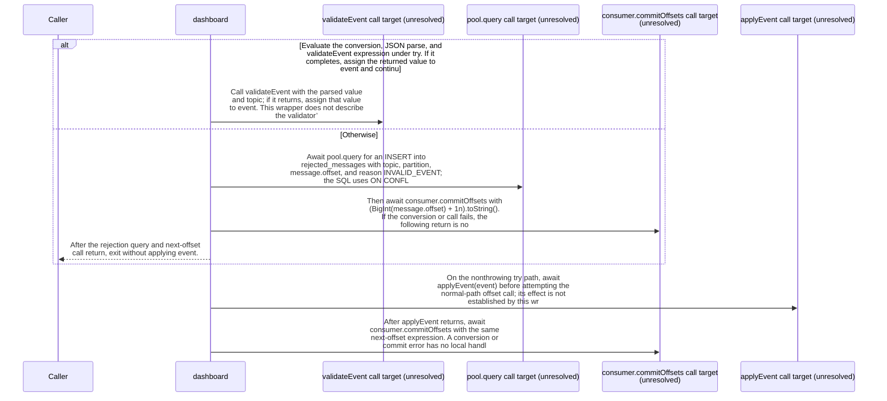

import {ClewMarkdown, ClewFieldDetails, ClewProcess, ClewDataModel, ClewDownload, ClewModelLink, ClewRelatedModelLink, ClewFieldTrace, ClewContextLink, ClewPageContext, ClewProcessReturn, ClewStatus, ClewRetainedPage, ClewCatalog, ClewAnchor} from '@site/src/components/ClewReaders';

# Dashboard consumeMessage wrapper

<ClewPageContext />

Retained account · UNVERIFIED · UNASSESSED. Runtime behavior is not established by this export.

consumeMessage takes an EachMessagePayload, then converts message.value with optional toString and a nullish empty-string fallback, parses JSON, and calls validateEvent inside one try. A throw from that expression enters catch: the wrapper awaits an INSERT into rejected\_messages with reason INVALID\_EVENT and ON CONFLICT DO NOTHING, then awaits commitOffsets with the next offset and returns. If the try completes, its result is assigned to event; the normal path awaits applyEvent(event), then the same next-offset call. The source shows these ordered awaits, not listener activation, call results, database durability, broker delivery, or applyEvent transaction outcomes.

Summary source bindings

- [services/dashboard/src/main.ts:59–59 · revision e635069293d58cb0d4f28c8211e748b8d58e6b37](../sources/fb056517f94476af3c7964b81f570f4579e6b57b469923f270bb1b5b7f3ec245.mdx)
- [services/dashboard/src/main.ts:51–51 · revision e635069293d58cb0d4f28c8211e748b8d58e6b37](../sources/9c56ac5341b33a45ae80ad458e3f2e616169e87ddcafb2ce44f0d643a042881d.mdx)
- [services/dashboard/src/main.ts:51–51 · revision e635069293d58cb0d4f28c8211e748b8d58e6b37](../sources/5ccb742ced5e1c66ddfe6c5af65e88b1a09e6ddc6bf6c0919245330f4808986f.mdx)
- [services/dashboard/src/main.ts:58–58 · revision e635069293d58cb0d4f28c8211e748b8d58e6b37](../sources/03b9efe6bc6d50d833e9a96c49365da011a0e4f6ed708994589122816819a21f.mdx)
- [services/dashboard/src/main.ts:53–54 · revision e635069293d58cb0d4f28c8211e748b8d58e6b37](../sources/51eb13746a4ec715b7f498f982fc29c26b082e21cf20eed410ae88e3807a0f13.mdx)
- [services/dashboard/src/main.ts:55–55 · revision e635069293d58cb0d4f28c8211e748b8d58e6b37](../sources/93bfdfa8b5f1d920fce5b370a4f6f2a256a16ed0c25f8253d464c0f273505c99.mdx)
- [services/dashboard/src/main.ts:55–55 · revision e635069293d58cb0d4f28c8211e748b8d58e6b37](../sources/04307c94ed8910824028310d5a54e4062e623b9b852e4e1ed79879721fe73f84.mdx)
- [services/dashboard/src/main.ts:55–55 · revision e635069293d58cb0d4f28c8211e748b8d58e6b37](../sources/7aade9ed3c0bb735283355f77a431ea3c8729271662e54ebab578098032c7df9.mdx)
- [services/dashboard/src/main.ts:59–59 · revision e635069293d58cb0d4f28c8211e748b8d58e6b37](../sources/6283e91063480812a39e2708d5aa73b5677fbda0d76e632eda0dcd45d0c8c4d6.mdx)
- [services/dashboard/src/main.ts:51–51 · revision e635069293d58cb0d4f28c8211e748b8d58e6b37](../sources/4798bc09cdd58e52e7e56aae4740dbb99954e40e39ad7c17923a447e491e2712.mdx)
- [services/dashboard/src/main.ts:59–59 · revision e635069293d58cb0d4f28c8211e748b8d58e6b37](../sources/596449b04f878bf0394c5492523a6a54d943d9f3a2a63e24cba4e4ca8dce043a.mdx)
- [services/dashboard/src/main.ts:50–57 · revision e635069293d58cb0d4f28c8211e748b8d58e6b37](../sources/cb1d1d3100a0984649d98da9a16956ac42fc63a19ea6841dad22f15a13784ba7.mdx)
- [services/dashboard/src/main.ts:47–60 · revision e635069293d58cb0d4f28c8211e748b8d58e6b37](../sources/c8b3521f73ba74f836cc640aa7a8cad2b6e1012251c1b736f186c06a9b475233.mdx)
- [services/dashboard/src/main.ts:56–56 · revision e635069293d58cb0d4f28c8211e748b8d58e6b37](../sources/7fdaf9f2a9021a175f7a56f3d1da7a449de99be9aa83f25efd9106bc89d18e90.mdx)

## Declared interface schemas

<ClewContextLink path="/http/475242e2ef07721c45d26c563b5cd15b52b47fb16494eab9b22738cd80b35c25">GET /openapi.json</ClewContextLink>

<ClewContextLink path="/http/5e9ce2f78105d5d9215b07ddf87c8025176e932f11403c3b248ee8f2f77a9989">POST /api/places</ClewContextLink>

<ClewContextLink path="/http/ed3ea26055386f7e8904ff37c1c9931e4943602283a96c6067a31ac32aa24dac">POST /api/places/&#123;id&#125;/refresh</ClewContextLink>

<ClewContextLink path="/http/d3d56f55618a4d6b12c611f5055d16e80668439f39a23e30eb42437d1be85294">GET /</ClewContextLink>

<ClewContextLink path="/http/589bef5f2c1640933430afb73226fc910c4cdb435b53197fdaef848d460a716b">GET /health</ClewContextLink>

<ClewContextLink path="/http/5fda6cc4b385e34a2f5c5b6539f9420f1a95661ef0c3656b18ef951b4f2fe516">GET /api/weather</ClewContextLink>

## Interaction diagram

Actors and nested branches from the retained account; not a runtime trace. Labels are shortened for readability. Full messages and notes follow.

Full original sequence, branches and notes

#### 1. alt

<ClewMarkdown text={"Evaluate the conversion, JSON parse, and validateEvent expression under try. If it completes, assign the returned value to event and continue; if any part throws, the catch path below runs."} />

Source bindings

- [services/dashboard/src/main.ts:50–57 · revision e635069293d58cb0d4f28c8211e748b8d58e6b37](../sources/cb1d1d3100a0984649d98da9a16956ac42fc63a19ea6841dad22f15a13784ba7.mdx)
- [services/dashboard/src/main.ts:47–60 · revision e635069293d58cb0d4f28c8211e748b8d58e6b37](../sources/c8b3521f73ba74f836cc640aa7a8cad2b6e1012251c1b736f186c06a9b475233.mdx)

#### 2. note

<ClewMarkdown text={"Read message.value?.toString() and use an empty string when that result is nullish, then call JSON.parse. A conversion or parse exception enters catch."} />

Source bindings

- [services/dashboard/src/main.ts:51–51 · revision e635069293d58cb0d4f28c8211e748b8d58e6b37](../sources/9c56ac5341b33a45ae80ad458e3f2e616169e87ddcafb2ce44f0d643a042881d.mdx)
- [services/dashboard/src/main.ts:51–51 · revision e635069293d58cb0d4f28c8211e748b8d58e6b37](../sources/5ccb742ced5e1c66ddfe6c5af65e88b1a09e6ddc6bf6c0919245330f4808986f.mdx)
- [services/dashboard/src/main.ts:47–60 · revision e635069293d58cb0d4f28c8211e748b8d58e6b37](../sources/c8b3521f73ba74f836cc640aa7a8cad2b6e1012251c1b736f186c06a9b475233.mdx)

#### 3. message

<ClewMarkdown text={"Call validateEvent with the parsed value and topic; if it returns, assign that value to event. This wrapper does not describe the validator’s checks."} />

Source bindings

- [services/dashboard/src/main.ts:51–51 · revision e635069293d58cb0d4f28c8211e748b8d58e6b37](../sources/4798bc09cdd58e52e7e56aae4740dbb99954e40e39ad7c17923a447e491e2712.mdx)
- [services/dashboard/src/main.ts:47–60 · revision e635069293d58cb0d4f28c8211e748b8d58e6b37](../sources/c8b3521f73ba74f836cc640aa7a8cad2b6e1012251c1b736f186c06a9b475233.mdx)

#### 4. else

<ClewMarkdown text={"Otherwise"} />

Source bindings

- [services/dashboard/src/main.ts:50–57 · revision e635069293d58cb0d4f28c8211e748b8d58e6b37](../sources/cb1d1d3100a0984649d98da9a16956ac42fc63a19ea6841dad22f15a13784ba7.mdx)
- [services/dashboard/src/main.ts:47–60 · revision e635069293d58cb0d4f28c8211e748b8d58e6b37](../sources/c8b3521f73ba74f836cc640aa7a8cad2b6e1012251c1b736f186c06a9b475233.mdx)

#### 5. message

<ClewMarkdown text={"Await pool.query for an INSERT into rejected_messages with topic, partition, message.offset, and reason INVALID_EVENT; the SQL uses ON CONFLICT DO NOTHING."} />

Source bindings

- [services/dashboard/src/main.ts:53–54 · revision e635069293d58cb0d4f28c8211e748b8d58e6b37](../sources/51eb13746a4ec715b7f498f982fc29c26b082e21cf20eed410ae88e3807a0f13.mdx)
- [services/dashboard/src/main.ts:47–60 · revision e635069293d58cb0d4f28c8211e748b8d58e6b37](../sources/c8b3521f73ba74f836cc640aa7a8cad2b6e1012251c1b736f186c06a9b475233.mdx)

#### 6. note

<ClewMarkdown text={"The INSERT is awaited before offset handling. If it rejects, the offset call is not reached; the catch body has no nested handler."} />

Source bindings

- [services/dashboard/src/main.ts:53–54 · revision e635069293d58cb0d4f28c8211e748b8d58e6b37](../sources/51eb13746a4ec715b7f498f982fc29c26b082e21cf20eed410ae88e3807a0f13.mdx)
- [services/dashboard/src/main.ts:55–55 · revision e635069293d58cb0d4f28c8211e748b8d58e6b37](../sources/04307c94ed8910824028310d5a54e4062e623b9b852e4e1ed79879721fe73f84.mdx)
- [services/dashboard/src/main.ts:47–60 · revision e635069293d58cb0d4f28c8211e748b8d58e6b37](../sources/c8b3521f73ba74f836cc640aa7a8cad2b6e1012251c1b736f186c06a9b475233.mdx)

#### 7. message

<ClewMarkdown text={"Then await consumer.commitOffsets with (BigInt(message.offset) + 1n).toString(). If the conversion or call fails, the following return is not reached."} />

Source bindings

- [services/dashboard/src/main.ts:55–55 · revision e635069293d58cb0d4f28c8211e748b8d58e6b37](../sources/93bfdfa8b5f1d920fce5b370a4f6f2a256a16ed0c25f8253d464c0f273505c99.mdx)
- [services/dashboard/src/main.ts:55–55 · revision e635069293d58cb0d4f28c8211e748b8d58e6b37](../sources/04307c94ed8910824028310d5a54e4062e623b9b852e4e1ed79879721fe73f84.mdx)
- [services/dashboard/src/main.ts:55–55 · revision e635069293d58cb0d4f28c8211e748b8d58e6b37](../sources/7aade9ed3c0bb735283355f77a431ea3c8729271662e54ebab578098032c7df9.mdx)
- [services/dashboard/src/main.ts:47–60 · revision e635069293d58cb0d4f28c8211e748b8d58e6b37](../sources/c8b3521f73ba74f836cc640aa7a8cad2b6e1012251c1b736f186c06a9b475233.mdx)

#### 8. return

<ClewMarkdown text={"After the rejection query and next-offset call return, exit without applying event."} />

Source bindings

- [services/dashboard/src/main.ts:47–60 · revision e635069293d58cb0d4f28c8211e748b8d58e6b37](../sources/c8b3521f73ba74f836cc640aa7a8cad2b6e1012251c1b736f186c06a9b475233.mdx)
- [services/dashboard/src/main.ts:56–56 · revision e635069293d58cb0d4f28c8211e748b8d58e6b37](../sources/7fdaf9f2a9021a175f7a56f3d1da7a449de99be9aa83f25efd9106bc89d18e90.mdx)

#### 9. end

<ClewMarkdown text={""} />

Source bindings

- [services/dashboard/src/main.ts:50–57 · revision e635069293d58cb0d4f28c8211e748b8d58e6b37](../sources/cb1d1d3100a0984649d98da9a16956ac42fc63a19ea6841dad22f15a13784ba7.mdx)
- [services/dashboard/src/main.ts:47–60 · revision e635069293d58cb0d4f28c8211e748b8d58e6b37](../sources/c8b3521f73ba74f836cc640aa7a8cad2b6e1012251c1b736f186c06a9b475233.mdx)

#### 10. message

<ClewMarkdown text={"On the nonthrowing try path, await applyEvent(event) before attempting the normal-path offset call; its effect is not established by this wrapper."} />

Source bindings

- [services/dashboard/src/main.ts:58–58 · revision e635069293d58cb0d4f28c8211e748b8d58e6b37](../sources/03b9efe6bc6d50d833e9a96c49365da011a0e4f6ed708994589122816819a21f.mdx)
- [services/dashboard/src/main.ts:47–60 · revision e635069293d58cb0d4f28c8211e748b8d58e6b37](../sources/c8b3521f73ba74f836cc640aa7a8cad2b6e1012251c1b736f186c06a9b475233.mdx)

#### 11. note

<ClewMarkdown text={"If applyEvent rejects, the following offset call is not reached; no catch surrounds this path in the captured body."} />

Source bindings

- [services/dashboard/src/main.ts:58–58 · revision e635069293d58cb0d4f28c8211e748b8d58e6b37](../sources/03b9efe6bc6d50d833e9a96c49365da011a0e4f6ed708994589122816819a21f.mdx)
- [services/dashboard/src/main.ts:59–59 · revision e635069293d58cb0d4f28c8211e748b8d58e6b37](../sources/596449b04f878bf0394c5492523a6a54d943d9f3a2a63e24cba4e4ca8dce043a.mdx)
- [services/dashboard/src/main.ts:47–60 · revision e635069293d58cb0d4f28c8211e748b8d58e6b37](../sources/c8b3521f73ba74f836cc640aa7a8cad2b6e1012251c1b736f186c06a9b475233.mdx)

#### 12. message

<ClewMarkdown text={"After applyEvent returns, await consumer.commitOffsets with the same next-offset expression. A conversion or commit error has no local handler here."} />

Source bindings

- [services/dashboard/src/main.ts:59–59 · revision e635069293d58cb0d4f28c8211e748b8d58e6b37](../sources/fb056517f94476af3c7964b81f570f4579e6b57b469923f270bb1b5b7f3ec245.mdx)
- [services/dashboard/src/main.ts:59–59 · revision e635069293d58cb0d4f28c8211e748b8d58e6b37](../sources/6283e91063480812a39e2708d5aa73b5677fbda0d76e632eda0dcd45d0c8c4d6.mdx)
- [services/dashboard/src/main.ts:59–59 · revision e635069293d58cb0d4f28c8211e748b8d58e6b37](../sources/596449b04f878bf0394c5492523a6a54d943d9f3a2a63e24cba4e4ca8dce043a.mdx)
- [services/dashboard/src/main.ts:47–60 · revision e635069293d58cb0d4f28c8211e748b8d58e6b37](../sources/c8b3521f73ba74f836cc640aa7a8cad2b6e1012251c1b736f186c06a9b475233.mdx)

## Implementation explanation

<ClewMarkdown text={"Evaluate the conversion, JSON parse, and validateEvent expression under try. If it completes, assign the returned value to event and continue; if any part throws, the catch path below runs."} />

Source bindings

- [services/dashboard/src/main.ts:50–57 · revision e635069293d58cb0d4f28c8211e748b8d58e6b37](../sources/cb1d1d3100a0984649d98da9a16956ac42fc63a19ea6841dad22f15a13784ba7.mdx)
- [services/dashboard/src/main.ts:47–60 · revision e635069293d58cb0d4f28c8211e748b8d58e6b37](../sources/c8b3521f73ba74f836cc640aa7a8cad2b6e1012251c1b736f186c06a9b475233.mdx)

<ClewMarkdown text={"Read message.value?.toString() and use an empty string when that result is nullish, then call JSON.parse. A conversion or parse exception enters catch."} />

Source bindings

- [services/dashboard/src/main.ts:51–51 · revision e635069293d58cb0d4f28c8211e748b8d58e6b37](../sources/9c56ac5341b33a45ae80ad458e3f2e616169e87ddcafb2ce44f0d643a042881d.mdx)
- [services/dashboard/src/main.ts:51–51 · revision e635069293d58cb0d4f28c8211e748b8d58e6b37](../sources/5ccb742ced5e1c66ddfe6c5af65e88b1a09e6ddc6bf6c0919245330f4808986f.mdx)
- [services/dashboard/src/main.ts:47–60 · revision e635069293d58cb0d4f28c8211e748b8d58e6b37](../sources/c8b3521f73ba74f836cc640aa7a8cad2b6e1012251c1b736f186c06a9b475233.mdx)

<ClewMarkdown text={"Call validateEvent with the parsed value and topic; if it returns, assign that value to event. This wrapper does not describe the validator’s checks."} />

Source bindings

- [services/dashboard/src/main.ts:51–51 · revision e635069293d58cb0d4f28c8211e748b8d58e6b37](../sources/4798bc09cdd58e52e7e56aae4740dbb99954e40e39ad7c17923a447e491e2712.mdx)
- [services/dashboard/src/main.ts:47–60 · revision e635069293d58cb0d4f28c8211e748b8d58e6b37](../sources/c8b3521f73ba74f836cc640aa7a8cad2b6e1012251c1b736f186c06a9b475233.mdx)

<ClewMarkdown text={"The source describes an alternative branch."} />

Source bindings

- [services/dashboard/src/main.ts:50–57 · revision e635069293d58cb0d4f28c8211e748b8d58e6b37](../sources/cb1d1d3100a0984649d98da9a16956ac42fc63a19ea6841dad22f15a13784ba7.mdx)
- [services/dashboard/src/main.ts:47–60 · revision e635069293d58cb0d4f28c8211e748b8d58e6b37](../sources/c8b3521f73ba74f836cc640aa7a8cad2b6e1012251c1b736f186c06a9b475233.mdx)

<ClewMarkdown text={"Await pool.query for an INSERT into rejected_messages with topic, partition, message.offset, and reason INVALID_EVENT; the SQL uses ON CONFLICT DO NOTHING."} />

Source bindings

- [services/dashboard/src/main.ts:53–54 · revision e635069293d58cb0d4f28c8211e748b8d58e6b37](../sources/51eb13746a4ec715b7f498f982fc29c26b082e21cf20eed410ae88e3807a0f13.mdx)
- [services/dashboard/src/main.ts:47–60 · revision e635069293d58cb0d4f28c8211e748b8d58e6b37](../sources/c8b3521f73ba74f836cc640aa7a8cad2b6e1012251c1b736f186c06a9b475233.mdx)

<ClewMarkdown text={"The INSERT is awaited before offset handling. If it rejects, the offset call is not reached; the catch body has no nested handler."} />

Source bindings

- [services/dashboard/src/main.ts:53–54 · revision e635069293d58cb0d4f28c8211e748b8d58e6b37](../sources/51eb13746a4ec715b7f498f982fc29c26b082e21cf20eed410ae88e3807a0f13.mdx)
- [services/dashboard/src/main.ts:55–55 · revision e635069293d58cb0d4f28c8211e748b8d58e6b37](../sources/04307c94ed8910824028310d5a54e4062e623b9b852e4e1ed79879721fe73f84.mdx)
- [services/dashboard/src/main.ts:47–60 · revision e635069293d58cb0d4f28c8211e748b8d58e6b37](../sources/c8b3521f73ba74f836cc640aa7a8cad2b6e1012251c1b736f186c06a9b475233.mdx)

<ClewMarkdown text={"Then await consumer.commitOffsets with (BigInt(message.offset) + 1n).toString(). If the conversion or call fails, the following return is not reached."} />

Source bindings

- [services/dashboard/src/main.ts:55–55 · revision e635069293d58cb0d4f28c8211e748b8d58e6b37](../sources/93bfdfa8b5f1d920fce5b370a4f6f2a256a16ed0c25f8253d464c0f273505c99.mdx)
- [services/dashboard/src/main.ts:55–55 · revision e635069293d58cb0d4f28c8211e748b8d58e6b37](../sources/04307c94ed8910824028310d5a54e4062e623b9b852e4e1ed79879721fe73f84.mdx)
- [services/dashboard/src/main.ts:55–55 · revision e635069293d58cb0d4f28c8211e748b8d58e6b37](../sources/7aade9ed3c0bb735283355f77a431ea3c8729271662e54ebab578098032c7df9.mdx)
- [services/dashboard/src/main.ts:47–60 · revision e635069293d58cb0d4f28c8211e748b8d58e6b37](../sources/c8b3521f73ba74f836cc640aa7a8cad2b6e1012251c1b736f186c06a9b475233.mdx)

<ClewMarkdown text={"After the rejection query and next-offset call return, exit without applying event."} />

Source bindings

- [services/dashboard/src/main.ts:47–60 · revision e635069293d58cb0d4f28c8211e748b8d58e6b37](../sources/c8b3521f73ba74f836cc640aa7a8cad2b6e1012251c1b736f186c06a9b475233.mdx)
- [services/dashboard/src/main.ts:56–56 · revision e635069293d58cb0d4f28c8211e748b8d58e6b37](../sources/7fdaf9f2a9021a175f7a56f3d1da7a449de99be9aa83f25efd9106bc89d18e90.mdx)

<ClewMarkdown text={"On the nonthrowing try path, await applyEvent(event) before attempting the normal-path offset call; its effect is not established by this wrapper."} />

Source bindings

- [services/dashboard/src/main.ts:58–58 · revision e635069293d58cb0d4f28c8211e748b8d58e6b37](../sources/03b9efe6bc6d50d833e9a96c49365da011a0e4f6ed708994589122816819a21f.mdx)
- [services/dashboard/src/main.ts:47–60 · revision e635069293d58cb0d4f28c8211e748b8d58e6b37](../sources/c8b3521f73ba74f836cc640aa7a8cad2b6e1012251c1b736f186c06a9b475233.mdx)

<ClewMarkdown text={"If applyEvent rejects, the following offset call is not reached; no catch surrounds this path in the captured body."} />

Source bindings

- [services/dashboard/src/main.ts:58–58 · revision e635069293d58cb0d4f28c8211e748b8d58e6b37](../sources/03b9efe6bc6d50d833e9a96c49365da011a0e4f6ed708994589122816819a21f.mdx)
- [services/dashboard/src/main.ts:59–59 · revision e635069293d58cb0d4f28c8211e748b8d58e6b37](../sources/596449b04f878bf0394c5492523a6a54d943d9f3a2a63e24cba4e4ca8dce043a.mdx)
- [services/dashboard/src/main.ts:47–60 · revision e635069293d58cb0d4f28c8211e748b8d58e6b37](../sources/c8b3521f73ba74f836cc640aa7a8cad2b6e1012251c1b736f186c06a9b475233.mdx)

<ClewMarkdown text={"After applyEvent returns, await consumer.commitOffsets with the same next-offset expression. A conversion or commit error has no local handler here."} />

Source bindings

- [services/dashboard/src/main.ts:59–59 · revision e635069293d58cb0d4f28c8211e748b8d58e6b37](../sources/fb056517f94476af3c7964b81f570f4579e6b57b469923f270bb1b5b7f3ec245.mdx)
- [services/dashboard/src/main.ts:59–59 · revision e635069293d58cb0d4f28c8211e748b8d58e6b37](../sources/6283e91063480812a39e2708d5aa73b5677fbda0d76e632eda0dcd45d0c8c4d6.mdx)
- [services/dashboard/src/main.ts:59–59 · revision e635069293d58cb0d4f28c8211e748b8d58e6b37](../sources/596449b04f878bf0394c5492523a6a54d943d9f3a2a63e24cba4e4ca8dce043a.mdx)
- [services/dashboard/src/main.ts:47–60 · revision e635069293d58cb0d4f28c8211e748b8d58e6b37](../sources/c8b3521f73ba74f836cc640aa7a8cad2b6e1012251c1b736f186c06a9b475233.mdx)

Retained boundaries

- This view is limited to the captured TypeScript source syntax. Call targets remain unresolved; the source does not establish listener activation, database durability, offset-commit outcomes, delivery guarantees, or the effect or transaction result of applyEvent.
- CALL\_TARGETS\_UNRESOLVED
- DIALECT\_DECLARED\_NOT\_COMPILER\_VALIDATED
- FILE\_ONLY:compose.yaml
- FILE\_ONLY:contracts/dashboard.openapi.json
- FILE\_ONLY:contracts/events.schema.json
- FILE\_ONLY:database/init.sql
- FILE\_ONLY:exercises/dashboard-focus-regression.mjs
- FILE\_ONLY:exercises/replay.py
- FILE\_ONLY:exercises/validator-regression.mjs
- FILE\_ONLY:fixtures/helsinki.json
- FILE\_ONLY:fixtures/lisbon.json
- FILE\_ONLY:fixtures/met-oslo-recorded.json
- FILE\_ONLY:fixtures/oslo.json
- FILE\_ONLY:fixtures/provenance.json
- FILE\_ONLY:services/dashboard/Dockerfile
- FILE\_ONLY:services/dashboard/package-lock.json
- FILE\_ONLY:services/dashboard/package.json
- FILE\_ONLY:services/dashboard/public/index.html
- FILE\_ONLY:services/dashboard/tsconfig.json
- OPENAPI\_JSON\_SCHEMA\_KEYWORDS\_NOT\_INTERPRETED
- OPENAPI\_SCHEMA\_NULL\_TYPE\_NOT\_INTERPRETED
- OPENAPI\_SCHEMA\_TYPE\_UNIONS\_NOT\_INTERPRETED
- ORDER\_LEXICAL\_ONLY
- SCOPE\_WATCH\_CONSERVATIVE
- Syntax evidence does not establish runtime dispatch or configuration. Expand known owners and helpers; retain explicit gaps for unresolved targets.
- ANNOTATION\_DECLARATION\_UNAVAILABLE
- CALL\_TARGETS\_UNRESOLVED
- DIALECT\_DECLARED\_NOT\_COMPILER\_VALIDATED
- FILE\_ONLY:compose.yaml
- FILE\_ONLY:contracts/events.schema.json
- FILE\_ONLY:contracts/forecasts.openapi.json
- FILE\_ONLY:database/init.sql
- FILE\_ONLY:fixtures/helsinki.json
- FILE\_ONLY:fixtures/lisbon.json
- FILE\_ONLY:fixtures/met-oslo-recorded.json
- FILE\_ONLY:fixtures/oslo.json
- FILE\_ONLY:fixtures/provenance.json
- FILE\_ONLY:services/forecasts/Dockerfile
- FILE\_ONLY:services/forecasts/pom.xml
- FILE\_ONLY:services/forecasts/src/main/resources/application.properties
- NO\_BEAN\_OWNER
- OPENAPI\_JSON\_SCHEMA\_KEYWORDS\_NOT\_INTERPRETED
- OPENAPI\_SCHEMA\_NULL\_TYPE\_NOT\_INTERPRETED
- OPENAPI\_SCHEMA\_TYPE\_UNIONS\_NOT\_INTERPRETED
- ORDER\_LEXICAL\_ONLY
- RUNTIME\_REGISTRATION\_UNPROVEN
- SCOPE\_WATCH\_CONSERVATIVE
- SOURCE\_NAMES\_NOT\_COMPILER\_RESOLVED
- UNRESOLVED\_ANNOTATION\_VALUE
- Syntax evidence does not establish runtime dispatch or configuration. Expand known owners and helpers; retain explicit gaps for unresolved targets.
- CLR\_SIGNATURE\_PROJECTED\_TO\_JVM\_DESCRIPTOR\_GRAMMAR
- CSHARP\_SOURCE\_GENERATED\_DOCUMENTS\_NOT\_INDEXED
- EXCEPTION\_FLOW\_REQUIRES\_SOURCE\_REVIEW
- GENERATED\_SOURCE\_BODIES\_NOT\_INDEXED
- LAMBDA\_EXECUTION\_NOT\_EXPANDED
- OPENAPI\_JSON\_SCHEMA\_KEYWORDS\_NOT\_INTERPRETED
- SHORT\_CIRCUIT\_FLOW\_REQUIRES\_SOURCE\_REVIEW
- SWITCH\_FLOW\_REQUIRES\_SOURCE\_REVIEW

