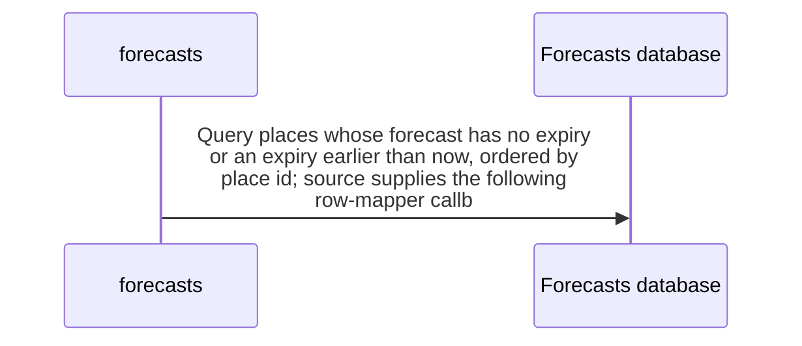

import {ClewMarkdown, ClewFieldDetails, ClewProcess, ClewDataModel, ClewDownload, ClewModelLink, ClewRelatedModelLink, ClewFieldTrace, ClewContextLink, ClewPageContext, ClewProcessReturn, ClewStatus, ClewRetainedPage, ClewCatalog, ClewAnchor} from '@site/src/components/ClewReaders';

# Scheduled refreshExpired declaration

<ClewPageContext />

Retained account · UNVERIFIED · UNASSESSED. Runtime behavior is not established by this export.

The source declares refreshExpired with fixedDelayString REFRESH\_INTERVAL\_MS and a 60000 millisecond default. It queries places whose forecast expiry is absent or earlier than now, ordered by place id, then passes each refresh call to a transaction callback. Scheduler activation and runtime callback behavior remain unverified.

Summary source bindings

- [services/forecasts/src/main/kotlin/weather/Forecasts.kt:62–68 · revision c289b28be4819eddf29d59a7c12f178559ec5229](../sources/ee1c73490c4cd4a1f4efaf310e65a12cc2a3c6bbb15ab76a4eb246cf1533dc35.mdx)

## Declared interface schemas

<ClewContextLink path="/http/f6ce8266c4e697d9db9c6b995e231713ba2df9f58df6c8a2b74789bcf30bfa2c">GET /openapi.json</ClewContextLink>

<ClewContextLink path="/http/99c2697e8d504c9514c34631f942558372d28feb06ef894ce282840389e9f94a">GET /forecasts/&#123;id&#125;</ClewContextLink>

<ClewContextLink path="/http/bd635c40728e23898f5528ecb1a60517fa6eb4df4b3b94834ca587cb6e123780">GET /health</ClewContextLink>

## Interaction diagram

Actors and nested branches from the retained account; not a runtime trace. Labels are shortened for readability. Full messages and notes follow.

Full original sequence, branches and notes

#### 1. note

<ClewMarkdown text={"The source declaration uses REFRESH_INTERVAL_MS with a 60000 millisecond fallback; this Work does not prove scheduler registration or runtime invocation."} />

Source bindings

- [services/forecasts/src/main/kotlin/weather/Forecasts.kt:62–68 · revision c289b28be4819eddf29d59a7c12f178559ec5229](../sources/ee1c73490c4cd4a1f4efaf310e65a12cc2a3c6bbb15ab76a4eb246cf1533dc35.mdx)

#### 2. message

<ClewMarkdown text={"Query places whose forecast has no expiry or an expiry earlier than now, ordered by place id; source supplies the following row-mapper callback."} />

Source bindings

- [services/forecasts/src/main/kotlin/weather/Forecasts.kt:62–68 · revision c289b28be4819eddf29d59a7c12f178559ec5229](../sources/ee1c73490c4cd4a1f4efaf310e65a12cc2a3c6bbb15ab76a4eb246cf1533dc35.mdx)

#### 3. opt

<ClewMarkdown text={"The query includes a deferred row-mapper lambda; this Work does not establish callback invocation or count."} />

Source bindings

- [services/forecasts/src/main/kotlin/weather/Forecasts.kt:64–64 · revision c289b28be4819eddf29d59a7c12f178559ec5229](../sources/d88100a3e64655a7f2f776447263dde9b9a986a7fdba57965ea9c7565783ffbf.mdx)

#### 4. note

<ClewMarkdown text={"The lambda builds a place object from each row’s id, name, latitude, and longitude."} />

Source bindings

- [services/forecasts/src/main/kotlin/weather/Forecasts.kt:64–64 · revision c289b28be4819eddf29d59a7c12f178559ec5229](../sources/d88100a3e64655a7f2f776447263dde9b9a986a7fdba57965ea9c7565783ffbf.mdx)

#### 5. end

<ClewMarkdown text={""} />

Source bindings

- [services/forecasts/src/main/kotlin/weather/Forecasts.kt:64–64 · revision c289b28be4819eddf29d59a7c12f178559ec5229](../sources/d88100a3e64655a7f2f776447263dde9b9a986a7fdba57965ea9c7565783ffbf.mdx)

#### 6. loop

<ClewMarkdown text={"For each selected place, the source attempts the transaction callback and catches per-place exceptions."} />

Source bindings

- [services/forecasts/src/main/kotlin/weather/Forecasts.kt:65–67 · revision c289b28be4819eddf29d59a7c12f178559ec5229](../sources/afc9d1096fb08a657cb9b7dfe6672bff110cfa74625c7d51092f4873e0a6863d.mdx)

#### 7. alt

<ClewMarkdown text={"The transaction call returns, or an exception is caught and logged as FORECAST_RETRY with its class name."} />

Source bindings

- [services/forecasts/src/main/kotlin/weather/Forecasts.kt:66–66 · revision c289b28be4819eddf29d59a7c12f178559ec5229](../sources/a5d4bf22b0f8c31ff9bfeb782f4242c6a3fbae92380ecfadc31c144d27b7f55f.mdx)

#### 8. opt

<ClewMarkdown text={"The source passes refresh(place) to transaction.executeWithoutResult as a deferred callback; runtime commit and rollback behavior are not established."} />

Source bindings

- [services/forecasts/src/main/kotlin/weather/Forecasts.kt:66–66 · revision c289b28be4819eddf29d59a7c12f178559ec5229](../sources/181fa6c9d9cc1e3e7ddeb4efe5cd89a564e8b1eb6511eb73f297139264c4609d.mdx)

#### 9. note

<ClewMarkdown text={"The callback body calls refresh(place)."} />

Source bindings

- [services/forecasts/src/main/kotlin/weather/Forecasts.kt:66–66 · revision c289b28be4819eddf29d59a7c12f178559ec5229](../sources/181fa6c9d9cc1e3e7ddeb4efe5cd89a564e8b1eb6511eb73f297139264c4609d.mdx)

#### 10. end

<ClewMarkdown text={""} />

Source bindings

- [services/forecasts/src/main/kotlin/weather/Forecasts.kt:66–66 · revision c289b28be4819eddf29d59a7c12f178559ec5229](../sources/181fa6c9d9cc1e3e7ddeb4efe5cd89a564e8b1eb6511eb73f297139264c4609d.mdx)

#### 11. else

<ClewMarkdown text={"Otherwise"} />

Source bindings

- [services/forecasts/src/main/kotlin/weather/Forecasts.kt:66–66 · revision c289b28be4819eddf29d59a7c12f178559ec5229](../sources/a5d4bf22b0f8c31ff9bfeb782f4242c6a3fbae92380ecfadc31c144d27b7f55f.mdx)

#### 12. note

<ClewMarkdown text={"The catch logs FORECAST_RETRY and the exception class; the source does not establish whether the scheduler will invoke the method again."} />

Source bindings

- [services/forecasts/src/main/kotlin/weather/Forecasts.kt:66–66 · revision c289b28be4819eddf29d59a7c12f178559ec5229](../sources/a5d4bf22b0f8c31ff9bfeb782f4242c6a3fbae92380ecfadc31c144d27b7f55f.mdx)

#### 13. end

<ClewMarkdown text={""} />

Source bindings

- [services/forecasts/src/main/kotlin/weather/Forecasts.kt:66–66 · revision c289b28be4819eddf29d59a7c12f178559ec5229](../sources/a5d4bf22b0f8c31ff9bfeb782f4242c6a3fbae92380ecfadc31c144d27b7f55f.mdx)

#### 14. end

<ClewMarkdown text={""} />

Source bindings

- [services/forecasts/src/main/kotlin/weather/Forecasts.kt:65–67 · revision c289b28be4819eddf29d59a7c12f178559ec5229](../sources/afc9d1096fb08a657cb9b7dfe6672bff110cfa74625c7d51092f4873e0a6863d.mdx)

## Implementation explanation

<ClewMarkdown text={"The source declaration uses REFRESH_INTERVAL_MS with a 60000 millisecond fallback; this Work does not prove scheduler registration or runtime invocation."} />

Source bindings

- [services/forecasts/src/main/kotlin/weather/Forecasts.kt:62–68 · revision c289b28be4819eddf29d59a7c12f178559ec5229](../sources/ee1c73490c4cd4a1f4efaf310e65a12cc2a3c6bbb15ab76a4eb246cf1533dc35.mdx)

<ClewMarkdown text={"Query places whose forecast has no expiry or an expiry earlier than now, ordered by place id; source supplies the following row-mapper callback."} />

Source bindings

- [services/forecasts/src/main/kotlin/weather/Forecasts.kt:62–68 · revision c289b28be4819eddf29d59a7c12f178559ec5229](../sources/ee1c73490c4cd4a1f4efaf310e65a12cc2a3c6bbb15ab76a4eb246cf1533dc35.mdx)

<ClewMarkdown text={"The query includes a deferred row-mapper lambda; this Work does not establish callback invocation or count."} />

Source bindings

- [services/forecasts/src/main/kotlin/weather/Forecasts.kt:64–64 · revision c289b28be4819eddf29d59a7c12f178559ec5229](../sources/d88100a3e64655a7f2f776447263dde9b9a986a7fdba57965ea9c7565783ffbf.mdx)

<ClewMarkdown text={"The lambda builds a place object from each row’s id, name, latitude, and longitude."} />

Source bindings

- [services/forecasts/src/main/kotlin/weather/Forecasts.kt:64–64 · revision c289b28be4819eddf29d59a7c12f178559ec5229](../sources/d88100a3e64655a7f2f776447263dde9b9a986a7fdba57965ea9c7565783ffbf.mdx)

<ClewMarkdown text={"For each selected place, the source attempts the transaction callback and catches per-place exceptions."} />

Source bindings

- [services/forecasts/src/main/kotlin/weather/Forecasts.kt:65–67 · revision c289b28be4819eddf29d59a7c12f178559ec5229](../sources/afc9d1096fb08a657cb9b7dfe6672bff110cfa74625c7d51092f4873e0a6863d.mdx)

<ClewMarkdown text={"The transaction call returns, or an exception is caught and logged as FORECAST_RETRY with its class name."} />

Source bindings

- [services/forecasts/src/main/kotlin/weather/Forecasts.kt:66–66 · revision c289b28be4819eddf29d59a7c12f178559ec5229](../sources/a5d4bf22b0f8c31ff9bfeb782f4242c6a3fbae92380ecfadc31c144d27b7f55f.mdx)

<ClewMarkdown text={"The source passes refresh(place) to transaction.executeWithoutResult as a deferred callback; runtime commit and rollback behavior are not established."} />

Source bindings

- [services/forecasts/src/main/kotlin/weather/Forecasts.kt:66–66 · revision c289b28be4819eddf29d59a7c12f178559ec5229](../sources/181fa6c9d9cc1e3e7ddeb4efe5cd89a564e8b1eb6511eb73f297139264c4609d.mdx)

<ClewMarkdown text={"The callback body calls refresh(place)."} />

Source bindings

- [services/forecasts/src/main/kotlin/weather/Forecasts.kt:66–66 · revision c289b28be4819eddf29d59a7c12f178559ec5229](../sources/181fa6c9d9cc1e3e7ddeb4efe5cd89a564e8b1eb6511eb73f297139264c4609d.mdx)

<ClewMarkdown text={"The source describes an alternative branch."} />

Source bindings

- [services/forecasts/src/main/kotlin/weather/Forecasts.kt:66–66 · revision c289b28be4819eddf29d59a7c12f178559ec5229](../sources/a5d4bf22b0f8c31ff9bfeb782f4242c6a3fbae92380ecfadc31c144d27b7f55f.mdx)

<ClewMarkdown text={"The catch logs FORECAST_RETRY and the exception class; the source does not establish whether the scheduler will invoke the method again."} />

Source bindings

- [services/forecasts/src/main/kotlin/weather/Forecasts.kt:66–66 · revision c289b28be4819eddf29d59a7c12f178559ec5229](../sources/a5d4bf22b0f8c31ff9bfeb782f4242c6a3fbae92380ecfadc31c144d27b7f55f.mdx)

Retained boundaries

- CALL\_TARGETS\_UNRESOLVED
- DIALECT\_DECLARED\_NOT\_COMPILER\_VALIDATED
- FILE\_ONLY:compose.yaml
- FILE\_ONLY:contracts/dashboard.openapi.json
- FILE\_ONLY:contracts/events.schema.json
- FILE\_ONLY:database/init.sql
- FILE\_ONLY:exercises/dashboard-focus-regression.mjs
- FILE\_ONLY:exercises/replay.py
- FILE\_ONLY:exercises/validator-regression.mjs
- FILE\_ONLY:fixtures/helsinki.json
- FILE\_ONLY:fixtures/lisbon.json
- FILE\_ONLY:fixtures/met-oslo-recorded.json
- FILE\_ONLY:fixtures/oslo.json
- FILE\_ONLY:fixtures/provenance.json
- FILE\_ONLY:services/dashboard/Dockerfile
- FILE\_ONLY:services/dashboard/package-lock.json
- FILE\_ONLY:services/dashboard/package.json
- FILE\_ONLY:services/dashboard/public/index.html
- FILE\_ONLY:services/dashboard/tsconfig.json
- OPENAPI\_JSON\_SCHEMA\_KEYWORDS\_NOT\_INTERPRETED
- OPENAPI\_SCHEMA\_NULL\_TYPE\_NOT\_INTERPRETED
- OPENAPI\_SCHEMA\_TYPE\_UNIONS\_NOT\_INTERPRETED
- ORDER\_LEXICAL\_ONLY
- SCOPE\_WATCH\_CONSERVATIVE
- Syntax evidence does not establish runtime dispatch or configuration. Expand known owners and helpers; retain explicit gaps for unresolved targets.
- ANNOTATION\_DECLARATION\_UNAVAILABLE
- CALL\_TARGETS\_UNRESOLVED
- DIALECT\_DECLARED\_NOT\_COMPILER\_VALIDATED
- FILE\_ONLY:compose.yaml
- FILE\_ONLY:contracts/events.schema.json
- FILE\_ONLY:contracts/forecasts.openapi.json
- FILE\_ONLY:database/init.sql
- FILE\_ONLY:fixtures/helsinki.json
- FILE\_ONLY:fixtures/lisbon.json
- FILE\_ONLY:fixtures/met-oslo-recorded.json
- FILE\_ONLY:fixtures/oslo.json
- FILE\_ONLY:fixtures/provenance.json
- FILE\_ONLY:services/forecasts/Dockerfile
- FILE\_ONLY:services/forecasts/pom.xml
- FILE\_ONLY:services/forecasts/src/main/resources/application.properties
- NO\_BEAN\_OWNER
- OPENAPI\_JSON\_SCHEMA\_KEYWORDS\_NOT\_INTERPRETED
- OPENAPI\_SCHEMA\_NULL\_TYPE\_NOT\_INTERPRETED
- OPENAPI\_SCHEMA\_TYPE\_UNIONS\_NOT\_INTERPRETED
- ORDER\_LEXICAL\_ONLY
- RUNTIME\_REGISTRATION\_UNPROVEN
- SCOPE\_WATCH\_CONSERVATIVE
- SOURCE\_NAMES\_NOT\_COMPILER\_RESOLVED
- UNRESOLVED\_ANNOTATION\_VALUE
- Syntax evidence does not establish runtime dispatch or configuration. Expand known owners and helpers; retain explicit gaps for unresolved targets.
- CLR\_SIGNATURE\_PROJECTED\_TO\_JVM\_DESCRIPTOR\_GRAMMAR
- CSHARP\_SOURCE\_GENERATED\_DOCUMENTS\_NOT\_INDEXED
- EXCEPTION\_FLOW\_REQUIRES\_SOURCE\_REVIEW
- GENERATED\_SOURCE\_BODIES\_NOT\_INDEXED
- LAMBDA\_EXECUTION\_NOT\_EXPANDED
- OPENAPI\_JSON\_SCHEMA\_KEYWORDS\_NOT\_INTERPRETED
- SHORT\_CIRCUIT\_FLOW\_REQUIRES\_SOURCE\_REVIEW
- SWITCH\_FLOW\_REQUIRES\_SOURCE\_REVIEW

