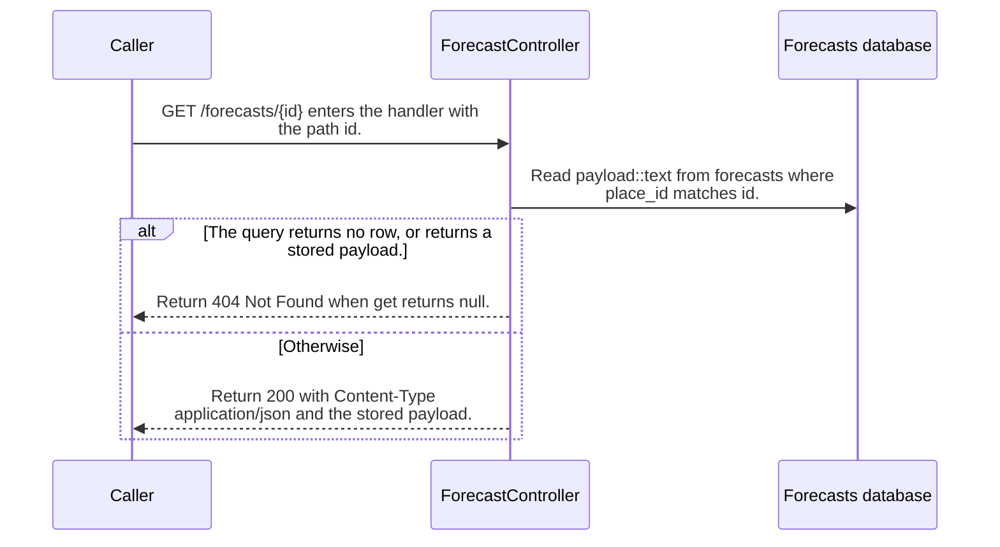

import {ClewMarkdown, ClewFieldDetails, ClewProcess, ClewDataModel, ClewDownload, ClewModelLink, ClewRelatedModelLink, ClewFieldTrace, ClewContextLink, ClewPageContext, ClewProcessReturn, ClewStatus, ClewRetainedPage, ClewCatalog, ClewAnchor} from '@site/src/components/ClewReaders';

# GET /forecasts/&#123;id&#125;

<ClewPageContext />

Retained account · UNVERIFIED · UNASSESSED. Runtime behavior is not established by this export.

The handler calls Forecasts.get with the path id. That function selects the stored payload by place\_id and returns its first row, or null. A missing payload produces 404; a found payload is returned with Content-Type application/json. This route reads the stored cache and does not call refresh. The OpenAPI contract requires id, restricts it to oslo, helsinki, or lisbon, and declares 200, 404, and 500 responses.

Summary source bindings

- [contracts/forecasts.openapi.json:1–191 · revision c289b28be4819eddf29d59a7c12f178559ec5229](../sources/05a53615f19e214ae81a34c0ae85fcfafb9285ab8078741f240e9fc46c2c358e.mdx)
- [services/forecasts/src/main/kotlin/weather/Forecasts.kt:36–36 · revision c289b28be4819eddf29d59a7c12f178559ec5229](../sources/bac513bace0ad04151b3709181393a5b35c9977fa0683066b265012f6b139f18.mdx)
- [services/forecasts/src/main/kotlin/weather/ForecastController.kt:11–15 · revision c289b28be4819eddf29d59a7c12f178559ec5229](../sources/d1fcf17d0a9de09639b7db63855f8f57f94441c9779b2f70329e75c7d03c99f4.mdx)

## OpenAPI: GET /forecasts/&#123;id&#125;

| Topic | Retained contract detail |
| --- | --- |
| Path and responses | The declared id path parameter is required and limited to oslo, helsinki, and lisbon; responses are 200, 404, and 500. |

Contract source bindings

**Path and responses**

- [contracts/forecasts.openapi.json:1–191 · revision c289b28be4819eddf29d59a7c12f178559ec5229](../sources/05a53615f19e214ae81a34c0ae85fcfafb9285ab8078741f240e9fc46c2c358e.mdx)

## Declared interface schemas

<ClewContextLink path="/http/f6ce8266c4e697d9db9c6b995e231713ba2df9f58df6c8a2b74789bcf30bfa2c">GET /openapi.json</ClewContextLink>

<ClewContextLink path="/http/99c2697e8d504c9514c34631f942558372d28feb06ef894ce282840389e9f94a">GET /forecasts/&#123;id&#125;</ClewContextLink>

<ClewContextLink path="/http/bd635c40728e23898f5528ecb1a60517fa6eb4df4b3b94834ca587cb6e123780">GET /health</ClewContextLink>

## Interaction diagram

Actors and nested branches from the retained account; not a runtime trace. Labels are shortened for readability. Full messages and notes follow.

Full original sequence, branches and notes

#### 1. message

<ClewMarkdown text={"GET /forecasts/{id} enters the handler with the path id."} />

Source bindings

- [services/forecasts/src/main/kotlin/weather/ForecastController.kt:11–15 · revision c289b28be4819eddf29d59a7c12f178559ec5229](../sources/d1fcf17d0a9de09639b7db63855f8f57f94441c9779b2f70329e75c7d03c99f4.mdx)

#### 2. message

<ClewMarkdown text={"Read payload::text from forecasts where place_id matches id."} />

Source bindings

- [services/forecasts/src/main/kotlin/weather/Forecasts.kt:36–36 · revision c289b28be4819eddf29d59a7c12f178559ec5229](../sources/bac513bace0ad04151b3709181393a5b35c9977fa0683066b265012f6b139f18.mdx)

#### 3. alt

<ClewMarkdown text={"The query returns no row, or returns a stored payload."} />

Source bindings

- [services/forecasts/src/main/kotlin/weather/Forecasts.kt:36–36 · revision c289b28be4819eddf29d59a7c12f178559ec5229](../sources/bac513bace0ad04151b3709181393a5b35c9977fa0683066b265012f6b139f18.mdx)
- [services/forecasts/src/main/kotlin/weather/ForecastController.kt:11–15 · revision c289b28be4819eddf29d59a7c12f178559ec5229](../sources/d1fcf17d0a9de09639b7db63855f8f57f94441c9779b2f70329e75c7d03c99f4.mdx)
- [services/forecasts/src/main/kotlin/weather/ForecastController.kt:13–13 · revision c289b28be4819eddf29d59a7c12f178559ec5229](../sources/7f48ca961cf99126b73bca2e5059e43de81420e2c4e6e581cee473fab5b0069d.mdx)

#### 4. return

<ClewMarkdown text={"Return 404 Not Found when get returns null."} />

Source bindings

- [services/forecasts/src/main/kotlin/weather/ForecastController.kt:13–13 · revision c289b28be4819eddf29d59a7c12f178559ec5229](../sources/5f55ff665f3f986398cd5544b88c28677409cabbd0442b42ed54d5a3de81a080.mdx)

#### 5. else

<ClewMarkdown text={"Otherwise"} />

Source bindings

- [services/forecasts/src/main/kotlin/weather/Forecasts.kt:36–36 · revision c289b28be4819eddf29d59a7c12f178559ec5229](../sources/bac513bace0ad04151b3709181393a5b35c9977fa0683066b265012f6b139f18.mdx)
- [services/forecasts/src/main/kotlin/weather/ForecastController.kt:11–15 · revision c289b28be4819eddf29d59a7c12f178559ec5229](../sources/d1fcf17d0a9de09639b7db63855f8f57f94441c9779b2f70329e75c7d03c99f4.mdx)
- [services/forecasts/src/main/kotlin/weather/ForecastController.kt:13–13 · revision c289b28be4819eddf29d59a7c12f178559ec5229](../sources/7f48ca961cf99126b73bca2e5059e43de81420e2c4e6e581cee473fab5b0069d.mdx)

#### 6. return

<ClewMarkdown text={"Return 200 with Content-Type application/json and the stored payload."} />

Source bindings

- [services/forecasts/src/main/kotlin/weather/ForecastController.kt:11–15 · revision c289b28be4819eddf29d59a7c12f178559ec5229](../sources/d1fcf17d0a9de09639b7db63855f8f57f94441c9779b2f70329e75c7d03c99f4.mdx)
- [services/forecasts/src/main/kotlin/weather/ForecastController.kt:14–14 · revision c289b28be4819eddf29d59a7c12f178559ec5229](../sources/579f64293791f67f09ba4405689bc7977511bdb1c682d36f0db4f2fe7c6e38e8.mdx)

#### 7. end

<ClewMarkdown text={""} />

Source bindings

- [services/forecasts/src/main/kotlin/weather/Forecasts.kt:36–36 · revision c289b28be4819eddf29d59a7c12f178559ec5229](../sources/bac513bace0ad04151b3709181393a5b35c9977fa0683066b265012f6b139f18.mdx)
- [services/forecasts/src/main/kotlin/weather/ForecastController.kt:11–15 · revision c289b28be4819eddf29d59a7c12f178559ec5229](../sources/d1fcf17d0a9de09639b7db63855f8f57f94441c9779b2f70329e75c7d03c99f4.mdx)
- [services/forecasts/src/main/kotlin/weather/ForecastController.kt:13–13 · revision c289b28be4819eddf29d59a7c12f178559ec5229](../sources/7f48ca961cf99126b73bca2e5059e43de81420e2c4e6e581cee473fab5b0069d.mdx)

## Implementation explanation

<ClewMarkdown text={"GET /forecasts/{id} enters the handler with the path id."} />

Source bindings

- [services/forecasts/src/main/kotlin/weather/ForecastController.kt:11–15 · revision c289b28be4819eddf29d59a7c12f178559ec5229](../sources/d1fcf17d0a9de09639b7db63855f8f57f94441c9779b2f70329e75c7d03c99f4.mdx)

<ClewMarkdown text={"Read payload::text from forecasts where place_id matches id."} />

Source bindings

- [services/forecasts/src/main/kotlin/weather/Forecasts.kt:36–36 · revision c289b28be4819eddf29d59a7c12f178559ec5229](../sources/bac513bace0ad04151b3709181393a5b35c9977fa0683066b265012f6b139f18.mdx)

<ClewMarkdown text={"The query returns no row, or returns a stored payload."} />

Source bindings

- [services/forecasts/src/main/kotlin/weather/Forecasts.kt:36–36 · revision c289b28be4819eddf29d59a7c12f178559ec5229](../sources/bac513bace0ad04151b3709181393a5b35c9977fa0683066b265012f6b139f18.mdx)
- [services/forecasts/src/main/kotlin/weather/ForecastController.kt:11–15 · revision c289b28be4819eddf29d59a7c12f178559ec5229](../sources/d1fcf17d0a9de09639b7db63855f8f57f94441c9779b2f70329e75c7d03c99f4.mdx)
- [services/forecasts/src/main/kotlin/weather/ForecastController.kt:13–13 · revision c289b28be4819eddf29d59a7c12f178559ec5229](../sources/7f48ca961cf99126b73bca2e5059e43de81420e2c4e6e581cee473fab5b0069d.mdx)

<ClewMarkdown text={"Return 404 Not Found when get returns null."} />

Source bindings

- [services/forecasts/src/main/kotlin/weather/ForecastController.kt:13–13 · revision c289b28be4819eddf29d59a7c12f178559ec5229](../sources/5f55ff665f3f986398cd5544b88c28677409cabbd0442b42ed54d5a3de81a080.mdx)

<ClewMarkdown text={"The source describes an alternative branch."} />

Source bindings

- [services/forecasts/src/main/kotlin/weather/Forecasts.kt:36–36 · revision c289b28be4819eddf29d59a7c12f178559ec5229](../sources/bac513bace0ad04151b3709181393a5b35c9977fa0683066b265012f6b139f18.mdx)
- [services/forecasts/src/main/kotlin/weather/ForecastController.kt:11–15 · revision c289b28be4819eddf29d59a7c12f178559ec5229](../sources/d1fcf17d0a9de09639b7db63855f8f57f94441c9779b2f70329e75c7d03c99f4.mdx)
- [services/forecasts/src/main/kotlin/weather/ForecastController.kt:13–13 · revision c289b28be4819eddf29d59a7c12f178559ec5229](../sources/7f48ca961cf99126b73bca2e5059e43de81420e2c4e6e581cee473fab5b0069d.mdx)

<ClewMarkdown text={"Return 200 with Content-Type application/json and the stored payload."} />

Source bindings

- [services/forecasts/src/main/kotlin/weather/ForecastController.kt:11–15 · revision c289b28be4819eddf29d59a7c12f178559ec5229](../sources/d1fcf17d0a9de09639b7db63855f8f57f94441c9779b2f70329e75c7d03c99f4.mdx)
- [services/forecasts/src/main/kotlin/weather/ForecastController.kt:14–14 · revision c289b28be4819eddf29d59a7c12f178559ec5229](../sources/579f64293791f67f09ba4405689bc7977511bdb1c682d36f0db4f2fe7c6e38e8.mdx)

Retained boundaries

- CALL\_TARGETS\_UNRESOLVED
- DIALECT\_DECLARED\_NOT\_COMPILER\_VALIDATED
- FILE\_ONLY:compose.yaml
- FILE\_ONLY:contracts/dashboard.openapi.json
- FILE\_ONLY:contracts/events.schema.json
- FILE\_ONLY:database/init.sql
- FILE\_ONLY:exercises/dashboard-focus-regression.mjs
- FILE\_ONLY:exercises/replay.py
- FILE\_ONLY:exercises/validator-regression.mjs
- FILE\_ONLY:fixtures/helsinki.json
- FILE\_ONLY:fixtures/lisbon.json
- FILE\_ONLY:fixtures/met-oslo-recorded.json
- FILE\_ONLY:fixtures/oslo.json
- FILE\_ONLY:fixtures/provenance.json
- FILE\_ONLY:services/dashboard/Dockerfile
- FILE\_ONLY:services/dashboard/package-lock.json
- FILE\_ONLY:services/dashboard/package.json
- FILE\_ONLY:services/dashboard/public/index.html
- FILE\_ONLY:services/dashboard/tsconfig.json
- OPENAPI\_JSON\_SCHEMA\_KEYWORDS\_NOT\_INTERPRETED
- OPENAPI\_SCHEMA\_NULL\_TYPE\_NOT\_INTERPRETED
- OPENAPI\_SCHEMA\_TYPE\_UNIONS\_NOT\_INTERPRETED
- ORDER\_LEXICAL\_ONLY
- SCOPE\_WATCH\_CONSERVATIVE
- Syntax evidence does not establish runtime dispatch or configuration. Expand known owners and helpers; retain explicit gaps for unresolved targets.
- ANNOTATION\_DECLARATION\_UNAVAILABLE
- CALL\_TARGETS\_UNRESOLVED
- DIALECT\_DECLARED\_NOT\_COMPILER\_VALIDATED
- FILE\_ONLY:compose.yaml
- FILE\_ONLY:contracts/events.schema.json
- FILE\_ONLY:contracts/forecasts.openapi.json
- FILE\_ONLY:database/init.sql
- FILE\_ONLY:fixtures/helsinki.json
- FILE\_ONLY:fixtures/lisbon.json
- FILE\_ONLY:fixtures/met-oslo-recorded.json
- FILE\_ONLY:fixtures/oslo.json
- FILE\_ONLY:fixtures/provenance.json
- FILE\_ONLY:services/forecasts/Dockerfile
- FILE\_ONLY:services/forecasts/pom.xml
- FILE\_ONLY:services/forecasts/src/main/resources/application.properties
- NO\_BEAN\_OWNER
- OPENAPI\_JSON\_SCHEMA\_KEYWORDS\_NOT\_INTERPRETED
- OPENAPI\_SCHEMA\_NULL\_TYPE\_NOT\_INTERPRETED
- OPENAPI\_SCHEMA\_TYPE\_UNIONS\_NOT\_INTERPRETED
- ORDER\_LEXICAL\_ONLY
- RUNTIME\_REGISTRATION\_UNPROVEN
- SCOPE\_WATCH\_CONSERVATIVE
- SOURCE\_NAMES\_NOT\_COMPILER\_RESOLVED
- UNRESOLVED\_ANNOTATION\_VALUE
- Syntax evidence does not establish runtime dispatch or configuration. Expand known owners and helpers; retain explicit gaps for unresolved targets.
- CLR\_SIGNATURE\_PROJECTED\_TO\_JVM\_DESCRIPTOR\_GRAMMAR
- CSHARP\_SOURCE\_GENERATED\_DOCUMENTS\_NOT\_INDEXED
- EXCEPTION\_FLOW\_REQUIRES\_SOURCE\_REVIEW
- GENERATED\_SOURCE\_BODIES\_NOT\_INDEXED
- LAMBDA\_EXECUTION\_NOT\_EXPANDED
- OPENAPI\_JSON\_SCHEMA\_KEYWORDS\_NOT\_INTERPRETED
- SHORT\_CIRCUIT\_FLOW\_REQUIRES\_SOURCE\_REVIEW
- SWITCH\_FLOW\_REQUIRES\_SOURCE\_REVIEW

