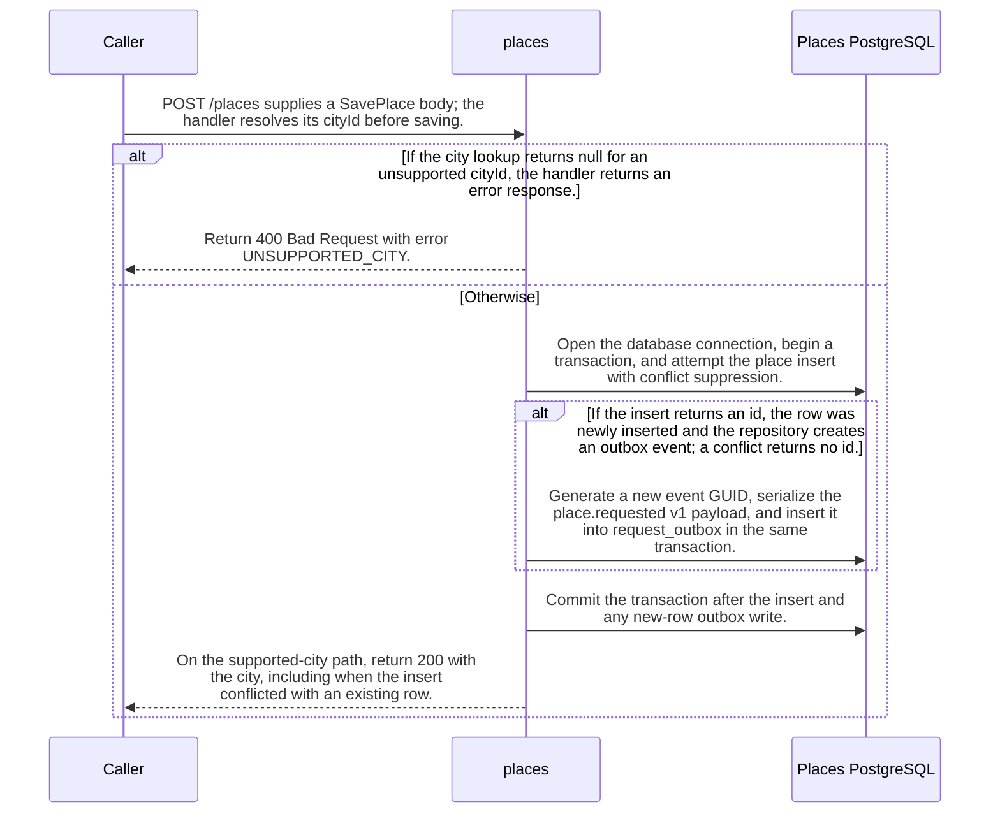

import {ClewMarkdown, ClewFieldDetails, ClewProcess, ClewDataModel, ClewDownload, ClewModelLink, ClewRelatedModelLink, ClewFieldTrace, ClewContextLink, ClewPageContext, ClewProcessReturn, ClewStatus, ClewRetainedPage, ClewCatalog, ClewAnchor} from '@site/src/components/ClewReaders';

# POST /places

<ClewPageContext />

Retained account · UNVERIFIED · UNASSESSED. Runtime behavior is not established by this export.

Save maps cityId oslo, helsinki, or lisbon to a Place; an unknown ID returns 400 with UNSUPPORTED\_CITY. For a supported city, Save opens the database, starts a transaction, and inserts with ON CONFLICT DO NOTHING RETURNING id. Only a new row causes InsertRequest to create a GUID and web-serialized place.requested v1 payload in request\_outbox. Save commits after that conditional write, and the handler returns 200 with the city. A duplicate insert creates no new outbox event but still reaches the same 200 response. Open disposes and rethrows if connection opening fails. The OpenAPI contract requires cityId and declares 200, 400, 415, and 500 responses.

Summary source bindings

- [services/places/PlacesController.cs:10–17 · revision c289b28be4819eddf29d59a7c12f178559ec5229](../sources/31d65799d2ab0d5586875469994de48826eff9efa7554c342d97a36030a8d9a0.mdx)
- [services/places/PlacesRepository.cs:52–59 · revision c289b28be4819eddf29d59a7c12f178559ec5229](../sources/89387464df117dd1f2cfdbd8113d90c803728d4fe220f507529703bd597dbf8e.mdx)
- [services/places/PlacesRepository.cs:20–25 · revision c289b28be4819eddf29d59a7c12f178559ec5229](../sources/d10889d7dec9ec7771472d1a44e755b28743b1800e345a02d390e4ce46d995b6.mdx)
- [contracts/places.openapi.json:1–263 · revision c289b28be4819eddf29d59a7c12f178559ec5229](../sources/d04d07ecb57a86dc75dd79d70d54dfd22aeaecc9ece8f888218b6a6fde39f959.mdx)
- [services/places/PlacesRepository.cs:7–13 · revision c289b28be4819eddf29d59a7c12f178559ec5229](../sources/67245c34fadc9a6bcd1038f1c2761a4382cb83fcee3ad8d02f408ccdeb1193dc.mdx)
- [services/places/PlacesRepository.cs:36–44 · revision c289b28be4819eddf29d59a7c12f178559ec5229](../sources/379c0b710ffb354ec36825644e1d5c73ec611814e26c938687bac753bdb832c6.mdx)

## OpenAPI: POST /places

| Topic | Retained contract detail |
| --- | --- |
| Request and responses | The contract requires a JSON body with only cityId, whose enum is oslo, helsinki, or lisbon; it declares 200, 400, 415, and 500 responses. |

Contract source bindings

**Request and responses**

- [contracts/places.openapi.json:1–263 · revision c289b28be4819eddf29d59a7c12f178559ec5229](../sources/d04d07ecb57a86dc75dd79d70d54dfd22aeaecc9ece8f888218b6a6fde39f959.mdx)

## Declared interface schemas

<ClewContextLink path="/http/87bdfe805b90ff664e9fc182216739d849835c6c30af7a07a61f2e924a3ac715">GET /health</ClewContextLink>

<ClewContextLink path="/http/21f85a173ea2df11931c2a8c3d4c8953ac99f281ef337c409d8436421d347b61">GET /places</ClewContextLink>

<ClewContextLink path="/http/323c07ab1fab7684d72321edf709e7e56345afa1fed70fa7e429deef72d255dc">POST /places/&#123;id&#125;/refresh</ClewContextLink>

<ClewContextLink path="/http/d3ee0d34d91fd8813ea24869ec083fb1661ae843ae68a8370d87dd837a061341">GET /openapi.json</ClewContextLink>

<ClewContextLink path="/http/4faae4a057439031a1013fae51fc548d28f7ae661a688f8923ca2d1474e2a60a">POST /places</ClewContextLink>

## Interaction diagram

Actors and nested branches from the retained account; not a runtime trace. Labels are shortened for readability. Full messages and notes follow.

Full original sequence, branches and notes

#### 1. message

<ClewMarkdown text={"POST /places supplies a SavePlace body; the handler resolves its cityId before saving."} />

Source bindings

- [services/places/PlacesController.cs:10–17 · revision c289b28be4819eddf29d59a7c12f178559ec5229](../sources/31d65799d2ab0d5586875469994de48826eff9efa7554c342d97a36030a8d9a0.mdx)
- [services/places/PlacesRepository.cs:7–13 · revision c289b28be4819eddf29d59a7c12f178559ec5229](../sources/67245c34fadc9a6bcd1038f1c2761a4382cb83fcee3ad8d02f408ccdeb1193dc.mdx)

#### 2. alt

<ClewMarkdown text={"If the city lookup returns null for an unsupported cityId, the handler returns an error response."} />

Source bindings

- [services/places/PlacesController.cs:10–17 · revision c289b28be4819eddf29d59a7c12f178559ec5229](../sources/31d65799d2ab0d5586875469994de48826eff9efa7554c342d97a36030a8d9a0.mdx)
- [services/places/PlacesRepository.cs:7–13 · revision c289b28be4819eddf29d59a7c12f178559ec5229](../sources/67245c34fadc9a6bcd1038f1c2761a4382cb83fcee3ad8d02f408ccdeb1193dc.mdx)
- [services/places/PlacesController.cs:14–14 · revision c289b28be4819eddf29d59a7c12f178559ec5229](../sources/88163caae761a5f78b16590efa0a544157f50d1ca4f24bff6a80a829931e9309.mdx)

#### 3. return

<ClewMarkdown text={"Return 400 Bad Request with error UNSUPPORTED_CITY."} />

Source bindings

- [services/places/PlacesController.cs:10–17 · revision c289b28be4819eddf29d59a7c12f178559ec5229](../sources/31d65799d2ab0d5586875469994de48826eff9efa7554c342d97a36030a8d9a0.mdx)
- [services/places/PlacesController.cs:14–14 · revision c289b28be4819eddf29d59a7c12f178559ec5229](../sources/001a33800512f3a620b662354b83547eead4a882a77361b3c7d8b85de99fafab.mdx)

#### 4. else

<ClewMarkdown text={"Otherwise"} />

Source bindings

- [services/places/PlacesController.cs:10–17 · revision c289b28be4819eddf29d59a7c12f178559ec5229](../sources/31d65799d2ab0d5586875469994de48826eff9efa7554c342d97a36030a8d9a0.mdx)
- [services/places/PlacesRepository.cs:7–13 · revision c289b28be4819eddf29d59a7c12f178559ec5229](../sources/67245c34fadc9a6bcd1038f1c2761a4382cb83fcee3ad8d02f408ccdeb1193dc.mdx)
- [services/places/PlacesController.cs:14–14 · revision c289b28be4819eddf29d59a7c12f178559ec5229](../sources/88163caae761a5f78b16590efa0a544157f50d1ca4f24bff6a80a829931e9309.mdx)

#### 5. message

<ClewMarkdown text={"Open the database connection, begin a transaction, and attempt the place insert with conflict suppression."} />

Source bindings

- [services/places/PlacesRepository.cs:20–25 · revision c289b28be4819eddf29d59a7c12f178559ec5229](../sources/d10889d7dec9ec7771472d1a44e755b28743b1800e345a02d390e4ce46d995b6.mdx)
- [services/places/PlacesRepository.cs:36–44 · revision c289b28be4819eddf29d59a7c12f178559ec5229](../sources/379c0b710ffb354ec36825644e1d5c73ec611814e26c938687bac753bdb832c6.mdx)

#### 6. alt

<ClewMarkdown text={"If the insert returns an id, the row was newly inserted and the repository creates an outbox event; a conflict returns no id."} />

Source bindings

- [services/places/PlacesRepository.cs:42–42 · revision c289b28be4819eddf29d59a7c12f178559ec5229](../sources/db4a337d739c657318d9b67686b2e3e0f578e38014c5f82691f44bed98f118a1.mdx)
- [services/places/PlacesRepository.cs:36–44 · revision c289b28be4819eddf29d59a7c12f178559ec5229](../sources/379c0b710ffb354ec36825644e1d5c73ec611814e26c938687bac753bdb832c6.mdx)

#### 7. message

<ClewMarkdown text={"Generate a new event GUID, serialize the place.requested v1 payload, and insert it into request_outbox in the same transaction."} />

Source bindings

- [services/places/PlacesRepository.cs:52–59 · revision c289b28be4819eddf29d59a7c12f178559ec5229](../sources/89387464df117dd1f2cfdbd8113d90c803728d4fe220f507529703bd597dbf8e.mdx)
- [services/places/PlacesRepository.cs:36–44 · revision c289b28be4819eddf29d59a7c12f178559ec5229](../sources/379c0b710ffb354ec36825644e1d5c73ec611814e26c938687bac753bdb832c6.mdx)

#### 8. else

<ClewMarkdown text={"Otherwise"} />

Source bindings

- [services/places/PlacesRepository.cs:42–42 · revision c289b28be4819eddf29d59a7c12f178559ec5229](../sources/db4a337d739c657318d9b67686b2e3e0f578e38014c5f82691f44bed98f118a1.mdx)
- [services/places/PlacesRepository.cs:36–44 · revision c289b28be4819eddf29d59a7c12f178559ec5229](../sources/379c0b710ffb354ec36825644e1d5c73ec611814e26c938687bac753bdb832c6.mdx)

#### 9. note

<ClewMarkdown text={"When the insert returns no id, InsertRequest is skipped, so the duplicate save adds no request_outbox row."} />

Source bindings

- [services/places/PlacesRepository.cs:42–42 · revision c289b28be4819eddf29d59a7c12f178559ec5229](../sources/db4a337d739c657318d9b67686b2e3e0f578e38014c5f82691f44bed98f118a1.mdx)
- [services/places/PlacesRepository.cs:36–44 · revision c289b28be4819eddf29d59a7c12f178559ec5229](../sources/379c0b710ffb354ec36825644e1d5c73ec611814e26c938687bac753bdb832c6.mdx)

#### 10. end

<ClewMarkdown text={""} />

Source bindings

- [services/places/PlacesRepository.cs:42–42 · revision c289b28be4819eddf29d59a7c12f178559ec5229](../sources/db4a337d739c657318d9b67686b2e3e0f578e38014c5f82691f44bed98f118a1.mdx)
- [services/places/PlacesRepository.cs:36–44 · revision c289b28be4819eddf29d59a7c12f178559ec5229](../sources/379c0b710ffb354ec36825644e1d5c73ec611814e26c938687bac753bdb832c6.mdx)

#### 11. message

<ClewMarkdown text={"Commit the transaction after the insert and any new-row outbox write."} />

Source bindings

- [services/places/PlacesRepository.cs:36–44 · revision c289b28be4819eddf29d59a7c12f178559ec5229](../sources/379c0b710ffb354ec36825644e1d5c73ec611814e26c938687bac753bdb832c6.mdx)

#### 12. return

<ClewMarkdown text={"On the supported-city path, return 200 with the city, including when the insert conflicted with an existing row."} />

Source bindings

- [services/places/PlacesController.cs:10–17 · revision c289b28be4819eddf29d59a7c12f178559ec5229](../sources/31d65799d2ab0d5586875469994de48826eff9efa7554c342d97a36030a8d9a0.mdx)
- [services/places/PlacesController.cs:16–16 · revision c289b28be4819eddf29d59a7c12f178559ec5229](../sources/060e15bdd239bc9c41e5e8121fc05aac611643d56844c1a2f491ca9f3442cffb.mdx)
- [services/places/PlacesRepository.cs:36–44 · revision c289b28be4819eddf29d59a7c12f178559ec5229](../sources/379c0b710ffb354ec36825644e1d5c73ec611814e26c938687bac753bdb832c6.mdx)

#### 13. end

<ClewMarkdown text={""} />

Source bindings

- [services/places/PlacesController.cs:10–17 · revision c289b28be4819eddf29d59a7c12f178559ec5229](../sources/31d65799d2ab0d5586875469994de48826eff9efa7554c342d97a36030a8d9a0.mdx)
- [services/places/PlacesRepository.cs:7–13 · revision c289b28be4819eddf29d59a7c12f178559ec5229](../sources/67245c34fadc9a6bcd1038f1c2761a4382cb83fcee3ad8d02f408ccdeb1193dc.mdx)
- [services/places/PlacesController.cs:14–14 · revision c289b28be4819eddf29d59a7c12f178559ec5229](../sources/88163caae761a5f78b16590efa0a544157f50d1ca4f24bff6a80a829931e9309.mdx)

## Implementation explanation

<ClewMarkdown text={"POST /places supplies a SavePlace body; the handler resolves its cityId before saving."} />

Source bindings

- [services/places/PlacesController.cs:10–17 · revision c289b28be4819eddf29d59a7c12f178559ec5229](../sources/31d65799d2ab0d5586875469994de48826eff9efa7554c342d97a36030a8d9a0.mdx)
- [services/places/PlacesRepository.cs:7–13 · revision c289b28be4819eddf29d59a7c12f178559ec5229](../sources/67245c34fadc9a6bcd1038f1c2761a4382cb83fcee3ad8d02f408ccdeb1193dc.mdx)

<ClewMarkdown text={"If the city lookup returns null for an unsupported cityId, the handler returns an error response."} />

Source bindings

- [services/places/PlacesController.cs:10–17 · revision c289b28be4819eddf29d59a7c12f178559ec5229](../sources/31d65799d2ab0d5586875469994de48826eff9efa7554c342d97a36030a8d9a0.mdx)
- [services/places/PlacesRepository.cs:7–13 · revision c289b28be4819eddf29d59a7c12f178559ec5229](../sources/67245c34fadc9a6bcd1038f1c2761a4382cb83fcee3ad8d02f408ccdeb1193dc.mdx)
- [services/places/PlacesController.cs:14–14 · revision c289b28be4819eddf29d59a7c12f178559ec5229](../sources/88163caae761a5f78b16590efa0a544157f50d1ca4f24bff6a80a829931e9309.mdx)

<ClewMarkdown text={"Return 400 Bad Request with error UNSUPPORTED_CITY."} />

Source bindings

- [services/places/PlacesController.cs:10–17 · revision c289b28be4819eddf29d59a7c12f178559ec5229](../sources/31d65799d2ab0d5586875469994de48826eff9efa7554c342d97a36030a8d9a0.mdx)
- [services/places/PlacesController.cs:14–14 · revision c289b28be4819eddf29d59a7c12f178559ec5229](../sources/001a33800512f3a620b662354b83547eead4a882a77361b3c7d8b85de99fafab.mdx)

<ClewMarkdown text={"The source describes an alternative branch."} />

Source bindings

- [services/places/PlacesController.cs:10–17 · revision c289b28be4819eddf29d59a7c12f178559ec5229](../sources/31d65799d2ab0d5586875469994de48826eff9efa7554c342d97a36030a8d9a0.mdx)
- [services/places/PlacesRepository.cs:7–13 · revision c289b28be4819eddf29d59a7c12f178559ec5229](../sources/67245c34fadc9a6bcd1038f1c2761a4382cb83fcee3ad8d02f408ccdeb1193dc.mdx)
- [services/places/PlacesController.cs:14–14 · revision c289b28be4819eddf29d59a7c12f178559ec5229](../sources/88163caae761a5f78b16590efa0a544157f50d1ca4f24bff6a80a829931e9309.mdx)

<ClewMarkdown text={"Open the database connection, begin a transaction, and attempt the place insert with conflict suppression."} />

Source bindings

- [services/places/PlacesRepository.cs:20–25 · revision c289b28be4819eddf29d59a7c12f178559ec5229](../sources/d10889d7dec9ec7771472d1a44e755b28743b1800e345a02d390e4ce46d995b6.mdx)
- [services/places/PlacesRepository.cs:36–44 · revision c289b28be4819eddf29d59a7c12f178559ec5229](../sources/379c0b710ffb354ec36825644e1d5c73ec611814e26c938687bac753bdb832c6.mdx)

<ClewMarkdown text={"If the insert returns an id, the row was newly inserted and the repository creates an outbox event; a conflict returns no id."} />

Source bindings

- [services/places/PlacesRepository.cs:42–42 · revision c289b28be4819eddf29d59a7c12f178559ec5229](../sources/db4a337d739c657318d9b67686b2e3e0f578e38014c5f82691f44bed98f118a1.mdx)
- [services/places/PlacesRepository.cs:36–44 · revision c289b28be4819eddf29d59a7c12f178559ec5229](../sources/379c0b710ffb354ec36825644e1d5c73ec611814e26c938687bac753bdb832c6.mdx)

<ClewMarkdown text={"Generate a new event GUID, serialize the place.requested v1 payload, and insert it into request_outbox in the same transaction."} />

Source bindings

- [services/places/PlacesRepository.cs:52–59 · revision c289b28be4819eddf29d59a7c12f178559ec5229](../sources/89387464df117dd1f2cfdbd8113d90c803728d4fe220f507529703bd597dbf8e.mdx)
- [services/places/PlacesRepository.cs:36–44 · revision c289b28be4819eddf29d59a7c12f178559ec5229](../sources/379c0b710ffb354ec36825644e1d5c73ec611814e26c938687bac753bdb832c6.mdx)

<ClewMarkdown text={"The source describes an alternative branch."} />

Source bindings

- [services/places/PlacesRepository.cs:42–42 · revision c289b28be4819eddf29d59a7c12f178559ec5229](../sources/db4a337d739c657318d9b67686b2e3e0f578e38014c5f82691f44bed98f118a1.mdx)
- [services/places/PlacesRepository.cs:36–44 · revision c289b28be4819eddf29d59a7c12f178559ec5229](../sources/379c0b710ffb354ec36825644e1d5c73ec611814e26c938687bac753bdb832c6.mdx)

<ClewMarkdown text={"When the insert returns no id, InsertRequest is skipped, so the duplicate save adds no request_outbox row."} />

Source bindings

- [services/places/PlacesRepository.cs:42–42 · revision c289b28be4819eddf29d59a7c12f178559ec5229](../sources/db4a337d739c657318d9b67686b2e3e0f578e38014c5f82691f44bed98f118a1.mdx)
- [services/places/PlacesRepository.cs:36–44 · revision c289b28be4819eddf29d59a7c12f178559ec5229](../sources/379c0b710ffb354ec36825644e1d5c73ec611814e26c938687bac753bdb832c6.mdx)

<ClewMarkdown text={"Commit the transaction after the insert and any new-row outbox write."} />

Source bindings

- [services/places/PlacesRepository.cs:36–44 · revision c289b28be4819eddf29d59a7c12f178559ec5229](../sources/379c0b710ffb354ec36825644e1d5c73ec611814e26c938687bac753bdb832c6.mdx)

<ClewMarkdown text={"On the supported-city path, return 200 with the city, including when the insert conflicted with an existing row."} />

Source bindings

- [services/places/PlacesController.cs:10–17 · revision c289b28be4819eddf29d59a7c12f178559ec5229](../sources/31d65799d2ab0d5586875469994de48826eff9efa7554c342d97a36030a8d9a0.mdx)
- [services/places/PlacesController.cs:16–16 · revision c289b28be4819eddf29d59a7c12f178559ec5229](../sources/060e15bdd239bc9c41e5e8121fc05aac611643d56844c1a2f491ca9f3442cffb.mdx)
- [services/places/PlacesRepository.cs:36–44 · revision c289b28be4819eddf29d59a7c12f178559ec5229](../sources/379c0b710ffb354ec36825644e1d5c73ec611814e26c938687bac753bdb832c6.mdx)

Retained boundaries

- C\# source coverage is PARTIAL. The selected snapshot supports source-level explanations; it does not establish runtime registration, HTTP serialization, deployment configuration, or downstream forecast recomputation. The OpenAPI projection is read as source text and its JSON Schema keywords are not fully interpreted.
- CALL\_TARGETS\_UNRESOLVED
- DIALECT\_DECLARED\_NOT\_COMPILER\_VALIDATED
- FILE\_ONLY:compose.yaml
- FILE\_ONLY:contracts/dashboard.openapi.json
- FILE\_ONLY:contracts/events.schema.json
- FILE\_ONLY:database/init.sql
- FILE\_ONLY:exercises/dashboard-focus-regression.mjs
- FILE\_ONLY:exercises/replay.py
- FILE\_ONLY:exercises/validator-regression.mjs
- FILE\_ONLY:fixtures/helsinki.json
- FILE\_ONLY:fixtures/lisbon.json
- FILE\_ONLY:fixtures/met-oslo-recorded.json
- FILE\_ONLY:fixtures/oslo.json
- FILE\_ONLY:fixtures/provenance.json
- FILE\_ONLY:services/dashboard/Dockerfile
- FILE\_ONLY:services/dashboard/package-lock.json
- FILE\_ONLY:services/dashboard/package.json
- FILE\_ONLY:services/dashboard/public/index.html
- FILE\_ONLY:services/dashboard/tsconfig.json
- OPENAPI\_JSON\_SCHEMA\_KEYWORDS\_NOT\_INTERPRETED
- OPENAPI\_SCHEMA\_NULL\_TYPE\_NOT\_INTERPRETED
- OPENAPI\_SCHEMA\_TYPE\_UNIONS\_NOT\_INTERPRETED
- ORDER\_LEXICAL\_ONLY
- SCOPE\_WATCH\_CONSERVATIVE
- Syntax evidence does not establish runtime dispatch or configuration. Expand known owners and helpers; retain explicit gaps for unresolved targets.
- ANNOTATION\_DECLARATION\_UNAVAILABLE
- CALL\_TARGETS\_UNRESOLVED
- DIALECT\_DECLARED\_NOT\_COMPILER\_VALIDATED
- FILE\_ONLY:compose.yaml
- FILE\_ONLY:contracts/events.schema.json
- FILE\_ONLY:contracts/forecasts.openapi.json
- FILE\_ONLY:database/init.sql
- FILE\_ONLY:fixtures/helsinki.json
- FILE\_ONLY:fixtures/lisbon.json
- FILE\_ONLY:fixtures/met-oslo-recorded.json
- FILE\_ONLY:fixtures/oslo.json
- FILE\_ONLY:fixtures/provenance.json
- FILE\_ONLY:services/forecasts/Dockerfile
- FILE\_ONLY:services/forecasts/pom.xml
- FILE\_ONLY:services/forecasts/src/main/resources/application.properties
- NO\_BEAN\_OWNER
- OPENAPI\_JSON\_SCHEMA\_KEYWORDS\_NOT\_INTERPRETED
- OPENAPI\_SCHEMA\_NULL\_TYPE\_NOT\_INTERPRETED
- OPENAPI\_SCHEMA\_TYPE\_UNIONS\_NOT\_INTERPRETED
- ORDER\_LEXICAL\_ONLY
- RUNTIME\_REGISTRATION\_UNPROVEN
- SCOPE\_WATCH\_CONSERVATIVE
- SOURCE\_NAMES\_NOT\_COMPILER\_RESOLVED
- UNRESOLVED\_ANNOTATION\_VALUE
- Syntax evidence does not establish runtime dispatch or configuration. Expand known owners and helpers; retain explicit gaps for unresolved targets.
- CLR\_SIGNATURE\_PROJECTED\_TO\_JVM\_DESCRIPTOR\_GRAMMAR
- CSHARP\_SOURCE\_GENERATED\_DOCUMENTS\_NOT\_INDEXED
- EXCEPTION\_FLOW\_REQUIRES\_SOURCE\_REVIEW
- GENERATED\_SOURCE\_BODIES\_NOT\_INDEXED
- LAMBDA\_EXECUTION\_NOT\_EXPANDED
- OPENAPI\_JSON\_SCHEMA\_KEYWORDS\_NOT\_INTERPRETED
- SHORT\_CIRCUIT\_FLOW\_REQUIRES\_SOURCE\_REVIEW
- SWITCH\_FLOW\_REQUIRES\_SOURCE\_REVIEW

