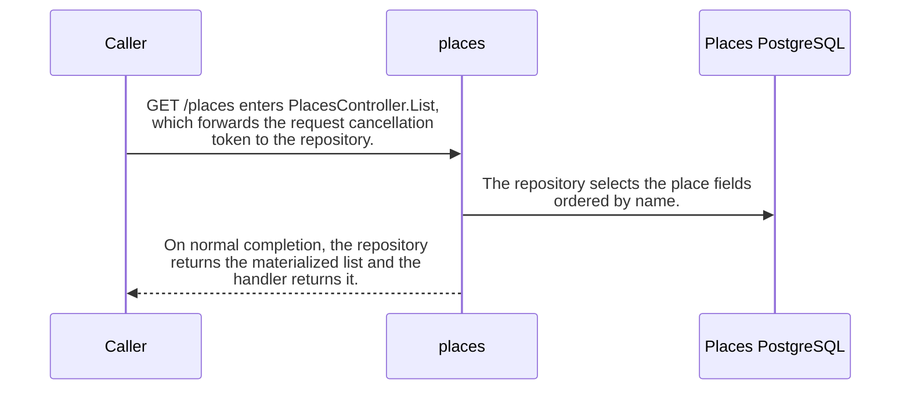

import {ClewMarkdown, ClewFieldDetails, ClewProcess, ClewDataModel, ClewDownload, ClewModelLink, ClewRelatedModelLink, ClewFieldTrace, ClewContextLink, ClewPageContext, ClewProcessReturn, ClewStatus, ClewRetainedPage, ClewCatalog, ClewAnchor} from '@site/src/components/ClewReaders';

# GET /places

<ClewPageContext />

Retained account · UNVERIFIED · UNASSESSED. Runtime behavior is not established by this export.

PlacesController.List awaits PlacesRepository.List with the request cancellation token. The repository opens PostgreSQL, selects id, name, latitude, and longitude ordered by name, reads all rows, and maps each row to a Place. If connection opening fails, Open disposes the connection and rethrows; the controller does not catch that failure. The OpenAPI contract declares a 200 JSON array and a 500 response.

Summary source bindings

- [services/places/PlacesController.cs:8–9 · revision c289b28be4819eddf29d59a7c12f178559ec5229](../sources/520c410620b6ad262c72ef74b88eec85f0ccbb36220cd1fc7f251efacd0d2b7f.mdx)
- [services/places/PlacesRepository.cs:20–25 · revision c289b28be4819eddf29d59a7c12f178559ec5229](../sources/d10889d7dec9ec7771472d1a44e755b28743b1800e345a02d390e4ce46d995b6.mdx)
- [contracts/places.openapi.json:1–263 · revision c289b28be4819eddf29d59a7c12f178559ec5229](../sources/d04d07ecb57a86dc75dd79d70d54dfd22aeaecc9ece8f888218b6a6fde39f959.mdx)
- [services/places/PlacesRepository.cs:26–34 · revision c289b28be4819eddf29d59a7c12f178559ec5229](../sources/e51d4c67bd27056cdebb28e9eb5ea481a943fc5f4d158a8ed72036c81cce0843.mdx)

## OpenAPI: GET /places

| Topic | Retained contract detail |
| --- | --- |
| Declared response | The contract declares a 200 JSON array whose object items require id, name, latitude, and longitude, plus a 500 response. |

Contract source bindings

**Declared response**

- [contracts/places.openapi.json:1–263 · revision c289b28be4819eddf29d59a7c12f178559ec5229](../sources/d04d07ecb57a86dc75dd79d70d54dfd22aeaecc9ece8f888218b6a6fde39f959.mdx)

## Declared interface schemas

<ClewContextLink path="/http/87bdfe805b90ff664e9fc182216739d849835c6c30af7a07a61f2e924a3ac715">GET /health</ClewContextLink>

<ClewContextLink path="/http/21f85a173ea2df11931c2a8c3d4c8953ac99f281ef337c409d8436421d347b61">GET /places</ClewContextLink>

<ClewContextLink path="/http/323c07ab1fab7684d72321edf709e7e56345afa1fed70fa7e429deef72d255dc">POST /places/&#123;id&#125;/refresh</ClewContextLink>

<ClewContextLink path="/http/d3ee0d34d91fd8813ea24869ec083fb1661ae843ae68a8370d87dd837a061341">GET /openapi.json</ClewContextLink>

<ClewContextLink path="/http/4faae4a057439031a1013fae51fc548d28f7ae661a688f8923ca2d1474e2a60a">POST /places</ClewContextLink>

## Interaction diagram

Actors and nested branches from the retained account; not a runtime trace. Labels are shortened for readability. Full messages and notes follow.

Full original sequence, branches and notes

#### 1. message

<ClewMarkdown text={"GET /places enters PlacesController.List, which forwards the request cancellation token to the repository."} />

Source bindings

- [services/places/PlacesController.cs:8–9 · revision c289b28be4819eddf29d59a7c12f178559ec5229](../sources/520c410620b6ad262c72ef74b88eec85f0ccbb36220cd1fc7f251efacd0d2b7f.mdx)

#### 2. message

<ClewMarkdown text={"The repository selects the place fields ordered by name."} />

Source bindings

- [services/places/PlacesRepository.cs:26–34 · revision c289b28be4819eddf29d59a7c12f178559ec5229](../sources/e51d4c67bd27056cdebb28e9eb5ea481a943fc5f4d158a8ed72036c81cce0843.mdx)

#### 3. loop

<ClewMarkdown text={"Read each database row and map its id, name, latitude, and longitude to a Place until the reader is exhausted."} />

Source bindings

- [services/places/PlacesRepository.cs:32–32 · revision c289b28be4819eddf29d59a7c12f178559ec5229](../sources/bb9a7a97efd1e65fb99a5ba6e268c3174435f4d8a176e36673fe21838b881472.mdx)
- [services/places/PlacesRepository.cs:26–34 · revision c289b28be4819eddf29d59a7c12f178559ec5229](../sources/e51d4c67bd27056cdebb28e9eb5ea481a943fc5f4d158a8ed72036c81cce0843.mdx)

#### 4. end

<ClewMarkdown text={""} />

Source bindings

- [services/places/PlacesRepository.cs:32–32 · revision c289b28be4819eddf29d59a7c12f178559ec5229](../sources/bb9a7a97efd1e65fb99a5ba6e268c3174435f4d8a176e36673fe21838b881472.mdx)
- [services/places/PlacesRepository.cs:26–34 · revision c289b28be4819eddf29d59a7c12f178559ec5229](../sources/e51d4c67bd27056cdebb28e9eb5ea481a943fc5f4d158a8ed72036c81cce0843.mdx)

#### 5. return

<ClewMarkdown text={"On normal completion, the repository returns the materialized list and the handler returns it."} />

Source bindings

- [services/places/PlacesController.cs:8–9 · revision c289b28be4819eddf29d59a7c12f178559ec5229](../sources/520c410620b6ad262c72ef74b88eec85f0ccbb36220cd1fc7f251efacd0d2b7f.mdx)
- [services/places/PlacesController.cs:9–9 · revision c289b28be4819eddf29d59a7c12f178559ec5229](../sources/05ccbfcb55d81cd857c11a3fdc045651ebfc19e32e8abf4ca6b149a923363505.mdx)
- [services/places/PlacesRepository.cs:26–34 · revision c289b28be4819eddf29d59a7c12f178559ec5229](../sources/e51d4c67bd27056cdebb28e9eb5ea481a943fc5f4d158a8ed72036c81cce0843.mdx)

#### 6. note

<ClewMarkdown text={"If opening the database connection fails, Open disposes and rethrows; the handler does not catch it."} />

Source bindings

- [services/places/PlacesController.cs:8–9 · revision c289b28be4819eddf29d59a7c12f178559ec5229](../sources/520c410620b6ad262c72ef74b88eec85f0ccbb36220cd1fc7f251efacd0d2b7f.mdx)
- [services/places/PlacesRepository.cs:20–25 · revision c289b28be4819eddf29d59a7c12f178559ec5229](../sources/d10889d7dec9ec7771472d1a44e755b28743b1800e345a02d390e4ce46d995b6.mdx)

## Implementation explanation

<ClewMarkdown text={"GET /places enters PlacesController.List, which forwards the request cancellation token to the repository."} />

Source bindings

- [services/places/PlacesController.cs:8–9 · revision c289b28be4819eddf29d59a7c12f178559ec5229](../sources/520c410620b6ad262c72ef74b88eec85f0ccbb36220cd1fc7f251efacd0d2b7f.mdx)

<ClewMarkdown text={"The repository selects the place fields ordered by name."} />

Source bindings

- [services/places/PlacesRepository.cs:26–34 · revision c289b28be4819eddf29d59a7c12f178559ec5229](../sources/e51d4c67bd27056cdebb28e9eb5ea481a943fc5f4d158a8ed72036c81cce0843.mdx)

<ClewMarkdown text={"Read each database row and map its id, name, latitude, and longitude to a Place until the reader is exhausted."} />

Source bindings

- [services/places/PlacesRepository.cs:32–32 · revision c289b28be4819eddf29d59a7c12f178559ec5229](../sources/bb9a7a97efd1e65fb99a5ba6e268c3174435f4d8a176e36673fe21838b881472.mdx)
- [services/places/PlacesRepository.cs:26–34 · revision c289b28be4819eddf29d59a7c12f178559ec5229](../sources/e51d4c67bd27056cdebb28e9eb5ea481a943fc5f4d158a8ed72036c81cce0843.mdx)

<ClewMarkdown text={"On normal completion, the repository returns the materialized list and the handler returns it."} />

Source bindings

- [services/places/PlacesController.cs:8–9 · revision c289b28be4819eddf29d59a7c12f178559ec5229](../sources/520c410620b6ad262c72ef74b88eec85f0ccbb36220cd1fc7f251efacd0d2b7f.mdx)
- [services/places/PlacesController.cs:9–9 · revision c289b28be4819eddf29d59a7c12f178559ec5229](../sources/05ccbfcb55d81cd857c11a3fdc045651ebfc19e32e8abf4ca6b149a923363505.mdx)
- [services/places/PlacesRepository.cs:26–34 · revision c289b28be4819eddf29d59a7c12f178559ec5229](../sources/e51d4c67bd27056cdebb28e9eb5ea481a943fc5f4d158a8ed72036c81cce0843.mdx)

<ClewMarkdown text={"If opening the database connection fails, Open disposes and rethrows; the handler does not catch it."} />

Source bindings

- [services/places/PlacesController.cs:8–9 · revision c289b28be4819eddf29d59a7c12f178559ec5229](../sources/520c410620b6ad262c72ef74b88eec85f0ccbb36220cd1fc7f251efacd0d2b7f.mdx)
- [services/places/PlacesRepository.cs:20–25 · revision c289b28be4819eddf29d59a7c12f178559ec5229](../sources/d10889d7dec9ec7771472d1a44e755b28743b1800e345a02d390e4ce46d995b6.mdx)

Retained boundaries

- C\# source coverage is PARTIAL. The selected snapshot supports source-level explanations; it does not establish runtime registration, HTTP serialization, deployment configuration, or downstream forecast recomputation. The OpenAPI projection is read as source text and its JSON Schema keywords are not fully interpreted.
- CALL\_TARGETS\_UNRESOLVED
- DIALECT\_DECLARED\_NOT\_COMPILER\_VALIDATED
- FILE\_ONLY:compose.yaml
- FILE\_ONLY:contracts/dashboard.openapi.json
- FILE\_ONLY:contracts/events.schema.json
- FILE\_ONLY:database/init.sql
- FILE\_ONLY:exercises/dashboard-focus-regression.mjs
- FILE\_ONLY:exercises/replay.py
- FILE\_ONLY:exercises/validator-regression.mjs
- FILE\_ONLY:fixtures/helsinki.json
- FILE\_ONLY:fixtures/lisbon.json
- FILE\_ONLY:fixtures/met-oslo-recorded.json
- FILE\_ONLY:fixtures/oslo.json
- FILE\_ONLY:fixtures/provenance.json
- FILE\_ONLY:services/dashboard/Dockerfile
- FILE\_ONLY:services/dashboard/package-lock.json
- FILE\_ONLY:services/dashboard/package.json
- FILE\_ONLY:services/dashboard/public/index.html
- FILE\_ONLY:services/dashboard/tsconfig.json
- OPENAPI\_JSON\_SCHEMA\_KEYWORDS\_NOT\_INTERPRETED
- OPENAPI\_SCHEMA\_NULL\_TYPE\_NOT\_INTERPRETED
- OPENAPI\_SCHEMA\_TYPE\_UNIONS\_NOT\_INTERPRETED
- ORDER\_LEXICAL\_ONLY
- SCOPE\_WATCH\_CONSERVATIVE
- Syntax evidence does not establish runtime dispatch or configuration. Expand known owners and helpers; retain explicit gaps for unresolved targets.
- ANNOTATION\_DECLARATION\_UNAVAILABLE
- CALL\_TARGETS\_UNRESOLVED
- DIALECT\_DECLARED\_NOT\_COMPILER\_VALIDATED
- FILE\_ONLY:compose.yaml
- FILE\_ONLY:contracts/events.schema.json
- FILE\_ONLY:contracts/forecasts.openapi.json
- FILE\_ONLY:database/init.sql
- FILE\_ONLY:fixtures/helsinki.json
- FILE\_ONLY:fixtures/lisbon.json
- FILE\_ONLY:fixtures/met-oslo-recorded.json
- FILE\_ONLY:fixtures/oslo.json
- FILE\_ONLY:fixtures/provenance.json
- FILE\_ONLY:services/forecasts/Dockerfile
- FILE\_ONLY:services/forecasts/pom.xml
- FILE\_ONLY:services/forecasts/src/main/resources/application.properties
- NO\_BEAN\_OWNER
- OPENAPI\_JSON\_SCHEMA\_KEYWORDS\_NOT\_INTERPRETED
- OPENAPI\_SCHEMA\_NULL\_TYPE\_NOT\_INTERPRETED
- OPENAPI\_SCHEMA\_TYPE\_UNIONS\_NOT\_INTERPRETED
- ORDER\_LEXICAL\_ONLY
- RUNTIME\_REGISTRATION\_UNPROVEN
- SCOPE\_WATCH\_CONSERVATIVE
- SOURCE\_NAMES\_NOT\_COMPILER\_RESOLVED
- UNRESOLVED\_ANNOTATION\_VALUE
- Syntax evidence does not establish runtime dispatch or configuration. Expand known owners and helpers; retain explicit gaps for unresolved targets.
- CLR\_SIGNATURE\_PROJECTED\_TO\_JVM\_DESCRIPTOR\_GRAMMAR
- CSHARP\_SOURCE\_GENERATED\_DOCUMENTS\_NOT\_INDEXED
- EXCEPTION\_FLOW\_REQUIRES\_SOURCE\_REVIEW
- GENERATED\_SOURCE\_BODIES\_NOT\_INDEXED
- LAMBDA\_EXECUTION\_NOT\_EXPANDED
- OPENAPI\_JSON\_SCHEMA\_KEYWORDS\_NOT\_INTERPRETED
- SHORT\_CIRCUIT\_FLOW\_REQUIRES\_SOURCE\_REVIEW
- SWITCH\_FLOW\_REQUIRES\_SOURCE\_REVIEW

