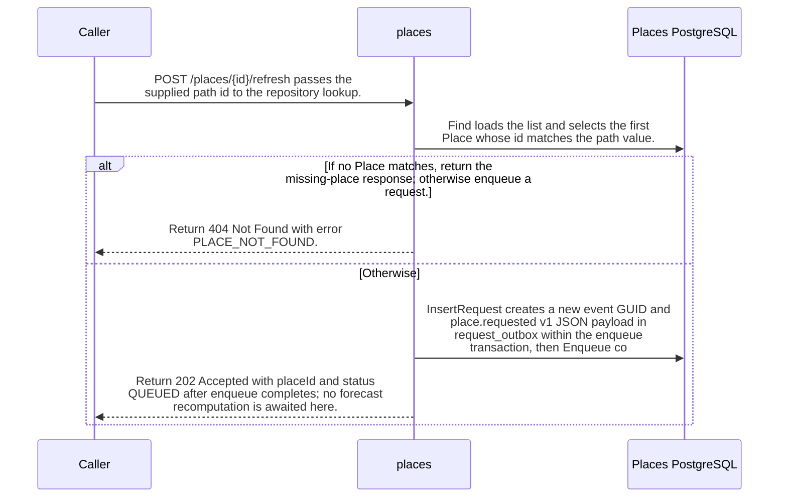

import {ClewMarkdown, ClewFieldDetails, ClewProcess, ClewDataModel, ClewDownload, ClewModelLink, ClewRelatedModelLink, ClewFieldTrace, ClewContextLink, ClewPageContext, ClewProcessReturn, ClewStatus, ClewRetainedPage, ClewCatalog, ClewAnchor} from '@site/src/components/ClewReaders';

# POST /places/&#123;id&#125;/refresh

<ClewPageContext />

Retained account · UNVERIFIED · UNASSESSED. Runtime behavior is not established by this export.

PlacesController.Refresh passes the path id to Find, which loads the full list and chooses the first matching Place. A missing match returns 404 PLACE\_NOT\_FOUND. A match is enqueued in a database transaction with a newly generated request\_outbox event ID and web-serialized place.requested v1 payload, then the handler returns 202 QUEUED. It does not wait for forecast recomputation. The OpenAPI contract declares an id enum of oslo, helsinki, and lisbon and 202, 404, and 500 responses; the handler source shown does not perform that enum validation. If database connection opening fails, Open disposes the connection and rethrows.

Summary source bindings

- [services/places/PlacesRepository.cs:35–35 · revision c289b28be4819eddf29d59a7c12f178559ec5229](../sources/09adfc4929d330ef0ace7773c10744a9ad2b7d33500cce7f3ebbce83b35cbccc.mdx)
- [services/places/PlacesRepository.cs:45–51 · revision c289b28be4819eddf29d59a7c12f178559ec5229](../sources/2f738bb1b0e4cfed6f7710952bc1442794ebe32fe8703bd2bca4c9b79e4bbbc2.mdx)
- [services/places/PlacesRepository.cs:52–59 · revision c289b28be4819eddf29d59a7c12f178559ec5229](../sources/89387464df117dd1f2cfdbd8113d90c803728d4fe220f507529703bd597dbf8e.mdx)
- [services/places/PlacesController.cs:18–25 · revision c289b28be4819eddf29d59a7c12f178559ec5229](../sources/10944607b7dd3022e1223a7de9822b263e1bccb2a729b6118f97fc90f3c31306.mdx)
- [services/places/PlacesRepository.cs:20–25 · revision c289b28be4819eddf29d59a7c12f178559ec5229](../sources/d10889d7dec9ec7771472d1a44e755b28743b1800e345a02d390e4ce46d995b6.mdx)
- [contracts/places.openapi.json:1–263 · revision c289b28be4819eddf29d59a7c12f178559ec5229](../sources/d04d07ecb57a86dc75dd79d70d54dfd22aeaecc9ece8f888218b6a6fde39f959.mdx)
- [services/places/PlacesRepository.cs:26–34 · revision c289b28be4819eddf29d59a7c12f178559ec5229](../sources/e51d4c67bd27056cdebb28e9eb5ea481a943fc5f4d158a8ed72036c81cce0843.mdx)

## OpenAPI: POST /places/&#123;id&#125;/refresh

| Topic | Retained contract detail |
| --- | --- |
| Path and responses | The contract requires path parameter id with enum oslo, helsinki, or lisbon and declares 202, 404, and 500 responses. |

Contract source bindings

**Path and responses**

- [contracts/places.openapi.json:1–263 · revision c289b28be4819eddf29d59a7c12f178559ec5229](../sources/d04d07ecb57a86dc75dd79d70d54dfd22aeaecc9ece8f888218b6a6fde39f959.mdx)

## Declared interface schemas

<ClewContextLink path="/http/87bdfe805b90ff664e9fc182216739d849835c6c30af7a07a61f2e924a3ac715">GET /health</ClewContextLink>

<ClewContextLink path="/http/21f85a173ea2df11931c2a8c3d4c8953ac99f281ef337c409d8436421d347b61">GET /places</ClewContextLink>

<ClewContextLink path="/http/323c07ab1fab7684d72321edf709e7e56345afa1fed70fa7e429deef72d255dc">POST /places/&#123;id&#125;/refresh</ClewContextLink>

<ClewContextLink path="/http/d3ee0d34d91fd8813ea24869ec083fb1661ae843ae68a8370d87dd837a061341">GET /openapi.json</ClewContextLink>

<ClewContextLink path="/http/4faae4a057439031a1013fae51fc548d28f7ae661a688f8923ca2d1474e2a60a">POST /places</ClewContextLink>

## Interaction diagram

Actors and nested branches from the retained account; not a runtime trace. Labels are shortened for readability. Full messages and notes follow.

Full original sequence, branches and notes

#### 1. message

<ClewMarkdown text={"POST /places/{id}/refresh passes the supplied path id to the repository lookup."} />

Source bindings

- [services/places/PlacesController.cs:18–25 · revision c289b28be4819eddf29d59a7c12f178559ec5229](../sources/10944607b7dd3022e1223a7de9822b263e1bccb2a729b6118f97fc90f3c31306.mdx)

#### 2. message

<ClewMarkdown text={"Find loads the list and selects the first Place whose id matches the path value."} />

Source bindings

- [services/places/PlacesRepository.cs:35–35 · revision c289b28be4819eddf29d59a7c12f178559ec5229](../sources/09adfc4929d330ef0ace7773c10744a9ad2b7d33500cce7f3ebbce83b35cbccc.mdx)
- [services/places/PlacesRepository.cs:26–34 · revision c289b28be4819eddf29d59a7c12f178559ec5229](../sources/e51d4c67bd27056cdebb28e9eb5ea481a943fc5f4d158a8ed72036c81cce0843.mdx)

#### 3. alt

<ClewMarkdown text={"If no Place matches, return the missing-place response; otherwise enqueue a request."} />

Source bindings

- [services/places/PlacesController.cs:18–25 · revision c289b28be4819eddf29d59a7c12f178559ec5229](../sources/10944607b7dd3022e1223a7de9822b263e1bccb2a729b6118f97fc90f3c31306.mdx)
- [services/places/PlacesController.cs:22–22 · revision c289b28be4819eddf29d59a7c12f178559ec5229](../sources/49ac56a63b7a243dcf3b92eaf871170f923e6a6c33566618c65dc8c7d62c5130.mdx)

#### 4. return

<ClewMarkdown text={"Return 404 Not Found with error PLACE_NOT_FOUND."} />

Source bindings

- [services/places/PlacesController.cs:24–24 · revision c289b28be4819eddf29d59a7c12f178559ec5229](../sources/a1320ac96e5a69642416c6a1afc64d64ed93e72ea6d85947efd51acca1b41a5d.mdx)
- [services/places/PlacesController.cs:18–25 · revision c289b28be4819eddf29d59a7c12f178559ec5229](../sources/10944607b7dd3022e1223a7de9822b263e1bccb2a729b6118f97fc90f3c31306.mdx)

#### 5. else

<ClewMarkdown text={"Otherwise"} />

Source bindings

- [services/places/PlacesController.cs:18–25 · revision c289b28be4819eddf29d59a7c12f178559ec5229](../sources/10944607b7dd3022e1223a7de9822b263e1bccb2a729b6118f97fc90f3c31306.mdx)
- [services/places/PlacesController.cs:22–22 · revision c289b28be4819eddf29d59a7c12f178559ec5229](../sources/49ac56a63b7a243dcf3b92eaf871170f923e6a6c33566618c65dc8c7d62c5130.mdx)

#### 6. message

<ClewMarkdown text={"InsertRequest creates a new event GUID and place.requested v1 JSON payload in request_outbox within the enqueue transaction, then Enqueue commits."} />

Source bindings

- [services/places/PlacesRepository.cs:45–51 · revision c289b28be4819eddf29d59a7c12f178559ec5229](../sources/2f738bb1b0e4cfed6f7710952bc1442794ebe32fe8703bd2bca4c9b79e4bbbc2.mdx)
- [services/places/PlacesRepository.cs:52–59 · revision c289b28be4819eddf29d59a7c12f178559ec5229](../sources/89387464df117dd1f2cfdbd8113d90c803728d4fe220f507529703bd597dbf8e.mdx)

#### 7. return

<ClewMarkdown text={"Return 202 Accepted with placeId and status QUEUED after enqueue completes; no forecast recomputation is awaited here."} />

Source bindings

- [services/places/PlacesController.cs:18–25 · revision c289b28be4819eddf29d59a7c12f178559ec5229](../sources/10944607b7dd3022e1223a7de9822b263e1bccb2a729b6118f97fc90f3c31306.mdx)
- [services/places/PlacesController.cs:22–22 · revision c289b28be4819eddf29d59a7c12f178559ec5229](../sources/9dc215489a5ce7b3d57940443d2a78b507b6e6f335c61d43f072f0fd276de730.mdx)

#### 8. end

<ClewMarkdown text={""} />

Source bindings

- [services/places/PlacesController.cs:18–25 · revision c289b28be4819eddf29d59a7c12f178559ec5229](../sources/10944607b7dd3022e1223a7de9822b263e1bccb2a729b6118f97fc90f3c31306.mdx)
- [services/places/PlacesController.cs:22–22 · revision c289b28be4819eddf29d59a7c12f178559ec5229](../sources/49ac56a63b7a243dcf3b92eaf871170f923e6a6c33566618c65dc8c7d62c5130.mdx)

## Implementation explanation

<ClewMarkdown text={"POST /places/{id}/refresh passes the supplied path id to the repository lookup."} />

Source bindings

- [services/places/PlacesController.cs:18–25 · revision c289b28be4819eddf29d59a7c12f178559ec5229](../sources/10944607b7dd3022e1223a7de9822b263e1bccb2a729b6118f97fc90f3c31306.mdx)

<ClewMarkdown text={"Find loads the list and selects the first Place whose id matches the path value."} />

Source bindings

- [services/places/PlacesRepository.cs:35–35 · revision c289b28be4819eddf29d59a7c12f178559ec5229](../sources/09adfc4929d330ef0ace7773c10744a9ad2b7d33500cce7f3ebbce83b35cbccc.mdx)
- [services/places/PlacesRepository.cs:26–34 · revision c289b28be4819eddf29d59a7c12f178559ec5229](../sources/e51d4c67bd27056cdebb28e9eb5ea481a943fc5f4d158a8ed72036c81cce0843.mdx)

<ClewMarkdown text={"If no Place matches, return the missing-place response; otherwise enqueue a request."} />

Source bindings

- [services/places/PlacesController.cs:18–25 · revision c289b28be4819eddf29d59a7c12f178559ec5229](../sources/10944607b7dd3022e1223a7de9822b263e1bccb2a729b6118f97fc90f3c31306.mdx)
- [services/places/PlacesController.cs:22–22 · revision c289b28be4819eddf29d59a7c12f178559ec5229](../sources/49ac56a63b7a243dcf3b92eaf871170f923e6a6c33566618c65dc8c7d62c5130.mdx)

<ClewMarkdown text={"Return 404 Not Found with error PLACE_NOT_FOUND."} />

Source bindings

- [services/places/PlacesController.cs:24–24 · revision c289b28be4819eddf29d59a7c12f178559ec5229](../sources/a1320ac96e5a69642416c6a1afc64d64ed93e72ea6d85947efd51acca1b41a5d.mdx)
- [services/places/PlacesController.cs:18–25 · revision c289b28be4819eddf29d59a7c12f178559ec5229](../sources/10944607b7dd3022e1223a7de9822b263e1bccb2a729b6118f97fc90f3c31306.mdx)

<ClewMarkdown text={"The source describes an alternative branch."} />

Source bindings

- [services/places/PlacesController.cs:18–25 · revision c289b28be4819eddf29d59a7c12f178559ec5229](../sources/10944607b7dd3022e1223a7de9822b263e1bccb2a729b6118f97fc90f3c31306.mdx)
- [services/places/PlacesController.cs:22–22 · revision c289b28be4819eddf29d59a7c12f178559ec5229](../sources/49ac56a63b7a243dcf3b92eaf871170f923e6a6c33566618c65dc8c7d62c5130.mdx)

<ClewMarkdown text={"InsertRequest creates a new event GUID and place.requested v1 JSON payload in request_outbox within the enqueue transaction, then Enqueue commits."} />

Source bindings

- [services/places/PlacesRepository.cs:45–51 · revision c289b28be4819eddf29d59a7c12f178559ec5229](../sources/2f738bb1b0e4cfed6f7710952bc1442794ebe32fe8703bd2bca4c9b79e4bbbc2.mdx)
- [services/places/PlacesRepository.cs:52–59 · revision c289b28be4819eddf29d59a7c12f178559ec5229](../sources/89387464df117dd1f2cfdbd8113d90c803728d4fe220f507529703bd597dbf8e.mdx)

<ClewMarkdown text={"Return 202 Accepted with placeId and status QUEUED after enqueue completes; no forecast recomputation is awaited here."} />

Source bindings

- [services/places/PlacesController.cs:18–25 · revision c289b28be4819eddf29d59a7c12f178559ec5229](../sources/10944607b7dd3022e1223a7de9822b263e1bccb2a729b6118f97fc90f3c31306.mdx)
- [services/places/PlacesController.cs:22–22 · revision c289b28be4819eddf29d59a7c12f178559ec5229](../sources/9dc215489a5ce7b3d57940443d2a78b507b6e6f335c61d43f072f0fd276de730.mdx)

Retained boundaries

- C\# source coverage is PARTIAL. The selected snapshot supports source-level explanations; it does not establish runtime registration, HTTP serialization, deployment configuration, or downstream forecast recomputation. The OpenAPI projection is read as source text and its JSON Schema keywords are not fully interpreted.
- CALL\_TARGETS\_UNRESOLVED
- DIALECT\_DECLARED\_NOT\_COMPILER\_VALIDATED
- FILE\_ONLY:compose.yaml
- FILE\_ONLY:contracts/dashboard.openapi.json
- FILE\_ONLY:contracts/events.schema.json
- FILE\_ONLY:database/init.sql
- FILE\_ONLY:exercises/dashboard-focus-regression.mjs
- FILE\_ONLY:exercises/replay.py
- FILE\_ONLY:exercises/validator-regression.mjs
- FILE\_ONLY:fixtures/helsinki.json
- FILE\_ONLY:fixtures/lisbon.json
- FILE\_ONLY:fixtures/met-oslo-recorded.json
- FILE\_ONLY:fixtures/oslo.json
- FILE\_ONLY:fixtures/provenance.json
- FILE\_ONLY:services/dashboard/Dockerfile
- FILE\_ONLY:services/dashboard/package-lock.json
- FILE\_ONLY:services/dashboard/package.json
- FILE\_ONLY:services/dashboard/public/index.html
- FILE\_ONLY:services/dashboard/tsconfig.json
- OPENAPI\_JSON\_SCHEMA\_KEYWORDS\_NOT\_INTERPRETED
- OPENAPI\_SCHEMA\_NULL\_TYPE\_NOT\_INTERPRETED
- OPENAPI\_SCHEMA\_TYPE\_UNIONS\_NOT\_INTERPRETED
- ORDER\_LEXICAL\_ONLY
- SCOPE\_WATCH\_CONSERVATIVE
- Syntax evidence does not establish runtime dispatch or configuration. Expand known owners and helpers; retain explicit gaps for unresolved targets.
- ANNOTATION\_DECLARATION\_UNAVAILABLE
- CALL\_TARGETS\_UNRESOLVED
- DIALECT\_DECLARED\_NOT\_COMPILER\_VALIDATED
- FILE\_ONLY:compose.yaml
- FILE\_ONLY:contracts/events.schema.json
- FILE\_ONLY:contracts/forecasts.openapi.json
- FILE\_ONLY:database/init.sql
- FILE\_ONLY:fixtures/helsinki.json
- FILE\_ONLY:fixtures/lisbon.json
- FILE\_ONLY:fixtures/met-oslo-recorded.json
- FILE\_ONLY:fixtures/oslo.json
- FILE\_ONLY:fixtures/provenance.json
- FILE\_ONLY:services/forecasts/Dockerfile
- FILE\_ONLY:services/forecasts/pom.xml
- FILE\_ONLY:services/forecasts/src/main/resources/application.properties
- NO\_BEAN\_OWNER
- OPENAPI\_JSON\_SCHEMA\_KEYWORDS\_NOT\_INTERPRETED
- OPENAPI\_SCHEMA\_NULL\_TYPE\_NOT\_INTERPRETED
- OPENAPI\_SCHEMA\_TYPE\_UNIONS\_NOT\_INTERPRETED
- ORDER\_LEXICAL\_ONLY
- RUNTIME\_REGISTRATION\_UNPROVEN
- SCOPE\_WATCH\_CONSERVATIVE
- SOURCE\_NAMES\_NOT\_COMPILER\_RESOLVED
- UNRESOLVED\_ANNOTATION\_VALUE
- Syntax evidence does not establish runtime dispatch or configuration. Expand known owners and helpers; retain explicit gaps for unresolved targets.
- CLR\_SIGNATURE\_PROJECTED\_TO\_JVM\_DESCRIPTOR\_GRAMMAR
- CSHARP\_SOURCE\_GENERATED\_DOCUMENTS\_NOT\_INDEXED
- EXCEPTION\_FLOW\_REQUIRES\_SOURCE\_REVIEW
- GENERATED\_SOURCE\_BODIES\_NOT\_INDEXED
- LAMBDA\_EXECUTION\_NOT\_EXPANDED
- OPENAPI\_JSON\_SCHEMA\_KEYWORDS\_NOT\_INTERPRETED
- SHORT\_CIRCUIT\_FLOW\_REQUIRES\_SOURCE\_REVIEW
- SWITCH\_FLOW\_REQUIRES\_SOURCE\_REVIEW

