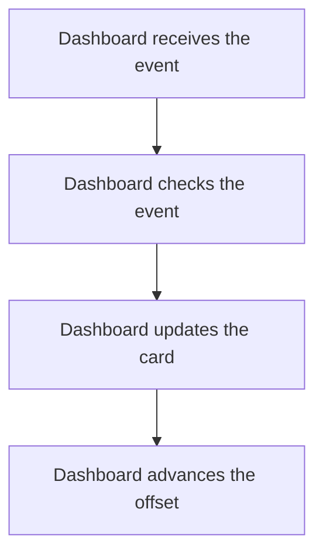

import {ClewMarkdown, ClewFieldDetails, ClewProcess, ClewDataModel, ClewDownload, ClewModelLink, ClewRelatedModelLink, ClewFieldTrace, ClewContextLink, ClewPageContext, ClewProcessReturn, ClewStatus, ClewRetainedPage, ClewCatalog, ClewAnchor} from '@site/src/components/ClewReaders';

<ClewAnchor id="process-overview" pageStart />

# Update a Dashboard forecast

<ClewPageContext />

<ClewStatus freshness="STALE" verification="UNASSESSED" />

<ClewProcess dataPath="/clew-data/widgets/scenario-dashboard-forecast-updated-consumer.json" defaultAnchor="question-apply">

Dashboard validates the event, updates its card when appropriate and advances the Kafka offset.

## 1. Dashboard receives the event {#question-receive}

<p className="clew-route"><code>{"Topic: weather.forecast-updated"}</code></p>

<ClewMarkdown text={"The saved process associates `weather.forecast-updated` with this Dashboard consumer. Runtime activation and message delivery are unverified."} />

<details>
<summary>Evidence and scope</summary>

**Dashboard consumes forecast-updated events** · STALE · UNASSESSED

The saved process associates weather.forecast-updated with Dashboard.consumeMessage as an agent-proposed topic mapping. It leaves topic subscription configuration and runtime delivery unverified.

- [services/dashboard/src/main.ts:47–60 · revision e635069293d58cb0d4f28c8211e748b8d58e6b37](../sources/c8b3521f73ba74f836cc640aa7a8cad2b6e1012251c1b736f186c06a9b475233.mdx)

</details>

<article className="clew-topic" id="topic-incoming-weather.forecast-updated" tabIndex={-1}>

### Incoming Kafka topic · weather.forecast-updated

<ClewProcessReturn topic="weather.forecast-updated" direction="incoming" />

<div className="clew-topic-path" aria-label="Declared asynchronous handoff">

<div>

<ClewContextLink path="/services/forecasts#section-egress" fromProcess="dashboard-forecast-updated-consumer" fromQuestion="question-receive" query={{"direction":"outgoing","topic":"weather.forecast-updated"}}>Forecasts</ClewContextLink>

publishPending

</div>

<span aria-hidden="true">→</span>

<div>

**weather.forecast-updated**

Kafka topic · asynchronous

</div>

<span aria-hidden="true">→</span>

<div>

<ClewContextLink path="/services/dashboard#section-ingress" fromProcess="dashboard-forecast-updated-consumer" fromQuestion="question-receive" query={{"direction":"incoming","topic":"weather.forecast-updated"}}>Dashboard</ClewContextLink>

consumeMessage

</div>

</div>

Proposed handoff; runtime delivery has not been verified.

Saved publisher view: <ClewContextLink path="/scenarios/forecasts-publish-pending#process-overview" fromProcess="dashboard-forecast-updated-consumer" fromQuestion="question-receive" query={{}}>Publish forecast updates</ClewContextLink>

<details>
<summary>Retained source and declaration context</summary>

Topic names and the payload's event type are separate values. These references retain their own revisions; source matches do not prove topic resolution or delivery.

- [services/dashboard/src/events.ts:10–29 · revision e635069293d58cb0d4f28c8211e748b8d58e6b37](../sources/afddedfc8054e8c5495b73e95e3924f7b15f90f9b73caf09d7c1b7cdda664830.mdx)
- [services/dashboard/src/main.ts:47–60 · revision e635069293d58cb0d4f28c8211e748b8d58e6b37](../sources/c8b3521f73ba74f836cc640aa7a8cad2b6e1012251c1b736f186c06a9b475233.mdx)

```json
[
  {
    "boundaries": [
      "RUNTIME_DESTINATION_AND_ACTIVATION_UNKNOWN",
      "WIRE_SERIALIZATION_NOT_ASSESSED",
      "MESSAGE_DELIVERY_ORDER_RETRY_AND_CONSUMER_ACTIVATION_UNKNOWN",
      "ENVIRONMENT_SCOPE_UNSPECIFIED",
      "CLIENT_PATTERN_UNSUPPORTED_OR_AMBIGUOUS",
      "UNACCEPTED_AGENT_PROPOSAL"
    ],
    "from": {
      "callSite": {
        "observation": "forecasts:flow:a5b0ed72a047f4f36e281eb2"
      },
      "selector": {
        "language": "kotlin",
        "name": "publishPending",
        "owner": "class:weather.Forecasts",
        "parameterTypes": []
      },
      "service": "forecasts"
    },
    "interaction": "forecasts-forecast-updated-to-dashboard",
    "origin": "agent-proposal",
    "rationale": "Agent-proposed weather.forecast-updated subscriber mapping. The selected source method and producer callsite are retained; topic resolution, consumer subscription and runtime delivery remain unverified.",
    "runtime": "UNKNOWN",
    "to": {
      "selector": {
        "language": "typescript",
        "name": "consumeMessage",
        "owner": "package:",
        "parameterTypes": [
          ": EachMessagePayload"
        ]
      },
      "service": "dashboard"
    },
    "topic": {
      "caller": {
        "declared": "weather.forecast-updated",
        "observed": [],
        "status": "UNRESOLVED"
      },
      "receiver": {
        "declared": "weather.forecast-updated",
        "observed": [],
        "status": "UNRESOLVED"
      }
    }
  }
]
```


</details>

</article>

<details className="clew-context-disclosure">
<summary>Consumer configuration and mapping<span className="clew-disclosure-preview">Declared topic mapping · manual offset handling · runtime unverified</span></summary>

<ClewMarkdown text={"This account does not establish subscription configuration. The handler explicitly advances offsets after its valid or rejection paths; runtime activation and delivery remain unverified."} />

<details>
<summary>Evidence and scope</summary>

**Dashboard consumes forecast-updated events** · STALE · UNASSESSED

The saved process associates weather.forecast-updated with Dashboard.consumeMessage as an agent-proposed topic mapping. It leaves topic subscription configuration and runtime delivery unverified.

- [services/dashboard/src/main.ts:47–60 · revision e635069293d58cb0d4f28c8211e748b8d58e6b37](../sources/c8b3521f73ba74f836cc640aa7a8cad2b6e1012251c1b736f186c06a9b475233.mdx)
**Dashboard consumes forecast-updated events** · STALE · UNASSESSED

After applyEvent resolves on the valid path, commit this partition's offset plus one.

- [services/dashboard/src/main.ts:59–59 · revision e635069293d58cb0d4f28c8211e748b8d58e6b37](../sources/fb056517f94476af3c7964b81f570f4579e6b57b469923f270bb1b5b7f3ec245.mdx)
- [services/dashboard/src/main.ts:58–58 · revision e635069293d58cb0d4f28c8211e748b8d58e6b37](../sources/03b9efe6bc6d50d833e9a96c49365da011a0e4f6ed708994589122816819a21f.mdx)
- [services/dashboard/src/main.ts:59–59 · revision e635069293d58cb0d4f28c8211e748b8d58e6b37](../sources/596449b04f878bf0394c5492523a6a54d943d9f3a2a63e24cba4e4ca8dce043a.mdx)
- [services/dashboard/src/main.ts:47–60 · revision e635069293d58cb0d4f28c8211e748b8d58e6b37](../sources/c8b3521f73ba74f836cc640aa7a8cad2b6e1012251c1b736f186c06a9b475233.mdx)

</details>


</details>

## 2. Dashboard checks the event {#question-validate}

<ClewMarkdown text={"The handler parses the JSON and checks that the event has the expected shape before applying it."} />

<details>
<summary>Evidence and scope</summary>

**Dashboard consumes forecast-updated events** · STALE · UNASSESSED

JSON parsing and validateEvent succeed for a weather.forecast-updated message, producing a valid forecast.updated event.

- [services/dashboard/src/events.ts:10–29 · revision e635069293d58cb0d4f28c8211e748b8d58e6b37](../sources/afddedfc8054e8c5495b73e95e3924f7b15f90f9b73caf09d7c1b7cdda664830.mdx)
- [services/dashboard/src/main.ts:50–57 · revision e635069293d58cb0d4f28c8211e748b8d58e6b37](../sources/cb1d1d3100a0984649d98da9a16956ac42fc63a19ea6841dad22f15a13784ba7.mdx)
- [services/dashboard/src/main.ts:47–60 · revision e635069293d58cb0d4f28c8211e748b8d58e6b37](../sources/c8b3521f73ba74f836cc640aa7a8cad2b6e1012251c1b736f186c06a9b475233.mdx)

</details>

<details className="clew-context-disclosure">
<summary>Validation details<span className="clew-disclosure-preview">Envelope, place fields and topic-specific payload checks</span></summary>

<ClewMarkdown text={"The envelope requires a string event ID, version 1, an allowed place ID, a string name and finite coordinates. A forecast.updated event also needs valid updatedAt/fetchedAt timestamps, fixture or live mode, and 1–6 periods with valid times, finite temperatures, null or finite nonnegative precipitation and string symbols."} />

<details>
<summary>Evidence and scope</summary>

**Dashboard consumes forecast-updated events** · STALE · UNASSESSED

The common envelope requires an object, string id, version 1, a place with id oslo, helsinki, or lisbon, string name, and finite latitude and longitude. The forecast branch requires updatedAt and fetchedAt accepted by isTimestamp, mode fixture or live, and a periods array of length 1 through 6. Each period requires a valid time, finite temperatureC, precipitationMm null or finite and nonnegative, and a string symbol. isTimestamp accepts a UTC ISO-like value with seconds and optional fractional seconds, and also requires Date.parse to be finite.

- [services/dashboard/src/events.ts:10–29 · revision e635069293d58cb0d4f28c8211e748b8d58e6b37](../sources/afddedfc8054e8c5495b73e95e3924f7b15f90f9b73caf09d7c1b7cdda664830.mdx)
- [services/dashboard/src/events.ts:6–8 · revision e635069293d58cb0d4f28c8211e748b8d58e6b37](../sources/f595401e33ffe1c87198d3297a901422e3d449fe00dd98adddc17aaca283d70e.mdx)

</details>


</details>

<aside className="clew-exception">

### If the event is invalid {#question-invalid-event}

<ClewMarkdown text={"A parse or validation failure is recorded as `INVALID_EVENT`. After that rejection is saved, Dashboard advances the offset and returns. Failure to save the rejection or advance its offset propagates."} />

<details>
<summary>Evidence and scope</summary>

**Dashboard consumes forecast-updated events** · STALE · UNASSESSED

On JSON parse or validation failure, including an unrecognized topic that throws UNKNOWN\_TOPIC, insert topic, partition, offset, and reason INVALID\_EVENT into rejected\_messages; ignore a duplicate rejection row.

- [services/dashboard/src/events.ts:10–29 · revision e635069293d58cb0d4f28c8211e748b8d58e6b37](../sources/afddedfc8054e8c5495b73e95e3924f7b15f90f9b73caf09d7c1b7cdda664830.mdx)
- [services/dashboard/src/main.ts:53–54 · revision e635069293d58cb0d4f28c8211e748b8d58e6b37](../sources/51eb13746a4ec715b7f498f982fc29c26b082e21cf20eed410ae88e3807a0f13.mdx)
- [services/dashboard/src/main.ts:50–57 · revision e635069293d58cb0d4f28c8211e748b8d58e6b37](../sources/cb1d1d3100a0984649d98da9a16956ac42fc63a19ea6841dad22f15a13784ba7.mdx)
**Dashboard consumes forecast-updated events** · STALE · UNASSESSED

After the rejection row is written, commit this partition's offset plus one and return.

- [services/dashboard/src/main.ts:59–59 · revision e635069293d58cb0d4f28c8211e748b8d58e6b37](../sources/fb056517f94476af3c7964b81f570f4579e6b57b469923f270bb1b5b7f3ec245.mdx)
- [services/dashboard/src/main.ts:55–55 · revision e635069293d58cb0d4f28c8211e748b8d58e6b37](../sources/04307c94ed8910824028310d5a54e4062e623b9b852e4e1ed79879721fe73f84.mdx)
- [services/dashboard/src/main.ts:50–57 · revision e635069293d58cb0d4f28c8211e748b8d58e6b37](../sources/cb1d1d3100a0984649d98da9a16956ac42fc63a19ea6841dad22f15a13784ba7.mdx)
**Dashboard consumes forecast-updated events** · STALE · UNASSESSED

A rejection-write or rejection-path offset-commit failure propagates. When both writes succeed, consumeMessage returns after advancing the offset.

- [services/dashboard/src/main.ts:53–54 · revision e635069293d58cb0d4f28c8211e748b8d58e6b37](../sources/51eb13746a4ec715b7f498f982fc29c26b082e21cf20eed410ae88e3807a0f13.mdx)
- [services/dashboard/src/main.ts:55–55 · revision e635069293d58cb0d4f28c8211e748b8d58e6b37](../sources/04307c94ed8910824028310d5a54e4062e623b9b852e4e1ed79879721fe73f84.mdx)
- [services/dashboard/src/main.ts:50–57 · revision e635069293d58cb0d4f28c8211e748b8d58e6b37](../sources/cb1d1d3100a0984649d98da9a16956ac42fc63a19ea6841dad22f15a13784ba7.mdx)
- [services/dashboard/src/main.ts:56–56 · revision e635069293d58cb0d4f28c8211e748b8d58e6b37](../sources/7fdaf9f2a9021a175f7a56f3d1da7a449de99be9aa83f25efd9106bc89d18e90.mdx)

</details>

</aside>

## 3. Dashboard updates the card {#question-apply}

<ClewMarkdown text={"A new forecast event can create its card directly from the place in the message. An existing card is updated only if its stored forecast timestamp is missing or the incoming forecast is strictly newer."} />

<div className="clew-context-links">

<ClewModelLink model="weather-card" process="dashboard-forecast-updated-consumer" anchor="question-apply">Weather card · data model</ClewModelLink>

<ClewContextLink path="/services/dashboard#section-entities" fromProcess="dashboard-forecast-updated-consumer" fromQuestion="question-apply">Technical context</ClewContextLink>

</div>

<details>
<summary>Evidence and scope</summary>

**Dashboard consumes forecast-updated events** · STALE · UNASSESSED

For a new forecast event, insert the card from event.place when no card exists, without checking for a prior place-requested event; for an existing card, update its place fields and forecast only when stored updated\_at is null or the incoming timestamp is strictly newer.

- [services/dashboard/src/main.ts:15–45 · revision e635069293d58cb0d4f28c8211e748b8d58e6b37](../sources/bf524d202ba882540036918136ea088912da8bc6f340ab23d8a90bfb0aacab71.mdx)

</details>

<p className="clew-step-data">Data handled by this step: <ClewModelLink model="place" process="dashboard-forecast-updated-consumer" anchor="question-apply">Place</ClewModelLink> · <ClewModelLink model="forecast" process="dashboard-forecast-updated-consumer" anchor="question-apply">Forecast</ClewModelLink> · <ClewModelLink model="period" process="dashboard-forecast-updated-consumer" anchor="question-apply">Period</ClewModelLink> · <ClewModelLink model="weather-card" process="dashboard-forecast-updated-consumer" anchor="question-apply">Weather card</ClewModelLink></p>

<aside className="clew-info">

### If this event ID was already handled

<ClewMarkdown text={"If the event ID was already handled, Dashboard commits its database transaction and skips the card change. The consumer can still advance its offset."} />

<details>
<summary>Evidence and scope</summary>

**Dashboard consumes forecast-updated events** · STALE · UNASSESSED

Begin a transaction and insert the event id into inbox with conflict ignored. If it already exists, commit and return DUPLICATE without changing the weather card.

- [services/dashboard/src/main.ts:15–45 · revision e635069293d58cb0d4f28c8211e748b8d58e6b37](../sources/bf524d202ba882540036918136ea088912da8bc6f340ab23d8a90bfb0aacab71.mdx)
**Dashboard consumes forecast-updated events** · STALE · UNASSESSED

The duplicate path commits and returns DUPLICATE; consumeMessage then commits this partition's offset plus one.

- [services/dashboard/src/main.ts:59–59 · revision e635069293d58cb0d4f28c8211e748b8d58e6b37](../sources/fb056517f94476af3c7964b81f570f4579e6b57b469923f270bb1b5b7f3ec245.mdx)
- [services/dashboard/src/main.ts:59–59 · revision e635069293d58cb0d4f28c8211e748b8d58e6b37](../sources/596449b04f878bf0394c5492523a6a54d943d9f3a2a63e24cba4e4ca8dce043a.mdx)
- [services/dashboard/src/main.ts:47–60 · revision e635069293d58cb0d4f28c8211e748b8d58e6b37](../sources/c8b3521f73ba74f836cc640aa7a8cad2b6e1012251c1b736f186c06a9b475233.mdx)
- [services/dashboard/src/main.ts:15–45 · revision e635069293d58cb0d4f28c8211e748b8d58e6b37](../sources/bf524d202ba882540036918136ea088912da8bc6f340ab23d8a90bfb0aacab71.mdx)

</details>

</aside>

<aside className="clew-info">

### Older or equal forecast

<ClewMarkdown text={"An equal or older incoming timestamp leaves an existing card unchanged. Creating a new card does not require a prior place-requested event."} />

<details>
<summary>Evidence and scope</summary>

**Dashboard consumes forecast-updated events** · STALE · UNASSESSED

For a new forecast event, insert the card from event.place when no card exists, without checking for a prior place-requested event; for an existing card, update its place fields and forecast only when stored updated\_at is null or the incoming timestamp is strictly newer.

- [services/dashboard/src/main.ts:15–45 · revision e635069293d58cb0d4f28c8211e748b8d58e6b37](../sources/bf524d202ba882540036918136ea088912da8bc6f340ab23d8a90bfb0aacab71.mdx)
**Dashboard consumes forecast-updated events** · STALE · UNASSESSED

For an existing card with an equal or newer stored timestamp, the SQL update condition affects no row. The transaction still commits the inbox insert and returns OLDER\_OR\_EQUAL without changing the card; consumeMessage then commits offset plus one.

- [services/dashboard/src/main.ts:59–59 · revision e635069293d58cb0d4f28c8211e748b8d58e6b37](../sources/fb056517f94476af3c7964b81f570f4579e6b57b469923f270bb1b5b7f3ec245.mdx)
- [services/dashboard/src/main.ts:59–59 · revision e635069293d58cb0d4f28c8211e748b8d58e6b37](../sources/596449b04f878bf0394c5492523a6a54d943d9f3a2a63e24cba4e4ca8dce043a.mdx)
- [services/dashboard/src/main.ts:47–60 · revision e635069293d58cb0d4f28c8211e748b8d58e6b37](../sources/c8b3521f73ba74f836cc640aa7a8cad2b6e1012251c1b736f186c06a9b475233.mdx)
- [services/dashboard/src/main.ts:15–45 · revision e635069293d58cb0d4f28c8211e748b8d58e6b37](../sources/bf524d202ba882540036918136ea088912da8bc6f340ab23d8a90bfb0aacab71.mdx)

</details>

</aside>

<aside className="clew-exception">

### If database work fails {#question-database-error}

<ClewMarkdown text={"An error on the valid path stops normal processing before offset advancement. Errors after a connection is acquired attempt rollback and release the client; connection acquisition can fail before that cleanup scope."} />

<details>
<summary>Evidence and scope</summary>

**Dashboard consumes forecast-updated events** · STALE · UNASSESSED

pool.connect runs before applyEvent's try. If it fails, there is no transaction rollback or client release. Once connected, errors inside the try attempt ROLLBACK, rethrow, and release the client in finally; either error prevents consumeMessage from reaching its valid-path offset commit. The DB transaction commits before the offset commit, so an offset failure can replay the message; the inbox duplicate check prevents a second card update, but does not establish exactly-once delivery.

- [services/dashboard/src/main.ts:58–58 · revision e635069293d58cb0d4f28c8211e748b8d58e6b37](../sources/03b9efe6bc6d50d833e9a96c49365da011a0e4f6ed708994589122816819a21f.mdx)
- [services/dashboard/src/main.ts:59–59 · revision e635069293d58cb0d4f28c8211e748b8d58e6b37](../sources/596449b04f878bf0394c5492523a6a54d943d9f3a2a63e24cba4e4ca8dce043a.mdx)
- [services/dashboard/src/main.ts:50–57 · revision e635069293d58cb0d4f28c8211e748b8d58e6b37](../sources/cb1d1d3100a0984649d98da9a16956ac42fc63a19ea6841dad22f15a13784ba7.mdx)
- [services/dashboard/src/main.ts:47–60 · revision e635069293d58cb0d4f28c8211e748b8d58e6b37](../sources/c8b3521f73ba74f836cc640aa7a8cad2b6e1012251c1b736f186c06a9b475233.mdx)
- [services/dashboard/src/main.ts:15–45 · revision e635069293d58cb0d4f28c8211e748b8d58e6b37](../sources/bf524d202ba882540036918136ea088912da8bc6f340ab23d8a90bfb0aacab71.mdx)

</details>

</aside>

## 4. Dashboard advances the offset {#question-offset}

<ClewMarkdown text={"After the valid-event handler returns, Dashboard commits this partition’s next offset. The database change and offset commit are separate effects."} />

<details>
<summary>Evidence and scope</summary>

**Dashboard consumes forecast-updated events** · STALE · UNASSESSED

After applyEvent resolves on the valid path, commit this partition's offset plus one.

- [services/dashboard/src/main.ts:59–59 · revision e635069293d58cb0d4f28c8211e748b8d58e6b37](../sources/fb056517f94476af3c7964b81f570f4579e6b57b469923f270bb1b5b7f3ec245.mdx)
- [services/dashboard/src/main.ts:58–58 · revision e635069293d58cb0d4f28c8211e748b8d58e6b37](../sources/03b9efe6bc6d50d833e9a96c49365da011a0e4f6ed708994589122816819a21f.mdx)
- [services/dashboard/src/main.ts:59–59 · revision e635069293d58cb0d4f28c8211e748b8d58e6b37](../sources/596449b04f878bf0394c5492523a6a54d943d9f3a2a63e24cba4e4ca8dce043a.mdx)
- [services/dashboard/src/main.ts:47–60 · revision e635069293d58cb0d4f28c8211e748b8d58e6b37](../sources/c8b3521f73ba74f836cc640aa7a8cad2b6e1012251c1b736f186c06a9b475233.mdx)
**Dashboard consumes forecast-updated events** · STALE · UNASSESSED

pool.connect runs before applyEvent's try. If it fails, there is no transaction rollback or client release. Once connected, errors inside the try attempt ROLLBACK, rethrow, and release the client in finally; either error prevents consumeMessage from reaching its valid-path offset commit. The DB transaction commits before the offset commit, so an offset failure can replay the message; the inbox duplicate check prevents a second card update, but does not establish exactly-once delivery.

- [services/dashboard/src/main.ts:58–58 · revision e635069293d58cb0d4f28c8211e748b8d58e6b37](../sources/03b9efe6bc6d50d833e9a96c49365da011a0e4f6ed708994589122816819a21f.mdx)
- [services/dashboard/src/main.ts:59–59 · revision e635069293d58cb0d4f28c8211e748b8d58e6b37](../sources/596449b04f878bf0394c5492523a6a54d943d9f3a2a63e24cba4e4ca8dce043a.mdx)
- [services/dashboard/src/main.ts:50–57 · revision e635069293d58cb0d4f28c8211e748b8d58e6b37](../sources/cb1d1d3100a0984649d98da9a16956ac42fc63a19ea6841dad22f15a13784ba7.mdx)
- [services/dashboard/src/main.ts:47–60 · revision e635069293d58cb0d4f28c8211e748b8d58e6b37](../sources/c8b3521f73ba74f836cc640aa7a8cad2b6e1012251c1b736f186c06a9b475233.mdx)
- [services/dashboard/src/main.ts:15–45 · revision e635069293d58cb0d4f28c8211e748b8d58e6b37](../sources/bf524d202ba882540036918136ea088912da8bc6f340ab23d8a90bfb0aacab71.mdx)

</details>

<aside className="clew-exception">

### If the final offset commit fails {#question-offset-error}

<ClewMarkdown text={"The database may already have committed. Kafka can replay the message; remembered event IDs prevent a second card update, but do not prevent duplicate delivery or establish exactly-once processing."} />

<details>
<summary>Evidence and scope</summary>

**Dashboard consumes forecast-updated events** · STALE · UNASSESSED

pool.connect runs before applyEvent's try. If it fails, there is no transaction rollback or client release. Once connected, errors inside the try attempt ROLLBACK, rethrow, and release the client in finally; either error prevents consumeMessage from reaching its valid-path offset commit. The DB transaction commits before the offset commit, so an offset failure can replay the message; the inbox duplicate check prevents a second card update, but does not establish exactly-once delivery.

- [services/dashboard/src/main.ts:58–58 · revision e635069293d58cb0d4f28c8211e748b8d58e6b37](../sources/03b9efe6bc6d50d833e9a96c49365da011a0e4f6ed708994589122816819a21f.mdx)
- [services/dashboard/src/main.ts:59–59 · revision e635069293d58cb0d4f28c8211e748b8d58e6b37](../sources/596449b04f878bf0394c5492523a6a54d943d9f3a2a63e24cba4e4ca8dce043a.mdx)
- [services/dashboard/src/main.ts:50–57 · revision e635069293d58cb0d4f28c8211e748b8d58e6b37](../sources/cb1d1d3100a0984649d98da9a16956ac42fc63a19ea6841dad22f15a13784ba7.mdx)
- [services/dashboard/src/main.ts:47–60 · revision e635069293d58cb0d4f28c8211e748b8d58e6b37](../sources/c8b3521f73ba74f836cc640aa7a8cad2b6e1012251c1b736f186c06a9b475233.mdx)
- [services/dashboard/src/main.ts:15–45 · revision e635069293d58cb0d4f28c8211e748b8d58e6b37](../sources/bf524d202ba882540036918136ea088912da8bc6f340ab23d8a90bfb0aacab71.mdx)

</details>

</aside>

## Full description and sources {#question-confidence}

<ClewMarkdown text={"Original source, event validation, database/offset ordering and review state remain attached below. This source interpretation does not prove runtime delivery. These two consumer topics have distinct payload checks and card-update rules."} />

<div className="clew-context-links">

<ClewContextLink path="/scenarios/forecasts-publish-pending#process-overview" fromProcess="dashboard-forecast-updated-consumer" fromQuestion="question-confidence">Related forecast publisher</ClewContextLink>

</div>

<details>
<summary>Evidence and scope</summary>

**Dashboard consumes forecast-updated events** · STALE · UNASSESSED

The saved process declaration proposes a weather.forecast-updated mapping to Dashboard.consumeMessage; subscription settings and runtime delivery remain unverified. For that topic, validateEvent requires a string id, version 1, an allowed place id (oslo, helsinki, lisbon), string name, finite coordinates, type forecast.updated, valid updatedAt/fetchedAt timestamps, fixture or live mode, and 1–6 periods. Each period needs a valid time, finite temperature, null or finite nonnegative precipitation, and a string symbol. Parse or validation failures, including UNKNOWN\_TOPIC, are caught, recorded as INVALID\_EVENT, and followed by offset plus one; reject-write or offset-commit errors propagate. On valid input, applyEvent inserts the id into inbox in a transaction. A duplicate commits and returns DUPLICATE without changing the card. A new forecast can insert its card directly from event.place, without a prior place-requested event; an existing card updates only when its stored timestamp is null or older, while equal or older timestamps leave it unchanged and return OLDER\_OR\_EQUAL. Connected-client transaction errors attempt rollback and release in finally; connection errors occur before the try, and either failure prevents the offset commit. The DB transaction commits before the offset, so a later offset failure can replay the message; inbox suppresses a second card update, not duplicate delivery. Runtime remains unverified.

- [services/dashboard/src/events.ts:10–29 · revision e635069293d58cb0d4f28c8211e748b8d58e6b37](../sources/afddedfc8054e8c5495b73e95e3924f7b15f90f9b73caf09d7c1b7cdda664830.mdx)
- [services/dashboard/src/main.ts:59–59 · revision e635069293d58cb0d4f28c8211e748b8d58e6b37](../sources/fb056517f94476af3c7964b81f570f4579e6b57b469923f270bb1b5b7f3ec245.mdx)
- [services/dashboard/src/main.ts:58–58 · revision e635069293d58cb0d4f28c8211e748b8d58e6b37](../sources/03b9efe6bc6d50d833e9a96c49365da011a0e4f6ed708994589122816819a21f.mdx)
- [services/dashboard/src/main.ts:53–54 · revision e635069293d58cb0d4f28c8211e748b8d58e6b37](../sources/51eb13746a4ec715b7f498f982fc29c26b082e21cf20eed410ae88e3807a0f13.mdx)
- [services/dashboard/src/main.ts:55–55 · revision e635069293d58cb0d4f28c8211e748b8d58e6b37](../sources/04307c94ed8910824028310d5a54e4062e623b9b852e4e1ed79879721fe73f84.mdx)
- [services/dashboard/src/events.ts:6–8 · revision e635069293d58cb0d4f28c8211e748b8d58e6b37](../sources/f595401e33ffe1c87198d3297a901422e3d449fe00dd98adddc17aaca283d70e.mdx)
- [services/dashboard/src/main.ts:59–59 · revision e635069293d58cb0d4f28c8211e748b8d58e6b37](../sources/596449b04f878bf0394c5492523a6a54d943d9f3a2a63e24cba4e4ca8dce043a.mdx)
- [services/dashboard/src/main.ts:50–57 · revision e635069293d58cb0d4f28c8211e748b8d58e6b37](../sources/cb1d1d3100a0984649d98da9a16956ac42fc63a19ea6841dad22f15a13784ba7.mdx)
- [services/dashboard/src/main.ts:47–60 · revision e635069293d58cb0d4f28c8211e748b8d58e6b37](../sources/c8b3521f73ba74f836cc640aa7a8cad2b6e1012251c1b736f186c06a9b475233.mdx)
- [services/dashboard/src/main.ts:15–45 · revision e635069293d58cb0d4f28c8211e748b8d58e6b37](../sources/bf524d202ba882540036918136ea088912da8bc6f340ab23d8a90bfb0aacab71.mdx)

</details>

<details>
<summary>Reading guide and map</summary>

Editorial reading guide · original source scopes and review states remain separate.

Reading order only. Conditions and failures remain beside the steps below; this is not a runtime trace.




</details>

<details>
<summary>Evidence scope</summary>

<ClewMarkdown text={"Original source, event validation, database/offset ordering and review state remain attached below. This source interpretation does not prove runtime delivery. These two consumer topics have distinct payload checks and card-update rules."} />

<div className="clew-context-links">

<ClewContextLink path="/scenarios/forecasts-publish-pending#process-overview" fromProcess="dashboard-forecast-updated-consumer" fromQuestion="question-confidence">Related forecast publisher</ClewContextLink>

</div>

<details>
<summary>Evidence and scope</summary>

**Dashboard consumes forecast-updated events** · STALE · UNASSESSED

The saved process declaration proposes a weather.forecast-updated mapping to Dashboard.consumeMessage; subscription settings and runtime delivery remain unverified. For that topic, validateEvent requires a string id, version 1, an allowed place id (oslo, helsinki, lisbon), string name, finite coordinates, type forecast.updated, valid updatedAt/fetchedAt timestamps, fixture or live mode, and 1–6 periods. Each period needs a valid time, finite temperature, null or finite nonnegative precipitation, and a string symbol. Parse or validation failures, including UNKNOWN\_TOPIC, are caught, recorded as INVALID\_EVENT, and followed by offset plus one; reject-write or offset-commit errors propagate. On valid input, applyEvent inserts the id into inbox in a transaction. A duplicate commits and returns DUPLICATE without changing the card. A new forecast can insert its card directly from event.place, without a prior place-requested event; an existing card updates only when its stored timestamp is null or older, while equal or older timestamps leave it unchanged and return OLDER\_OR\_EQUAL. Connected-client transaction errors attempt rollback and release in finally; connection errors occur before the try, and either failure prevents the offset commit. The DB transaction commits before the offset, so a later offset failure can replay the message; inbox suppresses a second card update, not duplicate delivery. Runtime remains unverified.

- [services/dashboard/src/events.ts:10–29 · revision e635069293d58cb0d4f28c8211e748b8d58e6b37](../sources/afddedfc8054e8c5495b73e95e3924f7b15f90f9b73caf09d7c1b7cdda664830.mdx)
- [services/dashboard/src/main.ts:59–59 · revision e635069293d58cb0d4f28c8211e748b8d58e6b37](../sources/fb056517f94476af3c7964b81f570f4579e6b57b469923f270bb1b5b7f3ec245.mdx)
- [services/dashboard/src/main.ts:58–58 · revision e635069293d58cb0d4f28c8211e748b8d58e6b37](../sources/03b9efe6bc6d50d833e9a96c49365da011a0e4f6ed708994589122816819a21f.mdx)
- [services/dashboard/src/main.ts:53–54 · revision e635069293d58cb0d4f28c8211e748b8d58e6b37](../sources/51eb13746a4ec715b7f498f982fc29c26b082e21cf20eed410ae88e3807a0f13.mdx)
- [services/dashboard/src/main.ts:55–55 · revision e635069293d58cb0d4f28c8211e748b8d58e6b37](../sources/04307c94ed8910824028310d5a54e4062e623b9b852e4e1ed79879721fe73f84.mdx)
- [services/dashboard/src/events.ts:6–8 · revision e635069293d58cb0d4f28c8211e748b8d58e6b37](../sources/f595401e33ffe1c87198d3297a901422e3d449fe00dd98adddc17aaca283d70e.mdx)
- [services/dashboard/src/main.ts:59–59 · revision e635069293d58cb0d4f28c8211e748b8d58e6b37](../sources/596449b04f878bf0394c5492523a6a54d943d9f3a2a63e24cba4e4ca8dce043a.mdx)
- [services/dashboard/src/main.ts:50–57 · revision e635069293d58cb0d4f28c8211e748b8d58e6b37](../sources/cb1d1d3100a0984649d98da9a16956ac42fc63a19ea6841dad22f15a13784ba7.mdx)
- [services/dashboard/src/main.ts:47–60 · revision e635069293d58cb0d4f28c8211e748b8d58e6b37](../sources/c8b3521f73ba74f836cc640aa7a8cad2b6e1012251c1b736f186c06a9b475233.mdx)
- [services/dashboard/src/main.ts:15–45 · revision e635069293d58cb0d4f28c8211e748b8d58e6b37](../sources/bf524d202ba882540036918136ea088912da8bc6f340ab23d8a90bfb0aacab71.mdx)

</details>


</details>

## Original accounts and implementation

- [Dashboard consumes forecast-updated events](../operations/scenarios-dashboard-forecast-updated-consumer--dashboard-forecast-updated-consumer.mdx)
- [Dashboard forecast-updated consumer view](../operations/scenarios-dashboard-forecast-updated-consumer--process-overview.mdx)

<ClewDownload path="/clew-data/native/scenarios/dashboard-forecast-updated-consumer.json">Saved data and complete provenance (reference format)</ClewDownload>

</ClewProcess>
