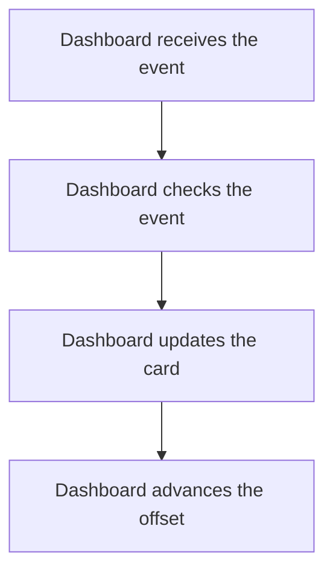

import {ClewMarkdown, ClewFieldDetails, ClewProcess, ClewDataModel, ClewDownload, ClewModelLink, ClewRelatedModelLink, ClewFieldTrace, ClewContextLink, ClewPageContext, ClewProcessReturn, ClewStatus, ClewRetainedPage, ClewCatalog, ClewAnchor} from '@site/src/components/ClewReaders';

<ClewAnchor id="process-overview" pageStart />

# Add a place to Dashboard

<ClewPageContext />

<ClewStatus freshness="STALE" verification="UNASSESSED" />

Dashboard validates the event, updates its card when appropriate and advances the Kafka offset.

## 1. Dashboard receives the event {#question-receive}

<p className="clew-route"><code>{"Topic: weather.place-requested"}</code></p>

<ClewMarkdown text={"The saved process associates `weather.place-requested` with this Dashboard consumer. Runtime activation and message delivery are unverified."} />

<details>
<summary>Evidence and scope</summary>

**Dashboard consumes place-requested events** · STALE · UNASSESSED

The saved process declaration proposes weather.place-requested as a topic-to-consumeMessage mapping; the mapping remains unverified at runtime.

- [services/dashboard/src/main.ts:47–60 · revision e635069293d58cb0d4f28c8211e748b8d58e6b37](../sources/c8b3521f73ba74f836cc640aa7a8cad2b6e1012251c1b736f186c06a9b475233.mdx)

</details>

<article className="clew-topic" id="topic-incoming-weather.place-requested" tabIndex={-1}>

### Incoming Kafka topic · weather.place-requested

<ClewProcessReturn topic="weather.place-requested" direction="incoming" />

<div className="clew-topic-path" aria-label="Declared asynchronous handoff">

<div>

<ClewContextLink path="/services/places#section-egress" fromProcess="dashboard-place-requested-consumer" fromQuestion="question-receive" query={{"direction":"outgoing","topic":"weather.place-requested"}}>Places</ClewContextLink>

PublishPending

</div>

<span aria-hidden="true">→</span>

<div>

**weather.place-requested**

Kafka topic · asynchronous

</div>

<span aria-hidden="true">→</span>

<div>

<ClewContextLink path="/services/dashboard#section-ingress" fromProcess="dashboard-place-requested-consumer" fromQuestion="question-receive" query={{"direction":"incoming","topic":"weather.place-requested"}}>Dashboard</ClewContextLink>

consumeMessage

</div>

</div>

Proposed handoff; runtime delivery has not been verified.

Saved publisher view: <ClewContextLink path="/scenarios/places-request-publisher#process-overview" fromProcess="dashboard-place-requested-consumer" fromQuestion="question-receive" query={{}}>Publish place requests</ClewContextLink>

<details>
<summary>Retained source and declaration context</summary>

Topic names and the payload's event type are separate values. These references retain their own revisions; source matches do not prove topic resolution or delivery.

- [services/dashboard/src/events.ts:10–29 · revision e635069293d58cb0d4f28c8211e748b8d58e6b37](../sources/afddedfc8054e8c5495b73e95e3924f7b15f90f9b73caf09d7c1b7cdda664830.mdx)
- [services/dashboard/src/main.ts:47–60 · revision e635069293d58cb0d4f28c8211e748b8d58e6b37](../sources/c8b3521f73ba74f836cc640aa7a8cad2b6e1012251c1b736f186c06a9b475233.mdx)
- [services/dashboard/src/main.ts:99–111 · revision e635069293d58cb0d4f28c8211e748b8d58e6b37](../sources/b8c6b94020ae709e61177a744a5a5315fccb0813ac9f4e37ca6a0be5140d129c.mdx)

```json
[
  {
    "boundaries": [
      "RUNTIME_DESTINATION_AND_ACTIVATION_UNKNOWN",
      "WIRE_SERIALIZATION_NOT_ASSESSED",
      "MESSAGE_DELIVERY_ORDER_RETRY_AND_CONSUMER_ACTIVATION_UNKNOWN",
      "ENVIRONMENT_SCOPE_UNSPECIFIED",
      "CLIENT_PATTERN_UNSUPPORTED_OR_AMBIGUOUS",
      "UNACCEPTED_AGENT_PROPOSAL"
    ],
    "from": {
      "callSite": {
        "observation": "places:flow:941152b2ec99892568c9e40a"
      },
      "selector": {
        "language": "csharp",
        "name": "PublishPending",
        "owner": "class:Weather.Places.RequestPublisher",
        "parameterTypes": [
          "Confluent.Kafka.IProducer`2",
          "System.Threading.CancellationToken"
        ]
      },
      "service": "places"
    },
    "interaction": "places-place-requested-to-dashboard",
    "origin": "agent-proposal",
    "rationale": "Agent-proposed weather.place-requested subscriber mapping. The captured Places producer call location is exact; topic resolution, consumer subscription and runtime delivery remain unverified.",
    "runtime": "UNKNOWN",
    "to": {
      "selector": {
        "language": "typescript",
        "name": "consumeMessage",
        "owner": "package:",
        "parameterTypes": [
          ": EachMessagePayload"
        ]
      },
      "service": "dashboard"
    },
    "topic": {
      "caller": {
        "declared": "weather.place-requested",
        "observed": [],
        "status": "UNRESOLVED"
      },
      "receiver": {
        "declared": "weather.place-requested",
        "observed": [],
        "status": "UNRESOLVED"
      }
    }
  }
]
```


</details>

</article>

<details className="clew-context-disclosure">
<summary>Consumer configuration and mapping<span className="clew-disclosure-preview">Declared topic mapping · manual offset handling · runtime unverified</span></summary>

<ClewMarkdown text={"The source subscribes to both Weather topics from the beginning and starts the consumer with automatic offset commits disabled. This declaration does not prove runtime activation or delivery."} />

<details>
<summary>Evidence and scope</summary>

**Dashboard consumes place-requested events** · STALE · UNASSESSED

The source subscribes to both weather topics from the beginning and starts consumeMessage with automatic commits disabled. This source sequence does not prove runtime activation or delivery.

- [services/dashboard/src/main.ts:47–60 · revision e635069293d58cb0d4f28c8211e748b8d58e6b37](../sources/c8b3521f73ba74f836cc640aa7a8cad2b6e1012251c1b736f186c06a9b475233.mdx)
- [services/dashboard/src/main.ts:99–111 · revision e635069293d58cb0d4f28c8211e748b8d58e6b37](../sources/b8c6b94020ae709e61177a744a5a5315fccb0813ac9f4e37ca6a0be5140d129c.mdx)

</details>


</details>

## 2. Dashboard checks the event {#question-validate}

<ClewMarkdown text={"The handler parses the JSON and checks that the event has the expected shape before applying it."} />

<details>
<summary>Evidence and scope</summary>

**Dashboard consumes place-requested events** · STALE · UNASSESSED

JSON parsing and validateEvent both succeed for the weather.place-requested topic, producing a valid place.requested event.

- [services/dashboard/src/events.ts:10–29 · revision e635069293d58cb0d4f28c8211e748b8d58e6b37](../sources/afddedfc8054e8c5495b73e95e3924f7b15f90f9b73caf09d7c1b7cdda664830.mdx)
- [services/dashboard/src/main.ts:51–51 · revision e635069293d58cb0d4f28c8211e748b8d58e6b37](../sources/4798bc09cdd58e52e7e56aae4740dbb99954e40e39ad7c17923a447e491e2712.mdx)
- [services/dashboard/src/main.ts:50–57 · revision e635069293d58cb0d4f28c8211e748b8d58e6b37](../sources/cb1d1d3100a0984649d98da9a16956ac42fc63a19ea6841dad22f15a13784ba7.mdx)
- [services/dashboard/src/main.ts:47–60 · revision e635069293d58cb0d4f28c8211e748b8d58e6b37](../sources/c8b3521f73ba74f836cc640aa7a8cad2b6e1012251c1b736f186c06a9b475233.mdx)

</details>

<details className="clew-context-disclosure">
<summary>Validation details<span className="clew-disclosure-preview">Envelope, place fields and topic-specific payload checks</span></summary>

<ClewMarkdown text={"A place.requested event needs a string ID, version 1, an allowed place ID, a string name and finite coordinates, with no forecast field. The forecast-updated topic has its own validator branch; an unrecognized topic throws UNKNOWN_TOPIC."} />

<details>
<summary>Evidence and scope</summary>

**Dashboard consumes place-requested events** · STALE · UNASSESSED

A place event has a string id, version 1, allowed place.id (oslo, helsinki, or lisbon), string place.name, finite latitude and longitude, type place.requested, and no forecast field. The known weather.forecast-updated topic has a separate validation branch; only unrecognized topic names throw UNKNOWN\_TOPIC.

- [services/dashboard/src/events.ts:10–29 · revision e635069293d58cb0d4f28c8211e748b8d58e6b37](../sources/afddedfc8054e8c5495b73e95e3924f7b15f90f9b73caf09d7c1b7cdda664830.mdx)

</details>


</details>

<aside className="clew-exception">

### If the event is invalid {#question-invalid-event}

<ClewMarkdown text={"A parse or validation failure is recorded as `INVALID_EVENT`. After that rejection is saved, Dashboard advances the offset and returns. Failure to save the rejection or advance its offset propagates."} />

<details>
<summary>Evidence and scope</summary>

**Dashboard consumes place-requested events** · STALE · UNASSESSED

Insert the topic, partition, offset, and reason INVALID\_EVENT into rejected\_messages; duplicate reject records are ignored.

- [services/dashboard/src/main.ts:53–54 · revision e635069293d58cb0d4f28c8211e748b8d58e6b37](../sources/51eb13746a4ec715b7f498f982fc29c26b082e21cf20eed410ae88e3807a0f13.mdx)
- [services/dashboard/src/main.ts:50–57 · revision e635069293d58cb0d4f28c8211e748b8d58e6b37](../sources/cb1d1d3100a0984649d98da9a16956ac42fc63a19ea6841dad22f15a13784ba7.mdx)
**Dashboard consumes place-requested events** · STALE · UNASSESSED

After the reject record is written, commit this partition’s offset plus one and return.

- [services/dashboard/src/main.ts:59–59 · revision e635069293d58cb0d4f28c8211e748b8d58e6b37](../sources/fb056517f94476af3c7964b81f570f4579e6b57b469923f270bb1b5b7f3ec245.mdx)
- [services/dashboard/src/main.ts:55–55 · revision e635069293d58cb0d4f28c8211e748b8d58e6b37](../sources/04307c94ed8910824028310d5a54e4062e623b9b852e4e1ed79879721fe73f84.mdx)
- [services/dashboard/src/main.ts:55–55 · revision e635069293d58cb0d4f28c8211e748b8d58e6b37](../sources/7aade9ed3c0bb735283355f77a431ea3c8729271662e54ebab578098032c7df9.mdx)
- [services/dashboard/src/main.ts:50–57 · revision e635069293d58cb0d4f28c8211e748b8d58e6b37](../sources/cb1d1d3100a0984649d98da9a16956ac42fc63a19ea6841dad22f15a13784ba7.mdx)
- [services/dashboard/src/main.ts:56–56 · revision e635069293d58cb0d4f28c8211e748b8d58e6b37](../sources/7fdaf9f2a9021a175f7a56f3d1da7a449de99be9aa83f25efd9106bc89d18e90.mdx)
**Dashboard consumes place-requested events** · STALE · UNASSESSED

A failure writing the rejection row or committing the rejection-path offset propagates. On the valid path, if pool.connect succeeds, an error inside applyEvent’s try attempts ROLLBACK, rethrows, and releases the client in finally. If pool.connect fails, that happens before the try, so no transaction rollback or client release runs. Either applyEvent error prevents consumeMessage from reaching the offset commit.

- [services/dashboard/src/main.ts:58–58 · revision e635069293d58cb0d4f28c8211e748b8d58e6b37](../sources/03b9efe6bc6d50d833e9a96c49365da011a0e4f6ed708994589122816819a21f.mdx)
- [services/dashboard/src/main.ts:59–59 · revision e635069293d58cb0d4f28c8211e748b8d58e6b37](../sources/596449b04f878bf0394c5492523a6a54d943d9f3a2a63e24cba4e4ca8dce043a.mdx)
- [services/dashboard/src/main.ts:50–57 · revision e635069293d58cb0d4f28c8211e748b8d58e6b37](../sources/cb1d1d3100a0984649d98da9a16956ac42fc63a19ea6841dad22f15a13784ba7.mdx)
- [services/dashboard/src/main.ts:47–60 · revision e635069293d58cb0d4f28c8211e748b8d58e6b37](../sources/c8b3521f73ba74f836cc640aa7a8cad2b6e1012251c1b736f186c06a9b475233.mdx)
- [services/dashboard/src/main.ts:15–45 · revision e635069293d58cb0d4f28c8211e748b8d58e6b37](../sources/bf524d202ba882540036918136ea088912da8bc6f340ab23d8a90bfb0aacab71.mdx)
- [services/dashboard/src/main.ts:56–56 · revision e635069293d58cb0d4f28c8211e748b8d58e6b37](../sources/7fdaf9f2a9021a175f7a56f3d1da7a449de99be9aa83f25efd9106bc89d18e90.mdx)

</details>

</aside>

## 3. Dashboard updates the card {#question-apply}

<ClewMarkdown text={"For a new event ID, Dashboard saves the place name and coordinates on the card. This branch preserves any stored forecast."} />

<div className="clew-context-links">

<ClewModelLink model="weather-card" process="dashboard-place-requested-consumer" anchor="question-apply">Weather card · data model</ClewModelLink>

<ClewContextLink path="/services/dashboard#section-entities" fromProcess="dashboard-place-requested-consumer" fromQuestion="question-apply">Technical context</ClewContextLink>

</div>

<details>
<summary>Evidence and scope</summary>

**Dashboard consumes place-requested events** · STALE · UNASSESSED

For a new place.requested event, upsert the place id, name, latitude, and longitude; this branch does not replace the stored forecast.

- [services/dashboard/src/main.ts:15–45 · revision e635069293d58cb0d4f28c8211e748b8d58e6b37](../sources/bf524d202ba882540036918136ea088912da8bc6f340ab23d8a90bfb0aacab71.mdx)

</details>

<aside className="clew-info">

### If this event ID was already handled

<ClewMarkdown text={"If the event ID was already handled, Dashboard commits its database transaction and skips the card change. The consumer can still advance its offset."} />

<details>
<summary>Evidence and scope</summary>

**Dashboard consumes place-requested events** · STALE · UNASSESSED

Begin a transaction and insert the event id into inbox with conflict ignored. If that id already exists, commit and return DUPLICATE without updating the card.

- [services/dashboard/src/main.ts:15–45 · revision e635069293d58cb0d4f28c8211e748b8d58e6b37](../sources/bf524d202ba882540036918136ea088912da8bc6f340ab23d8a90bfb0aacab71.mdx)
**Dashboard consumes place-requested events** · STALE · UNASSESSED

A duplicate commits its transaction and returns DUPLICATE; consumeMessage then advances the message offset.

- [services/dashboard/src/main.ts:59–59 · revision e635069293d58cb0d4f28c8211e748b8d58e6b37](../sources/596449b04f878bf0394c5492523a6a54d943d9f3a2a63e24cba4e4ca8dce043a.mdx)
- [services/dashboard/src/main.ts:47–60 · revision e635069293d58cb0d4f28c8211e748b8d58e6b37](../sources/c8b3521f73ba74f836cc640aa7a8cad2b6e1012251c1b736f186c06a9b475233.mdx)
- [services/dashboard/src/main.ts:15–45 · revision e635069293d58cb0d4f28c8211e748b8d58e6b37](../sources/bf524d202ba882540036918136ea088912da8bc6f340ab23d8a90bfb0aacab71.mdx)

</details>

</aside>

<aside className="clew-info">

### Forecast stays intact

<ClewMarkdown text={"A place-requested event changes the place fields without replacing forecast data."} />

<details>
<summary>Evidence and scope</summary>

**Dashboard consumes place-requested events** · STALE · UNASSESSED

For a new place.requested event, upsert the place id, name, latitude, and longitude; this branch does not replace the stored forecast.

- [services/dashboard/src/main.ts:15–45 · revision e635069293d58cb0d4f28c8211e748b8d58e6b37](../sources/bf524d202ba882540036918136ea088912da8bc6f340ab23d8a90bfb0aacab71.mdx)

</details>

</aside>

<aside className="clew-exception">

### If database work fails {#question-database-error}

<ClewMarkdown text={"An error on the valid path stops normal processing before offset advancement. Errors after a connection is acquired attempt rollback and release the client; connection acquisition can fail before that cleanup scope."} />

<details>
<summary>Evidence and scope</summary>

**Dashboard consumes place-requested events** · STALE · UNASSESSED

A failure writing the rejection row or committing the rejection-path offset propagates. On the valid path, if pool.connect succeeds, an error inside applyEvent’s try attempts ROLLBACK, rethrows, and releases the client in finally. If pool.connect fails, that happens before the try, so no transaction rollback or client release runs. Either applyEvent error prevents consumeMessage from reaching the offset commit.

- [services/dashboard/src/main.ts:58–58 · revision e635069293d58cb0d4f28c8211e748b8d58e6b37](../sources/03b9efe6bc6d50d833e9a96c49365da011a0e4f6ed708994589122816819a21f.mdx)
- [services/dashboard/src/main.ts:59–59 · revision e635069293d58cb0d4f28c8211e748b8d58e6b37](../sources/596449b04f878bf0394c5492523a6a54d943d9f3a2a63e24cba4e4ca8dce043a.mdx)
- [services/dashboard/src/main.ts:50–57 · revision e635069293d58cb0d4f28c8211e748b8d58e6b37](../sources/cb1d1d3100a0984649d98da9a16956ac42fc63a19ea6841dad22f15a13784ba7.mdx)
- [services/dashboard/src/main.ts:47–60 · revision e635069293d58cb0d4f28c8211e748b8d58e6b37](../sources/c8b3521f73ba74f836cc640aa7a8cad2b6e1012251c1b736f186c06a9b475233.mdx)
- [services/dashboard/src/main.ts:15–45 · revision e635069293d58cb0d4f28c8211e748b8d58e6b37](../sources/bf524d202ba882540036918136ea088912da8bc6f340ab23d8a90bfb0aacab71.mdx)
- [services/dashboard/src/main.ts:56–56 · revision e635069293d58cb0d4f28c8211e748b8d58e6b37](../sources/7fdaf9f2a9021a175f7a56f3d1da7a449de99be9aa83f25efd9106bc89d18e90.mdx)

</details>

</aside>

## 4. Dashboard advances the offset {#question-offset}

<ClewMarkdown text={"After the valid-event handler returns, Dashboard commits this partition’s next offset. The database change and offset commit are separate effects."} />

<details>
<summary>Evidence and scope</summary>

**Dashboard consumes place-requested events** · STALE · UNASSESSED

After applyEvent resolves, commit this partition’s offset plus one.

- [services/dashboard/src/main.ts:59–59 · revision e635069293d58cb0d4f28c8211e748b8d58e6b37](../sources/fb056517f94476af3c7964b81f570f4579e6b57b469923f270bb1b5b7f3ec245.mdx)
- [services/dashboard/src/main.ts:59–59 · revision e635069293d58cb0d4f28c8211e748b8d58e6b37](../sources/596449b04f878bf0394c5492523a6a54d943d9f3a2a63e24cba4e4ca8dce043a.mdx)
- [services/dashboard/src/main.ts:47–60 · revision e635069293d58cb0d4f28c8211e748b8d58e6b37](../sources/c8b3521f73ba74f836cc640aa7a8cad2b6e1012251c1b736f186c06a9b475233.mdx)
**Dashboard consumes place-requested events** · STALE · UNASSESSED

On a valid event, applyEvent commits its database transaction before consumeMessage commits offset plus one. If that later offset commit fails, the event can be replayed; the inbox duplicate check suppresses a second card update, but does not establish exactly-once delivery.

- [services/dashboard/src/main.ts:59–59 · revision e635069293d58cb0d4f28c8211e748b8d58e6b37](../sources/596449b04f878bf0394c5492523a6a54d943d9f3a2a63e24cba4e4ca8dce043a.mdx)
- [services/dashboard/src/main.ts:47–60 · revision e635069293d58cb0d4f28c8211e748b8d58e6b37](../sources/c8b3521f73ba74f836cc640aa7a8cad2b6e1012251c1b736f186c06a9b475233.mdx)
- [services/dashboard/src/main.ts:15–45 · revision e635069293d58cb0d4f28c8211e748b8d58e6b37](../sources/bf524d202ba882540036918136ea088912da8bc6f340ab23d8a90bfb0aacab71.mdx)

</details>

<aside className="clew-exception">

### If the final offset commit fails {#question-offset-error}

<ClewMarkdown text={"The database may already have committed. Kafka can replay the message; remembered event IDs prevent a second card update, but do not prevent duplicate delivery or establish exactly-once processing."} />

<details>
<summary>Evidence and scope</summary>

**Dashboard consumes place-requested events** · STALE · UNASSESSED

On a valid event, applyEvent commits its database transaction before consumeMessage commits offset plus one. If that later offset commit fails, the event can be replayed; the inbox duplicate check suppresses a second card update, but does not establish exactly-once delivery.

- [services/dashboard/src/main.ts:59–59 · revision e635069293d58cb0d4f28c8211e748b8d58e6b37](../sources/596449b04f878bf0394c5492523a6a54d943d9f3a2a63e24cba4e4ca8dce043a.mdx)
- [services/dashboard/src/main.ts:47–60 · revision e635069293d58cb0d4f28c8211e748b8d58e6b37](../sources/c8b3521f73ba74f836cc640aa7a8cad2b6e1012251c1b736f186c06a9b475233.mdx)
- [services/dashboard/src/main.ts:15–45 · revision e635069293d58cb0d4f28c8211e748b8d58e6b37](../sources/bf524d202ba882540036918136ea088912da8bc6f340ab23d8a90bfb0aacab71.mdx)

</details>

</aside>

## Full description and sources {#question-confidence}

<ClewMarkdown text={"Original source, event validation, database/offset ordering and review state remain attached below. This source interpretation does not prove runtime delivery. These two consumer topics have distinct payload checks and card-update rules."} />

<div className="clew-context-links">

<ClewContextLink path="/scenarios/places-request-publisher#process-overview" fromProcess="dashboard-place-requested-consumer" fromQuestion="question-confidence">Related place-request publisher</ClewContextLink>

</div>

<details>
<summary>Evidence and scope</summary>

**Dashboard consumes place-requested events** · STALE · UNASSESSED

At source level, start subscribes to weather.place-requested and weather.forecast-updated from the beginning and runs consumeMessage with autoCommit false; this does not prove runtime activation or delivery. The saved mapping of weather.place-requested to consumeMessage is agent-proposed. For this topic, validateEvent requires a string event id, version 1, an allowed place id, string name, finite coordinates, type place.requested, and no forecast. The known forecast-updated topic has its own validator branch; only an unrecognized topic name throws UNKNOWN\_TOPIC, and consumeMessage catches that too as INVALID\_EVENT. On parse or validation failure it writes a rejected\_messages row and commits offset plus one; a write or commit failure propagates. On valid input it inserts the event id into inbox within a transaction; an existing id commits and returns DUPLICATE without changing the card, while a new place event upserts name and coordinates without replacing forecast data. If the DB transaction commits but offset commit then fails, a replay can occur; inbox suppresses duplicate application, not delivery, so this is not exactly-once processing. If pool.connect succeeds, errors inside applyEvent’s try attempt rollback, rethrow, and release in finally. A connection failure occurs before the try, so no transaction rollback or client release runs; either failure prevents offset commit. Runtime behavior remains unverified.

- [services/dashboard/src/events.ts:10–29 · revision e635069293d58cb0d4f28c8211e748b8d58e6b37](../sources/afddedfc8054e8c5495b73e95e3924f7b15f90f9b73caf09d7c1b7cdda664830.mdx)
- [services/dashboard/src/main.ts:58–58 · revision e635069293d58cb0d4f28c8211e748b8d58e6b37](../sources/03b9efe6bc6d50d833e9a96c49365da011a0e4f6ed708994589122816819a21f.mdx)
- [services/dashboard/src/main.ts:53–54 · revision e635069293d58cb0d4f28c8211e748b8d58e6b37](../sources/51eb13746a4ec715b7f498f982fc29c26b082e21cf20eed410ae88e3807a0f13.mdx)
- [services/dashboard/src/main.ts:55–55 · revision e635069293d58cb0d4f28c8211e748b8d58e6b37](../sources/04307c94ed8910824028310d5a54e4062e623b9b852e4e1ed79879721fe73f84.mdx)
- [services/dashboard/src/main.ts:59–59 · revision e635069293d58cb0d4f28c8211e748b8d58e6b37](../sources/596449b04f878bf0394c5492523a6a54d943d9f3a2a63e24cba4e4ca8dce043a.mdx)
- [services/dashboard/src/main.ts:50–57 · revision e635069293d58cb0d4f28c8211e748b8d58e6b37](../sources/cb1d1d3100a0984649d98da9a16956ac42fc63a19ea6841dad22f15a13784ba7.mdx)
- [services/dashboard/src/main.ts:47–60 · revision e635069293d58cb0d4f28c8211e748b8d58e6b37](../sources/c8b3521f73ba74f836cc640aa7a8cad2b6e1012251c1b736f186c06a9b475233.mdx)
- [services/dashboard/src/main.ts:15–45 · revision e635069293d58cb0d4f28c8211e748b8d58e6b37](../sources/bf524d202ba882540036918136ea088912da8bc6f340ab23d8a90bfb0aacab71.mdx)
- [services/dashboard/src/main.ts:99–111 · revision e635069293d58cb0d4f28c8211e748b8d58e6b37](../sources/b8c6b94020ae709e61177a744a5a5315fccb0813ac9f4e37ca6a0be5140d129c.mdx)
- [services/dashboard/src/main.ts:56–56 · revision e635069293d58cb0d4f28c8211e748b8d58e6b37](../sources/7fdaf9f2a9021a175f7a56f3d1da7a449de99be9aa83f25efd9106bc89d18e90.mdx)

</details>

<details>
<summary>Reading guide and map</summary>

Editorial reading guide · original source scopes and review states remain separate.

Reading order only. Conditions and failures remain beside the steps below; this is not a runtime trace.




</details>

<details>
<summary>Evidence scope</summary>

<ClewMarkdown text={"Original source, event validation, database/offset ordering and review state remain attached below. This source interpretation does not prove runtime delivery. These two consumer topics have distinct payload checks and card-update rules."} />

<div className="clew-context-links">

<ClewContextLink path="/scenarios/places-request-publisher#process-overview" fromProcess="dashboard-place-requested-consumer" fromQuestion="question-confidence">Related place-request publisher</ClewContextLink>

</div>

<details>
<summary>Evidence and scope</summary>

**Dashboard consumes place-requested events** · STALE · UNASSESSED

At source level, start subscribes to weather.place-requested and weather.forecast-updated from the beginning and runs consumeMessage with autoCommit false; this does not prove runtime activation or delivery. The saved mapping of weather.place-requested to consumeMessage is agent-proposed. For this topic, validateEvent requires a string event id, version 1, an allowed place id, string name, finite coordinates, type place.requested, and no forecast. The known forecast-updated topic has its own validator branch; only an unrecognized topic name throws UNKNOWN\_TOPIC, and consumeMessage catches that too as INVALID\_EVENT. On parse or validation failure it writes a rejected\_messages row and commits offset plus one; a write or commit failure propagates. On valid input it inserts the event id into inbox within a transaction; an existing id commits and returns DUPLICATE without changing the card, while a new place event upserts name and coordinates without replacing forecast data. If the DB transaction commits but offset commit then fails, a replay can occur; inbox suppresses duplicate application, not delivery, so this is not exactly-once processing. If pool.connect succeeds, errors inside applyEvent’s try attempt rollback, rethrow, and release in finally. A connection failure occurs before the try, so no transaction rollback or client release runs; either failure prevents offset commit. Runtime behavior remains unverified.

- [services/dashboard/src/events.ts:10–29 · revision e635069293d58cb0d4f28c8211e748b8d58e6b37](../sources/afddedfc8054e8c5495b73e95e3924f7b15f90f9b73caf09d7c1b7cdda664830.mdx)
- [services/dashboard/src/main.ts:58–58 · revision e635069293d58cb0d4f28c8211e748b8d58e6b37](../sources/03b9efe6bc6d50d833e9a96c49365da011a0e4f6ed708994589122816819a21f.mdx)
- [services/dashboard/src/main.ts:53–54 · revision e635069293d58cb0d4f28c8211e748b8d58e6b37](../sources/51eb13746a4ec715b7f498f982fc29c26b082e21cf20eed410ae88e3807a0f13.mdx)
- [services/dashboard/src/main.ts:55–55 · revision e635069293d58cb0d4f28c8211e748b8d58e6b37](../sources/04307c94ed8910824028310d5a54e4062e623b9b852e4e1ed79879721fe73f84.mdx)
- [services/dashboard/src/main.ts:59–59 · revision e635069293d58cb0d4f28c8211e748b8d58e6b37](../sources/596449b04f878bf0394c5492523a6a54d943d9f3a2a63e24cba4e4ca8dce043a.mdx)
- [services/dashboard/src/main.ts:50–57 · revision e635069293d58cb0d4f28c8211e748b8d58e6b37](../sources/cb1d1d3100a0984649d98da9a16956ac42fc63a19ea6841dad22f15a13784ba7.mdx)
- [services/dashboard/src/main.ts:47–60 · revision e635069293d58cb0d4f28c8211e748b8d58e6b37](../sources/c8b3521f73ba74f836cc640aa7a8cad2b6e1012251c1b736f186c06a9b475233.mdx)
- [services/dashboard/src/main.ts:15–45 · revision e635069293d58cb0d4f28c8211e748b8d58e6b37](../sources/bf524d202ba882540036918136ea088912da8bc6f340ab23d8a90bfb0aacab71.mdx)
- [services/dashboard/src/main.ts:99–111 · revision e635069293d58cb0d4f28c8211e748b8d58e6b37](../sources/b8c6b94020ae709e61177a744a5a5315fccb0813ac9f4e37ca6a0be5140d129c.mdx)
- [services/dashboard/src/main.ts:56–56 · revision e635069293d58cb0d4f28c8211e748b8d58e6b37](../sources/7fdaf9f2a9021a175f7a56f3d1da7a449de99be9aa83f25efd9106bc89d18e90.mdx)

</details>


</details>

## Original accounts and implementation

- [Dashboard consumes place-requested events](../operations/scenarios-dashboard-place-requested-consumer--dashboard-place-requested-consumer.mdx)
- [Dashboard place-requested consumer view](../operations/scenarios-dashboard-place-requested-consumer--process-overview.mdx)

<ClewDownload path="/clew-data/native/scenarios/dashboard-place-requested-consumer.json">Saved data and complete provenance (reference format)</ClewDownload>

