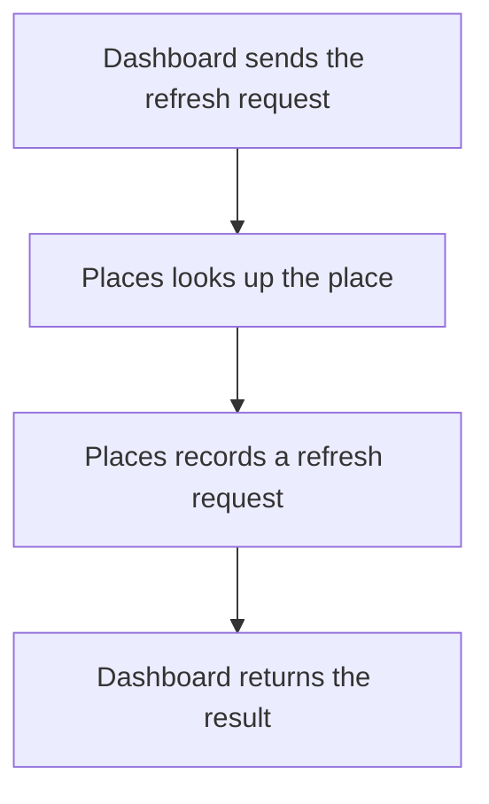

import {ClewMarkdown, ClewFieldDetails, ClewProcess, ClewDataModel, ClewDownload, ClewModelLink, ClewRelatedModelLink, ClewFieldTrace, ClewContextLink, ClewPageContext, ClewProcessReturn, ClewStatus, ClewRetainedPage, ClewCatalog, ClewAnchor} from '@site/src/components/ClewReaders';

<ClewAnchor id="process-overview" pageStart />

# Request a forecast refresh

<ClewPageContext />

<ClewStatus freshness="STALE" verification="UNASSESSED" />

Dashboard asks Places to queue a refresh and returns the request outcome.

## 1. Dashboard sends the refresh request {#question-request}

<p className="clew-route"><code>{"POST /api/places/{id}/refresh  →  POST /places/{id}/refresh"}</code></p>

<ClewMarkdown text={"Dashboard receives a place ID and asks Places to refresh its forecast."} />

<details>
<summary>Evidence and scope</summary>

**Request a place refresh and record its outbox boundary** · UNVERIFIED · UNASSESSED

Dashboard sends a bodyless POST to /places/&#123;id&#125;/refresh, URL-encodes the ID and applies a 10-second timeout. This declared receiver mapping is agent-proposed; runtime routing is unverified.

- [services/dashboard/src/main.ts:76–83 · revision e635069293d58cb0d4f28c8211e748b8d58e6b37](../sources/b41ac7155eba29b1e6a9dfe10348b626c22e19654978c7d35379a71fff4526a1.mdx)
- [services/dashboard/src/main.ts:1–113 · revision 7e602ace02c04006fb7b2a2f5ecd88ba3c4005c6](../sources/489998b3bb96ff69dfe04f629b6281ed01757e4adcc670bc9d740381b32f543d.mdx)
- [services/dashboard/src/main.ts:1–113 · revision 7e602ace02c04006fb7b2a2f5ecd88ba3c4005c6](../sources/489998b3bb96ff69dfe04f629b6281ed01757e4adcc670bc9d740381b32f543d.mdx)

</details>

<details className="clew-context-disclosure">
<summary>Address and contracts<span className="clew-disclosure-preview">Compose: POST http://places:8080/places/&#123;id&#125;/refresh · production URL unknown.</span></summary>

<ClewMarkdown text={"Dashboard sends a bodyless POST to /places/{id}/refresh, URL-encodes the ID and applies a 10-second timeout. The selected Compose config sets PLACES_URL to http://places:8080; the source uses the same default. The example target is POST http://places:8080/places/{id}/refresh. Production address and runtime receiver routing are unverified."} />

<div className="clew-context-links">

<ClewContextLink path="/operations/services-dashboard--dashboard-4301d0222c019e9d5339" fromProcess="dashboard-refresh-request" fromQuestion="question-request">Dashboard entry and contract</ClewContextLink>

<ClewContextLink path="/operations/services-places--places-e06f41e67f62720ad106" fromProcess="dashboard-refresh-request" fromQuestion="question-request">Places handler and contract</ClewContextLink>

</div>

<details>
<summary>Evidence and scope</summary>

**Request a place refresh and record its outbox boundary** · UNVERIFIED · UNASSESSED

Dashboard sends a bodyless POST to /places/&#123;id&#125;/refresh, URL-encodes the ID and applies a 10-second timeout. This declared receiver mapping is agent-proposed; runtime routing is unverified.

- [services/dashboard/src/main.ts:76–83 · revision e635069293d58cb0d4f28c8211e748b8d58e6b37](../sources/b41ac7155eba29b1e6a9dfe10348b626c22e19654978c7d35379a71fff4526a1.mdx)
- [services/dashboard/src/main.ts:1–113 · revision 7e602ace02c04006fb7b2a2f5ecd88ba3c4005c6](../sources/489998b3bb96ff69dfe04f629b6281ed01757e4adcc670bc9d740381b32f543d.mdx)
- [compose.yaml:1–83 · revision 7e602ace02c04006fb7b2a2f5ecd88ba3c4005c6](../sources/8b8a9654afc91bb6fdc51b4c16fc618743a55511d2caa81ebea58ac4f522db68.mdx)

</details>


</details>

<aside className="clew-exception">

### If the exchange with Places fails {#question-exchange-error}

<ClewMarkdown text={"Fetch, JSON decoding or the 10-second timeout can lead to `503 PLACES_UNAVAILABLE`.\nPlaces may already have committed. This response does not establish whether the request was recorded or whether retry is safe."} />

<details>
<summary>Evidence and scope</summary>

**Request a place refresh and record its outbox boundary** · UNVERIFIED · UNASSESSED

A fetch or response JSON exception returns 503 PLACES\_UNAVAILABLE. This failure does not establish whether Places committed before the client error.

- [services/dashboard/src/main.ts:76–83 · revision e635069293d58cb0d4f28c8211e748b8d58e6b37](../sources/b41ac7155eba29b1e6a9dfe10348b626c22e19654978c7d35379a71fff4526a1.mdx)
- [services/dashboard/src/main.ts:1–113 · revision 7e602ace02c04006fb7b2a2f5ecd88ba3c4005c6](../sources/489998b3bb96ff69dfe04f629b6281ed01757e4adcc670bc9d740381b32f543d.mdx)

</details>

</aside>

## 2. Places looks up the place {#question-lookup}

<ClewMarkdown text={"Places checks whether the requested place exists."} />

<details>
<summary>Evidence and scope</summary>

**Request a place refresh and record its outbox boundary** · UNVERIFIED · UNASSESSED

Places.Find returns null

- [services/places/PlacesRepository.cs:35–35 · revision c289b28be4819eddf29d59a7c12f178559ec5229](../sources/09adfc4929d330ef0ace7773c10744a9ad2b7d33500cce7f3ebbce83b35cbccc.mdx)
- [services/places/PlacesController.cs:18–25 · revision c289b28be4819eddf29d59a7c12f178559ec5229](../sources/10944607b7dd3022e1223a7de9822b263e1bccb2a729b6118f97fc90f3c31306.mdx)
- [services/places/PlacesController.cs:18–25 · revision c289b28be4819eddf29d59a7c12f178559ec5229](../sources/10944607b7dd3022e1223a7de9822b263e1bccb2a729b6118f97fc90f3c31306.mdx)

</details>

<aside className="clew-exception">

### If the place is not found {#question-place-not-found}

<ClewMarkdown text={"`404 PLACE_NOT_FOUND`. No refresh request is recorded."} />

<details>
<summary>Evidence and scope</summary>

**Request a place refresh and record its outbox boundary** · UNVERIFIED · UNASSESSED

Refresh returns 404 PLACE\_NOT\_FOUND before Enqueue. This branch terminates without an outbox insert or 202 response.

- [services/places/PlacesRepository.cs:35–35 · revision c289b28be4819eddf29d59a7c12f178559ec5229](../sources/09adfc4929d330ef0ace7773c10744a9ad2b7d33500cce7f3ebbce83b35cbccc.mdx)
- [services/places/PlacesController.cs:18–25 · revision c289b28be4819eddf29d59a7c12f178559ec5229](../sources/10944607b7dd3022e1223a7de9822b263e1bccb2a729b6118f97fc90f3c31306.mdx)

</details>

</aside>

## 3. Places records a refresh request {#question-enqueue}

<ClewMarkdown text={"For an existing place, Places saves a request for later publication (outbox) in a database transaction."} />

<div className="clew-context-links">

<ClewModelLink model="place" process="dashboard-refresh-request" anchor="question-enqueue">Place · data model</ClewModelLink>

<ClewContextLink path="/services/places#section-entities" fromProcess="dashboard-refresh-request" fromQuestion="question-enqueue">Technical context</ClewContextLink>

</div>

<details>
<summary>Evidence and scope</summary>

**Request a place refresh and record its outbox boundary** · UNVERIFIED · UNASSESSED

For a found place, Enqueue opens a connection, begins a transaction, inserts a request\_outbox row with a new GUID and place.requested v1 payload, then commits before returning.

- [services/places/PlacesRepository.cs:45–51 · revision c289b28be4819eddf29d59a7c12f178559ec5229](../sources/2f738bb1b0e4cfed6f7710952bc1442794ebe32fe8703bd2bca4c9b79e4bbbc2.mdx)
- [services/places/PlacesRepository.cs:52–59 · revision c289b28be4819eddf29d59a7c12f178559ec5229](../sources/89387464df117dd1f2cfdbd8113d90c803728d4fe220f507529703bd597dbf8e.mdx)
- [services/places/PlacesRepository.cs:20–25 · revision c289b28be4819eddf29d59a7c12f178559ec5229](../sources/d10889d7dec9ec7771472d1a44e755b28743b1800e345a02d390e4ce46d995b6.mdx)
- [services/places/PlacesRepository.cs:4–60 · revision c289b28be4819eddf29d59a7c12f178559ec5229](../sources/134e36e39b6fda8e9ee70b514147c124e73f7567d3b214272b0d7c85159ae83d.mdx)

</details>

<details className="clew-context-disclosure">
<summary>Transaction and event details<span className="clew-disclosure-preview">request\_outbox · place.requested v1 · commit before 202</span></summary>

<ClewMarkdown text={"Enqueue opens a connection, begins a transaction and calls InsertRequest. InsertRequest creates a new GUID and serializes a `place.requested` v1 event containing the Place into request_outbox. Enqueue then commits. This database write does not prove Kafka publication or delivery."} />

<details>
<summary>Evidence and scope</summary>

**Request a place refresh and record its outbox boundary** · UNVERIFIED · UNASSESSED

For a found place, Enqueue opens a connection, begins a transaction, inserts a request\_outbox row with a new GUID and place.requested v1 payload, then commits before returning.

- [services/places/PlacesRepository.cs:45–51 · revision c289b28be4819eddf29d59a7c12f178559ec5229](../sources/2f738bb1b0e4cfed6f7710952bc1442794ebe32fe8703bd2bca4c9b79e4bbbc2.mdx)
- [services/places/PlacesRepository.cs:52–59 · revision c289b28be4819eddf29d59a7c12f178559ec5229](../sources/89387464df117dd1f2cfdbd8113d90c803728d4fe220f507529703bd597dbf8e.mdx)
- [services/places/PlacesRepository.cs:20–25 · revision c289b28be4819eddf29d59a7c12f178559ec5229](../sources/d10889d7dec9ec7771472d1a44e755b28743b1800e345a02d390e4ce46d995b6.mdx)
- [services/places/PlacesRepository.cs:4–60 · revision c289b28be4819eddf29d59a7c12f178559ec5229](../sources/134e36e39b6fda8e9ee70b514147c124e73f7567d3b214272b0d7c85159ae83d.mdx)

</details>


</details>

<aside className="clew-info">

### Repeated requests

<ClewMarkdown text={"Repeating the request may record another refresh request. This path offers no repeat-request deduplication guarantee."} />

<details>
<summary>Evidence and scope</summary>

**Request a place refresh and record its outbox boundary** · UNVERIFIED · UNASSESSED

A caller enters Dashboard.requestRefresh with a place ID. Dashboard URL-encodes the ID in a bodyless POST /places/&#123;id&#125;/refresh with a 10-second timeout; the saved Dashboard-to-Places mapping is agent-proposed, so runtime routing is unverified. Places.Refresh calls Find; Find returns the first ID match from List. If no place is found, Refresh returns 404 PLACE\_NOT\_FOUND before enqueue. Otherwise it awaits Enqueue, which opens a connection, begins a transaction, inserts a request\_outbox row with a new GUID and a place.requested v1 payload, then commits before Refresh returns 202 with status QUEUED. QUEUED marks the response, not forecast completion. Dashboard forwards upstream status and parsed JSON; a fetch or JSON-decoding exception becomes 503 PLACES\_UNAVAILABLE, which does not show whether Places committed first. Open disposes and rethrows on connection-open failure; other exception-to-HTTP handling is outside these bodies. The saved process links separate Places publisher and Dashboard/Forecasts consumer views, but this path does not establish publication or delivery. These wrappers show no idempotency key or repeated-request deduplication.

- [services/dashboard/src/main.ts:76–83 · revision e635069293d58cb0d4f28c8211e748b8d58e6b37](../sources/b41ac7155eba29b1e6a9dfe10348b626c22e19654978c7d35379a71fff4526a1.mdx)
- [services/places/PlacesRepository.cs:35–35 · revision c289b28be4819eddf29d59a7c12f178559ec5229](../sources/09adfc4929d330ef0ace7773c10744a9ad2b7d33500cce7f3ebbce83b35cbccc.mdx)
- [services/places/PlacesRepository.cs:45–51 · revision c289b28be4819eddf29d59a7c12f178559ec5229](../sources/2f738bb1b0e4cfed6f7710952bc1442794ebe32fe8703bd2bca4c9b79e4bbbc2.mdx)
- [services/places/PlacesRepository.cs:52–59 · revision c289b28be4819eddf29d59a7c12f178559ec5229](../sources/89387464df117dd1f2cfdbd8113d90c803728d4fe220f507529703bd597dbf8e.mdx)
- [services/places/PlacesController.cs:18–25 · revision c289b28be4819eddf29d59a7c12f178559ec5229](../sources/10944607b7dd3022e1223a7de9822b263e1bccb2a729b6118f97fc90f3c31306.mdx)
- [services/places/PlacesRepository.cs:20–25 · revision c289b28be4819eddf29d59a7c12f178559ec5229](../sources/d10889d7dec9ec7771472d1a44e755b28743b1800e345a02d390e4ce46d995b6.mdx)
- [services/places/PlacesRepository.cs:4–60 · revision c289b28be4819eddf29d59a7c12f178559ec5229](../sources/134e36e39b6fda8e9ee70b514147c124e73f7567d3b214272b0d7c85159ae83d.mdx)

</details>

</aside>

<aside className="clew-exception">

### If recording the request fails {#question-enqueue-error}

<ClewMarkdown text={"If saving the request fails, Places does not reach the `202` response. The captured code does not establish the HTTP response for a database failure."} />

<details>
<summary>Evidence and scope</summary>

**Request a place refresh and record its outbox boundary** · UNVERIFIED · UNASSESSED

Open disposes and rethrows a connection-open failure; the captured bodies do not establish how that exception maps to an HTTP response.

- [services/places/PlacesRepository.cs:20–25 · revision c289b28be4819eddf29d59a7c12f178559ec5229](../sources/d10889d7dec9ec7771472d1a44e755b28743b1800e345a02d390e4ce46d995b6.mdx)
- [services/places/PlacesController.cs:18–25 · revision c289b28be4819eddf29d59a7c12f178559ec5229](../sources/10944607b7dd3022e1223a7de9822b263e1bccb2a729b6118f97fc90f3c31306.mdx)

</details>

</aside>

## 4. Dashboard returns the result {#question-result}

<ClewMarkdown text={"After the request is recorded, Places returns `202 QUEUED` with the place ID. Dashboard forwards the status and JSON response, including `404` when the place is missing."} />

<details>
<summary>Evidence and scope</summary>

**Request a place refresh and record its outbox boundary** · UNVERIFIED · UNASSESSED

After Enqueue completes, Refresh returns 202 with placeId and status QUEUED. This response does not establish forecast readiness or completion.

- [services/places/PlacesRepository.cs:45–51 · revision c289b28be4819eddf29d59a7c12f178559ec5229](../sources/2f738bb1b0e4cfed6f7710952bc1442794ebe32fe8703bd2bca4c9b79e4bbbc2.mdx)
- [services/places/PlacesController.cs:18–25 · revision c289b28be4819eddf29d59a7c12f178559ec5229](../sources/10944607b7dd3022e1223a7de9822b263e1bccb2a729b6118f97fc90f3c31306.mdx)
**Request a place refresh and record its outbox boundary** · UNVERIFIED · UNASSESSED

Dashboard forwards the upstream status and parsed JSON for the 404 or 202 response.

- [services/dashboard/src/main.ts:76–83 · revision e635069293d58cb0d4f28c8211e748b8d58e6b37](../sources/b41ac7155eba29b1e6a9dfe10348b626c22e19654978c7d35379a71fff4526a1.mdx)

</details>

<aside className="clew-info">

### Queued is not forecast ready

<ClewMarkdown text={"`202 QUEUED` describes the recorded refresh request. It does not confirm Kafka delivery, provider refresh or a forecast ready to display."} />

<details>
<summary>Evidence and scope</summary>

**Request a place refresh and record its outbox boundary** · UNVERIFIED · UNASSESSED

After Enqueue completes, Refresh returns 202 with placeId and status QUEUED. This response does not establish forecast readiness or completion.

- [services/places/PlacesRepository.cs:45–51 · revision c289b28be4819eddf29d59a7c12f178559ec5229](../sources/2f738bb1b0e4cfed6f7710952bc1442794ebe32fe8703bd2bca4c9b79e4bbbc2.mdx)
- [services/places/PlacesController.cs:18–25 · revision c289b28be4819eddf29d59a7c12f178559ec5229](../sources/10944607b7dd3022e1223a7de9822b263e1bccb2a729b6118f97fc90f3c31306.mdx)
**Dashboard refresh-request thread** · STALE · UNASSESSED

Dashboard.requestRefresh URL-encodes the place ID and sends POST /places/&#123;id&#125;/refresh, waiting up to ten seconds before forwarding the response status and JSON body. A fetch or JSON-decoding error returns 503 PLACES\_UNAVAILABLE. The saved process links this call to Places.Refresh and the request-publisher/consumer views, but the HTTP target binding is an agent proposal. The links do not establish execution order, response outcome, provider refresh or Kafka delivery; runtime routing remains unknown.

- [services/dashboard/src/main.ts:76–83 · revision e635069293d58cb0d4f28c8211e748b8d58e6b37](../sources/b41ac7155eba29b1e6a9dfe10348b626c22e19654978c7d35379a71fff4526a1.mdx)

</details>

</aside>

## Full description and sources {#question-confidence}

<ClewMarkdown text={"This guide interprets pinned source. It does not prove runtime routing, Kafka publication, delivery or forecast completion. Retained Dashboard explanations and selected-source evidence keep their separate revision bindings. Related publisher and consumer views are separate accounts, not a proven execution sequence."} />

<div className="clew-context-links">

<ClewContextLink path="/scenarios/places-request-publisher#process-overview" fromProcess="dashboard-refresh-request" fromQuestion="question-confidence">Related request-publisher view</ClewContextLink>

</div>

<details>
<summary>Evidence and scope</summary>

**Dashboard refresh-request thread** · STALE · UNASSESSED

Dashboard.requestRefresh URL-encodes the place ID and sends POST /places/&#123;id&#125;/refresh, waiting up to ten seconds before forwarding the response status and JSON body. A fetch or JSON-decoding error returns 503 PLACES\_UNAVAILABLE. The saved process links this call to Places.Refresh and the request-publisher/consumer views, but the HTTP target binding is an agent proposal. The links do not establish execution order, response outcome, provider refresh or Kafka delivery; runtime routing remains unknown.

- [services/dashboard/src/main.ts:76–83 · revision e635069293d58cb0d4f28c8211e748b8d58e6b37](../sources/b41ac7155eba29b1e6a9dfe10348b626c22e19654978c7d35379a71fff4526a1.mdx)
- [services/dashboard/src/main.ts:1–113 · revision 7e602ace02c04006fb7b2a2f5ecd88ba3c4005c6](../sources/489998b3bb96ff69dfe04f629b6281ed01757e4adcc670bc9d740381b32f543d.mdx)

</details>

## Related asynchronous continuations {#question-async-continuations}

These declared handoffs belong to the linked continuation views. They are not additional publishing steps in the local account above.

<article className="clew-topic" id="topic-related-weather.forecast-updated" tabIndex={-1}>

### Related asynchronous continuation · weather.forecast-updated

<ClewProcessReturn topic="weather.forecast-updated" direction="related" />

<div className="clew-topic-path" aria-label="Declared asynchronous handoff">

<div>

<ClewContextLink path="/services/forecasts#section-egress" fromProcess="dashboard-refresh-request" fromQuestion="question-async-continuations" query={{"direction":"outgoing","topic":"weather.forecast-updated"}}>Forecasts</ClewContextLink>

publishPending

</div>

<span aria-hidden="true">→</span>

<div>

**weather.forecast-updated**

Kafka topic · asynchronous

</div>

<span aria-hidden="true">→</span>

<div>

<ClewContextLink path="/services/dashboard#section-ingress" fromProcess="dashboard-refresh-request" fromQuestion="question-async-continuations" query={{"direction":"incoming","topic":"weather.forecast-updated"}}>Dashboard</ClewContextLink>

consumeMessage

</div>

</div>

Proposed handoff; runtime delivery has not been verified.

Saved consumer view: <ClewContextLink path="/scenarios/dashboard-forecast-updated-consumer#process-overview" fromProcess="dashboard-refresh-request" fromQuestion="question-async-continuations" query={{}}>Update a Dashboard forecast</ClewContextLink>

Saved publisher view: <ClewContextLink path="/scenarios/forecasts-publish-pending#process-overview" fromProcess="dashboard-refresh-request" fromQuestion="question-async-continuations" query={{}}>Publish forecast updates</ClewContextLink>

<details>
<summary>Retained source and declaration context</summary>

Topic names and the payload's event type are separate values. These references retain their own revisions; source matches do not prove topic resolution or delivery.


```json
[
  {
    "boundaries": [
      "RUNTIME_DESTINATION_AND_ACTIVATION_UNKNOWN",
      "WIRE_SERIALIZATION_NOT_ASSESSED",
      "MESSAGE_DELIVERY_ORDER_RETRY_AND_CONSUMER_ACTIVATION_UNKNOWN",
      "ENVIRONMENT_SCOPE_UNSPECIFIED",
      "CLIENT_PATTERN_UNSUPPORTED_OR_AMBIGUOUS",
      "UNACCEPTED_AGENT_PROPOSAL"
    ],
    "from": {
      "callSite": {
        "observation": "forecasts:flow:a5b0ed72a047f4f36e281eb2"
      },
      "selector": {
        "language": "kotlin",
        "name": "publishPending",
        "owner": "class:weather.Forecasts",
        "parameterTypes": []
      },
      "service": "forecasts"
    },
    "interaction": "forecasts-forecast-updated-to-dashboard",
    "origin": "agent-proposal",
    "rationale": "Agent-proposed weather.forecast-updated subscriber mapping. The selected source method and producer callsite are retained; topic resolution, consumer subscription and runtime delivery remain unverified.",
    "runtime": "UNKNOWN",
    "to": {
      "selector": {
        "language": "typescript",
        "name": "consumeMessage",
        "owner": "package:",
        "parameterTypes": [
          ": EachMessagePayload"
        ]
      },
      "service": "dashboard"
    },
    "topic": {
      "caller": {
        "declared": "weather.forecast-updated",
        "observed": [],
        "status": "UNRESOLVED"
      },
      "receiver": {
        "declared": "weather.forecast-updated",
        "observed": [],
        "status": "UNRESOLVED"
      }
    }
  }
]
```


</details>

</article>

<article className="clew-topic" id="topic-related-weather.place-requested" tabIndex={-1}>

### Related asynchronous continuation · weather.place-requested

<ClewProcessReturn topic="weather.place-requested" direction="related" />

<div className="clew-topic-path" aria-label="Declared asynchronous handoff">

<div>

<ClewContextLink path="/services/places#section-egress" fromProcess="dashboard-refresh-request" fromQuestion="question-async-continuations" query={{"direction":"outgoing","topic":"weather.place-requested"}}>Places</ClewContextLink>

PublishPending

</div>

<span aria-hidden="true">→</span>

<div>

**weather.place-requested**

Kafka topic · asynchronous

</div>

<span aria-hidden="true">→</span>

<div>

<ClewContextLink path="/services/dashboard#section-ingress" fromProcess="dashboard-refresh-request" fromQuestion="question-async-continuations" query={{"direction":"incoming","topic":"weather.place-requested"}}>Dashboard</ClewContextLink>

consumeMessage

<ClewContextLink path="/services/forecasts#section-ingress" fromProcess="dashboard-refresh-request" fromQuestion="question-async-continuations" query={{"direction":"incoming","topic":"weather.place-requested"}}>Forecasts</ClewContextLink>

consume

</div>

</div>

Proposed handoff; runtime delivery has not been verified.

Saved consumer view: <ClewContextLink path="/scenarios/dashboard-place-requested-consumer#process-overview" fromProcess="dashboard-refresh-request" fromQuestion="question-async-continuations" query={{}}>Add a place to Dashboard</ClewContextLink>

Saved consumer view: <ClewContextLink path="/scenarios/forecasts-place-requested-consumer#process-overview" fromProcess="dashboard-refresh-request" fromQuestion="question-async-continuations" query={{}}>Refresh a forecast after a place request</ClewContextLink>

Saved publisher view: <ClewContextLink path="/scenarios/places-request-publisher#process-overview" fromProcess="dashboard-refresh-request" fromQuestion="question-async-continuations" query={{}}>Publish place requests</ClewContextLink>

<details>
<summary>Retained source and declaration context</summary>

Topic names and the payload's event type are separate values. These references retain their own revisions; source matches do not prove topic resolution or delivery.


```json
[
  {
    "boundaries": [
      "RUNTIME_DESTINATION_AND_ACTIVATION_UNKNOWN",
      "WIRE_SERIALIZATION_NOT_ASSESSED",
      "MESSAGE_DELIVERY_ORDER_RETRY_AND_CONSUMER_ACTIVATION_UNKNOWN",
      "ENVIRONMENT_SCOPE_UNSPECIFIED",
      "CLIENT_PATTERN_UNSUPPORTED_OR_AMBIGUOUS",
      "UNACCEPTED_AGENT_PROPOSAL"
    ],
    "from": {
      "callSite": {
        "observation": "places:flow:941152b2ec99892568c9e40a"
      },
      "selector": {
        "language": "csharp",
        "name": "PublishPending",
        "owner": "class:Weather.Places.RequestPublisher",
        "parameterTypes": [
          "Confluent.Kafka.IProducer`2",
          "System.Threading.CancellationToken"
        ]
      },
      "service": "places"
    },
    "interaction": "places-place-requested-to-dashboard",
    "origin": "agent-proposal",
    "rationale": "Agent-proposed weather.place-requested subscriber mapping. The captured Places producer call location is exact; topic resolution, consumer subscription and runtime delivery remain unverified.",
    "runtime": "UNKNOWN",
    "to": {
      "selector": {
        "language": "typescript",
        "name": "consumeMessage",
        "owner": "package:",
        "parameterTypes": [
          ": EachMessagePayload"
        ]
      },
      "service": "dashboard"
    },
    "topic": {
      "caller": {
        "declared": "weather.place-requested",
        "observed": [],
        "status": "UNRESOLVED"
      },
      "receiver": {
        "declared": "weather.place-requested",
        "observed": [],
        "status": "UNRESOLVED"
      }
    }
  },
  {
    "boundaries": [
      "RUNTIME_DESTINATION_AND_ACTIVATION_UNKNOWN",
      "WIRE_SERIALIZATION_NOT_ASSESSED",
      "MESSAGE_DELIVERY_ORDER_RETRY_AND_CONSUMER_ACTIVATION_UNKNOWN",
      "ENVIRONMENT_SCOPE_UNSPECIFIED",
      "CLIENT_PATTERN_UNSUPPORTED_OR_AMBIGUOUS",
      "UNACCEPTED_AGENT_PROPOSAL"
    ],
    "from": {
      "callSite": {
        "observation": "places:flow:941152b2ec99892568c9e40a"
      },
      "selector": {
        "language": "csharp",
        "name": "PublishPending",
        "owner": "class:Weather.Places.RequestPublisher",
        "parameterTypes": [
          "Confluent.Kafka.IProducer`2",
          "System.Threading.CancellationToken"
        ]
      },
      "service": "places"
    },
    "interaction": "places-place-requested-to-forecasts",
    "origin": "agent-proposal",
    "rationale": "Agent-proposed weather.place-requested subscriber mapping. The captured Places producer call location is exact; topic resolution, consumer subscription and runtime delivery remain unverified.",
    "runtime": "UNKNOWN",
    "to": {
      "selector": {
        "language": "kotlin",
        "name": "consume",
        "owner": "class:weather.Forecasts",
        "parameterTypes": [
          "record: ConsumerRecord<String, String>",
          "acknowledgment: Acknowledgment"
        ]
      },
      "service": "forecasts"
    },
    "topic": {
      "caller": {
        "declared": "weather.place-requested",
        "observed": [],
        "status": "UNRESOLVED"
      },
      "receiver": {
        "declared": "weather.place-requested",
        "observed": [],
        "status": "UNRESOLVED"
      }
    }
  }
]
```


</details>

</article>

<details>
<summary>Reading guide and map</summary>

Editorial reading guide · original source scopes and review states remain separate.

Reading order only. Conditions and failures remain beside the steps below; this is not a runtime trace.




</details>

<details>
<summary>Evidence scope</summary>

<ClewMarkdown text={"This guide interprets pinned source. It does not prove runtime routing, Kafka publication, delivery or forecast completion. Retained Dashboard explanations and selected-source evidence keep their separate revision bindings. Related publisher and consumer views are separate accounts, not a proven execution sequence."} />

<div className="clew-context-links">

<ClewContextLink path="/scenarios/places-request-publisher#process-overview" fromProcess="dashboard-refresh-request" fromQuestion="question-confidence">Related request-publisher view</ClewContextLink>

</div>

<details>
<summary>Evidence and scope</summary>

**Dashboard refresh-request thread** · STALE · UNASSESSED

Dashboard.requestRefresh URL-encodes the place ID and sends POST /places/&#123;id&#125;/refresh, waiting up to ten seconds before forwarding the response status and JSON body. A fetch or JSON-decoding error returns 503 PLACES\_UNAVAILABLE. The saved process links this call to Places.Refresh and the request-publisher/consumer views, but the HTTP target binding is an agent proposal. The links do not establish execution order, response outcome, provider refresh or Kafka delivery; runtime routing remains unknown.

- [services/dashboard/src/main.ts:76–83 · revision e635069293d58cb0d4f28c8211e748b8d58e6b37](../sources/b41ac7155eba29b1e6a9dfe10348b626c22e19654978c7d35379a71fff4526a1.mdx)
- [services/dashboard/src/main.ts:1–113 · revision 7e602ace02c04006fb7b2a2f5ecd88ba3c4005c6](../sources/489998b3bb96ff69dfe04f629b6281ed01757e4adcc670bc9d740381b32f543d.mdx)

</details>


</details>

## Original accounts and implementation

- [Request a place refresh and record its outbox boundary](../operations/scenarios-dashboard-refresh-request--dashboard-refresh-request.mdx)
- [Dashboard refresh-request thread](../operations/scenarios-dashboard-refresh-request--process-overview.mdx)

<ClewDownload path="/clew-data/native/scenarios/dashboard-refresh-request.json">Saved data and complete provenance (reference format)</ClewDownload>

