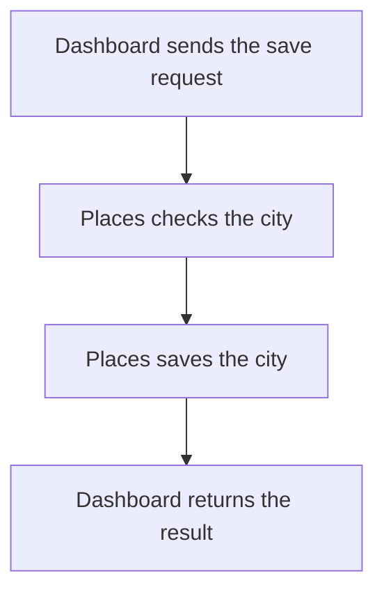

import {ClewMarkdown, ClewFieldDetails, ClewProcess, ClewDataModel, ClewDownload, ClewModelLink, ClewRelatedModelLink, ClewFieldTrace, ClewContextLink, ClewPageContext, ClewProcessReturn, ClewStatus, ClewRetainedPage, ClewCatalog, ClewAnchor} from '@site/src/components/ClewReaders';

<ClewAnchor id="process-overview" pageStart />

# Save a city

<ClewPageContext />

<ClewStatus freshness="STALE" verification="UNASSESSED" />

<ClewProcess dataPath="/clew-data/widgets/scenario-dashboard-save-city.json" defaultAnchor="question-request">

Dashboard sends the city to Places and returns the save result.

## 1. Dashboard sends the save request {#question-request}

<p className="clew-route"><code>{"POST /api/places    →    POST /places"}</code></p>

<ClewMarkdown text={"Dashboard receives a city ID and sends the save request to Places."} />

<details>
<summary>Evidence and scope</summary>

**Save a city through Dashboard and record the outbox boundary** · UNVERIFIED · UNASSESSED

A caller enters savePlace with a JSON body. The declared Places request body requires only cityId, a string in the oslo, helsinki, or lisbon enum; SavePlace exposes that value as CityId.

- [services/dashboard/src/main.ts:67–74 · revision e635069293d58cb0d4f28c8211e748b8d58e6b37](../sources/ab8df8a5fe7536b2fc32d2257bed77e48c54ce422b10c3afba79f26ac88b67a8.mdx)
- [services/places/PlacesController.cs:4–4 · revision c289b28be4819eddf29d59a7c12f178559ec5229](../sources/5d0e0230101848f293cac0902245f465a92e8106f700b8853514a42687637309.mdx)
- [contracts/places.openapi.json:1–263 · revision c289b28be4819eddf29d59a7c12f178559ec5229](../sources/d04d07ecb57a86dc75dd79d70d54dfd22aeaecc9ece8f888218b6a6fde39f959.mdx)
**Save a city through Dashboard and record the outbox boundary** · UNVERIFIED · UNASSESSED

Dashboard POSTs JSON.stringify(request.body) to /places with content-type application/json and AbortSignal.timeout(10000). The saved interaction is an agent-proposed target mapping, not proof of runtime routing.

- [services/dashboard/src/main.ts:67–74 · revision e635069293d58cb0d4f28c8211e748b8d58e6b37](../sources/ab8df8a5fe7536b2fc32d2257bed77e48c54ce422b10c3afba79f26ac88b67a8.mdx)
- [services/dashboard/src/main.ts:1–113 · revision 7e602ace02c04006fb7b2a2f5ecd88ba3c4005c6](../sources/489998b3bb96ff69dfe04f629b6281ed01757e4adcc670bc9d740381b32f543d.mdx)

</details>

<p className="clew-step-data">Data handled by this step: <ClewModelLink model="save-city-request" process="dashboard-save-city" anchor="question-request">Save city request</ClewModelLink> · <ClewModelLink model="place" process="dashboard-save-city" anchor="question-request">Place</ClewModelLink></p>

<details className="clew-context-disclosure">
<summary>Request fields<span className="clew-disclosure-preview">cityId · selected city key; complete retained comment</span></summary>

<ClewMarkdown text={"This additional reference table uses the retained request-field description. The original process steps are unchanged.\n\n| Original field | Readable name | Comment |\n| --- | --- | --- |\n| `cityId` | Selected city key | The selected city key sent by the browser. This request carries only cityId; Places derives the Place name and coordinates from its supported-city lookup. It is not an event ID, and it is not a client-supplied Place object. |\n\nThis is a source-bound description, not an observed HTTP run."} />

<details>
<summary>Evidence and scope</summary>

- [services/dashboard/public/index.html:1–11 · revision 7e602ace02c04006fb7b2a2f5ecd88ba3c4005c6](../sources/c2239e2c6403a3d1207383732a448da7982b4d8765aaa00a7aa74ac6b8bbdfd0.mdx)
- [services/places/PlacesRepository.cs:7–13 · revision c289b28be4819eddf29d59a7c12f178559ec5229](../sources/c267a4a78e8949194aeb00d9acfa74a5a9a90a34ddabb3a97ae3d4a7eed0a2fa.mdx)
- [services/places/PlacesController.cs:10–17 · revision c289b28be4819eddf29d59a7c12f178559ec5229](../sources/31d65799d2ab0d5586875469994de48826eff9efa7554c342d97a36030a8d9a0.mdx)

</details>


</details>

<details className="clew-context-disclosure">
<summary>Address and contracts<span className="clew-disclosure-preview">Compose: POST http://places:8080/places · production URL unknown.</span></summary>

<ClewMarkdown text={"The selected Compose config sets PLACES_URL to http://places:8080, also the source default. The example target is POST http://places:8080/places. Production address and actual receiver routing are unverified; the saved service mapping is agent-proposed."} />

<div className="clew-context-links">

<ClewContextLink path="/operations/services-dashboard--dashboard-ad968c2137fedea90215" fromProcess="dashboard-save-city" fromQuestion="question-request">Dashboard entry and contract</ClewContextLink>

<ClewContextLink path="/operations/services-places--places-691b340ea61828b197b6" fromProcess="dashboard-save-city" fromQuestion="question-request">Places handler and contract</ClewContextLink>

</div>

<details>
<summary>Evidence and scope</summary>

**Save a city through Dashboard and record the outbox boundary** · UNVERIFIED · UNASSESSED

Dashboard POSTs JSON.stringify(request.body) to /places with content-type application/json and AbortSignal.timeout(10000). The saved interaction is an agent-proposed target mapping, not proof of runtime routing.

- [services/dashboard/src/main.ts:67–74 · revision e635069293d58cb0d4f28c8211e748b8d58e6b37](../sources/ab8df8a5fe7536b2fc32d2257bed77e48c54ce422b10c3afba79f26ac88b67a8.mdx)
- [services/dashboard/src/main.ts:1–113 · revision 7e602ace02c04006fb7b2a2f5ecd88ba3c4005c6](../sources/489998b3bb96ff69dfe04f629b6281ed01757e4adcc670bc9d740381b32f543d.mdx)
- [compose.yaml:1–83 · revision 7e602ace02c04006fb7b2a2f5ecd88ba3c4005c6](../sources/8b8a9654afc91bb6fdc51b4c16fc618743a55511d2caa81ebea58ac4f522db68.mdx)

</details>


</details>

<aside className="clew-exception">

### If the exchange with Places fails {#question-exchange-error}

<ClewMarkdown text={"Fetch, JSON decoding or the 10-second timeout can lead to `503 PLACES_UNAVAILABLE`.\nThe save may already have completed. Whether retry is safe is not established."} />

<details>
<summary>Evidence and scope</summary>

**Save a city through Dashboard and record the outbox boundary** · UNVERIFIED · UNASSESSED

A fetch or response.json exception, including an abort from the 10-second signal, is caught and mapped to HTTP 503 PLACES\_UNAVAILABLE.

- [services/dashboard/src/main.ts:67–74 · revision e635069293d58cb0d4f28c8211e748b8d58e6b37](../sources/ab8df8a5fe7536b2fc32d2257bed77e48c54ce422b10c3afba79f26ac88b67a8.mdx)
**Save a city through Dashboard and record the outbox boundary** · UNVERIFIED · UNASSESSED

The exception may occur before or after Places commits, so this 503 is not a database outcome. The handler has no retry branch. A later call can follow the no-outbox conflict path whenever the place INSERT returns null, including for a preexisting city or another request; the source does not identify which request caused that state.

- [services/dashboard/src/main.ts:67–74 · revision e635069293d58cb0d4f28c8211e748b8d58e6b37](../sources/ab8df8a5fe7536b2fc32d2257bed77e48c54ce422b10c3afba79f26ac88b67a8.mdx)
- [services/places/PlacesRepository.cs:52–59 · revision c289b28be4819eddf29d59a7c12f178559ec5229](../sources/89387464df117dd1f2cfdbd8113d90c803728d4fe220f507529703bd597dbf8e.mdx)
- [services/places/PlacesRepository.cs:36–44 · revision c289b28be4819eddf29d59a7c12f178559ec5229](../sources/379c0b710ffb354ec36825644e1d5c73ec611814e26c938687bac753bdb832c6.mdx)

</details>

</aside>

## 2. Places checks the city {#question-validation}

<ClewMarkdown text={"The supported city IDs are `oslo`, `helsinki` and `lisbon`."} />

<details>
<summary>Evidence and scope</summary>

**Save a city through Dashboard and record the outbox boundary** · UNVERIFIED · UNASSESSED

A caller enters savePlace with a JSON body. The declared Places request body requires only cityId, a string in the oslo, helsinki, or lisbon enum; SavePlace exposes that value as CityId.

- [services/dashboard/src/main.ts:67–74 · revision e635069293d58cb0d4f28c8211e748b8d58e6b37](../sources/ab8df8a5fe7536b2fc32d2257bed77e48c54ce422b10c3afba79f26ac88b67a8.mdx)
- [services/places/PlacesController.cs:4–4 · revision c289b28be4819eddf29d59a7c12f178559ec5229](../sources/5d0e0230101848f293cac0902245f465a92e8106f700b8853514a42687637309.mdx)
- [contracts/places.openapi.json:1–263 · revision c289b28be4819eddf29d59a7c12f178559ec5229](../sources/d04d07ecb57a86dc75dd79d70d54dfd22aeaecc9ece8f888218b6a6fde39f959.mdx)

</details>

<ClewModelLink model="city-lookup" process="dashboard-save-city" anchor="question-validation">City lookup</ClewModelLink>

<aside className="clew-exception">

### If the city is unsupported {#question-unsupported-city}

<ClewMarkdown text={"`400 UNSUPPORTED_CITY`. This branch does not save the city."} />

<details>
<summary>Evidence and scope</summary>

**Save a city through Dashboard and record the outbox boundary** · UNVERIFIED · UNASSESSED

PlacesRepository.City returns null for CityId

- [services/places/PlacesController.cs:10–17 · revision c289b28be4819eddf29d59a7c12f178559ec5229](../sources/31d65799d2ab0d5586875469994de48826eff9efa7554c342d97a36030a8d9a0.mdx)
**Save a city through Dashboard and record the outbox boundary** · UNVERIFIED · UNASSESSED

Places returns HTTP 400 with error UNSUPPORTED\_CITY.

- [services/places/PlacesController.cs:10–17 · revision c289b28be4819eddf29d59a7c12f178559ec5229](../sources/31d65799d2ab0d5586875469994de48826eff9efa7554c342d97a36030a8d9a0.mdx)
- [contracts/places.openapi.json:1–263 · revision c289b28be4819eddf29d59a7c12f178559ec5229](../sources/d04d07ecb57a86dc75dd79d70d54dfd22aeaecc9ece8f888218b6a6fde39f959.mdx)

</details>

</aside>

## 3. Places saves the city {#question-save}

<ClewMarkdown text={"A new Place and its request for later publication (outbox) are saved in one database transaction."} />

<div className="clew-context-links">

<ClewModelLink model="place" process="dashboard-save-city" anchor="question-save">Place · data model</ClewModelLink>

<ClewContextLink path="/services/places#section-entities" fromProcess="dashboard-save-city" fromQuestion="question-save">Technical context</ClewContextLink>

</div>

<details>
<summary>Evidence and scope</summary>

**Save a city through Dashboard and record the outbox boundary** · UNVERIFIED · UNASSESSED

For a supported city, repository.Save opens a connection, begins a transaction, and inserts the place with ON CONFLICT DO NOTHING RETURNING id.

- [services/places/PlacesController.cs:10–17 · revision c289b28be4819eddf29d59a7c12f178559ec5229](../sources/31d65799d2ab0d5586875469994de48826eff9efa7554c342d97a36030a8d9a0.mdx)
- [services/places/PlacesRepository.cs:36–44 · revision c289b28be4819eddf29d59a7c12f178559ec5229](../sources/379c0b710ffb354ec36825644e1d5c73ec611814e26c938687bac753bdb832c6.mdx)
**Save a city through Dashboard and record the outbox boundary** · UNVERIFIED · UNASSESSED

Within the same transaction, InsertRequest creates a UUID and inserts a JSONB outbox payload with type place.requested, version 1, and the place.

- [services/places/PlacesRepository.cs:52–59 · revision c289b28be4819eddf29d59a7c12f178559ec5229](../sources/89387464df117dd1f2cfdbd8113d90c803728d4fe220f507529703bd597dbf8e.mdx)
- [services/places/PlacesRepository.cs:36–44 · revision c289b28be4819eddf29d59a7c12f178559ec5229](../sources/379c0b710ffb354ec36825644e1d5c73ec611814e26c938687bac753bdb832c6.mdx)

</details>

<ClewMarkdown text={"An existing city creates neither a new Place nor a new outbox record.\nThe transaction commits in either case, and Places returns `200` with the city."} />

<details>
<summary>Evidence and scope</summary>

**Save a city through Dashboard and record the outbox boundary** · UNVERIFIED · UNASSESSED

If the INSERT returns null after a conflict, InsertRequest is skipped, so this call adds no outbox row.

- [services/places/PlacesRepository.cs:36–44 · revision c289b28be4819eddf29d59a7c12f178559ec5229](../sources/379c0b710ffb354ec36825644e1d5c73ec611814e26c938687bac753bdb832c6.mdx)
**Save a city through Dashboard and record the outbox boundary** · UNVERIFIED · UNASSESSED

repository.Save commits the transaction after the optional outbox insert; the new place and its outbox row share that transaction.

- [services/places/PlacesRepository.cs:52–59 · revision c289b28be4819eddf29d59a7c12f178559ec5229](../sources/89387464df117dd1f2cfdbd8113d90c803728d4fe220f507529703bd597dbf8e.mdx)
- [services/places/PlacesRepository.cs:36–44 · revision c289b28be4819eddf29d59a7c12f178559ec5229](../sources/379c0b710ffb354ec36825644e1d5c73ec611814e26c938687bac753bdb832c6.mdx)
**Save a city through Dashboard and record the outbox boundary** · UNVERIFIED · UNASSESSED

After repository.Save returns, the controller returns HTTP 200 with the mapped city.

- [services/places/PlacesController.cs:10–17 · revision c289b28be4819eddf29d59a7c12f178559ec5229](../sources/31d65799d2ab0d5586875469994de48826eff9efa7554c342d97a36030a8d9a0.mdx)
- [contracts/places.openapi.json:1–263 · revision c289b28be4819eddf29d59a7c12f178559ec5229](../sources/d04d07ecb57a86dc75dd79d70d54dfd22aeaecc9ece8f888218b6a6fde39f959.mdx)

</details>

## 4. Dashboard returns the result {#question-result}

<ClewMarkdown text={"Places returns `200` with the city after saving. Dashboard forwards the status and parsed JSON to the client."} />

<details>
<summary>Evidence and scope</summary>

**Save a city through Dashboard and record the outbox boundary** · UNVERIFIED · UNASSESSED

After repository.Save returns, the controller returns HTTP 200 with the mapped city.

- [services/places/PlacesController.cs:10–17 · revision c289b28be4819eddf29d59a7c12f178559ec5229](../sources/31d65799d2ab0d5586875469994de48826eff9efa7554c342d97a36030a8d9a0.mdx)
- [contracts/places.openapi.json:1–263 · revision c289b28be4819eddf29d59a7c12f178559ec5229](../sources/d04d07ecb57a86dc75dd79d70d54dfd22aeaecc9ece8f888218b6a6fde39f959.mdx)
**Save a city through Dashboard and record the outbox boundary** · UNVERIFIED · UNASSESSED

Dashboard forwards the upstream status and parsed JSON body. The shown Places branches return 400 for an unsupported city or 200 after a supported save.

- [services/dashboard/src/main.ts:67–74 · revision e635069293d58cb0d4f28c8211e748b8d58e6b37](../sources/ab8df8a5fe7536b2fc32d2257bed77e48c54ce422b10c3afba79f26ac88b67a8.mdx)
- [services/places/PlacesController.cs:10–17 · revision c289b28be4819eddf29d59a7c12f178559ec5229](../sources/31d65799d2ab0d5586875469994de48826eff9efa7554c342d97a36030a8d9a0.mdx)
- [contracts/places.openapi.json:1–263 · revision c289b28be4819eddf29d59a7c12f178559ec5229](../sources/d04d07ecb57a86dc75dd79d70d54dfd22aeaecc9ece8f888218b6a6fde39f959.mdx)

</details>

<aside className="clew-info">

### What 200 means

<ClewMarkdown text={"The `200` response describes the local save result. It does not confirm forecast readiness or completion of the whole message flow."} />

<details>
<summary>Evidence and scope</summary>

**Save a city through Dashboard and record the outbox boundary** · UNVERIFIED · UNASSESSED

The saved process links the Places publisher, Forecasts consumer/publisher, and Dashboard consumer views as separate subviews. This HTTP narrative does not establish their activation, routing, retry behavior, or message delivery, and the outbox insert is not a synchronous broker acknowledgement.

- [services/places/PlacesRepository.cs:52–59 · revision c289b28be4819eddf29d59a7c12f178559ec5229](../sources/89387464df117dd1f2cfdbd8113d90c803728d4fe220f507529703bd597dbf8e.mdx)
**Save a city through Dashboard and record the outbox boundary** · UNVERIFIED · UNASSESSED

A caller submits a cityId to Dashboard.savePlace. The handler serializes the body and sends POST /places with a 10-second abort signal; the declared OpenAPI request is an object containing only cityId, with oslo, helsinki, and lisbon as allowed values. The saved Dashboard-to-Places mapping is agent-proposed, so runtime target binding is not established. Places returns 400 UNSUPPORTED\_CITY when its city mapping fails; otherwise it awaits repository.Save and returns 200. Save inserts the place in a database transaction, inserts a place.requested version 1 outbox record only when the place insert returns a new id, and commits. A conflict skips the outbox insert but still commits. Dashboard forwards a parsed upstream status/body, while a fetch or JSON parse exception returns 503 PLACES\_UNAVAILABLE; the wrapper has no retry and that response does not say whether the Places transaction committed. The no-outbox path is tied to the place INSERT returning null on conflict; that can reflect an existing city or another request, so it is not a retry guarantee for the timed-out caller. The saved process links publisher and consumer views separately; an outbox row is not proof of Kafka publication or consumption.

- [services/dashboard/src/main.ts:67–74 · revision e635069293d58cb0d4f28c8211e748b8d58e6b37](../sources/ab8df8a5fe7536b2fc32d2257bed77e48c54ce422b10c3afba79f26ac88b67a8.mdx)
- [services/places/PlacesController.cs:10–17 · revision c289b28be4819eddf29d59a7c12f178559ec5229](../sources/31d65799d2ab0d5586875469994de48826eff9efa7554c342d97a36030a8d9a0.mdx)
- [services/places/PlacesRepository.cs:52–59 · revision c289b28be4819eddf29d59a7c12f178559ec5229](../sources/89387464df117dd1f2cfdbd8113d90c803728d4fe220f507529703bd597dbf8e.mdx)
- [services/places/PlacesController.cs:4–4 · revision c289b28be4819eddf29d59a7c12f178559ec5229](../sources/5d0e0230101848f293cac0902245f465a92e8106f700b8853514a42687637309.mdx)
- [contracts/places.openapi.json:1–263 · revision c289b28be4819eddf29d59a7c12f178559ec5229](../sources/d04d07ecb57a86dc75dd79d70d54dfd22aeaecc9ece8f888218b6a6fde39f959.mdx)
- [services/places/PlacesRepository.cs:36–44 · revision c289b28be4819eddf29d59a7c12f178559ec5229](../sources/379c0b710ffb354ec36825644e1d5c73ec611814e26c938687bac753bdb832c6.mdx)

</details>

</aside>

## Full description and sources {#question-confidence}

<ClewMarkdown text={"Place contains Id, Name, Latitude and Longitude. SavePlace carries CityId; request_outbox holds a delivery record. Formal domain identity and ownership have not been declared in the saved evidence."} />

<details>
<summary>Evidence and scope</summary>

**Places domain entities** · UNVERIFIED · UNASSESSED

Place is the service's domain record with Id, Name, Latitude, and Longitude. SavePlace is an HTTP request DTO containing CityId. The repository persists those place fields in the places table and stores JSON request payloads in request\_outbox; the outbox row is a delivery record rather than a domain entity. The static City mapping maps IDs oslo, helsinki, and lisbon to the names and coordinates for Oslo, Helsinki, and Lisbon.

- [services/places/PlacesRepository.cs:4–60 · revision c289b28be4819eddf29d59a7c12f178559ec5229](../sources/134e36e39b6fda8e9ee70b514147c124e73f7567d3b214272b0d7c85159ae83d.mdx)
- [services/places/PlacesController.cs:4–4 · revision c289b28be4819eddf29d59a7c12f178559ec5229](../sources/5d0e0230101848f293cac0902245f465a92e8106f700b8853514a42687637309.mdx)
- [services/places/PlacesController.cs:3–3 · revision c289b28be4819eddf29d59a7c12f178559ec5229](../sources/9e47d817ca1d51924aad0c9840dc01a49fa438ad4b7d03faf2c22fbca713adc4.mdx)

</details>

<ClewMarkdown text={"An outbox record alone does not prove Kafka publication, delivery, processing or a forecast ready to display. Related accounts retain their own sources and limits; their links do not establish an observed execution sequence."} />

<div className="clew-context-links">

<ClewContextLink path="/scenarios/places-request-publisher#process-overview" fromProcess="dashboard-save-city" fromQuestion="question-confidence">Related place-request publisher</ClewContextLink>

<ClewContextLink path="/scenarios/dashboard-forecast-updated-consumer#process-overview" fromProcess="dashboard-save-city" fromQuestion="question-confidence">Related Dashboard forecast consumer</ClewContextLink>

</div>

<details>
<summary>Evidence and scope</summary>

**Save a city through Dashboard and record the outbox boundary** · UNVERIFIED · UNASSESSED

The saved process links the Places publisher, Forecasts consumer/publisher, and Dashboard consumer views as separate subviews. This HTTP narrative does not establish their activation, routing, retry behavior, or message delivery, and the outbox insert is not a synchronous broker acknowledgement.

- [services/places/PlacesRepository.cs:52–59 · revision c289b28be4819eddf29d59a7c12f178559ec5229](../sources/89387464df117dd1f2cfdbd8113d90c803728d4fe220f507529703bd597dbf8e.mdx)

</details>

## Related asynchronous continuations {#question-async-continuations}

These declared handoffs belong to the linked continuation views. They are not additional publishing steps in the local account above.

<article className="clew-topic" id="topic-related-weather.forecast-updated" tabIndex={-1}>

### Related asynchronous continuation · weather.forecast-updated

<ClewProcessReturn topic="weather.forecast-updated" direction="related" />

<div className="clew-topic-path" aria-label="Declared asynchronous handoff">

<div>

<ClewContextLink path="/services/forecasts#section-egress" fromProcess="dashboard-save-city" fromQuestion="question-async-continuations" query={{"direction":"outgoing","topic":"weather.forecast-updated"}}>Forecasts</ClewContextLink>

publishPending

</div>

<span aria-hidden="true">→</span>

<div>

**weather.forecast-updated**

Kafka topic · asynchronous

</div>

<span aria-hidden="true">→</span>

<div>

<ClewContextLink path="/services/dashboard#section-ingress" fromProcess="dashboard-save-city" fromQuestion="question-async-continuations" query={{"direction":"incoming","topic":"weather.forecast-updated"}}>Dashboard</ClewContextLink>

consumeMessage

</div>

</div>

Proposed handoff; runtime delivery has not been verified.

Saved consumer view: <ClewContextLink path="/scenarios/dashboard-forecast-updated-consumer#process-overview" fromProcess="dashboard-save-city" fromQuestion="question-async-continuations" query={{}}>Update a Dashboard forecast</ClewContextLink>

Saved publisher view: <ClewContextLink path="/scenarios/forecasts-publish-pending#process-overview" fromProcess="dashboard-save-city" fromQuestion="question-async-continuations" query={{}}>Publish forecast updates</ClewContextLink>

<details>
<summary>Retained source and declaration context</summary>

Topic names and the payload's event type are separate values. These references retain their own revisions; source matches do not prove topic resolution or delivery.


```json
[
  {
    "boundaries": [
      "RUNTIME_DESTINATION_AND_ACTIVATION_UNKNOWN",
      "WIRE_SERIALIZATION_NOT_ASSESSED",
      "MESSAGE_DELIVERY_ORDER_RETRY_AND_CONSUMER_ACTIVATION_UNKNOWN",
      "ENVIRONMENT_SCOPE_UNSPECIFIED",
      "CLIENT_PATTERN_UNSUPPORTED_OR_AMBIGUOUS",
      "UNACCEPTED_AGENT_PROPOSAL"
    ],
    "from": {
      "callSite": {
        "observation": "forecasts:flow:a5b0ed72a047f4f36e281eb2"
      },
      "selector": {
        "language": "kotlin",
        "name": "publishPending",
        "owner": "class:weather.Forecasts",
        "parameterTypes": []
      },
      "service": "forecasts"
    },
    "interaction": "forecasts-forecast-updated-to-dashboard",
    "origin": "agent-proposal",
    "rationale": "Agent-proposed weather.forecast-updated subscriber mapping. The selected source method and producer callsite are retained; topic resolution, consumer subscription and runtime delivery remain unverified.",
    "runtime": "UNKNOWN",
    "to": {
      "selector": {
        "language": "typescript",
        "name": "consumeMessage",
        "owner": "package:",
        "parameterTypes": [
          ": EachMessagePayload"
        ]
      },
      "service": "dashboard"
    },
    "topic": {
      "caller": {
        "declared": "weather.forecast-updated",
        "observed": [],
        "status": "UNRESOLVED"
      },
      "receiver": {
        "declared": "weather.forecast-updated",
        "observed": [],
        "status": "UNRESOLVED"
      }
    }
  }
]
```


</details>

</article>

<article className="clew-topic" id="topic-related-weather.place-requested" tabIndex={-1}>

### Related asynchronous continuation · weather.place-requested

<ClewProcessReturn topic="weather.place-requested" direction="related" />

<div className="clew-topic-path" aria-label="Declared asynchronous handoff">

<div>

<ClewContextLink path="/services/places#section-egress" fromProcess="dashboard-save-city" fromQuestion="question-async-continuations" query={{"direction":"outgoing","topic":"weather.place-requested"}}>Places</ClewContextLink>

PublishPending

</div>

<span aria-hidden="true">→</span>

<div>

**weather.place-requested**

Kafka topic · asynchronous

</div>

<span aria-hidden="true">→</span>

<div>

<ClewContextLink path="/services/dashboard#section-ingress" fromProcess="dashboard-save-city" fromQuestion="question-async-continuations" query={{"direction":"incoming","topic":"weather.place-requested"}}>Dashboard</ClewContextLink>

consumeMessage

<ClewContextLink path="/services/forecasts#section-ingress" fromProcess="dashboard-save-city" fromQuestion="question-async-continuations" query={{"direction":"incoming","topic":"weather.place-requested"}}>Forecasts</ClewContextLink>

consume

</div>

</div>

Proposed handoff; runtime delivery has not been verified.

Saved consumer view: <ClewContextLink path="/scenarios/dashboard-place-requested-consumer#process-overview" fromProcess="dashboard-save-city" fromQuestion="question-async-continuations" query={{}}>Add a place to Dashboard</ClewContextLink>

Saved consumer view: <ClewContextLink path="/scenarios/forecasts-place-requested-consumer#process-overview" fromProcess="dashboard-save-city" fromQuestion="question-async-continuations" query={{}}>Refresh a forecast after a place request</ClewContextLink>

Saved publisher view: <ClewContextLink path="/scenarios/places-request-publisher#process-overview" fromProcess="dashboard-save-city" fromQuestion="question-async-continuations" query={{}}>Publish place requests</ClewContextLink>

<details>
<summary>Retained source and declaration context</summary>

Topic names and the payload's event type are separate values. These references retain their own revisions; source matches do not prove topic resolution or delivery.


```json
[
  {
    "boundaries": [
      "RUNTIME_DESTINATION_AND_ACTIVATION_UNKNOWN",
      "WIRE_SERIALIZATION_NOT_ASSESSED",
      "MESSAGE_DELIVERY_ORDER_RETRY_AND_CONSUMER_ACTIVATION_UNKNOWN",
      "ENVIRONMENT_SCOPE_UNSPECIFIED",
      "CLIENT_PATTERN_UNSUPPORTED_OR_AMBIGUOUS",
      "UNACCEPTED_AGENT_PROPOSAL"
    ],
    "from": {
      "callSite": {
        "observation": "places:flow:941152b2ec99892568c9e40a"
      },
      "selector": {
        "language": "csharp",
        "name": "PublishPending",
        "owner": "class:Weather.Places.RequestPublisher",
        "parameterTypes": [
          "Confluent.Kafka.IProducer`2",
          "System.Threading.CancellationToken"
        ]
      },
      "service": "places"
    },
    "interaction": "places-place-requested-to-dashboard",
    "origin": "agent-proposal",
    "rationale": "Agent-proposed weather.place-requested subscriber mapping. The captured Places producer call location is exact; topic resolution, consumer subscription and runtime delivery remain unverified.",
    "runtime": "UNKNOWN",
    "to": {
      "selector": {
        "language": "typescript",
        "name": "consumeMessage",
        "owner": "package:",
        "parameterTypes": [
          ": EachMessagePayload"
        ]
      },
      "service": "dashboard"
    },
    "topic": {
      "caller": {
        "declared": "weather.place-requested",
        "observed": [],
        "status": "UNRESOLVED"
      },
      "receiver": {
        "declared": "weather.place-requested",
        "observed": [],
        "status": "UNRESOLVED"
      }
    }
  },
  {
    "boundaries": [
      "RUNTIME_DESTINATION_AND_ACTIVATION_UNKNOWN",
      "WIRE_SERIALIZATION_NOT_ASSESSED",
      "MESSAGE_DELIVERY_ORDER_RETRY_AND_CONSUMER_ACTIVATION_UNKNOWN",
      "ENVIRONMENT_SCOPE_UNSPECIFIED",
      "CLIENT_PATTERN_UNSUPPORTED_OR_AMBIGUOUS",
      "UNACCEPTED_AGENT_PROPOSAL"
    ],
    "from": {
      "callSite": {
        "observation": "places:flow:941152b2ec99892568c9e40a"
      },
      "selector": {
        "language": "csharp",
        "name": "PublishPending",
        "owner": "class:Weather.Places.RequestPublisher",
        "parameterTypes": [
          "Confluent.Kafka.IProducer`2",
          "System.Threading.CancellationToken"
        ]
      },
      "service": "places"
    },
    "interaction": "places-place-requested-to-forecasts",
    "origin": "agent-proposal",
    "rationale": "Agent-proposed weather.place-requested subscriber mapping. The captured Places producer call location is exact; topic resolution, consumer subscription and runtime delivery remain unverified.",
    "runtime": "UNKNOWN",
    "to": {
      "selector": {
        "language": "kotlin",
        "name": "consume",
        "owner": "class:weather.Forecasts",
        "parameterTypes": [
          "record: ConsumerRecord<String, String>",
          "acknowledgment: Acknowledgment"
        ]
      },
      "service": "forecasts"
    },
    "topic": {
      "caller": {
        "declared": "weather.place-requested",
        "observed": [],
        "status": "UNRESOLVED"
      },
      "receiver": {
        "declared": "weather.place-requested",
        "observed": [],
        "status": "UNRESOLVED"
      }
    }
  }
]
```


</details>

</article>

<details>
<summary>Reading guide and map</summary>

Editorial reading guide · original source scopes and review states remain separate.

Reading order only. Conditions and failures remain beside the steps below; this is not a runtime trace.




</details>

<details>
<summary>Local outcome</summary>

<ClewMarkdown text={"A 200 response does not establish message delivery or forecast readiness."} />

<details>
<summary>Evidence and scope</summary>

**Save a city through Dashboard and record the outbox boundary** · UNVERIFIED · UNASSESSED

The saved process links the Places publisher, Forecasts consumer/publisher, and Dashboard consumer views as separate subviews. This HTTP narrative does not establish their activation, routing, retry behavior, or message delivery, and the outbox insert is not a synchronous broker acknowledgement.

- [services/places/PlacesRepository.cs:52–59 · revision c289b28be4819eddf29d59a7c12f178559ec5229](../sources/89387464df117dd1f2cfdbd8113d90c803728d4fe220f507529703bd597dbf8e.mdx)

</details>


</details>

## Original accounts and implementation

- [Save a city through Dashboard and record the outbox boundary](../operations/scenarios-dashboard-save-city--dashboard-save-city.mdx)
- [Dashboard save-city thread](../operations/scenarios-dashboard-save-city--process-overview.mdx)

<ClewDownload path="/clew-data/native/scenarios/dashboard-save-city.json">Saved data and complete provenance (reference format)</ClewDownload>

</ClewProcess>
