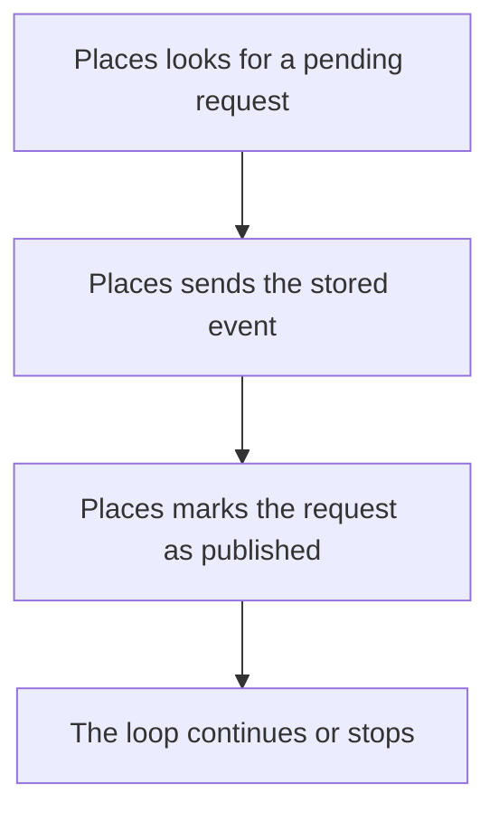

import {ClewMarkdown, ClewFieldDetails, ClewProcess, ClewDataModel, ClewDownload, ClewModelLink, ClewRelatedModelLink, ClewFieldTrace, ClewContextLink, ClewPageContext, ClewProcessReturn, ClewStatus, ClewRetainedPage, ClewCatalog, ClewAnchor} from '@site/src/components/ClewReaders';

<ClewAnchor id="process-overview" pageStart />

# Publish place requests

<ClewPageContext />

<ClewStatus freshness="STALE" verification="UNASSESSED" />

Places publishes saved outbox requests and records completed sends.

## 1. Places looks for a pending request {#question-pending}

<ClewMarkdown text={"The publishing loop attempts one eligible unpublished request at a time. If no row is selected, this pass sends nothing."} />

<details>
<summary>Evidence and scope</summary>

**Place request publisher** · STALE · UNASSESSED

PublishPending opens a connection and transaction, then selects one eligible unpublished row in created\_at order, limited to one and locked with SKIP LOCKED.

- [services/places/RequestPublisher.cs:18–34 · revision c289b28be4819eddf29d59a7c12f178559ec5229](../sources/728b9ba12f04391993430660fb0e4a022375568be05cd19f8e9d4aca115e990d.mdx)
**Place request publisher** · STALE · UNASSESSED

No row is sent when the reader is empty; the using scopes dispose the open transaction and connection on return.

- [services/places/RequestPublisher.cs:18–34 · revision c289b28be4819eddf29d59a7c12f178559ec5229](../sources/728b9ba12f04391993430660fb0e4a022375568be05cd19f8e9d4aca115e990d.mdx)

</details>

<details className="clew-context-disclosure">
<summary>Selection and producer settings<span className="clew-disclosure-preview">One eligible row · created\_at order · selected-source configuration</span></summary>

<ClewMarkdown text={"The query orders by created_at, selects at most one row and uses FOR UPDATE SKIP LOCKED. The producer uses KAFKA_BOOTSTRAP or kafka:9092, enables idempotence and configures a 10-second message timeout. Runtime hosting activation is not established."} />

<details>
<summary>Evidence and scope</summary>

**Place request publisher** · STALE · UNASSESSED

At source level, RequestPublisher.ExecuteAsync creates one Kafka producer using KAFKA\_BOOTSTRAP or kafka:9092, with idempotence enabled and a 10-second message timeout. While the token is not cancelled, it calls PublishPending and waits one second between passes. PublishPending selects at most one eligible unpublished row in created\_at order with FOR UPDATE SKIP LOCKED; if none is returned, it exits that pass without sending. For a selected row it extracts place.id from the stored JSON, awaits a send to weather.place-requested using that ID as the key, then sets published=true and commits the database transaction. Since send completion comes before the database commit, a crash between them can leave the row eligible for another send. The loop logs other exceptions as PUBLISH\_RETRY; cancellation during PublishPending breaks the loop, while cancellation reaching the post-attempt delay can propagate. C\# source coverage is PARTIAL; this code does not establish runtime hosting activation or delivery.

- [services/places/RequestPublisher.cs:18–34 · revision c289b28be4819eddf29d59a7c12f178559ec5229](../sources/728b9ba12f04391993430660fb0e4a022375568be05cd19f8e9d4aca115e990d.mdx)
- [services/places/RequestPublisher.cs:7–17 · revision c289b28be4819eddf29d59a7c12f178559ec5229](../sources/b970c6d235f9c5eb2f4e16bc78eda2a4ee3a68751103a8811054e9802c535d97.mdx)

</details>


</details>

## 2. Places sends the stored event {#question-send}

<p className="clew-route"><code>{"Topic: weather.place-requested"}</code></p>

<ClewMarkdown text={"The selected payload is sent to `weather.place-requested`, using the place ID as its message key. The code awaits the send before changing the outbox row."} />

<details>
<summary>Evidence and scope</summary>

**Place request publisher** · STALE · UNASSESSED

Extract place.id from the stored payload and await ProduceAsync to weather.place-requested with place.id as the message key and the original payload as the value.

- [services/places/RequestPublisher.cs:18–34 · revision c289b28be4819eddf29d59a7c12f178559ec5229](../sources/728b9ba12f04391993430660fb0e4a022375568be05cd19f8e9d4aca115e990d.mdx)

</details>

<article className="clew-topic" id="topic-outgoing-weather.place-requested" tabIndex={-1}>

### Outgoing Kafka topic · weather.place-requested

<ClewProcessReturn topic="weather.place-requested" direction="outgoing" />

<div className="clew-topic-path" aria-label="Declared asynchronous handoff">

<div>

<ClewContextLink path="/services/places#section-egress" fromProcess="places-request-publisher" fromQuestion="question-send" query={{"direction":"outgoing","topic":"weather.place-requested"}}>Places</ClewContextLink>

PublishPending

</div>

<span aria-hidden="true">→</span>

<div>

**weather.place-requested**

Kafka topic · asynchronous

</div>

<span aria-hidden="true">→</span>

<div>

<ClewContextLink path="/services/dashboard#section-ingress" fromProcess="places-request-publisher" fromQuestion="question-send" query={{"direction":"incoming","topic":"weather.place-requested"}}>Dashboard</ClewContextLink>

consumeMessage

<ClewContextLink path="/services/forecasts#section-ingress" fromProcess="places-request-publisher" fromQuestion="question-send" query={{"direction":"incoming","topic":"weather.place-requested"}}>Forecasts</ClewContextLink>

consume

</div>

</div>

Proposed handoff; runtime delivery has not been verified.

Saved consumer view: <ClewContextLink path="/scenarios/dashboard-place-requested-consumer#process-overview" fromProcess="places-request-publisher" fromQuestion="question-send" query={{}}>Add a place to Dashboard</ClewContextLink>

Saved consumer view: <ClewContextLink path="/scenarios/forecasts-place-requested-consumer#process-overview" fromProcess="places-request-publisher" fromQuestion="question-send" query={{}}>Refresh a forecast after a place request</ClewContextLink>

<details>
<summary>Retained source and declaration context</summary>

Topic names and the payload's event type are separate values. These references retain their own revisions; source matches do not prove topic resolution or delivery.

- [services/places/RequestPublisher.cs:18–34 · revision c289b28be4819eddf29d59a7c12f178559ec5229](../sources/728b9ba12f04391993430660fb0e4a022375568be05cd19f8e9d4aca115e990d.mdx)

```json
[
  {
    "boundaries": [
      "RUNTIME_DESTINATION_AND_ACTIVATION_UNKNOWN",
      "WIRE_SERIALIZATION_NOT_ASSESSED",
      "MESSAGE_DELIVERY_ORDER_RETRY_AND_CONSUMER_ACTIVATION_UNKNOWN",
      "ENVIRONMENT_SCOPE_UNSPECIFIED",
      "CLIENT_PATTERN_UNSUPPORTED_OR_AMBIGUOUS",
      "UNACCEPTED_AGENT_PROPOSAL"
    ],
    "from": {
      "callSite": {
        "observation": "places:flow:941152b2ec99892568c9e40a"
      },
      "selector": {
        "language": "csharp",
        "name": "PublishPending",
        "owner": "class:Weather.Places.RequestPublisher",
        "parameterTypes": [
          "Confluent.Kafka.IProducer`2",
          "System.Threading.CancellationToken"
        ]
      },
      "service": "places"
    },
    "interaction": "places-place-requested-to-dashboard",
    "origin": "agent-proposal",
    "rationale": "Agent-proposed weather.place-requested subscriber mapping. The captured Places producer call location is exact; topic resolution, consumer subscription and runtime delivery remain unverified.",
    "runtime": "UNKNOWN",
    "to": {
      "selector": {
        "language": "typescript",
        "name": "consumeMessage",
        "owner": "package:",
        "parameterTypes": [
          ": EachMessagePayload"
        ]
      },
      "service": "dashboard"
    },
    "topic": {
      "caller": {
        "declared": "weather.place-requested",
        "observed": [],
        "status": "UNRESOLVED"
      },
      "receiver": {
        "declared": "weather.place-requested",
        "observed": [],
        "status": "UNRESOLVED"
      }
    }
  },
  {
    "boundaries": [
      "RUNTIME_DESTINATION_AND_ACTIVATION_UNKNOWN",
      "WIRE_SERIALIZATION_NOT_ASSESSED",
      "MESSAGE_DELIVERY_ORDER_RETRY_AND_CONSUMER_ACTIVATION_UNKNOWN",
      "ENVIRONMENT_SCOPE_UNSPECIFIED",
      "CLIENT_PATTERN_UNSUPPORTED_OR_AMBIGUOUS",
      "UNACCEPTED_AGENT_PROPOSAL"
    ],
    "from": {
      "callSite": {
        "observation": "places:flow:941152b2ec99892568c9e40a"
      },
      "selector": {
        "language": "csharp",
        "name": "PublishPending",
        "owner": "class:Weather.Places.RequestPublisher",
        "parameterTypes": [
          "Confluent.Kafka.IProducer`2",
          "System.Threading.CancellationToken"
        ]
      },
      "service": "places"
    },
    "interaction": "places-place-requested-to-forecasts",
    "origin": "agent-proposal",
    "rationale": "Agent-proposed weather.place-requested subscriber mapping. The captured Places producer call location is exact; topic resolution, consumer subscription and runtime delivery remain unverified.",
    "runtime": "UNKNOWN",
    "to": {
      "selector": {
        "language": "kotlin",
        "name": "consume",
        "owner": "class:weather.Forecasts",
        "parameterTypes": [
          "record: ConsumerRecord<String, String>",
          "acknowledgment: Acknowledgment"
        ]
      },
      "service": "forecasts"
    },
    "topic": {
      "caller": {
        "declared": "weather.place-requested",
        "observed": [],
        "status": "UNRESOLVED"
      },
      "receiver": {
        "declared": "weather.place-requested",
        "observed": [],
        "status": "UNRESOLVED"
      }
    }
  }
]
```


</details>

</article>

<aside className="clew-exception">

### If the attempt fails {#question-publish-error}

<ClewMarkdown text={"Other exceptions are logged as `PUBLISH_RETRY`. While the loop remains active, later passes can attempt pending work again."} />

<details>
<summary>Evidence and scope</summary>

**Place request publisher** · STALE · UNASSESSED

Other exceptions are logged with PUBLISH\_RETRY; normal completion and logged failures continue to the one-second delay. The delay also receives the token, so cancellation reaching that await can propagate.

- [services/places/RequestPublisher.cs:7–17 · revision c289b28be4819eddf29d59a7c12f178559ec5229](../sources/b970c6d235f9c5eb2f4e16bc78eda2a4ee3a68751103a8811054e9802c535d97.mdx)

</details>

</aside>

## 3. Places marks the request as published {#question-record}

<ClewMarkdown text={"After the send completes, the outbox row is marked published and the database transaction is committed."} />

<div className="clew-context-links">

<ClewModelLink model="place" process="places-request-publisher" anchor="question-record">Place · data model</ClewModelLink>

<ClewContextLink path="/services/places#section-entities" fromProcess="places-request-publisher" fromQuestion="question-record">Technical context</ClewContextLink>

</div>

<details>
<summary>Evidence and scope</summary>

**Place request publisher** · STALE · UNASSESSED

After ProduceAsync completes, update that outbox row to published=true and commit the database transaction.

- [services/places/RequestPublisher.cs:18–34 · revision c289b28be4819eddf29d59a7c12f178559ec5229](../sources/728b9ba12f04391993430660fb0e4a022375568be05cd19f8e9d4aca115e990d.mdx)

</details>

<aside className="clew-exception">

### If the process stops between send and commit {#question-replay-window}

<ClewMarkdown text={"A completed broker send followed by a crash or database-commit failure can leave the row pending. It may be sent again; producer idempotence does not make Kafka and the database one atomic transaction."} />

<details>
<summary>Evidence and scope</summary>

**Place request publisher** · STALE · UNASSESSED

A crash after the broker send but before the database commit can leave the row unpublished for a later send; producer idempotence does not make Kafka and PostgreSQL one atomic transaction.

- [services/places/RequestPublisher.cs:18–34 · revision c289b28be4819eddf29d59a7c12f178559ec5229](../sources/728b9ba12f04391993430660fb0e4a022375568be05cd19f8e9d4aca115e990d.mdx)
- [services/places/RequestPublisher.cs:7–17 · revision c289b28be4819eddf29d59a7c12f178559ec5229](../sources/b970c6d235f9c5eb2f4e16bc78eda2a4ee3a68751103a8811054e9802c535d97.mdx)

</details>

</aside>

## 4. The loop continues or stops {#question-continue}

<ClewMarkdown text={"Normal completion and logged failures are followed by a one-second wait. Each pass attempts one pending row."} />

<details>
<summary>Evidence and scope</summary>

**Place request publisher** · STALE · UNASSESSED

Repeat while the cancellation token is not signalled; each pass attempts one pending row, then waits one second.

- [services/places/RequestPublisher.cs:10–10 · revision c289b28be4819eddf29d59a7c12f178559ec5229](../sources/a0297a2ef05d2d41e7c12a344c24091c5b8976f8b4240b03ed9698d1adaf5298.mdx)
- [services/places/RequestPublisher.cs:7–17 · revision c289b28be4819eddf29d59a7c12f178559ec5229](../sources/b970c6d235f9c5eb2f4e16bc78eda2a4ee3a68751103a8811054e9802c535d97.mdx)
**Place request publisher** · STALE · UNASSESSED

Other exceptions are logged with PUBLISH\_RETRY; normal completion and logged failures continue to the one-second delay. The delay also receives the token, so cancellation reaching that await can propagate.

- [services/places/RequestPublisher.cs:7–17 · revision c289b28be4819eddf29d59a7c12f178559ec5229](../sources/b970c6d235f9c5eb2f4e16bc78eda2a4ee3a68751103a8811054e9802c535d97.mdx)

</details>

<details className="clew-context-disclosure">
<summary>Cancellation details<span className="clew-disclosure-preview">Publish-attempt cancellation and delay cancellation take different paths</span></summary>

<ClewMarkdown text={"Cancellation observed during the publish attempt exits the loop. Cancellation reaching the following delay can propagate from that await."} />

<details>
<summary>Evidence and scope</summary>

**Place request publisher** · STALE · UNASSESSED

An OperationCanceledException observed while the token is cancelled breaks the loop.

- [services/places/RequestPublisher.cs:7–17 · revision c289b28be4819eddf29d59a7c12f178559ec5229](../sources/b970c6d235f9c5eb2f4e16bc78eda2a4ee3a68751103a8811054e9802c535d97.mdx)
**Place request publisher** · STALE · UNASSESSED

Other exceptions are logged with PUBLISH\_RETRY; normal completion and logged failures continue to the one-second delay. The delay also receives the token, so cancellation reaching that await can propagate.

- [services/places/RequestPublisher.cs:7–17 · revision c289b28be4819eddf29d59a7c12f178559ec5229](../sources/b970c6d235f9c5eb2f4e16bc78eda2a4ee3a68751103a8811054e9802c535d97.mdx)

</details>


</details>

## Full description and sources {#question-confidence}

<ClewMarkdown text={"This is a pinned source interpretation with PARTIAL C# coverage. It does not establish worker activation, broker delivery or consumer execution. Related consumer accounts have their own sources and review state; their links do not prove execution order."} />

<div className="clew-context-links">

<ClewContextLink path="/scenarios/forecasts-place-requested-consumer#process-overview" fromProcess="places-request-publisher" fromQuestion="question-confidence">Related Forecasts consumer</ClewContextLink>

<ClewContextLink path="/scenarios/dashboard-place-requested-consumer#process-overview" fromProcess="places-request-publisher" fromQuestion="question-confidence">Related Dashboard consumer</ClewContextLink>

</div>

<details>
<summary>Evidence and scope</summary>

**Place request publisher** · STALE · UNASSESSED

At source level, RequestPublisher.ExecuteAsync creates one Kafka producer using KAFKA\_BOOTSTRAP or kafka:9092, with idempotence enabled and a 10-second message timeout. While the token is not cancelled, it calls PublishPending and waits one second between passes. PublishPending selects at most one eligible unpublished row in created\_at order with FOR UPDATE SKIP LOCKED; if none is returned, it exits that pass without sending. For a selected row it extracts place.id from the stored JSON, awaits a send to weather.place-requested using that ID as the key, then sets published=true and commits the database transaction. Since send completion comes before the database commit, a crash between them can leave the row eligible for another send. The loop logs other exceptions as PUBLISH\_RETRY; cancellation during PublishPending breaks the loop, while cancellation reaching the post-attempt delay can propagate. C\# source coverage is PARTIAL; this code does not establish runtime hosting activation or delivery.

- [services/places/RequestPublisher.cs:18–34 · revision c289b28be4819eddf29d59a7c12f178559ec5229](../sources/728b9ba12f04391993430660fb0e4a022375568be05cd19f8e9d4aca115e990d.mdx)
- [services/places/RequestPublisher.cs:7–17 · revision c289b28be4819eddf29d59a7c12f178559ec5229](../sources/b970c6d235f9c5eb2f4e16bc78eda2a4ee3a68751103a8811054e9802c535d97.mdx)

</details>

<details>
<summary>Reading guide and map</summary>

Editorial reading guide · original source scopes and review states remain separate.

Reading order only. Conditions and failures remain beside the steps below; this is not a runtime trace.




</details>

<details>
<summary>Evidence scope</summary>

<ClewMarkdown text={"This is a pinned source interpretation with PARTIAL C# coverage. It does not establish worker activation, broker delivery or consumer execution. Related consumer accounts have their own sources and review state; their links do not prove execution order."} />

<div className="clew-context-links">

<ClewContextLink path="/scenarios/forecasts-place-requested-consumer#process-overview" fromProcess="places-request-publisher" fromQuestion="question-confidence">Related Forecasts consumer</ClewContextLink>

<ClewContextLink path="/scenarios/dashboard-place-requested-consumer#process-overview" fromProcess="places-request-publisher" fromQuestion="question-confidence">Related Dashboard consumer</ClewContextLink>

</div>

<details>
<summary>Evidence and scope</summary>

**Place request publisher** · STALE · UNASSESSED

At source level, RequestPublisher.ExecuteAsync creates one Kafka producer using KAFKA\_BOOTSTRAP or kafka:9092, with idempotence enabled and a 10-second message timeout. While the token is not cancelled, it calls PublishPending and waits one second between passes. PublishPending selects at most one eligible unpublished row in created\_at order with FOR UPDATE SKIP LOCKED; if none is returned, it exits that pass without sending. For a selected row it extracts place.id from the stored JSON, awaits a send to weather.place-requested using that ID as the key, then sets published=true and commits the database transaction. Since send completion comes before the database commit, a crash between them can leave the row eligible for another send. The loop logs other exceptions as PUBLISH\_RETRY; cancellation during PublishPending breaks the loop, while cancellation reaching the post-attempt delay can propagate. C\# source coverage is PARTIAL; this code does not establish runtime hosting activation or delivery.

- [services/places/RequestPublisher.cs:18–34 · revision c289b28be4819eddf29d59a7c12f178559ec5229](../sources/728b9ba12f04391993430660fb0e4a022375568be05cd19f8e9d4aca115e990d.mdx)
- [services/places/RequestPublisher.cs:7–17 · revision c289b28be4819eddf29d59a7c12f178559ec5229](../sources/b970c6d235f9c5eb2f4e16bc78eda2a4ee3a68751103a8811054e9802c535d97.mdx)

</details>


</details>

## Original accounts and implementation

- [Place request publisher](../operations/scenarios-places-request-publisher--places-request-publisher.mdx)
- [Publish pending place requests](../operations/scenarios-places-request-publisher--process-overview.mdx)

<ClewDownload path="/clew-data/native/scenarios/places-request-publisher.json">Saved data and complete provenance (reference format)</ClewDownload>

