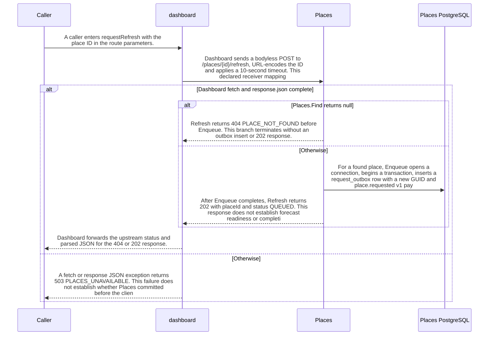

import {ClewProcess, ClewDataModel, ClewDownload, ClewModelLink, ClewRelatedModelLink, ClewFieldTrace, ClewContextLink, ClewPageContext, ClewProcessReturn, ClewStatus, ClewRetainedPage, ClewCatalog, ClewAnchor} from '@site/src/components/ClewReaders';

# Request a place refresh and record its outbox boundary

<ClewPageContext />

Retained account · UNVERIFIED · UNASSESSED. Runtime behavior is not established by this export.

A caller enters Dashboard.requestRefresh with a place ID. Dashboard URL-encodes the ID in a bodyless POST /places/&#123;id&#125;/refresh with a 10-second timeout; the saved Dashboard-to-Places mapping is agent-proposed, so runtime routing is unverified. Places.Refresh calls Find; Find returns the first ID match from List. If no place is found, Refresh returns 404 PLACE\_NOT\_FOUND before enqueue. Otherwise it awaits Enqueue, which opens a connection, begins a transaction, inserts a request\_outbox row with a new GUID and a place.requested v1 payload, then commits before Refresh returns 202 with status QUEUED. QUEUED marks the response, not forecast completion. Dashboard forwards upstream status and parsed JSON; a fetch or JSON-decoding exception becomes 503 PLACES\_UNAVAILABLE, which does not show whether Places committed first. Open disposes and rethrows on connection-open failure; other exception-to-HTTP handling is outside these bodies. The saved process links separate Places publisher and Dashboard/Forecasts consumer views, but this path does not establish publication or delivery. These wrappers show no idempotency key or repeated-request deduplication.

Summary source bindings

- [services/dashboard/src/main.ts:76–83 · revision e635069293d58cb0d4f28c8211e748b8d58e6b37](../sources/b41ac7155eba29b1e6a9dfe10348b626c22e19654978c7d35379a71fff4526a1.mdx)
- [services/places/PlacesRepository.cs:35–35 · revision c289b28be4819eddf29d59a7c12f178559ec5229](../sources/09adfc4929d330ef0ace7773c10744a9ad2b7d33500cce7f3ebbce83b35cbccc.mdx)
- [services/places/PlacesRepository.cs:45–51 · revision c289b28be4819eddf29d59a7c12f178559ec5229](../sources/2f738bb1b0e4cfed6f7710952bc1442794ebe32fe8703bd2bca4c9b79e4bbbc2.mdx)
- [services/places/PlacesRepository.cs:52–59 · revision c289b28be4819eddf29d59a7c12f178559ec5229](../sources/89387464df117dd1f2cfdbd8113d90c803728d4fe220f507529703bd597dbf8e.mdx)
- [services/places/PlacesController.cs:18–25 · revision c289b28be4819eddf29d59a7c12f178559ec5229](../sources/10944607b7dd3022e1223a7de9822b263e1bccb2a729b6118f97fc90f3c31306.mdx)
- [services/places/PlacesRepository.cs:20–25 · revision c289b28be4819eddf29d59a7c12f178559ec5229](../sources/d10889d7dec9ec7771472d1a44e755b28743b1800e345a02d390e4ce46d995b6.mdx)

## Source-visible refresh HTTP boundary

| Topic | Retained contract detail |
| --- | --- |
| Request | Dashboard sends POST /places/&#123;id&#125;/refresh without a request body and encodes the path ID. The declared Dashboard-to-Places target mapping remains unverified at runtime. |
| Places response | The controller returns 404 PLACE\_NOT\_FOUND before enqueue when Find returns null; otherwise it waits for Enqueue and returns 202 with placeId and QUEUED. |
| Dashboard failure cut | A fetch or response JSON exception is returned as 503 PLACES\_UNAVAILABLE. The handler does not report whether Places committed first; the Open method disposes and rethrows a connection-open failure. |

Contract source bindings

**Request**

- [services/dashboard/src/main.ts:76–83 · revision e635069293d58cb0d4f28c8211e748b8d58e6b37](../sources/b41ac7155eba29b1e6a9dfe10348b626c22e19654978c7d35379a71fff4526a1.mdx)

**Places response**

- [services/places/PlacesRepository.cs:35–35 · revision c289b28be4819eddf29d59a7c12f178559ec5229](../sources/09adfc4929d330ef0ace7773c10744a9ad2b7d33500cce7f3ebbce83b35cbccc.mdx)
- [services/places/PlacesRepository.cs:45–51 · revision c289b28be4819eddf29d59a7c12f178559ec5229](../sources/2f738bb1b0e4cfed6f7710952bc1442794ebe32fe8703bd2bca4c9b79e4bbbc2.mdx)
- [services/places/PlacesController.cs:18–25 · revision c289b28be4819eddf29d59a7c12f178559ec5229](../sources/10944607b7dd3022e1223a7de9822b263e1bccb2a729b6118f97fc90f3c31306.mdx)

**Dashboard failure cut**

- [services/dashboard/src/main.ts:76–83 · revision e635069293d58cb0d4f28c8211e748b8d58e6b37](../sources/b41ac7155eba29b1e6a9dfe10348b626c22e19654978c7d35379a71fff4526a1.mdx)
- [services/places/PlacesRepository.cs:20–25 · revision c289b28be4819eddf29d59a7c12f178559ec5229](../sources/d10889d7dec9ec7771472d1a44e755b28743b1800e345a02d390e4ce46d995b6.mdx)

## Interaction diagram

Actors and nested branches from the retained account; not a runtime trace. Labels are shortened for readability. Full messages and notes follow.

Full original sequence, branches and notes

#### 1. message

A caller enters requestRefresh with the place ID in the route parameters.

Source bindings

- [services/dashboard/src/main.ts:76–83 · revision e635069293d58cb0d4f28c8211e748b8d58e6b37](../sources/b41ac7155eba29b1e6a9dfe10348b626c22e19654978c7d35379a71fff4526a1.mdx)

#### 2. message

Dashboard sends a bodyless POST to /places/&#123;id&#125;/refresh, URL-encodes the ID and applies a 10-second timeout. This declared receiver mapping is agent-proposed; runtime routing is unverified.

Source bindings

- [services/dashboard/src/main.ts:76–83 · revision e635069293d58cb0d4f28c8211e748b8d58e6b37](../sources/b41ac7155eba29b1e6a9dfe10348b626c22e19654978c7d35379a71fff4526a1.mdx)

#### 3. alt

Dashboard fetch and response.json complete

Source bindings

- [services/dashboard/src/main.ts:77–82 · revision e635069293d58cb0d4f28c8211e748b8d58e6b37](../sources/6e99c286bdd3d582e94aaa493006d53aa3167c95d52d54d1270c79548caf0867.mdx)
- [services/dashboard/src/main.ts:76–83 · revision e635069293d58cb0d4f28c8211e748b8d58e6b37](../sources/b41ac7155eba29b1e6a9dfe10348b626c22e19654978c7d35379a71fff4526a1.mdx)

#### 4. alt

Places.Find returns null

Source bindings

- [services/places/PlacesRepository.cs:35–35 · revision c289b28be4819eddf29d59a7c12f178559ec5229](../sources/09adfc4929d330ef0ace7773c10744a9ad2b7d33500cce7f3ebbce83b35cbccc.mdx)
- [services/places/PlacesController.cs:18–25 · revision c289b28be4819eddf29d59a7c12f178559ec5229](../sources/10944607b7dd3022e1223a7de9822b263e1bccb2a729b6118f97fc90f3c31306.mdx)

#### 5. return

Refresh returns 404 PLACE\_NOT\_FOUND before Enqueue. This branch terminates without an outbox insert or 202 response.

Source bindings

- [services/places/PlacesRepository.cs:35–35 · revision c289b28be4819eddf29d59a7c12f178559ec5229](../sources/09adfc4929d330ef0ace7773c10744a9ad2b7d33500cce7f3ebbce83b35cbccc.mdx)
- [services/places/PlacesController.cs:18–25 · revision c289b28be4819eddf29d59a7c12f178559ec5229](../sources/10944607b7dd3022e1223a7de9822b263e1bccb2a729b6118f97fc90f3c31306.mdx)

#### 6. else

Otherwise

Source bindings

- [services/places/PlacesRepository.cs:35–35 · revision c289b28be4819eddf29d59a7c12f178559ec5229](../sources/09adfc4929d330ef0ace7773c10744a9ad2b7d33500cce7f3ebbce83b35cbccc.mdx)
- [services/places/PlacesController.cs:18–25 · revision c289b28be4819eddf29d59a7c12f178559ec5229](../sources/10944607b7dd3022e1223a7de9822b263e1bccb2a729b6118f97fc90f3c31306.mdx)

#### 7. message

For a found place, Enqueue opens a connection, begins a transaction, inserts a request\_outbox row with a new GUID and place.requested v1 payload, then commits before returning.

Source bindings

- [services/places/PlacesRepository.cs:45–51 · revision c289b28be4819eddf29d59a7c12f178559ec5229](../sources/2f738bb1b0e4cfed6f7710952bc1442794ebe32fe8703bd2bca4c9b79e4bbbc2.mdx)
- [services/places/PlacesRepository.cs:52–59 · revision c289b28be4819eddf29d59a7c12f178559ec5229](../sources/89387464df117dd1f2cfdbd8113d90c803728d4fe220f507529703bd597dbf8e.mdx)
- [services/places/PlacesRepository.cs:20–25 · revision c289b28be4819eddf29d59a7c12f178559ec5229](../sources/d10889d7dec9ec7771472d1a44e755b28743b1800e345a02d390e4ce46d995b6.mdx)

#### 8. return

After Enqueue completes, Refresh returns 202 with placeId and status QUEUED. This response does not establish forecast readiness or completion.

Source bindings

- [services/places/PlacesRepository.cs:45–51 · revision c289b28be4819eddf29d59a7c12f178559ec5229](../sources/2f738bb1b0e4cfed6f7710952bc1442794ebe32fe8703bd2bca4c9b79e4bbbc2.mdx)
- [services/places/PlacesController.cs:18–25 · revision c289b28be4819eddf29d59a7c12f178559ec5229](../sources/10944607b7dd3022e1223a7de9822b263e1bccb2a729b6118f97fc90f3c31306.mdx)

#### 9. end

Source bindings

- [services/places/PlacesRepository.cs:35–35 · revision c289b28be4819eddf29d59a7c12f178559ec5229](../sources/09adfc4929d330ef0ace7773c10744a9ad2b7d33500cce7f3ebbce83b35cbccc.mdx)
- [services/places/PlacesController.cs:18–25 · revision c289b28be4819eddf29d59a7c12f178559ec5229](../sources/10944607b7dd3022e1223a7de9822b263e1bccb2a729b6118f97fc90f3c31306.mdx)

#### 10. return

Dashboard forwards the upstream status and parsed JSON for the 404 or 202 response.

Source bindings

- [services/dashboard/src/main.ts:76–83 · revision e635069293d58cb0d4f28c8211e748b8d58e6b37](../sources/b41ac7155eba29b1e6a9dfe10348b626c22e19654978c7d35379a71fff4526a1.mdx)

#### 11. else

Otherwise

Source bindings

- [services/dashboard/src/main.ts:77–82 · revision e635069293d58cb0d4f28c8211e748b8d58e6b37](../sources/6e99c286bdd3d582e94aaa493006d53aa3167c95d52d54d1270c79548caf0867.mdx)
- [services/dashboard/src/main.ts:76–83 · revision e635069293d58cb0d4f28c8211e748b8d58e6b37](../sources/b41ac7155eba29b1e6a9dfe10348b626c22e19654978c7d35379a71fff4526a1.mdx)

#### 12. return

A fetch or response JSON exception returns 503 PLACES\_UNAVAILABLE. This failure does not establish whether Places committed before the client error.

Source bindings

- [services/dashboard/src/main.ts:76–83 · revision e635069293d58cb0d4f28c8211e748b8d58e6b37](../sources/b41ac7155eba29b1e6a9dfe10348b626c22e19654978c7d35379a71fff4526a1.mdx)

#### 13. note

Open disposes and rethrows a connection-open failure; the captured bodies do not establish how that exception maps to an HTTP response.

Source bindings

- [services/places/PlacesRepository.cs:20–25 · revision c289b28be4819eddf29d59a7c12f178559ec5229](../sources/d10889d7dec9ec7771472d1a44e755b28743b1800e345a02d390e4ce46d995b6.mdx)

#### 14. end

Source bindings

- [services/dashboard/src/main.ts:77–82 · revision e635069293d58cb0d4f28c8211e748b8d58e6b37](../sources/6e99c286bdd3d582e94aaa493006d53aa3167c95d52d54d1270c79548caf0867.mdx)
- [services/dashboard/src/main.ts:76–83 · revision e635069293d58cb0d4f28c8211e748b8d58e6b37](../sources/b41ac7155eba29b1e6a9dfe10348b626c22e19654978c7d35379a71fff4526a1.mdx)

## Implementation explanation

A caller enters requestRefresh with the place ID in the route parameters.

Source bindings

- [services/dashboard/src/main.ts:76–83 · revision e635069293d58cb0d4f28c8211e748b8d58e6b37](../sources/b41ac7155eba29b1e6a9dfe10348b626c22e19654978c7d35379a71fff4526a1.mdx)

Dashboard sends a bodyless POST to /places/&#123;id&#125;/refresh, URL-encodes the ID and applies a 10-second timeout. This declared receiver mapping is agent-proposed; runtime routing is unverified.

Source bindings

- [services/dashboard/src/main.ts:76–83 · revision e635069293d58cb0d4f28c8211e748b8d58e6b37](../sources/b41ac7155eba29b1e6a9dfe10348b626c22e19654978c7d35379a71fff4526a1.mdx)

Dashboard fetch and response.json complete

Source bindings

- [services/dashboard/src/main.ts:77–82 · revision e635069293d58cb0d4f28c8211e748b8d58e6b37](../sources/6e99c286bdd3d582e94aaa493006d53aa3167c95d52d54d1270c79548caf0867.mdx)
- [services/dashboard/src/main.ts:76–83 · revision e635069293d58cb0d4f28c8211e748b8d58e6b37](../sources/b41ac7155eba29b1e6a9dfe10348b626c22e19654978c7d35379a71fff4526a1.mdx)

Places.Find returns null

Source bindings

- [services/places/PlacesRepository.cs:35–35 · revision c289b28be4819eddf29d59a7c12f178559ec5229](../sources/09adfc4929d330ef0ace7773c10744a9ad2b7d33500cce7f3ebbce83b35cbccc.mdx)
- [services/places/PlacesController.cs:18–25 · revision c289b28be4819eddf29d59a7c12f178559ec5229](../sources/10944607b7dd3022e1223a7de9822b263e1bccb2a729b6118f97fc90f3c31306.mdx)

Refresh returns 404 PLACE\_NOT\_FOUND before Enqueue. This branch terminates without an outbox insert or 202 response.

Source bindings

- [services/places/PlacesRepository.cs:35–35 · revision c289b28be4819eddf29d59a7c12f178559ec5229](../sources/09adfc4929d330ef0ace7773c10744a9ad2b7d33500cce7f3ebbce83b35cbccc.mdx)
- [services/places/PlacesController.cs:18–25 · revision c289b28be4819eddf29d59a7c12f178559ec5229](../sources/10944607b7dd3022e1223a7de9822b263e1bccb2a729b6118f97fc90f3c31306.mdx)

The source describes an alternative branch.

Source bindings

- [services/places/PlacesRepository.cs:35–35 · revision c289b28be4819eddf29d59a7c12f178559ec5229](../sources/09adfc4929d330ef0ace7773c10744a9ad2b7d33500cce7f3ebbce83b35cbccc.mdx)
- [services/places/PlacesController.cs:18–25 · revision c289b28be4819eddf29d59a7c12f178559ec5229](../sources/10944607b7dd3022e1223a7de9822b263e1bccb2a729b6118f97fc90f3c31306.mdx)

For a found place, Enqueue opens a connection, begins a transaction, inserts a request\_outbox row with a new GUID and place.requested v1 payload, then commits before returning.

Source bindings

- [services/places/PlacesRepository.cs:45–51 · revision c289b28be4819eddf29d59a7c12f178559ec5229](../sources/2f738bb1b0e4cfed6f7710952bc1442794ebe32fe8703bd2bca4c9b79e4bbbc2.mdx)
- [services/places/PlacesRepository.cs:52–59 · revision c289b28be4819eddf29d59a7c12f178559ec5229](../sources/89387464df117dd1f2cfdbd8113d90c803728d4fe220f507529703bd597dbf8e.mdx)
- [services/places/PlacesRepository.cs:20–25 · revision c289b28be4819eddf29d59a7c12f178559ec5229](../sources/d10889d7dec9ec7771472d1a44e755b28743b1800e345a02d390e4ce46d995b6.mdx)

After Enqueue completes, Refresh returns 202 with placeId and status QUEUED. This response does not establish forecast readiness or completion.

Source bindings

- [services/places/PlacesRepository.cs:45–51 · revision c289b28be4819eddf29d59a7c12f178559ec5229](../sources/2f738bb1b0e4cfed6f7710952bc1442794ebe32fe8703bd2bca4c9b79e4bbbc2.mdx)
- [services/places/PlacesController.cs:18–25 · revision c289b28be4819eddf29d59a7c12f178559ec5229](../sources/10944607b7dd3022e1223a7de9822b263e1bccb2a729b6118f97fc90f3c31306.mdx)

Dashboard forwards the upstream status and parsed JSON for the 404 or 202 response.

Source bindings

- [services/dashboard/src/main.ts:76–83 · revision e635069293d58cb0d4f28c8211e748b8d58e6b37](../sources/b41ac7155eba29b1e6a9dfe10348b626c22e19654978c7d35379a71fff4526a1.mdx)

The source describes an alternative branch.

Source bindings

- [services/dashboard/src/main.ts:77–82 · revision e635069293d58cb0d4f28c8211e748b8d58e6b37](../sources/6e99c286bdd3d582e94aaa493006d53aa3167c95d52d54d1270c79548caf0867.mdx)
- [services/dashboard/src/main.ts:76–83 · revision e635069293d58cb0d4f28c8211e748b8d58e6b37](../sources/b41ac7155eba29b1e6a9dfe10348b626c22e19654978c7d35379a71fff4526a1.mdx)

A fetch or response JSON exception returns 503 PLACES\_UNAVAILABLE. This failure does not establish whether Places committed before the client error.

Source bindings

- [services/dashboard/src/main.ts:76–83 · revision e635069293d58cb0d4f28c8211e748b8d58e6b37](../sources/b41ac7155eba29b1e6a9dfe10348b626c22e19654978c7d35379a71fff4526a1.mdx)

Open disposes and rethrows a connection-open failure; the captured bodies do not establish how that exception maps to an HTTP response.

Source bindings

- [services/places/PlacesRepository.cs:20–25 · revision c289b28be4819eddf29d59a7c12f178559ec5229](../sources/d10889d7dec9ec7771472d1a44e755b28743b1800e345a02d390e4ce46d995b6.mdx)

Retained boundaries

- The Dashboard-to-Places receiver mapping is agent-proposed; runtime target binding and routing are unverified. This process is source-level, and its linked publisher and consumer views do not prove publication or delivery. The 503 wrapper does not reveal whether Places committed before the client error. No current compiler or runtime verification was performed for this draft.
- CALL\_TARGETS\_UNRESOLVED
- DIALECT\_DECLARED\_NOT\_COMPILER\_VALIDATED
- FILE\_ONLY:compose.yaml
- FILE\_ONLY:contracts/dashboard.openapi.json
- FILE\_ONLY:contracts/events.schema.json
- FILE\_ONLY:database/init.sql
- FILE\_ONLY:exercises/dashboard-focus-regression.mjs
- FILE\_ONLY:exercises/replay.py
- FILE\_ONLY:exercises/validator-regression.mjs
- FILE\_ONLY:fixtures/helsinki.json
- FILE\_ONLY:fixtures/lisbon.json
- FILE\_ONLY:fixtures/met-oslo-recorded.json
- FILE\_ONLY:fixtures/oslo.json
- FILE\_ONLY:fixtures/provenance.json
- FILE\_ONLY:services/dashboard/Dockerfile
- FILE\_ONLY:services/dashboard/package-lock.json
- FILE\_ONLY:services/dashboard/package.json
- FILE\_ONLY:services/dashboard/public/index.html
- FILE\_ONLY:services/dashboard/tsconfig.json
- OPENAPI\_JSON\_SCHEMA\_KEYWORDS\_NOT\_INTERPRETED
- OPENAPI\_SCHEMA\_NULL\_TYPE\_NOT\_INTERPRETED
- OPENAPI\_SCHEMA\_TYPE\_UNIONS\_NOT\_INTERPRETED
- ORDER\_LEXICAL\_ONLY
- SCOPE\_WATCH\_CONSERVATIVE
- Syntax evidence does not establish runtime dispatch or configuration. Expand known owners and helpers; retain explicit gaps for unresolved targets.
- ANNOTATION\_DECLARATION\_UNAVAILABLE
- CALL\_TARGETS\_UNRESOLVED
- DIALECT\_DECLARED\_NOT\_COMPILER\_VALIDATED
- FILE\_ONLY:compose.yaml
- FILE\_ONLY:contracts/events.schema.json
- FILE\_ONLY:contracts/forecasts.openapi.json
- FILE\_ONLY:database/init.sql
- FILE\_ONLY:fixtures/helsinki.json
- FILE\_ONLY:fixtures/lisbon.json
- FILE\_ONLY:fixtures/met-oslo-recorded.json
- FILE\_ONLY:fixtures/oslo.json
- FILE\_ONLY:fixtures/provenance.json
- FILE\_ONLY:services/forecasts/Dockerfile
- FILE\_ONLY:services/forecasts/pom.xml
- FILE\_ONLY:services/forecasts/src/main/resources/application.properties
- NO\_BEAN\_OWNER
- OPENAPI\_JSON\_SCHEMA\_KEYWORDS\_NOT\_INTERPRETED
- OPENAPI\_SCHEMA\_NULL\_TYPE\_NOT\_INTERPRETED
- OPENAPI\_SCHEMA\_TYPE\_UNIONS\_NOT\_INTERPRETED
- ORDER\_LEXICAL\_ONLY
- RUNTIME\_REGISTRATION\_UNPROVEN
- SCOPE\_WATCH\_CONSERVATIVE
- SOURCE\_NAMES\_NOT\_COMPILER\_RESOLVED
- UNRESOLVED\_ANNOTATION\_VALUE
- Syntax evidence does not establish runtime dispatch or configuration. Expand known owners and helpers; retain explicit gaps for unresolved targets.
- CLR\_SIGNATURE\_PROJECTED\_TO\_JVM\_DESCRIPTOR\_GRAMMAR
- CSHARP\_SOURCE\_GENERATED\_DOCUMENTS\_NOT\_INDEXED
- EXCEPTION\_FLOW\_REQUIRES\_SOURCE\_REVIEW
- GENERATED\_SOURCE\_BODIES\_NOT\_INDEXED
- LAMBDA\_EXECUTION\_NOT\_EXPANDED
- OPENAPI\_JSON\_SCHEMA\_KEYWORDS\_NOT\_INTERPRETED
- SHORT\_CIRCUIT\_FLOW\_REQUIRES\_SOURCE\_REVIEW
- SWITCH\_FLOW\_REQUIRES\_SOURCE\_REVIEW

