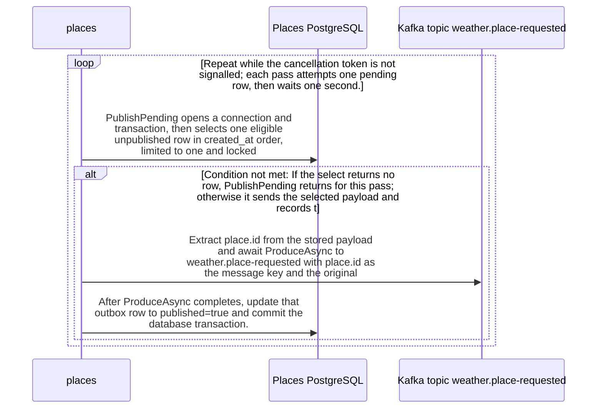

import {ClewProcess, ClewDataModel, ClewDownload, ClewModelLink, ClewRelatedModelLink, ClewFieldTrace, ClewContextLink, ClewPageContext, ClewProcessReturn, ClewStatus, ClewRetainedPage, ClewCatalog, ClewAnchor} from '@site/src/components/ClewReaders';

# Place request publisher

<ClewPageContext />

Retained account · STALE · UNASSESSED. Runtime behavior is not established by this export.

At source level, RequestPublisher.ExecuteAsync creates one Kafka producer using KAFKA\_BOOTSTRAP or kafka:9092, with idempotence enabled and a 10-second message timeout. While the token is not cancelled, it calls PublishPending and waits one second between passes. PublishPending selects at most one eligible unpublished row in created\_at order with FOR UPDATE SKIP LOCKED; if none is returned, it exits that pass without sending. For a selected row it extracts place.id from the stored JSON, awaits a send to weather.place-requested using that ID as the key, then sets published=true and commits the database transaction. Since send completion comes before the database commit, a crash between them can leave the row eligible for another send. The loop logs other exceptions as PUBLISH\_RETRY; cancellation during PublishPending breaks the loop, while cancellation reaching the post-attempt delay can propagate. C\# source coverage is PARTIAL; this code does not establish runtime hosting activation or delivery.

Summary source bindings

- [services/places/RequestPublisher.cs:18–34 · revision c289b28be4819eddf29d59a7c12f178559ec5229](../sources/728b9ba12f04391993430660fb0e4a022375568be05cd19f8e9d4aca115e990d.mdx)
- [services/places/RequestPublisher.cs:7–17 · revision c289b28be4819eddf29d59a7c12f178559ec5229](../sources/b970c6d235f9c5eb2f4e16bc78eda2a4ee3a68751103a8811054e9802c535d97.mdx)

## Interaction diagram

Actors and nested branches from the retained account; not a runtime trace. Labels are shortened for readability. Full messages and notes follow.

Full original sequence, branches and notes

#### 1. loop

Repeat while the cancellation token is not signalled; each pass attempts one pending row, then waits one second.

Source bindings

- [services/places/RequestPublisher.cs:10–10 · revision c289b28be4819eddf29d59a7c12f178559ec5229](../sources/a0297a2ef05d2d41e7c12a344c24091c5b8976f8b4240b03ed9698d1adaf5298.mdx)
- [services/places/RequestPublisher.cs:7–17 · revision c289b28be4819eddf29d59a7c12f178559ec5229](../sources/b970c6d235f9c5eb2f4e16bc78eda2a4ee3a68751103a8811054e9802c535d97.mdx)

#### 2. message

PublishPending opens a connection and transaction, then selects one eligible unpublished row in created\_at order, limited to one and locked with SKIP LOCKED.

Source bindings

- [services/places/RequestPublisher.cs:18–34 · revision c289b28be4819eddf29d59a7c12f178559ec5229](../sources/728b9ba12f04391993430660fb0e4a022375568be05cd19f8e9d4aca115e990d.mdx)

#### 3. alt

If the select returns no row, PublishPending returns for this pass; otherwise it sends the selected payload and records the completed send.

Source bindings

- [services/places/RequestPublisher.cs:18–34 · revision c289b28be4819eddf29d59a7c12f178559ec5229](../sources/728b9ba12f04391993430660fb0e4a022375568be05cd19f8e9d4aca115e990d.mdx)

#### 4. note

No row is sent when the reader is empty; the using scopes dispose the open transaction and connection on return.

Source bindings

- [services/places/RequestPublisher.cs:18–34 · revision c289b28be4819eddf29d59a7c12f178559ec5229](../sources/728b9ba12f04391993430660fb0e4a022375568be05cd19f8e9d4aca115e990d.mdx)

#### 5. else

Otherwise

Source bindings

- [services/places/RequestPublisher.cs:18–34 · revision c289b28be4819eddf29d59a7c12f178559ec5229](../sources/728b9ba12f04391993430660fb0e4a022375568be05cd19f8e9d4aca115e990d.mdx)

#### 6. message

Extract place.id from the stored payload and await ProduceAsync to weather.place-requested with place.id as the message key and the original payload as the value.

Source bindings

- [services/places/RequestPublisher.cs:18–34 · revision c289b28be4819eddf29d59a7c12f178559ec5229](../sources/728b9ba12f04391993430660fb0e4a022375568be05cd19f8e9d4aca115e990d.mdx)

#### 7. message

After ProduceAsync completes, update that outbox row to published=true and commit the database transaction.

Source bindings

- [services/places/RequestPublisher.cs:18–34 · revision c289b28be4819eddf29d59a7c12f178559ec5229](../sources/728b9ba12f04391993430660fb0e4a022375568be05cd19f8e9d4aca115e990d.mdx)

#### 8. note

A crash after the broker send but before the database commit can leave the row unpublished for a later send; producer idempotence does not make Kafka and PostgreSQL one atomic transaction.

Source bindings

- [services/places/RequestPublisher.cs:18–34 · revision c289b28be4819eddf29d59a7c12f178559ec5229](../sources/728b9ba12f04391993430660fb0e4a022375568be05cd19f8e9d4aca115e990d.mdx)
- [services/places/RequestPublisher.cs:7–17 · revision c289b28be4819eddf29d59a7c12f178559ec5229](../sources/b970c6d235f9c5eb2f4e16bc78eda2a4ee3a68751103a8811054e9802c535d97.mdx)

#### 9. end

Source bindings

- [services/places/RequestPublisher.cs:18–34 · revision c289b28be4819eddf29d59a7c12f178559ec5229](../sources/728b9ba12f04391993430660fb0e4a022375568be05cd19f8e9d4aca115e990d.mdx)

#### 10. alt

If PublishPending throws OperationCanceledException while the token is cancelled, the loop exits; other errors are handled by the general catch.

Source bindings

- [services/places/RequestPublisher.cs:12–14 · revision c289b28be4819eddf29d59a7c12f178559ec5229](../sources/ff647c92f0f91c1dd6e892f5a3ff6cc9dc864ff5d6ce859d7dce19ee7c350405.mdx)
- [services/places/RequestPublisher.cs:7–17 · revision c289b28be4819eddf29d59a7c12f178559ec5229](../sources/b970c6d235f9c5eb2f4e16bc78eda2a4ee3a68751103a8811054e9802c535d97.mdx)

#### 11. note

An OperationCanceledException observed while the token is cancelled breaks the loop.

Source bindings

- [services/places/RequestPublisher.cs:7–17 · revision c289b28be4819eddf29d59a7c12f178559ec5229](../sources/b970c6d235f9c5eb2f4e16bc78eda2a4ee3a68751103a8811054e9802c535d97.mdx)

#### 12. else

Otherwise

Source bindings

- [services/places/RequestPublisher.cs:12–14 · revision c289b28be4819eddf29d59a7c12f178559ec5229](../sources/ff647c92f0f91c1dd6e892f5a3ff6cc9dc864ff5d6ce859d7dce19ee7c350405.mdx)
- [services/places/RequestPublisher.cs:7–17 · revision c289b28be4819eddf29d59a7c12f178559ec5229](../sources/b970c6d235f9c5eb2f4e16bc78eda2a4ee3a68751103a8811054e9802c535d97.mdx)

#### 13. note

Other exceptions are logged with PUBLISH\_RETRY; normal completion and logged failures continue to the one-second delay. The delay also receives the token, so cancellation reaching that await can propagate.

Source bindings

- [services/places/RequestPublisher.cs:7–17 · revision c289b28be4819eddf29d59a7c12f178559ec5229](../sources/b970c6d235f9c5eb2f4e16bc78eda2a4ee3a68751103a8811054e9802c535d97.mdx)

#### 14. end

Source bindings

- [services/places/RequestPublisher.cs:12–14 · revision c289b28be4819eddf29d59a7c12f178559ec5229](../sources/ff647c92f0f91c1dd6e892f5a3ff6cc9dc864ff5d6ce859d7dce19ee7c350405.mdx)
- [services/places/RequestPublisher.cs:7–17 · revision c289b28be4819eddf29d59a7c12f178559ec5229](../sources/b970c6d235f9c5eb2f4e16bc78eda2a4ee3a68751103a8811054e9802c535d97.mdx)

#### 15. end

Source bindings

- [services/places/RequestPublisher.cs:10–10 · revision c289b28be4819eddf29d59a7c12f178559ec5229](../sources/a0297a2ef05d2d41e7c12a344c24091c5b8976f8b4240b03ed9698d1adaf5298.mdx)
- [services/places/RequestPublisher.cs:7–17 · revision c289b28be4819eddf29d59a7c12f178559ec5229](../sources/b970c6d235f9c5eb2f4e16bc78eda2a4ee3a68751103a8811054e9802c535d97.mdx)

## Implementation explanation

Repeat while the cancellation token is not signalled; each pass attempts one pending row, then waits one second.

Source bindings

- [services/places/RequestPublisher.cs:10–10 · revision c289b28be4819eddf29d59a7c12f178559ec5229](../sources/a0297a2ef05d2d41e7c12a344c24091c5b8976f8b4240b03ed9698d1adaf5298.mdx)
- [services/places/RequestPublisher.cs:7–17 · revision c289b28be4819eddf29d59a7c12f178559ec5229](../sources/b970c6d235f9c5eb2f4e16bc78eda2a4ee3a68751103a8811054e9802c535d97.mdx)

PublishPending opens a connection and transaction, then selects one eligible unpublished row in created\_at order, limited to one and locked with SKIP LOCKED.

Source bindings

- [services/places/RequestPublisher.cs:18–34 · revision c289b28be4819eddf29d59a7c12f178559ec5229](../sources/728b9ba12f04391993430660fb0e4a022375568be05cd19f8e9d4aca115e990d.mdx)

If the select returns no row, PublishPending returns for this pass; otherwise it sends the selected payload and records the completed send.

Source bindings

- [services/places/RequestPublisher.cs:18–34 · revision c289b28be4819eddf29d59a7c12f178559ec5229](../sources/728b9ba12f04391993430660fb0e4a022375568be05cd19f8e9d4aca115e990d.mdx)

No row is sent when the reader is empty; the using scopes dispose the open transaction and connection on return.

Source bindings

- [services/places/RequestPublisher.cs:18–34 · revision c289b28be4819eddf29d59a7c12f178559ec5229](../sources/728b9ba12f04391993430660fb0e4a022375568be05cd19f8e9d4aca115e990d.mdx)

The source describes an alternative branch.

Source bindings

- [services/places/RequestPublisher.cs:18–34 · revision c289b28be4819eddf29d59a7c12f178559ec5229](../sources/728b9ba12f04391993430660fb0e4a022375568be05cd19f8e9d4aca115e990d.mdx)

Extract place.id from the stored payload and await ProduceAsync to weather.place-requested with place.id as the message key and the original payload as the value.

Source bindings

- [services/places/RequestPublisher.cs:18–34 · revision c289b28be4819eddf29d59a7c12f178559ec5229](../sources/728b9ba12f04391993430660fb0e4a022375568be05cd19f8e9d4aca115e990d.mdx)

After ProduceAsync completes, update that outbox row to published=true and commit the database transaction.

Source bindings

- [services/places/RequestPublisher.cs:18–34 · revision c289b28be4819eddf29d59a7c12f178559ec5229](../sources/728b9ba12f04391993430660fb0e4a022375568be05cd19f8e9d4aca115e990d.mdx)

A crash after the broker send but before the database commit can leave the row unpublished for a later send; producer idempotence does not make Kafka and PostgreSQL one atomic transaction.

Source bindings

- [services/places/RequestPublisher.cs:18–34 · revision c289b28be4819eddf29d59a7c12f178559ec5229](../sources/728b9ba12f04391993430660fb0e4a022375568be05cd19f8e9d4aca115e990d.mdx)
- [services/places/RequestPublisher.cs:7–17 · revision c289b28be4819eddf29d59a7c12f178559ec5229](../sources/b970c6d235f9c5eb2f4e16bc78eda2a4ee3a68751103a8811054e9802c535d97.mdx)

If PublishPending throws OperationCanceledException while the token is cancelled, the loop exits; other errors are handled by the general catch.

Source bindings

- [services/places/RequestPublisher.cs:12–14 · revision c289b28be4819eddf29d59a7c12f178559ec5229](../sources/ff647c92f0f91c1dd6e892f5a3ff6cc9dc864ff5d6ce859d7dce19ee7c350405.mdx)
- [services/places/RequestPublisher.cs:7–17 · revision c289b28be4819eddf29d59a7c12f178559ec5229](../sources/b970c6d235f9c5eb2f4e16bc78eda2a4ee3a68751103a8811054e9802c535d97.mdx)

An OperationCanceledException observed while the token is cancelled breaks the loop.

Source bindings

- [services/places/RequestPublisher.cs:7–17 · revision c289b28be4819eddf29d59a7c12f178559ec5229](../sources/b970c6d235f9c5eb2f4e16bc78eda2a4ee3a68751103a8811054e9802c535d97.mdx)

The source describes an alternative branch.

Source bindings

- [services/places/RequestPublisher.cs:12–14 · revision c289b28be4819eddf29d59a7c12f178559ec5229](../sources/ff647c92f0f91c1dd6e892f5a3ff6cc9dc864ff5d6ce859d7dce19ee7c350405.mdx)
- [services/places/RequestPublisher.cs:7–17 · revision c289b28be4819eddf29d59a7c12f178559ec5229](../sources/b970c6d235f9c5eb2f4e16bc78eda2a4ee3a68751103a8811054e9802c535d97.mdx)

Other exceptions are logged with PUBLISH\_RETRY; normal completion and logged failures continue to the one-second delay. The delay also receives the token, so cancellation reaching that await can propagate.

Source bindings

- [services/places/RequestPublisher.cs:7–17 · revision c289b28be4819eddf29d59a7c12f178559ec5229](../sources/b970c6d235f9c5eb2f4e16bc78eda2a4ee3a68751103a8811054e9802c535d97.mdx)

Retained boundaries

- CALL\_TARGETS\_UNRESOLVED
- DIALECT\_DECLARED\_NOT\_COMPILER\_VALIDATED
- FILE\_ONLY:compose.yaml
- FILE\_ONLY:contracts/dashboard.openapi.json
- FILE\_ONLY:contracts/events.schema.json
- FILE\_ONLY:database/init.sql
- FILE\_ONLY:exercises/dashboard-focus-regression.mjs
- FILE\_ONLY:exercises/replay.py
- FILE\_ONLY:exercises/validator-regression.mjs
- FILE\_ONLY:fixtures/helsinki.json
- FILE\_ONLY:fixtures/lisbon.json
- FILE\_ONLY:fixtures/met-oslo-recorded.json
- FILE\_ONLY:fixtures/oslo.json
- FILE\_ONLY:fixtures/provenance.json
- FILE\_ONLY:services/dashboard/Dockerfile
- FILE\_ONLY:services/dashboard/package-lock.json
- FILE\_ONLY:services/dashboard/package.json
- FILE\_ONLY:services/dashboard/public/index.html
- FILE\_ONLY:services/dashboard/tsconfig.json
- OPENAPI\_JSON\_SCHEMA\_KEYWORDS\_NOT\_INTERPRETED
- OPENAPI\_SCHEMA\_NULL\_TYPE\_NOT\_INTERPRETED
- OPENAPI\_SCHEMA\_TYPE\_UNIONS\_NOT\_INTERPRETED
- ORDER\_LEXICAL\_ONLY
- SCOPE\_WATCH\_CONSERVATIVE
- Syntax evidence does not establish runtime dispatch or configuration. Expand known owners and helpers; retain explicit gaps for unresolved targets.
- ANNOTATION\_DECLARATION\_UNAVAILABLE
- CALL\_TARGETS\_UNRESOLVED
- DIALECT\_DECLARED\_NOT\_COMPILER\_VALIDATED
- FILE\_ONLY:compose.yaml
- FILE\_ONLY:contracts/events.schema.json
- FILE\_ONLY:contracts/forecasts.openapi.json
- FILE\_ONLY:database/init.sql
- FILE\_ONLY:fixtures/helsinki.json
- FILE\_ONLY:fixtures/lisbon.json
- FILE\_ONLY:fixtures/met-oslo-recorded.json
- FILE\_ONLY:fixtures/oslo.json
- FILE\_ONLY:fixtures/provenance.json
- FILE\_ONLY:services/forecasts/Dockerfile
- FILE\_ONLY:services/forecasts/pom.xml
- FILE\_ONLY:services/forecasts/src/main/resources/application.properties
- NO\_BEAN\_OWNER
- OPENAPI\_JSON\_SCHEMA\_KEYWORDS\_NOT\_INTERPRETED
- OPENAPI\_SCHEMA\_NULL\_TYPE\_NOT\_INTERPRETED
- OPENAPI\_SCHEMA\_TYPE\_UNIONS\_NOT\_INTERPRETED
- ORDER\_LEXICAL\_ONLY
- RUNTIME\_REGISTRATION\_UNPROVEN
- SCOPE\_WATCH\_CONSERVATIVE
- SOURCE\_NAMES\_NOT\_COMPILER\_RESOLVED
- UNRESOLVED\_ANNOTATION\_VALUE
- Syntax evidence does not establish runtime dispatch or configuration. Expand known owners and helpers; retain explicit gaps for unresolved targets.
- CLR\_SIGNATURE\_PROJECTED\_TO\_JVM\_DESCRIPTOR\_GRAMMAR
- CSHARP\_SOURCE\_GENERATED\_DOCUMENTS\_NOT\_INDEXED
- EXCEPTION\_FLOW\_REQUIRES\_SOURCE\_REVIEW
- GENERATED\_SOURCE\_BODIES\_NOT\_INDEXED
- LAMBDA\_EXECUTION\_NOT\_EXPANDED
- OPENAPI\_JSON\_SCHEMA\_KEYWORDS\_NOT\_INTERPRETED
- SHORT\_CIRCUIT\_FLOW\_REQUIRES\_SOURCE\_REVIEW
- SWITCH\_FLOW\_REQUIRES\_SOURCE\_REVIEW

