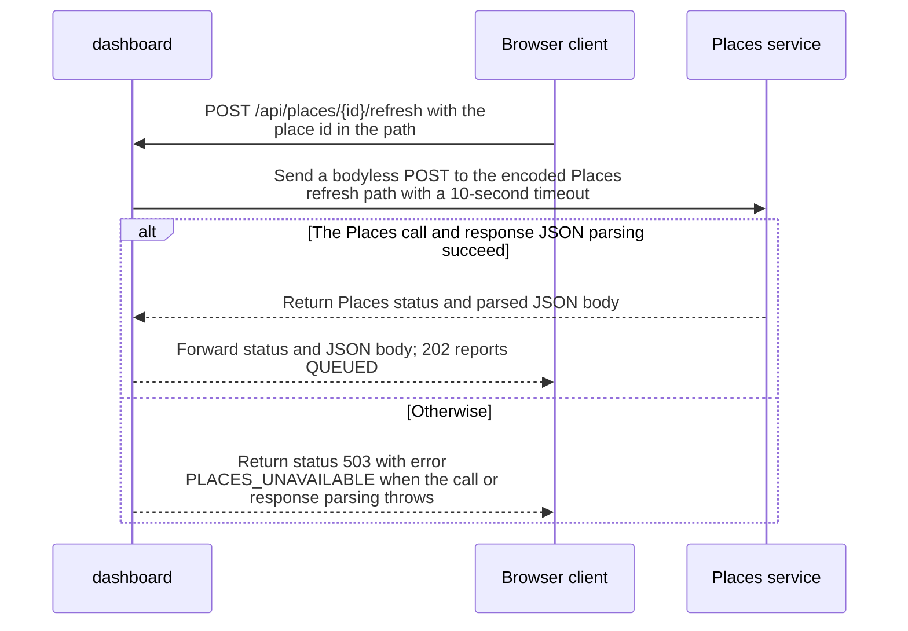

import {ClewProcess, ClewDataModel, ClewDownload, ClewModelLink, ClewRelatedModelLink, ClewFieldTrace, ClewContextLink, ClewPageContext, ClewProcessReturn, ClewStatus, ClewRetainedPage, ClewCatalog, ClewAnchor} from '@site/src/components/ClewReaders';

# POST /api/places/&#123;id&#125;/refresh — queue refresh

<ClewPageContext />

Retained account · UNVERIFIED · UNASSESSED. Runtime behavior is not established by this export.

The required id path parameter is encoded and sent in a bodyless POST to Places with a 10-second timeout. Dashboard forwards Places status and JSON. If the call or JSON parsing throws, Dashboard returns 503 PLACES\_UNAVAILABLE. The declared 202 body means the request is queued, not that forecast data is ready.

Summary source bindings

- [services/dashboard/src/main.ts:78–78 · revision e635069293d58cb0d4f28c8211e748b8d58e6b37](../sources/35ec21685190e64603e7da3a3f17597274cb2c14b70c455f6a1e6529f6800249.mdx)
- [services/dashboard/src/main.ts:79–79 · revision e635069293d58cb0d4f28c8211e748b8d58e6b37](../sources/499dc8e55282117f57ff61a3963e0c2d65a8df022c3de390c50dcbb7767d89cb.mdx)
- [services/dashboard/src/main.ts:76–83 · revision e635069293d58cb0d4f28c8211e748b8d58e6b37](../sources/b41ac7155eba29b1e6a9dfe10348b626c22e19654978c7d35379a71fff4526a1.mdx)
- [contracts/dashboard.openapi.json:1–462 · revision e635069293d58cb0d4f28c8211e748b8d58e6b37](../sources/2cf069499a8284aa81909007590ed57f8b987703681fef870962f36c0681f13b.mdx)
- [services/dashboard/src/main.ts:79–79 · revision e635069293d58cb0d4f28c8211e748b8d58e6b37](../sources/df9cdc7b2bc1ca9cf6122d22c2c35f025650b1a53788a3cb08891113a857b24a.mdx)
- [services/dashboard/src/main.ts:78–78 · revision e635069293d58cb0d4f28c8211e748b8d58e6b37](../sources/a68a759254041e1222f1b3acbee6dd2f618f57c0f0854e6edc261ffc148b6604.mdx)
- [services/dashboard/src/main.ts:81–81 · revision e635069293d58cb0d4f28c8211e748b8d58e6b37](../sources/f865349a078107726248178334c212c28474b6872a24418e9df7be13205ff92b.mdx)
- [services/dashboard/src/main.ts:78–78 · revision e635069293d58cb0d4f28c8211e748b8d58e6b37](../sources/0df062f3ce874bf34a6ca6587e650178f2eb445f035717c293279068eeaac343.mdx)

## Declared POST /api/places/&#123;id&#125;/refresh contract

| Topic | Retained contract detail |
| --- | --- |
| Request | The required path parameter id is oslo, helsinki, or lisbon; no request body is declared. |
| 202 response | The application/json body requires placeId as a string and status as the constant QUEUED. |
| 404, 500, and 503 responses | Each declares an application/json object with a string error field. |
| Declaration boundary | OpenAPI 3.1 declarations are parsed by a bounded reader; runtime enforcement and full JSON Schema validation are unverified. |

Contract source bindings

**Request**

- [contracts/dashboard.openapi.json:1–462 · revision e635069293d58cb0d4f28c8211e748b8d58e6b37](../sources/2cf069499a8284aa81909007590ed57f8b987703681fef870962f36c0681f13b.mdx)

**202 response**

- [contracts/dashboard.openapi.json:1–462 · revision e635069293d58cb0d4f28c8211e748b8d58e6b37](../sources/2cf069499a8284aa81909007590ed57f8b987703681fef870962f36c0681f13b.mdx)

**404, 500, and 503 responses**

- [contracts/dashboard.openapi.json:1–462 · revision e635069293d58cb0d4f28c8211e748b8d58e6b37](../sources/2cf069499a8284aa81909007590ed57f8b987703681fef870962f36c0681f13b.mdx)

**Declaration boundary**

- [contracts/dashboard.openapi.json:1–462 · revision e635069293d58cb0d4f28c8211e748b8d58e6b37](../sources/2cf069499a8284aa81909007590ed57f8b987703681fef870962f36c0681f13b.mdx)

## Declared interface schemas

<ClewContextLink path="/http/475242e2ef07721c45d26c563b5cd15b52b47fb16494eab9b22738cd80b35c25">GET /openapi.json</ClewContextLink>

<ClewContextLink path="/http/5e9ce2f78105d5d9215b07ddf87c8025176e932f11403c3b248ee8f2f77a9989">POST /api/places</ClewContextLink>

<ClewContextLink path="/http/ed3ea26055386f7e8904ff37c1c9931e4943602283a96c6067a31ac32aa24dac">POST /api/places/&#123;id&#125;/refresh</ClewContextLink>

<ClewContextLink path="/http/d3d56f55618a4d6b12c611f5055d16e80668439f39a23e30eb42437d1be85294">GET /</ClewContextLink>

<ClewContextLink path="/http/589bef5f2c1640933430afb73226fc910c4cdb435b53197fdaef848d460a716b">GET /health</ClewContextLink>

<ClewContextLink path="/http/5fda6cc4b385e34a2f5c5b6539f9420f1a95661ef0c3656b18ef951b4f2fe516">GET /api/weather</ClewContextLink>

## Interaction diagram

Actors and nested branches from the retained account; not a runtime trace. Labels are shortened for readability. Full messages and notes follow.

Full original sequence, branches and notes

#### 1. message

POST /api/places/&#123;id&#125;/refresh with the place id in the path

Source bindings

- [services/dashboard/src/main.ts:76–83 · revision e635069293d58cb0d4f28c8211e748b8d58e6b37](../sources/b41ac7155eba29b1e6a9dfe10348b626c22e19654978c7d35379a71fff4526a1.mdx)
- [contracts/dashboard.openapi.json:1–462 · revision e635069293d58cb0d4f28c8211e748b8d58e6b37](../sources/2cf069499a8284aa81909007590ed57f8b987703681fef870962f36c0681f13b.mdx)

#### 2. message

Send a bodyless POST to the encoded Places refresh path with a 10-second timeout

Source bindings

- [services/dashboard/src/main.ts:78–78 · revision e635069293d58cb0d4f28c8211e748b8d58e6b37](../sources/35ec21685190e64603e7da3a3f17597274cb2c14b70c455f6a1e6529f6800249.mdx)
- [services/dashboard/src/main.ts:76–83 · revision e635069293d58cb0d4f28c8211e748b8d58e6b37](../sources/b41ac7155eba29b1e6a9dfe10348b626c22e19654978c7d35379a71fff4526a1.mdx)
- [services/dashboard/src/main.ts:78–78 · revision e635069293d58cb0d4f28c8211e748b8d58e6b37](../sources/a68a759254041e1222f1b3acbee6dd2f618f57c0f0854e6edc261ffc148b6604.mdx)
- [services/dashboard/src/main.ts:78–78 · revision e635069293d58cb0d4f28c8211e748b8d58e6b37](../sources/0df062f3ce874bf34a6ca6587e650178f2eb445f035717c293279068eeaac343.mdx)

#### 3. alt

The Places call and response JSON parsing succeed

Source bindings

- [services/dashboard/src/main.ts:77–82 · revision e635069293d58cb0d4f28c8211e748b8d58e6b37](../sources/6e99c286bdd3d582e94aaa493006d53aa3167c95d52d54d1270c79548caf0867.mdx)
- [services/dashboard/src/main.ts:79–79 · revision e635069293d58cb0d4f28c8211e748b8d58e6b37](../sources/499dc8e55282117f57ff61a3963e0c2d65a8df022c3de390c50dcbb7767d89cb.mdx)
- [services/dashboard/src/main.ts:76–83 · revision e635069293d58cb0d4f28c8211e748b8d58e6b37](../sources/b41ac7155eba29b1e6a9dfe10348b626c22e19654978c7d35379a71fff4526a1.mdx)
- [services/dashboard/src/main.ts:79–79 · revision e635069293d58cb0d4f28c8211e748b8d58e6b37](../sources/df9cdc7b2bc1ca9cf6122d22c2c35f025650b1a53788a3cb08891113a857b24a.mdx)
- [services/dashboard/src/main.ts:78–78 · revision e635069293d58cb0d4f28c8211e748b8d58e6b37](../sources/a68a759254041e1222f1b3acbee6dd2f618f57c0f0854e6edc261ffc148b6604.mdx)

#### 4. return

Return Places status and parsed JSON body

Source bindings

- [services/dashboard/src/main.ts:79–79 · revision e635069293d58cb0d4f28c8211e748b8d58e6b37](../sources/499dc8e55282117f57ff61a3963e0c2d65a8df022c3de390c50dcbb7767d89cb.mdx)
- [services/dashboard/src/main.ts:76–83 · revision e635069293d58cb0d4f28c8211e748b8d58e6b37](../sources/b41ac7155eba29b1e6a9dfe10348b626c22e19654978c7d35379a71fff4526a1.mdx)
- [services/dashboard/src/main.ts:79–79 · revision e635069293d58cb0d4f28c8211e748b8d58e6b37](../sources/df9cdc7b2bc1ca9cf6122d22c2c35f025650b1a53788a3cb08891113a857b24a.mdx)

#### 5. return

Forward status and JSON body; 202 reports QUEUED

Source bindings

- [services/dashboard/src/main.ts:76–83 · revision e635069293d58cb0d4f28c8211e748b8d58e6b37](../sources/b41ac7155eba29b1e6a9dfe10348b626c22e19654978c7d35379a71fff4526a1.mdx)
- [contracts/dashboard.openapi.json:1–462 · revision e635069293d58cb0d4f28c8211e748b8d58e6b37](../sources/2cf069499a8284aa81909007590ed57f8b987703681fef870962f36c0681f13b.mdx)
- [services/dashboard/src/main.ts:81–81 · revision e635069293d58cb0d4f28c8211e748b8d58e6b37](../sources/f865349a078107726248178334c212c28474b6872a24418e9df7be13205ff92b.mdx)

#### 6. else

Otherwise

Source bindings

- [services/dashboard/src/main.ts:77–82 · revision e635069293d58cb0d4f28c8211e748b8d58e6b37](../sources/6e99c286bdd3d582e94aaa493006d53aa3167c95d52d54d1270c79548caf0867.mdx)
- [services/dashboard/src/main.ts:79–79 · revision e635069293d58cb0d4f28c8211e748b8d58e6b37](../sources/499dc8e55282117f57ff61a3963e0c2d65a8df022c3de390c50dcbb7767d89cb.mdx)
- [services/dashboard/src/main.ts:76–83 · revision e635069293d58cb0d4f28c8211e748b8d58e6b37](../sources/b41ac7155eba29b1e6a9dfe10348b626c22e19654978c7d35379a71fff4526a1.mdx)
- [services/dashboard/src/main.ts:79–79 · revision e635069293d58cb0d4f28c8211e748b8d58e6b37](../sources/df9cdc7b2bc1ca9cf6122d22c2c35f025650b1a53788a3cb08891113a857b24a.mdx)
- [services/dashboard/src/main.ts:78–78 · revision e635069293d58cb0d4f28c8211e748b8d58e6b37](../sources/a68a759254041e1222f1b3acbee6dd2f618f57c0f0854e6edc261ffc148b6604.mdx)

#### 7. return

Return status 503 with error PLACES\_UNAVAILABLE when the call or response parsing throws

Source bindings

- [services/dashboard/src/main.ts:77–82 · revision e635069293d58cb0d4f28c8211e748b8d58e6b37](../sources/6e99c286bdd3d582e94aaa493006d53aa3167c95d52d54d1270c79548caf0867.mdx)
- [services/dashboard/src/main.ts:76–83 · revision e635069293d58cb0d4f28c8211e748b8d58e6b37](../sources/b41ac7155eba29b1e6a9dfe10348b626c22e19654978c7d35379a71fff4526a1.mdx)
- [services/dashboard/src/main.ts:79–79 · revision e635069293d58cb0d4f28c8211e748b8d58e6b37](../sources/df9cdc7b2bc1ca9cf6122d22c2c35f025650b1a53788a3cb08891113a857b24a.mdx)
- [services/dashboard/src/main.ts:78–78 · revision e635069293d58cb0d4f28c8211e748b8d58e6b37](../sources/a68a759254041e1222f1b3acbee6dd2f618f57c0f0854e6edc261ffc148b6604.mdx)

#### 8. end

Source bindings

- [services/dashboard/src/main.ts:77–82 · revision e635069293d58cb0d4f28c8211e748b8d58e6b37](../sources/6e99c286bdd3d582e94aaa493006d53aa3167c95d52d54d1270c79548caf0867.mdx)
- [services/dashboard/src/main.ts:79–79 · revision e635069293d58cb0d4f28c8211e748b8d58e6b37](../sources/499dc8e55282117f57ff61a3963e0c2d65a8df022c3de390c50dcbb7767d89cb.mdx)
- [services/dashboard/src/main.ts:76–83 · revision e635069293d58cb0d4f28c8211e748b8d58e6b37](../sources/b41ac7155eba29b1e6a9dfe10348b626c22e19654978c7d35379a71fff4526a1.mdx)
- [services/dashboard/src/main.ts:79–79 · revision e635069293d58cb0d4f28c8211e748b8d58e6b37](../sources/df9cdc7b2bc1ca9cf6122d22c2c35f025650b1a53788a3cb08891113a857b24a.mdx)
- [services/dashboard/src/main.ts:78–78 · revision e635069293d58cb0d4f28c8211e748b8d58e6b37](../sources/a68a759254041e1222f1b3acbee6dd2f618f57c0f0854e6edc261ffc148b6604.mdx)

## Implementation explanation

POST /api/places/&#123;id&#125;/refresh with the place id in the path

Source bindings

- [services/dashboard/src/main.ts:76–83 · revision e635069293d58cb0d4f28c8211e748b8d58e6b37](../sources/b41ac7155eba29b1e6a9dfe10348b626c22e19654978c7d35379a71fff4526a1.mdx)
- [contracts/dashboard.openapi.json:1–462 · revision e635069293d58cb0d4f28c8211e748b8d58e6b37](../sources/2cf069499a8284aa81909007590ed57f8b987703681fef870962f36c0681f13b.mdx)

Send a bodyless POST to the encoded Places refresh path with a 10-second timeout

Source bindings

- [services/dashboard/src/main.ts:78–78 · revision e635069293d58cb0d4f28c8211e748b8d58e6b37](../sources/35ec21685190e64603e7da3a3f17597274cb2c14b70c455f6a1e6529f6800249.mdx)
- [services/dashboard/src/main.ts:76–83 · revision e635069293d58cb0d4f28c8211e748b8d58e6b37](../sources/b41ac7155eba29b1e6a9dfe10348b626c22e19654978c7d35379a71fff4526a1.mdx)
- [services/dashboard/src/main.ts:78–78 · revision e635069293d58cb0d4f28c8211e748b8d58e6b37](../sources/a68a759254041e1222f1b3acbee6dd2f618f57c0f0854e6edc261ffc148b6604.mdx)
- [services/dashboard/src/main.ts:78–78 · revision e635069293d58cb0d4f28c8211e748b8d58e6b37](../sources/0df062f3ce874bf34a6ca6587e650178f2eb445f035717c293279068eeaac343.mdx)

The Places call and response JSON parsing succeed

Source bindings

- [services/dashboard/src/main.ts:77–82 · revision e635069293d58cb0d4f28c8211e748b8d58e6b37](../sources/6e99c286bdd3d582e94aaa493006d53aa3167c95d52d54d1270c79548caf0867.mdx)
- [services/dashboard/src/main.ts:79–79 · revision e635069293d58cb0d4f28c8211e748b8d58e6b37](../sources/499dc8e55282117f57ff61a3963e0c2d65a8df022c3de390c50dcbb7767d89cb.mdx)
- [services/dashboard/src/main.ts:76–83 · revision e635069293d58cb0d4f28c8211e748b8d58e6b37](../sources/b41ac7155eba29b1e6a9dfe10348b626c22e19654978c7d35379a71fff4526a1.mdx)
- [services/dashboard/src/main.ts:79–79 · revision e635069293d58cb0d4f28c8211e748b8d58e6b37](../sources/df9cdc7b2bc1ca9cf6122d22c2c35f025650b1a53788a3cb08891113a857b24a.mdx)
- [services/dashboard/src/main.ts:78–78 · revision e635069293d58cb0d4f28c8211e748b8d58e6b37](../sources/a68a759254041e1222f1b3acbee6dd2f618f57c0f0854e6edc261ffc148b6604.mdx)

Return Places status and parsed JSON body

Source bindings

- [services/dashboard/src/main.ts:79–79 · revision e635069293d58cb0d4f28c8211e748b8d58e6b37](../sources/499dc8e55282117f57ff61a3963e0c2d65a8df022c3de390c50dcbb7767d89cb.mdx)
- [services/dashboard/src/main.ts:76–83 · revision e635069293d58cb0d4f28c8211e748b8d58e6b37](../sources/b41ac7155eba29b1e6a9dfe10348b626c22e19654978c7d35379a71fff4526a1.mdx)
- [services/dashboard/src/main.ts:79–79 · revision e635069293d58cb0d4f28c8211e748b8d58e6b37](../sources/df9cdc7b2bc1ca9cf6122d22c2c35f025650b1a53788a3cb08891113a857b24a.mdx)

Forward status and JSON body; 202 reports QUEUED

Source bindings

- [services/dashboard/src/main.ts:76–83 · revision e635069293d58cb0d4f28c8211e748b8d58e6b37](../sources/b41ac7155eba29b1e6a9dfe10348b626c22e19654978c7d35379a71fff4526a1.mdx)
- [contracts/dashboard.openapi.json:1–462 · revision e635069293d58cb0d4f28c8211e748b8d58e6b37](../sources/2cf069499a8284aa81909007590ed57f8b987703681fef870962f36c0681f13b.mdx)
- [services/dashboard/src/main.ts:81–81 · revision e635069293d58cb0d4f28c8211e748b8d58e6b37](../sources/f865349a078107726248178334c212c28474b6872a24418e9df7be13205ff92b.mdx)

The source describes an alternative branch.

Source bindings

- [services/dashboard/src/main.ts:77–82 · revision e635069293d58cb0d4f28c8211e748b8d58e6b37](../sources/6e99c286bdd3d582e94aaa493006d53aa3167c95d52d54d1270c79548caf0867.mdx)
- [services/dashboard/src/main.ts:79–79 · revision e635069293d58cb0d4f28c8211e748b8d58e6b37](../sources/499dc8e55282117f57ff61a3963e0c2d65a8df022c3de390c50dcbb7767d89cb.mdx)
- [services/dashboard/src/main.ts:76–83 · revision e635069293d58cb0d4f28c8211e748b8d58e6b37](../sources/b41ac7155eba29b1e6a9dfe10348b626c22e19654978c7d35379a71fff4526a1.mdx)
- [services/dashboard/src/main.ts:79–79 · revision e635069293d58cb0d4f28c8211e748b8d58e6b37](../sources/df9cdc7b2bc1ca9cf6122d22c2c35f025650b1a53788a3cb08891113a857b24a.mdx)
- [services/dashboard/src/main.ts:78–78 · revision e635069293d58cb0d4f28c8211e748b8d58e6b37](../sources/a68a759254041e1222f1b3acbee6dd2f618f57c0f0854e6edc261ffc148b6604.mdx)

Return status 503 with error PLACES\_UNAVAILABLE when the call or response parsing throws

Source bindings

- [services/dashboard/src/main.ts:77–82 · revision e635069293d58cb0d4f28c8211e748b8d58e6b37](../sources/6e99c286bdd3d582e94aaa493006d53aa3167c95d52d54d1270c79548caf0867.mdx)
- [services/dashboard/src/main.ts:76–83 · revision e635069293d58cb0d4f28c8211e748b8d58e6b37](../sources/b41ac7155eba29b1e6a9dfe10348b626c22e19654978c7d35379a71fff4526a1.mdx)
- [services/dashboard/src/main.ts:79–79 · revision e635069293d58cb0d4f28c8211e748b8d58e6b37](../sources/df9cdc7b2bc1ca9cf6122d22c2c35f025650b1a53788a3cb08891113a857b24a.mdx)
- [services/dashboard/src/main.ts:78–78 · revision e635069293d58cb0d4f28c8211e748b8d58e6b37](../sources/a68a759254041e1222f1b3acbee6dd2f618f57c0f0854e6edc261ffc148b6604.mdx)

Address and contracts · retained process documentation

Dashboard sends a bodyless POST to /places/&#123;id&#125;/refresh, URL-encodes the ID and applies a 10-second timeout. The selected Compose config sets PLACES\_URL to http://places:8080; the source uses the same default. The example target is POST http://places:8080/places/&#123;id&#125;/refresh. Production address and runtime receiver routing are unverified.

EDITORIAL\_READING\_GUIDE\_NOT\_ACCEPTED\_PROSE. This context does not change the interaction declaration or establish runtime binding.

[Process step and source evidence](../scenarios/dashboard-refresh-request.mdx#question-request)

Retained boundaries

- CALL\_TARGETS\_UNRESOLVED
- DIALECT\_DECLARED\_NOT\_COMPILER\_VALIDATED
- FILE\_ONLY:compose.yaml
- FILE\_ONLY:contracts/dashboard.openapi.json
- FILE\_ONLY:contracts/events.schema.json
- FILE\_ONLY:database/init.sql
- FILE\_ONLY:exercises/dashboard-focus-regression.mjs
- FILE\_ONLY:exercises/replay.py
- FILE\_ONLY:exercises/validator-regression.mjs
- FILE\_ONLY:fixtures/helsinki.json
- FILE\_ONLY:fixtures/lisbon.json
- FILE\_ONLY:fixtures/met-oslo-recorded.json
- FILE\_ONLY:fixtures/oslo.json
- FILE\_ONLY:fixtures/provenance.json
- FILE\_ONLY:services/dashboard/Dockerfile
- FILE\_ONLY:services/dashboard/package-lock.json
- FILE\_ONLY:services/dashboard/package.json
- FILE\_ONLY:services/dashboard/public/index.html
- FILE\_ONLY:services/dashboard/tsconfig.json
- OPENAPI\_JSON\_SCHEMA\_KEYWORDS\_NOT\_INTERPRETED
- OPENAPI\_SCHEMA\_NULL\_TYPE\_NOT\_INTERPRETED
- OPENAPI\_SCHEMA\_TYPE\_UNIONS\_NOT\_INTERPRETED
- ORDER\_LEXICAL\_ONLY
- SCOPE\_WATCH\_CONSERVATIVE
- Syntax evidence does not establish runtime dispatch or configuration. Expand known owners and helpers; retain explicit gaps for unresolved targets.
- ANNOTATION\_DECLARATION\_UNAVAILABLE
- CALL\_TARGETS\_UNRESOLVED
- DIALECT\_DECLARED\_NOT\_COMPILER\_VALIDATED
- FILE\_ONLY:compose.yaml
- FILE\_ONLY:contracts/events.schema.json
- FILE\_ONLY:contracts/forecasts.openapi.json
- FILE\_ONLY:database/init.sql
- FILE\_ONLY:fixtures/helsinki.json
- FILE\_ONLY:fixtures/lisbon.json
- FILE\_ONLY:fixtures/met-oslo-recorded.json
- FILE\_ONLY:fixtures/oslo.json
- FILE\_ONLY:fixtures/provenance.json
- FILE\_ONLY:services/forecasts/Dockerfile
- FILE\_ONLY:services/forecasts/pom.xml
- FILE\_ONLY:services/forecasts/src/main/resources/application.properties
- NO\_BEAN\_OWNER
- OPENAPI\_JSON\_SCHEMA\_KEYWORDS\_NOT\_INTERPRETED
- OPENAPI\_SCHEMA\_NULL\_TYPE\_NOT\_INTERPRETED
- OPENAPI\_SCHEMA\_TYPE\_UNIONS\_NOT\_INTERPRETED
- ORDER\_LEXICAL\_ONLY
- RUNTIME\_REGISTRATION\_UNPROVEN
- SCOPE\_WATCH\_CONSERVATIVE
- SOURCE\_NAMES\_NOT\_COMPILER\_RESOLVED
- UNRESOLVED\_ANNOTATION\_VALUE
- Syntax evidence does not establish runtime dispatch or configuration. Expand known owners and helpers; retain explicit gaps for unresolved targets.
- CLR\_SIGNATURE\_PROJECTED\_TO\_JVM\_DESCRIPTOR\_GRAMMAR
- CSHARP\_SOURCE\_GENERATED\_DOCUMENTS\_NOT\_INDEXED
- EXCEPTION\_FLOW\_REQUIRES\_SOURCE\_REVIEW
- GENERATED\_SOURCE\_BODIES\_NOT\_INDEXED
- LAMBDA\_EXECUTION\_NOT\_EXPANDED
- OPENAPI\_JSON\_SCHEMA\_KEYWORDS\_NOT\_INTERPRETED
- SHORT\_CIRCUIT\_FLOW\_REQUIRES\_SOURCE\_REVIEW
- SWITCH\_FLOW\_REQUIRES\_SOURCE\_REVIEW

