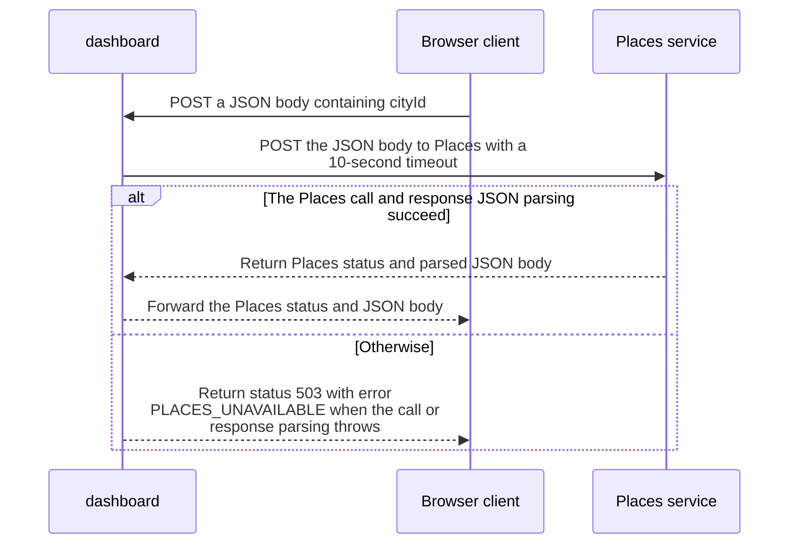

import {ClewProcess, ClewDataModel, ClewDownload, ClewModelLink, ClewRelatedModelLink, ClewFieldTrace, ClewContextLink, ClewPageContext, ClewProcessReturn, ClewStatus, ClewRetainedPage, ClewCatalog, ClewAnchor} from '@site/src/components/ClewReaders';

# POST /api/places — save a place

<ClewPageContext />

Retained account · UNVERIFIED · UNASSESSED. Runtime behavior is not established by this export.

The request carries cityId to Places as JSON. Dashboard forwards Places response status and JSON body. If the downstream call or JSON parsing throws, it returns 503 with PLACES\_UNAVAILABLE. The contract declares a required cityId body and a 200 saved-place response; other declared statuses are listed below.

Summary source bindings

- [services/dashboard/src/main.ts:69–69 · revision e635069293d58cb0d4f28c8211e748b8d58e6b37](../sources/42c79a62306d69f6e03417a48b78e31b68aa10ef4b9eb483f5b99a2c42feb556.mdx)
- [contracts/dashboard.openapi.json:1–462 · revision e635069293d58cb0d4f28c8211e748b8d58e6b37](../sources/2cf069499a8284aa81909007590ed57f8b987703681fef870962f36c0681f13b.mdx)
- [services/dashboard/src/main.ts:72–72 · revision e635069293d58cb0d4f28c8211e748b8d58e6b37](../sources/ba743bf8e936d129e5d731fdb79a4793b5028645d2d93594f266a04c7fde43fb.mdx)
- [services/dashboard/src/main.ts:67–74 · revision e635069293d58cb0d4f28c8211e748b8d58e6b37](../sources/ab8df8a5fe7536b2fc32d2257bed77e48c54ce422b10c3afba79f26ac88b67a8.mdx)
- [services/dashboard/src/main.ts:70–70 · revision e635069293d58cb0d4f28c8211e748b8d58e6b37](../sources/82baae9e891028786b477265a59e1647e0a7f9caa4407265ebb90d0ccabdf51c.mdx)
- [services/dashboard/src/main.ts:68–73 · revision e635069293d58cb0d4f28c8211e748b8d58e6b37](../sources/baa3248d99ea30a6c17da11fe53dc9898eb6ec9f54f08b597247f295b7f98989.mdx)
- [services/dashboard/src/main.ts:70–70 · revision e635069293d58cb0d4f28c8211e748b8d58e6b37](../sources/d324e9e85df47a94842b62d5335833610763086dcb985bce02be45e8c3625606.mdx)
- [services/dashboard/src/main.ts:72–72 · revision e635069293d58cb0d4f28c8211e748b8d58e6b37](../sources/b811d68ec726aeb53287f481b58ebe7448f0186b75bd42d11ecc1dee94c65aac.mdx)
- [services/dashboard/src/main.ts:70–70 · revision e635069293d58cb0d4f28c8211e748b8d58e6b37](../sources/eaf972e7a4259881d552b2e750bf0912f2db5d6c87d4026bff49f628e8ff0129.mdx)

## Declared POST /api/places contract

| Topic | Retained contract detail |
| --- | --- |
| Request | A required application/json object has only the required cityId field; cityId is oslo, helsinki, or lisbon. |
| 200 response | The application/json object requires id, name, latitude, and longitude. id is oslo, helsinki, or lisbon; latitude is -90..90 and longitude -180..180. |
| 400, 500, and 503 responses | Each declares an application/json object with a string error field. |
| 415 response | Status 415 is declared without a response body schema. |
| Declaration boundary | OpenAPI 3.1 declarations are parsed by a bounded reader; runtime enforcement and full JSON Schema validation are unverified. |

Contract source bindings

**Request**

- [contracts/dashboard.openapi.json:1–462 · revision e635069293d58cb0d4f28c8211e748b8d58e6b37](../sources/2cf069499a8284aa81909007590ed57f8b987703681fef870962f36c0681f13b.mdx)

**200 response**

- [contracts/dashboard.openapi.json:1–462 · revision e635069293d58cb0d4f28c8211e748b8d58e6b37](../sources/2cf069499a8284aa81909007590ed57f8b987703681fef870962f36c0681f13b.mdx)

**400, 500, and 503 responses**

- [contracts/dashboard.openapi.json:1–462 · revision e635069293d58cb0d4f28c8211e748b8d58e6b37](../sources/2cf069499a8284aa81909007590ed57f8b987703681fef870962f36c0681f13b.mdx)

**415 response**

- [contracts/dashboard.openapi.json:1–462 · revision e635069293d58cb0d4f28c8211e748b8d58e6b37](../sources/2cf069499a8284aa81909007590ed57f8b987703681fef870962f36c0681f13b.mdx)

**Declaration boundary**

- [contracts/dashboard.openapi.json:1–462 · revision e635069293d58cb0d4f28c8211e748b8d58e6b37](../sources/2cf069499a8284aa81909007590ed57f8b987703681fef870962f36c0681f13b.mdx)

## Declared interface schemas

<ClewContextLink path="/http/475242e2ef07721c45d26c563b5cd15b52b47fb16494eab9b22738cd80b35c25">GET /openapi.json</ClewContextLink>

<ClewContextLink path="/http/5e9ce2f78105d5d9215b07ddf87c8025176e932f11403c3b248ee8f2f77a9989">POST /api/places</ClewContextLink>

<ClewContextLink path="/http/ed3ea26055386f7e8904ff37c1c9931e4943602283a96c6067a31ac32aa24dac">POST /api/places/&#123;id&#125;/refresh</ClewContextLink>

<ClewContextLink path="/http/d3d56f55618a4d6b12c611f5055d16e80668439f39a23e30eb42437d1be85294">GET /</ClewContextLink>

<ClewContextLink path="/http/589bef5f2c1640933430afb73226fc910c4cdb435b53197fdaef848d460a716b">GET /health</ClewContextLink>

<ClewContextLink path="/http/5fda6cc4b385e34a2f5c5b6539f9420f1a95661ef0c3656b18ef951b4f2fe516">GET /api/weather</ClewContextLink>

## Interaction diagram

Actors and nested branches from the retained account; not a runtime trace. Labels are shortened for readability. Full messages and notes follow.

Full original sequence, branches and notes

#### 1. message

POST a JSON body containing cityId

Source bindings

- [contracts/dashboard.openapi.json:1–462 · revision e635069293d58cb0d4f28c8211e748b8d58e6b37](../sources/2cf069499a8284aa81909007590ed57f8b987703681fef870962f36c0681f13b.mdx)
- [services/dashboard/src/main.ts:67–74 · revision e635069293d58cb0d4f28c8211e748b8d58e6b37](../sources/ab8df8a5fe7536b2fc32d2257bed77e48c54ce422b10c3afba79f26ac88b67a8.mdx)

#### 2. message

POST the JSON body to Places with a 10-second timeout

Source bindings

- [services/dashboard/src/main.ts:69–69 · revision e635069293d58cb0d4f28c8211e748b8d58e6b37](../sources/42c79a62306d69f6e03417a48b78e31b68aa10ef4b9eb483f5b99a2c42feb556.mdx)
- [services/dashboard/src/main.ts:67–74 · revision e635069293d58cb0d4f28c8211e748b8d58e6b37](../sources/ab8df8a5fe7536b2fc32d2257bed77e48c54ce422b10c3afba79f26ac88b67a8.mdx)

#### 3. alt

The Places call and response JSON parsing succeed

Source bindings

- [services/dashboard/src/main.ts:69–69 · revision e635069293d58cb0d4f28c8211e748b8d58e6b37](../sources/42c79a62306d69f6e03417a48b78e31b68aa10ef4b9eb483f5b99a2c42feb556.mdx)
- [services/dashboard/src/main.ts:67–74 · revision e635069293d58cb0d4f28c8211e748b8d58e6b37](../sources/ab8df8a5fe7536b2fc32d2257bed77e48c54ce422b10c3afba79f26ac88b67a8.mdx)
- [services/dashboard/src/main.ts:70–70 · revision e635069293d58cb0d4f28c8211e748b8d58e6b37](../sources/82baae9e891028786b477265a59e1647e0a7f9caa4407265ebb90d0ccabdf51c.mdx)
- [services/dashboard/src/main.ts:68–73 · revision e635069293d58cb0d4f28c8211e748b8d58e6b37](../sources/baa3248d99ea30a6c17da11fe53dc9898eb6ec9f54f08b597247f295b7f98989.mdx)

#### 4. return

Return Places status and parsed JSON body

Source bindings

- [services/dashboard/src/main.ts:69–69 · revision e635069293d58cb0d4f28c8211e748b8d58e6b37](../sources/42c79a62306d69f6e03417a48b78e31b68aa10ef4b9eb483f5b99a2c42feb556.mdx)
- [services/dashboard/src/main.ts:67–74 · revision e635069293d58cb0d4f28c8211e748b8d58e6b37](../sources/ab8df8a5fe7536b2fc32d2257bed77e48c54ce422b10c3afba79f26ac88b67a8.mdx)
- [services/dashboard/src/main.ts:70–70 · revision e635069293d58cb0d4f28c8211e748b8d58e6b37](../sources/82baae9e891028786b477265a59e1647e0a7f9caa4407265ebb90d0ccabdf51c.mdx)
- [services/dashboard/src/main.ts:70–70 · revision e635069293d58cb0d4f28c8211e748b8d58e6b37](../sources/d324e9e85df47a94842b62d5335833610763086dcb985bce02be45e8c3625606.mdx)

#### 5. return

Forward the Places status and JSON body

Source bindings

- [services/dashboard/src/main.ts:67–74 · revision e635069293d58cb0d4f28c8211e748b8d58e6b37](../sources/ab8df8a5fe7536b2fc32d2257bed77e48c54ce422b10c3afba79f26ac88b67a8.mdx)
- [services/dashboard/src/main.ts:70–70 · revision e635069293d58cb0d4f28c8211e748b8d58e6b37](../sources/d324e9e85df47a94842b62d5335833610763086dcb985bce02be45e8c3625606.mdx)
- [services/dashboard/src/main.ts:70–70 · revision e635069293d58cb0d4f28c8211e748b8d58e6b37](../sources/eaf972e7a4259881d552b2e750bf0912f2db5d6c87d4026bff49f628e8ff0129.mdx)

#### 6. else

Otherwise

Source bindings

- [services/dashboard/src/main.ts:69–69 · revision e635069293d58cb0d4f28c8211e748b8d58e6b37](../sources/42c79a62306d69f6e03417a48b78e31b68aa10ef4b9eb483f5b99a2c42feb556.mdx)
- [services/dashboard/src/main.ts:67–74 · revision e635069293d58cb0d4f28c8211e748b8d58e6b37](../sources/ab8df8a5fe7536b2fc32d2257bed77e48c54ce422b10c3afba79f26ac88b67a8.mdx)
- [services/dashboard/src/main.ts:70–70 · revision e635069293d58cb0d4f28c8211e748b8d58e6b37](../sources/82baae9e891028786b477265a59e1647e0a7f9caa4407265ebb90d0ccabdf51c.mdx)
- [services/dashboard/src/main.ts:68–73 · revision e635069293d58cb0d4f28c8211e748b8d58e6b37](../sources/baa3248d99ea30a6c17da11fe53dc9898eb6ec9f54f08b597247f295b7f98989.mdx)

#### 7. return

Return status 503 with error PLACES\_UNAVAILABLE when the call or response parsing throws

Source bindings

- [services/dashboard/src/main.ts:72–72 · revision e635069293d58cb0d4f28c8211e748b8d58e6b37](../sources/ba743bf8e936d129e5d731fdb79a4793b5028645d2d93594f266a04c7fde43fb.mdx)
- [services/dashboard/src/main.ts:67–74 · revision e635069293d58cb0d4f28c8211e748b8d58e6b37](../sources/ab8df8a5fe7536b2fc32d2257bed77e48c54ce422b10c3afba79f26ac88b67a8.mdx)
- [services/dashboard/src/main.ts:72–72 · revision e635069293d58cb0d4f28c8211e748b8d58e6b37](../sources/b811d68ec726aeb53287f481b58ebe7448f0186b75bd42d11ecc1dee94c65aac.mdx)

#### 8. end

Source bindings

- [services/dashboard/src/main.ts:69–69 · revision e635069293d58cb0d4f28c8211e748b8d58e6b37](../sources/42c79a62306d69f6e03417a48b78e31b68aa10ef4b9eb483f5b99a2c42feb556.mdx)
- [services/dashboard/src/main.ts:67–74 · revision e635069293d58cb0d4f28c8211e748b8d58e6b37](../sources/ab8df8a5fe7536b2fc32d2257bed77e48c54ce422b10c3afba79f26ac88b67a8.mdx)
- [services/dashboard/src/main.ts:70–70 · revision e635069293d58cb0d4f28c8211e748b8d58e6b37](../sources/82baae9e891028786b477265a59e1647e0a7f9caa4407265ebb90d0ccabdf51c.mdx)
- [services/dashboard/src/main.ts:68–73 · revision e635069293d58cb0d4f28c8211e748b8d58e6b37](../sources/baa3248d99ea30a6c17da11fe53dc9898eb6ec9f54f08b597247f295b7f98989.mdx)

## Implementation explanation

POST a JSON body containing cityId

Source bindings

- [contracts/dashboard.openapi.json:1–462 · revision e635069293d58cb0d4f28c8211e748b8d58e6b37](../sources/2cf069499a8284aa81909007590ed57f8b987703681fef870962f36c0681f13b.mdx)
- [services/dashboard/src/main.ts:67–74 · revision e635069293d58cb0d4f28c8211e748b8d58e6b37](../sources/ab8df8a5fe7536b2fc32d2257bed77e48c54ce422b10c3afba79f26ac88b67a8.mdx)

POST the JSON body to Places with a 10-second timeout

Source bindings

- [services/dashboard/src/main.ts:69–69 · revision e635069293d58cb0d4f28c8211e748b8d58e6b37](../sources/42c79a62306d69f6e03417a48b78e31b68aa10ef4b9eb483f5b99a2c42feb556.mdx)
- [services/dashboard/src/main.ts:67–74 · revision e635069293d58cb0d4f28c8211e748b8d58e6b37](../sources/ab8df8a5fe7536b2fc32d2257bed77e48c54ce422b10c3afba79f26ac88b67a8.mdx)

The Places call and response JSON parsing succeed

Source bindings

- [services/dashboard/src/main.ts:69–69 · revision e635069293d58cb0d4f28c8211e748b8d58e6b37](../sources/42c79a62306d69f6e03417a48b78e31b68aa10ef4b9eb483f5b99a2c42feb556.mdx)
- [services/dashboard/src/main.ts:67–74 · revision e635069293d58cb0d4f28c8211e748b8d58e6b37](../sources/ab8df8a5fe7536b2fc32d2257bed77e48c54ce422b10c3afba79f26ac88b67a8.mdx)
- [services/dashboard/src/main.ts:70–70 · revision e635069293d58cb0d4f28c8211e748b8d58e6b37](../sources/82baae9e891028786b477265a59e1647e0a7f9caa4407265ebb90d0ccabdf51c.mdx)
- [services/dashboard/src/main.ts:68–73 · revision e635069293d58cb0d4f28c8211e748b8d58e6b37](../sources/baa3248d99ea30a6c17da11fe53dc9898eb6ec9f54f08b597247f295b7f98989.mdx)

Return Places status and parsed JSON body

Source bindings

- [services/dashboard/src/main.ts:69–69 · revision e635069293d58cb0d4f28c8211e748b8d58e6b37](../sources/42c79a62306d69f6e03417a48b78e31b68aa10ef4b9eb483f5b99a2c42feb556.mdx)
- [services/dashboard/src/main.ts:67–74 · revision e635069293d58cb0d4f28c8211e748b8d58e6b37](../sources/ab8df8a5fe7536b2fc32d2257bed77e48c54ce422b10c3afba79f26ac88b67a8.mdx)
- [services/dashboard/src/main.ts:70–70 · revision e635069293d58cb0d4f28c8211e748b8d58e6b37](../sources/82baae9e891028786b477265a59e1647e0a7f9caa4407265ebb90d0ccabdf51c.mdx)
- [services/dashboard/src/main.ts:70–70 · revision e635069293d58cb0d4f28c8211e748b8d58e6b37](../sources/d324e9e85df47a94842b62d5335833610763086dcb985bce02be45e8c3625606.mdx)

Forward the Places status and JSON body

Source bindings

- [services/dashboard/src/main.ts:67–74 · revision e635069293d58cb0d4f28c8211e748b8d58e6b37](../sources/ab8df8a5fe7536b2fc32d2257bed77e48c54ce422b10c3afba79f26ac88b67a8.mdx)
- [services/dashboard/src/main.ts:70–70 · revision e635069293d58cb0d4f28c8211e748b8d58e6b37](../sources/d324e9e85df47a94842b62d5335833610763086dcb985bce02be45e8c3625606.mdx)
- [services/dashboard/src/main.ts:70–70 · revision e635069293d58cb0d4f28c8211e748b8d58e6b37](../sources/eaf972e7a4259881d552b2e750bf0912f2db5d6c87d4026bff49f628e8ff0129.mdx)

The source describes an alternative branch.

Source bindings

- [services/dashboard/src/main.ts:69–69 · revision e635069293d58cb0d4f28c8211e748b8d58e6b37](../sources/42c79a62306d69f6e03417a48b78e31b68aa10ef4b9eb483f5b99a2c42feb556.mdx)
- [services/dashboard/src/main.ts:67–74 · revision e635069293d58cb0d4f28c8211e748b8d58e6b37](../sources/ab8df8a5fe7536b2fc32d2257bed77e48c54ce422b10c3afba79f26ac88b67a8.mdx)
- [services/dashboard/src/main.ts:70–70 · revision e635069293d58cb0d4f28c8211e748b8d58e6b37](../sources/82baae9e891028786b477265a59e1647e0a7f9caa4407265ebb90d0ccabdf51c.mdx)
- [services/dashboard/src/main.ts:68–73 · revision e635069293d58cb0d4f28c8211e748b8d58e6b37](../sources/baa3248d99ea30a6c17da11fe53dc9898eb6ec9f54f08b597247f295b7f98989.mdx)

Return status 503 with error PLACES\_UNAVAILABLE when the call or response parsing throws

Source bindings

- [services/dashboard/src/main.ts:72–72 · revision e635069293d58cb0d4f28c8211e748b8d58e6b37](../sources/ba743bf8e936d129e5d731fdb79a4793b5028645d2d93594f266a04c7fde43fb.mdx)
- [services/dashboard/src/main.ts:67–74 · revision e635069293d58cb0d4f28c8211e748b8d58e6b37](../sources/ab8df8a5fe7536b2fc32d2257bed77e48c54ce422b10c3afba79f26ac88b67a8.mdx)
- [services/dashboard/src/main.ts:72–72 · revision e635069293d58cb0d4f28c8211e748b8d58e6b37](../sources/b811d68ec726aeb53287f481b58ebe7448f0186b75bd42d11ecc1dee94c65aac.mdx)

Address and contracts · retained process documentation

The selected Compose config sets PLACES\_URL to http://places:8080, also the source default. The example target is POST http://places:8080/places. Production address and actual receiver routing are unverified; the saved service mapping is agent-proposed.

EDITORIAL\_READING\_GUIDE\_NOT\_ACCEPTED\_PROSE. This context does not change the interaction declaration or establish runtime binding.

[Process step and source evidence](../scenarios/dashboard-save-city.mdx#question-request)

Retained boundaries

- CALL\_TARGETS\_UNRESOLVED
- DIALECT\_DECLARED\_NOT\_COMPILER\_VALIDATED
- FILE\_ONLY:compose.yaml
- FILE\_ONLY:contracts/dashboard.openapi.json
- FILE\_ONLY:contracts/events.schema.json
- FILE\_ONLY:database/init.sql
- FILE\_ONLY:exercises/dashboard-focus-regression.mjs
- FILE\_ONLY:exercises/replay.py
- FILE\_ONLY:exercises/validator-regression.mjs
- FILE\_ONLY:fixtures/helsinki.json
- FILE\_ONLY:fixtures/lisbon.json
- FILE\_ONLY:fixtures/met-oslo-recorded.json
- FILE\_ONLY:fixtures/oslo.json
- FILE\_ONLY:fixtures/provenance.json
- FILE\_ONLY:services/dashboard/Dockerfile
- FILE\_ONLY:services/dashboard/package-lock.json
- FILE\_ONLY:services/dashboard/package.json
- FILE\_ONLY:services/dashboard/public/index.html
- FILE\_ONLY:services/dashboard/tsconfig.json
- OPENAPI\_JSON\_SCHEMA\_KEYWORDS\_NOT\_INTERPRETED
- OPENAPI\_SCHEMA\_NULL\_TYPE\_NOT\_INTERPRETED
- OPENAPI\_SCHEMA\_TYPE\_UNIONS\_NOT\_INTERPRETED
- ORDER\_LEXICAL\_ONLY
- SCOPE\_WATCH\_CONSERVATIVE
- Syntax evidence does not establish runtime dispatch or configuration. Expand known owners and helpers; retain explicit gaps for unresolved targets.
- ANNOTATION\_DECLARATION\_UNAVAILABLE
- CALL\_TARGETS\_UNRESOLVED
- DIALECT\_DECLARED\_NOT\_COMPILER\_VALIDATED
- FILE\_ONLY:compose.yaml
- FILE\_ONLY:contracts/events.schema.json
- FILE\_ONLY:contracts/forecasts.openapi.json
- FILE\_ONLY:database/init.sql
- FILE\_ONLY:fixtures/helsinki.json
- FILE\_ONLY:fixtures/lisbon.json
- FILE\_ONLY:fixtures/met-oslo-recorded.json
- FILE\_ONLY:fixtures/oslo.json
- FILE\_ONLY:fixtures/provenance.json
- FILE\_ONLY:services/forecasts/Dockerfile
- FILE\_ONLY:services/forecasts/pom.xml
- FILE\_ONLY:services/forecasts/src/main/resources/application.properties
- NO\_BEAN\_OWNER
- OPENAPI\_JSON\_SCHEMA\_KEYWORDS\_NOT\_INTERPRETED
- OPENAPI\_SCHEMA\_NULL\_TYPE\_NOT\_INTERPRETED
- OPENAPI\_SCHEMA\_TYPE\_UNIONS\_NOT\_INTERPRETED
- ORDER\_LEXICAL\_ONLY
- RUNTIME\_REGISTRATION\_UNPROVEN
- SCOPE\_WATCH\_CONSERVATIVE
- SOURCE\_NAMES\_NOT\_COMPILER\_RESOLVED
- UNRESOLVED\_ANNOTATION\_VALUE
- Syntax evidence does not establish runtime dispatch or configuration. Expand known owners and helpers; retain explicit gaps for unresolved targets.
- CLR\_SIGNATURE\_PROJECTED\_TO\_JVM\_DESCRIPTOR\_GRAMMAR
- CSHARP\_SOURCE\_GENERATED\_DOCUMENTS\_NOT\_INDEXED
- EXCEPTION\_FLOW\_REQUIRES\_SOURCE\_REVIEW
- GENERATED\_SOURCE\_BODIES\_NOT\_INDEXED
- LAMBDA\_EXECUTION\_NOT\_EXPANDED
- OPENAPI\_JSON\_SCHEMA\_KEYWORDS\_NOT\_INTERPRETED
- SHORT\_CIRCUIT\_FLOW\_REQUIRES\_SOURCE\_REVIEW
- SWITCH\_FLOW\_REQUIRES\_SOURCE\_REVIEW

