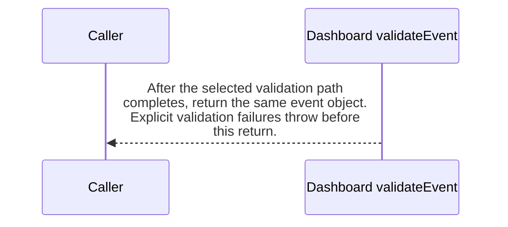

import {ClewProcess, ClewDataModel, ClewDownload, ClewModelLink, ClewRelatedModelLink, ClewFieldTrace, ClewContextLink, ClewPageContext, ClewProcessReturn, ClewStatus, ClewRetainedPage, ClewCatalog, ClewAnchor} from '@site/src/components/ClewReaders';

# Dashboard event validation

<ClewPageContext />

Retained account · UNVERIFIED · UNASSESSED. Runtime behavior is not established by this export.

validateEvent rejects falsy or non-object input with INVALID\_EVENT, then requires a string id, version 1, and a truthy place with a string id in oslo/helsinki/lisbon, a string name, and finite latitude and longitude; a false explicit predicate throws INVALID\_EVENT. No nonempty-string or coordinate-range check appears. For topic weather.forecast-updated, the explicit guard requires type forecast.updated, a truthy forecast, timestamps passing the isTimestamp calls, mode fixture/live, and an array of 1-6 periods; a failed predicate throws INVALID\_FORECAST. The captured same-file isTimestamp definition checks string type, a YYYY-MM-DDTHH:mm:ss pattern with optional fractional seconds and trailing Z, and finite Date.parse; analysis does not resolve these call targets or establish full calendar validation. Each period is checked for timestamp, finite temperature, precipitation null or finite and nonnegative, and string symbol; a failed explicit check throws INVALID\_PERIOD. The loop reads period.time first, so a null period throws TypeError before that guard; there is no local catch for that or other property-access exceptions. For weather.place-requested, event.type must be place.requested and forecast must be undefined, else INVALID\_PLACE\_EVENT. Other topics throw UNKNOWN\_TOPIC. Success returns the same event; no I/O or mutation appears. Framework activation and runtime behavior are unverified.

Summary source bindings

- [services/dashboard/src/events.ts:10–29 · revision e635069293d58cb0d4f28c8211e748b8d58e6b37](../sources/afddedfc8054e8c5495b73e95e3924f7b15f90f9b73caf09d7c1b7cdda664830.mdx)
- [services/dashboard/src/events.ts:26–26 · revision e635069293d58cb0d4f28c8211e748b8d58e6b37](../sources/ed9a89955e006db5c20017aad4d426863a8fab87101965320d5d7c494c5cf649.mdx)
- [services/dashboard/src/events.ts:15–15 · revision e635069293d58cb0d4f28c8211e748b8d58e6b37](../sources/79ddc0f8e1ed0c68daab9a62a0cca0b0b93b61cfdd8bf0731b800e163c081f41.mdx)
- [services/dashboard/src/events.ts:17–19 · revision e635069293d58cb0d4f28c8211e748b8d58e6b37](../sources/ca30d5450662411a0f321f4bb0db3863eb158380f4617bf02280910731a13829.mdx)
- [services/dashboard/src/events.ts:21–23 · revision e635069293d58cb0d4f28c8211e748b8d58e6b37](../sources/c3e82f4315b81987f7d5c607bb160712f1ea3a5aa99dde4598e479aa32627ccd.mdx)
- [services/dashboard/src/events.ts:26–26 · revision e635069293d58cb0d4f28c8211e748b8d58e6b37](../sources/97c24e4dc7bd66939e6948de2324904b04a24f298b496ef20320468a182eedcb.mdx)
- [services/dashboard/src/events.ts:25–27 · revision e635069293d58cb0d4f28c8211e748b8d58e6b37](../sources/37ea8a5ad67c8d8f122e011d24c642789632aada629a962c19c554ae08cf14ed.mdx)
- [services/dashboard/src/events.ts:27–27 · revision e635069293d58cb0d4f28c8211e748b8d58e6b37](../sources/6ec068cdbd0a650c3c4c8e059aa033abcb47fc19bc17b289662196b11ce23640.mdx)
- [services/dashboard/src/events.ts:19–19 · revision e635069293d58cb0d4f28c8211e748b8d58e6b37](../sources/2d8c243eba3442f47ad4aee6eed76927d006fa51ed7a2d08ad65e64030d1b9be.mdx)
- [services/dashboard/src/events.ts:23–23 · revision e635069293d58cb0d4f28c8211e748b8d58e6b37](../sources/8f8c49e0961b72680b993799a3a787a6c891d00da794b19e43e3db794b0f65f3.mdx)
- [services/dashboard/src/events.ts:11–11 · revision e635069293d58cb0d4f28c8211e748b8d58e6b37](../sources/b22ba71f8330d1da4e56f2ae09953c25f916a4b9a543b519e699ea7cb0edbf22.mdx)
- [services/dashboard/src/events.ts:6–8 · revision e635069293d58cb0d4f28c8211e748b8d58e6b37](../sources/f595401e33ffe1c87198d3297a901422e3d449fe00dd98adddc17aaca283d70e.mdx)
- [services/dashboard/src/events.ts:28–28 · revision e635069293d58cb0d4f28c8211e748b8d58e6b37](../sources/28be6fc718e18e8500a01c3d863507ec7f1b2d7c5f97da384867d919b4e4ecd0.mdx)
- [services/dashboard/src/events.ts:13–15 · revision e635069293d58cb0d4f28c8211e748b8d58e6b37](../sources/63c5130c42b275bafe10ded54f4897263cc2a156732c1bf4689ea3369fad6cef.mdx)
- [services/dashboard/src/events.ts:11–11 · revision e635069293d58cb0d4f28c8211e748b8d58e6b37](../sources/0d838820b4764b6d662c8a2d313c9ffbc9915655d0061eef5b858e85da87a98c.mdx)
- [services/dashboard/src/events.ts:16–27 · revision e635069293d58cb0d4f28c8211e748b8d58e6b37](../sources/1bebaa185b698264b919df27521ad36ef4b4df48db052250e96a94cd76ec9f4c.mdx)

## Declared interface schemas

<ClewContextLink path="/http/475242e2ef07721c45d26c563b5cd15b52b47fb16494eab9b22738cd80b35c25">GET /openapi.json</ClewContextLink>

<ClewContextLink path="/http/5e9ce2f78105d5d9215b07ddf87c8025176e932f11403c3b248ee8f2f77a9989">POST /api/places</ClewContextLink>

<ClewContextLink path="/http/ed3ea26055386f7e8904ff37c1c9931e4943602283a96c6067a31ac32aa24dac">POST /api/places/&#123;id&#125;/refresh</ClewContextLink>

<ClewContextLink path="/http/d3d56f55618a4d6b12c611f5055d16e80668439f39a23e30eb42437d1be85294">GET /</ClewContextLink>

<ClewContextLink path="/http/589bef5f2c1640933430afb73226fc910c4cdb435b53197fdaef848d460a716b">GET /health</ClewContextLink>

<ClewContextLink path="/http/5fda6cc4b385e34a2f5c5b6539f9420f1a95661ef0c3656b18ef951b4f2fe516">GET /api/weather</ClewContextLink>

## Interaction diagram

Actors and nested branches from the retained account; not a runtime trace. Labels are shortened for readability. Full messages and notes follow.

Full original sequence, branches and notes

#### 1. alt

The first guard accepts only truthy values whose runtime type is object.

Source bindings

- [services/dashboard/src/events.ts:10–29 · revision e635069293d58cb0d4f28c8211e748b8d58e6b37](../sources/afddedfc8054e8c5495b73e95e3924f7b15f90f9b73caf09d7c1b7cdda664830.mdx)
- [services/dashboard/src/events.ts:11–11 · revision e635069293d58cb0d4f28c8211e748b8d58e6b37](../sources/0d838820b4764b6d662c8a2d313c9ffbc9915655d0061eef5b858e85da87a98c.mdx)

#### 2. note

Falsy input or any value whose type is not object throws INVALID\_EVENT before the cast.

Source bindings

- [services/dashboard/src/events.ts:10–29 · revision e635069293d58cb0d4f28c8211e748b8d58e6b37](../sources/afddedfc8054e8c5495b73e95e3924f7b15f90f9b73caf09d7c1b7cdda664830.mdx)
- [services/dashboard/src/events.ts:11–11 · revision e635069293d58cb0d4f28c8211e748b8d58e6b37](../sources/b22ba71f8330d1da4e56f2ae09953c25f916a4b9a543b519e699ea7cb0edbf22.mdx)
- [services/dashboard/src/events.ts:11–11 · revision e635069293d58cb0d4f28c8211e748b8d58e6b37](../sources/0d838820b4764b6d662c8a2d313c9ffbc9915655d0061eef5b858e85da87a98c.mdx)

#### 3. else

Otherwise

Source bindings

- [services/dashboard/src/events.ts:10–29 · revision e635069293d58cb0d4f28c8211e748b8d58e6b37](../sources/afddedfc8054e8c5495b73e95e3924f7b15f90f9b73caf09d7c1b7cdda664830.mdx)
- [services/dashboard/src/events.ts:11–11 · revision e635069293d58cb0d4f28c8211e748b8d58e6b37](../sources/0d838820b4764b6d662c8a2d313c9ffbc9915655d0061eef5b858e85da87a98c.mdx)

#### 4. note

A truthy object is cast to Event and proceeds; the type assertion itself does not validate the remaining fields.

Source bindings

- [services/dashboard/src/events.ts:10–29 · revision e635069293d58cb0d4f28c8211e748b8d58e6b37](../sources/afddedfc8054e8c5495b73e95e3924f7b15f90f9b73caf09d7c1b7cdda664830.mdx)
- [services/dashboard/src/events.ts:11–11 · revision e635069293d58cb0d4f28c8211e748b8d58e6b37](../sources/0d838820b4764b6d662c8a2d313c9ffbc9915655d0061eef5b858e85da87a98c.mdx)

#### 5. end

Source bindings

- [services/dashboard/src/events.ts:10–29 · revision e635069293d58cb0d4f28c8211e748b8d58e6b37](../sources/afddedfc8054e8c5495b73e95e3924f7b15f90f9b73caf09d7c1b7cdda664830.mdx)
- [services/dashboard/src/events.ts:11–11 · revision e635069293d58cb0d4f28c8211e748b8d58e6b37](../sources/0d838820b4764b6d662c8a2d313c9ffbc9915655d0061eef5b858e85da87a98c.mdx)

#### 6. alt

The next guard checks the event identity and required place fields.

Source bindings

- [services/dashboard/src/events.ts:10–29 · revision e635069293d58cb0d4f28c8211e748b8d58e6b37](../sources/afddedfc8054e8c5495b73e95e3924f7b15f90f9b73caf09d7c1b7cdda664830.mdx)
- [services/dashboard/src/events.ts:13–15 · revision e635069293d58cb0d4f28c8211e748b8d58e6b37](../sources/63c5130c42b275bafe10ded54f4897263cc2a156732c1bf4689ea3369fad6cef.mdx)

#### 7. note

A non-string id, version other than 1, falsy place, non-string or non-allowlisted place id, non-string place name, or latitude/longitude for which Number.isFinite is false throws INVALID\_EVENT.

Source bindings

- [services/dashboard/src/events.ts:10–29 · revision e635069293d58cb0d4f28c8211e748b8d58e6b37](../sources/afddedfc8054e8c5495b73e95e3924f7b15f90f9b73caf09d7c1b7cdda664830.mdx)
- [services/dashboard/src/events.ts:15–15 · revision e635069293d58cb0d4f28c8211e748b8d58e6b37](../sources/79ddc0f8e1ed0c68daab9a62a0cca0b0b93b61cfdd8bf0731b800e163c081f41.mdx)
- [services/dashboard/src/events.ts:13–15 · revision e635069293d58cb0d4f28c8211e748b8d58e6b37](../sources/63c5130c42b275bafe10ded54f4897263cc2a156732c1bf4689ea3369fad6cef.mdx)

#### 8. else

Otherwise

Source bindings

- [services/dashboard/src/events.ts:10–29 · revision e635069293d58cb0d4f28c8211e748b8d58e6b37](../sources/afddedfc8054e8c5495b73e95e3924f7b15f90f9b73caf09d7c1b7cdda664830.mdx)
- [services/dashboard/src/events.ts:13–15 · revision e635069293d58cb0d4f28c8211e748b8d58e6b37](../sources/63c5130c42b275bafe10ded54f4897263cc2a156732c1bf4689ea3369fad6cef.mdx)

#### 9. note

If these explicit predicates pass, validation continues to the topic branches.

Source bindings

- [services/dashboard/src/events.ts:10–29 · revision e635069293d58cb0d4f28c8211e748b8d58e6b37](../sources/afddedfc8054e8c5495b73e95e3924f7b15f90f9b73caf09d7c1b7cdda664830.mdx)
- [services/dashboard/src/events.ts:13–15 · revision e635069293d58cb0d4f28c8211e748b8d58e6b37](../sources/63c5130c42b275bafe10ded54f4897263cc2a156732c1bf4689ea3369fad6cef.mdx)

#### 10. end

Source bindings

- [services/dashboard/src/events.ts:10–29 · revision e635069293d58cb0d4f28c8211e748b8d58e6b37](../sources/afddedfc8054e8c5495b73e95e3924f7b15f90f9b73caf09d7c1b7cdda664830.mdx)
- [services/dashboard/src/events.ts:13–15 · revision e635069293d58cb0d4f28c8211e748b8d58e6b37](../sources/63c5130c42b275bafe10ded54f4897263cc2a156732c1bf4689ea3369fad6cef.mdx)

#### 11. alt

The topic test selects the forecast branch first, then the place-requested branch; every other topic takes the unknown-topic error branch.

Source bindings

- [services/dashboard/src/events.ts:10–29 · revision e635069293d58cb0d4f28c8211e748b8d58e6b37](../sources/afddedfc8054e8c5495b73e95e3924f7b15f90f9b73caf09d7c1b7cdda664830.mdx)
- [services/dashboard/src/events.ts:25–27 · revision e635069293d58cb0d4f28c8211e748b8d58e6b37](../sources/37ea8a5ad67c8d8f122e011d24c642789632aada629a962c19c554ae08cf14ed.mdx)
- [services/dashboard/src/events.ts:27–27 · revision e635069293d58cb0d4f28c8211e748b8d58e6b37](../sources/6ec068cdbd0a650c3c4c8e059aa033abcb47fc19bc17b289662196b11ce23640.mdx)
- [services/dashboard/src/events.ts:16–27 · revision e635069293d58cb0d4f28c8211e748b8d58e6b37](../sources/1bebaa185b698264b919df27521ad36ef4b4df48db052250e96a94cd76ec9f4c.mdx)

#### 12. alt

For weather.forecast-updated, the forecast metadata and list guard checks the event type, forecast truthiness, two timestamp calls, mode, array shape, and list length.

Source bindings

- [services/dashboard/src/events.ts:10–29 · revision e635069293d58cb0d4f28c8211e748b8d58e6b37](../sources/afddedfc8054e8c5495b73e95e3924f7b15f90f9b73caf09d7c1b7cdda664830.mdx)
- [services/dashboard/src/events.ts:17–19 · revision e635069293d58cb0d4f28c8211e748b8d58e6b37](../sources/ca30d5450662411a0f321f4bb0db3863eb158380f4617bf02280910731a13829.mdx)
- [services/dashboard/src/events.ts:6–8 · revision e635069293d58cb0d4f28c8211e748b8d58e6b37](../sources/f595401e33ffe1c87198d3297a901422e3d449fe00dd98adddc17aaca283d70e.mdx)
- [services/dashboard/src/events.ts:16–27 · revision e635069293d58cb0d4f28c8211e748b8d58e6b37](../sources/1bebaa185b698264b919df27521ad36ef4b4df48db052250e96a94cd76ec9f4c.mdx)

#### 13. note

A wrong type, falsy forecast, failed timestamp predicate, mode outside fixture/live, non-array periods, or period count outside 1-6 throws INVALID\_FORECAST.

Source bindings

- [services/dashboard/src/events.ts:10–29 · revision e635069293d58cb0d4f28c8211e748b8d58e6b37](../sources/afddedfc8054e8c5495b73e95e3924f7b15f90f9b73caf09d7c1b7cdda664830.mdx)
- [services/dashboard/src/events.ts:17–19 · revision e635069293d58cb0d4f28c8211e748b8d58e6b37](../sources/ca30d5450662411a0f321f4bb0db3863eb158380f4617bf02280910731a13829.mdx)
- [services/dashboard/src/events.ts:19–19 · revision e635069293d58cb0d4f28c8211e748b8d58e6b37](../sources/2d8c243eba3442f47ad4aee6eed76927d006fa51ed7a2d08ad65e64030d1b9be.mdx)
- [services/dashboard/src/events.ts:6–8 · revision e635069293d58cb0d4f28c8211e748b8d58e6b37](../sources/f595401e33ffe1c87198d3297a901422e3d449fe00dd98adddc17aaca283d70e.mdx)

#### 14. else

Otherwise

Source bindings

- [services/dashboard/src/events.ts:10–29 · revision e635069293d58cb0d4f28c8211e748b8d58e6b37](../sources/afddedfc8054e8c5495b73e95e3924f7b15f90f9b73caf09d7c1b7cdda664830.mdx)
- [services/dashboard/src/events.ts:17–19 · revision e635069293d58cb0d4f28c8211e748b8d58e6b37](../sources/ca30d5450662411a0f321f4bb0db3863eb158380f4617bf02280910731a13829.mdx)
- [services/dashboard/src/events.ts:6–8 · revision e635069293d58cb0d4f28c8211e748b8d58e6b37](../sources/f595401e33ffe1c87198d3297a901422e3d449fe00dd98adddc17aaca283d70e.mdx)
- [services/dashboard/src/events.ts:16–27 · revision e635069293d58cb0d4f28c8211e748b8d58e6b37](../sources/1bebaa185b698264b919df27521ad36ef4b4df48db052250e96a94cd76ec9f4c.mdx)

#### 15. note

When the metadata/list guard passes, the function iterates over event.forecast.periods.

Source bindings

- [services/dashboard/src/events.ts:10–29 · revision e635069293d58cb0d4f28c8211e748b8d58e6b37](../sources/afddedfc8054e8c5495b73e95e3924f7b15f90f9b73caf09d7c1b7cdda664830.mdx)
- [services/dashboard/src/events.ts:17–19 · revision e635069293d58cb0d4f28c8211e748b8d58e6b37](../sources/ca30d5450662411a0f321f4bb0db3863eb158380f4617bf02280910731a13829.mdx)
- [services/dashboard/src/events.ts:16–27 · revision e635069293d58cb0d4f28c8211e748b8d58e6b37](../sources/1bebaa185b698264b919df27521ad36ef4b4df48db052250e96a94cd76ec9f4c.mdx)

#### 16. end

Source bindings

- [services/dashboard/src/events.ts:10–29 · revision e635069293d58cb0d4f28c8211e748b8d58e6b37](../sources/afddedfc8054e8c5495b73e95e3924f7b15f90f9b73caf09d7c1b7cdda664830.mdx)
- [services/dashboard/src/events.ts:17–19 · revision e635069293d58cb0d4f28c8211e748b8d58e6b37](../sources/ca30d5450662411a0f321f4bb0db3863eb158380f4617bf02280910731a13829.mdx)
- [services/dashboard/src/events.ts:6–8 · revision e635069293d58cb0d4f28c8211e748b8d58e6b37](../sources/f595401e33ffe1c87198d3297a901422e3d449fe00dd98adddc17aaca283d70e.mdx)
- [services/dashboard/src/events.ts:16–27 · revision e635069293d58cb0d4f28c8211e748b8d58e6b37](../sources/1bebaa185b698264b919df27521ad36ef4b4df48db052250e96a94cd76ec9f4c.mdx)

#### 17. note

The loop reads period.time as an argument before the period guard can run. A null period therefore throws a property-access TypeError before INVALID\_PERIOD; this function has no local catch for that or other property-access exceptions.

Source bindings

- [services/dashboard/src/events.ts:10–29 · revision e635069293d58cb0d4f28c8211e748b8d58e6b37](../sources/afddedfc8054e8c5495b73e95e3924f7b15f90f9b73caf09d7c1b7cdda664830.mdx)
- [services/dashboard/src/events.ts:21–23 · revision e635069293d58cb0d4f28c8211e748b8d58e6b37](../sources/c3e82f4315b81987f7d5c607bb160712f1ea3a5aa99dde4598e479aa32627ccd.mdx)
- [services/dashboard/src/events.ts:6–8 · revision e635069293d58cb0d4f28c8211e748b8d58e6b37](../sources/f595401e33ffe1c87198d3297a901422e3d449fe00dd98adddc17aaca283d70e.mdx)
- [services/dashboard/src/events.ts:16–27 · revision e635069293d58cb0d4f28c8211e748b8d58e6b37](../sources/1bebaa185b698264b919df27521ad36ef4b4df48db052250e96a94cd76ec9f4c.mdx)

#### 18. alt

Each iterated period is checked for timestamp, temperature, precipitation, and symbol.

Source bindings

- [services/dashboard/src/events.ts:10–29 · revision e635069293d58cb0d4f28c8211e748b8d58e6b37](../sources/afddedfc8054e8c5495b73e95e3924f7b15f90f9b73caf09d7c1b7cdda664830.mdx)
- [services/dashboard/src/events.ts:21–23 · revision e635069293d58cb0d4f28c8211e748b8d58e6b37](../sources/c3e82f4315b81987f7d5c607bb160712f1ea3a5aa99dde4598e479aa32627ccd.mdx)
- [services/dashboard/src/events.ts:6–8 · revision e635069293d58cb0d4f28c8211e748b8d58e6b37](../sources/f595401e33ffe1c87198d3297a901422e3d449fe00dd98adddc17aaca283d70e.mdx)

#### 19. note

If the timestamp predicate fails, temperature is not finite, precipitation is neither null nor finite and nonnegative, or symbol is not a string, the explicit guard throws INVALID\_PERIOD.

Source bindings

- [services/dashboard/src/events.ts:10–29 · revision e635069293d58cb0d4f28c8211e748b8d58e6b37](../sources/afddedfc8054e8c5495b73e95e3924f7b15f90f9b73caf09d7c1b7cdda664830.mdx)
- [services/dashboard/src/events.ts:21–23 · revision e635069293d58cb0d4f28c8211e748b8d58e6b37](../sources/c3e82f4315b81987f7d5c607bb160712f1ea3a5aa99dde4598e479aa32627ccd.mdx)
- [services/dashboard/src/events.ts:23–23 · revision e635069293d58cb0d4f28c8211e748b8d58e6b37](../sources/8f8c49e0961b72680b993799a3a787a6c891d00da794b19e43e3db794b0f65f3.mdx)
- [services/dashboard/src/events.ts:6–8 · revision e635069293d58cb0d4f28c8211e748b8d58e6b37](../sources/f595401e33ffe1c87198d3297a901422e3d449fe00dd98adddc17aaca283d70e.mdx)

#### 20. else

Otherwise

Source bindings

- [services/dashboard/src/events.ts:10–29 · revision e635069293d58cb0d4f28c8211e748b8d58e6b37](../sources/afddedfc8054e8c5495b73e95e3924f7b15f90f9b73caf09d7c1b7cdda664830.mdx)
- [services/dashboard/src/events.ts:21–23 · revision e635069293d58cb0d4f28c8211e748b8d58e6b37](../sources/c3e82f4315b81987f7d5c607bb160712f1ea3a5aa99dde4598e479aa32627ccd.mdx)
- [services/dashboard/src/events.ts:6–8 · revision e635069293d58cb0d4f28c8211e748b8d58e6b37](../sources/f595401e33ffe1c87198d3297a901422e3d449fe00dd98adddc17aaca283d70e.mdx)

#### 21. note

A period that passes these checks continues through the loop.

Source bindings

- [services/dashboard/src/events.ts:10–29 · revision e635069293d58cb0d4f28c8211e748b8d58e6b37](../sources/afddedfc8054e8c5495b73e95e3924f7b15f90f9b73caf09d7c1b7cdda664830.mdx)
- [services/dashboard/src/events.ts:21–23 · revision e635069293d58cb0d4f28c8211e748b8d58e6b37](../sources/c3e82f4315b81987f7d5c607bb160712f1ea3a5aa99dde4598e479aa32627ccd.mdx)

#### 22. end

Source bindings

- [services/dashboard/src/events.ts:10–29 · revision e635069293d58cb0d4f28c8211e748b8d58e6b37](../sources/afddedfc8054e8c5495b73e95e3924f7b15f90f9b73caf09d7c1b7cdda664830.mdx)
- [services/dashboard/src/events.ts:21–23 · revision e635069293d58cb0d4f28c8211e748b8d58e6b37](../sources/c3e82f4315b81987f7d5c607bb160712f1ea3a5aa99dde4598e479aa32627ccd.mdx)
- [services/dashboard/src/events.ts:6–8 · revision e635069293d58cb0d4f28c8211e748b8d58e6b37](../sources/f595401e33ffe1c87198d3297a901422e3d449fe00dd98adddc17aaca283d70e.mdx)

#### 23. else

Otherwise

Source bindings

- [services/dashboard/src/events.ts:10–29 · revision e635069293d58cb0d4f28c8211e748b8d58e6b37](../sources/afddedfc8054e8c5495b73e95e3924f7b15f90f9b73caf09d7c1b7cdda664830.mdx)
- [services/dashboard/src/events.ts:25–27 · revision e635069293d58cb0d4f28c8211e748b8d58e6b37](../sources/37ea8a5ad67c8d8f122e011d24c642789632aada629a962c19c554ae08cf14ed.mdx)
- [services/dashboard/src/events.ts:27–27 · revision e635069293d58cb0d4f28c8211e748b8d58e6b37](../sources/6ec068cdbd0a650c3c4c8e059aa033abcb47fc19bc17b289662196b11ce23640.mdx)
- [services/dashboard/src/events.ts:16–27 · revision e635069293d58cb0d4f28c8211e748b8d58e6b37](../sources/1bebaa185b698264b919df27521ad36ef4b4df48db052250e96a94cd76ec9f4c.mdx)

#### 24. alt

After the forecast topic fails to match, the function tests for weather.place-requested.

Source bindings

- [services/dashboard/src/events.ts:10–29 · revision e635069293d58cb0d4f28c8211e748b8d58e6b37](../sources/afddedfc8054e8c5495b73e95e3924f7b15f90f9b73caf09d7c1b7cdda664830.mdx)
- [services/dashboard/src/events.ts:25–27 · revision e635069293d58cb0d4f28c8211e748b8d58e6b37](../sources/37ea8a5ad67c8d8f122e011d24c642789632aada629a962c19c554ae08cf14ed.mdx)
- [services/dashboard/src/events.ts:16–27 · revision e635069293d58cb0d4f28c8211e748b8d58e6b37](../sources/1bebaa185b698264b919df27521ad36ef4b4df48db052250e96a94cd76ec9f4c.mdx)

#### 25. alt

For weather.place-requested, the event type must be place.requested and forecast must be undefined.

Source bindings

- [services/dashboard/src/events.ts:10–29 · revision e635069293d58cb0d4f28c8211e748b8d58e6b37](../sources/afddedfc8054e8c5495b73e95e3924f7b15f90f9b73caf09d7c1b7cdda664830.mdx)
- [services/dashboard/src/events.ts:26–26 · revision e635069293d58cb0d4f28c8211e748b8d58e6b37](../sources/ed9a89955e006db5c20017aad4d426863a8fab87101965320d5d7c494c5cf649.mdx)
- [services/dashboard/src/events.ts:25–27 · revision e635069293d58cb0d4f28c8211e748b8d58e6b37](../sources/37ea8a5ad67c8d8f122e011d24c642789632aada629a962c19c554ae08cf14ed.mdx)

#### 26. note

If event.type differs from place.requested or event.forecast is not undefined, the guard throws INVALID\_PLACE\_EVENT.

Source bindings

- [services/dashboard/src/events.ts:10–29 · revision e635069293d58cb0d4f28c8211e748b8d58e6b37](../sources/afddedfc8054e8c5495b73e95e3924f7b15f90f9b73caf09d7c1b7cdda664830.mdx)
- [services/dashboard/src/events.ts:26–26 · revision e635069293d58cb0d4f28c8211e748b8d58e6b37](../sources/ed9a89955e006db5c20017aad4d426863a8fab87101965320d5d7c494c5cf649.mdx)
- [services/dashboard/src/events.ts:26–26 · revision e635069293d58cb0d4f28c8211e748b8d58e6b37](../sources/97c24e4dc7bd66939e6948de2324904b04a24f298b496ef20320468a182eedcb.mdx)

#### 27. else

Otherwise

Source bindings

- [services/dashboard/src/events.ts:10–29 · revision e635069293d58cb0d4f28c8211e748b8d58e6b37](../sources/afddedfc8054e8c5495b73e95e3924f7b15f90f9b73caf09d7c1b7cdda664830.mdx)
- [services/dashboard/src/events.ts:26–26 · revision e635069293d58cb0d4f28c8211e748b8d58e6b37](../sources/ed9a89955e006db5c20017aad4d426863a8fab87101965320d5d7c494c5cf649.mdx)
- [services/dashboard/src/events.ts:25–27 · revision e635069293d58cb0d4f28c8211e748b8d58e6b37](../sources/37ea8a5ad67c8d8f122e011d24c642789632aada629a962c19c554ae08cf14ed.mdx)

#### 28. note

When both predicates pass, this branch reaches the shared return.

Source bindings

- [services/dashboard/src/events.ts:10–29 · revision e635069293d58cb0d4f28c8211e748b8d58e6b37](../sources/afddedfc8054e8c5495b73e95e3924f7b15f90f9b73caf09d7c1b7cdda664830.mdx)
- [services/dashboard/src/events.ts:26–26 · revision e635069293d58cb0d4f28c8211e748b8d58e6b37](../sources/ed9a89955e006db5c20017aad4d426863a8fab87101965320d5d7c494c5cf649.mdx)
- [services/dashboard/src/events.ts:28–28 · revision e635069293d58cb0d4f28c8211e748b8d58e6b37](../sources/28be6fc718e18e8500a01c3d863507ec7f1b2d7c5f97da384867d919b4e4ecd0.mdx)

#### 29. end

Source bindings

- [services/dashboard/src/events.ts:10–29 · revision e635069293d58cb0d4f28c8211e748b8d58e6b37](../sources/afddedfc8054e8c5495b73e95e3924f7b15f90f9b73caf09d7c1b7cdda664830.mdx)
- [services/dashboard/src/events.ts:26–26 · revision e635069293d58cb0d4f28c8211e748b8d58e6b37](../sources/ed9a89955e006db5c20017aad4d426863a8fab87101965320d5d7c494c5cf649.mdx)
- [services/dashboard/src/events.ts:25–27 · revision e635069293d58cb0d4f28c8211e748b8d58e6b37](../sources/37ea8a5ad67c8d8f122e011d24c642789632aada629a962c19c554ae08cf14ed.mdx)

#### 30. else

Otherwise

Source bindings

- [services/dashboard/src/events.ts:10–29 · revision e635069293d58cb0d4f28c8211e748b8d58e6b37](../sources/afddedfc8054e8c5495b73e95e3924f7b15f90f9b73caf09d7c1b7cdda664830.mdx)
- [services/dashboard/src/events.ts:25–27 · revision e635069293d58cb0d4f28c8211e748b8d58e6b37](../sources/37ea8a5ad67c8d8f122e011d24c642789632aada629a962c19c554ae08cf14ed.mdx)
- [services/dashboard/src/events.ts:16–27 · revision e635069293d58cb0d4f28c8211e748b8d58e6b37](../sources/1bebaa185b698264b919df27521ad36ef4b4df48db052250e96a94cd76ec9f4c.mdx)

#### 31. note

Any topic other than weather.forecast-updated or weather.place-requested throws UNKNOWN\_TOPIC.

Source bindings

- [services/dashboard/src/events.ts:10–29 · revision e635069293d58cb0d4f28c8211e748b8d58e6b37](../sources/afddedfc8054e8c5495b73e95e3924f7b15f90f9b73caf09d7c1b7cdda664830.mdx)
- [services/dashboard/src/events.ts:25–27 · revision e635069293d58cb0d4f28c8211e748b8d58e6b37](../sources/37ea8a5ad67c8d8f122e011d24c642789632aada629a962c19c554ae08cf14ed.mdx)
- [services/dashboard/src/events.ts:27–27 · revision e635069293d58cb0d4f28c8211e748b8d58e6b37](../sources/6ec068cdbd0a650c3c4c8e059aa033abcb47fc19bc17b289662196b11ce23640.mdx)

#### 32. end

Source bindings

- [services/dashboard/src/events.ts:10–29 · revision e635069293d58cb0d4f28c8211e748b8d58e6b37](../sources/afddedfc8054e8c5495b73e95e3924f7b15f90f9b73caf09d7c1b7cdda664830.mdx)
- [services/dashboard/src/events.ts:25–27 · revision e635069293d58cb0d4f28c8211e748b8d58e6b37](../sources/37ea8a5ad67c8d8f122e011d24c642789632aada629a962c19c554ae08cf14ed.mdx)
- [services/dashboard/src/events.ts:16–27 · revision e635069293d58cb0d4f28c8211e748b8d58e6b37](../sources/1bebaa185b698264b919df27521ad36ef4b4df48db052250e96a94cd76ec9f4c.mdx)

#### 33. end

Source bindings

- [services/dashboard/src/events.ts:10–29 · revision e635069293d58cb0d4f28c8211e748b8d58e6b37](../sources/afddedfc8054e8c5495b73e95e3924f7b15f90f9b73caf09d7c1b7cdda664830.mdx)
- [services/dashboard/src/events.ts:25–27 · revision e635069293d58cb0d4f28c8211e748b8d58e6b37](../sources/37ea8a5ad67c8d8f122e011d24c642789632aada629a962c19c554ae08cf14ed.mdx)
- [services/dashboard/src/events.ts:27–27 · revision e635069293d58cb0d4f28c8211e748b8d58e6b37](../sources/6ec068cdbd0a650c3c4c8e059aa033abcb47fc19bc17b289662196b11ce23640.mdx)
- [services/dashboard/src/events.ts:16–27 · revision e635069293d58cb0d4f28c8211e748b8d58e6b37](../sources/1bebaa185b698264b919df27521ad36ef4b4df48db052250e96a94cd76ec9f4c.mdx)

#### 34. return

After the selected validation path completes, return the same event object. Explicit validation failures throw before this return.

Source bindings

- [services/dashboard/src/events.ts:10–29 · revision e635069293d58cb0d4f28c8211e748b8d58e6b37](../sources/afddedfc8054e8c5495b73e95e3924f7b15f90f9b73caf09d7c1b7cdda664830.mdx)
- [services/dashboard/src/events.ts:28–28 · revision e635069293d58cb0d4f28c8211e748b8d58e6b37](../sources/28be6fc718e18e8500a01c3d863507ec7f1b2d7c5f97da384867d919b4e4ecd0.mdx)

## Implementation explanation

The first guard accepts only truthy values whose runtime type is object.

Source bindings

- [services/dashboard/src/events.ts:10–29 · revision e635069293d58cb0d4f28c8211e748b8d58e6b37](../sources/afddedfc8054e8c5495b73e95e3924f7b15f90f9b73caf09d7c1b7cdda664830.mdx)
- [services/dashboard/src/events.ts:11–11 · revision e635069293d58cb0d4f28c8211e748b8d58e6b37](../sources/0d838820b4764b6d662c8a2d313c9ffbc9915655d0061eef5b858e85da87a98c.mdx)

Falsy input or any value whose type is not object throws INVALID\_EVENT before the cast.

Source bindings

- [services/dashboard/src/events.ts:10–29 · revision e635069293d58cb0d4f28c8211e748b8d58e6b37](../sources/afddedfc8054e8c5495b73e95e3924f7b15f90f9b73caf09d7c1b7cdda664830.mdx)
- [services/dashboard/src/events.ts:11–11 · revision e635069293d58cb0d4f28c8211e748b8d58e6b37](../sources/b22ba71f8330d1da4e56f2ae09953c25f916a4b9a543b519e699ea7cb0edbf22.mdx)
- [services/dashboard/src/events.ts:11–11 · revision e635069293d58cb0d4f28c8211e748b8d58e6b37](../sources/0d838820b4764b6d662c8a2d313c9ffbc9915655d0061eef5b858e85da87a98c.mdx)

The source describes an alternative branch.

Source bindings

- [services/dashboard/src/events.ts:10–29 · revision e635069293d58cb0d4f28c8211e748b8d58e6b37](../sources/afddedfc8054e8c5495b73e95e3924f7b15f90f9b73caf09d7c1b7cdda664830.mdx)
- [services/dashboard/src/events.ts:11–11 · revision e635069293d58cb0d4f28c8211e748b8d58e6b37](../sources/0d838820b4764b6d662c8a2d313c9ffbc9915655d0061eef5b858e85da87a98c.mdx)

A truthy object is cast to Event and proceeds; the type assertion itself does not validate the remaining fields.

Source bindings

- [services/dashboard/src/events.ts:10–29 · revision e635069293d58cb0d4f28c8211e748b8d58e6b37](../sources/afddedfc8054e8c5495b73e95e3924f7b15f90f9b73caf09d7c1b7cdda664830.mdx)
- [services/dashboard/src/events.ts:11–11 · revision e635069293d58cb0d4f28c8211e748b8d58e6b37](../sources/0d838820b4764b6d662c8a2d313c9ffbc9915655d0061eef5b858e85da87a98c.mdx)

The next guard checks the event identity and required place fields.

Source bindings

- [services/dashboard/src/events.ts:10–29 · revision e635069293d58cb0d4f28c8211e748b8d58e6b37](../sources/afddedfc8054e8c5495b73e95e3924f7b15f90f9b73caf09d7c1b7cdda664830.mdx)
- [services/dashboard/src/events.ts:13–15 · revision e635069293d58cb0d4f28c8211e748b8d58e6b37](../sources/63c5130c42b275bafe10ded54f4897263cc2a156732c1bf4689ea3369fad6cef.mdx)

A non-string id, version other than 1, falsy place, non-string or non-allowlisted place id, non-string place name, or latitude/longitude for which Number.isFinite is false throws INVALID\_EVENT.

Source bindings

- [services/dashboard/src/events.ts:10–29 · revision e635069293d58cb0d4f28c8211e748b8d58e6b37](../sources/afddedfc8054e8c5495b73e95e3924f7b15f90f9b73caf09d7c1b7cdda664830.mdx)
- [services/dashboard/src/events.ts:15–15 · revision e635069293d58cb0d4f28c8211e748b8d58e6b37](../sources/79ddc0f8e1ed0c68daab9a62a0cca0b0b93b61cfdd8bf0731b800e163c081f41.mdx)
- [services/dashboard/src/events.ts:13–15 · revision e635069293d58cb0d4f28c8211e748b8d58e6b37](../sources/63c5130c42b275bafe10ded54f4897263cc2a156732c1bf4689ea3369fad6cef.mdx)

The source describes an alternative branch.

Source bindings

- [services/dashboard/src/events.ts:10–29 · revision e635069293d58cb0d4f28c8211e748b8d58e6b37](../sources/afddedfc8054e8c5495b73e95e3924f7b15f90f9b73caf09d7c1b7cdda664830.mdx)
- [services/dashboard/src/events.ts:13–15 · revision e635069293d58cb0d4f28c8211e748b8d58e6b37](../sources/63c5130c42b275bafe10ded54f4897263cc2a156732c1bf4689ea3369fad6cef.mdx)

If these explicit predicates pass, validation continues to the topic branches.

Source bindings

- [services/dashboard/src/events.ts:10–29 · revision e635069293d58cb0d4f28c8211e748b8d58e6b37](../sources/afddedfc8054e8c5495b73e95e3924f7b15f90f9b73caf09d7c1b7cdda664830.mdx)
- [services/dashboard/src/events.ts:13–15 · revision e635069293d58cb0d4f28c8211e748b8d58e6b37](../sources/63c5130c42b275bafe10ded54f4897263cc2a156732c1bf4689ea3369fad6cef.mdx)

The topic test selects the forecast branch first, then the place-requested branch; every other topic takes the unknown-topic error branch.

Source bindings

- [services/dashboard/src/events.ts:10–29 · revision e635069293d58cb0d4f28c8211e748b8d58e6b37](../sources/afddedfc8054e8c5495b73e95e3924f7b15f90f9b73caf09d7c1b7cdda664830.mdx)
- [services/dashboard/src/events.ts:25–27 · revision e635069293d58cb0d4f28c8211e748b8d58e6b37](../sources/37ea8a5ad67c8d8f122e011d24c642789632aada629a962c19c554ae08cf14ed.mdx)
- [services/dashboard/src/events.ts:27–27 · revision e635069293d58cb0d4f28c8211e748b8d58e6b37](../sources/6ec068cdbd0a650c3c4c8e059aa033abcb47fc19bc17b289662196b11ce23640.mdx)
- [services/dashboard/src/events.ts:16–27 · revision e635069293d58cb0d4f28c8211e748b8d58e6b37](../sources/1bebaa185b698264b919df27521ad36ef4b4df48db052250e96a94cd76ec9f4c.mdx)

For weather.forecast-updated, the forecast metadata and list guard checks the event type, forecast truthiness, two timestamp calls, mode, array shape, and list length.

Source bindings

- [services/dashboard/src/events.ts:10–29 · revision e635069293d58cb0d4f28c8211e748b8d58e6b37](../sources/afddedfc8054e8c5495b73e95e3924f7b15f90f9b73caf09d7c1b7cdda664830.mdx)
- [services/dashboard/src/events.ts:17–19 · revision e635069293d58cb0d4f28c8211e748b8d58e6b37](../sources/ca30d5450662411a0f321f4bb0db3863eb158380f4617bf02280910731a13829.mdx)
- [services/dashboard/src/events.ts:6–8 · revision e635069293d58cb0d4f28c8211e748b8d58e6b37](../sources/f595401e33ffe1c87198d3297a901422e3d449fe00dd98adddc17aaca283d70e.mdx)
- [services/dashboard/src/events.ts:16–27 · revision e635069293d58cb0d4f28c8211e748b8d58e6b37](../sources/1bebaa185b698264b919df27521ad36ef4b4df48db052250e96a94cd76ec9f4c.mdx)

A wrong type, falsy forecast, failed timestamp predicate, mode outside fixture/live, non-array periods, or period count outside 1-6 throws INVALID\_FORECAST.

Source bindings

- [services/dashboard/src/events.ts:10–29 · revision e635069293d58cb0d4f28c8211e748b8d58e6b37](../sources/afddedfc8054e8c5495b73e95e3924f7b15f90f9b73caf09d7c1b7cdda664830.mdx)
- [services/dashboard/src/events.ts:17–19 · revision e635069293d58cb0d4f28c8211e748b8d58e6b37](../sources/ca30d5450662411a0f321f4bb0db3863eb158380f4617bf02280910731a13829.mdx)
- [services/dashboard/src/events.ts:19–19 · revision e635069293d58cb0d4f28c8211e748b8d58e6b37](../sources/2d8c243eba3442f47ad4aee6eed76927d006fa51ed7a2d08ad65e64030d1b9be.mdx)
- [services/dashboard/src/events.ts:6–8 · revision e635069293d58cb0d4f28c8211e748b8d58e6b37](../sources/f595401e33ffe1c87198d3297a901422e3d449fe00dd98adddc17aaca283d70e.mdx)

The source describes an alternative branch.

Source bindings

- [services/dashboard/src/events.ts:10–29 · revision e635069293d58cb0d4f28c8211e748b8d58e6b37](../sources/afddedfc8054e8c5495b73e95e3924f7b15f90f9b73caf09d7c1b7cdda664830.mdx)
- [services/dashboard/src/events.ts:17–19 · revision e635069293d58cb0d4f28c8211e748b8d58e6b37](../sources/ca30d5450662411a0f321f4bb0db3863eb158380f4617bf02280910731a13829.mdx)
- [services/dashboard/src/events.ts:6–8 · revision e635069293d58cb0d4f28c8211e748b8d58e6b37](../sources/f595401e33ffe1c87198d3297a901422e3d449fe00dd98adddc17aaca283d70e.mdx)
- [services/dashboard/src/events.ts:16–27 · revision e635069293d58cb0d4f28c8211e748b8d58e6b37](../sources/1bebaa185b698264b919df27521ad36ef4b4df48db052250e96a94cd76ec9f4c.mdx)

When the metadata/list guard passes, the function iterates over event.forecast.periods.

Source bindings

- [services/dashboard/src/events.ts:10–29 · revision e635069293d58cb0d4f28c8211e748b8d58e6b37](../sources/afddedfc8054e8c5495b73e95e3924f7b15f90f9b73caf09d7c1b7cdda664830.mdx)
- [services/dashboard/src/events.ts:17–19 · revision e635069293d58cb0d4f28c8211e748b8d58e6b37](../sources/ca30d5450662411a0f321f4bb0db3863eb158380f4617bf02280910731a13829.mdx)
- [services/dashboard/src/events.ts:16–27 · revision e635069293d58cb0d4f28c8211e748b8d58e6b37](../sources/1bebaa185b698264b919df27521ad36ef4b4df48db052250e96a94cd76ec9f4c.mdx)

The loop reads period.time as an argument before the period guard can run. A null period therefore throws a property-access TypeError before INVALID\_PERIOD; this function has no local catch for that or other property-access exceptions.

Source bindings

- [services/dashboard/src/events.ts:10–29 · revision e635069293d58cb0d4f28c8211e748b8d58e6b37](../sources/afddedfc8054e8c5495b73e95e3924f7b15f90f9b73caf09d7c1b7cdda664830.mdx)
- [services/dashboard/src/events.ts:21–23 · revision e635069293d58cb0d4f28c8211e748b8d58e6b37](../sources/c3e82f4315b81987f7d5c607bb160712f1ea3a5aa99dde4598e479aa32627ccd.mdx)
- [services/dashboard/src/events.ts:6–8 · revision e635069293d58cb0d4f28c8211e748b8d58e6b37](../sources/f595401e33ffe1c87198d3297a901422e3d449fe00dd98adddc17aaca283d70e.mdx)
- [services/dashboard/src/events.ts:16–27 · revision e635069293d58cb0d4f28c8211e748b8d58e6b37](../sources/1bebaa185b698264b919df27521ad36ef4b4df48db052250e96a94cd76ec9f4c.mdx)

Each iterated period is checked for timestamp, temperature, precipitation, and symbol.

Source bindings

- [services/dashboard/src/events.ts:10–29 · revision e635069293d58cb0d4f28c8211e748b8d58e6b37](../sources/afddedfc8054e8c5495b73e95e3924f7b15f90f9b73caf09d7c1b7cdda664830.mdx)
- [services/dashboard/src/events.ts:21–23 · revision e635069293d58cb0d4f28c8211e748b8d58e6b37](../sources/c3e82f4315b81987f7d5c607bb160712f1ea3a5aa99dde4598e479aa32627ccd.mdx)
- [services/dashboard/src/events.ts:6–8 · revision e635069293d58cb0d4f28c8211e748b8d58e6b37](../sources/f595401e33ffe1c87198d3297a901422e3d449fe00dd98adddc17aaca283d70e.mdx)

If the timestamp predicate fails, temperature is not finite, precipitation is neither null nor finite and nonnegative, or symbol is not a string, the explicit guard throws INVALID\_PERIOD.

Source bindings

- [services/dashboard/src/events.ts:10–29 · revision e635069293d58cb0d4f28c8211e748b8d58e6b37](../sources/afddedfc8054e8c5495b73e95e3924f7b15f90f9b73caf09d7c1b7cdda664830.mdx)
- [services/dashboard/src/events.ts:21–23 · revision e635069293d58cb0d4f28c8211e748b8d58e6b37](../sources/c3e82f4315b81987f7d5c607bb160712f1ea3a5aa99dde4598e479aa32627ccd.mdx)
- [services/dashboard/src/events.ts:23–23 · revision e635069293d58cb0d4f28c8211e748b8d58e6b37](../sources/8f8c49e0961b72680b993799a3a787a6c891d00da794b19e43e3db794b0f65f3.mdx)
- [services/dashboard/src/events.ts:6–8 · revision e635069293d58cb0d4f28c8211e748b8d58e6b37](../sources/f595401e33ffe1c87198d3297a901422e3d449fe00dd98adddc17aaca283d70e.mdx)

The source describes an alternative branch.

Source bindings

- [services/dashboard/src/events.ts:10–29 · revision e635069293d58cb0d4f28c8211e748b8d58e6b37](../sources/afddedfc8054e8c5495b73e95e3924f7b15f90f9b73caf09d7c1b7cdda664830.mdx)
- [services/dashboard/src/events.ts:21–23 · revision e635069293d58cb0d4f28c8211e748b8d58e6b37](../sources/c3e82f4315b81987f7d5c607bb160712f1ea3a5aa99dde4598e479aa32627ccd.mdx)
- [services/dashboard/src/events.ts:6–8 · revision e635069293d58cb0d4f28c8211e748b8d58e6b37](../sources/f595401e33ffe1c87198d3297a901422e3d449fe00dd98adddc17aaca283d70e.mdx)

A period that passes these checks continues through the loop.

Source bindings

- [services/dashboard/src/events.ts:10–29 · revision e635069293d58cb0d4f28c8211e748b8d58e6b37](../sources/afddedfc8054e8c5495b73e95e3924f7b15f90f9b73caf09d7c1b7cdda664830.mdx)
- [services/dashboard/src/events.ts:21–23 · revision e635069293d58cb0d4f28c8211e748b8d58e6b37](../sources/c3e82f4315b81987f7d5c607bb160712f1ea3a5aa99dde4598e479aa32627ccd.mdx)

The source describes an alternative branch.

Source bindings

- [services/dashboard/src/events.ts:10–29 · revision e635069293d58cb0d4f28c8211e748b8d58e6b37](../sources/afddedfc8054e8c5495b73e95e3924f7b15f90f9b73caf09d7c1b7cdda664830.mdx)
- [services/dashboard/src/events.ts:25–27 · revision e635069293d58cb0d4f28c8211e748b8d58e6b37](../sources/37ea8a5ad67c8d8f122e011d24c642789632aada629a962c19c554ae08cf14ed.mdx)
- [services/dashboard/src/events.ts:27–27 · revision e635069293d58cb0d4f28c8211e748b8d58e6b37](../sources/6ec068cdbd0a650c3c4c8e059aa033abcb47fc19bc17b289662196b11ce23640.mdx)
- [services/dashboard/src/events.ts:16–27 · revision e635069293d58cb0d4f28c8211e748b8d58e6b37](../sources/1bebaa185b698264b919df27521ad36ef4b4df48db052250e96a94cd76ec9f4c.mdx)

After the forecast topic fails to match, the function tests for weather.place-requested.

Source bindings

- [services/dashboard/src/events.ts:10–29 · revision e635069293d58cb0d4f28c8211e748b8d58e6b37](../sources/afddedfc8054e8c5495b73e95e3924f7b15f90f9b73caf09d7c1b7cdda664830.mdx)
- [services/dashboard/src/events.ts:25–27 · revision e635069293d58cb0d4f28c8211e748b8d58e6b37](../sources/37ea8a5ad67c8d8f122e011d24c642789632aada629a962c19c554ae08cf14ed.mdx)
- [services/dashboard/src/events.ts:16–27 · revision e635069293d58cb0d4f28c8211e748b8d58e6b37](../sources/1bebaa185b698264b919df27521ad36ef4b4df48db052250e96a94cd76ec9f4c.mdx)

For weather.place-requested, the event type must be place.requested and forecast must be undefined.

Source bindings

- [services/dashboard/src/events.ts:10–29 · revision e635069293d58cb0d4f28c8211e748b8d58e6b37](../sources/afddedfc8054e8c5495b73e95e3924f7b15f90f9b73caf09d7c1b7cdda664830.mdx)
- [services/dashboard/src/events.ts:26–26 · revision e635069293d58cb0d4f28c8211e748b8d58e6b37](../sources/ed9a89955e006db5c20017aad4d426863a8fab87101965320d5d7c494c5cf649.mdx)
- [services/dashboard/src/events.ts:25–27 · revision e635069293d58cb0d4f28c8211e748b8d58e6b37](../sources/37ea8a5ad67c8d8f122e011d24c642789632aada629a962c19c554ae08cf14ed.mdx)

If event.type differs from place.requested or event.forecast is not undefined, the guard throws INVALID\_PLACE\_EVENT.

Source bindings

- [services/dashboard/src/events.ts:10–29 · revision e635069293d58cb0d4f28c8211e748b8d58e6b37](../sources/afddedfc8054e8c5495b73e95e3924f7b15f90f9b73caf09d7c1b7cdda664830.mdx)
- [services/dashboard/src/events.ts:26–26 · revision e635069293d58cb0d4f28c8211e748b8d58e6b37](../sources/ed9a89955e006db5c20017aad4d426863a8fab87101965320d5d7c494c5cf649.mdx)
- [services/dashboard/src/events.ts:26–26 · revision e635069293d58cb0d4f28c8211e748b8d58e6b37](../sources/97c24e4dc7bd66939e6948de2324904b04a24f298b496ef20320468a182eedcb.mdx)

The source describes an alternative branch.

Source bindings

- [services/dashboard/src/events.ts:10–29 · revision e635069293d58cb0d4f28c8211e748b8d58e6b37](../sources/afddedfc8054e8c5495b73e95e3924f7b15f90f9b73caf09d7c1b7cdda664830.mdx)
- [services/dashboard/src/events.ts:26–26 · revision e635069293d58cb0d4f28c8211e748b8d58e6b37](../sources/ed9a89955e006db5c20017aad4d426863a8fab87101965320d5d7c494c5cf649.mdx)
- [services/dashboard/src/events.ts:25–27 · revision e635069293d58cb0d4f28c8211e748b8d58e6b37](../sources/37ea8a5ad67c8d8f122e011d24c642789632aada629a962c19c554ae08cf14ed.mdx)

When both predicates pass, this branch reaches the shared return.

Source bindings

- [services/dashboard/src/events.ts:10–29 · revision e635069293d58cb0d4f28c8211e748b8d58e6b37](../sources/afddedfc8054e8c5495b73e95e3924f7b15f90f9b73caf09d7c1b7cdda664830.mdx)
- [services/dashboard/src/events.ts:26–26 · revision e635069293d58cb0d4f28c8211e748b8d58e6b37](../sources/ed9a89955e006db5c20017aad4d426863a8fab87101965320d5d7c494c5cf649.mdx)
- [services/dashboard/src/events.ts:28–28 · revision e635069293d58cb0d4f28c8211e748b8d58e6b37](../sources/28be6fc718e18e8500a01c3d863507ec7f1b2d7c5f97da384867d919b4e4ecd0.mdx)

The source describes an alternative branch.

Source bindings

- [services/dashboard/src/events.ts:10–29 · revision e635069293d58cb0d4f28c8211e748b8d58e6b37](../sources/afddedfc8054e8c5495b73e95e3924f7b15f90f9b73caf09d7c1b7cdda664830.mdx)
- [services/dashboard/src/events.ts:25–27 · revision e635069293d58cb0d4f28c8211e748b8d58e6b37](../sources/37ea8a5ad67c8d8f122e011d24c642789632aada629a962c19c554ae08cf14ed.mdx)
- [services/dashboard/src/events.ts:16–27 · revision e635069293d58cb0d4f28c8211e748b8d58e6b37](../sources/1bebaa185b698264b919df27521ad36ef4b4df48db052250e96a94cd76ec9f4c.mdx)

Any topic other than weather.forecast-updated or weather.place-requested throws UNKNOWN\_TOPIC.

Source bindings

- [services/dashboard/src/events.ts:10–29 · revision e635069293d58cb0d4f28c8211e748b8d58e6b37](../sources/afddedfc8054e8c5495b73e95e3924f7b15f90f9b73caf09d7c1b7cdda664830.mdx)
- [services/dashboard/src/events.ts:25–27 · revision e635069293d58cb0d4f28c8211e748b8d58e6b37](../sources/37ea8a5ad67c8d8f122e011d24c642789632aada629a962c19c554ae08cf14ed.mdx)
- [services/dashboard/src/events.ts:27–27 · revision e635069293d58cb0d4f28c8211e748b8d58e6b37](../sources/6ec068cdbd0a650c3c4c8e059aa033abcb47fc19bc17b289662196b11ce23640.mdx)

After the selected validation path completes, return the same event object. Explicit validation failures throw before this return.

Source bindings

- [services/dashboard/src/events.ts:10–29 · revision e635069293d58cb0d4f28c8211e748b8d58e6b37](../sources/afddedfc8054e8c5495b73e95e3924f7b15f90f9b73caf09d7c1b7cdda664830.mdx)
- [services/dashboard/src/events.ts:28–28 · revision e635069293d58cb0d4f28c8211e748b8d58e6b37](../sources/28be6fc718e18e8500a01c3d863507ec7f1b2d7c5f97da384867d919b4e4ecd0.mdx)

Retained boundaries

- The flow evidence is syntax-level and lexical. Calls are unresolved by analysis; the captured same-file isTimestamp body is explanatory source, not proof of resolved call targets.
- This source does not establish compiler validation, framework activation, runtime behavior, or any I/O. Property-access failures are not caught inside validateEvent and may occur before a named validation error.
- CALL\_TARGETS\_UNRESOLVED
- DIALECT\_DECLARED\_NOT\_COMPILER\_VALIDATED
- FILE\_ONLY:compose.yaml
- FILE\_ONLY:contracts/dashboard.openapi.json
- FILE\_ONLY:contracts/events.schema.json
- FILE\_ONLY:database/init.sql
- FILE\_ONLY:exercises/dashboard-focus-regression.mjs
- FILE\_ONLY:exercises/replay.py
- FILE\_ONLY:exercises/validator-regression.mjs
- FILE\_ONLY:fixtures/helsinki.json
- FILE\_ONLY:fixtures/lisbon.json
- FILE\_ONLY:fixtures/met-oslo-recorded.json
- FILE\_ONLY:fixtures/oslo.json
- FILE\_ONLY:fixtures/provenance.json
- FILE\_ONLY:services/dashboard/Dockerfile
- FILE\_ONLY:services/dashboard/package-lock.json
- FILE\_ONLY:services/dashboard/package.json
- FILE\_ONLY:services/dashboard/public/index.html
- FILE\_ONLY:services/dashboard/tsconfig.json
- OPENAPI\_JSON\_SCHEMA\_KEYWORDS\_NOT\_INTERPRETED
- OPENAPI\_SCHEMA\_NULL\_TYPE\_NOT\_INTERPRETED
- OPENAPI\_SCHEMA\_TYPE\_UNIONS\_NOT\_INTERPRETED
- ORDER\_LEXICAL\_ONLY
- SCOPE\_WATCH\_CONSERVATIVE
- Syntax evidence does not establish runtime dispatch or configuration. Expand known owners and helpers; retain explicit gaps for unresolved targets.
- ANNOTATION\_DECLARATION\_UNAVAILABLE
- CALL\_TARGETS\_UNRESOLVED
- DIALECT\_DECLARED\_NOT\_COMPILER\_VALIDATED
- FILE\_ONLY:compose.yaml
- FILE\_ONLY:contracts/events.schema.json
- FILE\_ONLY:contracts/forecasts.openapi.json
- FILE\_ONLY:database/init.sql
- FILE\_ONLY:fixtures/helsinki.json
- FILE\_ONLY:fixtures/lisbon.json
- FILE\_ONLY:fixtures/met-oslo-recorded.json
- FILE\_ONLY:fixtures/oslo.json
- FILE\_ONLY:fixtures/provenance.json
- FILE\_ONLY:services/forecasts/Dockerfile
- FILE\_ONLY:services/forecasts/pom.xml
- FILE\_ONLY:services/forecasts/src/main/resources/application.properties
- NO\_BEAN\_OWNER
- OPENAPI\_JSON\_SCHEMA\_KEYWORDS\_NOT\_INTERPRETED
- OPENAPI\_SCHEMA\_NULL\_TYPE\_NOT\_INTERPRETED
- OPENAPI\_SCHEMA\_TYPE\_UNIONS\_NOT\_INTERPRETED
- ORDER\_LEXICAL\_ONLY
- RUNTIME\_REGISTRATION\_UNPROVEN
- SCOPE\_WATCH\_CONSERVATIVE
- SOURCE\_NAMES\_NOT\_COMPILER\_RESOLVED
- UNRESOLVED\_ANNOTATION\_VALUE
- Syntax evidence does not establish runtime dispatch or configuration. Expand known owners and helpers; retain explicit gaps for unresolved targets.
- CLR\_SIGNATURE\_PROJECTED\_TO\_JVM\_DESCRIPTOR\_GRAMMAR
- CSHARP\_SOURCE\_GENERATED\_DOCUMENTS\_NOT\_INDEXED
- EXCEPTION\_FLOW\_REQUIRES\_SOURCE\_REVIEW
- GENERATED\_SOURCE\_BODIES\_NOT\_INDEXED
- LAMBDA\_EXECUTION\_NOT\_EXPANDED
- OPENAPI\_JSON\_SCHEMA\_KEYWORDS\_NOT\_INTERPRETED
- SHORT\_CIRCUIT\_FLOW\_REQUIRES\_SOURCE\_REVIEW
- SWITCH\_FLOW\_REQUIRES\_SOURCE\_REVIEW

