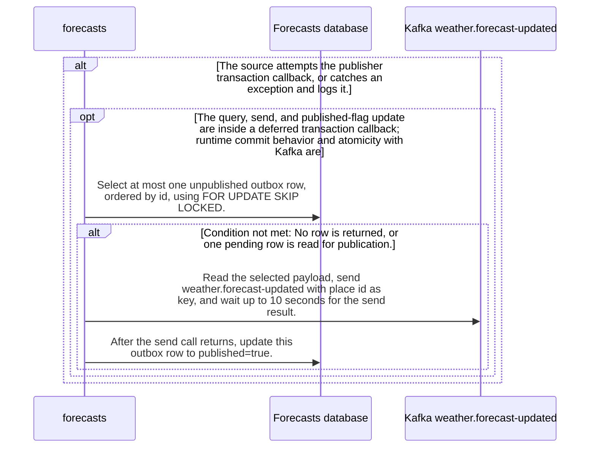

import {ClewProcess, ClewDataModel, ClewDownload, ClewModelLink, ClewRelatedModelLink, ClewFieldTrace, ClewContextLink, ClewPageContext, ClewProcessReturn, ClewStatus, ClewRetainedPage, ClewCatalog, ClewAnchor} from '@site/src/components/ClewReaders';

# Scheduled publishPending declaration

<ClewPageContext />

Retained account · UNVERIFIED · UNASSESSED. Runtime behavior is not established by this export.

The source declares publishPending with fixedDelayString PUBLISH\_INTERVAL\_MS and a 1000 millisecond default. It selects at most one unpublished outbox row, waits up to 10 seconds for the Kafka send, then updates the row to published inside a transaction callback. A crash after send but before a committed flag can leave the row eligible for resend; cross-store atomicity and runtime schedule activation are unverified.

Summary source bindings

- [services/forecasts/src/main/kotlin/weather/Forecasts.kt:127–139 · revision c289b28be4819eddf29d59a7c12f178559ec5229](../sources/1bd07596f6d98195ae25427eb2eb0175e2e0db2969f1b348800d52ddabc630ab.mdx)

## Declared interface schemas

<ClewContextLink path="/http/f6ce8266c4e697d9db9c6b995e231713ba2df9f58df6c8a2b74789bcf30bfa2c">GET /openapi.json</ClewContextLink>

<ClewContextLink path="/http/99c2697e8d504c9514c34631f942558372d28feb06ef894ce282840389e9f94a">GET /forecasts/&#123;id&#125;</ClewContextLink>

<ClewContextLink path="/http/bd635c40728e23898f5528ecb1a60517fa6eb4df4b3b94834ca587cb6e123780">GET /health</ClewContextLink>

## Interaction diagram

Actors and nested branches from the retained account; not a runtime trace. Labels are shortened for readability. Full messages and notes follow.

Full original sequence, branches and notes

#### 1. note

The source declaration uses PUBLISH\_INTERVAL\_MS with a 1000 millisecond fallback; this Work does not prove scheduler registration or runtime invocation.

Source bindings

- [services/forecasts/src/main/kotlin/weather/Forecasts.kt:127–139 · revision c289b28be4819eddf29d59a7c12f178559ec5229](../sources/1bd07596f6d98195ae25427eb2eb0175e2e0db2969f1b348800d52ddabc630ab.mdx)

#### 2. alt

The source attempts the publisher transaction callback, or catches an exception and logs it.

Source bindings

- [services/forecasts/src/main/kotlin/weather/Forecasts.kt:129–138 · revision c289b28be4819eddf29d59a7c12f178559ec5229](../sources/77419b38cab1c2be268d248020c0f3d1aed119786e7f30a01355c56299cf7b1f.mdx)

#### 3. opt

The query, send, and published-flag update are inside a deferred transaction callback; runtime commit behavior and atomicity with Kafka are not established.

Source bindings

- [services/forecasts/src/main/kotlin/weather/Forecasts.kt:130–137 · revision c289b28be4819eddf29d59a7c12f178559ec5229](../sources/d16edda6870f49ad776f5d271642e7ceb0421909d445f9f593fa3fd1ecf610c2.mdx)

#### 4. message

Select at most one unpublished outbox row, ordered by id, using FOR UPDATE SKIP LOCKED.

Source bindings

- [services/forecasts/src/main/kotlin/weather/Forecasts.kt:127–139 · revision c289b28be4819eddf29d59a7c12f178559ec5229](../sources/1bd07596f6d98195ae25427eb2eb0175e2e0db2969f1b348800d52ddabc630ab.mdx)
- [services/forecasts/src/main/kotlin/weather/Forecasts.kt:130–137 · revision c289b28be4819eddf29d59a7c12f178559ec5229](../sources/d16edda6870f49ad776f5d271642e7ceb0421909d445f9f593fa3fd1ecf610c2.mdx)

#### 5. alt

No row is returned, or one pending row is read for publication.

Source bindings

- [services/forecasts/src/main/kotlin/weather/Forecasts.kt:132–132 · revision c289b28be4819eddf29d59a7c12f178559ec5229](../sources/a9ab89dedd2b2f820a65a3b31b06a7e29e1e432f2a2e9f9b8c1d1a030d0a2614.mdx)

#### 6. note

If the query returns no row, the transaction callback returns without sending.

Source bindings

- [services/forecasts/src/main/kotlin/weather/Forecasts.kt:132–132 · revision c289b28be4819eddf29d59a7c12f178559ec5229](../sources/7c66cfc253529cc22121742daf694971e07c9472d3498bc6ef300d767cbf4713.mdx)

#### 7. else

Otherwise

Source bindings

- [services/forecasts/src/main/kotlin/weather/Forecasts.kt:132–132 · revision c289b28be4819eddf29d59a7c12f178559ec5229](../sources/a9ab89dedd2b2f820a65a3b31b06a7e29e1e432f2a2e9f9b8c1d1a030d0a2614.mdx)

#### 8. message

Read the selected payload, send weather.forecast-updated with place id as key, and wait up to 10 seconds for the send result.

Source bindings

- [services/forecasts/src/main/kotlin/weather/Forecasts.kt:127–139 · revision c289b28be4819eddf29d59a7c12f178559ec5229](../sources/1bd07596f6d98195ae25427eb2eb0175e2e0db2969f1b348800d52ddabc630ab.mdx)
- [services/forecasts/src/main/kotlin/weather/Forecasts.kt:130–137 · revision c289b28be4819eddf29d59a7c12f178559ec5229](../sources/d16edda6870f49ad776f5d271642e7ceb0421909d445f9f593fa3fd1ecf610c2.mdx)

#### 9. message

After the send call returns, update this outbox row to published=true.

Source bindings

- [services/forecasts/src/main/kotlin/weather/Forecasts.kt:127–139 · revision c289b28be4819eddf29d59a7c12f178559ec5229](../sources/1bd07596f6d98195ae25427eb2eb0175e2e0db2969f1b348800d52ddabc630ab.mdx)
- [services/forecasts/src/main/kotlin/weather/Forecasts.kt:130–137 · revision c289b28be4819eddf29d59a7c12f178559ec5229](../sources/d16edda6870f49ad776f5d271642e7ceb0421909d445f9f593fa3fd1ecf610c2.mdx)

#### 10. end

Source bindings

- [services/forecasts/src/main/kotlin/weather/Forecasts.kt:132–132 · revision c289b28be4819eddf29d59a7c12f178559ec5229](../sources/a9ab89dedd2b2f820a65a3b31b06a7e29e1e432f2a2e9f9b8c1d1a030d0a2614.mdx)

#### 11. end

Source bindings

- [services/forecasts/src/main/kotlin/weather/Forecasts.kt:130–137 · revision c289b28be4819eddf29d59a7c12f178559ec5229](../sources/d16edda6870f49ad776f5d271642e7ceb0421909d445f9f593fa3fd1ecf610c2.mdx)

#### 12. else

Otherwise

Source bindings

- [services/forecasts/src/main/kotlin/weather/Forecasts.kt:129–138 · revision c289b28be4819eddf29d59a7c12f178559ec5229](../sources/77419b38cab1c2be268d248020c0f3d1aed119786e7f30a01355c56299cf7b1f.mdx)

#### 13. note

On an exception, the catch logs PUBLISH\_RETRY and the exception class; this source does not prove an automatic retry or completed broker delivery.

Source bindings

- [services/forecasts/src/main/kotlin/weather/Forecasts.kt:129–138 · revision c289b28be4819eddf29d59a7c12f178559ec5229](../sources/77419b38cab1c2be268d248020c0f3d1aed119786e7f30a01355c56299cf7b1f.mdx)

#### 14. end

Source bindings

- [services/forecasts/src/main/kotlin/weather/Forecasts.kt:129–138 · revision c289b28be4819eddf29d59a7c12f178559ec5229](../sources/77419b38cab1c2be268d248020c0f3d1aed119786e7f30a01355c56299cf7b1f.mdx)

## Implementation explanation

The source declaration uses PUBLISH\_INTERVAL\_MS with a 1000 millisecond fallback; this Work does not prove scheduler registration or runtime invocation.

Source bindings

- [services/forecasts/src/main/kotlin/weather/Forecasts.kt:127–139 · revision c289b28be4819eddf29d59a7c12f178559ec5229](../sources/1bd07596f6d98195ae25427eb2eb0175e2e0db2969f1b348800d52ddabc630ab.mdx)

The source attempts the publisher transaction callback, or catches an exception and logs it.

Source bindings

- [services/forecasts/src/main/kotlin/weather/Forecasts.kt:129–138 · revision c289b28be4819eddf29d59a7c12f178559ec5229](../sources/77419b38cab1c2be268d248020c0f3d1aed119786e7f30a01355c56299cf7b1f.mdx)

The query, send, and published-flag update are inside a deferred transaction callback; runtime commit behavior and atomicity with Kafka are not established.

Source bindings

- [services/forecasts/src/main/kotlin/weather/Forecasts.kt:130–137 · revision c289b28be4819eddf29d59a7c12f178559ec5229](../sources/d16edda6870f49ad776f5d271642e7ceb0421909d445f9f593fa3fd1ecf610c2.mdx)

Select at most one unpublished outbox row, ordered by id, using FOR UPDATE SKIP LOCKED.

Source bindings

- [services/forecasts/src/main/kotlin/weather/Forecasts.kt:127–139 · revision c289b28be4819eddf29d59a7c12f178559ec5229](../sources/1bd07596f6d98195ae25427eb2eb0175e2e0db2969f1b348800d52ddabc630ab.mdx)
- [services/forecasts/src/main/kotlin/weather/Forecasts.kt:130–137 · revision c289b28be4819eddf29d59a7c12f178559ec5229](../sources/d16edda6870f49ad776f5d271642e7ceb0421909d445f9f593fa3fd1ecf610c2.mdx)

No row is returned, or one pending row is read for publication.

Source bindings

- [services/forecasts/src/main/kotlin/weather/Forecasts.kt:132–132 · revision c289b28be4819eddf29d59a7c12f178559ec5229](../sources/a9ab89dedd2b2f820a65a3b31b06a7e29e1e432f2a2e9f9b8c1d1a030d0a2614.mdx)

If the query returns no row, the transaction callback returns without sending.

Source bindings

- [services/forecasts/src/main/kotlin/weather/Forecasts.kt:132–132 · revision c289b28be4819eddf29d59a7c12f178559ec5229](../sources/7c66cfc253529cc22121742daf694971e07c9472d3498bc6ef300d767cbf4713.mdx)

The source describes an alternative branch.

Source bindings

- [services/forecasts/src/main/kotlin/weather/Forecasts.kt:132–132 · revision c289b28be4819eddf29d59a7c12f178559ec5229](../sources/a9ab89dedd2b2f820a65a3b31b06a7e29e1e432f2a2e9f9b8c1d1a030d0a2614.mdx)

Read the selected payload, send weather.forecast-updated with place id as key, and wait up to 10 seconds for the send result.

Source bindings

- [services/forecasts/src/main/kotlin/weather/Forecasts.kt:127–139 · revision c289b28be4819eddf29d59a7c12f178559ec5229](../sources/1bd07596f6d98195ae25427eb2eb0175e2e0db2969f1b348800d52ddabc630ab.mdx)
- [services/forecasts/src/main/kotlin/weather/Forecasts.kt:130–137 · revision c289b28be4819eddf29d59a7c12f178559ec5229](../sources/d16edda6870f49ad776f5d271642e7ceb0421909d445f9f593fa3fd1ecf610c2.mdx)

After the send call returns, update this outbox row to published=true.

Source bindings

- [services/forecasts/src/main/kotlin/weather/Forecasts.kt:127–139 · revision c289b28be4819eddf29d59a7c12f178559ec5229](../sources/1bd07596f6d98195ae25427eb2eb0175e2e0db2969f1b348800d52ddabc630ab.mdx)
- [services/forecasts/src/main/kotlin/weather/Forecasts.kt:130–137 · revision c289b28be4819eddf29d59a7c12f178559ec5229](../sources/d16edda6870f49ad776f5d271642e7ceb0421909d445f9f593fa3fd1ecf610c2.mdx)

The source describes an alternative branch.

Source bindings

- [services/forecasts/src/main/kotlin/weather/Forecasts.kt:129–138 · revision c289b28be4819eddf29d59a7c12f178559ec5229](../sources/77419b38cab1c2be268d248020c0f3d1aed119786e7f30a01355c56299cf7b1f.mdx)

On an exception, the catch logs PUBLISH\_RETRY and the exception class; this source does not prove an automatic retry or completed broker delivery.

Source bindings

- [services/forecasts/src/main/kotlin/weather/Forecasts.kt:129–138 · revision c289b28be4819eddf29d59a7c12f178559ec5229](../sources/77419b38cab1c2be268d248020c0f3d1aed119786e7f30a01355c56299cf7b1f.mdx)

Retained boundaries

- CALL\_TARGETS\_UNRESOLVED
- DIALECT\_DECLARED\_NOT\_COMPILER\_VALIDATED
- FILE\_ONLY:compose.yaml
- FILE\_ONLY:contracts/dashboard.openapi.json
- FILE\_ONLY:contracts/events.schema.json
- FILE\_ONLY:database/init.sql
- FILE\_ONLY:exercises/dashboard-focus-regression.mjs
- FILE\_ONLY:exercises/replay.py
- FILE\_ONLY:exercises/validator-regression.mjs
- FILE\_ONLY:fixtures/helsinki.json
- FILE\_ONLY:fixtures/lisbon.json
- FILE\_ONLY:fixtures/met-oslo-recorded.json
- FILE\_ONLY:fixtures/oslo.json
- FILE\_ONLY:fixtures/provenance.json
- FILE\_ONLY:services/dashboard/Dockerfile
- FILE\_ONLY:services/dashboard/package-lock.json
- FILE\_ONLY:services/dashboard/package.json
- FILE\_ONLY:services/dashboard/public/index.html
- FILE\_ONLY:services/dashboard/tsconfig.json
- OPENAPI\_JSON\_SCHEMA\_KEYWORDS\_NOT\_INTERPRETED
- OPENAPI\_SCHEMA\_NULL\_TYPE\_NOT\_INTERPRETED
- OPENAPI\_SCHEMA\_TYPE\_UNIONS\_NOT\_INTERPRETED
- ORDER\_LEXICAL\_ONLY
- SCOPE\_WATCH\_CONSERVATIVE
- Syntax evidence does not establish runtime dispatch or configuration. Expand known owners and helpers; retain explicit gaps for unresolved targets.
- ANNOTATION\_DECLARATION\_UNAVAILABLE
- CALL\_TARGETS\_UNRESOLVED
- DIALECT\_DECLARED\_NOT\_COMPILER\_VALIDATED
- FILE\_ONLY:compose.yaml
- FILE\_ONLY:contracts/events.schema.json
- FILE\_ONLY:contracts/forecasts.openapi.json
- FILE\_ONLY:database/init.sql
- FILE\_ONLY:fixtures/helsinki.json
- FILE\_ONLY:fixtures/lisbon.json
- FILE\_ONLY:fixtures/met-oslo-recorded.json
- FILE\_ONLY:fixtures/oslo.json
- FILE\_ONLY:fixtures/provenance.json
- FILE\_ONLY:services/forecasts/Dockerfile
- FILE\_ONLY:services/forecasts/pom.xml
- FILE\_ONLY:services/forecasts/src/main/resources/application.properties
- NO\_BEAN\_OWNER
- OPENAPI\_JSON\_SCHEMA\_KEYWORDS\_NOT\_INTERPRETED
- OPENAPI\_SCHEMA\_NULL\_TYPE\_NOT\_INTERPRETED
- OPENAPI\_SCHEMA\_TYPE\_UNIONS\_NOT\_INTERPRETED
- ORDER\_LEXICAL\_ONLY
- RUNTIME\_REGISTRATION\_UNPROVEN
- SCOPE\_WATCH\_CONSERVATIVE
- SOURCE\_NAMES\_NOT\_COMPILER\_RESOLVED
- UNRESOLVED\_ANNOTATION\_VALUE
- Syntax evidence does not establish runtime dispatch or configuration. Expand known owners and helpers; retain explicit gaps for unresolved targets.
- CLR\_SIGNATURE\_PROJECTED\_TO\_JVM\_DESCRIPTOR\_GRAMMAR
- CSHARP\_SOURCE\_GENERATED\_DOCUMENTS\_NOT\_INDEXED
- EXCEPTION\_FLOW\_REQUIRES\_SOURCE\_REVIEW
- GENERATED\_SOURCE\_BODIES\_NOT\_INDEXED
- LAMBDA\_EXECUTION\_NOT\_EXPANDED
- OPENAPI\_JSON\_SCHEMA\_KEYWORDS\_NOT\_INTERPRETED
- SHORT\_CIRCUIT\_FLOW\_REQUIRES\_SOURCE\_REVIEW
- SWITCH\_FLOW\_REQUIRES\_SOURCE\_REVIEW

