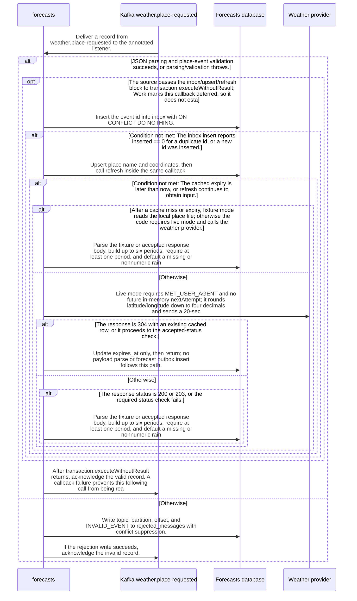

import {ClewProcess, ClewDataModel, ClewDownload, ClewModelLink, ClewRelatedModelLink, ClewFieldTrace, ClewContextLink, ClewPageContext, ClewProcessReturn, ClewStatus, ClewRetainedPage, ClewCatalog, ClewAnchor} from '@site/src/components/ClewReaders';

# Consume weather.place-requested

<ClewPageContext />

Retained account · UNVERIFIED · UNASSESSED. Runtime behavior is not established by this export.

The annotated listener validates each place.requested record; parse or validation exceptions enter a rejection write followed by acknowledgement and return when that write succeeds. Valid records pass through a transaction callback that skips duplicate ids or upserts the place and calls refresh before acknowledging the broker; refresh skips an unexpired cache, separates fixture and live paths, and updates only expiry for a cached 304. The saved Kotlin source does not prove Spring listener registration or runtime transaction behavior.

Summary source bindings

- [services/forecasts/src/main/kotlin/weather/Forecasts.kt:70–125 · revision c289b28be4819eddf29d59a7c12f178559ec5229](../sources/ca9432fec2a98615bce1212fc0e5541dcddd9f87f2124c7af78487e0179ddffa.mdx)
- [services/forecasts/src/main/kotlin/weather/Forecasts.kt:38–53 · revision c289b28be4819eddf29d59a7c12f178559ec5229](../sources/fabcf790d6359bad92930830b294197d73c440e51b6a010808853eccb900f2e6.mdx)
- [services/forecasts/src/main/kotlin/weather/Forecasts.kt:55–60 · revision c289b28be4819eddf29d59a7c12f178559ec5229](../sources/9233bcae5aa5673c061ebdb857c39ce75ee4724473f2f75c21b7387f0fc94e1b.mdx)
- [services/forecasts/src/main/kotlin/weather/KafkaConfiguration.kt:11–18 · revision c289b28be4819eddf29d59a7c12f178559ec5229](../sources/ac051494dd55d4673d494d5a705f37341c5833affea72c6c9476c9f68a13b08e.mdx)

## Declared interface schemas

<ClewContextLink path="/http/f6ce8266c4e697d9db9c6b995e231713ba2df9f58df6c8a2b74789bcf30bfa2c">GET /openapi.json</ClewContextLink>

<ClewContextLink path="/http/99c2697e8d504c9514c34631f942558372d28feb06ef894ce282840389e9f94a">GET /forecasts/&#123;id&#125;</ClewContextLink>

<ClewContextLink path="/http/bd635c40728e23898f5528ecb1a60517fa6eb4df4b3b94834ca587cb6e123780">GET /health</ClewContextLink>

## Interaction diagram

Actors and nested branches from the retained account; not a runtime trace. Labels are shortened for readability. Full messages and notes follow.

Full original sequence, branches and notes

#### 1. message

Deliver a record from weather.place-requested to the annotated listener.

Source bindings

- [services/forecasts/src/main/kotlin/weather/Forecasts.kt:38–53 · revision c289b28be4819eddf29d59a7c12f178559ec5229](../sources/fabcf790d6359bad92930830b294197d73c440e51b6a010808853eccb900f2e6.mdx)

#### 2. alt

JSON parsing and place-event validation succeeds, or parsing/validation throws.

Source bindings

- [services/forecasts/src/main/kotlin/weather/Forecasts.kt:40–44 · revision c289b28be4819eddf29d59a7c12f178559ec5229](../sources/97e0dd89fa86dcb90cc283f4c25f9200d6f06d20fb3ddd9728645de580dd22fc.mdx)
- [services/forecasts/src/main/kotlin/weather/Forecasts.kt:38–53 · revision c289b28be4819eddf29d59a7c12f178559ec5229](../sources/fabcf790d6359bad92930830b294197d73c440e51b6a010808853eccb900f2e6.mdx)
- [services/forecasts/src/main/kotlin/weather/Forecasts.kt:55–60 · revision c289b28be4819eddf29d59a7c12f178559ec5229](../sources/9233bcae5aa5673c061ebdb857c39ce75ee4724473f2f75c21b7387f0fc94e1b.mdx)

#### 3. opt

The source passes validatePlaceEvent(it) in the also lambda; the Work records this lambda as DEFERRED with an unresolved target, so invocation behavior is not established by this source capture.

Source bindings

- [services/forecasts/src/main/kotlin/weather/Forecasts.kt:40–40 · revision c289b28be4819eddf29d59a7c12f178559ec5229](../sources/47e4ea3df3f628f54c8dde414c838593d9efdf9d54a4f79f3c08f48519ca7d51.mdx)

#### 4. note

This callback contains the place-event validator call; its captured body and predicate are available in the exact validator source.

Source bindings

- [services/forecasts/src/main/kotlin/weather/Forecasts.kt:40–40 · revision c289b28be4819eddf29d59a7c12f178559ec5229](../sources/47e4ea3df3f628f54c8dde414c838593d9efdf9d54a4f79f3c08f48519ca7d51.mdx)
- [services/forecasts/src/main/kotlin/weather/Forecasts.kt:55–60 · revision c289b28be4819eddf29d59a7c12f178559ec5229](../sources/9233bcae5aa5673c061ebdb857c39ce75ee4724473f2f75c21b7387f0fc94e1b.mdx)

#### 5. end

Source bindings

- [services/forecasts/src/main/kotlin/weather/Forecasts.kt:40–40 · revision c289b28be4819eddf29d59a7c12f178559ec5229](../sources/47e4ea3df3f628f54c8dde414c838593d9efdf9d54a4f79f3c08f48519ca7d51.mdx)

#### 6. opt

The source passes the inbox/upsert/refresh block to transaction.executeWithoutResult; Work marks this callback deferred, so it does not establish runtime commit, rollback, or callback timing.

Source bindings

- [services/forecasts/src/main/kotlin/weather/Forecasts.kt:45–51 · revision c289b28be4819eddf29d59a7c12f178559ec5229](../sources/4e9f622c29b7004ef06a46c8f890c5d19566d4f728694d74e89ca982402eeb60.mdx)
- [services/forecasts/src/main/kotlin/weather/Forecasts.kt:45–51 · revision c289b28be4819eddf29d59a7c12f178559ec5229](../sources/82080250637a61157578f134c0309ac5e11c2adb9c4d0df9719841ec8fcd5292.mdx)

#### 7. message

Insert the event id into inbox with ON CONFLICT DO NOTHING.

Source bindings

- [services/forecasts/src/main/kotlin/weather/Forecasts.kt:46–46 · revision c289b28be4819eddf29d59a7c12f178559ec5229](../sources/a7bcb7cba000cbbf5d61798b42b99274d2e88df847484159d5c25ed0a479510c.mdx)
- [services/forecasts/src/main/kotlin/weather/Forecasts.kt:38–53 · revision c289b28be4819eddf29d59a7c12f178559ec5229](../sources/fabcf790d6359bad92930830b294197d73c440e51b6a010808853eccb900f2e6.mdx)

#### 8. alt

The inbox insert reports inserted == 0 for a duplicate id, or a new id was inserted.

Source bindings

- [services/forecasts/src/main/kotlin/weather/Forecasts.kt:47–47 · revision c289b28be4819eddf29d59a7c12f178559ec5229](../sources/409e3c65e41d42561e1d69c57c599677ac5cd54fccc2d766e8adf954f68ee7d8.mdx)
- [services/forecasts/src/main/kotlin/weather/Forecasts.kt:38–53 · revision c289b28be4819eddf29d59a7c12f178559ec5229](../sources/fabcf790d6359bad92930830b294197d73c440e51b6a010808853eccb900f2e6.mdx)

#### 9. note

A duplicate id returns from the transaction callback before the place upsert and refresh; the listener reaches its following acknowledgement after the callback call returns.

Source bindings

- [services/forecasts/src/main/kotlin/weather/Forecasts.kt:38–53 · revision c289b28be4819eddf29d59a7c12f178559ec5229](../sources/fabcf790d6359bad92930830b294197d73c440e51b6a010808853eccb900f2e6.mdx)
- [services/forecasts/src/main/kotlin/weather/Forecasts.kt:47–47 · revision c289b28be4819eddf29d59a7c12f178559ec5229](../sources/7e91c34807cc22ec484f72d2e4506c85976f38cfff61cce5f7dece6d263b8506.mdx)

#### 10. else

Otherwise

Source bindings

- [services/forecasts/src/main/kotlin/weather/Forecasts.kt:47–47 · revision c289b28be4819eddf29d59a7c12f178559ec5229](../sources/409e3c65e41d42561e1d69c57c599677ac5cd54fccc2d766e8adf954f68ee7d8.mdx)
- [services/forecasts/src/main/kotlin/weather/Forecasts.kt:38–53 · revision c289b28be4819eddf29d59a7c12f178559ec5229](../sources/fabcf790d6359bad92930830b294197d73c440e51b6a010808853eccb900f2e6.mdx)

#### 11. message

Upsert place name and coordinates, then call refresh inside the same callback.

Source bindings

- [services/forecasts/src/main/kotlin/weather/Forecasts.kt:50–50 · revision c289b28be4819eddf29d59a7c12f178559ec5229](../sources/46d81d49b96762d11f749e57bd348eeeecf426392203bcbd7833228d7ad4421e.mdx)
- [services/forecasts/src/main/kotlin/weather/Forecasts.kt:38–53 · revision c289b28be4819eddf29d59a7c12f178559ec5229](../sources/fabcf790d6359bad92930830b294197d73c440e51b6a010808853eccb900f2e6.mdx)
- [services/forecasts/src/main/kotlin/weather/Forecasts.kt:49–49 · revision c289b28be4819eddf29d59a7c12f178559ec5229](../sources/fb2f2a703de39fb293e9b3628f178583cdc4a44cc9ca5ec9362efdeb07238ed7.mdx)

#### 12. alt

The cached expiry is later than now, or refresh continues to obtain input.

Source bindings

- [services/forecasts/src/main/kotlin/weather/Forecasts.kt:70–125 · revision c289b28be4819eddf29d59a7c12f178559ec5229](../sources/ca9432fec2a98615bce1212fc0e5541dcddd9f87f2124c7af78487e0179ddffa.mdx)

#### 13. note

An unexpired cached row returns immediately, without a provider request, forecast update, or forecast outbox attempt.

Source bindings

- [services/forecasts/src/main/kotlin/weather/Forecasts.kt:70–125 · revision c289b28be4819eddf29d59a7c12f178559ec5229](../sources/ca9432fec2a98615bce1212fc0e5541dcddd9f87f2124c7af78487e0179ddffa.mdx)

#### 14. else

Otherwise

Source bindings

- [services/forecasts/src/main/kotlin/weather/Forecasts.kt:70–125 · revision c289b28be4819eddf29d59a7c12f178559ec5229](../sources/ca9432fec2a98615bce1212fc0e5541dcddd9f87f2124c7af78487e0179ddffa.mdx)

#### 15. alt

After a cache miss or expiry, fixture mode reads the local place file; otherwise the code requires live mode and calls the weather provider.

Source bindings

- [services/forecasts/src/main/kotlin/weather/Forecasts.kt:70–125 · revision c289b28be4819eddf29d59a7c12f178559ec5229](../sources/ca9432fec2a98615bce1212fc0e5541dcddd9f87f2124c7af78487e0179ddffa.mdx)

#### 16. note

Fixture mode reads /app/fixtures/&#123;placeId&#125;.json, then uses the common transform and persistence path.

Source bindings

- [services/forecasts/src/main/kotlin/weather/Forecasts.kt:70–125 · revision c289b28be4819eddf29d59a7c12f178559ec5229](../sources/ca9432fec2a98615bce1212fc0e5541dcddd9f87f2124c7af78487e0179ddffa.mdx)

#### 17. note

Parse the fixture or accepted response body, build up to six periods, require at least one period, and default a missing or nonnumeric rain amount to null and missing symbol to unknown. The forecast row is upserted only when incoming updatedAt is at least the stored value; the code then attempts a forecast.updated outbox insert using placeId:updatedAt with conflict suppression.

Source bindings

- [services/forecasts/src/main/kotlin/weather/Forecasts.kt:70–125 · revision c289b28be4819eddf29d59a7c12f178559ec5229](../sources/ca9432fec2a98615bce1212fc0e5541dcddd9f87f2124c7af78487e0179ddffa.mdx)
- [services/forecasts/src/main/kotlin/weather/Forecasts.kt:109–109 · revision c289b28be4819eddf29d59a7c12f178559ec5229](../sources/7193d0f62621ef22a56e6eafe3da31be249266f0354d2904fca3a51bd93fe0d3.mdx)
- [services/forecasts/src/main/kotlin/weather/Forecasts.kt:105–105 · revision c289b28be4819eddf29d59a7c12f178559ec5229](../sources/3d6e849747d42118f08326100c579214f91cc34c812327400a04638863cba873.mdx)
- [services/forecasts/src/main/kotlin/weather/Forecasts.kt:120–120 · revision c289b28be4819eddf29d59a7c12f178559ec5229](../sources/203a0ed17382d6023ae3bbb0600b826a5b59530796110b91d1ac083f967f2b2b.mdx)
- [services/forecasts/src/main/kotlin/weather/Forecasts.kt:121–121 · revision c289b28be4819eddf29d59a7c12f178559ec5229](../sources/22f59aaa92b2bda3fd052ce2f9ddc601df9ad4893af4f5474e5abb501b0c698c.mdx)
- [services/forecasts/src/main/kotlin/weather/Forecasts.kt:103–103 · revision c289b28be4819eddf29d59a7c12f178559ec5229](../sources/55ed1a1f543405b3248a8c39ba5b752884359975fc7c9225b66bfb2d6339c33b.mdx)
- [services/forecasts/src/main/kotlin/weather/Forecasts.kt:118–118 · revision c289b28be4819eddf29d59a7c12f178559ec5229](../sources/5ed6052166d04c3a86d97235ea7a956a2eb24a664bdaa74e09d2b0ffc72e20ba.mdx)
- [services/forecasts/src/main/kotlin/weather/Forecasts.kt:108–108 · revision c289b28be4819eddf29d59a7c12f178559ec5229](../sources/6296fcbcff0be8424cfc73414b600a57d335607e13e2875fa56aef0d81f27ce1.mdx)
- [services/forecasts/src/main/kotlin/weather/Forecasts.kt:114–114 · revision c289b28be4819eddf29d59a7c12f178559ec5229](../sources/700b495f05423548d7f3d8b471b51bf64fba6afa970c98cb7516bf9ff1b2c36a.mdx)

#### 18. message

Parse the fixture or accepted response body, build up to six periods, require at least one period, and default a missing or nonnumeric rain amount to null and missing symbol to unknown. The forecast row is upserted only when incoming updatedAt is at least the stored value; the code then attempts a forecast.updated outbox insert using placeId:updatedAt with conflict suppression.

Source bindings

- [services/forecasts/src/main/kotlin/weather/Forecasts.kt:70–125 · revision c289b28be4819eddf29d59a7c12f178559ec5229](../sources/ca9432fec2a98615bce1212fc0e5541dcddd9f87f2124c7af78487e0179ddffa.mdx)
- [services/forecasts/src/main/kotlin/weather/Forecasts.kt:109–109 · revision c289b28be4819eddf29d59a7c12f178559ec5229](../sources/7193d0f62621ef22a56e6eafe3da31be249266f0354d2904fca3a51bd93fe0d3.mdx)
- [services/forecasts/src/main/kotlin/weather/Forecasts.kt:105–105 · revision c289b28be4819eddf29d59a7c12f178559ec5229](../sources/3d6e849747d42118f08326100c579214f91cc34c812327400a04638863cba873.mdx)
- [services/forecasts/src/main/kotlin/weather/Forecasts.kt:120–120 · revision c289b28be4819eddf29d59a7c12f178559ec5229](../sources/203a0ed17382d6023ae3bbb0600b826a5b59530796110b91d1ac083f967f2b2b.mdx)
- [services/forecasts/src/main/kotlin/weather/Forecasts.kt:121–121 · revision c289b28be4819eddf29d59a7c12f178559ec5229](../sources/22f59aaa92b2bda3fd052ce2f9ddc601df9ad4893af4f5474e5abb501b0c698c.mdx)
- [services/forecasts/src/main/kotlin/weather/Forecasts.kt:103–103 · revision c289b28be4819eddf29d59a7c12f178559ec5229](../sources/55ed1a1f543405b3248a8c39ba5b752884359975fc7c9225b66bfb2d6339c33b.mdx)
- [services/forecasts/src/main/kotlin/weather/Forecasts.kt:118–118 · revision c289b28be4819eddf29d59a7c12f178559ec5229](../sources/5ed6052166d04c3a86d97235ea7a956a2eb24a664bdaa74e09d2b0ffc72e20ba.mdx)
- [services/forecasts/src/main/kotlin/weather/Forecasts.kt:108–108 · revision c289b28be4819eddf29d59a7c12f178559ec5229](../sources/6296fcbcff0be8424cfc73414b600a57d335607e13e2875fa56aef0d81f27ce1.mdx)
- [services/forecasts/src/main/kotlin/weather/Forecasts.kt:114–114 · revision c289b28be4819eddf29d59a7c12f178559ec5229](../sources/700b495f05423548d7f3d8b471b51bf64fba6afa970c98cb7516bf9ff1b2c36a.mdx)

#### 19. else

Otherwise

Source bindings

- [services/forecasts/src/main/kotlin/weather/Forecasts.kt:70–125 · revision c289b28be4819eddf29d59a7c12f178559ec5229](../sources/ca9432fec2a98615bce1212fc0e5541dcddd9f87f2124c7af78487e0179ddffa.mdx)

#### 20. message

Live mode requires MET\_USER\_AGENT and no future in-memory nextAttempt; it rounds latitude/longitude down to four decimals and sends a 20-second GET with gzip acceptance and If-Modified-Since when a cached validator exists.

Source bindings

- [services/forecasts/src/main/kotlin/weather/Forecasts.kt:70–125 · revision c289b28be4819eddf29d59a7c12f178559ec5229](../sources/ca9432fec2a98615bce1212fc0e5541dcddd9f87f2124c7af78487e0179ddffa.mdx)

#### 21. note

For the response, expires is the parsed Expires header or one hour from now. A 429 stores nextAttempt from Retry-After with a 60-second minimum; other statuses store expires as nextAttempt.

Source bindings

- [services/forecasts/src/main/kotlin/weather/Forecasts.kt:70–125 · revision c289b28be4819eddf29d59a7c12f178559ec5229](../sources/ca9432fec2a98615bce1212fc0e5541dcddd9f87f2124c7af78487e0179ddffa.mdx)

#### 22. alt

The response is 304 with an existing cached row, or it proceeds to the accepted-status check.

Source bindings

- [services/forecasts/src/main/kotlin/weather/Forecasts.kt:70–125 · revision c289b28be4819eddf29d59a7c12f178559ec5229](../sources/ca9432fec2a98615bce1212fc0e5541dcddd9f87f2124c7af78487e0179ddffa.mdx)

#### 23. message

Update expires\_at only, then return; no payload parse or forecast outbox insert follows this path.

Source bindings

- [services/forecasts/src/main/kotlin/weather/Forecasts.kt:70–125 · revision c289b28be4819eddf29d59a7c12f178559ec5229](../sources/ca9432fec2a98615bce1212fc0e5541dcddd9f87f2124c7af78487e0179ddffa.mdx)

#### 24. else

Otherwise

Source bindings

- [services/forecasts/src/main/kotlin/weather/Forecasts.kt:70–125 · revision c289b28be4819eddf29d59a7c12f178559ec5229](../sources/ca9432fec2a98615bce1212fc0e5541dcddd9f87f2124c7af78487e0179ddffa.mdx)

#### 25. alt

The response status is 200 or 203, or the required status check fails.

Source bindings

- [services/forecasts/src/main/kotlin/weather/Forecasts.kt:70–125 · revision c289b28be4819eddf29d59a7c12f178559ec5229](../sources/ca9432fec2a98615bce1212fc0e5541dcddd9f87f2124c7af78487e0179ddffa.mdx)

#### 26. note

Decode a gzip body when indicated, then transform the returned document and persist the forecast and outbox event.

Source bindings

- [services/forecasts/src/main/kotlin/weather/Forecasts.kt:70–125 · revision c289b28be4819eddf29d59a7c12f178559ec5229](../sources/ca9432fec2a98615bce1212fc0e5541dcddd9f87f2124c7af78487e0179ddffa.mdx)
- [services/forecasts/src/main/kotlin/weather/Forecasts.kt:27–27 · revision c289b28be4819eddf29d59a7c12f178559ec5229](../sources/515071c54d48c31841ec690b1b480a50b434b45eb74990f1624b0f09e744de84.mdx)
- [services/forecasts/src/main/kotlin/weather/Forecasts.kt:118–118 · revision c289b28be4819eddf29d59a7c12f178559ec5229](../sources/5ed6052166d04c3a86d97235ea7a956a2eb24a664bdaa74e09d2b0ffc72e20ba.mdx)

#### 27. message

Parse the fixture or accepted response body, build up to six periods, require at least one period, and default a missing or nonnumeric rain amount to null and missing symbol to unknown. The forecast row is upserted only when incoming updatedAt is at least the stored value; the code then attempts a forecast.updated outbox insert using placeId:updatedAt with conflict suppression.

Source bindings

- [services/forecasts/src/main/kotlin/weather/Forecasts.kt:70–125 · revision c289b28be4819eddf29d59a7c12f178559ec5229](../sources/ca9432fec2a98615bce1212fc0e5541dcddd9f87f2124c7af78487e0179ddffa.mdx)
- [services/forecasts/src/main/kotlin/weather/Forecasts.kt:109–109 · revision c289b28be4819eddf29d59a7c12f178559ec5229](../sources/7193d0f62621ef22a56e6eafe3da31be249266f0354d2904fca3a51bd93fe0d3.mdx)
- [services/forecasts/src/main/kotlin/weather/Forecasts.kt:105–105 · revision c289b28be4819eddf29d59a7c12f178559ec5229](../sources/3d6e849747d42118f08326100c579214f91cc34c812327400a04638863cba873.mdx)
- [services/forecasts/src/main/kotlin/weather/Forecasts.kt:120–120 · revision c289b28be4819eddf29d59a7c12f178559ec5229](../sources/203a0ed17382d6023ae3bbb0600b826a5b59530796110b91d1ac083f967f2b2b.mdx)
- [services/forecasts/src/main/kotlin/weather/Forecasts.kt:121–121 · revision c289b28be4819eddf29d59a7c12f178559ec5229](../sources/22f59aaa92b2bda3fd052ce2f9ddc601df9ad4893af4f5474e5abb501b0c698c.mdx)
- [services/forecasts/src/main/kotlin/weather/Forecasts.kt:103–103 · revision c289b28be4819eddf29d59a7c12f178559ec5229](../sources/55ed1a1f543405b3248a8c39ba5b752884359975fc7c9225b66bfb2d6339c33b.mdx)
- [services/forecasts/src/main/kotlin/weather/Forecasts.kt:118–118 · revision c289b28be4819eddf29d59a7c12f178559ec5229](../sources/5ed6052166d04c3a86d97235ea7a956a2eb24a664bdaa74e09d2b0ffc72e20ba.mdx)
- [services/forecasts/src/main/kotlin/weather/Forecasts.kt:108–108 · revision c289b28be4819eddf29d59a7c12f178559ec5229](../sources/6296fcbcff0be8424cfc73414b600a57d335607e13e2875fa56aef0d81f27ce1.mdx)
- [services/forecasts/src/main/kotlin/weather/Forecasts.kt:114–114 · revision c289b28be4819eddf29d59a7c12f178559ec5229](../sources/700b495f05423548d7f3d8b471b51bf64fba6afa970c98cb7516bf9ff1b2c36a.mdx)

#### 28. else

Otherwise

Source bindings

- [services/forecasts/src/main/kotlin/weather/Forecasts.kt:70–125 · revision c289b28be4819eddf29d59a7c12f178559ec5229](../sources/ca9432fec2a98615bce1212fc0e5541dcddd9f87f2124c7af78487e0179ddffa.mdx)

#### 29. note

A 429 has already updated nextAttempt, then fails the 200-or-203 requirement; other unaccepted statuses also throw. A 304 without a cached row reaches this failing check.

Source bindings

- [services/forecasts/src/main/kotlin/weather/Forecasts.kt:70–125 · revision c289b28be4819eddf29d59a7c12f178559ec5229](../sources/ca9432fec2a98615bce1212fc0e5541dcddd9f87f2124c7af78487e0179ddffa.mdx)

#### 30. end

Source bindings

- [services/forecasts/src/main/kotlin/weather/Forecasts.kt:70–125 · revision c289b28be4819eddf29d59a7c12f178559ec5229](../sources/ca9432fec2a98615bce1212fc0e5541dcddd9f87f2124c7af78487e0179ddffa.mdx)

#### 31. end

Source bindings

- [services/forecasts/src/main/kotlin/weather/Forecasts.kt:70–125 · revision c289b28be4819eddf29d59a7c12f178559ec5229](../sources/ca9432fec2a98615bce1212fc0e5541dcddd9f87f2124c7af78487e0179ddffa.mdx)

#### 32. end

Source bindings

- [services/forecasts/src/main/kotlin/weather/Forecasts.kt:70–125 · revision c289b28be4819eddf29d59a7c12f178559ec5229](../sources/ca9432fec2a98615bce1212fc0e5541dcddd9f87f2124c7af78487e0179ddffa.mdx)

#### 33. end

Source bindings

- [services/forecasts/src/main/kotlin/weather/Forecasts.kt:70–125 · revision c289b28be4819eddf29d59a7c12f178559ec5229](../sources/ca9432fec2a98615bce1212fc0e5541dcddd9f87f2124c7af78487e0179ddffa.mdx)

#### 34. end

Source bindings

- [services/forecasts/src/main/kotlin/weather/Forecasts.kt:47–47 · revision c289b28be4819eddf29d59a7c12f178559ec5229](../sources/409e3c65e41d42561e1d69c57c599677ac5cd54fccc2d766e8adf954f68ee7d8.mdx)
- [services/forecasts/src/main/kotlin/weather/Forecasts.kt:38–53 · revision c289b28be4819eddf29d59a7c12f178559ec5229](../sources/fabcf790d6359bad92930830b294197d73c440e51b6a010808853eccb900f2e6.mdx)

#### 35. end

Source bindings

- [services/forecasts/src/main/kotlin/weather/Forecasts.kt:45–51 · revision c289b28be4819eddf29d59a7c12f178559ec5229](../sources/4e9f622c29b7004ef06a46c8f890c5d19566d4f728694d74e89ca982402eeb60.mdx)
- [services/forecasts/src/main/kotlin/weather/Forecasts.kt:45–51 · revision c289b28be4819eddf29d59a7c12f178559ec5229](../sources/82080250637a61157578f134c0309ac5e11c2adb9c4d0df9719841ec8fcd5292.mdx)

#### 36. message

After transaction.executeWithoutResult returns, acknowledge the valid record. A callback failure prevents this following call from being reached.

Source bindings

- [services/forecasts/src/main/kotlin/weather/Forecasts.kt:42–42 · revision c289b28be4819eddf29d59a7c12f178559ec5229](../sources/e13d878fbbcc7b5d5b9fa08cec665f3b8ce1a54157cee2d954944814a70ad0fb.mdx)
- [services/forecasts/src/main/kotlin/weather/Forecasts.kt:38–53 · revision c289b28be4819eddf29d59a7c12f178559ec5229](../sources/fabcf790d6359bad92930830b294197d73c440e51b6a010808853eccb900f2e6.mdx)

#### 37. else

Otherwise

Source bindings

- [services/forecasts/src/main/kotlin/weather/Forecasts.kt:40–44 · revision c289b28be4819eddf29d59a7c12f178559ec5229](../sources/97e0dd89fa86dcb90cc283f4c25f9200d6f06d20fb3ddd9728645de580dd22fc.mdx)
- [services/forecasts/src/main/kotlin/weather/Forecasts.kt:38–53 · revision c289b28be4819eddf29d59a7c12f178559ec5229](../sources/fabcf790d6359bad92930830b294197d73c440e51b6a010808853eccb900f2e6.mdx)
- [services/forecasts/src/main/kotlin/weather/Forecasts.kt:55–60 · revision c289b28be4819eddf29d59a7c12f178559ec5229](../sources/9233bcae5aa5673c061ebdb857c39ce75ee4724473f2f75c21b7387f0fc94e1b.mdx)

#### 38. message

Write topic, partition, offset, and INVALID\_EVENT to rejected\_messages with conflict suppression.

Source bindings

- [services/forecasts/src/main/kotlin/weather/Forecasts.kt:41–41 · revision c289b28be4819eddf29d59a7c12f178559ec5229](../sources/2aee9d53590251f93f68f72d38b0f201c17fcc7c36e538e20c569a50ecbaafdd.mdx)
- [services/forecasts/src/main/kotlin/weather/Forecasts.kt:40–44 · revision c289b28be4819eddf29d59a7c12f178559ec5229](../sources/0d496a05c23a3202685173d8a8f7bcb13f2319abaacf7d63938c9b5180a2e86d.mdx)
- [services/forecasts/src/main/kotlin/weather/Forecasts.kt:38–53 · revision c289b28be4819eddf29d59a7c12f178559ec5229](../sources/fabcf790d6359bad92930830b294197d73c440e51b6a010808853eccb900f2e6.mdx)

#### 39. message

If the rejection write succeeds, acknowledge the invalid record.

Source bindings

- [services/forecasts/src/main/kotlin/weather/Forecasts.kt:52–52 · revision c289b28be4819eddf29d59a7c12f178559ec5229](../sources/17dacf92a6fa435cb7a8669968338be46439de4eb6d2509e8c458716d0a031d0.mdx)
- [services/forecasts/src/main/kotlin/weather/Forecasts.kt:38–53 · revision c289b28be4819eddf29d59a7c12f178559ec5229](../sources/fabcf790d6359bad92930830b294197d73c440e51b6a010808853eccb900f2e6.mdx)

#### 40. note

Return from the invalid-event path after the rejection write and acknowledgement.

Source bindings

- [services/forecasts/src/main/kotlin/weather/Forecasts.kt:43–43 · revision c289b28be4819eddf29d59a7c12f178559ec5229](../sources/384453793a46df4473ae10f9da35b024cd20ccdcc119f971bdd3c51a8dc6b413.mdx)
- [services/forecasts/src/main/kotlin/weather/Forecasts.kt:38–53 · revision c289b28be4819eddf29d59a7c12f178559ec5229](../sources/fabcf790d6359bad92930830b294197d73c440e51b6a010808853eccb900f2e6.mdx)

#### 41. end

Source bindings

- [services/forecasts/src/main/kotlin/weather/Forecasts.kt:40–44 · revision c289b28be4819eddf29d59a7c12f178559ec5229](../sources/97e0dd89fa86dcb90cc283f4c25f9200d6f06d20fb3ddd9728645de580dd22fc.mdx)
- [services/forecasts/src/main/kotlin/weather/Forecasts.kt:38–53 · revision c289b28be4819eddf29d59a7c12f178559ec5229](../sources/fabcf790d6359bad92930830b294197d73c440e51b6a010808853eccb900f2e6.mdx)
- [services/forecasts/src/main/kotlin/weather/Forecasts.kt:55–60 · revision c289b28be4819eddf29d59a7c12f178559ec5229](../sources/9233bcae5aa5673c061ebdb857c39ce75ee4724473f2f75c21b7387f0fc94e1b.mdx)

#### 42. note

The source Kafka listener factory declares MANUAL\_IMMEDIATE acknowledgement and a one-second fixed backoff with unlimited attempts. Source declarations do not prove that this factory or listener is active at runtime.

Source bindings

- [services/forecasts/src/main/kotlin/weather/KafkaConfiguration.kt:11–18 · revision c289b28be4819eddf29d59a7c12f178559ec5229](../sources/ac051494dd55d4673d494d5a705f37341c5833affea72c6c9476c9f68a13b08e.mdx)

## Implementation explanation

Deliver a record from weather.place-requested to the annotated listener.

Source bindings

- [services/forecasts/src/main/kotlin/weather/Forecasts.kt:38–53 · revision c289b28be4819eddf29d59a7c12f178559ec5229](../sources/fabcf790d6359bad92930830b294197d73c440e51b6a010808853eccb900f2e6.mdx)

JSON parsing and place-event validation succeeds, or parsing/validation throws.

Source bindings

- [services/forecasts/src/main/kotlin/weather/Forecasts.kt:40–44 · revision c289b28be4819eddf29d59a7c12f178559ec5229](../sources/97e0dd89fa86dcb90cc283f4c25f9200d6f06d20fb3ddd9728645de580dd22fc.mdx)
- [services/forecasts/src/main/kotlin/weather/Forecasts.kt:38–53 · revision c289b28be4819eddf29d59a7c12f178559ec5229](../sources/fabcf790d6359bad92930830b294197d73c440e51b6a010808853eccb900f2e6.mdx)
- [services/forecasts/src/main/kotlin/weather/Forecasts.kt:55–60 · revision c289b28be4819eddf29d59a7c12f178559ec5229](../sources/9233bcae5aa5673c061ebdb857c39ce75ee4724473f2f75c21b7387f0fc94e1b.mdx)

The source passes validatePlaceEvent(it) in the also lambda; the Work records this lambda as DEFERRED with an unresolved target, so invocation behavior is not established by this source capture.

Source bindings

- [services/forecasts/src/main/kotlin/weather/Forecasts.kt:40–40 · revision c289b28be4819eddf29d59a7c12f178559ec5229](../sources/47e4ea3df3f628f54c8dde414c838593d9efdf9d54a4f79f3c08f48519ca7d51.mdx)

This callback contains the place-event validator call; its captured body and predicate are available in the exact validator source.

Source bindings

- [services/forecasts/src/main/kotlin/weather/Forecasts.kt:40–40 · revision c289b28be4819eddf29d59a7c12f178559ec5229](../sources/47e4ea3df3f628f54c8dde414c838593d9efdf9d54a4f79f3c08f48519ca7d51.mdx)
- [services/forecasts/src/main/kotlin/weather/Forecasts.kt:55–60 · revision c289b28be4819eddf29d59a7c12f178559ec5229](../sources/9233bcae5aa5673c061ebdb857c39ce75ee4724473f2f75c21b7387f0fc94e1b.mdx)

The source passes the inbox/upsert/refresh block to transaction.executeWithoutResult; Work marks this callback deferred, so it does not establish runtime commit, rollback, or callback timing.

Source bindings

- [services/forecasts/src/main/kotlin/weather/Forecasts.kt:45–51 · revision c289b28be4819eddf29d59a7c12f178559ec5229](../sources/4e9f622c29b7004ef06a46c8f890c5d19566d4f728694d74e89ca982402eeb60.mdx)
- [services/forecasts/src/main/kotlin/weather/Forecasts.kt:45–51 · revision c289b28be4819eddf29d59a7c12f178559ec5229](../sources/82080250637a61157578f134c0309ac5e11c2adb9c4d0df9719841ec8fcd5292.mdx)

Insert the event id into inbox with ON CONFLICT DO NOTHING.

Source bindings

- [services/forecasts/src/main/kotlin/weather/Forecasts.kt:46–46 · revision c289b28be4819eddf29d59a7c12f178559ec5229](../sources/a7bcb7cba000cbbf5d61798b42b99274d2e88df847484159d5c25ed0a479510c.mdx)
- [services/forecasts/src/main/kotlin/weather/Forecasts.kt:38–53 · revision c289b28be4819eddf29d59a7c12f178559ec5229](../sources/fabcf790d6359bad92930830b294197d73c440e51b6a010808853eccb900f2e6.mdx)

The inbox insert reports inserted == 0 for a duplicate id, or a new id was inserted.

Source bindings

- [services/forecasts/src/main/kotlin/weather/Forecasts.kt:47–47 · revision c289b28be4819eddf29d59a7c12f178559ec5229](../sources/409e3c65e41d42561e1d69c57c599677ac5cd54fccc2d766e8adf954f68ee7d8.mdx)
- [services/forecasts/src/main/kotlin/weather/Forecasts.kt:38–53 · revision c289b28be4819eddf29d59a7c12f178559ec5229](../sources/fabcf790d6359bad92930830b294197d73c440e51b6a010808853eccb900f2e6.mdx)

A duplicate id returns from the transaction callback before the place upsert and refresh; the listener reaches its following acknowledgement after the callback call returns.

Source bindings

- [services/forecasts/src/main/kotlin/weather/Forecasts.kt:38–53 · revision c289b28be4819eddf29d59a7c12f178559ec5229](../sources/fabcf790d6359bad92930830b294197d73c440e51b6a010808853eccb900f2e6.mdx)
- [services/forecasts/src/main/kotlin/weather/Forecasts.kt:47–47 · revision c289b28be4819eddf29d59a7c12f178559ec5229](../sources/7e91c34807cc22ec484f72d2e4506c85976f38cfff61cce5f7dece6d263b8506.mdx)

The source describes an alternative branch.

Source bindings

- [services/forecasts/src/main/kotlin/weather/Forecasts.kt:47–47 · revision c289b28be4819eddf29d59a7c12f178559ec5229](../sources/409e3c65e41d42561e1d69c57c599677ac5cd54fccc2d766e8adf954f68ee7d8.mdx)
- [services/forecasts/src/main/kotlin/weather/Forecasts.kt:38–53 · revision c289b28be4819eddf29d59a7c12f178559ec5229](../sources/fabcf790d6359bad92930830b294197d73c440e51b6a010808853eccb900f2e6.mdx)

Upsert place name and coordinates, then call refresh inside the same callback.

Source bindings

- [services/forecasts/src/main/kotlin/weather/Forecasts.kt:50–50 · revision c289b28be4819eddf29d59a7c12f178559ec5229](../sources/46d81d49b96762d11f749e57bd348eeeecf426392203bcbd7833228d7ad4421e.mdx)
- [services/forecasts/src/main/kotlin/weather/Forecasts.kt:38–53 · revision c289b28be4819eddf29d59a7c12f178559ec5229](../sources/fabcf790d6359bad92930830b294197d73c440e51b6a010808853eccb900f2e6.mdx)
- [services/forecasts/src/main/kotlin/weather/Forecasts.kt:49–49 · revision c289b28be4819eddf29d59a7c12f178559ec5229](../sources/fb2f2a703de39fb293e9b3628f178583cdc4a44cc9ca5ec9362efdeb07238ed7.mdx)

The cached expiry is later than now, or refresh continues to obtain input.

Source bindings

- [services/forecasts/src/main/kotlin/weather/Forecasts.kt:70–125 · revision c289b28be4819eddf29d59a7c12f178559ec5229](../sources/ca9432fec2a98615bce1212fc0e5541dcddd9f87f2124c7af78487e0179ddffa.mdx)

An unexpired cached row returns immediately, without a provider request, forecast update, or forecast outbox attempt.

Source bindings

- [services/forecasts/src/main/kotlin/weather/Forecasts.kt:70–125 · revision c289b28be4819eddf29d59a7c12f178559ec5229](../sources/ca9432fec2a98615bce1212fc0e5541dcddd9f87f2124c7af78487e0179ddffa.mdx)

The source describes an alternative branch.

Source bindings

- [services/forecasts/src/main/kotlin/weather/Forecasts.kt:70–125 · revision c289b28be4819eddf29d59a7c12f178559ec5229](../sources/ca9432fec2a98615bce1212fc0e5541dcddd9f87f2124c7af78487e0179ddffa.mdx)

After a cache miss or expiry, fixture mode reads the local place file; otherwise the code requires live mode and calls the weather provider.

Source bindings

- [services/forecasts/src/main/kotlin/weather/Forecasts.kt:70–125 · revision c289b28be4819eddf29d59a7c12f178559ec5229](../sources/ca9432fec2a98615bce1212fc0e5541dcddd9f87f2124c7af78487e0179ddffa.mdx)

Fixture mode reads /app/fixtures/&#123;placeId&#125;.json, then uses the common transform and persistence path.

Source bindings

- [services/forecasts/src/main/kotlin/weather/Forecasts.kt:70–125 · revision c289b28be4819eddf29d59a7c12f178559ec5229](../sources/ca9432fec2a98615bce1212fc0e5541dcddd9f87f2124c7af78487e0179ddffa.mdx)

Parse the fixture or accepted response body, build up to six periods, require at least one period, and default a missing or nonnumeric rain amount to null and missing symbol to unknown. The forecast row is upserted only when incoming updatedAt is at least the stored value; the code then attempts a forecast.updated outbox insert using placeId:updatedAt with conflict suppression.

Source bindings

- [services/forecasts/src/main/kotlin/weather/Forecasts.kt:70–125 · revision c289b28be4819eddf29d59a7c12f178559ec5229](../sources/ca9432fec2a98615bce1212fc0e5541dcddd9f87f2124c7af78487e0179ddffa.mdx)
- [services/forecasts/src/main/kotlin/weather/Forecasts.kt:109–109 · revision c289b28be4819eddf29d59a7c12f178559ec5229](../sources/7193d0f62621ef22a56e6eafe3da31be249266f0354d2904fca3a51bd93fe0d3.mdx)
- [services/forecasts/src/main/kotlin/weather/Forecasts.kt:105–105 · revision c289b28be4819eddf29d59a7c12f178559ec5229](../sources/3d6e849747d42118f08326100c579214f91cc34c812327400a04638863cba873.mdx)
- [services/forecasts/src/main/kotlin/weather/Forecasts.kt:120–120 · revision c289b28be4819eddf29d59a7c12f178559ec5229](../sources/203a0ed17382d6023ae3bbb0600b826a5b59530796110b91d1ac083f967f2b2b.mdx)
- [services/forecasts/src/main/kotlin/weather/Forecasts.kt:121–121 · revision c289b28be4819eddf29d59a7c12f178559ec5229](../sources/22f59aaa92b2bda3fd052ce2f9ddc601df9ad4893af4f5474e5abb501b0c698c.mdx)
- [services/forecasts/src/main/kotlin/weather/Forecasts.kt:103–103 · revision c289b28be4819eddf29d59a7c12f178559ec5229](../sources/55ed1a1f543405b3248a8c39ba5b752884359975fc7c9225b66bfb2d6339c33b.mdx)
- [services/forecasts/src/main/kotlin/weather/Forecasts.kt:118–118 · revision c289b28be4819eddf29d59a7c12f178559ec5229](../sources/5ed6052166d04c3a86d97235ea7a956a2eb24a664bdaa74e09d2b0ffc72e20ba.mdx)
- [services/forecasts/src/main/kotlin/weather/Forecasts.kt:108–108 · revision c289b28be4819eddf29d59a7c12f178559ec5229](../sources/6296fcbcff0be8424cfc73414b600a57d335607e13e2875fa56aef0d81f27ce1.mdx)
- [services/forecasts/src/main/kotlin/weather/Forecasts.kt:114–114 · revision c289b28be4819eddf29d59a7c12f178559ec5229](../sources/700b495f05423548d7f3d8b471b51bf64fba6afa970c98cb7516bf9ff1b2c36a.mdx)

Parse the fixture or accepted response body, build up to six periods, require at least one period, and default a missing or nonnumeric rain amount to null and missing symbol to unknown. The forecast row is upserted only when incoming updatedAt is at least the stored value; the code then attempts a forecast.updated outbox insert using placeId:updatedAt with conflict suppression.

Source bindings

- [services/forecasts/src/main/kotlin/weather/Forecasts.kt:70–125 · revision c289b28be4819eddf29d59a7c12f178559ec5229](../sources/ca9432fec2a98615bce1212fc0e5541dcddd9f87f2124c7af78487e0179ddffa.mdx)
- [services/forecasts/src/main/kotlin/weather/Forecasts.kt:109–109 · revision c289b28be4819eddf29d59a7c12f178559ec5229](../sources/7193d0f62621ef22a56e6eafe3da31be249266f0354d2904fca3a51bd93fe0d3.mdx)
- [services/forecasts/src/main/kotlin/weather/Forecasts.kt:105–105 · revision c289b28be4819eddf29d59a7c12f178559ec5229](../sources/3d6e849747d42118f08326100c579214f91cc34c812327400a04638863cba873.mdx)
- [services/forecasts/src/main/kotlin/weather/Forecasts.kt:120–120 · revision c289b28be4819eddf29d59a7c12f178559ec5229](../sources/203a0ed17382d6023ae3bbb0600b826a5b59530796110b91d1ac083f967f2b2b.mdx)
- [services/forecasts/src/main/kotlin/weather/Forecasts.kt:121–121 · revision c289b28be4819eddf29d59a7c12f178559ec5229](../sources/22f59aaa92b2bda3fd052ce2f9ddc601df9ad4893af4f5474e5abb501b0c698c.mdx)
- [services/forecasts/src/main/kotlin/weather/Forecasts.kt:103–103 · revision c289b28be4819eddf29d59a7c12f178559ec5229](../sources/55ed1a1f543405b3248a8c39ba5b752884359975fc7c9225b66bfb2d6339c33b.mdx)
- [services/forecasts/src/main/kotlin/weather/Forecasts.kt:118–118 · revision c289b28be4819eddf29d59a7c12f178559ec5229](../sources/5ed6052166d04c3a86d97235ea7a956a2eb24a664bdaa74e09d2b0ffc72e20ba.mdx)
- [services/forecasts/src/main/kotlin/weather/Forecasts.kt:108–108 · revision c289b28be4819eddf29d59a7c12f178559ec5229](../sources/6296fcbcff0be8424cfc73414b600a57d335607e13e2875fa56aef0d81f27ce1.mdx)
- [services/forecasts/src/main/kotlin/weather/Forecasts.kt:114–114 · revision c289b28be4819eddf29d59a7c12f178559ec5229](../sources/700b495f05423548d7f3d8b471b51bf64fba6afa970c98cb7516bf9ff1b2c36a.mdx)

The source describes an alternative branch.

Source bindings

- [services/forecasts/src/main/kotlin/weather/Forecasts.kt:70–125 · revision c289b28be4819eddf29d59a7c12f178559ec5229](../sources/ca9432fec2a98615bce1212fc0e5541dcddd9f87f2124c7af78487e0179ddffa.mdx)

Live mode requires MET\_USER\_AGENT and no future in-memory nextAttempt; it rounds latitude/longitude down to four decimals and sends a 20-second GET with gzip acceptance and If-Modified-Since when a cached validator exists.

Source bindings

- [services/forecasts/src/main/kotlin/weather/Forecasts.kt:70–125 · revision c289b28be4819eddf29d59a7c12f178559ec5229](../sources/ca9432fec2a98615bce1212fc0e5541dcddd9f87f2124c7af78487e0179ddffa.mdx)

For the response, expires is the parsed Expires header or one hour from now. A 429 stores nextAttempt from Retry-After with a 60-second minimum; other statuses store expires as nextAttempt.

Source bindings

- [services/forecasts/src/main/kotlin/weather/Forecasts.kt:70–125 · revision c289b28be4819eddf29d59a7c12f178559ec5229](../sources/ca9432fec2a98615bce1212fc0e5541dcddd9f87f2124c7af78487e0179ddffa.mdx)

The response is 304 with an existing cached row, or it proceeds to the accepted-status check.

Source bindings

- [services/forecasts/src/main/kotlin/weather/Forecasts.kt:70–125 · revision c289b28be4819eddf29d59a7c12f178559ec5229](../sources/ca9432fec2a98615bce1212fc0e5541dcddd9f87f2124c7af78487e0179ddffa.mdx)

Update expires\_at only, then return; no payload parse or forecast outbox insert follows this path.

Source bindings

- [services/forecasts/src/main/kotlin/weather/Forecasts.kt:70–125 · revision c289b28be4819eddf29d59a7c12f178559ec5229](../sources/ca9432fec2a98615bce1212fc0e5541dcddd9f87f2124c7af78487e0179ddffa.mdx)

The source describes an alternative branch.

Source bindings

- [services/forecasts/src/main/kotlin/weather/Forecasts.kt:70–125 · revision c289b28be4819eddf29d59a7c12f178559ec5229](../sources/ca9432fec2a98615bce1212fc0e5541dcddd9f87f2124c7af78487e0179ddffa.mdx)

The response status is 200 or 203, or the required status check fails.

Source bindings

- [services/forecasts/src/main/kotlin/weather/Forecasts.kt:70–125 · revision c289b28be4819eddf29d59a7c12f178559ec5229](../sources/ca9432fec2a98615bce1212fc0e5541dcddd9f87f2124c7af78487e0179ddffa.mdx)

Decode a gzip body when indicated, then transform the returned document and persist the forecast and outbox event.

Source bindings

- [services/forecasts/src/main/kotlin/weather/Forecasts.kt:70–125 · revision c289b28be4819eddf29d59a7c12f178559ec5229](../sources/ca9432fec2a98615bce1212fc0e5541dcddd9f87f2124c7af78487e0179ddffa.mdx)
- [services/forecasts/src/main/kotlin/weather/Forecasts.kt:27–27 · revision c289b28be4819eddf29d59a7c12f178559ec5229](../sources/515071c54d48c31841ec690b1b480a50b434b45eb74990f1624b0f09e744de84.mdx)
- [services/forecasts/src/main/kotlin/weather/Forecasts.kt:118–118 · revision c289b28be4819eddf29d59a7c12f178559ec5229](../sources/5ed6052166d04c3a86d97235ea7a956a2eb24a664bdaa74e09d2b0ffc72e20ba.mdx)

Parse the fixture or accepted response body, build up to six periods, require at least one period, and default a missing or nonnumeric rain amount to null and missing symbol to unknown. The forecast row is upserted only when incoming updatedAt is at least the stored value; the code then attempts a forecast.updated outbox insert using placeId:updatedAt with conflict suppression.

Source bindings

- [services/forecasts/src/main/kotlin/weather/Forecasts.kt:70–125 · revision c289b28be4819eddf29d59a7c12f178559ec5229](../sources/ca9432fec2a98615bce1212fc0e5541dcddd9f87f2124c7af78487e0179ddffa.mdx)
- [services/forecasts/src/main/kotlin/weather/Forecasts.kt:109–109 · revision c289b28be4819eddf29d59a7c12f178559ec5229](../sources/7193d0f62621ef22a56e6eafe3da31be249266f0354d2904fca3a51bd93fe0d3.mdx)
- [services/forecasts/src/main/kotlin/weather/Forecasts.kt:105–105 · revision c289b28be4819eddf29d59a7c12f178559ec5229](../sources/3d6e849747d42118f08326100c579214f91cc34c812327400a04638863cba873.mdx)
- [services/forecasts/src/main/kotlin/weather/Forecasts.kt:120–120 · revision c289b28be4819eddf29d59a7c12f178559ec5229](../sources/203a0ed17382d6023ae3bbb0600b826a5b59530796110b91d1ac083f967f2b2b.mdx)
- [services/forecasts/src/main/kotlin/weather/Forecasts.kt:121–121 · revision c289b28be4819eddf29d59a7c12f178559ec5229](../sources/22f59aaa92b2bda3fd052ce2f9ddc601df9ad4893af4f5474e5abb501b0c698c.mdx)
- [services/forecasts/src/main/kotlin/weather/Forecasts.kt:103–103 · revision c289b28be4819eddf29d59a7c12f178559ec5229](../sources/55ed1a1f543405b3248a8c39ba5b752884359975fc7c9225b66bfb2d6339c33b.mdx)
- [services/forecasts/src/main/kotlin/weather/Forecasts.kt:118–118 · revision c289b28be4819eddf29d59a7c12f178559ec5229](../sources/5ed6052166d04c3a86d97235ea7a956a2eb24a664bdaa74e09d2b0ffc72e20ba.mdx)
- [services/forecasts/src/main/kotlin/weather/Forecasts.kt:108–108 · revision c289b28be4819eddf29d59a7c12f178559ec5229](../sources/6296fcbcff0be8424cfc73414b600a57d335607e13e2875fa56aef0d81f27ce1.mdx)
- [services/forecasts/src/main/kotlin/weather/Forecasts.kt:114–114 · revision c289b28be4819eddf29d59a7c12f178559ec5229](../sources/700b495f05423548d7f3d8b471b51bf64fba6afa970c98cb7516bf9ff1b2c36a.mdx)

The source describes an alternative branch.

Source bindings

- [services/forecasts/src/main/kotlin/weather/Forecasts.kt:70–125 · revision c289b28be4819eddf29d59a7c12f178559ec5229](../sources/ca9432fec2a98615bce1212fc0e5541dcddd9f87f2124c7af78487e0179ddffa.mdx)

A 429 has already updated nextAttempt, then fails the 200-or-203 requirement; other unaccepted statuses also throw. A 304 without a cached row reaches this failing check.

Source bindings

- [services/forecasts/src/main/kotlin/weather/Forecasts.kt:70–125 · revision c289b28be4819eddf29d59a7c12f178559ec5229](../sources/ca9432fec2a98615bce1212fc0e5541dcddd9f87f2124c7af78487e0179ddffa.mdx)

After transaction.executeWithoutResult returns, acknowledge the valid record. A callback failure prevents this following call from being reached.

Source bindings

- [services/forecasts/src/main/kotlin/weather/Forecasts.kt:42–42 · revision c289b28be4819eddf29d59a7c12f178559ec5229](../sources/e13d878fbbcc7b5d5b9fa08cec665f3b8ce1a54157cee2d954944814a70ad0fb.mdx)
- [services/forecasts/src/main/kotlin/weather/Forecasts.kt:38–53 · revision c289b28be4819eddf29d59a7c12f178559ec5229](../sources/fabcf790d6359bad92930830b294197d73c440e51b6a010808853eccb900f2e6.mdx)

The source describes an alternative branch.

Source bindings

- [services/forecasts/src/main/kotlin/weather/Forecasts.kt:40–44 · revision c289b28be4819eddf29d59a7c12f178559ec5229](../sources/97e0dd89fa86dcb90cc283f4c25f9200d6f06d20fb3ddd9728645de580dd22fc.mdx)
- [services/forecasts/src/main/kotlin/weather/Forecasts.kt:38–53 · revision c289b28be4819eddf29d59a7c12f178559ec5229](../sources/fabcf790d6359bad92930830b294197d73c440e51b6a010808853eccb900f2e6.mdx)
- [services/forecasts/src/main/kotlin/weather/Forecasts.kt:55–60 · revision c289b28be4819eddf29d59a7c12f178559ec5229](../sources/9233bcae5aa5673c061ebdb857c39ce75ee4724473f2f75c21b7387f0fc94e1b.mdx)

Write topic, partition, offset, and INVALID\_EVENT to rejected\_messages with conflict suppression.

Source bindings

- [services/forecasts/src/main/kotlin/weather/Forecasts.kt:41–41 · revision c289b28be4819eddf29d59a7c12f178559ec5229](../sources/2aee9d53590251f93f68f72d38b0f201c17fcc7c36e538e20c569a50ecbaafdd.mdx)
- [services/forecasts/src/main/kotlin/weather/Forecasts.kt:40–44 · revision c289b28be4819eddf29d59a7c12f178559ec5229](../sources/0d496a05c23a3202685173d8a8f7bcb13f2319abaacf7d63938c9b5180a2e86d.mdx)
- [services/forecasts/src/main/kotlin/weather/Forecasts.kt:38–53 · revision c289b28be4819eddf29d59a7c12f178559ec5229](../sources/fabcf790d6359bad92930830b294197d73c440e51b6a010808853eccb900f2e6.mdx)

If the rejection write succeeds, acknowledge the invalid record.

Source bindings

- [services/forecasts/src/main/kotlin/weather/Forecasts.kt:52–52 · revision c289b28be4819eddf29d59a7c12f178559ec5229](../sources/17dacf92a6fa435cb7a8669968338be46439de4eb6d2509e8c458716d0a031d0.mdx)
- [services/forecasts/src/main/kotlin/weather/Forecasts.kt:38–53 · revision c289b28be4819eddf29d59a7c12f178559ec5229](../sources/fabcf790d6359bad92930830b294197d73c440e51b6a010808853eccb900f2e6.mdx)

Return from the invalid-event path after the rejection write and acknowledgement.

Source bindings

- [services/forecasts/src/main/kotlin/weather/Forecasts.kt:43–43 · revision c289b28be4819eddf29d59a7c12f178559ec5229](../sources/384453793a46df4473ae10f9da35b024cd20ccdcc119f971bdd3c51a8dc6b413.mdx)
- [services/forecasts/src/main/kotlin/weather/Forecasts.kt:38–53 · revision c289b28be4819eddf29d59a7c12f178559ec5229](../sources/fabcf790d6359bad92930830b294197d73c440e51b6a010808853eccb900f2e6.mdx)

The source Kafka listener factory declares MANUAL\_IMMEDIATE acknowledgement and a one-second fixed backoff with unlimited attempts. Source declarations do not prove that this factory or listener is active at runtime.

Source bindings

- [services/forecasts/src/main/kotlin/weather/KafkaConfiguration.kt:11–18 · revision c289b28be4819eddf29d59a7c12f178559ec5229](../sources/ac051494dd55d4673d494d5a705f37341c5833affea72c6c9476c9f68a13b08e.mdx)

Retained boundaries

- Captured Kotlin source syntax and Spring declarations do not establish runtime listener registration, callback invocation, or transaction commit/rollback behavior.
- CALL\_TARGETS\_UNRESOLVED
- DIALECT\_DECLARED\_NOT\_COMPILER\_VALIDATED
- FILE\_ONLY:compose.yaml
- FILE\_ONLY:contracts/dashboard.openapi.json
- FILE\_ONLY:contracts/events.schema.json
- FILE\_ONLY:database/init.sql
- FILE\_ONLY:exercises/dashboard-focus-regression.mjs
- FILE\_ONLY:exercises/replay.py
- FILE\_ONLY:exercises/validator-regression.mjs
- FILE\_ONLY:fixtures/helsinki.json
- FILE\_ONLY:fixtures/lisbon.json
- FILE\_ONLY:fixtures/met-oslo-recorded.json
- FILE\_ONLY:fixtures/oslo.json
- FILE\_ONLY:fixtures/provenance.json
- FILE\_ONLY:services/dashboard/Dockerfile
- FILE\_ONLY:services/dashboard/package-lock.json
- FILE\_ONLY:services/dashboard/package.json
- FILE\_ONLY:services/dashboard/public/index.html
- FILE\_ONLY:services/dashboard/tsconfig.json
- OPENAPI\_JSON\_SCHEMA\_KEYWORDS\_NOT\_INTERPRETED
- OPENAPI\_SCHEMA\_NULL\_TYPE\_NOT\_INTERPRETED
- OPENAPI\_SCHEMA\_TYPE\_UNIONS\_NOT\_INTERPRETED
- ORDER\_LEXICAL\_ONLY
- SCOPE\_WATCH\_CONSERVATIVE
- Syntax evidence does not establish runtime dispatch or configuration. Expand known owners and helpers; retain explicit gaps for unresolved targets.
- ANNOTATION\_DECLARATION\_UNAVAILABLE
- CALL\_TARGETS\_UNRESOLVED
- DIALECT\_DECLARED\_NOT\_COMPILER\_VALIDATED
- FILE\_ONLY:compose.yaml
- FILE\_ONLY:contracts/events.schema.json
- FILE\_ONLY:contracts/forecasts.openapi.json
- FILE\_ONLY:database/init.sql
- FILE\_ONLY:fixtures/helsinki.json
- FILE\_ONLY:fixtures/lisbon.json
- FILE\_ONLY:fixtures/met-oslo-recorded.json
- FILE\_ONLY:fixtures/oslo.json
- FILE\_ONLY:fixtures/provenance.json
- FILE\_ONLY:services/forecasts/Dockerfile
- FILE\_ONLY:services/forecasts/pom.xml
- FILE\_ONLY:services/forecasts/src/main/resources/application.properties
- NO\_BEAN\_OWNER
- OPENAPI\_JSON\_SCHEMA\_KEYWORDS\_NOT\_INTERPRETED
- OPENAPI\_SCHEMA\_NULL\_TYPE\_NOT\_INTERPRETED
- OPENAPI\_SCHEMA\_TYPE\_UNIONS\_NOT\_INTERPRETED
- ORDER\_LEXICAL\_ONLY
- RUNTIME\_REGISTRATION\_UNPROVEN
- SCOPE\_WATCH\_CONSERVATIVE
- SOURCE\_NAMES\_NOT\_COMPILER\_RESOLVED
- UNRESOLVED\_ANNOTATION\_VALUE
- Syntax evidence does not establish runtime dispatch or configuration. Expand known owners and helpers; retain explicit gaps for unresolved targets.
- CLR\_SIGNATURE\_PROJECTED\_TO\_JVM\_DESCRIPTOR\_GRAMMAR
- CSHARP\_SOURCE\_GENERATED\_DOCUMENTS\_NOT\_INDEXED
- EXCEPTION\_FLOW\_REQUIRES\_SOURCE\_REVIEW
- GENERATED\_SOURCE\_BODIES\_NOT\_INDEXED
- LAMBDA\_EXECUTION\_NOT\_EXPANDED
- OPENAPI\_JSON\_SCHEMA\_KEYWORDS\_NOT\_INTERPRETED
- SHORT\_CIRCUIT\_FLOW\_REQUIRES\_SOURCE\_REVIEW
- SWITCH\_FLOW\_REQUIRES\_SOURCE\_REVIEW

