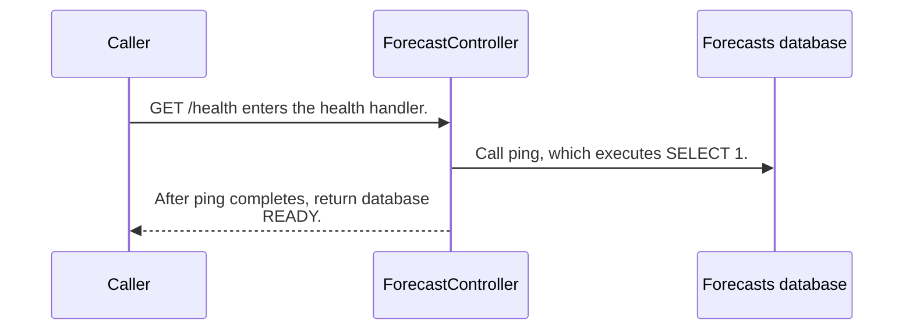

import {ClewProcess, ClewDataModel, ClewDownload, ClewModelLink, ClewRelatedModelLink, ClewFieldTrace, ClewContextLink, ClewPageContext, ClewProcessReturn, ClewStatus, ClewRetainedPage, ClewCatalog, ClewAnchor} from '@site/src/components/ClewReaders';

# GET /health

<ClewPageContext />

Retained account · UNVERIFIED · UNASSESSED. Runtime behavior is not established by this export.

The handler calls Forecasts.ping and then returns database READY. ping executes SELECT 1 through JDBC. The source shows a database check; it does not show a Kafka readiness check. The OpenAPI contract declares 200 and 500 responses.

Summary source bindings

- [contracts/forecasts.openapi.json:1–191 · revision c289b28be4819eddf29d59a7c12f178559ec5229](../sources/05a53615f19e214ae81a34c0ae85fcfafb9285ab8078741f240e9fc46c2c358e.mdx)
- [services/forecasts/src/main/kotlin/weather/Forecasts.kt:35–35 · revision c289b28be4819eddf29d59a7c12f178559ec5229](../sources/f6bdd894e3f69a993b049015d6d7a4d0e73a5e6dc94b46bf32a274326decee8b.mdx)
- [services/forecasts/src/main/kotlin/weather/ForecastController.kt:16–17 · revision c289b28be4819eddf29d59a7c12f178559ec5229](../sources/3fd6e0154de0e76dd7f5030fd6198b1f6fcb97f00c9d7d4ba454f60a75b32969.mdx)

## OpenAPI: GET /health

| Topic | Retained contract detail |
| --- | --- |
| Declared responses | The contract declares 200 and 500 responses. |

Contract source bindings

**Declared responses**

- [contracts/forecasts.openapi.json:1–191 · revision c289b28be4819eddf29d59a7c12f178559ec5229](../sources/05a53615f19e214ae81a34c0ae85fcfafb9285ab8078741f240e9fc46c2c358e.mdx)

## Declared interface schemas

<ClewContextLink path="/http/f6ce8266c4e697d9db9c6b995e231713ba2df9f58df6c8a2b74789bcf30bfa2c">GET /openapi.json</ClewContextLink>

<ClewContextLink path="/http/99c2697e8d504c9514c34631f942558372d28feb06ef894ce282840389e9f94a">GET /forecasts/&#123;id&#125;</ClewContextLink>

<ClewContextLink path="/http/bd635c40728e23898f5528ecb1a60517fa6eb4df4b3b94834ca587cb6e123780">GET /health</ClewContextLink>

## Interaction diagram

Actors and nested branches from the retained account; not a runtime trace. Labels are shortened for readability. Full messages and notes follow.

Full original sequence, branches and notes

#### 1. message

GET /health enters the health handler.

Source bindings

- [services/forecasts/src/main/kotlin/weather/ForecastController.kt:16–17 · revision c289b28be4819eddf29d59a7c12f178559ec5229](../sources/3fd6e0154de0e76dd7f5030fd6198b1f6fcb97f00c9d7d4ba454f60a75b32969.mdx)

#### 2. message

Call ping, which executes SELECT 1.

Source bindings

- [services/forecasts/src/main/kotlin/weather/Forecasts.kt:35–35 · revision c289b28be4819eddf29d59a7c12f178559ec5229](../sources/f6bdd894e3f69a993b049015d6d7a4d0e73a5e6dc94b46bf32a274326decee8b.mdx)
- [services/forecasts/src/main/kotlin/weather/ForecastController.kt:16–17 · revision c289b28be4819eddf29d59a7c12f178559ec5229](../sources/3fd6e0154de0e76dd7f5030fd6198b1f6fcb97f00c9d7d4ba454f60a75b32969.mdx)

#### 3. return

After ping completes, return database READY.

Source bindings

- [services/forecasts/src/main/kotlin/weather/ForecastController.kt:17–17 · revision c289b28be4819eddf29d59a7c12f178559ec5229](../sources/9f66c8a1048a37f611053a404085aabd8c71d98662bb52618c717211a56a6786.mdx)
- [services/forecasts/src/main/kotlin/weather/ForecastController.kt:16–17 · revision c289b28be4819eddf29d59a7c12f178559ec5229](../sources/3fd6e0154de0e76dd7f5030fd6198b1f6fcb97f00c9d7d4ba454f60a75b32969.mdx)

## Implementation explanation

GET /health enters the health handler.

Source bindings

- [services/forecasts/src/main/kotlin/weather/ForecastController.kt:16–17 · revision c289b28be4819eddf29d59a7c12f178559ec5229](../sources/3fd6e0154de0e76dd7f5030fd6198b1f6fcb97f00c9d7d4ba454f60a75b32969.mdx)

Call ping, which executes SELECT 1.

Source bindings

- [services/forecasts/src/main/kotlin/weather/Forecasts.kt:35–35 · revision c289b28be4819eddf29d59a7c12f178559ec5229](../sources/f6bdd894e3f69a993b049015d6d7a4d0e73a5e6dc94b46bf32a274326decee8b.mdx)
- [services/forecasts/src/main/kotlin/weather/ForecastController.kt:16–17 · revision c289b28be4819eddf29d59a7c12f178559ec5229](../sources/3fd6e0154de0e76dd7f5030fd6198b1f6fcb97f00c9d7d4ba454f60a75b32969.mdx)

After ping completes, return database READY.

Source bindings

- [services/forecasts/src/main/kotlin/weather/ForecastController.kt:17–17 · revision c289b28be4819eddf29d59a7c12f178559ec5229](../sources/9f66c8a1048a37f611053a404085aabd8c71d98662bb52618c717211a56a6786.mdx)
- [services/forecasts/src/main/kotlin/weather/ForecastController.kt:16–17 · revision c289b28be4819eddf29d59a7c12f178559ec5229](../sources/3fd6e0154de0e76dd7f5030fd6198b1f6fcb97f00c9d7d4ba454f60a75b32969.mdx)

Retained boundaries

- CALL\_TARGETS\_UNRESOLVED
- DIALECT\_DECLARED\_NOT\_COMPILER\_VALIDATED
- FILE\_ONLY:compose.yaml
- FILE\_ONLY:contracts/dashboard.openapi.json
- FILE\_ONLY:contracts/events.schema.json
- FILE\_ONLY:database/init.sql
- FILE\_ONLY:exercises/dashboard-focus-regression.mjs
- FILE\_ONLY:exercises/replay.py
- FILE\_ONLY:exercises/validator-regression.mjs
- FILE\_ONLY:fixtures/helsinki.json
- FILE\_ONLY:fixtures/lisbon.json
- FILE\_ONLY:fixtures/met-oslo-recorded.json
- FILE\_ONLY:fixtures/oslo.json
- FILE\_ONLY:fixtures/provenance.json
- FILE\_ONLY:services/dashboard/Dockerfile
- FILE\_ONLY:services/dashboard/package-lock.json
- FILE\_ONLY:services/dashboard/package.json
- FILE\_ONLY:services/dashboard/public/index.html
- FILE\_ONLY:services/dashboard/tsconfig.json
- OPENAPI\_JSON\_SCHEMA\_KEYWORDS\_NOT\_INTERPRETED
- OPENAPI\_SCHEMA\_NULL\_TYPE\_NOT\_INTERPRETED
- OPENAPI\_SCHEMA\_TYPE\_UNIONS\_NOT\_INTERPRETED
- ORDER\_LEXICAL\_ONLY
- SCOPE\_WATCH\_CONSERVATIVE
- Syntax evidence does not establish runtime dispatch or configuration. Expand known owners and helpers; retain explicit gaps for unresolved targets.
- ANNOTATION\_DECLARATION\_UNAVAILABLE
- CALL\_TARGETS\_UNRESOLVED
- DIALECT\_DECLARED\_NOT\_COMPILER\_VALIDATED
- FILE\_ONLY:compose.yaml
- FILE\_ONLY:contracts/events.schema.json
- FILE\_ONLY:contracts/forecasts.openapi.json
- FILE\_ONLY:database/init.sql
- FILE\_ONLY:fixtures/helsinki.json
- FILE\_ONLY:fixtures/lisbon.json
- FILE\_ONLY:fixtures/met-oslo-recorded.json
- FILE\_ONLY:fixtures/oslo.json
- FILE\_ONLY:fixtures/provenance.json
- FILE\_ONLY:services/forecasts/Dockerfile
- FILE\_ONLY:services/forecasts/pom.xml
- FILE\_ONLY:services/forecasts/src/main/resources/application.properties
- NO\_BEAN\_OWNER
- OPENAPI\_JSON\_SCHEMA\_KEYWORDS\_NOT\_INTERPRETED
- OPENAPI\_SCHEMA\_NULL\_TYPE\_NOT\_INTERPRETED
- OPENAPI\_SCHEMA\_TYPE\_UNIONS\_NOT\_INTERPRETED
- ORDER\_LEXICAL\_ONLY
- RUNTIME\_REGISTRATION\_UNPROVEN
- SCOPE\_WATCH\_CONSERVATIVE
- SOURCE\_NAMES\_NOT\_COMPILER\_RESOLVED
- UNRESOLVED\_ANNOTATION\_VALUE
- Syntax evidence does not establish runtime dispatch or configuration. Expand known owners and helpers; retain explicit gaps for unresolved targets.
- CLR\_SIGNATURE\_PROJECTED\_TO\_JVM\_DESCRIPTOR\_GRAMMAR
- CSHARP\_SOURCE\_GENERATED\_DOCUMENTS\_NOT\_INDEXED
- EXCEPTION\_FLOW\_REQUIRES\_SOURCE\_REVIEW
- GENERATED\_SOURCE\_BODIES\_NOT\_INDEXED
- LAMBDA\_EXECUTION\_NOT\_EXPANDED
- OPENAPI\_JSON\_SCHEMA\_KEYWORDS\_NOT\_INTERPRETED
- SHORT\_CIRCUIT\_FLOW\_REQUIRES\_SOURCE\_REVIEW
- SWITCH\_FLOW\_REQUIRES\_SOURCE\_REVIEW

