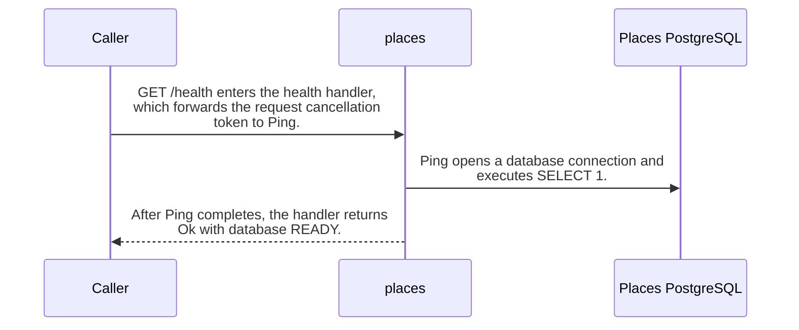

import {ClewProcess, ClewDataModel, ClewDownload, ClewModelLink, ClewRelatedModelLink, ClewFieldTrace, ClewContextLink, ClewPageContext, ClewProcessReturn, ClewStatus, ClewRetainedPage, ClewCatalog, ClewAnchor} from '@site/src/components/ClewReaders';

# GET /health

<ClewPageContext />

Retained account · UNVERIFIED · UNASSESSED. Runtime behavior is not established by this export.

PlacesController.Health awaits PlacesRepository.Ping and then returns Ok with database READY. Ping opens a PostgreSQL connection and executes SELECT 1, so this source checks database reachability and does not check Kafka. If connection opening fails, Open disposes the connection and rethrows. The OpenAPI 200 schema also defines a kafka READY property, while this handler returns only database; the source does not show a Kafka readiness check.

Summary source bindings

- [services/places/PlacesRepository.cs:14–19 · revision c289b28be4819eddf29d59a7c12f178559ec5229](../sources/ac9cd70dddf6c07f241fea3e24665fbe31c3ebcace3aebc051cc81679106cb7c.mdx)
- [services/places/PlacesRepository.cs:20–25 · revision c289b28be4819eddf29d59a7c12f178559ec5229](../sources/d10889d7dec9ec7771472d1a44e755b28743b1800e345a02d390e4ce46d995b6.mdx)
- [contracts/places.openapi.json:1–263 · revision c289b28be4819eddf29d59a7c12f178559ec5229](../sources/d04d07ecb57a86dc75dd79d70d54dfd22aeaecc9ece8f888218b6a6fde39f959.mdx)
- [services/places/PlacesController.cs:26–31 · revision c289b28be4819eddf29d59a7c12f178559ec5229](../sources/efc0c91d8075be6474d60ff2dfdc8deccb39e21ff00789cc4a20f6b4f07406d2.mdx)

## OpenAPI: GET /health

| Topic | Retained contract detail |
| --- | --- |
| Declared responses | The contract declares 200 and 500 responses. The 200 schema defines database and kafka properties, each with const READY. |

Contract source bindings

**Declared responses**

- [contracts/places.openapi.json:1–263 · revision c289b28be4819eddf29d59a7c12f178559ec5229](../sources/d04d07ecb57a86dc75dd79d70d54dfd22aeaecc9ece8f888218b6a6fde39f959.mdx)

## Declared interface schemas

<ClewContextLink path="/http/87bdfe805b90ff664e9fc182216739d849835c6c30af7a07a61f2e924a3ac715">GET /health</ClewContextLink>

<ClewContextLink path="/http/21f85a173ea2df11931c2a8c3d4c8953ac99f281ef337c409d8436421d347b61">GET /places</ClewContextLink>

<ClewContextLink path="/http/323c07ab1fab7684d72321edf709e7e56345afa1fed70fa7e429deef72d255dc">POST /places/&#123;id&#125;/refresh</ClewContextLink>

<ClewContextLink path="/http/d3ee0d34d91fd8813ea24869ec083fb1661ae843ae68a8370d87dd837a061341">GET /openapi.json</ClewContextLink>

<ClewContextLink path="/http/4faae4a057439031a1013fae51fc548d28f7ae661a688f8923ca2d1474e2a60a">POST /places</ClewContextLink>

## Interaction diagram

Actors and nested branches from the retained account; not a runtime trace. Labels are shortened for readability. Full messages and notes follow.

Full original sequence, branches and notes

#### 1. message

GET /health enters the health handler, which forwards the request cancellation token to Ping.

Source bindings

- [services/places/PlacesController.cs:26–31 · revision c289b28be4819eddf29d59a7c12f178559ec5229](../sources/efc0c91d8075be6474d60ff2dfdc8deccb39e21ff00789cc4a20f6b4f07406d2.mdx)

#### 2. message

Ping opens a database connection and executes SELECT 1.

Source bindings

- [services/places/PlacesRepository.cs:14–19 · revision c289b28be4819eddf29d59a7c12f178559ec5229](../sources/ac9cd70dddf6c07f241fea3e24665fbe31c3ebcace3aebc051cc81679106cb7c.mdx)
- [services/places/PlacesRepository.cs:20–25 · revision c289b28be4819eddf29d59a7c12f178559ec5229](../sources/d10889d7dec9ec7771472d1a44e755b28743b1800e345a02d390e4ce46d995b6.mdx)

#### 3. return

After Ping completes, the handler returns Ok with database READY.

Source bindings

- [services/places/PlacesController.cs:30–30 · revision c289b28be4819eddf29d59a7c12f178559ec5229](../sources/d203286611c588c4b0c038c3324009a087eb5da300f33fa1ac68974691bb5270.mdx)
- [services/places/PlacesController.cs:26–31 · revision c289b28be4819eddf29d59a7c12f178559ec5229](../sources/efc0c91d8075be6474d60ff2dfdc8deccb39e21ff00789cc4a20f6b4f07406d2.mdx)

#### 4. note

The OpenAPI 200 schema includes a kafka READY property; the handler returns only database and does not query Kafka. The spec property is not evidence that Kafka readiness is checked.

Source bindings

- [contracts/places.openapi.json:1–263 · revision c289b28be4819eddf29d59a7c12f178559ec5229](../sources/d04d07ecb57a86dc75dd79d70d54dfd22aeaecc9ece8f888218b6a6fde39f959.mdx)
- [services/places/PlacesController.cs:26–31 · revision c289b28be4819eddf29d59a7c12f178559ec5229](../sources/efc0c91d8075be6474d60ff2dfdc8deccb39e21ff00789cc4a20f6b4f07406d2.mdx)

#### 5. note

If opening the database connection fails, Open disposes it and rethrows; the handler has no catch for that failure.

Source bindings

- [services/places/PlacesRepository.cs:20–25 · revision c289b28be4819eddf29d59a7c12f178559ec5229](../sources/d10889d7dec9ec7771472d1a44e755b28743b1800e345a02d390e4ce46d995b6.mdx)
- [services/places/PlacesController.cs:26–31 · revision c289b28be4819eddf29d59a7c12f178559ec5229](../sources/efc0c91d8075be6474d60ff2dfdc8deccb39e21ff00789cc4a20f6b4f07406d2.mdx)

## Implementation explanation

GET /health enters the health handler, which forwards the request cancellation token to Ping.

Source bindings

- [services/places/PlacesController.cs:26–31 · revision c289b28be4819eddf29d59a7c12f178559ec5229](../sources/efc0c91d8075be6474d60ff2dfdc8deccb39e21ff00789cc4a20f6b4f07406d2.mdx)

Ping opens a database connection and executes SELECT 1.

Source bindings

- [services/places/PlacesRepository.cs:14–19 · revision c289b28be4819eddf29d59a7c12f178559ec5229](../sources/ac9cd70dddf6c07f241fea3e24665fbe31c3ebcace3aebc051cc81679106cb7c.mdx)
- [services/places/PlacesRepository.cs:20–25 · revision c289b28be4819eddf29d59a7c12f178559ec5229](../sources/d10889d7dec9ec7771472d1a44e755b28743b1800e345a02d390e4ce46d995b6.mdx)

After Ping completes, the handler returns Ok with database READY.

Source bindings

- [services/places/PlacesController.cs:30–30 · revision c289b28be4819eddf29d59a7c12f178559ec5229](../sources/d203286611c588c4b0c038c3324009a087eb5da300f33fa1ac68974691bb5270.mdx)
- [services/places/PlacesController.cs:26–31 · revision c289b28be4819eddf29d59a7c12f178559ec5229](../sources/efc0c91d8075be6474d60ff2dfdc8deccb39e21ff00789cc4a20f6b4f07406d2.mdx)

The OpenAPI 200 schema includes a kafka READY property; the handler returns only database and does not query Kafka. The spec property is not evidence that Kafka readiness is checked.

Source bindings

- [contracts/places.openapi.json:1–263 · revision c289b28be4819eddf29d59a7c12f178559ec5229](../sources/d04d07ecb57a86dc75dd79d70d54dfd22aeaecc9ece8f888218b6a6fde39f959.mdx)
- [services/places/PlacesController.cs:26–31 · revision c289b28be4819eddf29d59a7c12f178559ec5229](../sources/efc0c91d8075be6474d60ff2dfdc8deccb39e21ff00789cc4a20f6b4f07406d2.mdx)

If opening the database connection fails, Open disposes it and rethrows; the handler has no catch for that failure.

Source bindings

- [services/places/PlacesRepository.cs:20–25 · revision c289b28be4819eddf29d59a7c12f178559ec5229](../sources/d10889d7dec9ec7771472d1a44e755b28743b1800e345a02d390e4ce46d995b6.mdx)
- [services/places/PlacesController.cs:26–31 · revision c289b28be4819eddf29d59a7c12f178559ec5229](../sources/efc0c91d8075be6474d60ff2dfdc8deccb39e21ff00789cc4a20f6b4f07406d2.mdx)

## Retained HTTP comparison

Recorded HTTP checks · 1. Retained comparison observations · 0. These are separate from source-based observations.

[Comparison scope and original test artifacts](../comparisons/places.mdx)

Retained boundaries

- C\# source coverage is PARTIAL. The selected snapshot supports source-level explanations; it does not establish runtime registration, HTTP serialization, deployment configuration, or downstream forecast recomputation. The OpenAPI projection is read as source text and its JSON Schema keywords are not fully interpreted.
- CALL\_TARGETS\_UNRESOLVED
- DIALECT\_DECLARED\_NOT\_COMPILER\_VALIDATED
- FILE\_ONLY:compose.yaml
- FILE\_ONLY:contracts/dashboard.openapi.json
- FILE\_ONLY:contracts/events.schema.json
- FILE\_ONLY:database/init.sql
- FILE\_ONLY:exercises/dashboard-focus-regression.mjs
- FILE\_ONLY:exercises/replay.py
- FILE\_ONLY:exercises/validator-regression.mjs
- FILE\_ONLY:fixtures/helsinki.json
- FILE\_ONLY:fixtures/lisbon.json
- FILE\_ONLY:fixtures/met-oslo-recorded.json
- FILE\_ONLY:fixtures/oslo.json
- FILE\_ONLY:fixtures/provenance.json
- FILE\_ONLY:services/dashboard/Dockerfile
- FILE\_ONLY:services/dashboard/package-lock.json
- FILE\_ONLY:services/dashboard/package.json
- FILE\_ONLY:services/dashboard/public/index.html
- FILE\_ONLY:services/dashboard/tsconfig.json
- OPENAPI\_JSON\_SCHEMA\_KEYWORDS\_NOT\_INTERPRETED
- OPENAPI\_SCHEMA\_NULL\_TYPE\_NOT\_INTERPRETED
- OPENAPI\_SCHEMA\_TYPE\_UNIONS\_NOT\_INTERPRETED
- ORDER\_LEXICAL\_ONLY
- SCOPE\_WATCH\_CONSERVATIVE
- Syntax evidence does not establish runtime dispatch or configuration. Expand known owners and helpers; retain explicit gaps for unresolved targets.
- ANNOTATION\_DECLARATION\_UNAVAILABLE
- CALL\_TARGETS\_UNRESOLVED
- DIALECT\_DECLARED\_NOT\_COMPILER\_VALIDATED
- FILE\_ONLY:compose.yaml
- FILE\_ONLY:contracts/events.schema.json
- FILE\_ONLY:contracts/forecasts.openapi.json
- FILE\_ONLY:database/init.sql
- FILE\_ONLY:fixtures/helsinki.json
- FILE\_ONLY:fixtures/lisbon.json
- FILE\_ONLY:fixtures/met-oslo-recorded.json
- FILE\_ONLY:fixtures/oslo.json
- FILE\_ONLY:fixtures/provenance.json
- FILE\_ONLY:services/forecasts/Dockerfile
- FILE\_ONLY:services/forecasts/pom.xml
- FILE\_ONLY:services/forecasts/src/main/resources/application.properties
- NO\_BEAN\_OWNER
- OPENAPI\_JSON\_SCHEMA\_KEYWORDS\_NOT\_INTERPRETED
- OPENAPI\_SCHEMA\_NULL\_TYPE\_NOT\_INTERPRETED
- OPENAPI\_SCHEMA\_TYPE\_UNIONS\_NOT\_INTERPRETED
- ORDER\_LEXICAL\_ONLY
- RUNTIME\_REGISTRATION\_UNPROVEN
- SCOPE\_WATCH\_CONSERVATIVE
- SOURCE\_NAMES\_NOT\_COMPILER\_RESOLVED
- UNRESOLVED\_ANNOTATION\_VALUE
- Syntax evidence does not establish runtime dispatch or configuration. Expand known owners and helpers; retain explicit gaps for unresolved targets.
- CLR\_SIGNATURE\_PROJECTED\_TO\_JVM\_DESCRIPTOR\_GRAMMAR
- CSHARP\_SOURCE\_GENERATED\_DOCUMENTS\_NOT\_INDEXED
- EXCEPTION\_FLOW\_REQUIRES\_SOURCE\_REVIEW
- GENERATED\_SOURCE\_BODIES\_NOT\_INDEXED
- LAMBDA\_EXECUTION\_NOT\_EXPANDED
- OPENAPI\_JSON\_SCHEMA\_KEYWORDS\_NOT\_INTERPRETED
- SHORT\_CIRCUIT\_FLOW\_REQUIRES\_SOURCE\_REVIEW
- SWITCH\_FLOW\_REQUIRES\_SOURCE\_REVIEW

