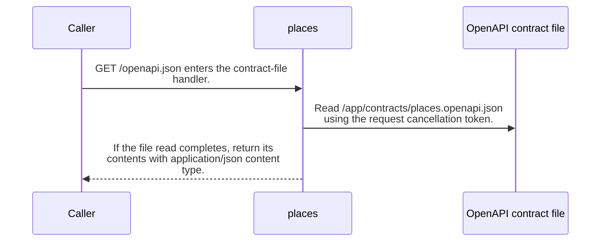

import {ClewProcess, ClewDataModel, ClewDownload, ClewModelLink, ClewRelatedModelLink, ClewFieldTrace, ClewContextLink, ClewPageContext, ClewProcessReturn, ClewStatus, ClewRetainedPage, ClewCatalog, ClewAnchor} from '@site/src/components/ClewReaders';

# GET /openapi.json

<ClewPageContext />

Retained account · UNVERIFIED · UNASSESSED. Runtime behavior is not established by this export.

PlacesController.OpenApi reads /app/contracts/places.openapi.json and returns its contents as application/json. The source shows no fallback or catch for a file-read failure, so a successful 200 response is not guaranteed by this code. The OpenAPI file itself declares 200 application/json and 500 responses for this route. Runtime file deployment and HTTP behavior remain unverified.

Summary source bindings

- [contracts/places.openapi.json:1–263 · revision c289b28be4819eddf29d59a7c12f178559ec5229](../sources/d04d07ecb57a86dc75dd79d70d54dfd22aeaecc9ece8f888218b6a6fde39f959.mdx)
- [services/places/PlacesController.cs:32–33 · revision c289b28be4819eddf29d59a7c12f178559ec5229](../sources/ce35089eb32fb4ba4d00a1b4b0c657cff0127f739011c6e0b42e5ffb2db671ba.mdx)

## OpenAPI: GET /openapi.json

| Topic | Retained contract detail |
| --- | --- |
| Declared responses | The contract declares 200 application/json with an object schema and a 500 response. |

Contract source bindings

**Declared responses**

- [contracts/places.openapi.json:1–263 · revision c289b28be4819eddf29d59a7c12f178559ec5229](../sources/d04d07ecb57a86dc75dd79d70d54dfd22aeaecc9ece8f888218b6a6fde39f959.mdx)

## Declared interface schemas

<ClewContextLink path="/http/87bdfe805b90ff664e9fc182216739d849835c6c30af7a07a61f2e924a3ac715">GET /health</ClewContextLink>

<ClewContextLink path="/http/21f85a173ea2df11931c2a8c3d4c8953ac99f281ef337c409d8436421d347b61">GET /places</ClewContextLink>

<ClewContextLink path="/http/323c07ab1fab7684d72321edf709e7e56345afa1fed70fa7e429deef72d255dc">POST /places/&#123;id&#125;/refresh</ClewContextLink>

<ClewContextLink path="/http/d3ee0d34d91fd8813ea24869ec083fb1661ae843ae68a8370d87dd837a061341">GET /openapi.json</ClewContextLink>

<ClewContextLink path="/http/4faae4a057439031a1013fae51fc548d28f7ae661a688f8923ca2d1474e2a60a">POST /places</ClewContextLink>

## Interaction diagram

Actors and nested branches from the retained account; not a runtime trace. Labels are shortened for readability. Full messages and notes follow.

Full original sequence, branches and notes

#### 1. message

GET /openapi.json enters the contract-file handler.

Source bindings

- [services/places/PlacesController.cs:32–33 · revision c289b28be4819eddf29d59a7c12f178559ec5229](../sources/ce35089eb32fb4ba4d00a1b4b0c657cff0127f739011c6e0b42e5ffb2db671ba.mdx)

#### 2. message

Read /app/contracts/places.openapi.json using the request cancellation token.

Source bindings

- [services/places/PlacesController.cs:32–33 · revision c289b28be4819eddf29d59a7c12f178559ec5229](../sources/ce35089eb32fb4ba4d00a1b4b0c657cff0127f739011c6e0b42e5ffb2db671ba.mdx)

#### 3. return

If the file read completes, return its contents with application/json content type.

Source bindings

- [services/places/PlacesController.cs:33–33 · revision c289b28be4819eddf29d59a7c12f178559ec5229](../sources/511591bc907a3b4cdbc0e66abfea8b19a5d53b4f98e218ca4a70c40318ed4678.mdx)
- [services/places/PlacesController.cs:32–33 · revision c289b28be4819eddf29d59a7c12f178559ec5229](../sources/ce35089eb32fb4ba4d00a1b4b0c657cff0127f739011c6e0b42e5ffb2db671ba.mdx)

#### 4. note

The shown handler has no fallback or catch around file reading; do not infer a successful 200 if the file cannot be read.

Source bindings

- [services/places/PlacesController.cs:32–33 · revision c289b28be4819eddf29d59a7c12f178559ec5229](../sources/ce35089eb32fb4ba4d00a1b4b0c657cff0127f739011c6e0b42e5ffb2db671ba.mdx)

## Implementation explanation

GET /openapi.json enters the contract-file handler.

Source bindings

- [services/places/PlacesController.cs:32–33 · revision c289b28be4819eddf29d59a7c12f178559ec5229](../sources/ce35089eb32fb4ba4d00a1b4b0c657cff0127f739011c6e0b42e5ffb2db671ba.mdx)

Read /app/contracts/places.openapi.json using the request cancellation token.

Source bindings

- [services/places/PlacesController.cs:32–33 · revision c289b28be4819eddf29d59a7c12f178559ec5229](../sources/ce35089eb32fb4ba4d00a1b4b0c657cff0127f739011c6e0b42e5ffb2db671ba.mdx)

If the file read completes, return its contents with application/json content type.

Source bindings

- [services/places/PlacesController.cs:33–33 · revision c289b28be4819eddf29d59a7c12f178559ec5229](../sources/511591bc907a3b4cdbc0e66abfea8b19a5d53b4f98e218ca4a70c40318ed4678.mdx)
- [services/places/PlacesController.cs:32–33 · revision c289b28be4819eddf29d59a7c12f178559ec5229](../sources/ce35089eb32fb4ba4d00a1b4b0c657cff0127f739011c6e0b42e5ffb2db671ba.mdx)

The shown handler has no fallback or catch around file reading; do not infer a successful 200 if the file cannot be read.

Source bindings

- [services/places/PlacesController.cs:32–33 · revision c289b28be4819eddf29d59a7c12f178559ec5229](../sources/ce35089eb32fb4ba4d00a1b4b0c657cff0127f739011c6e0b42e5ffb2db671ba.mdx)

## Retained HTTP comparison

Recorded HTTP checks · 0. Retained comparison observations · 0. These are separate from source-based observations.

[Comparison scope and original test artifacts](../comparisons/places.mdx)

Retained boundaries

- C\# source coverage is PARTIAL. The selected snapshot supports source-level explanations; it does not establish runtime registration, HTTP serialization, deployment configuration, or downstream forecast recomputation. The OpenAPI projection is read as source text and its JSON Schema keywords are not fully interpreted.
- CALL\_TARGETS\_UNRESOLVED
- DIALECT\_DECLARED\_NOT\_COMPILER\_VALIDATED
- FILE\_ONLY:compose.yaml
- FILE\_ONLY:contracts/dashboard.openapi.json
- FILE\_ONLY:contracts/events.schema.json
- FILE\_ONLY:database/init.sql
- FILE\_ONLY:exercises/dashboard-focus-regression.mjs
- FILE\_ONLY:exercises/replay.py
- FILE\_ONLY:exercises/validator-regression.mjs
- FILE\_ONLY:fixtures/helsinki.json
- FILE\_ONLY:fixtures/lisbon.json
- FILE\_ONLY:fixtures/met-oslo-recorded.json
- FILE\_ONLY:fixtures/oslo.json
- FILE\_ONLY:fixtures/provenance.json
- FILE\_ONLY:services/dashboard/Dockerfile
- FILE\_ONLY:services/dashboard/package-lock.json
- FILE\_ONLY:services/dashboard/package.json
- FILE\_ONLY:services/dashboard/public/index.html
- FILE\_ONLY:services/dashboard/tsconfig.json
- OPENAPI\_JSON\_SCHEMA\_KEYWORDS\_NOT\_INTERPRETED
- OPENAPI\_SCHEMA\_NULL\_TYPE\_NOT\_INTERPRETED
- OPENAPI\_SCHEMA\_TYPE\_UNIONS\_NOT\_INTERPRETED
- ORDER\_LEXICAL\_ONLY
- SCOPE\_WATCH\_CONSERVATIVE
- Syntax evidence does not establish runtime dispatch or configuration. Expand known owners and helpers; retain explicit gaps for unresolved targets.
- ANNOTATION\_DECLARATION\_UNAVAILABLE
- CALL\_TARGETS\_UNRESOLVED
- DIALECT\_DECLARED\_NOT\_COMPILER\_VALIDATED
- FILE\_ONLY:compose.yaml
- FILE\_ONLY:contracts/events.schema.json
- FILE\_ONLY:contracts/forecasts.openapi.json
- FILE\_ONLY:database/init.sql
- FILE\_ONLY:fixtures/helsinki.json
- FILE\_ONLY:fixtures/lisbon.json
- FILE\_ONLY:fixtures/met-oslo-recorded.json
- FILE\_ONLY:fixtures/oslo.json
- FILE\_ONLY:fixtures/provenance.json
- FILE\_ONLY:services/forecasts/Dockerfile
- FILE\_ONLY:services/forecasts/pom.xml
- FILE\_ONLY:services/forecasts/src/main/resources/application.properties
- NO\_BEAN\_OWNER
- OPENAPI\_JSON\_SCHEMA\_KEYWORDS\_NOT\_INTERPRETED
- OPENAPI\_SCHEMA\_NULL\_TYPE\_NOT\_INTERPRETED
- OPENAPI\_SCHEMA\_TYPE\_UNIONS\_NOT\_INTERPRETED
- ORDER\_LEXICAL\_ONLY
- RUNTIME\_REGISTRATION\_UNPROVEN
- SCOPE\_WATCH\_CONSERVATIVE
- SOURCE\_NAMES\_NOT\_COMPILER\_RESOLVED
- UNRESOLVED\_ANNOTATION\_VALUE
- Syntax evidence does not establish runtime dispatch or configuration. Expand known owners and helpers; retain explicit gaps for unresolved targets.
- CLR\_SIGNATURE\_PROJECTED\_TO\_JVM\_DESCRIPTOR\_GRAMMAR
- CSHARP\_SOURCE\_GENERATED\_DOCUMENTS\_NOT\_INDEXED
- EXCEPTION\_FLOW\_REQUIRES\_SOURCE\_REVIEW
- GENERATED\_SOURCE\_BODIES\_NOT\_INDEXED
- LAMBDA\_EXECUTION\_NOT\_EXPANDED
- OPENAPI\_JSON\_SCHEMA\_KEYWORDS\_NOT\_INTERPRETED
- SHORT\_CIRCUIT\_FLOW\_REQUIRES\_SOURCE\_REVIEW
- SWITCH\_FLOW\_REQUIRES\_SOURCE\_REVIEW

