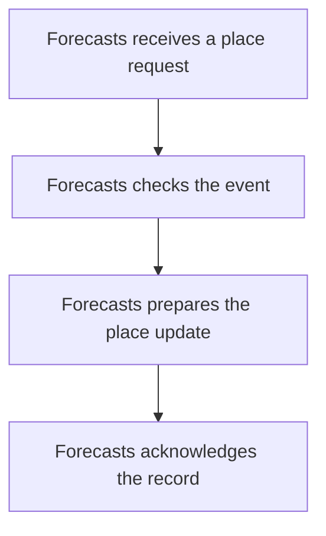

import {ClewProcess, ClewDataModel, ClewDownload, ClewModelLink, ClewRelatedModelLink, ClewFieldTrace, ClewContextLink, ClewPageContext, ClewProcessReturn, ClewStatus, ClewRetainedPage, ClewCatalog, ClewAnchor} from '@site/src/components/ClewReaders';

<ClewAnchor id="process-overview" pageStart />

# Refresh a forecast after a place request

<ClewPageContext />

<ClewStatus freshness="STALE" verification="UNASSESSED" />

Forecasts validates a place-requested event and prepares the place update and refresh.

## 1. Forecasts receives a place request {#question-receive}

<p className="clew-route"><code>{"Declared topic: weather.place-requested"}</code></p>

The saved process proposes a mapping from the Places publisher to this consumer on <code>{"weather.place-requested"}</code>. Broker routing and delivery are not established.

<details>
<summary>Evidence and scope</summary>

**Forecasts consumes proposed place-requested events** · STALE · UNASSESSED

The maintained process proposes the weather.place-requested mapping from Places.PublishPending to Forecasts.consume; this association does not verify topic configuration or runtime delivery.

- [services/forecasts/src/main/kotlin/weather/Forecasts.kt:38–53 · revision c289b28be4819eddf29d59a7c12f178559ec5229](../sources/fabcf790d6359bad92930830b294197d73c440e51b6a010808853eccb900f2e6.mdx)

</details>

<article className="clew-topic" id="topic-incoming-weather.place-requested" tabIndex={-1}>

### Incoming Kafka topic · weather.place-requested

<ClewProcessReturn topic="weather.place-requested" direction="incoming" />

<div className="clew-topic-path" aria-label="Declared asynchronous handoff">

<div>

<ClewContextLink path="/services/places#section-egress" fromProcess="forecasts-place-requested-consumer" fromQuestion="question-receive" query={{"direction":"outgoing","topic":"weather.place-requested"}}>Places</ClewContextLink>

PublishPending

</div>

<span aria-hidden="true">→</span>

<div>

**weather.place-requested**

Kafka topic · asynchronous

</div>

<span aria-hidden="true">→</span>

<div>

<ClewContextLink path="/services/forecasts#section-ingress" fromProcess="forecasts-place-requested-consumer" fromQuestion="question-receive" query={{"direction":"incoming","topic":"weather.place-requested"}}>Forecasts</ClewContextLink>

consume

</div>

</div>

Proposed handoff; runtime delivery has not been verified.

Saved publisher view: <ClewContextLink path="/scenarios/places-request-publisher#process-overview" fromProcess="forecasts-place-requested-consumer" fromQuestion="question-receive" query={{}}>Publish place requests</ClewContextLink>

<details>
<summary>Retained source and declaration context</summary>

Topic names and the payload's event type are separate values. These references retain their own revisions; source matches do not prove topic resolution or delivery.

- [services/forecasts/src/main/kotlin/weather/Forecasts.kt:38–53 · revision c289b28be4819eddf29d59a7c12f178559ec5229](../sources/fabcf790d6359bad92930830b294197d73c440e51b6a010808853eccb900f2e6.mdx)

```json
[
  {
    "boundaries": [
      "RUNTIME_DESTINATION_AND_ACTIVATION_UNKNOWN",
      "WIRE_SERIALIZATION_NOT_ASSESSED",
      "MESSAGE_DELIVERY_ORDER_RETRY_AND_CONSUMER_ACTIVATION_UNKNOWN",
      "ENVIRONMENT_SCOPE_UNSPECIFIED",
      "CLIENT_PATTERN_UNSUPPORTED_OR_AMBIGUOUS",
      "UNACCEPTED_AGENT_PROPOSAL"
    ],
    "from": {
      "callSite": {
        "observation": "places:flow:941152b2ec99892568c9e40a"
      },
      "selector": {
        "language": "csharp",
        "name": "PublishPending",
        "owner": "class:Weather.Places.RequestPublisher",
        "parameterTypes": [
          "Confluent.Kafka.IProducer`2",
          "System.Threading.CancellationToken"
        ]
      },
      "service": "places"
    },
    "interaction": "places-place-requested-to-forecasts",
    "origin": "agent-proposal",
    "rationale": "Agent-proposed weather.place-requested subscriber mapping. The captured Places producer call location is exact; topic resolution, consumer subscription and runtime delivery remain unverified.",
    "runtime": "UNKNOWN",
    "to": {
      "selector": {
        "language": "kotlin",
        "name": "consume",
        "owner": "class:weather.Forecasts",
        "parameterTypes": [
          "record: ConsumerRecord<String, String>",
          "acknowledgment: Acknowledgment"
        ]
      },
      "service": "forecasts"
    },
    "topic": {
      "caller": {
        "declared": "weather.place-requested",
        "observed": [],
        "status": "UNRESOLVED"
      },
      "receiver": {
        "declared": "weather.place-requested",
        "observed": [],
        "status": "UNRESOLVED"
      }
    }
  }
]
```


</details>

</article>

## 2. Forecasts checks the event {#question-validate}

The listener is written to parse and validate the event before preparing database work.

<details>
<summary>Evidence and scope</summary>

**Forecasts consumes proposed place-requested events** · STALE · UNASSESSED

JSON parsing and validatePlaceEvent complete successfully.

- [services/forecasts/src/main/kotlin/weather/Forecasts.kt:40–44 · revision c289b28be4819eddf29d59a7c12f178559ec5229](../sources/97e0dd89fa86dcb90cc283f4c25f9200d6f06d20fb3ddd9728645de580dd22fc.mdx)
- [services/forecasts/src/main/kotlin/weather/Forecasts.kt:38–53 · revision c289b28be4819eddf29d59a7c12f178559ec5229](../sources/fabcf790d6359bad92930830b294197d73c440e51b6a010808853eccb900f2e6.mdx)
- [services/forecasts/src/main/kotlin/weather/Forecasts.kt:55–60 · revision c289b28be4819eddf29d59a7c12f178559ec5229](../sources/9233bcae5aa5673c061ebdb857c39ce75ee4724473f2f75c21b7387f0fc94e1b.mdx)

</details>

<details className="clew-context-disclosure">
<summary>Validation details<span className="clew-disclosure-preview">Required event and place fields · syntax-backed callback limits</span></summary>

The validator checks version 1, type place.requested, a nonblank event ID, an allowed place ID, a nonblank name and numeric coordinates. The syntax record shows validation in an also callback; it does not attest callback invocation.

<details>
<summary>Evidence and scope</summary>

**Forecasts consumes proposed place-requested events** · STALE · UNASSESSED

The source validator checks version 1, type place.requested, a nonblank id, an allowed place id, a nonblank name, and numeric latitude and longitude.

- [services/forecasts/src/main/kotlin/weather/Forecasts.kt:55–60 · revision c289b28be4819eddf29d59a7c12f178559ec5229](../sources/9233bcae5aa5673c061ebdb857c39ce75ee4724473f2f75c21b7387f0fc94e1b.mdx)
**Forecasts consumes proposed place-requested events** · STALE · UNASSESSED

The source expression contains a deferred also lambda that calls validatePlaceEvent. The exact invocation semantics are not established by this syntax record.

- [services/forecasts/src/main/kotlin/weather/Forecasts.kt:40–40 · revision c289b28be4819eddf29d59a7c12f178559ec5229](../sources/47e4ea3df3f628f54c8dde414c838593d9efdf9d54a4f79f3c08f48519ca7d51.mdx)
- [services/forecasts/src/main/kotlin/weather/Forecasts.kt:38–53 · revision c289b28be4819eddf29d59a7c12f178559ec5229](../sources/fabcf790d6359bad92930830b294197d73c440e51b6a010808853eccb900f2e6.mdx)
- [services/forecasts/src/main/kotlin/weather/Forecasts.kt:55–60 · revision c289b28be4819eddf29d59a7c12f178559ec5229](../sources/9233bcae5aa5673c061ebdb857c39ce75ee4724473f2f75c21b7387f0fc94e1b.mdx)

</details>


</details>

<aside className="clew-exception">

### If parsing or validation fails {#question-invalid-event}

The listener writes an <code>{"INVALID_EVENT"}</code> rejection, then acknowledges the record and returns. If writing the rejection fails, acknowledgement is not reached and the error propagates.

<details>
<summary>Evidence and scope</summary>

**Forecasts consumes proposed place-requested events** · STALE · UNASSESSED

Write a rejected\_messages row with the source topic, partition, offset, and reason INVALID\_EVENT; conflicts are ignored.

- [services/forecasts/src/main/kotlin/weather/Forecasts.kt:38–53 · revision c289b28be4819eddf29d59a7c12f178559ec5229](../sources/fabcf790d6359bad92930830b294197d73c440e51b6a010808853eccb900f2e6.mdx)
**Forecasts consumes proposed place-requested events** · STALE · UNASSESSED

After the rejection write returns, acknowledge the record.

- [services/forecasts/src/main/kotlin/weather/Forecasts.kt:38–53 · revision c289b28be4819eddf29d59a7c12f178559ec5229](../sources/fabcf790d6359bad92930830b294197d73c440e51b6a010808853eccb900f2e6.mdx)
**Forecasts consumes proposed place-requested events** · STALE · UNASSESSED

If the rejection write throws, the acknowledge call is not reached and the exception propagates from this source path.

- [services/forecasts/src/main/kotlin/weather/Forecasts.kt:38–53 · revision c289b28be4819eddf29d59a7c12f178559ec5229](../sources/fabcf790d6359bad92930830b294197d73c440e51b6a010808853eccb900f2e6.mdx)

</details>

</aside>

## 3. Forecasts prepares the place update {#question-update}

The supplied transaction callback remembers the event ID, updates the place and calls the shared forecast-refresh path. This snapshot does not prove callback execution or transaction commit.

<div className="clew-context-links">

<ClewModelLink model="forecast" process="forecasts-place-requested-consumer" anchor="question-update">Forecast · data model</ClewModelLink>

<ClewContextLink path="/services/forecasts#section-entities" fromProcess="forecasts-place-requested-consumer" fromQuestion="question-update">Technical context</ClewContextLink>

</div>

<details>
<summary>Evidence and scope</summary>

**Forecasts consumes proposed place-requested events** · STALE · UNASSESSED

Run the transaction callback and insert event.id into inbox with conflicts ignored.

- [services/forecasts/src/main/kotlin/weather/Forecasts.kt:38–53 · revision c289b28be4819eddf29d59a7c12f178559ec5229](../sources/fabcf790d6359bad92930830b294197d73c440e51b6a010808853eccb900f2e6.mdx)
**Forecasts consumes proposed place-requested events** · STALE · UNASSESSED

Upsert the place fields by place id, then invoke refresh(place) in the callback.

- [services/forecasts/src/main/kotlin/weather/Forecasts.kt:38–53 · revision c289b28be4819eddf29d59a7c12f178559ec5229](../sources/fabcf790d6359bad92930830b294197d73c440e51b6a010808853eccb900f2e6.mdx)
**Forecasts consumes proposed place-requested events** · STALE · UNASSESSED

The source passes a deferred callback to transaction.executeWithoutResult; this group records the callback body and does not establish framework invocation or transaction outcome.

- [services/forecasts/src/main/kotlin/weather/Forecasts.kt:38–53 · revision c289b28be4819eddf29d59a7c12f178559ec5229](../sources/fabcf790d6359bad92930830b294197d73c440e51b6a010808853eccb900f2e6.mdx)
- [services/forecasts/src/main/kotlin/weather/Forecasts.kt:45–51 · revision c289b28be4819eddf29d59a7c12f178559ec5229](../sources/4e9f622c29b7004ef06a46c8f890c5d19566d4f728694d74e89ca982402eeb60.mdx)

</details>

<aside className="clew-info">

### If the event ID already exists

If the event ID already exists, the callback returns before updating the place or calling refresh.

<details>
<summary>Evidence and scope</summary>

**Forecasts consumes proposed place-requested events** · STALE · UNASSESSED

When the inbox insert reports an existing event id, return from the transaction callback before the place upsert and refresh call.

- [services/forecasts/src/main/kotlin/weather/Forecasts.kt:38–53 · revision c289b28be4819eddf29d59a7c12f178559ec5229](../sources/fabcf790d6359bad92930830b294197d73c440e51b6a010808853eccb900f2e6.mdx)
- [services/forecasts/src/main/kotlin/weather/Forecasts.kt:47–47 · revision c289b28be4819eddf29d59a7c12f178559ec5229](../sources/7e91c34807cc22ec484f72d2e4506c85976f38cfff61cce5f7dece6d263b8506.mdx)

</details>

</aside>

<aside className="clew-exception">

### If transaction work fails {#question-transaction-error}

An exception escaping the transaction call prevents the following acknowledgement. Rollback and delivery outcomes are not established by these source records.

<details>
<summary>Evidence and scope</summary>

**Forecasts consumes proposed place-requested events** · STALE · UNASSESSED

If an exception exits the transaction call, execution does not reach the following acknowledge statement. This source view does not determine rollback or delivery outcomes.

- [services/forecasts/src/main/kotlin/weather/Forecasts.kt:38–53 · revision c289b28be4819eddf29d59a7c12f178559ec5229](../sources/fabcf790d6359bad92930830b294197d73c440e51b6a010808853eccb900f2e6.mdx)

</details>

</aside>

## 4. Forecasts acknowledges the record {#question-acknowledge}

The listener calls acknowledgement after the transaction call returns. That call is not proof of an atomic database-and-Kafka commit or exactly-once delivery.

<details>
<summary>Evidence and scope</summary>

**Forecasts consumes proposed place-requested events** · STALE · UNASSESSED

Acknowledge the record after the transaction call returns.

- [services/forecasts/src/main/kotlin/weather/Forecasts.kt:38–53 · revision c289b28be4819eddf29d59a7c12f178559ec5229](../sources/fabcf790d6359bad92930830b294197d73c440e51b6a010808853eccb900f2e6.mdx)
**Forecasts consumes proposed place-requested events** · STALE · UNASSESSED

If an exception exits the transaction call, execution does not reach the following acknowledge statement. This source view does not determine rollback or delivery outcomes.

- [services/forecasts/src/main/kotlin/weather/Forecasts.kt:38–53 · revision c289b28be4819eddf29d59a7c12f178559ec5229](../sources/fabcf790d6359bad92930830b294197d73c440e51b6a010808853eccb900f2e6.mdx)

</details>

## Full description and sources {#question-confidence}

The saved topic mapping is agent-proposed. Callback execution, transaction outcome and runtime delivery remain unverified. The shared refresh and pending-publisher views describe separate source scopes, not a proven execution sequence.

<div className="clew-context-links">

<ClewContextLink path="/scenarios/forecasts-refresh-scheduled#process-overview" fromProcess="forecasts-place-requested-consumer" fromQuestion="question-confidence">Shared forecast refresh path</ClewContextLink>

<ClewContextLink path="/scenarios/forecasts-publish-pending#process-overview" fromProcess="forecasts-place-requested-consumer" fromQuestion="question-confidence">Related forecast publisher</ClewContextLink>

</div>

<details>
<summary>Evidence and scope</summary>

**Forecasts consumes proposed place-requested events** · STALE · UNASSESSED

The saved process declares an agent-proposed mapping from Places.PublishPending to Forecasts.consume on weather.place-requested; it does not establish broker routing or runtime delivery. At source, the listener parses and validates the record before entering a transaction. A parse or validation exception enters the rejection branch: an INVALID\_EVENT row is written and the record is acknowledged; if the rejection write fails, the acknowledgement is not reached. A valid event inserts its id into inbox. An existing id returns before the place upsert and refresh call; a new id upserts the place and calls refresh(place) inside the callback. The listener acknowledges after the transaction call returns, so an exception exiting that call prevents this source-level acknowledgement. The accepted Consume weather.place-requested service operation retains the detailed handler body; this page locates it in the declared Places-to-Forecasts path. Saved refresh and publisher views are links, not proof of order or atomicity. Runtime routing, delivery, and transaction outcomes remain unverified.

- [services/forecasts/src/main/kotlin/weather/Forecasts.kt:38–53 · revision c289b28be4819eddf29d59a7c12f178559ec5229](../sources/fabcf790d6359bad92930830b294197d73c440e51b6a010808853eccb900f2e6.mdx)
- [services/forecasts/src/main/kotlin/weather/Forecasts.kt:55–60 · revision c289b28be4819eddf29d59a7c12f178559ec5229](../sources/9233bcae5aa5673c061ebdb857c39ce75ee4724473f2f75c21b7387f0fc94e1b.mdx)

</details>

<details>
<summary>Reading guide and map</summary>

Editorial reading guide · original source scopes and review states remain separate.

Reading order only. Conditions and failures remain beside the steps below; this is not a runtime trace.




</details>

<details>
<summary>Evidence scope</summary>

The saved topic mapping is agent-proposed. Callback execution, transaction outcome and runtime delivery remain unverified. The shared refresh and pending-publisher views describe separate source scopes, not a proven execution sequence.

<div className="clew-context-links">

<ClewContextLink path="/scenarios/forecasts-refresh-scheduled#process-overview" fromProcess="forecasts-place-requested-consumer" fromQuestion="question-confidence">Shared forecast refresh path</ClewContextLink>

<ClewContextLink path="/scenarios/forecasts-publish-pending#process-overview" fromProcess="forecasts-place-requested-consumer" fromQuestion="question-confidence">Related forecast publisher</ClewContextLink>

</div>

<details>
<summary>Evidence and scope</summary>

**Forecasts consumes proposed place-requested events** · STALE · UNASSESSED

The saved process declares an agent-proposed mapping from Places.PublishPending to Forecasts.consume on weather.place-requested; it does not establish broker routing or runtime delivery. At source, the listener parses and validates the record before entering a transaction. A parse or validation exception enters the rejection branch: an INVALID\_EVENT row is written and the record is acknowledged; if the rejection write fails, the acknowledgement is not reached. A valid event inserts its id into inbox. An existing id returns before the place upsert and refresh call; a new id upserts the place and calls refresh(place) inside the callback. The listener acknowledges after the transaction call returns, so an exception exiting that call prevents this source-level acknowledgement. The accepted Consume weather.place-requested service operation retains the detailed handler body; this page locates it in the declared Places-to-Forecasts path. Saved refresh and publisher views are links, not proof of order or atomicity. Runtime routing, delivery, and transaction outcomes remain unverified.

- [services/forecasts/src/main/kotlin/weather/Forecasts.kt:38–53 · revision c289b28be4819eddf29d59a7c12f178559ec5229](../sources/fabcf790d6359bad92930830b294197d73c440e51b6a010808853eccb900f2e6.mdx)
- [services/forecasts/src/main/kotlin/weather/Forecasts.kt:55–60 · revision c289b28be4819eddf29d59a7c12f178559ec5229](../sources/9233bcae5aa5673c061ebdb857c39ce75ee4724473f2f75c21b7387f0fc94e1b.mdx)

</details>


</details>

## Original accounts and implementation

- [Forecasts consumes proposed place-requested events](../operations/scenarios-forecasts-place-requested-consumer--forecasts-place-requested-consumer.mdx)
- [Forecasts place-requested process overview](../operations/scenarios-forecasts-place-requested-consumer--process-overview.mdx)

<ClewDownload path="/clew-data/native/scenarios/forecasts-place-requested-consumer.json">Saved data and complete provenance (reference format)</ClewDownload>

