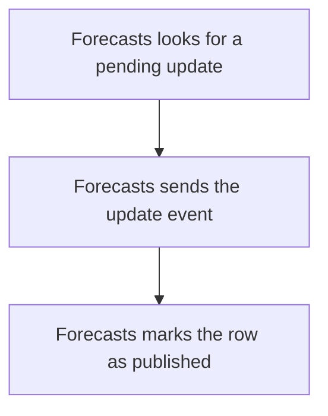

import {ClewProcess, ClewDataModel, ClewDownload, ClewModelLink, ClewRelatedModelLink, ClewFieldTrace, ClewContextLink, ClewPageContext, ClewProcessReturn, ClewStatus, ClewRetainedPage, ClewCatalog, ClewAnchor} from '@site/src/components/ClewReaders';

<ClewAnchor id="process-overview" pageStart />

# Publish forecast updates

<ClewPageContext />

<ClewStatus freshness="STALE" verification="UNASSESSED" />

Forecasts sends pending update events and marks completed sends in its transaction callback.

## 1. Forecasts looks for a pending update {#question-pending}

The source declares a periodic publishing pass. Inside its transaction callback, at most one unpublished outbox row is selected. No selected row means no Kafka send.

<details>
<summary>Evidence and scope</summary>

**Publish pending forecast updates** · STALE · UNASSESSED

The source annotation sets a fixed delay from PUBLISH\_INTERVAL\_MS, default 1000 ms. Runtime scheduler registration and activation are unverified.

- [services/forecasts/src/main/kotlin/weather/Forecasts.kt:127–139 · revision c289b28be4819eddf29d59a7c12f178559ec5229](../sources/1bd07596f6d98195ae25427eb2eb0175e2e0db2969f1b348800d52ddabc630ab.mdx)
**Publish pending forecast updates** · STALE · UNASSESSED

Inside transaction.executeWithoutResult, select at most one unpublished outbox row with ORDER BY id LIMIT 1 FOR UPDATE SKIP LOCKED. The source orders by identifier; it does not establish a globally oldest event.

- [services/forecasts/src/main/kotlin/weather/Forecasts.kt:127–139 · revision c289b28be4819eddf29d59a7c12f178559ec5229](../sources/1bd07596f6d98195ae25427eb2eb0175e2e0db2969f1b348800d52ddabc630ab.mdx)
- [services/forecasts/src/main/kotlin/weather/Forecasts.kt:129–138 · revision c289b28be4819eddf29d59a7c12f178559ec5229](../sources/77419b38cab1c2be268d248020c0f3d1aed119786e7f30a01355c56299cf7b1f.mdx)
**Publish pending forecast updates** · STALE · UNASSESSED

An empty result returns from the transaction callback without sending.

- [services/forecasts/src/main/kotlin/weather/Forecasts.kt:127–139 · revision c289b28be4819eddf29d59a7c12f178559ec5229](../sources/1bd07596f6d98195ae25427eb2eb0175e2e0db2969f1b348800d52ddabc630ab.mdx)
- [services/forecasts/src/main/kotlin/weather/Forecasts.kt:129–138 · revision c289b28be4819eddf29d59a7c12f178559ec5229](../sources/77419b38cab1c2be268d248020c0f3d1aed119786e7f30a01355c56299cf7b1f.mdx)
- [services/forecasts/src/main/kotlin/weather/Forecasts.kt:132–132 · revision c289b28be4819eddf29d59a7c12f178559ec5229](../sources/7c66cfc253529cc22121742daf694971e07c9472d3498bc6ef300d767cbf4713.mdx)

</details>

<details className="clew-context-disclosure">
<summary>Schedule and selection rules<span className="clew-disclosure-preview">One row · identifier order · declared one-second delay</span></summary>

The declared fixed delay defaults to one second. The query uses ORDER BY id LIMIT 1 FOR UPDATE SKIP LOCKED: identifier order is not event-time order. Scheduler activation, callback invocation and transaction outcomes remain unverified.

<details>
<summary>Evidence and scope</summary>

**Publish pending forecast updates** · STALE · UNASSESSED

The source annotation sets a fixed delay from PUBLISH\_INTERVAL\_MS, default 1000 ms. Runtime scheduler registration and activation are unverified.

- [services/forecasts/src/main/kotlin/weather/Forecasts.kt:127–139 · revision c289b28be4819eddf29d59a7c12f178559ec5229](../sources/1bd07596f6d98195ae25427eb2eb0175e2e0db2969f1b348800d52ddabc630ab.mdx)
**Publish pending forecast updates** · STALE · UNASSESSED

Inside transaction.executeWithoutResult, select at most one unpublished outbox row with ORDER BY id LIMIT 1 FOR UPDATE SKIP LOCKED. The source orders by identifier; it does not establish a globally oldest event.

- [services/forecasts/src/main/kotlin/weather/Forecasts.kt:127–139 · revision c289b28be4819eddf29d59a7c12f178559ec5229](../sources/1bd07596f6d98195ae25427eb2eb0175e2e0db2969f1b348800d52ddabc630ab.mdx)
- [services/forecasts/src/main/kotlin/weather/Forecasts.kt:129–138 · revision c289b28be4819eddf29d59a7c12f178559ec5229](../sources/77419b38cab1c2be268d248020c0f3d1aed119786e7f30a01355c56299cf7b1f.mdx)
**Publish pending forecast updates** · STALE · UNASSESSED

The source passes a deferred lambda to transaction.executeWithoutResult; its body contains the row selection and all selected-row actions shown below. This does not establish runtime scheduler activation.

- [services/forecasts/src/main/kotlin/weather/Forecasts.kt:130–137 · revision c289b28be4819eddf29d59a7c12f178559ec5229](../sources/d16edda6870f49ad776f5d271642e7ceb0421909d445f9f593fa3fd1ecf610c2.mdx)

</details>


</details>

## 2. Forecasts sends the update event {#question-send}

<p className="clew-route"><code>{"Topic: weather.forecast-updated"}</code></p>

The stored payload is sent to <code>{"weather.forecast-updated"}</code>, using the place ID as key. The method waits up to ten seconds for the send future.

<details>
<summary>Evidence and scope</summary>

**Publish pending forecast updates** · STALE · UNASSESSED

Read the stored JSON payload and use place.id as the Kafka message key.

- [services/forecasts/src/main/kotlin/weather/Forecasts.kt:127–139 · revision c289b28be4819eddf29d59a7c12f178559ec5229](../sources/1bd07596f6d98195ae25427eb2eb0175e2e0db2969f1b348800d52ddabc630ab.mdx)
**Publish pending forecast updates** · STALE · UNASSESSED

Send the payload to weather.forecast-updated and wait up to ten seconds for the send future to complete.

- [services/forecasts/src/main/kotlin/weather/Forecasts.kt:127–139 · revision c289b28be4819eddf29d59a7c12f178559ec5229](../sources/1bd07596f6d98195ae25427eb2eb0175e2e0db2969f1b348800d52ddabc630ab.mdx)
- [services/forecasts/src/main/kotlin/weather/Forecasts.kt:129–138 · revision c289b28be4819eddf29d59a7c12f178559ec5229](../sources/77419b38cab1c2be268d248020c0f3d1aed119786e7f30a01355c56299cf7b1f.mdx)

</details>

<article className="clew-topic" id="topic-outgoing-weather.forecast-updated" tabIndex={-1}>

### Outgoing Kafka topic · weather.forecast-updated

<ClewProcessReturn topic="weather.forecast-updated" direction="outgoing" />

<div className="clew-topic-path" aria-label="Declared asynchronous handoff">

<div>

<ClewContextLink path="/services/forecasts#section-egress" fromProcess="forecasts-publish-pending" fromQuestion="question-send" query={{"direction":"outgoing","topic":"weather.forecast-updated"}}>Forecasts</ClewContextLink>

publishPending

</div>

<span aria-hidden="true">→</span>

<div>

**weather.forecast-updated**

Kafka topic · asynchronous

</div>

<span aria-hidden="true">→</span>

<div>

<ClewContextLink path="/services/dashboard#section-ingress" fromProcess="forecasts-publish-pending" fromQuestion="question-send" query={{"direction":"incoming","topic":"weather.forecast-updated"}}>Dashboard</ClewContextLink>

consumeMessage

</div>

</div>

Proposed handoff; runtime delivery has not been verified.

Saved consumer view: <ClewContextLink path="/scenarios/dashboard-forecast-updated-consumer#process-overview" fromProcess="forecasts-publish-pending" fromQuestion="question-send" query={{}}>Update a Dashboard forecast</ClewContextLink>

<details>
<summary>Retained source and declaration context</summary>

Topic names and the payload's event type are separate values. These references retain their own revisions; source matches do not prove topic resolution or delivery.

- [services/forecasts/src/main/kotlin/weather/Forecasts.kt:127–139 · revision c289b28be4819eddf29d59a7c12f178559ec5229](../sources/1bd07596f6d98195ae25427eb2eb0175e2e0db2969f1b348800d52ddabc630ab.mdx)
- [services/forecasts/src/main/kotlin/weather/Forecasts.kt:129–138 · revision c289b28be4819eddf29d59a7c12f178559ec5229](../sources/77419b38cab1c2be268d248020c0f3d1aed119786e7f30a01355c56299cf7b1f.mdx)
- [services/forecasts/src/main/kotlin/weather/Forecasts.kt:130–137 · revision c289b28be4819eddf29d59a7c12f178559ec5229](../sources/d16edda6870f49ad776f5d271642e7ceb0421909d445f9f593fa3fd1ecf610c2.mdx)

```json
[
  {
    "boundaries": [
      "RUNTIME_DESTINATION_AND_ACTIVATION_UNKNOWN",
      "WIRE_SERIALIZATION_NOT_ASSESSED",
      "MESSAGE_DELIVERY_ORDER_RETRY_AND_CONSUMER_ACTIVATION_UNKNOWN",
      "ENVIRONMENT_SCOPE_UNSPECIFIED",
      "CLIENT_PATTERN_UNSUPPORTED_OR_AMBIGUOUS",
      "UNACCEPTED_AGENT_PROPOSAL"
    ],
    "from": {
      "callSite": {
        "observation": "forecasts:flow:a5b0ed72a047f4f36e281eb2"
      },
      "selector": {
        "language": "kotlin",
        "name": "publishPending",
        "owner": "class:weather.Forecasts",
        "parameterTypes": []
      },
      "service": "forecasts"
    },
    "interaction": "forecasts-forecast-updated-to-dashboard",
    "origin": "agent-proposal",
    "rationale": "Agent-proposed weather.forecast-updated subscriber mapping. The selected source method and producer callsite are retained; topic resolution, consumer subscription and runtime delivery remain unverified.",
    "runtime": "UNKNOWN",
    "to": {
      "selector": {
        "language": "typescript",
        "name": "consumeMessage",
        "owner": "package:",
        "parameterTypes": [
          ": EachMessagePayload"
        ]
      },
      "service": "dashboard"
    },
    "topic": {
      "caller": {
        "declared": "weather.forecast-updated",
        "observed": [],
        "status": "UNRESOLVED"
      },
      "receiver": {
        "declared": "weather.forecast-updated",
        "observed": [],
        "status": "UNRESOLVED"
      }
    }
  }
]
```


</details>

</article>

<aside className="clew-exception">

### If the publish attempt fails {#question-publish-error}

An exception from the transaction path, send wait or database update is logged as <code>{"PUBLISH_RETRY"}</code> with its class. The method has no immediate retry loop; another attempt needs another invocation.

<details>
<summary>Evidence and scope</summary>

**Publish pending forecast updates** · STALE · UNASSESSED

An exception from the transaction path, send wait, or database update is caught and logged as PUBLISH\_RETRY followed by the exception class name. A later attempt depends on another invocation; this method contains no immediate retry loop.

- [services/forecasts/src/main/kotlin/weather/Forecasts.kt:127–139 · revision c289b28be4819eddf29d59a7c12f178559ec5229](../sources/1bd07596f6d98195ae25427eb2eb0175e2e0db2969f1b348800d52ddabc630ab.mdx)
- [services/forecasts/src/main/kotlin/weather/Forecasts.kt:129–138 · revision c289b28be4819eddf29d59a7c12f178559ec5229](../sources/77419b38cab1c2be268d248020c0f3d1aed119786e7f30a01355c56299cf7b1f.mdx)

</details>

</aside>

## 3. Forecasts marks the row as published {#question-record}

After the send future completes, the callback marks the selected row published. This statement alone does not prove that its database transaction committed.

<div className="clew-context-links">

<ClewModelLink model="forecast" process="forecasts-publish-pending" anchor="question-record">Forecast · data model</ClewModelLink>

<ClewContextLink path="/services/forecasts#section-entities" fromProcess="forecasts-publish-pending" fromQuestion="question-record">Technical context</ClewContextLink>

</div>

<details>
<summary>Evidence and scope</summary>

**Publish pending forecast updates** · STALE · UNASSESSED

After the send future completes, update the selected outbox row to published=true inside the transaction callback.

- [services/forecasts/src/main/kotlin/weather/Forecasts.kt:127–139 · revision c289b28be4819eddf29d59a7c12f178559ec5229](../sources/1bd07596f6d98195ae25427eb2eb0175e2e0db2969f1b348800d52ddabc630ab.mdx)
- [services/forecasts/src/main/kotlin/weather/Forecasts.kt:129–138 · revision c289b28be4819eddf29d59a7c12f178559ec5229](../sources/77419b38cab1c2be268d248020c0f3d1aed119786e7f30a01355c56299cf7b1f.mdx)

</details>

<aside className="clew-exception">

### If send succeeds but commit does not {#question-replay-window}

The broker send and database commit are separate effects. A transaction failure or crash after sending can leave the row pending and cause a later duplicate send.

<details>
<summary>Evidence and scope</summary>

**Publish pending forecast updates** · STALE · UNASSESSED

The database transaction does not make the Kafka effect atomic with its commit. If the send completes but the transaction later fails or the process stops before commit, the row can remain pending and be sent again.

- [services/forecasts/src/main/kotlin/weather/Forecasts.kt:127–139 · revision c289b28be4819eddf29d59a7c12f178559ec5229](../sources/1bd07596f6d98195ae25427eb2eb0175e2e0db2969f1b348800d52ddabc630ab.mdx)
- [services/forecasts/src/main/kotlin/weather/Forecasts.kt:129–138 · revision c289b28be4819eddf29d59a7c12f178559ec5229](../sources/77419b38cab1c2be268d248020c0f3d1aed119786e7f30a01355c56299cf7b1f.mdx)

</details>

</aside>

## Full description and sources {#question-confidence}

The source declares one pending-row attempt per invocation, not a running scheduler or observed delivery. It does not establish an atomic Kafka/database transaction, exactly-once delivery or downstream consumer completion.

<div className="clew-context-links">

<ClewContextLink path="/scenarios/dashboard-forecast-updated-consumer#process-overview" fromProcess="forecasts-publish-pending" fromQuestion="question-confidence">Related Dashboard consumer</ClewContextLink>

<ClewContextLink path="/scenarios/forecasts-refresh-scheduled#process-overview" fromProcess="forecasts-publish-pending" fromQuestion="question-confidence">Related forecast refresh</ClewContextLink>

</div>

<details>
<summary>Evidence and scope</summary>

**Publish pending forecast updates** · STALE · UNASSESSED

At source level, publishPending declares a fixed delay from PUBLISH\_INTERVAL\_MS with a 1000 ms default; runtime registration and activation are unverified. Each invocation opens a database transaction and selects at most one unpublished outbox row ordered by id with FOR UPDATE SKIP LOCKED. The query uses identifier order, not event-time order. An empty selection returns without sending. For a selected row, the method waits up to ten seconds for the Kafka send future on weather.forecast-updated, then updates published=true in the transaction callback. Exceptions are logged as PUBLISH\_RETRY with the exception class, and the method has no in-body retry loop. Kafka send and database commit are separate effects, so a completed send followed by a transaction failure or crash can leave the row eligible for replay. The source does not establish exactly-once delivery or runtime success.

- [services/forecasts/src/main/kotlin/weather/Forecasts.kt:127–139 · revision c289b28be4819eddf29d59a7c12f178559ec5229](../sources/1bd07596f6d98195ae25427eb2eb0175e2e0db2969f1b348800d52ddabc630ab.mdx)
- [services/forecasts/src/main/kotlin/weather/Forecasts.kt:129–138 · revision c289b28be4819eddf29d59a7c12f178559ec5229](../sources/77419b38cab1c2be268d248020c0f3d1aed119786e7f30a01355c56299cf7b1f.mdx)

</details>

<details>
<summary>Reading guide and map</summary>

Editorial reading guide · original source scopes and review states remain separate.

Reading order only. Conditions and failures remain beside the steps below; this is not a runtime trace.




</details>

<details>
<summary>Evidence scope</summary>

The source declares one pending-row attempt per invocation, not a running scheduler or observed delivery. It does not establish an atomic Kafka/database transaction, exactly-once delivery or downstream consumer completion.

<div className="clew-context-links">

<ClewContextLink path="/scenarios/dashboard-forecast-updated-consumer#process-overview" fromProcess="forecasts-publish-pending" fromQuestion="question-confidence">Related Dashboard consumer</ClewContextLink>

<ClewContextLink path="/scenarios/forecasts-refresh-scheduled#process-overview" fromProcess="forecasts-publish-pending" fromQuestion="question-confidence">Related forecast refresh</ClewContextLink>

</div>

<details>
<summary>Evidence and scope</summary>

**Publish pending forecast updates** · STALE · UNASSESSED

At source level, publishPending declares a fixed delay from PUBLISH\_INTERVAL\_MS with a 1000 ms default; runtime registration and activation are unverified. Each invocation opens a database transaction and selects at most one unpublished outbox row ordered by id with FOR UPDATE SKIP LOCKED. The query uses identifier order, not event-time order. An empty selection returns without sending. For a selected row, the method waits up to ten seconds for the Kafka send future on weather.forecast-updated, then updates published=true in the transaction callback. Exceptions are logged as PUBLISH\_RETRY with the exception class, and the method has no in-body retry loop. Kafka send and database commit are separate effects, so a completed send followed by a transaction failure or crash can leave the row eligible for replay. The source does not establish exactly-once delivery or runtime success.

- [services/forecasts/src/main/kotlin/weather/Forecasts.kt:127–139 · revision c289b28be4819eddf29d59a7c12f178559ec5229](../sources/1bd07596f6d98195ae25427eb2eb0175e2e0db2969f1b348800d52ddabc630ab.mdx)
- [services/forecasts/src/main/kotlin/weather/Forecasts.kt:129–138 · revision c289b28be4819eddf29d59a7c12f178559ec5229](../sources/77419b38cab1c2be268d248020c0f3d1aed119786e7f30a01355c56299cf7b1f.mdx)

</details>


</details>

## Original accounts and implementation

- [Publish pending forecast updates](../operations/scenarios-forecasts-publish-pending--forecasts-publish-pending.mdx)
- [Publish pending forecast updates](../operations/scenarios-forecasts-publish-pending--process-overview.mdx)

<ClewDownload path="/clew-data/native/scenarios/forecasts-publish-pending.json">Saved data and complete provenance (reference format)</ClewDownload>

