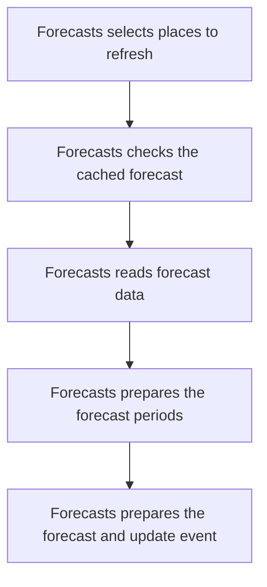

import {ClewProcess, ClewDataModel, ClewDownload, ClewModelLink, ClewRelatedModelLink, ClewFieldTrace, ClewContextLink, ClewPageContext, ClewProcessReturn, ClewStatus, ClewRetainedPage, ClewCatalog, ClewAnchor} from '@site/src/components/ClewReaders';

<ClewAnchor id="process-overview" pageStart />

# Refresh forecasts for expired places

<ClewPageContext />

<ClewStatus freshness="STALE" verification="UNASSESSED" />

Forecasts selects expired places, reads fixture or provider data and prepares an update event.

## 1. Forecasts selects places to refresh {#question-choose}

Forecasts selects places with no forecast expiry or an expiry before now, ordered by place ID. Each selected place has its own refresh attempt.

Evidence and scope

**Refresh cached and provider forecasts** · STALE · UNASSESSED

Select places whose forecast expiry is null or earlier than now, ordered by place id, and read each place id, name, latitude, and longitude.

- [services/forecasts/src/main/kotlin/weather/Forecasts.kt:62–68 · revision c289b28be4819eddf29d59a7c12f178559ec5229](../sources/ee1c73490c4cd4a1f4efaf310e65a12cc2a3c6bbb15ab76a4eb246cf1533dc35.mdx)
**Refresh cached and provider forecasts** · STALE · UNASSESSED

Process each selected place separately. The source passes refresh(place) to transaction.executeWithoutResult; transaction commit, rollback, and callback timing are not established by this syntax capture.

- [services/forecasts/src/main/kotlin/weather/Forecasts.kt:62–68 · revision c289b28be4819eddf29d59a7c12f178559ec5229](../sources/ee1c73490c4cd4a1f4efaf310e65a12cc2a3c6bbb15ab76a4eb246cf1533dc35.mdx)
- [services/forecasts/src/main/kotlin/weather/Forecasts.kt:65–67 · revision c289b28be4819eddf29d59a7c12f178559ec5229](../sources/afc9d1096fb08a657cb9b7dfe6672bff110cfa74625c7d51092f4873e0a6863d.mdx)

Schedule and execution scope60-second declared delay · per-place callback · execution unverified

The annotation declares a 60-second default fixed delay. Each place is passed to transaction.executeWithoutResult as a refresh callback inside a per-place try/catch. This syntax snapshot does not establish scheduler activation, callback execution or transaction commit/rollback.

Evidence and scope

**Refresh cached and provider forecasts** · STALE · UNASSESSED

The source annotates refreshExpired with fixedDelayString REFRESH\_INTERVAL\_MS defaulting to 60000 ms. This declaration does not establish that the runtime scheduler registers or activates it.

- [services/forecasts/src/main/kotlin/weather/Forecasts.kt:62–68 · revision c289b28be4819eddf29d59a7c12f178559ec5229](../sources/ee1c73490c4cd4a1f4efaf310e65a12cc2a3c6bbb15ab76a4eb246cf1533dc35.mdx)
**Refresh cached and provider forecasts** · STALE · UNASSESSED

The source passes refresh(place) to transaction.executeWithoutResult as a deferred lambda. This source view shows the lambda body but does not establish callback invocation or transaction outcomes.

- [services/forecasts/src/main/kotlin/weather/Forecasts.kt:62–68 · revision c289b28be4819eddf29d59a7c12f178559ec5229](../sources/ee1c73490c4cd4a1f4efaf310e65a12cc2a3c6bbb15ab76a4eb246cf1533dc35.mdx)
- [services/forecasts/src/main/kotlin/weather/Forecasts.kt:66–66 · revision c289b28be4819eddf29d59a7c12f178559ec5229](../sources/181fa6c9d9cc1e3e7ddeb4efe5cd89a564e8b1eb6511eb73f297139264c4609d.mdx)

## 2. Forecasts checks the cached forecast {#question-cache}

A forecast whose expiry is still in the future ends this refresh without contacting the provider or creating a new outbox event.

Evidence and scope

**Refresh cached and provider forecasts** · STALE · UNASSESSED

Read the cached forecast payload, expiry, and last-modified value for this place. If expiry is later than now, return without contacting the provider or writing a new forecast outbox event.

- [services/forecasts/src/main/kotlin/weather/Forecasts.kt:70–125 · revision c289b28be4819eddf29d59a7c12f178559ec5229](../sources/ca9432fec2a98615bce1212fc0e5541dcddd9f87f2124c7af78487e0179ddffa.mdx)

## 3. Forecasts reads forecast data {#question-read}

Fixture mode reads the place’s saved forecast file. Live mode requests the weather provider, subject to required configuration and a per-place waiting period.

Evidence and scope

**Refresh cached and provider forecasts** · STALE · UNASSESSED

In fixture mode, read the place-specific fixture and continue through the common transformation and persistence path.

- [services/forecasts/src/main/kotlin/weather/Forecasts.kt:70–125 · revision c289b28be4819eddf29d59a7c12f178559ec5229](../sources/ca9432fec2a98615bce1212fc0e5541dcddd9f87f2124c7af78487e0179ddffa.mdx)
**Refresh cached and provider forecasts** · STALE · UNASSESSED

Fixture mode reads /app/fixtures/&#123;placeId&#125;.json; otherwise the source requires live mode and a nonblank MET\_USER\_AGENT.

- [services/forecasts/src/main/kotlin/weather/Forecasts.kt:70–125 · revision c289b28be4819eddf29d59a7c12f178559ec5229](../sources/ca9432fec2a98615bce1212fc0e5541dcddd9f87f2124c7af78487e0179ddffa.mdx)
**Refresh cached and provider forecasts** · STALE · UNASSESSED

The Forecasts source declares nextAttempt as a private in-memory ConcurrentHashMap field keyed by place id and storing Instant values. In live mode, reject the request when this place entry is later than now, then set it to now plus 60 seconds before sending. The capture does not establish how long a runtime instance is retained.

- [services/forecasts/src/main/kotlin/weather/Forecasts.kt:70–125 · revision c289b28be4819eddf29d59a7c12f178559ec5229](../sources/ca9432fec2a98615bce1212fc0e5541dcddd9f87f2124c7af78487e0179ddffa.mdx)
- [services/forecasts/src/main/kotlin/weather/Forecasts.kt:32–32 · revision c289b28be4819eddf29d59a7c12f178559ec5229](../sources/b325b07220fc25f8eb6c7811f29686ee179f573e860c82a95641074c7f3d0907.mdx)

Provider request and retry timingRequired User-Agent · 20-second request timeout · per-place timing

Live mode requires a nonblank MET\_USER\_AGENT. It stores nextAttempt in a private in-memory map keyed by place ID, checks it before the request and sets a 60-second deadline before sending. The GET uses coordinates truncated down to four decimal places, a 20-second timeout, User-Agent, gzip and an optional If-Modified-Since. Each response sets expiry from Expires or a one-hour fallback. For 429, numeric Retry-After sets the next attempt with a 60-second minimum; other statuses set it to expiry, before status handling. The lifetime of the runtime instance is not established.

Evidence and scope

**Refresh cached and provider forecasts** · STALE · UNASSESSED

Fixture mode reads /app/fixtures/&#123;placeId&#125;.json; otherwise the source requires live mode and a nonblank MET\_USER\_AGENT.

- [services/forecasts/src/main/kotlin/weather/Forecasts.kt:70–125 · revision c289b28be4819eddf29d59a7c12f178559ec5229](../sources/ca9432fec2a98615bce1212fc0e5541dcddd9f87f2124c7af78487e0179ddffa.mdx)
**Refresh cached and provider forecasts** · STALE · UNASSESSED

The Forecasts source declares nextAttempt as a private in-memory ConcurrentHashMap field keyed by place id and storing Instant values. In live mode, reject the request when this place entry is later than now, then set it to now plus 60 seconds before sending. The capture does not establish how long a runtime instance is retained.

- [services/forecasts/src/main/kotlin/weather/Forecasts.kt:70–125 · revision c289b28be4819eddf29d59a7c12f178559ec5229](../sources/ca9432fec2a98615bce1212fc0e5541dcddd9f87f2124c7af78487e0179ddffa.mdx)
- [services/forecasts/src/main/kotlin/weather/Forecasts.kt:32–32 · revision c289b28be4819eddf29d59a7c12f178559ec5229](../sources/b325b07220fc25f8eb6c7811f29686ee179f573e860c82a95641074c7f3d0907.mdx)
**Refresh cached and provider forecasts** · STALE · UNASSESSED

Build the location forecast URL with latitude and longitude truncated down to four decimal places. Send a GET with a 20-second timeout, the configured User-Agent, Accept-Encoding gzip, and If-Modified-Since when the cached row has a last-modified value.

- [services/forecasts/src/main/kotlin/weather/Forecasts.kt:70–125 · revision c289b28be4819eddf29d59a7c12f178559ec5229](../sources/ca9432fec2a98615bce1212fc0e5541dcddd9f87f2124c7af78487e0179ddffa.mdx)
**Refresh cached and provider forecasts** · STALE · UNASSESSED

For every live response, set expiry from the Expires header or now plus one hour. Set nextAttempt from numeric Retry-After for status 429, defaulting to 60 seconds and enforcing a 60-second minimum; for other statuses set nextAttempt to expiry. These updates occur before the 304 and accepted-status branches.

- [services/forecasts/src/main/kotlin/weather/Forecasts.kt:70–125 · revision c289b28be4819eddf29d59a7c12f178559ec5229](../sources/ca9432fec2a98615bce1212fc0e5541dcddd9f87f2124c7af78487e0179ddffa.mdx)
- [services/forecasts/src/main/kotlin/weather/Forecasts.kt:32–32 · revision c289b28be4819eddf29d59a7c12f178559ec5229](../sources/b325b07220fc25f8eb6c7811f29686ee179f573e860c82a95641074c7f3d0907.mdx)

<aside className="clew-exception">

### If the provider cannot supply an accepted response {#question-provider-error}

Missing live configuration, an active wait or an unaccepted provider status prevents normal refresh. Statuses 200 and 203 can proceed; a 304 needs an existing cache entry for the reuse branch.

Evidence and scope

**Refresh cached and provider forecasts** · STALE · UNASSESSED

Fixture mode reads /app/fixtures/&#123;placeId&#125;.json; otherwise the source requires live mode and a nonblank MET\_USER\_AGENT.

- [services/forecasts/src/main/kotlin/weather/Forecasts.kt:70–125 · revision c289b28be4819eddf29d59a7c12f178559ec5229](../sources/ca9432fec2a98615bce1212fc0e5541dcddd9f87f2124c7af78487e0179ddffa.mdx)
**Refresh cached and provider forecasts** · STALE · UNASSESSED

Require status 200 or 203, then read Last-Modified and decode the body as gzip when indicated or UTF-8 otherwise. Other statuses throw an error containing the provider status.

- [services/forecasts/src/main/kotlin/weather/Forecasts.kt:70–125 · revision c289b28be4819eddf29d59a7c12f178559ec5229](../sources/ca9432fec2a98615bce1212fc0e5541dcddd9f87f2124c7af78487e0179ddffa.mdx)
**Refresh cached and provider forecasts** · STALE · UNASSESSED

For a status other than 200 or 203, the source requirement throws an error containing the provider status. The enclosing per-place catch logs the exception class, and this failed path does not reach the shared transformation or persistence steps.

- [services/forecasts/src/main/kotlin/weather/Forecasts.kt:70–125 · revision c289b28be4819eddf29d59a7c12f178559ec5229](../sources/ca9432fec2a98615bce1212fc0e5541dcddd9f87f2124c7af78487e0179ddffa.mdx)
- [services/forecasts/src/main/kotlin/weather/Forecasts.kt:66–66 · revision c289b28be4819eddf29d59a7c12f178559ec5229](../sources/a5d4bf22b0f8c31ff9bfeb782f4242c6a3fbae92380ecfadc31c144d27b7f55f.mdx)
**Refresh cached and provider forecasts** · STALE · UNASSESSED

The Forecasts source declares nextAttempt as a private in-memory ConcurrentHashMap field keyed by place id and storing Instant values. In live mode, reject the request when this place entry is later than now, then set it to now plus 60 seconds before sending. The capture does not establish how long a runtime instance is retained.

- [services/forecasts/src/main/kotlin/weather/Forecasts.kt:70–125 · revision c289b28be4819eddf29d59a7c12f178559ec5229](../sources/ca9432fec2a98615bce1212fc0e5541dcddd9f87f2124c7af78487e0179ddffa.mdx)
- [services/forecasts/src/main/kotlin/weather/Forecasts.kt:32–32 · revision c289b28be4819eddf29d59a7c12f178559ec5229](../sources/b325b07220fc25f8eb6c7811f29686ee179f573e860c82a95641074c7f3d0907.mdx)

</aside>

<aside className="clew-info">

### If the provider returns 304 with cached data

If the provider returns 304 and cached data exists, only cached expiry is updated. The refresh returns without transforming a new payload or adding a forecast-update event.

Evidence and scope

**Refresh cached and provider forecasts** · STALE · UNASSESSED

When status is 304 and a cached row exists, update only expires\_at and return from refresh; no payload transformation or forecast outbox insert follows this branch.

- [services/forecasts/src/main/kotlin/weather/Forecasts.kt:70–125 · revision c289b28be4819eddf29d59a7c12f178559ec5229](../sources/ca9432fec2a98615bce1212fc0e5541dcddd9f87f2124c7af78487e0179ddffa.mdx)

</aside>

## 4. Forecasts prepares the forecast periods {#question-transform}

Fixture input and accepted provider bodies use the same transformation. Up to six periods are prepared; temperature must be numeric and the result must not be empty.

Evidence and scope

**Refresh cached and provider forecasts** · STALE · UNASSESSED

For fixture input or an accepted provider body, parse the document and transform up to six time-series points. Require numeric air temperature and at least one period; missing or nonnumeric precipitation becomes null and a missing symbol becomes unknown.

- [services/forecasts/src/main/kotlin/weather/Forecasts.kt:70–125 · revision c289b28be4819eddf29d59a7c12f178559ec5229](../sources/ca9432fec2a98615bce1212fc0e5541dcddd9f87f2124c7af78487e0179ddffa.mdx)

<aside className="clew-exception">

### If forecast data is invalid {#question-forecast-invalid}

Parsing or validation errors prevent the normal write path. Missing or nonnumeric rain becomes null and a missing symbol becomes unknown; missing numeric temperature or an empty forecast is rejected.

Evidence and scope

**Refresh cached and provider forecasts** · STALE · UNASSESSED

For fixture input or an accepted provider body, parse the document and transform up to six time-series points. Require numeric air temperature and at least one period; missing or nonnumeric precipitation becomes null and a missing symbol becomes unknown.

- [services/forecasts/src/main/kotlin/weather/Forecasts.kt:70–125 · revision c289b28be4819eddf29d59a7c12f178559ec5229](../sources/ca9432fec2a98615bce1212fc0e5541dcddd9f87f2124c7af78487e0179ddffa.mdx)

</aside>

## 5. Forecasts prepares the forecast and update event {#question-save}

The supplied callback attempts to save the forecast, then insert an update event for a separate publisher. A committed result is not established by this syntax snapshot.

<ClewModelLink model="forecast" process="forecasts-refresh-scheduled" anchor="question-save">Forecast · data model</ClewModelLink>

<ClewContextLink path="/services/forecasts#section-entities" fromProcess="forecasts-refresh-scheduled" fromQuestion="question-save">Technical context</ClewContextLink>

Evidence and scope

**Refresh cached and provider forecasts** · STALE · UNASSESSED

Parse updatedAt as an Instant and upsert the forecast row only when incoming updatedAt is at least the stored value. Then attempt a forecast.updated event insert with id placeId:updatedAt, version 1, place and forecast data, using ON CONFLICT DO NOTHING. The outbox attempt follows the upsert call even when the SQL predicate rejects an older value.

- [services/forecasts/src/main/kotlin/weather/Forecasts.kt:70–125 · revision c289b28be4819eddf29d59a7c12f178559ec5229](../sources/ca9432fec2a98615bce1212fc0e5541dcddd9f87f2124c7af78487e0179ddffa.mdx)
**Refresh cached and provider forecasts** · STALE · UNASSESSED

The source passes refresh(place) to transaction.executeWithoutResult as a deferred lambda. This source view shows the lambda body but does not establish callback invocation or transaction outcomes.

- [services/forecasts/src/main/kotlin/weather/Forecasts.kt:62–68 · revision c289b28be4819eddf29d59a7c12f178559ec5229](../sources/ee1c73490c4cd4a1f4efaf310e65a12cc2a3c6bbb15ab76a4eb246cf1533dc35.mdx)
- [services/forecasts/src/main/kotlin/weather/Forecasts.kt:66–66 · revision c289b28be4819eddf29d59a7c12f178559ec5229](../sources/181fa6c9d9cc1e3e7ddeb4efe5cd89a564e8b1eb6511eb73f297139264c4609d.mdx)

Timestamp and event rulesMonotonic forecast upsert · conflict-suppressed outbox insert

The forecast upsert accepts an incoming updatedAt at least as new as the stored value. The following forecast.updated outbox insert uses placeId:updatedAt as its ID and ignores conflicts. That insert is still attempted when the upsert rejects an older forecast. These source calls do not establish callback execution or an atomic committed outcome.

Evidence and scope

**Refresh cached and provider forecasts** · STALE · UNASSESSED

Parse updatedAt as an Instant and upsert the forecast row only when incoming updatedAt is at least the stored value. Then attempt a forecast.updated event insert with id placeId:updatedAt, version 1, place and forecast data, using ON CONFLICT DO NOTHING. The outbox attempt follows the upsert call even when the SQL predicate rejects an older value.

- [services/forecasts/src/main/kotlin/weather/Forecasts.kt:70–125 · revision c289b28be4819eddf29d59a7c12f178559ec5229](../sources/ca9432fec2a98615bce1212fc0e5541dcddd9f87f2124c7af78487e0179ddffa.mdx)

<aside className="clew-exception">

### If a per-place refresh fails {#question-refresh-error}

The exception class is logged with <code>{"FORECAST_RETRY"}</code>, and processing continues to the next place. There is no immediate retry loop here; another attempt needs another invocation.

Evidence and scope

**Refresh cached and provider forecasts** · STALE · UNASSESSED

When the per-place transaction call throws an Exception, the source catches it, logs FORECAST\_RETRY followed by the exception class, and continues to the next place. This method contains no explicit retry loop; another invocation is needed for another attempt, and runtime scheduling remains unverified.

- [services/forecasts/src/main/kotlin/weather/Forecasts.kt:62–68 · revision c289b28be4819eddf29d59a7c12f178559ec5229](../sources/ee1c73490c4cd4a1f4efaf310e65a12cc2a3c6bbb15ab76a4eb246cf1533dc35.mdx)
- [services/forecasts/src/main/kotlin/weather/Forecasts.kt:66–66 · revision c289b28be4819eddf29d59a7c12f178559ec5229](../sources/a5d4bf22b0f8c31ff9bfeb782f4242c6a3fbae92380ecfadc31c144d27b7f55f.mdx)

</aside>

## Full description and sources {#question-confidence}

The 60-second schedule is a source declaration, not proof of activation. Provider behavior, deferred callback execution and transaction outcomes remain bounded by the retained evidence. A pending event is not proof of Kafka delivery or a completed Dashboard update.

<ClewContextLink path="/scenarios/forecasts-place-requested-consumer#process-overview" fromProcess="forecasts-refresh-scheduled" fromQuestion="question-confidence">Related place-request consumer</ClewContextLink>

<ClewContextLink path="/scenarios/forecasts-publish-pending#process-overview" fromProcess="forecasts-refresh-scheduled" fromQuestion="question-confidence">Pending forecast publisher</ClewContextLink>

Evidence and scope

**Refresh cached and provider forecasts** · STALE · UNASSESSED

The source declares refreshExpired with a 60-second default fixed delay; scheduler registration and activation are unverified. It selects places with a null or expired forecast, ordered by place id, and passes each refresh call to a transaction callback inside a per-place try/catch. The shared refresh path returns on an unexpired cache entry. Fixture mode reads a place file; live mode requires a nonblank MET\_USER\_AGENT and uses a private in-memory ConcurrentHashMap field keyed by place id for nextAttempt, setting a 60-second deadline before the request. Each response sets expiry from Expires or a one-hour fallback, then sets nextAttempt from numeric Retry-After for 429 with a 60-second minimum, or from expiry for other statuses. A cached 304 updates expiry and returns. Fixture data and accepted 200/203 bodies share the transformation and persistence path: up to six periods require numeric temperature and a nonempty result; missing or nonnumeric rain becomes null and a missing symbol becomes unknown. The forecast upsert accepts an incoming updatedAt at least as new as the stored value, then attempts a forecast.updated outbox insert keyed by place id and updatedAt with conflict suppression. Pending-row delivery belongs to a separate linked publisher view. These source records do not prove scheduler activation, callback transaction behavior, or runtime delivery.

- [services/forecasts/src/main/kotlin/weather/Forecasts.kt:70–125 · revision c289b28be4819eddf29d59a7c12f178559ec5229](../sources/ca9432fec2a98615bce1212fc0e5541dcddd9f87f2124c7af78487e0179ddffa.mdx)
- [services/forecasts/src/main/kotlin/weather/Forecasts.kt:62–68 · revision c289b28be4819eddf29d59a7c12f178559ec5229](../sources/ee1c73490c4cd4a1f4efaf310e65a12cc2a3c6bbb15ab76a4eb246cf1533dc35.mdx)
- [services/forecasts/src/main/kotlin/weather/Forecasts.kt:32–32 · revision c289b28be4819eddf29d59a7c12f178559ec5229](../sources/b325b07220fc25f8eb6c7811f29686ee179f573e860c82a95641074c7f3d0907.mdx)

Reading guide and map

Editorial reading guide · original source scopes and review states remain separate.

Reading order only. Conditions and failures remain beside the steps below; this is not a runtime trace.

Evidence scope

The 60-second schedule is a source declaration, not proof of activation. Provider behavior, deferred callback execution and transaction outcomes remain bounded by the retained evidence. A pending event is not proof of Kafka delivery or a completed Dashboard update.

<ClewContextLink path="/scenarios/forecasts-place-requested-consumer#process-overview" fromProcess="forecasts-refresh-scheduled" fromQuestion="question-confidence">Related place-request consumer</ClewContextLink>

<ClewContextLink path="/scenarios/forecasts-publish-pending#process-overview" fromProcess="forecasts-refresh-scheduled" fromQuestion="question-confidence">Pending forecast publisher</ClewContextLink>

Evidence and scope

**Refresh cached and provider forecasts** · STALE · UNASSESSED

The source declares refreshExpired with a 60-second default fixed delay; scheduler registration and activation are unverified. It selects places with a null or expired forecast, ordered by place id, and passes each refresh call to a transaction callback inside a per-place try/catch. The shared refresh path returns on an unexpired cache entry. Fixture mode reads a place file; live mode requires a nonblank MET\_USER\_AGENT and uses a private in-memory ConcurrentHashMap field keyed by place id for nextAttempt, setting a 60-second deadline before the request. Each response sets expiry from Expires or a one-hour fallback, then sets nextAttempt from numeric Retry-After for 429 with a 60-second minimum, or from expiry for other statuses. A cached 304 updates expiry and returns. Fixture data and accepted 200/203 bodies share the transformation and persistence path: up to six periods require numeric temperature and a nonempty result; missing or nonnumeric rain becomes null and a missing symbol becomes unknown. The forecast upsert accepts an incoming updatedAt at least as new as the stored value, then attempts a forecast.updated outbox insert keyed by place id and updatedAt with conflict suppression. Pending-row delivery belongs to a separate linked publisher view. These source records do not prove scheduler activation, callback transaction behavior, or runtime delivery.

- [services/forecasts/src/main/kotlin/weather/Forecasts.kt:70–125 · revision c289b28be4819eddf29d59a7c12f178559ec5229](../sources/ca9432fec2a98615bce1212fc0e5541dcddd9f87f2124c7af78487e0179ddffa.mdx)
- [services/forecasts/src/main/kotlin/weather/Forecasts.kt:62–68 · revision c289b28be4819eddf29d59a7c12f178559ec5229](../sources/ee1c73490c4cd4a1f4efaf310e65a12cc2a3c6bbb15ab76a4eb246cf1533dc35.mdx)
- [services/forecasts/src/main/kotlin/weather/Forecasts.kt:32–32 · revision c289b28be4819eddf29d59a7c12f178559ec5229](../sources/b325b07220fc25f8eb6c7811f29686ee179f573e860c82a95641074c7f3d0907.mdx)

## Original accounts and implementation

- [Refresh cached and provider forecasts](../operations/scenarios-forecasts-refresh-scheduled--forecasts-refresh-scheduled.mdx)
- [Refresh cached and provider forecasts](../operations/scenarios-forecasts-refresh-scheduled--process-overview.mdx)

<ClewDownload path="/clew-data/native/scenarios/forecasts-refresh-scheduled.json">Saved data and complete provenance (reference format)</ClewDownload>

